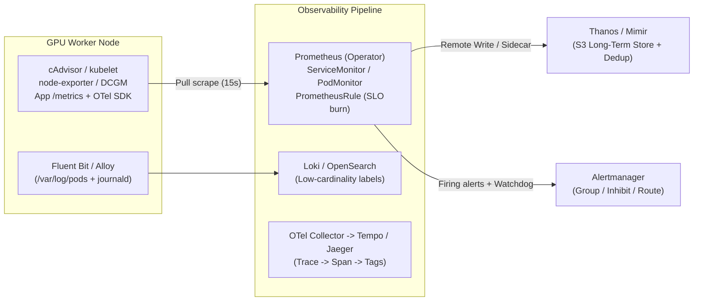

# 5.24 Observability for Kubernetes

| | |
|---|---|
| Level | Intermediate |
| Priority tier | 1 |
| Lab venue | kind/kubeadm; `helm`; kube-prometheus-stack; Loki; OpenTelemetry Collector; Grafana; optional DCGM exporter |
| Part | Part 5: Kubernetes |
| Status | Drafted, labs **untested** |

## Why this matters for AI infrastructure

A GPU platform is only as reliable as your ability to see inside it. Picture a training job that silently runs at 40% of its expected throughput. The cause turns out to be one node's NIC, which negotiated a lower speed. Other failures hide in the same way. An inference service's p99 latency can double when its KV-cache fills. A node's GPU can throw Xid errors for days before the job finally fails. A runaway controller can slow the whole control plane.

Observability turns these mysteries into dashboards and alerts. The Kubernetes ecosystem has now largely converged on a common toolkit. It uses Prometheus-compatible metrics, structured logs shipped to a central store, OpenTelemetry for traces, and Grafana for visualisation. This chapter walks through the architecture and the exporters that matter. It then shows how to design alerts you can act on, and how to scale and secure the stack. GPU-specific signals appear along the way, and Part 17 covers them in more depth.

## Prerequisites and outcomes

This chapter builds on 5.3, 5.9 and 5.19, so read those first. When you finish, you should be able to do the following.

- Describe the Prometheus data model and scrape architecture. Install and operate kube-prometheus-stack, including the Prometheus Operator CRDs ServiceMonitor, PodMonitor, PrometheusRule, Probe and AlertmanagerConfig.
- Name the key metric sources, such as kube-state-metrics, cAdvisor and kubelet, node-exporter, the API server, etcd, the scheduler and controller metrics, CoreDNS, ingress, the DCGM exporter and application metrics. Know the most useful PromQL for each.
- Design alerts and SLOs. That means symptom-based paging, multiwindow burn-rate alerts, severity routing, inhibition and runbooks, while avoiding alert fatigue.
- Build log pipelines with node agents, structured logging and Loki or Elastic. Build trace pipelines with the OpenTelemetry Collector and Tempo or Jaeger. Correlate the signals with exemplars and trace IDs.
- Use Kubernetes events and audit logs effectively.
- Scale and secure observability with federation or remote write (Thanos, Mimir, VictoriaMetrics), multi-tenancy, retention, cardinality control and cost control.
- Build dashboards for cluster, node, GPU, job and service health.

## 1. The observability signals

Each signal answers a different question, so you rarely get the whole story from one. The table lists each signal, the question it answers and where its data comes from.

| Signal | Question answered | Kubernetes sources |
|---|---|---|
| **Metrics** | How is the system behaving over time? (rates, errors, durations, saturation) | Prometheus scraping `/metrics` endpoints |
| **Logs** | What happened (discrete events with context)? | Container stdout/stderr, node logs (journald), audit logs |
| **Traces** | Where did time go across services for a request? | OpenTelemetry/Jaeger/Tempo |
| **Events** | What did the control plane do? (Scheduled, Pulled, Killing, FailedMount) | `kubectl get events`, Event objects (1 h TTL), event exporters |
| **Profiles** | Where is CPU/memory spent in code? | Pyroscope/Parca, `py-spy`, Nsight (Part 10) |
| **Health checks/synthetics** | Does it work from the outside? | Blackbox exporter, probes, synthetic requests |

Three methods help you choose what to measure. RED stands for Rate, Errors and Duration, and it suits request-driven services. USE stands for Utilisation, Saturation and Errors, and it suits resources such as CPU, memory, disk, network and GPU. The Four Golden Signals are latency, traffic, errors and saturation. For ML workloads, also track throughput in tokens/s and samples/s, step time, loss and gradient health, MFU, checkpoint age and data-loader wait.

## 2. Prometheus and the Operator

The diagram shows the pipeline on a GPU worker node. Exporters and application endpoints feed Prometheus, Fluent Bit or Alloy feeds Loki, and Prometheus sends alerts to Alertmanager.



### Why Prometheus became the default

Think of a metric as a measurement taken again and again over time. Plotted on a timeline, it shows the moment behavior drifts away from normal. The same data can also drive an alert, so you hear about a failure early, or before it happens. For this job on Kubernetes, Prometheus is the common open source choice.

Control plane components already expose Prometheus metrics. Nearly every production cluster also runs exporters that pull metrics from its nodes. That shared format is why commercial tools such as Datadog, New Relic, and VMware Tanzu Observability can read Prometheus metrics too.

Prometheus works by scraping. On a schedule, it visits each target and collects its metrics. Your application never pushes metrics anywhere. It only exposes an endpoint, and Prometheus does the rest. The app needs to know one thing, the output format, and nothing about metrics plumbing.

Prometheus takes on several jobs:

- Collects metrics from targets by scraping them
- Stores the metrics in a time series database
- Sends alerts, usually to Alertmanager, based on alerting rules
- Exposes an HTTP API that other components can use to read stored metrics
- Provides a dashboard for ad hoc queries and status checks

Many teams start with Prometheus for collection and Grafana for graphs, and that works well at first. Trouble usually arrives later. Long-term storage, scaling and federation all need planning up front. If running the metrics stack becomes heavy, you can move to a commercial system and keep the same kind of metrics.

Metrics and alerts decide how useful a platform is. A warning about a coming failure gives you time to avoid downtime and errors. Treat them as core platform services, not as extras.

### Prometheus model

A time series is identified by a metric name and a set of labels. For example, `http_requests_total{job="api",code="200"}` names one series. Prometheus has four metric types. A counter only goes up, so you read it with `rate()` or `increase()`. A gauge can go up and down. A histogram stores cumulative buckets, which `histogram_quantile` turns into percentiles. A summary is the fourth type.

Prometheus pulls. It scrapes each target at an interval, typically every 15–30 s. Samples go into a local time series database. That database writes 2 h blocks, compacts them, and applies retention by time or size. Prometheus also evaluates recording and alerting rules, and it sends firing alerts to **Alertmanager**.

To find targets, Prometheus asks the Kubernetes API. Its `kubernetes_sd_configs` can list pods, endpoints, services, nodes and ingresses. Relabelling then picks which targets to scrape and attaches labels to them.

*Production Kubernetes*, Chapter 9 (*Observability*), by Josh Rosso et al., covers three more architectural patterns for metrics, showback and distributed tracing.

1. **Pull scraping vs. Pushgateway for short batch jobs (Production Kubernetes, Figure 9-2).** Prometheus's pull model suits long-lived services and DaemonSets. A short batch `Job` is different. It can run for 8 seconds and exit before the 15–30s scrape interval comes around. A database migration or checkpoint validator may finish that quickly. Such a job can push its completion metrics to a Prometheus `Pushgateway`, and Prometheus then scrapes the gateway. Group the metrics by job or role rather than by unique Pod names, so stale series do not accumulate forever.
2. **Federation vs. Thanos (Figure 9-3) and showback models (Figure 9-5).**
   - *Federation vs. Thanos:* Hierarchical `/federate` scraping works for aggregating low-cardinality recording rules across clusters. It struggles to keep full historical series. Thanos takes a different approach. It attaches a `thanos-sidecar` to each Prometheus pod, and that sidecar uploads 2-hour TSDB blocks to S3 or GCS object storage. A `Store Gateway` and a `Compactor` handle history, and the Compactor does downsampling to 5m and 1h resolutions. A global `Querier` deduplicates HA Prometheus pairs labelled `replica="a"` and `replica="b"`.
   - *Requests vs. consumption showback (Figure 9-5):* Production Kubernetes, Chapter 9, contrasts requests-based showback with consumption-based showback. Requests-based showback charges a team for what its Pods requested. Consumption-based showback charges for `max(resource_request, actual_usage)`. That way a team answers both for idle capacity it over-reserved and for Burstable usage spikes above its requests. The model is `compute_showback_requests_vs_consumption()` in `code/part05/k8s_observability_slo_sim.py`.
3. **Distributed tracing concepts (OpenTracing and OpenCensus to OpenTelemetry and Jaeger, Production Kubernetes, Chapter 9).** A distributed `Trace` shows the end-to-end path of one request across microservices. It is built from timed `Span`s, one per service or operation. Spans link to their parents through span IDs, and each carries key-value `Tags`, `Baggage` and logs. Node-local tracing `Agents` collect the spans, and `Collectors` sample and process them before storage.

### kube-prometheus-stack

The kube-prometheus-stack is a Helm chart. It bundles the Prometheus Operator, Prometheus, Alertmanager, Grafana, kube-state-metrics and node-exporter. It also ships default dashboards and rules for Kubernetes components. Install it with the Helm commands below. The storage and retention flags set how long Prometheus keeps data and how much disk it gets, and the three `NilUsesHelmValues=false` flags let Prometheus discover every ServiceMonitor, PodMonitor and rule, not only the ones tagged with the Helm release.

```bash
helm repo add prometheus-community https://prometheus-community.github.io/helm-charts
helm upgrade --install kps prometheus-community/kube-prometheus-stack -n monitoring --create-namespace \
  --set prometheus.prometheusSpec.retention=15d \
  --set prometheus.prometheusSpec.storageSpec.volumeClaimTemplate.spec.resources.requests.storage=200Gi \
  --set prometheus.prometheusSpec.serviceMonitorSelectorNilUsesHelmValues=false \
  --set prometheus.prometheusSpec.podMonitorSelectorNilUsesHelmValues=false \
  --set prometheus.prometheusSpec.ruleSelectorNilUsesHelmValues=false
```

The Operator adds custom resources. The first two are a ServiceMonitor and a PrometheusRule:

```yaml
apiVersion: monitoring.coreos.com/v1
kind: ServiceMonitor
metadata: { name: vllm, namespace: serving, labels: { release: kps } }
spec:
  selector: { matchLabels: { app: vllm } }              # Services with these labels
  namespaceSelector: { matchNames: [serving] }
  endpoints:
    - port: http
      path: /metrics
      interval: 15s
      relabelings:
        - { sourceLabels: [__meta_kubernetes_pod_node_name], targetLabel: node }
      metricRelabelings:
        - { sourceLabels: [__name__], regex: "vllm:(num_requests_.*|gpu_cache_usage_perc|time_to_first_token_seconds.*)", action: keep }   # keep only needed series
---
apiVersion: monitoring.coreos.com/v1
kind: PrometheusRule
metadata: { name: gpu-alerts, namespace: monitoring, labels: { release: kps } }
spec:
  groups:
    - name: gpu.rules
      interval: 30s
      rules:
        - record: node:gpu_util:avg
          expr: avg by (node) (DCGM_FI_DEV_GPU_UTIL)
        - alert: GPUXidError
          expr: increase(DCGM_FI_DEV_XID_ERRORS[10m]) > 0
          for: 0m
          labels: { severity: critical, team: platform }
          annotations:
            summary: "Xid {{ $value }} on {{ $labels.Hostname }} GPU {{ $labels.gpu }}"
            runbook_url: https://runbooks.example.com/gpu-xid
```

The other monitor types cover other cases. A `PodMonitor` handles pod endpoints that have no Service. A `Probe` handles blackbox targets. An `AlertmanagerConfig` sets namespaced routing, and a `ScrapeConfig` covers static or external targets. Watch the selectors, though. The `serviceMonitorSelector` on a Prometheus decides which monitors it picks up, and a missing `release: kps` label is a common trap.

### Prometheus servers as custom resources

With the Prometheus Operator installed, you can create a `Prometheus` resource. The operator then builds a Prometheus server from it and creates a StatefulSet to run that server. The manifest below describes a platform server.

```yaml
apiVersion: monitoring.coreos.com/v1
kind: Prometheus
metadata:
  name: platform
  namespace: platform-monitoring
  labels:
    monitor: platform
    owner: platform-engineering
spec:
  alerting:
    alertmanagers:
    - name: alertmanager-main
      namespace: platform-monitoring
      port: web
  image: quay.io/prometheus/prometheus:v2.20.0
  nodeSelector:
    kubernetes.io/os: linux
  replicas: 2
  resources:
    requests:
      memory: 400Mi
  ruleSelector:
    matchLabels:
      monitor: platform
      role: alert-rules
  securityContext:
    fsGroup: 2000
    runAsNonRoot: true
    runAsUser: 1000
  serviceAccountName: platform-prometheus
  version: v2.20.0
  serviceMonitorSelector:
    matchLabels:
      monitor: platform
```

Read the manifest from top to bottom. The `alerting` block tells Prometheus where to send alerts. The `image` field picks the container image. The `ruleSelector` decides which PrometheusRules apply to this server, and any rule carrying the labels shown is applied here. The `serviceMonitorSelector` does the same for ServiceMonitors, and those feed this server's scrape configuration.

Metric processing is compute-heavy, so you can split the load across several servers. One server can collect the platform's metrics while others collect application or node metrics. Tenants benefit too. A team that emits a large volume of metrics may need its own server in its namespace, and that cost can count against the team's resource budget. The trade-off is more work for dashboards, alerting, federation and long-term storage. Many teams prefer a simpler layer on top, but the option is worth knowing about.

### Reading a ServiceMonitor

When you create a ServiceMonitor, the operator updates the scrape configuration of the matching Prometheus server. The manifest below points Prometheus at the Kubernetes API server.

```yaml
apiVersion: monitoring.coreos.com/v1
kind: ServiceMonitor
metadata:
  labels:
    k8s-app: apiserver
    monitor: platform
  name: kube-apiserver
  namespace: platform-monitoring
spec:
  endpoints:
  - bearerTokenFile: /var/run/secrets/kubernetes.io/serviceaccount/token
    interval: 30s
    port: https
    scheme: https
    tlsConfig:
      caFile: /var/run/secrets/kubernetes.io/serviceaccount/ca.crt
      serverName: kubernetes
  jobLabel: component
  namespaceSelector:
    matchNames:
    - default
  selector:
    matchLabels:
      component: apiserver
      provider: kubernetes
```

Notice the `monitor: platform` label. The Prometheus server's `serviceMonitorSelector` looks for exactly that label. The `endpoints` block sets the port and the way to connect to each instance. This example uses HTTPS, and it checks the endpoint against a Certificate Authority and a server name.

In Prometheus terms, a job is a group of instances of one service. One API server is an instance, and all the API servers together form the job. The `jobLabel` field names the label that supplies the job name, and here that job is `apiserver`.

The `namespaceSelector` picks the namespaces to search for Services. The `selector` then matches Services by label. Any Service in the `default` namespace with those labels becomes a scrape target.

### Recording and alerting rules with PrometheusRule

A PrometheusRule asks the operator to generate a rule file for Prometheus. Rules can record new metrics or raise alerts. The operator stores the rules in a ConfigMap and mounts that ConfigMap into the Prometheus Pods.

```yaml
apiVersion: monitoring.coreos.com/v1
kind: PrometheusRule
metadata:
  labels:
    monitor: platform
    role: alert-rules
  name: sample-rules
  namespace: platform-monitoring
spec:
  groups:
  - name: kube-apiserver.rules
    rules:
    - expr: |
        sum by (code,resource) (rate(
          apiserver_request_total{job="apiserver",verb=~"LIST|GET"}[5m]
        ))
      labels:
        verb: read
      record: code_resource:apiserver_request_total:rate5m
  - name: kubernetes-apps
    rules:
    - alert: KubePodNotReady
      annotations:
        description: Pod {{ $labels.namespace }}/{{ $labels.pod }} has been in a
          non-ready state for longer than 15 minutes.
        summary: Pod has been in a non-ready state for more than 15 minutes.
      expr: |
        sum by (namespace, pod) (
          max by(namespace, pod) (
            kube_pod_status_phase{job="kube-state-metrics", phase=~"Pending|Unknown"}
          ) * on(namespace, pod) group_left(owner_kind) topk by(namespace, pod) (
            1, max by(namespace, pod, owner_kind) (kube_pod_owner{owner_kind!="Job"})
          )
        ) > 0
      for: 15m
      labels:
        severity: warning
```

The first group holds a recording rule. It adds up the LIST and GET requests across all API server instances over a 5-minute window. The result is saved as a new metric named `code_resource:apiserver_request_total:rate5m`.

The second group holds an alerting rule. It raises a warning when a Pod stays not-ready for more than 15 minutes. With the Operator and these custom resources, the pattern is easy to repeat. Production Kubernetes strongly recommends it if Prometheus is your main metrics tool.

### Instrumenting your own software

The best metrics come from the application itself. Many apps built for Kubernetes expose Prometheus metrics natively, helped by official and community client libraries. Production Kubernetes covers this in depth in its Chapter 14.

Sometimes an app or system does not expose Prometheus metrics at all. An exporter fills that gap. It collects data points from the system and republishes them as Prometheus metrics. The Node Exporter is the common example, gathering hardware and operating system metrics for Prometheus to scrape. Community exporters exist for many popular tools.

Once an app exposes metrics, it needs a place in the scrape configuration. A ServiceMonitor handles that for you. The Operator auto-discovers Services by namespace and labels, so you never edit scrape configs by hand.

Labels are powerful, but they carry a warning. Too many labels can make your Prometheus servers too expensive to run. Learn what high cardinality does to metrics before you add many labels. The instrumentation guide in the Prometheus docs is a good place to start.

In short, instrument the software you write wherever you can. Where that is not feasible, build or use an exporter. Then let auto-discovery collect what is exposed, so your systems stay visible.

### Exposing app metrics with the Prometheus client libraries

Prometheus pulls metrics with an HTTP request to an endpoint, usually `/metrics`. Your app must serve that endpoint, and the response must use the Prometheus text format. You have two ways to do this. With native instrumentation, the Prometheus client library runs inside your app. With an out-of-process exporter, a sidecar runs beside the app and translates metrics that already exist. Native instrumentation suits code you control. Exporters suit off-the-shelf software you cannot change, such as the NGINX Prometheus Exporter or the MySQL Server Exporter.

The client libraries offer four metric types. A Counter only goes up. A Gauge can rise and fall. A Histogram sorts observations into buckets, and the Prometheus server uses those buckets to compute quantiles such as the 95th percentile. A Summary also reports quantiles, but the client computes them over a sliding time window.

Instrumenting a Go service takes three steps. First, expose an HTTP endpoint that serves the metrics:

```go
func main() {
    // app code...
    http.Handle("/metrics",
        promhttp.HandlerFor(
            prometheus.DefaultGatherer,
            promhttp.HandlerOpts{},
        ))
    log.Fatal(http.ListenAndServe("localhost:8080", nil))
}
```

Second, create the metric and register it. The Counter below counts the queue items the service handles:

```go
// create the counter
var totalItemsHandled = prometheus.NewCounter(
    prometheus.CounterOpts{
        Name: "items_handled_total",
        Help: "Total number of queue items handled.",
    },
)
// register the counter
prometheus.MustRegister(totalItemsHandled)
```

Third, update the metric where the work happens. Calling `Inc()` increments the counter by one each time:

```go
func handleItem(item Item) {
    // item handling code...
    // increment the counter as we handle items
    totalItemsHandled.Inc()
}
```

The library is the easy part. The hard part is deciding which metrics to expose, and three common methods give you a starting point.

The USE method, proposed by Brendan Gregg, looks at resources. For each resource, you capture Utilization, Saturation and Errors. Resources include CPU, memory and disk, and they can also include parts of the app, such as queues and thread pools.

The RED method, proposed by Tom Wilkie, looks at the service instead. It captures the Rate, Errors and Duration of the requests the service handles. It suits online services because it shows what users experience.

The Four Golden Signals come from Google's Site Reliability Engineering book: Latency, Traffic, Errors and Saturation. They overlap with RED, and they add Saturation.

App-specific metrics form the last category. They measure things only your app can see, such as how long it takes to add an item to a shopping cart, or how long it takes to connect a customer with an agent. These often tie directly to business KPIs. Whichever method you pick, exporting metrics is what lets you build dashboards, set alerts and spot trends over time.

### Key exporters and sources

The table lists the main metric sources, what each one exposes and the notes you need. Use it as a lookup when you wire up a new component.

| Source | Metrics | Notes |
|---|---|---|
| **kubelet / cAdvisor** (`/metrics/cadvisor`) | `container_cpu_usage_seconds_total`, `container_memory_working_set_bytes`, `container_cpu_cfs_throttled_periods_total`, `container_network_*`, `container_fs_*`, `container_oom_events_total` | Per container; the basis of `kubectl top` and capacity |
| **kubelet** (`/metrics`, `/metrics/probes`, `/metrics/resource`) | Pod start durations, PLEG, runtime ops, volume stats, evictions, cert TTL | 5.9 |
| **kube-state-metrics (KSM)** | State of API objects: `kube_pod_status_phase`, `kube_pod_container_status_restarts_total`, `kube_pod_container_resource_requests/limits`, `kube_node_status_condition`, `kube_deployment_status_replicas_available`, `kube_job_status_failed`, `kube_persistentvolumeclaim_status_phase`, `kube_horizontalpodautoscaler_*` | Joins with cAdvisor for efficiency; supports custom resource state metrics for CRDs (Kueue, jobs) |
| **node-exporter** | CPU, memory, disk, filesystem, network, load, `node_pressure_*` (PSI), softnet, conntrack, hwmon temperatures, `node_infiniband_*` | DaemonSet; mount host paths; collectors configurable |
| **API server** | `apiserver_request_total`, `apiserver_request_duration_seconds`, `apiserver_flowcontrol_*`, `etcd_request_duration_seconds`, `apiserver_admission_*` | 5.5 |
| **etcd** | `etcd_server_*`, `etcd_disk_wal_fsync_duration_seconds`, `etcd_mvcc_db_total_size_in_bytes` | Scrape with client certs |
| **scheduler / controller-manager** | `scheduler_pending_pods`, `scheduler_schedule_attempts_total`, `workqueue_*`, `rest_client_requests_total` | |
| **CoreDNS** | `coredns_dns_requests_total`, `coredns_dns_responses_total{rcode}`, duration | 5.11 |
| **kube-proxy / CNI** | `kubeproxy_sync_proxy_rules_duration_seconds`, Cilium/Calico metrics, Hubble | 5.10, 5.14 |
| **Ingress/Gateway** | request rates, latencies, status codes, upstream health | 5.12 |
| **DCGM exporter** | `DCGM_FI_DEV_GPU_UTIL`, `DCGM_FI_DEV_FB_USED`, `DCGM_FI_DEV_POWER_USAGE`, `DCGM_FI_DEV_GPU_TEMP`, `DCGM_FI_DEV_SM_CLOCK`, `DCGM_FI_DEV_XID_ERRORS`, `DCGM_FI_DEV_ECC_DBE_VOL_TOTAL`, `DCGM_FI_PROF_PIPE_TENSOR_ACTIVE`, `DCGM_FI_PROF_DRAM_ACTIVE`, NVLink bandwidth/error counters | Profile metrics need DCGM profiling enabled; labels `gpu`, `UUID`, `modelName`, `Hostname`, `pod`, `namespace` (via pod-resources mapping) |
| **Network/RDMA** | `node_infiniband_*`, `ibstat` exporters, UFM exporter, switch telemetry (gNMI/SNMP) | Part 12, Part 17 |
| **Storage** | CSI driver metrics, `kubelet_volume_stats_*`, filesystem exporters (Lustre/WEKA/Ceph), S3 gateway metrics | |
| **Applications** | Framework metrics: PyTorch/Lightning custom (`train_step_seconds`, `tokens_per_second`), vLLM/Triton/TGI endpoints, Ray metrics | Instrument with `prometheus_client`/OpenTelemetry metrics |
| **Blackbox probes** | HTTP/TCP/ICMP/DNS from inside/outside | Synthetic checks for endpoints and DNS |
| **Node problem detector** | Conditions/events for kernel/runtime/hardware problems | Exposes as node conditions → KSM metric |

The GPU row needs extra care. Profile metrics appear only after DCGM profiling is enabled.

### Essential PromQL

The queries below cover node health, scheduling, CPU and memory, the API server and GPUs. Each comment says what the query tells you.

```promql
# Node and pod health
sum(kube_node_status_condition{condition="Ready",status="true"} == 0)                                # NotReady nodes
sum by (namespace, pod) (rate(kube_pod_container_status_restarts_total[15m])) > 0.01                  # restarting pods
sum by (reason) (kube_pod_container_status_last_terminated_reason{reason="OOMKilled"})                # OOMs
count by (phase) (kube_pod_status_phase == 1)

# Pending pods and reasons (scheduler)
sum(scheduler_pending_pods{queue="unschedulable"})
sum by (namespace) (kube_pod_status_phase{phase="Pending"} == 1)

# CPU throttling and saturation
sum by (namespace,pod,container) (rate(container_cpu_cfs_throttled_periods_total[5m]) / rate(container_cpu_cfs_periods_total[5m])) > 0.25
sum by (node) (rate(node_cpu_seconds_total{mode!="idle"}[5m])) / count by (node) (node_cpu_seconds_total{mode="idle"})

# Memory
container_memory_working_set_bytes{container!=""} / on(namespace,pod,container) kube_pod_container_resource_limits{resource="memory"} > 0.9
node_memory_MemAvailable_bytes / node_memory_MemTotal_bytes < 0.1

# API server
histogram_quantile(0.99, sum by (le,verb) (rate(apiserver_request_duration_seconds_bucket{verb!~"WATCH|CONNECT"}[5m])))
sum(rate(apiserver_request_total{code=~"5.."}[5m])) / sum(rate(apiserver_request_total[5m]))
histogram_quantile(0.99, rate(etcd_disk_wal_fsync_duration_seconds_bucket[5m])) > 0.01

# GPU
avg by (Hostname, gpu) (DCGM_FI_DEV_GPU_UTIL)
sum by (namespace) (kube_pod_container_resource_requests{resource="nvidia_com_gpu"}) / ignoring(namespace) group_left sum(kube_node_status_allocatable{resource="nvidia_com_gpu"})   # allocation fraction
avg_over_time(DCGM_FI_PROF_PIPE_TENSOR_ACTIVE[5m]) < 0.2 and on(pod) kube_pod_container_resource_requests{resource="nvidia_com_gpu"} > 0     # allocated but tensor cores idle
increase(DCGM_FI_DEV_XID_ERRORS[1h]) > 0
DCGM_FI_DEV_GPU_TEMP > 85
```

Start with the `release` label when a new target never appears. A missing label is one of the first things to check.

## 3. Alerting design

### Principles

1. **Page on symptoms, ticket on causes.** Page someone when users or SLOs are affected, such as API errors, inference latency or availability problems, jobs that fail to start, or many nodes lost. Notify through a ticket or chat for causes and capacity warnings, such as a disk 80% full or a certificate that expires in 14 days.
2. **Every alert is actionable.** Each alert needs a clear summary of what is wrong and where, a severity, an owner or team, a runbook link and a dashboard link. Set a `for:` duration so the alert does not flap. Delete alerts that nobody acts on.
3. **SLO-based alerting** uses multiwindow, multi-burn-rate rules from the Google SRE workbook. A page fires when 2% of a 30-day error budget burns in 1 hour, which is a burn rate of 14.4. The same condition must also hold over 5 minutes. A ticket fires when 5% burns in 6 hours, a burn rate of 6, and that must also hold over 30 minutes. Use recording rules for SLI ratios.
4. **Routing and noise control** happen in Alertmanager. Group alerts by `alertname`, `cluster` and `namespace`. Tune `group_wait`, `group_interval` and `repeat_interval` to set the timing. Inhibition suppresses downstream alerts when a node or the control plane is down. Silences cover planned maintenance. Time-based routing can send low-severity alerts only during office hours, and label-based routing sends alerts to teams through PagerDuty, Opsgenie, Slack, email or webhooks.
5. **Watchdog, or dead man's switch.** An alert that always fires and is sent to an external service proves the pipeline still works. If that heartbeat stops arriving, the pipeline is broken.
6. **Alert on absence.** Missing data is a signal too. Use `absent()` or `up == 0` for critical exporters. Also alert on the health of the observability stack itself, including the Prometheus WAL, scrape failures, rule evaluation failures and disk.
7. **Test alerts before you trust them.** Run `promtool test rules` and inject synthetic failures. Review alerts again after every incident.

Here is an SLO example for inference availability, where non-5xx responses must reach 99.5% over 30 days.

```yaml
# SLO example: inference availability (non-5xx ratio) 99.5% over 30d
- record: slo:inference_error_ratio:rate5m
  expr: sum(rate(gateway_requests_total{route="chat",code=~"5.."}[5m])) / sum(rate(gateway_requests_total{route="chat"}[5m]))
- alert: InferenceErrorBudgetBurnFast
  expr: slo:inference_error_ratio:rate1h > (14.4 * 0.005) and slo:inference_error_ratio:rate5m > (14.4 * 0.005)
  labels: { severity: page }
  annotations: { summary: "Burning 2% of monthly error budget per hour", runbook_url: https://runbooks.example.com/inference-errors }
```

The alert fires only when both the 1-hour and the 5-minute error ratios exceed 14.4 times the 0.5% budget. A brief blip stays quiet, and a fixed outage clears quickly.

### Alertmanager

Alertmanager runs as its own workload. It receives alerts from Prometheus, groups and de-duplicates them, and routes them to receivers. A receiver is a notification channel your on-call engineers use, such as email, Slack or PagerDuty. Grouping matters. An outage that touches many replicas should not flood people with alerts. If your tool has no built-in receiver, a webhook receiver can POST a JSON payload to any URL you provide.

With the Prometheus Operator, you deploy Alertmanager from a manifest such as the one below.

```yaml
apiVersion: monitoring.coreos.com/v1
kind: Alertmanager
metadata:
  labels:
    alertmanager: main
  name: main
  namespace: platform-monitoring
spec:
  image: quay.io/prometheus/alertmanager:v0.21.0
  nodeSelector:
    kubernetes.io/os: linux
  replicas: 2
  securityContext:
    fsGroup: 2000
    runAsNonRoot: true
    runAsUser: 1000
  serviceAccountName: alertmanager-main
  version: v0.21.0
```

Setting `replicas` to more than one gives you a highly available Alertmanager. You rarely need several separate Alertmanagers in one cluster, because one HA deployment usually does the job. Some teams run a central Alertmanager for many clusters. Most prefer one per cluster, since each cluster then has fewer external dependencies. A shared Alertmanager also lets tenants add their own alerting rules through a single PrometheusRule.

### GPU-fleet specific alerts

Start with the hardware on each node. Xid errors deserve the closest watch, especially code 79, which means the GPU fell off the bus, code 48, a double-bit ECC error (DBE), and code 74 for NVLink. Also watch uncorrectable ECC, retired pages pending, GPU temperature and power throttling (`DCGM_FI_DEV_CLOCK_THROTTLE_REASONS`), NVLink errors and down links, PCIe replay counters, the lost GPU count against the expected count, and an `nvidia-smi` that hangs. Decide for each one whether it pages someone or opens a ticket.

On the network side, watch for IB or RoCE link-down events, symbol errors, PFC storms, ECN marks, and any port running slower than expected. For storage, alert on mount errors and throughput drops. At the job level, alert when training throughput falls below baseline, when loss turns NaN, when step-time skew across ranks points to stragglers, or when a checkpoint fails or goes stale. Finally, watch the platform itself: queue wait time at p95, pending reasons, and GPU allocation efficiency. Part 17 covers these in detail.

Start with the node hardware alerts, because one bad GPU can hold back an entire job.

## 4. Logs

### Why logs need a central place

Picture a workload with dozens of replicas. A user reports an error, and you must find the one log line behind it. Opening each replica's logs by hand is slow, and it is easy to miss the line. A central collection point lets you search every replica at once.

Logs once lived in a file on a server's disk. That worked when there were fewer workloads and fewer instances. Today, applications usually write to standard out and standard error, the same way a command-line tool prints. Workloads are ephemeral and often have no disk to keep logs, so the logs must leave the workload as they are written.

This section follows logs from the platform and its tenant workloads to a storage backend. Most companies already run a log backend. The platform's job is to capture, process and forward logs to it, and storage itself is usually not the platform's concern.

### What your application should log

Write logs to standard out and standard error. That keeps the app simple, and the platform can ship those streams with the least work. The harder question is what to write. Teams often log too much, and the one line that matters gets buried. Log too little, and you are blind during an incident. The book's rule of thumb is to ask whether the message is actionable. If someone could act on it, log it. If not, it probably adds noise.

Logs come in two styles. Unstructured logs are plain strings with no fixed format. They need no planning, which is why they are so common. Structured logs have fixed fields that you fill in every time, usually as JSON lines or key-value pairs. A structured line can look like `time="2015-08-09T03:41:12-03:21" msg="hello world!" thread="13" batchId="5"`. Machines can query structured logs far more easily, while people often find them harder to read. Pick the style that fits how your team works.

Context is what makes a log line useful. Take a payment service. When a payment fails because the payee is not found, the error alone is not enough. Add the payee name or ID, the ID of the user who tried to pay, and the payment amount. That context helps you troubleshoot and prevent the next failure. Keep sensitive data out, though. A password or card number should never appear in a log.

### Architecture

Follow a log line through the stack. A container writes to stdout or stderr. The runtime saves that output to files under `/var/log/pods/...`, which chapter 5.9 describes. A node agent runs as a DaemonSet on every node. Fluent Bit, Vector, Promtail/Grafana Alloy, Fluentd and Filebeat all do this job. The agent tails those files, parses them as JSON or CRI, and adds Kubernetes metadata such as namespace, pod, labels and node. It then filters or redacts what it finds before it ships the lines onward.

The backend stores the logs. Loki is label-indexed, cheap and backed by object storage. Elasticsearch and OpenSearch offer full-text search. ClickHouse, cloud logging services such as Cloud Logging or CloudWatch, and Splunk are other options. Node-level logs include journald output from `kubelet` and `containerd`, the kernel `dmesg` output with Xid messages, and audit logs from the API server. Application files live in volumes.

Several practices keep this pipeline healthy.

- Write structured JSON logs with consistent fields such as `timestamp`, `level`, `msg`, `trace_id`, `request_id`, `job` and `rank`. Avoid free text. Keep multi-line stack traces out, or parse them with a multiline parser.
- Control the volume. Training frameworks can log every step on every rank, which floods storage. Sample or aggregate those lines. Send numeric series as metrics instead of logs. Set log levels, rotate logs with the kubelet `containerLogMaxSize` setting, and drop noisy lines at the agent.
- Labels in Loki must stay low-cardinality, such as namespace, app, container and cluster. Put high-cardinality data inside the log line, and use LogQL filters and parsers to find it.
- Retention and tiering. Keep hot logs for days in the log store, and move cold logs to object storage. Audit logs follow your compliance rules.
- Security. Logs can contain secrets or PII, so redact them at the agent. Use RBAC and tenant separation, including Loki multi-tenancy with `X-Scope-OrgID`, and protect access to node logs.
- Correlation. Include trace IDs. Grafana Explore lets you jump between metrics, logs and traces, and Loki `derived fields` help with the links.
- Kubernetes events are not logs. Export them with `kubernetes-event-exporter` or Grafana Alloy `loki.source.kubernetes_events` so you keep them for longer than 1 hour. Alert on repeated `FailedScheduling`, `FailedMount`, `BackOff`, `Unhealthy` and `NodeNotReady`.

The Fluent Bit ConfigMap below shows the essentials. It tails container logs, drops health-check lines, and sends the rest to Loki.

```yaml
# Fluent Bit essentials (ConfigMap excerpt)
[INPUT]
    Name tail
    Path /var/log/containers/*.log
    multiline.parser cri
    Tag kube.*
    Mem_Buf_Limit 50MB
    Skip_Long_Lines On
[FILTER]
    Name kubernetes
    Match kube.*
    Merge_Log On
    Keep_Log Off
    K8S-Logging.Parser On
[FILTER]
    Name grep
    Match kube.*
    Exclude log health(z)?
[OUTPUT]
    Name loki
    Match kube.*
    Host loki-gateway.monitoring
    Labels job=fluentbit, namespace=$kubernetes['namespace_name'], pod=$kubernetes['pod_name'], container=$kubernetes['container_name']
```

Once the logs reach Loki, you query them with LogQL. For example: `{namespace="training"} |= "NCCL WARN"`; `sum by (pod) (rate({namespace="serving"} |= "ERROR" [5m]))`; `{app="vllm"} | json | latency_ms > 2000`.

### Kubernetes Events

Logs record what an app did. Events record what the platform did to an object. Events are a native Kubernetes resource that platform components create to report actions, such as a Pod being scheduled or an image being pulled. They work like a platform log, but they are not usually sent to a logging backend.

Events are stored in etcd and kept for one hour by default. That short life is the reason to export them if you may need them later. To see the Events for one object, run `kubectl describe`. The output below shows the Events for a newly created Pod.

```text
$ kubectl describe pod nginx-6db489d4b7-q8ppw
Name:         nginx-6db489d4b7-q8ppw
Namespace:    default
...
Events:
  Type    Reason     Age        From                                        Message
  ----    ------     ----       ----                                        -------
  Normal  Scheduled  <unknown>  default-scheduler                           Successfully assigned default/nginx-6db489d4b7-q8ppw
  Normal  Pulling    34s        kubelet, ip-10-0-0-229.us-east-2.compute.internal   Pulling image "nginx"
  Normal  Pulled     30s        kubelet, ip-10-0-0-229.us-east-2.compute.internal   Successfully pulled image "nginx"
  Normal  Created    30s        kubelet, ip-10-0-0-229.us-east-2.compute.internal   Created container nginx
  Normal  Started    30s        kubelet, ip-10-0-0-229.us-east-2.compute.internal   Started container nginx
```

To list Events for a whole namespace, run `kubectl get events -n default`. The output includes Events for the ReplicaSet and the Deployment, not just the Pod.

```text
$ kubectl get events -n default
LAST SEEN   TYPE     REASON                OBJECT                              MESSAGE
2m5s        Normal   Scheduled             pod/nginx-6db489d4b7-q8ppw          Successfully assigned default/nginx-6db489d4b7-q8ppw
2m5s        Normal   Pulling               pod/nginx-6db489d4b7-q8ppw          Pulling image "nginx"
2m1s        Normal   Pulled                pod/nginx-6db489d4b7-q8ppw          Successfully pulled image "nginx"
2m1s        Normal   Created               pod/nginx-6db489d4b7-q8ppw          Created container nginx
2m1s        Normal   Started               pod/nginx-6db489d4b7-q8ppw          Started container nginx
2m6s        Normal   SuccessfulCreate      replicaset/nginx-6db489d4b7         Created pod: nginx-6db489d4b7-q8ppw
2m6s        Normal   ScalingReplicaSet     deployment/nginx                    Scaled up replica set nginx-6db489d4b7 to 1
```

Because Events live in the API, you could write automation that watches for specific Events and reacts to them. In practice, teams rarely do this. A more useful option is an Event exporter, which turns Events into metrics that Prometheus can scrape. Export the Events you may need later, since the default one-hour retention will not keep them for you.

## 5. Traces and OpenTelemetry

**OpenTelemetry (OTel)** standardises how telemetry is produced. SDKs and auto-instrumentation create traces, metrics and logs. The **OpenTelemetry Collector** receives that data over OTLP, through an agent DaemonSet, a gateway Deployment or both. It processes the data with steps such as batching, a memory limiter, attributes, tail sampling and k8sattributes enrichment. Then it exports the data to backends such as Tempo, Jaeger, Prometheus remote write, Loki or cloud APIs. The **OpenTelemetry Operator** manages Collector instances, and it auto-instruments workloads through annotations such as `instrumentation.opentelemetry.io/inject-python: "true"`.

For AI services, a trace can follow a request through gateway → auth → router → model server, and show tokenizer, KV-cache and GPU kernel spans along the way. In RAG pipelines, it reveals retrieval latency from the vector database. In agent workflows, it shows each tool call. LLM-specific tools such as OpenLLMetry, Langfuse, Arize Phoenix and LangSmith add prompt, response, token and cost spans.

Three habits make this work. Propagate the W3C `traceparent` through gateways and meshes. Sample intelligently, using head sampling to control volume and tail sampling to keep errors and slow traces. Avoid storing prompts and PII in spans unless a policy allows it.

### Tracing vocabulary

Distributed tracing follows one request across several services. The OpenTracing specification gives the ecosystem a shared set of terms. Three of them matter most.

- **Trace:** the whole journey of one end-user request through the services that handle it. A trace is made of spans.
- **Span:** the work one service does for that request. The operations inside one workload's boundaries form a single span.
- **Tag:** metadata attached to a span. Tags add context inside the trace and give you searchable indexes.

When you visualise a trace, you see the full path of one request. That view shows which components slow things down most. It also shows where errors start and how they spread to other parts of the application.

OpenTracing merged with OpenCensus to form OpenTelemetry. The book notes that Jaeger's OpenTelemetry support was still experimental when it was written, and it expects OpenTelemetry to become the de facto standard.

### Tracing components

A platform that offers tracing needs a few components. The models below come from open source projects such as Zipkin and Jaeger. Products that follow the OpenTracing standards often use the same models.

- **Agent:** each component in an application emits a span for every request. The agent is the server those spans go to. In Kubernetes it is usually a node agent on each machine, receiving spans for every workload on that node. It forwards batched spans to a central collector.
- **Collector:** processes the spans and stores them. It validates them, indexes them, and transforms them before they reach storage.
- **Storage:** the supported databases vary by project. Cassandra and Elasticsearch are the usual choices. Tracing systems collect very large volumes, even with sampling. The database must search that data quickly to be useful.
- **API:** exposes stored traces and spans to other workloads and to visualization layers.
- **User interface:** the layer app developers use. It queries the API and shows the data in charts they can use to study their systems.

Tracing only works when applications send the data. Win over the application teams early, because even the best platform cannot trace what the apps never send.

### Instrumenting services for distributed tracing

Tracing shows how one request moves across several services. The platform can offer tracing with Jaeger or Zipkin, but each service must still be instrumented to produce useful traces. The book works through Jaeger with OpenTracing, using Go. A span is one named, timed operation, and spans make up a trace. The work has three parts: initialize a tracer, create spans, and pass the span context to the next service.

Start with the tracer. Read its configuration from the environment, using settings such as `JAEGER_SERVICE_NAME` for the service name, instead of hardcoding values. The tracer can also report to your metrics library and your logger. It emits metrics about sampled traces and reported spans, and it logs errors. A logger that prints spans is handy in development. The Go service below does this with Prometheus and the standard logger:

```go
package main

import (
    "log"

    jaeger "github.com/uber/jaeger-client-go"
    "github.com/uber/jaeger-client-go/config"
    "github.com/uber/jaeger-lib/metrics/prometheus"
)

func main() {
    // app initialization code...
    metricsFactory := prometheus.New()
    cfg := config.Configuration{}
    tracer, closer, err := cfg.NewTracer(
        config.Metrics(metricsFactory),
        config.Logger(jaeger.StdLogger),
    )
    if err != nil {
        log.Fatalf("error initializing tracer: %v", err)
    }
    defer closer.Close()
    // continue main()...
}
```

The code creates a Prometheus metrics factory for Jaeger. It then builds a default configuration with no hardcoded values, and creates the tracer from it with the factory and the standard logger.

When a request arrives, the service must read the span context the previous service sent. In an HTTP service, that context travels in headers. The handler extracts it and starts a child span. The tracer from the previous step must be in scope:

```go
func (s server) handleListPayments(w http.ResponseWriter, req *http.Request) {
    spanCtx, err := s.tracer.Extract(
        opentracing.HTTPHeaders,
        opentracing.HTTPHeadersCarrier(req.Header),
    )
    if err != nil {
        // handle the error
    }
    span := opentracing.StartSpan(
        "listPayments",
        ext.RPCServerOption(spanCtx),
    )
    defer span.Finish()
}
```

Inside the request, the service can add child spans. If a function runs a SQL query, that function can start its own span and name it:

```go
func listPayments(ctx context.Context) ([]Payment, error) {
    span, ctx := opentracing.StartSpanFromContext(ctx, "listPayments")
    defer span.Finish()
    // run sql query
}
```

When this service calls another one, it must pass the trace context along. The OpenTracing helpers inject the context into the outgoing HTTP headers. The client side marks the span as an RPC client call, records the URL and method, and then injects the context into the request:

```go
req, err := http.NewRequest("GET", serviceURL, nil)
if err != nil {
    // handle error
}
// inject context into the request's HTTP headers
ext.SpanKindRPCClient.Set(span)
ext.HTTPUrl.Set(span, url)
ext.HTTPMethod.Set(span, "GET")
span.Tracer().Inject(
    span.Context(),
    opentracing.HTTPHeaders,
    opentracing.HTTPHeadersCarrier(req.Header),
)
// send the request
resp, err := http.DefaultClient.Do(req)
```

The `ext.SpanKindRPCClient.Set` call tags the span as the client side of a service call. The `Inject` call writes the span context into the request headers. Tagging, logging and baggage come after these basics. If your platform team offers tracing as a service, these three steps are all your app needs to join in.

## 6. Dashboards

If you provision Grafana from Git, keep dashboards as code with Jsonnet, Grafonnet or Terraform. The recommended set has eight dashboards that show you what to watch.

1. **Cluster overview** shows node readiness, pod phases, pending and unschedulable pods, API latency and errors, etcd health, the scheduler queue, certificate expiry and GitOps sync status.
2. **Capacity and allocation** compares allocatable, requested and used CPU, memory and GPU per pool and namespace. It also tracks fragmentation through the largest free GPU block, quota usage, and queue depth and wait time from Kueue metrics.
3. **Node and GPU health** shows per-node GPU utilisation, memory, power, temperature and clocks. It adds throttle reasons, an ECC and Xid timeline, NVLink and PCIe errors, NIC throughput and errors, and disk and inode use. Heatmaps across the fleet make outliers stand out, since one hot or one slow GPU shows up clearly.
4. **Training job view** tracks GPU utilisation and tensor activity, step time, tokens/s, loss, data-loader wait, checkpoint duration and age, per-rank skew and network bandwidth per node. It also links to logs and pods.
5. **Inference service view** follows RED plus saturation. It shows RPS, error rate, TTFT, ITL and latency percentiles, queue depth, batch size and KV-cache usage. It also tracks GPU utilisation and SM activity, replicas against the desired count, cold starts, and a breakdown per model and tenant.
6. **Platform and tenant view** shows GPU-hours by team, utilisation against allocation, idle waste and budget burn.
7. **Network and storage** covers CoreDNS, ingress, CNI drops and conntrack, plus PVC usage, CSI latency and storage throughput.
8. **Observability stack health** tracks Prometheus ingestion, series count and cardinality, scrape failures, rule evaluation time and Alertmanager notifications. It also covers Loki ingestion and query errors, and storage growth.

A few design rules help you read them all. Put SLO panels at the top, and add drill-down links. Use consistent time ranges and variables such as cluster, namespace, node and job. Show units and thresholds, avoid walls of graphs, and annotate deployments and maintenance events.

## 7. Scaling, retention and cost

**Cardinality** is the main scaling problem. Every unique label set becomes a series, and each series costs memory, roughly a few KB. Avoid unbounded labels such as user IDs, request IDs, full URLs and pod UIDs in app metrics. Use `metricRelabelings` to drop heavy series, and check the largest offenders with `topk(10, count by (__name__)({__name__=~".+"}))`. Per-pod histograms with many buckets multiply the problem. DCGM exports many fields per GPU, so restrict the counters CSV to the fields you actually use.

**Prometheus sizing** depends on two things. On disk, expect roughly 1–2 bytes per sample. In memory, the head series dominate, so 1M series take several GB. To spread the load, shard by scrape target with the Operator's `shards` setting, or split by function, with separate Prometheus servers for infrastructure, GPU and applications. Edge clusters can use `agent` mode with remote write.

**Long-term storage and a global view** can come from Thanos (sidecar or receive, object storage, a global querier, compaction and downsampling), Grafana Mimir, Cortex, VictoriaMetrics in single or cluster form, or managed Prometheus such as GMP or AMP. For many clusters, each cluster runs Prometheus in agent mode and uses remote write to a central TSDB. Each series carries a `cluster` external label. A central Alertmanager and ruler handle the global rules.

**High availability** comes from two Prometheus replicas that scrape the same targets. Each replica gets a different external label (`replica`), and Thanos or Mimir queriers deduplicate the results. Run Alertmanager as an HA cluster that uses gossip. Put Prometheus on persistent volumes on fast disks, and protect the WAL.

**Retention** is a set of trade-offs. Keep 7–15 days locally, and 6–13 months remotely with downsampling to 5 m and 1 h. Logs stay hot for 7–30 days. Traces last 3–7 days when you use tail sampling. Audit logs follow your compliance rules. To estimate costs, multiply series by samples/s by retention, and for logs multiply GB/day by retention.

**Multi-tenancy** starts with tenant IDs in Mimir, Loki and Tempo. Grafana organisations, teams and folders take RBAC. Label-based enforcement with prom-label-proxy means each team sees only its own namespaces. For strict isolation, give each tenant a separate datasource.

**Security** covers several parts. Put TLS and authentication on metrics endpoints where they are exposed, using kube-rbac-proxy or the ServiceMonitor `tlsConfig` and `bearerTokenFile` settings. Add a NetworkPolicy so the monitoring namespace can scrape pods and reach node ports 9100/9400/10250. Secure Grafana with SSO and no anonymous access. Restrict the Alertmanager and Prometheus UIs, guard against metric and label injection by tenants, and keep the monitoring stack's own credentials minimal.

**Reliability of the monitoring stack** matters, because monitoring that fails with the system is no help. Run it with priority, resource requests and anti-affinity. Where possible, keep it outside the failure domain it watches. A separate management cluster or external SaaS can host the critical alerting path. Include a Watchdog as well.

Start by finding your largest series, because cardinality is the main scaling problem.

## 8. Practical diagnosis flows

When a symptom appears, these flows point you to the first thing to check.

```text
Job slow →  Grafana job view: GPU util low?  yes → data-loader wait / storage throughput / CPU throttling (cAdvisor) / network
                                          no  → comms bound? NIC throughput vs expected, NCCL logs, step-time skew across ranks → straggler node (GPU throttle, ECC, PCIe)
Pods Pending → pending reasons event metric + scheduler_pending_pods; quota/queue (Kueue), node capacity, taints
Latency up → gateway RED, queue depth, KV-cache %, GPU SM activity, recent deploy annotation, node noisy neighbour (CPU throttle), DNS latency
API slow → apiserver_request_duration by verb/resource, APF queues, etcd fsync, top clients (audit), webhook latency
Node flapping → NotReady condition history, kubelet PLEG, runtime errors, disk pressure, kernel logs (Loki: Xid), temperature
```

Pick the flow that matches your symptom, and work through its checks in order.

## 9. Lab

Start with the self-checking Python lab, which runs locally. The lab checks three things. It tests `evaluate_slo_multiwindow_burn_rate` for the `14.4x` fast-burn page over `1h` and `5m`, and for an immediate reset once `5m` recovers. It checks `estimate_prometheus_series_cardinality`, which estimates multiplicative series cardinality and head memory for Prometheus. It also checks the showback calculator `compute_showback_requests_vs_consumption`, which uses `max(request, usage)` from Production Kubernetes, Chapter 9.

```bash
python3 code/part05/k8s_observability_slo_sim_lab.py
```

Next, work through these exercises on a `kind` or `kubeadm` cluster. Every interactive shell step below is `untested here`.

1. Install kube-prometheus-stack with persistent storage. Explore its default dashboards and rules, and find a control-plane metric for each component. Confirm that the Watchdog alert is firing.
2. Instrument a small FastAPI app (3.7) with `prometheus-fastapi-instrumentator`. Create a Service and a ServiceMonitor, then verify the target, labels and queries. Deliberately fall into the `release` label mismatch trap, and then fix it.
3. Write the queries from section 2 against your cluster. Build recording rules, and test them with `promtool test rules` using synthetic series.
4. Deploy the DCGM exporter, or the one that comes with the GPU Operator. Enable the profiling fields and customise the counters CSV. Build a per-pod GPU panel with the pod-resources mapping. Then simulate Xid events, either directly or with `dcgmi` health injection in the lab, and fire the alert.
5. Implement a fast and slow burn SLO alert pair for a synthetic service. Trigger failures with fault injection, then test routing, grouping, inhibition and silences. Confirm that a node going down inhibits the pod alerts. Deliver alerts to a webhook receiver, and write the runbook.
6. Deploy Loki with Promtail, Alloy or Fluent Bit. Ship container logs and journald, and ship audit logs if your environment allows it. Build LogQL queries for NCCL warnings, OOM kills and Xid kernel messages. Then create a log-based alert.
7. Export Kubernetes events to Loki. Build an "events timeline" dashboard, and alert on repeated `FailedScheduling` and `FailedMount` events.
8. Deploy the OTel Collector and Tempo. Auto-instrument the FastAPI app and a client, then view a trace. Add exemplars that link metrics to traces, and configure tail sampling for errors.
9. Introduce a high-cardinality label, such as user id, into app metrics. Watch series growth and Prometheus memory, then find the label on the TSDB status page. Fix it with relabeling and a code change.
10. Add remote write to a central Mimir, VictoriaMetrics or Thanos setup in the lab, using external `cluster` labels. Query across two clusters, and compare costs and retention settings.
11. Provision a dashboard from Git, through a ConfigMap or Grafana provisioning. Add deployment annotations, and build the training job and inference views.
12. Run failure drills. Kill Prometheus with its PVC retained, and check recovery. Fill the disk. Stop an exporter, and verify the `absent` and `up==0` alerts. Make Alertmanager unreachable, and confirm that the Watchdog or DMS alert fires externally.
13. Clean up when you finish.

## 10. Common mistakes

Watch for these mistakes as you set up monitoring, and check your own setup against each one.

- Shipping dashboards without alerts, or alerts without runbooks.
- Paging people on CPU percentage or on a single pod restarting.
- Using high-cardinality labels and per-request IDs in metrics, or scraping everything every 5 s.
- Relying on GPU utilisation as the only GPU health metric, with no Xid, ECC or throttle alerts and no per-pod mapping.
- Running a single Prometheus with no HA or remote storage, or keeping monitoring in the same failure domain as the system, with no Watchdog.
- Leaving logs unstructured and unbounded, letting training frameworks log every step from every rank, or putting secrets in logs.
- Sampling traces at 100% in production, or having no sampling policy, and putting prompts or PII in spans.
- Ignoring Kubernetes events, which expire in an hour, and ignoring audit logs.
- Not versioning dashboards and rules, so manual edits get lost on upgrade.
- Writing ServiceMonitor selectors that do not match the Prometheus instance, so nothing is scraped.
- Running shared monitoring with no tenant separation.

## 11. Interview angles

- "Explain Prometheus's pull model, data model, and how it discovers Kubernetes targets."
- "What does kube-state-metrics provide vs cAdvisor vs node-exporter?"
- "How do you alert on an SLO? Explain multi-window burn-rate alerts."
- "What GPU metrics and alerts would you set up for a training fleet?"
- "How do you handle high cardinality?"
- "How do you design logging for a 1,000-GPU job?"
- "How would you scale Prometheus across many clusters?"
- "How do you diagnose a slow training job using observability data?"

## Exercises

Each exercise asks you to write, trace or explain something in your own cluster, so keep notes as you go.

1. Work through the observability methods, RED, USE, the Four Golden Signals and ML metrics, along with the three core Kubernetes exporters. Contrast RED and USE. Explain the exact difference between what `cAdvisor` (`/metrics/cadvisor`), `kube-state-metrics` (`KSM`), `node-exporter` and `dcgm-exporter` measure. Then write PromQL queries that join `cAdvisor` usage with `KSM` resource limits and requests.
2. Work through the Prometheus Operator CRDs, `ServiceMonitor`, `PodMonitor`, `PrometheusRule` and `AlertmanagerConfig`, along with the `release` label trap in Production Kubernetes, Chapter 9. Trace the `vllm` ServiceMonitor and the `gpu-alerts` PrometheusRule in section 2. Explain why setting `serviceMonitorSelectorNilUsesHelmValues: false` avoids the `release: kps` label-matching trap. Then contrast `relabelings`, which run before the scrape for target discovery, with `metricRelabelings`, which filter series after the scrape.
3. Cover SLO-driven alerting with multi-window, multi-burn-rate rules, Alertmanager inhibition, and the dead man's switch, which is the Watchdog alert in Production Kubernetes, Chapter 9. Using `evaluate_slo_multiwindow_burn_rate()` in `code/part05/k8s_observability_slo_sim.py`, derive the `14.4x` fast-burn page threshold for `1h` and `5m`. Then derive the `6.0x` slow-burn ticket threshold for `6h` and `30m`. Both apply to a `99.5%` 30-day availability SLO. Explain why pairing a long window (`1h`) with a short window (`5m`) stops alerts from staying firing for 55 minutes after recovery. Finally, explain Alertmanager inhibition and the Watchdog alert.
4. Compare the standard DCGM gauges, `DCGM_FI_DEV_GPU_UTIL`, `FB_USED`, `GPU_TEMP`, `XID_ERRORS`, `ECC_DBE_VOL_TOTAL` and `CLOCK_THROTTLE_REASONS`, with the DCGM hardware profiling counters, `DCGM_FI_PROF_PIPE_TENSOR_ACTIVE`, `DRAM_ACTIVE` and `NVLINK_TX_BYTES`. Then trace the decision tree in Section 8 to decide whether a slow 1,000-GPU training job is bottlenecked by CPU data loading, storage I/O, or a single straggler rank or NIC.
5. Cover logging with Fluent Bit and Loki, Kubernetes `Events` with their `1h` TTL, audit logs, and distributed tracing with the OpenTelemetry Collector and Tempo or Jaeger (Production Kubernetes, Chapter 9). Trace the `Fluent Bit` ConfigMap in Section 4. Explain why Loki index labels must stay low-cardinality, while high-cardinality fields stay in JSON log lines and are queried with LogQL. Explain why Kubernetes `Events` must be exported before their `1h` TTL expires. Then explain how OpenTelemetry (`Trace -> Span -> Tags`, `traceparent`, tail sampling) traces RAG and LLM pipelines.
6. Work through cardinality control, long-term storage with Thanos, Mimir or VictoriaMetrics, and showback models in Production Kubernetes, Chapter 9. Using `estimate_prometheus_series_cardinality()` and `compute_showback_requests_vs_consumption()` in `code/part05/k8s_observability_slo_sim.py`, show how adding a 50,000-value `user_id` label explodes 10,000 series into 500,000,000 series. Compare Prometheus federation with Thanos or Mimir remote write. Then compare requests-based and consumption-based showback, where consumption uses `max(request, usage)`, as in Figure 9-5.

## Checkpoint questions (20)

<details>
<summary>1. Compare the `RED` method and the `USE` method: which one applies to an LLM Inference Gateway vs. a GPU Worker Node?</summary>

- `RED` (Rate, Errors, Duration) applies to request-driven services, such as an LLM Inference Gateway or a `vLLM` endpoint.
  - Rate is requests, or tokens, per second.
  - Errors is the rate of HTTP `5xx` responses and timeouts per second.
  - Duration is the latency distribution: `p50`, `p95` and `p99` Time-To-First-Token `TTFT`, and Inter-Token Latency `ITL`.
- `USE` (Utilization, Saturation, Errors) applies to hardware resources on a worker node, such as CPUs, RAM, GPUs, NVMe disks and RDMA NICs.
  - Utilization is the share of time busy, or the share of capacity used, as in `DCGM_FI_PROF_PIPE_TENSOR_ACTIVE` and `DCGM_FI_DEV_FB_USED`.
  - Saturation is queue depth or wait time, as in `container_cpu_cfs_throttled_periods_total`, disk `aqu-sz`, and `vllm:num_requests_waiting`.
  - Errors are hardware error counters, such as `DCGM_FI_DEV_XID_ERRORS`, `ECC_DBE_VOL_TOTAL`, and NIC CRC and symbol drops.
</details>

<details>
<summary>2. What is the exact difference between the metrics provided by (a) `cAdvisor` (built into `kubelet`), (b) `kube-state-metrics` (`KSM`), and (c) `node-exporter`?</summary>

1. `cAdvisor` is served at `/metrics/cadvisor` on each `kubelet`. It reads Linux **cgroup** accounting on the node, so it reports actual container runtime usage (`container_cpu_usage_seconds_total`, `container_memory_working_set_bytes`, `container_cpu_cfs_throttled_periods_total`). It does not know the requests or limits set on the Pod spec in `kube-apiserver`.
2. `kube-state-metrics` (`KSM`) runs as a single Deployment that watches `kube-apiserver`. It turns declared object specs and statuses into metrics, such as `kube_pod_status_phase`, `kube_pod_container_resource_requests`, `kube_pod_container_resource_limits`, `kube_node_status_condition` and `kube_deployment_status_replicas_available`. It does not measure live CPU or memory use.
3. `node-exporter` is a DaemonSet on every host. It reads host `/proc` and `/sys` to report OS and hardware metrics, such as `node_cpu_seconds_total`, `node_memory_MemAvailable_bytes`, `node_filesystem_avail_bytes`, `node_infiniband_*` and `node_hwmon_temp_celsius`.
</details>

<details>
<summary>3. Why do PromQL queries for container memory or GPU allocation efficiency often join a `cAdvisor`/`DCGM` metric with a `kube-state-metrics` metric using `on (namespace, pod, container)`?</summary>

`cAdvisor` reports actual usage (`container_memory_working_set_bytes`), while `kube-state-metrics` reports the configured limits and requests (`kube_pod_container_resource_limits{resource="memory"}`). To compute the percentage of the memory limit in use, you join the two series on their shared `(namespace, pod, container)` labels:

```promql
container_memory_working_set_bytes{container!=""}
  / on(namespace, pod, container)
kube_pod_container_resource_limits{resource="memory"} > 0.90
```
</details>

<details>
<summary>4. What are the four Prometheus metric types, and why must you use `rate()` or `increase()` on a `Counter` before aggregating or alerting?</summary>

- A Counter is a cumulative number that only goes up and resets to `0` when the process restarts, such as `apiserver_request_total` or `container_cpu_cfs_throttled_periods_total`. Raw values depend on how long the process has been running. So apply `rate(metric[5m])`, a per-second rate that handles counter resets, or `increase(metric[10m])`, before you sum across pods, as in `sum by (namespace) (rate(http_requests_total[5m]))`.
- A Gauge is a value that goes up and down, such as `DCGM_FI_DEV_GPU_TEMP` or `node_memory_MemAvailable_bytes`.
- A Histogram records observations in cumulative `_bucket{le="..."}` counters, plus `_sum` and `_count`. You aggregate them across pods with `histogram_quantile(0.99, sum by (le) (rate(metric_bucket[5m])))`.
- A Summary computes streaming quantiles on the client. You cannot aggregate those quantiles statistically across Pod replicas, so prefer Histograms for multi-pod services.
</details>

<details>
<summary>5. Why does a newly created `ServiceMonitor` often fail to get scraped by `kube-prometheus-stack`, and what are the three most common causes?</summary>

1. The `release: kps` label is missing. By default, kube-prometheus-stack sets the Prometheus CR's `serviceMonitorSelector` to `matchLabels: release: <helm-release-name>`. A ServiceMonitor without `labels: release: kps` is ignored, unless you set `serviceMonitorSelectorNilUsesHelmValues: false` so that Prometheus discovers all ServiceMonitors.
2. `ServiceMonitor.spec.selector` matches Service labels, not Pod labels. Putting the Pod's labels there is a common mistake when the Service has different labels. Forgetting `namespaceSelector` causes a similar miss.
3. The port name and the port number do not match. `ServiceMonitor.spec.endpoints[].port` takes the named port, such as `port: http` or `port: metrics`, as defined in `Service.spec.ports[].name`. It does not take the numeric port `8000`. To reference a port by number, use `targetPort`.
</details>

<details>
<summary>6. In a `ServiceMonitor`, what is the difference between `relabelings` and `metricRelabelings`?</summary>

- `relabelings` (`relabel_configs`) run before the scrape. They work on Kubernetes service-discovery metadata, such as `__meta_kubernetes_pod_node_name`, `__meta_kubernetes_namespace` and `__address__`. Use them to filter which targets get scraped, and to copy node, pod and namespace labels onto the target.
- `metricRelabelings` (`metric_relabel_configs`) run after the scrape returns metrics and before ingestion into the TSDB. They work on metric names (`__name__`) and labels. Use them to drop high-cardinality or unused series, such as keeping only `vllm:(num_requests_.*|gpu_cache_usage_perc)` and dropping unwanted buckets, to save Prometheus RAM.
</details>

<details>
<summary>7. In *Production Kubernetes* Chapter 9, when is the Prometheus `Pushgateway` (`Figure 9-2`) appropriate, and what is its main pitfall?</summary>

- It is appropriate for ephemeral, short-lived batch `Job`s or `CronJob`s, such as a 5-second backup or checkpoint verification script. These finish and exit before Prometheus's 15–30 second pull-scrape cycle can reach them. The job pushes its completion timestamp and exit status to the `Pushgateway`, and Prometheus scrapes that.
- Its main pitfall is that the `Pushgateway` never expires pushed metrics on its own when a Pod exits. If the grouping key includes a unique `pod_name` or `job_uid`, every batch run leaves series behind for good. Group only by stable job or role labels, such as `job="nightly-backup"`. Alternatively, use Prometheus's newer native **OTLP / Remote-Write receiver**, or the KSM `kube_job_status_*` metrics.
</details>

<details>
<summary>8. Explain the math behind a Google SRE **Multi-Window, Multi-Burn-Rate** SLO alert (`14.4x` over `1h` and `5m` for a `99.5%` 30-day SLO).</summary>

- For a 30-day (`720`-hour) `99.5%` availability SLO, the monthly error budget is $1 - 0.995 = \mathbf{0.005}$. That means 0.5% of requests may fail over 720 hours.
- A **burn rate of `1.0`** means errors occur at exactly $0.005$, or 0.5%. That uses up 100% of the monthly budget in 720 hours.
- A **burn rate of `14.4`** means errors occur at $14.4 \times 0.005 = \mathbf{0.072}$, a 7.2% error rate. That uses $\frac{14.4}{720} = 2\%$ of the whole month's budget in just 1 hour. At that pace, the full monthly budget runs out in 50 hours.
- **Why require BOTH `rate1h > 14.4 * 0.005` AND `rate5m > 14.4 * 0.005`?**
  - The `1h` window makes sure you page on-call only when a significant 2% of the budget has really burned. That ignores a 30-second blip.
  - The `5m` window makes sure the outage is still burning right now. Once engineers fix the issue, the `5m` error rate drops below the threshold within 5 minutes, and the alert resolves at once. Without it, the alert would stay firing for another 55 minutes while the 1h average decays.
</details>

<details>
<summary>9. In `Alertmanager`, what is the difference between `Grouping`, `Inhibition`, and `Silences`, and what is the `Watchdog` ("Dead Man's Switch") alert (Production Kubernetes, Chapter 9)?</summary>

- Grouping (`group_by: [alertname, cluster, namespace]`) collapses 200 simultaneous pod alerts from the same outage into one PagerDuty or Slack notification, so on-call is not flooded.
- Inhibition (`inhibit_rules`) suppresses lower-level symptom alerts when a root-cause alert is already firing on the same label set. For example, if `NodeNotReady` is firing for `gpu-node-04`, the `PodCrashLooping` and `TargetDown` alerts on `gpu-node-04` are inhibited.
- Silences are time-bounded mutes that match specific label matchers. For example, you might mute alerts for `node="gpu-node-07"` during a 2-hour scheduled hardware maintenance window.
- Watchdog (the dead man's switch in Production Kubernetes, Chapter 9) is an alert rule with `expr: vector(1)` that fires 24/7. Alertmanager routes Watchdog every 5 minutes to an external heartbeat receiver, such as PagerDuty Dead Man's Snitch, Healthchecks.io or an Opsgenie heartbeat. If Prometheus crashes, Alertmanager's disk fills up, or the cluster loses outbound internet access, the external service notices the missing heartbeat. It then pages on-call that the monitoring pipeline itself is down.
</details>

<details>
<summary>10. Why does `DCGM_FI_DEV_GPU_UTIL` alone fail to detect an underperforming multi-node GPU training job, and why is `DCGM_FI_PROF_PIPE_TENSOR_ACTIVE` much more informative?</summary>

Suppose an NCCL network bottleneck or a slow CPU data loader makes each GPU kernel run on a tiny batch, or spin inside a communication kernel.
- `DCGM_FI_DEV_GPU_UTIL` reports the fraction of time any GPU context was active on the device. If only 1 of 132 Streaming Multiprocessors (`SM`s) is spinning inside an NCCL wait loop, it still reports `100%`, while the GPU does almost no math.
- `DCGM_FI_PROF_PIPE_TENSOR_ACTIVE` is a DCGM profiling metric. It measures the duty cycle of the Tensor Core math pipelines, from `0.0` to `1.0`. If `DCGM_FI_DEV_GPU_UTIL` reads `100%` while `DCGM_FI_PROF_PIPE_TENSOR_ACTIVE` is below `0.15`, the GPUs are stalled on communication, memory or data. They are not doing matrix multiplication.
</details>

<details>
<summary>11. Which DCGM metrics should trigger an automated node cordon or hardware maintenance ticket on a GPU cluster?</summary>

Four groups of metrics should trigger a cordon or a maintenance ticket.

1. Critical XID errors (`increase(DCGM_FI_DEV_XID_ERRORS[5m]) > 0`). Watch especially XID `79`, a GPU fallen off the PCIe bus, XID `48`, a double-bit ECC error, and XID `74`, an NVLink error. Also watch XID `63` and `64`, which signal row remapping or page retirement failure, and XID `94` and `95`, which signal contained or uncontained ECC errors.
2. Uncorrectable double-bit ECC errors (`DCGM_FI_DEV_ECC_DBE_VOL_TOTAL > 0`, or `ROW_REMAP_FAILURE > 0`).
3. Thermal or power clock throttling (`DCGM_FI_DEV_GPU_TEMP > 85`, or a `DCGM_FI_DEV_CLOCK_THROTTLE_REASONS` bitmask that shows a thermal or hardware slowdown).
4. NVLink and PCIe CRC and replay errors (`DCGM_FI_DEV_NVLINK_CRC_FLIT_ERROR_COUNT_TOTAL`, `DCGM_FI_DEV_PCIE_REPLAY_COUNTER`).
</details>

<details>
<summary>12. Compare the Node-Agent (`Fluent Bit` / `Alloy` DaemonSet) logging architecture vs. the Sidecar logging architecture (Production Kubernetes, Chapter 9).</summary>

- The node-agent DaemonSet is the approach Production Kubernetes, Chapter 9, prefers. Containers write to `stdout` and `stderr`, and `containerd` saves those logs under `/var/log/pods/...` on the node. A single `Fluent Bit` or `Grafana Alloy` pod per node tails `/var/log/containers/*.log`, adds Kubernetes metadata, and ships the logs to Loki or OpenSearch. That means one agent per node instead of one per Pod, and no changes to application Pod specs.
- A sidecar logging container is needed only when a legacy application writes several separate log files to a local directory and cannot write to `stdout` or `stderr`. A shared `emptyDir` volume mounts that log directory into a logging sidecar container in the same Pod.
</details>

<details>
<summary>13. Why must you NEVER put high-cardinality fields like `request_id`, `user_id`, `ip`, or `trace_id` into Grafana `Loki` stream labels, and how does Loki search them quickly without indexing them?</summary>

Unlike Elasticsearch, which builds a heavy inverted index over every field in every JSON document, Grafana Loki indexes only the Prometheus-style stream labels, such as `{namespace="serving", app="vllm", container="vllm"}`. It compresses the raw log lines into chunks in object storage, such as S3 or GCS.
If you put `request_id` or `user_id` into Loki's labels, Loki creates millions of tiny one-line index streams. That destroys ingestion performance and blows up index memory (`max_streams_per_user`). Instead, keep Loki labels to 4–6 low-cardinality labels (`cluster`, `namespace`, `app`, `pod`, `container`). Put `request_id`, `trace_id` or `user_id` inside the structured JSON log line, or in Loki Structured Metadata. Then filter at query time with LogQL, for example `{namespace="serving", app="vllm"} |= "req-98123" | json`.
</details>

<details>
<summary>14. Why do Kubernetes `Event`s (`kubectl get events`) disappear after 1 hour, and why should you export them to Loki or Prometheus?</summary>

To stop `/registry/events` from filling `etcd`, `kube-apiserver` enforces a `--event-ttl` of `1h` by default. Suppose a training job fails overnight at 02:00 UTC because of a transient `FailedMount`, `FailedScheduling` or `Evicted` event, and an engineer investigates at 09:00 UTC. `kubectl describe pod` and `kubectl get events` then show `<none>`, because the events expired at 03:00 UTC.
Running `kubernetes-event-exporter`, or Grafana Alloy with `loki.source.kubernetes_events`, streams every Kubernetes `Event` into Loki for 30-day retention. That keeps post-mortem timelines intact.
</details>

<details>
<summary>15. In *Production Kubernetes* Chapter 9 (`Example 9-1`), how does a Kubernetes Audit Policy (`audit.k8s.io/v1`) balance security forensics against disk/CPU overhead?</summary>

An Audit Policy evaluates its rules from top to bottom, and the `first match wins`. It works across four levels: `None`, `Metadata`, `Request` and `RequestResponse`.
1. `level: None` handles noisy read-only system watches. It drops high-frequency watches, such as `system:kube-proxy` watching `endpoints` or `services` (`verbs: ["watch"]`), and `/healthz` checks.
2. `level: Metadata` covers `secrets` and `tokenreviews`. It records who accessed a Secret and when, without writing the Secret's plaintext or bearer tokens into the audit log.
3. `level: Request` or `RequestResponse` covers mutating actions (`create`, `update`, `patch`, `delete`) on workloads, on RBAC (`roles`, `rolebindings`), and on `pods/exec` and `pods/attach`.
</details>

<details>
<summary>16. How do OpenTelemetry **Exemplars** connect a Prometheus latency spike directly to the exact slow Distributed Trace in `Tempo`/`Jaeger`?</summary>

When an application instrumented with OpenTelemetry records a duration into a Prometheus histogram bucket (`http_server_duration_seconds_bucket`), it attaches an **Exemplar**. An Exemplar is metadata that carries the current request's **`trace_id`** (`{trace_id="4bf92f3577b34da6a3ce929d0e0e4736"}`) and a timestamp.
With Exemplars enabled, a p99 latency spike on a Grafana panel shows small diamond markers. Clicking a diamond jumps from the Prometheus panel to that slow request's multi-service **Trace** in Grafana Tempo or Jaeger. From the trace's `trace_id`, you can jump to the exact container logs in Loki.
</details>

<details>
<summary>17. In OpenTelemetry Tracing, what is the difference between **Head Sampling** and **Tail Sampling**, and why is Tail Sampling valuable for LLM serving?</summary>

- Head Sampling happens in the SDK when a request starts. It decides at the very beginning, for example with a `1%` random probability, whether to record the trace. That decision comes before the system knows whether the request will finish in 50ms or fail with a `500` error after 30 seconds. As a result, 99% of rare errors and tail-latency outliers are dropped.
- Tail Sampling happens in the `OpenTelemetry Collector` `tailsamplingprocessor`, after spans complete. It buffers spans for a few seconds until the trace finishes. Then it keeps 100% of traces that contain an error (`status_code == ERROR`) or cross a latency threshold (`latency > 5s`). It samples only `1%` of normal, fast `200 OK` traces.
</details>

<details>
<summary>18. What causes a "Prometheus Cardinality Explosion", how do you identify the culprit metric and label, and how do you fix it immediately without restarting applications?</summary>

- The cause is that cardinality is the product of the unique values across all labels on a metric. Adding one unbounded label, such as `user_id` (50,000 users), or an un-normalized URL path such as `path="/v1/items/98231"`, to a 20-bucket histogram on 50 pods multiplies the series: `50 * 20 * 50,000 = 50,000,000` time series. That can make Prometheus OOM-kill.
- To identify the culprit, check the Prometheus TSDB Status page (`/tsdb-status`), or run `topk(10, count by (__name__)({__name__=~".+"}))`.
- To fix it immediately without redeploying the app, add a `metricRelabelings` rule on the `ServiceMonitor` or `PodMonitor` with **`action: labeldrop` (`regex: "user_id"`)**, or with `action: drop` for the offending series. Also set `sampleLimit: 10000` on ServiceMonitors, so one rogue target fails its own scrape instead of crashing the whole Prometheus server.
</details>

<details>
<summary>19. Compare `Thanos` (Production Kubernetes, Chapter 9) and `Grafana Mimir` / `VictoriaMetrics` for multi-cluster, long-term Prometheus storage and High Availability.</summary>

- Thanos (Sidecar or Receive, Store Gateway, Compactor, Querier) runs a `thanos-sidecar` alongside each HA Prometheus replica (`replica="a"`, `replica="b"`). The sidecar uploads compacted 2h TSDB blocks to S3 or GCS. The Thanos Querier fans queries out to the live sidecars for the last 2h, and to the Store Gateway for historical S3 blocks. It deduplicates the `replica="a"` and `replica="b"` series seamlessly.
- Grafana Mimir and VictoriaMetrics use a remote-write architecture. Each cluster runs a lightweight Prometheus in `Agent` mode (or Grafana Alloy, or `vmagent`), with no local querying or long-term block storage on the workload cluster. It streams samples through `remote_write`, with an external label such as `cluster="gpu-prod-us-east"`, to a horizontally scalable, multi-tenant central cluster backed by object storage.
</details>

<details>
<summary>20. Walk through how you use metrics and logs to diagnose a 64-node distributed training job whose step time suddenly doubled from `1.2s` to `2.5s` with zero pod crashes.</summary>

1. Start with the Job overview dashboard, and compare compute with waiting. Look at `DCGM_FI_PROF_PIPE_TENSOR_ACTIVE` across the 64 nodes. It fell from `65%` to `30%`, yet `DCGM_FI_DEV_GPU_UTIL` still reads `100%`. That means the ranks are spinning inside an NCCL barrier, waiting for a slow peer.
2. Find the straggler on per-node heatmaps. Compare per-node step or compute timings, GPU clock speed (`DCGM_FI_DEV_SM_CLOCK`), temperature (`DCGM_FI_DEV_GPU_TEMP`) and RDMA NIC bandwidth (`node_infiniband_port_data_transmitted_bytes_total`).
   - Case A, a thermal or power straggler: node `gpu-node-42` shows GPU 3 at `89°C`, with `DCGM_FI_DEV_CLOCK_THROTTLE_REASONS` active and the SM clock throttled from `1980 MHz` to `1100 MHz`. One slow GPU holds back all 511 other GPUs at every `AllReduce` barrier.
   - Case B, a network or PCIe straggler: node `gpu-node-19` shows its PCIe link width degraded from `x16` to `x4`, or its RDMA link speed downgraded, or PFC pause frames spiking.
3. Cordon the straggler node, checkpoint, and reschedule onto a validated spare node.
</details>

## Sources and review notes

- **Sources read in full:**
  - `production-kubernetes` — Josh Rosso, Rich Lander, Alexander Brand & John Harris, *Production Kubernetes*, **Chapter 9: Observability** (read in full: logging mechanics, node-agent vs sidecar log forwarding `Figure 9-1`, Kubernetes `audit.k8s.io/v1` `Policy` `Example 9-1`, Kubernetes `Events` `Examples 9-2 & 9-3`, Prometheus pull model vs `Pushgateway` `Figure 9-2`, Prometheus Operator CRDs `Prometheus`/`ServiceMonitor`/`PrometheusRule`/`Alertmanager` `Examples 9-4 to 9-7`, Federation `Figure 9-3` vs `Thanos` `Figure 9-4`, Dead Man's Switch alert, Requests vs Consumption showback `Figure 9-5`, and `OpenTracing`/`OpenCensus` -> `OpenTelemetry` / `Jaeger` distributed tracing).
  - `nvidia-devops` (`volume-03/01-k8s-control-plane-scheduling-masterclass.md` and `volume-10`): control-plane, APF, and GPU cluster telemetry.
- `production-kubernetes` — Josh Rosso, Rich Lander, Alexander Brand & John Harris, *Production Kubernetes*, **Chapter 14: Application Considerations** (read in full: structured and unstructured logs, log context, Prometheus `/metrics` instrumentation with the four metric types, USE, RED, golden signals and app-specific metrics, and OpenTracing/Jaeger tracer, span and propagation code).
- **Run here:** `python3 code/part05/k8s_observability_slo_sim_lab.py` (3 passed, 0 failed).
- **Explicitly labelled inferences:** The `evaluate_slo_multiwindow_burn_rate`, `estimate_prometheus_series_cardinality`, and `compute_showback_requests_vs_consumption` models in `code/part05/k8s_observability_slo_sim.py` and the `vllm` `ServiceMonitor`, `gpu-alerts` `PrometheusRule`, SLO burn-rate rules, and `Fluent Bit` ConfigMap are the author's constructions synthesizing `PK` Chapter 9, the Google SRE Workbook, and upstream Prometheus/Loki/OTel/DCGM documentation (plus original study items 21, 22, 23, 24, 25, 26, 27, 28, 29, 30, 31, 32, 33, 34, and 35).
- **Not verified on live hardware:** Live `kube-prometheus-stack`, `dcgm-exporter`, `Fluent Bit`, `Loki`, and `OpenTelemetry Collector` executions (`40%` throughput drop, `1h` Event TTL, `15-30 s` scrape interval, `2 h` TSDB blocks, `15d` retention, `200Gi` PVC, `85°C` GPU temp, `14.4` and `6` burn rates on `99.5%` 30d SLO, `50MB` `Mem_Buf_Limit`, `1-2 bytes/sample`, ports `9100`/`9400`/`10250`) are marked (`untested here`) where not executed by `k8s_observability_slo_sim_lab.py`.
