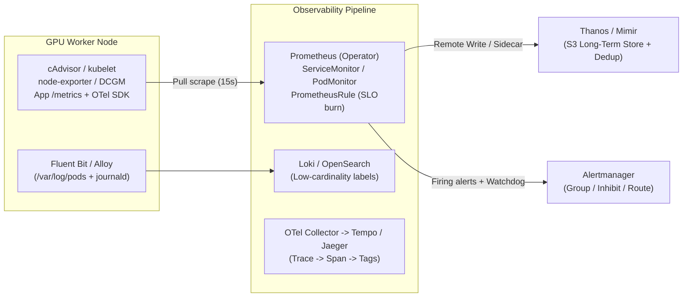

# 5.24 Observability for Kubernetes

| | |
|---|---|
| Level | Intermediate |
| Priority tier | 1 |
| Lab venue | kind/kubeadm; `helm`; kube-prometheus-stack; Loki; OpenTelemetry Collector; Grafana; optional DCGM exporter |
| Part | Part 5: Kubernetes |
| Status | Drafted, labs **untested** |

## Why this matters for AI infrastructure

A GPU platform is only as reliable as your ability to see inside it: a training job that silently runs at 40% of expected throughput because one node's NIC negotiated a lower speed, an inference service whose p99 latency doubles when KV-cache fills, a node whose GPU throws Xid errors for days before the job fails, a control plane slowed by a runaway controller. Observability turns these from mysteries into dashboards and alerts. The Kubernetes ecosystem has converged on Prometheus-compatible metrics, structured logs shipped to a central store, OpenTelemetry for traces, and Grafana for visualisation. This chapter explains the architecture, the exporters that matter, how to design alerts that are actionable, and how to scale and secure the stack, with GPU-specific signals (deeper treatment in Part 17).

## Prerequisites and outcomes

Needs 5.3, 5.9, 5.19. After this chapter you can:

- Describe the Prometheus data model and scrape architecture; install and operate kube-prometheus-stack (Prometheus Operator CRDs: ServiceMonitor, PodMonitor, PrometheusRule, Probe, AlertmanagerConfig).
- Identify the key metric sources (kube-state-metrics, cAdvisor/kubelet, node-exporter, API server/etcd/scheduler/controller metrics, CoreDNS, ingress, DCGM exporter, application metrics) and the most useful PromQL for each.
- Design alerts and SLOs: symptom-based paging, multiwindow burn-rate alerts, severity routing, inhibition, runbooks; avoid alert fatigue.
- Build log pipelines (node agents, structured logging, Loki/Elastic) and trace pipelines (OpenTelemetry Collector, Tempo/Jaeger), and correlate across signals (exemplars, trace IDs).
- Use Kubernetes events and audit logs effectively.
- Scale and secure observability: federation/remote write (Thanos/Mimir/VictoriaMetrics), multi-tenancy, retention, cardinality control, cost.
- Build dashboards for cluster, node, GPU, job and service health.

## 1. The observability signals

| Signal | Question answered | Kubernetes sources |
|---|---|---|
| **Metrics** | How is the system behaving over time? (rates, errors, durations, saturation) | Prometheus scraping `/metrics` endpoints |
| **Logs** | What happened (discrete events with context)? | Container stdout/stderr, node logs (journald), audit logs |
| **Traces** | Where did time go across services for a request? | OpenTelemetry/Jaeger/Tempo |
| **Events** | What did the control plane do? (Scheduled, Pulled, Killing, FailedMount) | `kubectl get events`, Event objects (1 h TTL), event exporters |
| **Profiles** | Where is CPU/memory spent in code? | Pyroscope/Parca, `py-spy`, Nsight (Part 10) |
| **Health checks/synthetics** | Does it work from the outside? | Blackbox exporter, probes, synthetic requests |

Methodologies: **RED** (Rate, Errors, Duration) for request-driven services; **USE** (Utilisation, Saturation, Errors) for resources (CPU, memory, disk, network, GPU); **Four Golden Signals** (latency, traffic, errors, saturation); for ML: **throughput (tokens/s, samples/s), step time, loss/gradient health, MFU, checkpoint age, data-loader wait**.

## 2. Prometheus and the Operator



### Why Prometheus became the default

Metrics are measurements recorded over time. Plotted on a timeline, they show when behavior drifts away from normal. They also give you something to alert on, so you hear about a failure early, or before it happens. Prometheus is the common open source choice for this on Kubernetes.

The control plane components expose Prometheus metrics. Nearly every production cluster also uses exporters to pull metrics from its nodes. Because of this, commercial tools such as Datadog, New Relic, and VMware Tanzu Observability can read Prometheus metrics too.

Prometheus uses a scraping model. It collects metrics from targets on a schedule. Applications and infrastructure do not send metrics anywhere. They expose an endpoint, and Prometheus scrapes it. The app only needs to know the output format, which keeps it free of metrics plumbing.

Prometheus handles several jobs:

- Collects metrics from targets by scraping them
- Stores the metrics in a time series database
- Sends alerts, usually to Alertmanager, based on alerting rules
- Exposes an HTTP API that other components can use to read stored metrics
- Provides a dashboard for ad hoc queries and status checks

Many teams start with Prometheus for collection and Grafana for graphs. The trouble comes later. Long-term storage, scaling, and federation all need planning. If the upkeep of the metrics stack grows heavy, you can move to a commercial system without changing the kind of metrics you use.

Metrics and alerting are vital to a platform's usefulness. Warnings of an impending failure give you time to avoid downtime and errors. So treat metrics and alerts as core platform services, not extras.

### Prometheus model

Time series identified by metric name + labels (`http_requests_total{job="api",code="200"}`); types: **counter** (monotonic; use `rate()`/`increase()`), **gauge**, **histogram** (cumulative buckets; `histogram_quantile`), **summary**. Pull model: Prometheus scrapes targets at an interval (15–30 s typical), stores in a local TSDB (2 h blocks, compaction, retention by time/size), evaluates **recording and alerting rules**, and sends alerts to **Alertmanager**. Service discovery uses the Kubernetes API (`kubernetes_sd_configs`: pods, endpoints, services, nodes, ingresses) plus relabelling to choose targets and attach labels.

In *Production Kubernetes* Chapter 9 (*Observability*), Josh Rosso et al. highlight three additional architectural patterns for metrics, showback, and distributed tracing:
1. **Pull Scraping vs. `Pushgateway` for Ephemeral Batch Jobs (`PK` Chapter 9 Figure 9-2):** While Prometheus's pull model is ideal for long-lived services and DaemonSets, a short-lived batch `Job` that runs for 8 seconds and exits may terminate before Prometheus's 15–30s scrape interval occurs. For short-lived batch jobs (such as a database migration or checkpoint validator), the job can push its completion metrics to a **Prometheus `Pushgateway`** (`Figure 9-2`), which Prometheus then scrapes (being careful to group by job/role rather than unique Pod names so stale series do not accumulate forever).
2. **Prometheus Federation vs. `Thanos` (`PK` Chapter 9 Figure 9-3) and Showback Models (`Figure 9-5`):**
   - *Federation vs. Thanos:* Hierarchical Prometheus `/federate` scraping works for aggregating low-cardinality recording rules across clusters, but struggles with full historical series retention. **Thanos** attaches a `thanos-sidecar` to each Prometheus pod to upload 2-hour TSDB blocks to S3/GCS object storage, uses `Store Gateway` + `Compactor` (downsampling to 5m and 1h resolutions), and provides a global `Querier` that deduplicates HA Prometheus pairs (`replica="a"` and `replica="b"`).
   - *Requests vs. Consumption Showback (`Figure 9-5`):* `PK` Chapter 9 contrasts **Requests-based showback** (attributing what a team's Pods requested) with **Consumption-based showback** (attributing **`max(resource_request, actual_usage)`** so teams are accountable both for over-reserved idle capacity *and* for Burstable usage spikes above requests, modeled in `compute_showback_requests_vs_consumption()` in `code/part05/k8s_observability_slo_sim.py`).
3. **Distributed Tracing Concepts (`OpenTracing` + `OpenCensus` $\rightarrow$ `OpenTelemetry` / `Jaeger`, `PK` Chapter 9):** A distributed **Trace** represents the end-to-end journey of a single request across microservices, composed of individual timed **Spans** (one per service/operation, linked by parent-child span IDs and contextualized with key-value **Tags** and **Baggage**/Logs), collected by node-local tracing **Agents** and processed/sampled by **Collectors** before persistence.

### kube-prometheus-stack

Helm chart bundling Prometheus Operator, Prometheus, Alertmanager, Grafana, kube-state-metrics, node-exporter, default dashboards and rules for Kubernetes components.

```bash
helm repo add prometheus-community https://prometheus-community.github.io/helm-charts
helm upgrade --install kps prometheus-community/kube-prometheus-stack -n monitoring --create-namespace \
  --set prometheus.prometheusSpec.retention=15d \
  --set prometheus.prometheusSpec.storageSpec.volumeClaimTemplate.spec.resources.requests.storage=200Gi \
  --set prometheus.prometheusSpec.serviceMonitorSelectorNilUsesHelmValues=false \
  --set prometheus.prometheusSpec.podMonitorSelectorNilUsesHelmValues=false \
  --set prometheus.prometheusSpec.ruleSelectorNilUsesHelmValues=false
```

Operator CRDs:

```yaml
apiVersion: monitoring.coreos.com/v1
kind: ServiceMonitor
metadata: { name: vllm, namespace: serving, labels: { release: kps } }
spec:
  selector: { matchLabels: { app: vllm } }              # Services with these labels
  namespaceSelector: { matchNames: [serving] }
  endpoints:
    - port: http
      path: /metrics
      interval: 15s
      relabelings:
        - { sourceLabels: [__meta_kubernetes_pod_node_name], targetLabel: node }
      metricRelabelings:
        - { sourceLabels: [__name__], regex: "vllm:(num_requests_.*|gpu_cache_usage_perc|time_to_first_token_seconds.*)", action: keep }   # keep only needed series
---
apiVersion: monitoring.coreos.com/v1
kind: PrometheusRule
metadata: { name: gpu-alerts, namespace: monitoring, labels: { release: kps } }
spec:
  groups:
    - name: gpu.rules
      interval: 30s
      rules:
        - record: node:gpu_util:avg
          expr: avg by (node) (DCGM_FI_DEV_GPU_UTIL)
        - alert: GPUXidError
          expr: increase(DCGM_FI_DEV_XID_ERRORS[10m]) > 0
          for: 0m
          labels: { severity: critical, team: platform }
          annotations:
            summary: "Xid {{ $value }} on {{ $labels.Hostname }} GPU {{ $labels.gpu }}"
            runbook_url: https://runbooks.example.com/gpu-xid
```

`PodMonitor` for pod-level endpoints without Services; `Probe` for blackbox targets; `AlertmanagerConfig` for namespaced routing; `ScrapeConfig` for static/external targets. Selectors on Prometheus (`serviceMonitorSelector`) determine which monitors it picks up (the `release: kps` label trap).

### Prometheus servers as custom resources

With the Prometheus Operator installed, you can create a `Prometheus` resource. The operator then builds a Prometheus server from it and creates a StatefulSet to run that server. The manifest below shows a platform server.

```yaml
apiVersion: monitoring.coreos.com/v1
kind: Prometheus
metadata:
  name: platform
  namespace: platform-monitoring
  labels:
    monitor: platform
    owner: platform-engineering
spec:
  alerting:
    alertmanagers:
    - name: alertmanager-main
      namespace: platform-monitoring
      port: web
  image: quay.io/prometheus/prometheus:v2.20.0
  nodeSelector:
    kubernetes.io/os: linux
  replicas: 2
  resources:
    requests:
      memory: 400Mi
  ruleSelector:
    matchLabels:
      monitor: platform
      role: alert-rules
  securityContext:
    fsGroup: 2000
    runAsNonRoot: true
    runAsUser: 1000
  serviceAccountName: platform-prometheus
  version: v2.20.0
  serviceMonitorSelector:
    matchLabels:
      monitor: platform
```

The `alerting` block tells Prometheus where to send alerts. The `image` field sets the container image to run. The `ruleSelector` tells the operator which PrometheusRules apply to this server. Any PrometheusRule with the labels shown is applied here. The `serviceMonitorSelector` does the same for ServiceMonitors, which feed this server's scrape configuration.

Being able to create many Prometheus servers lets platform operators split the load. Processing metrics is compute-heavy. One server can collect the platform's metrics while others collect custom application metrics or node metrics. This is also useful for tenants. A team that emits a large volume of metrics may need its own server in its namespace, and that cost can count against its resource budget. The trade-off is more work for dashboards, alerting, federation, and long-term storage. Many teams will want a simpler layer on top, but the option is worth knowing.

### Reading a ServiceMonitor

Creating a ServiceMonitor makes the operator update the scrape configuration of the matching Prometheus server. The manifest below points Prometheus at the Kubernetes API server.

```yaml
apiVersion: monitoring.coreos.com/v1
kind: ServiceMonitor
metadata:
  labels:
    k8s-app: apiserver
    monitor: platform
  name: kube-apiserver
  namespace: platform-monitoring
spec:
  endpoints:
  - bearerTokenFile: /var/run/secrets/kubernetes.io/serviceaccount/token
    interval: 30s
    port: https
    scheme: https
    tlsConfig:
      caFile: /var/run/secrets/kubernetes.io/serviceaccount/ca.crt
      serverName: kubernetes
  jobLabel: component
  namespaceSelector:
    matchNames:
    - default
  selector:
    matchLabels:
      component: apiserver
      provider: kubernetes
```

The `monitor: platform` label is the one the Prometheus server's `serviceMonitorSelector` looks for. The `endpoints` block sets the port and how to connect to each instance. This example uses HTTPS, with a Certificate Authority and a server name to verify the endpoint.

In Prometheus terms, a job is a group of instances of one service. A single API server is an instance, and all the API servers together form the job. The `jobLabel` field names the label that supplies the job name. Here the job is `apiserver`.

The `namespaceSelector` says which namespaces to search for Services. The `selector` finds Services by their labels. Any Service in the `default` namespace with those labels becomes a scrape target.

### Recording and alerting rules with PrometheusRule

A PrometheusRule tells the operator to generate a rule file for Prometheus. The rules cover recording metrics and alerting on them. The operator stores the rules in a ConfigMap and mounts it into the Prometheus Pods.

```yaml
apiVersion: monitoring.coreos.com/v1
kind: PrometheusRule
metadata:
  labels:
    monitor: platform
    role: alert-rules
  name: sample-rules
  namespace: platform-monitoring
spec:
  groups:
  - name: kube-apiserver.rules
    rules:
    - expr: |
        sum by (code,resource) (rate(
          apiserver_request_total{job="apiserver",verb=~"LIST|GET"}[5m]
        ))
      labels:
        verb: read
      record: code_resource:apiserver_request_total:rate5m
  - name: kubernetes-apps
    rules:
    - alert: KubePodNotReady
      annotations:
        description: Pod {{ $labels.namespace }}/{{ $labels.pod }} has been in a
          non-ready state for longer than 15 minutes.
        summary: Pod has been in a non-ready state for more than 15 minutes.
      expr: |
        sum by (namespace, pod) (
          max by(namespace, pod) (
            kube_pod_status_phase{job="kube-state-metrics", phase=~"Pending|Unknown"}
          ) * on(namespace, pod) group_left(owner_kind) topk by(namespace, pod) (
            1, max by(namespace, pod, owner_kind) (kube_pod_owner{owner_kind!="Job"})
          )
        ) > 0
      for: 15m
      labels:
        severity: warning
```

The first group holds a recording rule. It totals the LIST and GET requests to all API server instances over a 5-minute window. It stores the result as a new metric named `code_resource:apiserver_request_total:rate5m`.

The second group holds an alerting rule. It sends a warning if any Pod stays in a not-ready state for more than 15 minutes. Once you use the Prometheus Operator and these custom resources, the pattern is easy to repeat. Production Kubernetes recommends it highly if Prometheus is your main metrics tool.

### Instrumenting your own software

The best source of metrics is the app itself. Many applications built for Kubernetes expose Prometheus metrics natively. Official and community client libraries make this easy for developers. Production Kubernetes covers this in depth in its Chapter 14.

Sometimes an app or system does not expose Prometheus metrics. An exporter fills that gap. It collects data points from the system and exposes them as Prometheus metrics. The Node Exporter is the common example. It gathers hardware and operating system metrics for Prometheus to scrape. Community exporters exist for many popular tools.

Once an app exposes metrics, add it to a Prometheus scrape configuration. A ServiceMonitor does this for you. The Operator can auto-discover Services by their namespace and labels, so you do not edit scrape configs by hand.

Labels are powerful, and they come with a warning. Overusing labels can make the resource use of your Prometheus servers untenable. Learn what high cardinality does to metrics before you add many labels. Check the instrumentation guide in the Prometheus docs.

In short, instrument the software you write where you can. Build or use exporters where native instrumentation is not feasible. Then collect the exposed metrics with auto-discovery, so you can see your systems clearly.

### Exposing app metrics with the Prometheus client libraries

Prometheus pulls metrics. It makes an HTTP request to an endpoint, usually `/metrics`, and reads the response. Your app must expose that endpoint, and the response must use the Prometheus text format. There are two ways to do this. Native instrumentation puts the Prometheus client library inside your app. An out-of-process exporter runs beside the app as a sidecar and translates metrics that already exist. Native instrumentation suits code you control. Exporters suit off-the-shelf software you cannot change. The NGINX Prometheus Exporter and the MySQL Server Exporter are examples.

The client libraries support four metric types. A Counter only goes up. A Gauge can go up or down. A Histogram puts observations into buckets, and the Prometheus server uses those buckets to compute quantiles such as the 95th percentile. A Summary also reports quantiles, but it computes them in the client over a sliding time window.

Instrumenting a Go service takes three steps. First, expose an HTTP endpoint that serves the metrics:

```go
func main() {
    // app code...
    http.Handle("/metrics",
        promhttp.HandlerFor(
            prometheus.DefaultGatherer,
            promhttp.HandlerOpts{},
        ))
    log.Fatal(http.ListenAndServe("localhost:8080", nil))
}
```

Second, create the metric and register it. This Counter counts queue items handled:

```go
// create the counter
var totalItemsHandled = prometheus.NewCounter(
    prometheus.CounterOpts{
        Name: "items_handled_total",
        Help: "Total number of queue items handled.",
    },
)
// register the counter
prometheus.MustRegister(totalItemsHandled)
```

Third, update the metric where the work happens. Calling `Inc()` increments the counter by one each time:

```go
func handleItem(item Item) {
    // item handling code...
    // increment the counter as we handle items
    totalItemsHandled.Inc()
}
```

The hard part is not the library. It is deciding which metrics to expose. Three common methods give you a starting point.

The USE method, proposed by Brendan Gregg, looks at system resources. For each resource, you capture Utilization, Saturation and Errors. Those resources include CPU, memory and disk. They can also include resources inside the app, such as queues and thread pools.

The RED method, proposed by Tom Wilkie, looks at the service instead. It captures the Rate, Errors and Duration of the requests the service handles. RED suits online services, because it shows what users experience.

The four golden signals come from Google's Site Reliability Engineering book. They are Latency, Traffic, Errors and Saturation. They overlap with RED, and they add Saturation.

App-specific metrics are the last category. They measure things only your app can see. Examples include how long it takes to add an item to a shopping cart, or how long it takes to connect a customer with an agent. These often tie to business KPIs. Whichever method you choose, exporting metrics is what lets you build dashboards, set alerts and spot trends over time.

### Key exporters and sources

| Source | Metrics | Notes |
|---|---|---|
| **kubelet / cAdvisor** (`/metrics/cadvisor`) | `container_cpu_usage_seconds_total`, `container_memory_working_set_bytes`, `container_cpu_cfs_throttled_periods_total`, `container_network_*`, `container_fs_*`, `container_oom_events_total` | Per container; the basis of `kubectl top` and capacity |
| **kubelet** (`/metrics`, `/metrics/probes`, `/metrics/resource`) | Pod start durations, PLEG, runtime ops, volume stats, evictions, cert TTL | 5.9 |
| **kube-state-metrics (KSM)** | State of API objects: `kube_pod_status_phase`, `kube_pod_container_status_restarts_total`, `kube_pod_container_resource_requests/limits`, `kube_node_status_condition`, `kube_deployment_status_replicas_available`, `kube_job_status_failed`, `kube_persistentvolumeclaim_status_phase`, `kube_horizontalpodautoscaler_*` | Joins with cAdvisor for efficiency; supports custom resource state metrics for CRDs (Kueue, jobs) |
| **node-exporter** | CPU, memory, disk, filesystem, network, load, `node_pressure_*` (PSI), softnet, conntrack, hwmon temperatures, `node_infiniband_*` | DaemonSet; mount host paths; collectors configurable |
| **API server** | `apiserver_request_total`, `apiserver_request_duration_seconds`, `apiserver_flowcontrol_*`, `etcd_request_duration_seconds`, `apiserver_admission_*` | 5.5 |
| **etcd** | `etcd_server_*`, `etcd_disk_wal_fsync_duration_seconds`, `etcd_mvcc_db_total_size_in_bytes` | Scrape with client certs |
| **scheduler / controller-manager** | `scheduler_pending_pods`, `scheduler_schedule_attempts_total`, `workqueue_*`, `rest_client_requests_total` | |
| **CoreDNS** | `coredns_dns_requests_total`, `coredns_dns_responses_total{rcode}`, duration | 5.11 |
| **kube-proxy / CNI** | `kubeproxy_sync_proxy_rules_duration_seconds`, Cilium/Calico metrics, Hubble | 5.10, 5.14 |
| **Ingress/Gateway** | request rates, latencies, status codes, upstream health | 5.12 |
| **DCGM exporter** | `DCGM_FI_DEV_GPU_UTIL`, `DCGM_FI_DEV_FB_USED`, `DCGM_FI_DEV_POWER_USAGE`, `DCGM_FI_DEV_GPU_TEMP`, `DCGM_FI_DEV_SM_CLOCK`, `DCGM_FI_DEV_XID_ERRORS`, `DCGM_FI_DEV_ECC_DBE_VOL_TOTAL`, `DCGM_FI_PROF_PIPE_TENSOR_ACTIVE`, `DCGM_FI_PROF_DRAM_ACTIVE`, NVLink bandwidth/error counters | Profile metrics need DCGM profiling enabled; labels `gpu`, `UUID`, `modelName`, `Hostname`, `pod`, `namespace` (via pod-resources mapping) |
| **Network/RDMA** | `node_infiniband_*`, `ibstat` exporters, UFM exporter, switch telemetry (gNMI/SNMP) | Part 12, Part 17 |
| **Storage** | CSI driver metrics, `kubelet_volume_stats_*`, filesystem exporters (Lustre/WEKA/Ceph), S3 gateway metrics | |
| **Applications** | Framework metrics: PyTorch/Lightning custom (`train_step_seconds`, `tokens_per_second`), vLLM/Triton/TGI endpoints, Ray metrics | Instrument with `prometheus_client`/OpenTelemetry metrics |
| **Blackbox probes** | HTTP/TCP/ICMP/DNS from inside/outside | Synthetic checks for endpoints and DNS |
| **Node problem detector** | Conditions/events for kernel/runtime/hardware problems | Exposes as node conditions → KSM metric |

### Essential PromQL

```promql
# Node and pod health
sum(kube_node_status_condition{condition="Ready",status="true"} == 0)                                # NotReady nodes
sum by (namespace, pod) (rate(kube_pod_container_status_restarts_total[15m])) > 0.01                  # restarting pods
sum by (reason) (kube_pod_container_status_last_terminated_reason{reason="OOMKilled"})                # OOMs
count by (phase) (kube_pod_status_phase == 1)

# Pending pods and reasons (scheduler)
sum(scheduler_pending_pods{queue="unschedulable"})
sum by (namespace) (kube_pod_status_phase{phase="Pending"} == 1)

# CPU throttling and saturation
sum by (namespace,pod,container) (rate(container_cpu_cfs_throttled_periods_total[5m]) / rate(container_cpu_cfs_periods_total[5m])) > 0.25
sum by (node) (rate(node_cpu_seconds_total{mode!="idle"}[5m])) / count by (node) (node_cpu_seconds_total{mode="idle"})

# Memory
container_memory_working_set_bytes{container!=""} / on(namespace,pod,container) kube_pod_container_resource_limits{resource="memory"} > 0.9
node_memory_MemAvailable_bytes / node_memory_MemTotal_bytes < 0.1

# API server
histogram_quantile(0.99, sum by (le,verb) (rate(apiserver_request_duration_seconds_bucket{verb!~"WATCH|CONNECT"}[5m])))
sum(rate(apiserver_request_total{code=~"5.."}[5m])) / sum(rate(apiserver_request_total[5m]))
histogram_quantile(0.99, rate(etcd_disk_wal_fsync_duration_seconds_bucket[5m])) > 0.01

# GPU
avg by (Hostname, gpu) (DCGM_FI_DEV_GPU_UTIL)
sum by (namespace) (kube_pod_container_resource_requests{resource="nvidia_com_gpu"}) / ignoring(namespace) group_left sum(kube_node_status_allocatable{resource="nvidia_com_gpu"})   # allocation fraction
avg_over_time(DCGM_FI_PROF_PIPE_TENSOR_ACTIVE[5m]) < 0.2 and on(pod) kube_pod_container_resource_requests{resource="nvidia_com_gpu"} > 0     # allocated but tensor cores idle
increase(DCGM_FI_DEV_XID_ERRORS[1h]) > 0
DCGM_FI_DEV_GPU_TEMP > 85
```

## 3. Alerting design

### Principles

1. **Page on symptoms, ticket on causes.** Page when users or SLOs are affected (API errors, inference latency/availability, jobs failing to start, many nodes lost). Notify (ticket/chat) for causes and capacity warnings (disk 80% full, certificate in 14 days).
2. **Every alert is actionable**: clear summary (what/where), severity, owner/team, runbook link, dashboard link, `for:` duration to avoid flapping; delete alerts nobody acts on.
3. **SLO-based alerting** with **multiwindow, multi-burn-rate** rules (Google SRE workbook): e.g., page when 2% of a 30-day error budget burns in 1 hour (burn rate 14.4) and in 5 minutes; ticket on 5% in 6 hours (burn 6) and 30 minutes. Use recording rules for SLI ratios.
4. **Routing and noise control** in Alertmanager: group by `alertname, cluster, namespace`; `group_wait`, `group_interval`, `repeat_interval`; **inhibition** (suppress downstream alerts when a node or the control plane is down); **silences** for maintenance; time-based routing (office hours for low severity); route by labels to teams (PagerDuty/Opsgenie/Slack/email/webhooks).
5. **Watchdog / dead man's switch**: an always-firing alert to an external service proves the pipeline works.
6. **Alert on the absence** of data (`absent()`, `up == 0`) for critical exporters; alert on observability stack health (Prometheus WAL, scrape failures, rule evaluation failures, disk).
7. **Test alerts** (`promtool test rules`, synthetic failures) and review them after incidents.

```yaml
# SLO example: inference availability (non-5xx ratio) 99.5% over 30d
- record: slo:inference_error_ratio:rate5m
  expr: sum(rate(gateway_requests_total{route="chat",code=~"5.."}[5m])) / sum(rate(gateway_requests_total{route="chat"}[5m]))
- alert: InferenceErrorBudgetBurnFast
  expr: slo:inference_error_ratio:rate1h > (14.4 * 0.005) and slo:inference_error_ratio:rate5m > (14.4 * 0.005)
  labels: { severity: page }
  annotations: { summary: "Burning 2% of monthly error budget per hour", runbook_url: https://runbooks.example.com/inference-errors }
```

### Alertmanager

Alertmanager is a separate workload. It receives alerts from Prometheus, groups and de-duplicates them, and routes them to receivers. Receivers are the notification channels your on-call engineers use, such as email, Slack, or PagerDuty. Grouping matters because an outage that touches many replicas should not flood people with alerts. If your system is unsupported, a webhook receiver can POST a JSON payload to any URL you provide.

With the Prometheus Operator, you deploy Alertmanager from a manifest like the one below.

```yaml
apiVersion: monitoring.coreos.com/v1
kind: Alertmanager
metadata:
  labels:
    alertmanager: main
  name: main
  namespace: platform-monitoring
spec:
  image: quay.io/prometheus/alertmanager:v0.21.0
  nodeSelector:
    kubernetes.io/os: linux
  replicas: 2
  securityContext:
    fsGroup: 2000
    runAsNonRoot: true
    runAsUser: 1000
  serviceAccountName: alertmanager-main
  version: v0.21.0
```

Setting `replicas` to more than one asks for a highly available Alertmanager. Running several Alertmanagers in one cluster is rarely needed, since one HA deployment usually does the job. Some teams use a central Alertmanager for many clusters. Most prefer one per cluster, because it leaves each cluster with fewer external dependencies. A shared Alertmanager also lets tenants use a single PrometheusRule to add their own alerting rules.

### GPU-fleet specific alerts

Node-level hardware (page/ticket by severity): Xid errors (esp. 79 fallen off bus, 48 DBE, 74 NVLink), uncorrectable ECC, retired pages pending, GPU temperature/power throttling (`DCGM_FI_DEV_CLOCK_THROTTLE_REASONS`), NVLink errors/down links, PCIe replay counters, lost GPU count vs expected, `nvidia-smi` hang; network (IB/RoCE link down, symbol errors, PFC storms, ECN marks, port speed lower than expected); storage (mount errors, throughput drop); job-level (training throughput below baseline, loss NaN, step-time skew across ranks (stragglers), checkpoint failing or stale); platform (queue wait time p95, pending reasons, GPU allocation efficiency). Details in Part 17.

## 4. Logs

### Why logs need a central place

Picture a workload with dozens of replicas. A user reports an error, and you need to find the one log line behind it. If you must open each replica's logs by hand, the search is slow and easy to get wrong. A central collection point lets you search log entries across all replicas at once.

Logs used to live in a file on a server's disk. Fewer workloads and fewer instances made that manageable. Today, applications usually write to standard out and standard error, the way a command-line tool prints. Workloads are ephemeral, and often have no disk to keep logs, so the logs must leave the workload as they are written.

This section covers how logs move from the platform and its tenant workloads to a storage backend. Most companies already run a log backend, so the platform's job is to capture, process, and forward logs to it. Storage itself is usually not the platform's concern.

### What your application should log

Applications should write logs to standard out and standard error. That keeps the app simple, and the platform can ship those streams to a central place with the least work. The harder question is what to write. Teams often log too much. Too much logging buries the one line that matters. Too little leaves you blind during an incident. The book's rule of thumb is to ask whether the message is actionable. If someone could act on it, log it. If not, it probably adds noise.

Logs come in two styles. Unstructured logs are plain strings with no fixed format. They need no planning, which is why they are so common. Structured logs have fixed fields that you must fill in every time. They usually take the form of JSON lines or key-value pairs. A structured line can look like `time="2015-08-09T03:41:12-03:21" msg="hello world!" thread="13" batchId="5"`. Machines can query structured logs much more easily. People find them harder to read, so pick the style that fits how your team works.

Context makes a log line useful. Take a payment service. When a payment fails because the payee is not found, the error alone is not enough. Add the payee name or ID, the ID of the user who tried to pay, and the payment amount. That context helps you troubleshoot and prevent the next failure. Keep sensitive data out, though. A password or card number should never appear in a log.

### Architecture

Containers write stdout/stderr → runtime files `/var/log/pods/...` (5.9) → **node agent** DaemonSet (Fluent Bit, Vector, Promtail/Grafana Alloy, Fluentd, Filebeat) tails files, parses (JSON/CRI), enriches with Kubernetes metadata (namespace, pod, labels, node), filters/redacts, and ships to a backend: **Loki** (label-indexed, cheap, object-storage backed), **Elasticsearch/OpenSearch** (full-text), **ClickHouse**, cloud logging (Cloud Logging, CloudWatch), or Splunk. Node-level logs: journald (`kubelet`, `containerd`, kernel `dmesg` with Xid messages), audit logs from API server, and application files in volumes.

Best practices:

- **Structured JSON logs** with consistent fields (`timestamp`, `level`, `msg`, `trace_id`, `request_id`, `job`, `rank`), not free text; avoid multi-line stack traces (or use multiline parsing).
- **Control volume**: training frameworks can log per step per rank: sample/aggregate, send metrics instead of logs for numeric series, set log levels, rotate (kubelet `containerLogMaxSize`), drop noisy lines at the agent.
- **Labels in Loki** must be low-cardinality (namespace, app, container, cluster); put high-cardinality data in the log line and use LogQL filters/parsers.
- **Retention & tiering**: hot (days) in the log store, cold in object storage; compliance retention for audit logs.
- **Security**: logs can contain secrets/PII; redact at the agent; RBAC and tenant separation (Loki multi-tenancy `X-Scope-OrgID`); protect access to node logs.
- **Correlation**: include trace IDs; use Grafana Explore to jump between metrics, logs and traces; Loki `derived fields`.
- **Kubernetes events** are not logs: export with `kubernetes-event-exporter` or Grafana Alloy `loki.source.kubernetes_events` to retain beyond 1 hour; alert on repeated `FailedScheduling`, `FailedMount`, `BackOff`, `Unhealthy`, `NodeNotReady`.

```yaml
# Fluent Bit essentials (ConfigMap excerpt)
[INPUT]
    Name tail
    Path /var/log/containers/*.log
    multiline.parser cri
    Tag kube.*
    Mem_Buf_Limit 50MB
    Skip_Long_Lines On
[FILTER]
    Name kubernetes
    Match kube.*
    Merge_Log On
    Keep_Log Off
    K8S-Logging.Parser On
[FILTER]
    Name grep
    Match kube.*
    Exclude log health(z)?
[OUTPUT]
    Name loki
    Match kube.*
    Host loki-gateway.monitoring
    Labels job=fluentbit, namespace=$kubernetes['namespace_name'], pod=$kubernetes['pod_name'], container=$kubernetes['container_name']
```

LogQL examples: `{namespace="training"} |= "NCCL WARN"`; `sum by (pod) (rate({namespace="serving"} |= "ERROR" [5m]))`; `{app="vllm"} | json | latency_ms > 2000`.

### Kubernetes Events

Logs record what an app did. Events record what the platform did to an object. Events are a native Kubernetes resource. Platform components create them to report actions, such as a Pod being scheduled or an image being pulled. They work like a platform log, but they are not usually sent to a logging backend.

Events are stored in etcd and kept for one hour by default. That short life is why you should export them if you need them later. To see the Events for one object, run `kubectl describe`. The output below shows the Events for a newly created Pod.

```text
$ kubectl describe pod nginx-6db489d4b7-q8ppw
Name:         nginx-6db489d4b7-q8ppw
Namespace:    default
...
Events:
  Type    Reason     Age        From                                        Message
  ----    ------     ----       ----                                        -------
  Normal  Scheduled  <unknown>  default-scheduler                           Successfully assigned default/nginx-6db489d4b7-q8ppw
  Normal  Pulling    34s        kubelet, ip-10-0-0-229.us-east-2.compute.internal   Pulling image "nginx"
  Normal  Pulled     30s        kubelet, ip-10-0-0-229.us-east-2.compute.internal   Successfully pulled image "nginx"
  Normal  Created    30s        kubelet, ip-10-0-0-229.us-east-2.compute.internal   Created container nginx
  Normal  Started    30s        kubelet, ip-10-0-0-229.us-east-2.compute.internal   Started container nginx
```

To get Events for a whole namespace, run `kubectl get events -n default`. The output includes Events for the ReplicaSet and the Deployment, not only the Pod.

```text
$ kubectl get events -n default
LAST SEEN   TYPE     REASON                OBJECT                              MESSAGE
2m5s        Normal   Scheduled             pod/nginx-6db489d4b7-q8ppw          Successfully assigned default/nginx-6db489d4b7-q8ppw
2m5s        Normal   Pulling               pod/nginx-6db489d4b7-q8ppw          Pulling image "nginx"
2m1s        Normal   Pulled                pod/nginx-6db489d4b7-q8ppw          Successfully pulled image "nginx"
2m1s        Normal   Created               pod/nginx-6db489d4b7-q8ppw          Created container nginx
2m1s        Normal   Started               pod/nginx-6db489d4b7-q8ppw          Started container nginx
2m6s        Normal   SuccessfulCreate      replicaset/nginx-6db489d4b7         Created pod: nginx-6db489d4b7-q8ppw
2m6s        Normal   ScalingReplicaSet     deployment/nginx                    Scaled up replica set nginx-6db489d4b7 to 1
```

Because Events live in the API, you could write automation that watches for specific Events and reacts to them. In practice, that is not common. A more useful option is an Event exporter, which turns Events into metrics that Prometheus can scrape.

## 5. Traces and OpenTelemetry

**OpenTelemetry (OTel)** standardises telemetry: SDKs/auto-instrumentation produce traces/metrics/logs; the **OpenTelemetry Collector** (agent DaemonSet and/or gateway Deployment) receives (OTLP), processes (batch, memory limiter, attributes, tail sampling, k8sattributes enrichment), and exports to backends (Tempo, Jaeger, Prometheus remote write, Loki, cloud APIs). The **OpenTelemetry Operator** manages Collector instances and auto-instruments workloads via annotations (`instrumentation.opentelemetry.io/inject-python: "true"`).

For AI services, traces show: gateway → auth → router → model server → tokenizer/KV-cache/GPU kernel spans, retrieval (vector DB) latency in RAG pipelines, tool calls in agent workflows; LLM-specific observability (OpenLLMetry, Langfuse, Arize Phoenix, LangSmith) adds prompt/response/token/cost spans. Propagate W3C `traceparent` through gateways and meshes; sample intelligently (head sampling for volume, tail sampling to keep errors and slow traces); avoid storing prompts/PII in spans without policy.

### Tracing vocabulary

Distributed tracing follows one request across several services. The OpenTracing specification gives the ecosystem a shared set of terms. Three of them matter most.

- **Trace:** the whole journey of one end-user request through the services that handle it. A trace is made of spans.
- **Span:** the work one service does for that request. The operations inside one workload's boundaries form a single span.
- **Tag:** metadata attached to a span. Tags add context inside the trace and give you searchable indexes.

When you visualize traces, you see each one in full. The view shows which components hurt performance most. It also shows where errors start and how they spread to other parts of the application.

OpenTracing merged with OpenCensus to form OpenTelemetry. The book notes that OpenTelemetry support in Jaeger was still experimental when it was written. It still expects OpenTelemetry to become the de facto standard.

### Tracing components

A platform that offers tracing needs a few components in place. The models below apply to open source projects such as Zipkin and Jaeger. Other products that follow the OpenTracing standards often use the same models.

- **Agent:** each component in an application outputs a span for every request. The agent is a server the application sends spans to. In Kubernetes it is usually a node agent on each machine, which receives all spans for workloads on that node. It forwards batched spans to a central collector.
- **Collector:** processes the spans and stores them. It validates them, indexes them, and transforms them before they reach storage.
- **Storage:** the supported databases vary by project. Cassandra and Elasticsearch are the usual choices. Tracing systems collect very large volumes, even with sampling. The database must search that data quickly to be useful.
- **API:** exposes stored traces and spans to other workloads and to visualization layers.
- **User interface:** the layer app developers use. It queries the API and shows the data in charts they can use to study their systems.

Tracing only works if the application sends the data. Get buy-in from application teams early, because the best platform cannot trace what apps do not send.

### Instrumenting services for distributed tracing

Tracing shows how one request moves across several services. The platform can offer tracing with Jaeger or Zipkin. But the services must still be instrumented before they produce useful traces. The book works through Jaeger with OpenTracing, using Go. A span is one named, timed operation, and spans make up a trace. The work has three parts: initialize a tracer, create spans, and propagate the span context to the next service.

Start with the tracer. Its configuration should come from the environment, such as `JAEGER_SERVICE_NAME` for the service name, rather than from hardcoded values. The tracer can also report to your metrics library and your logger. It emits metrics about sampled traces and reported spans, and it logs errors. A logger that prints spans is handy in development. Here is a Go service that does this with Prometheus and the standard logger:

```go
package main

import (
    "log"

    jaeger "github.com/uber/jaeger-client-go"
    "github.com/uber/jaeger-client-go/config"
    "github.com/uber/jaeger-lib/metrics/prometheus"
)

func main() {
    // app initialization code...
    metricsFactory := prometheus.New()
    cfg := config.Configuration{}
    tracer, closer, err := cfg.NewTracer(
        config.Metrics(metricsFactory),
        config.Logger(jaeger.StdLogger),
    )
    if err != nil {
        log.Fatalf("error initializing tracer: %v", err)
    }
    defer closer.Close()
    // continue main()...
}
```

The code creates a Prometheus metrics factory for Jaeger. It builds a default configuration with no hardcoded values. Then it creates the tracer from that configuration, with the factory and the standard logger.

When a request arrives, the service must read the span context that the previous service sent. In an HTTP service, that context travels in headers. The handler extracts it and starts a child span. The tracer from the previous step must be in scope:

```go
func (s server) handleListPayments(w http.ResponseWriter, req *http.Request) {
    spanCtx, err := s.tracer.Extract(
        opentracing.HTTPHeaders,
        opentracing.HTTPHeadersCarrier(req.Header),
    )
    if err != nil {
        // handle the error
    }
    span := opentracing.StartSpan(
        "listPayments",
        ext.RPCServerOption(spanCtx),
    )
    defer span.Finish()
}
```

Inside the request, the service can add child spans. If a function runs a SQL query, that function can start its own span and name it:

```go
func listPayments(ctx context.Context) ([]Payment, error) {
    span, ctx := opentracing.StartSpanFromContext(ctx, "listPayments")
    defer span.Finish()
    // run sql query
}
```

When this service calls another one, it must pass the trace context along. The OpenTracing helpers inject the context into the outgoing HTTP headers. The client side marks the span as an RPC client call, records the URL and method, and then injects the context into the request:

```go
req, err := http.NewRequest("GET", serviceURL, nil)
if err != nil {
    // handle error
}
// inject context into the request's HTTP headers
ext.SpanKindRPCClient.Set(span)
ext.HTTPUrl.Set(span, url)
ext.HTTPMethod.Set(span, "GET")
span.Tracer().Inject(
    span.Context(),
    opentracing.HTTPHeaders,
    opentracing.HTTPHeadersCarrier(req.Header),
)
// send the request
resp, err := http.DefaultClient.Do(req)
```

The `ext.SpanKindRPCClient.Set` call tags the span as the client side of a service call. The `Inject` call writes the span context into the request headers. Tagging, logging and baggage are more features to explore after these basics. If your platform team offers tracing as a service, these three steps are what your app needs to take part.

## 6. Dashboards

Grafana (provisioned from Git; dashboards-as-code with Jsonnet/Grafonnet/Terraform). Recommended set:

1. **Cluster overview**: node readiness, pod phases, pending/unschedulable, API latency/errors, etcd health, scheduler queue, certificate expiry, GitOps sync status.
2. **Capacity & allocation**: allocatable vs requested vs used for CPU/memory/GPU per pool/namespace; fragmentation (largest free GPU block); quota usage; queue depth/wait (Kueue metrics).
3. **Node/GPU health**: per-node GPU utilisation/memory/power/temp/clocks, throttle reasons, ECC/Xid timeline, NVLink/PCIe errors, NIC throughput/errors, disk/inode; heatmaps across the fleet to spot outliers (one hot or one slow GPU stands out).
4. **Training job view**: per-job GPU utilisation and tensor activity, step time, tokens/s, loss, data-loader wait, checkpoint duration/age, per-rank skew, network bandwidth per node; links to logs and pods.
5. **Inference service view (RED + saturation)**: RPS, error rate, TTFT/ITL/latency percentiles, queue depth, batch size, KV-cache usage, GPU util/SM activity, replicas vs desired, cold starts, per-model/tenant breakdown.
6. **Platform/tenant view**: GPU-hours by team, utilisation vs allocation, idle waste, budget burn.
7. **Network & storage**: CoreDNS, ingress, CNI drops, conntrack; PVC usage, CSI latency, storage throughput.
8. **Observability stack health**: Prometheus ingestion/series count/cardinality, scrape failures, rule eval time, Alertmanager notifications, Loki ingestion/query errors, storage growth.

Design rules: top-level SLO panels first; drill-down links; consistent time ranges and variables (cluster, namespace, node, job); units and thresholds; avoid walls of graphs; annotate deployments and maintenance events.

## 7. Scaling, retention and cost

- **Cardinality** is the main scaling issue: every unique label set is a series (memory ~ a few KB each). Avoid unbounded labels (user IDs, request IDs, full URLs, pod UIDs in app metrics); `metricRelabelings` drop heavy series; check `topk(10, count by (__name__)({__name__=~".+"}))`; per-pod histograms with many buckets multiply; DCGM exports many fields per GPU: restrict the counters CSV to what you use.
- **Prometheus sizing**: roughly 1–2 bytes/sample on disk, memory dominated by head series (e.g., 1M series ≈ several GB); shard by scrape target (Prometheus Operator `shards`) or by function (separate Prometheus for infrastructure, GPU and applications); use `agent` mode + remote write for edge clusters.
- **Long-term storage and global view**: Thanos (sidecar/receive, object storage, global querier, compaction/downsampling), Grafana Mimir, Cortex, VictoriaMetrics (single/cluster), or managed Prometheus (GMP, AMP). Multi-cluster: each cluster runs Prometheus (agent) → remote write to a central TSDB with `cluster` external label; central Alertmanager/ruler for global rules.
- **High availability**: two Prometheus replicas scraping identically with different external labels (replica), deduplicated by Thanos/Mimir queriers; HA Alertmanager cluster (gossip); persistent volumes on fast disks; WAL protection.
- **Retention**: local 7–15 days, remote 6–13 months with downsampling (5 m / 1 h); logs 7–30 days hot; traces 3–7 days with tail sampling; audit logs per compliance. Estimate costs: series × samples/s × retention; logs GB/day × retention.
- **Multi-tenancy**: tenant IDs in Mimir/Loki/Tempo; Grafana orgs/teams/folders with RBAC; label-based enforcement (prom-label-proxy) so teams only see their namespaces; separate datasources per tenant for strict isolation.
- **Security**: TLS and auth on metrics endpoints where exposed (kube-rbac-proxy, ServiceMonitor `tlsConfig`/`bearerTokenFile`), NetworkPolicy to allow scraping (monitoring namespace → pods, node ports 9100/9400/10250), secure Grafana (SSO, no anonymous), restrict Alertmanager/Prometheus UIs, protect against metric/label injection by tenants, and keep the monitoring stack's own credentials minimal.
- **Reliability of the monitoring stack**: run it with priority, resource requests, anti-affinity, outside the failure domain it watches where possible (a separate management cluster or external SaaS for the critical alerting path), with a Watchdog.

## 8. Practical diagnosis flows

```text
Job slow →  Grafana job view: GPU util low?  yes → data-loader wait / storage throughput / CPU throttling (cAdvisor) / network
                                          no  → comms bound? NIC throughput vs expected, NCCL logs, step-time skew across ranks → straggler node (GPU throttle, ECC, PCIe)
Pods Pending → pending reasons event metric + scheduler_pending_pods; quota/queue (Kueue), node capacity, taints
Latency up → gateway RED, queue depth, KV-cache %, GPU SM activity, recent deploy annotation, node noisy neighbour (CPU throttle), DNS latency
API slow → apiserver_request_duration by verb/resource, APF queues, etcd fsync, top clients (audit), webhook latency
Node flapping → NotReady condition history, kubelet PLEG, runtime errors, disk pressure, kernel logs (Loki: Xid), temperature
```

## 9. Lab

First, run the self-checking Python lab (`code/part05/k8s_observability_slo_sim_lab.py`) locally. It verifies the multi-window, multi-burn-rate SLO alert evaluator (`evaluate_slo_multiwindow_burn_rate`: testing `14.4x` fast-burn page over `1h` + `5m` and immediate reset when `5m` recovers), the Prometheus multiplicative series cardinality and head-memory estimator (`estimate_prometheus_series_cardinality`), and the `PK` Chapter 9 Requests vs Consumption (`max(request, usage)`) showback calculator (`compute_showback_requests_vs_consumption`).

```bash
python3 code/part05/k8s_observability_slo_sim_lab.py
```

Next, on a `kind` or `kubeadm` cluster (all interactive shell steps below are `untested here`), work through these exercises:

1. **Install the stack**: kube-prometheus-stack with persistent storage; explore default dashboards and rules; find a control-plane metric for each component; confirm Watchdog alert is firing.
2. **ServiceMonitor**: instrument a small FastAPI app (3.7) with `prometheus-fastapi-instrumentator`; create Service + ServiceMonitor; verify the target, labels, and queries; fix the `release` label mismatch trap on purpose.
3. **PromQL drills**: write the queries in section 2 for your cluster; build recording rules; test with `promtool test rules` using synthetic series.
4. **GPU metrics**: deploy the DCGM exporter (or the GPU Operator's), enable profiling fields, customise the counters CSV; build a per-pod GPU panel using the pod-resources mapping; simulate Xid events (or use `dcgmi` health injection in lab) and fire the alert.
5. **Alerting**: implement an SLO alert pair (fast/slow burn) for a synthetic service; trigger failures with fault injection; test routing, grouping, inhibition (node down inhibits pod alerts), silences; deliver to a webhook receiver; write the runbook.
6. **Logs**: deploy Loki + Promtail/Alloy or Fluent Bit; ship container logs, journald and (if allowed) audit logs; build LogQL queries for NCCL warnings, OOM kills and Xid kernel messages; create a log-based alert.
7. **Events**: export Kubernetes events to Loki; build an "events timeline" dashboard; alert on repeated `FailedScheduling`/`FailedMount`.
8. **Tracing**: deploy the OTel Collector and Tempo; auto-instrument the FastAPI app and a client; view a trace; add exemplars linking metrics to traces; configure tail sampling for errors.
9. **Cardinality incident**: introduce a high-cardinality label (user id) in app metrics; watch series growth and Prometheus memory; find it with TSDB status page; fix via relabeling and code.
10. **Scale-out**: add remote write to a central Mimir/VictoriaMetrics/Thanos (lab) with external `cluster` labels; query across two clusters; compare costs and retention settings.
11. **Dashboards-as-code**: provision a dashboard via ConfigMap/Grafana provisioning from Git; add deployment annotations; build the training job and inference views.
12. **Failure drills**: kill Prometheus (PVC retained) and check recovery; fill disk; stop an exporter and verify `absent`/`up==0` alerts; make Alertmanager unreachable and confirm the Watchdog/DMS alerts externally.
13. **Clean up**.

## 10. Common mistakes

- Dashboards without alerts and alerts without runbooks; paging on CPU % or single-pod restarts.
- High-cardinality labels and per-request IDs in metrics; scraping everything at 5 s.
- Relying on GPU utilisation as the only GPU health metric; no Xid/ECC/throttle alerts; no per-pod mapping.
- Single Prometheus with no HA/remote storage; monitoring in the same failure domain as the system; no Watchdog.
- Logs unstructured and unbounded; training frameworks logging every step from every rank; secrets in logs.
- Trace sampling at 100% in production, or no sampling policy; prompts/PII in spans.
- Ignoring Kubernetes events (expire in an hour) and audit logs.
- Not versioning dashboards/rules; manual edits lost on upgrade.
- ServiceMonitor selectors not matching the Prometheus instance, so nothing is scraped.
- No tenant separation in shared monitoring.

## 11. Interview angles

- "Explain Prometheus's pull model, data model, and how it discovers Kubernetes targets."
- "What does kube-state-metrics provide vs cAdvisor vs node-exporter?"
- "How do you alert on an SLO? Explain multi-window burn-rate alerts."
- "What GPU metrics and alerts would you set up for a training fleet?"
- "How do you handle high cardinality?"
- "How do you design logging for a 1,000-GPU job?"
- "How would you scale Prometheus across many clusters?"
- "How do you diagnose a slow training job using observability data?"

## Exercises

1. **Observability Methodologies (`RED`, `USE`, Four Golden Signals, ML Metrics) and the Three Core Kubernetes Exporters (`cAdvisor`, `kube-state-metrics`, `node-exporter`):** Contrast `RED` and `USE`, explain the exact difference between what `cAdvisor` (`/metrics/cadvisor`), `kube-state-metrics` (`KSM`), `node-exporter`, and `dcgm-exporter` measure, and write PromQL queries joining `cAdvisor` usage with `KSM` resource limits/requests.
2. **Prometheus Operator CRDs (`ServiceMonitor`, `PodMonitor`, `PrometheusRule`, `AlertmanagerConfig`), `relabelings` vs. `metricRelabelings`, and the `release` Label Trap (`PK` Chapter 9):** Trace the `vllm` `ServiceMonitor` and `gpu-alerts` `PrometheusRule` in Section 2, explain why setting `serviceMonitorSelectorNilUsesHelmValues: false` avoids the `release: kps` label-matching trap, and contrast `relabelings` (pre-scrape target discovery) with `metricRelabelings` (post-scrape series filtering).
3. **SLO-Driven Alerting (`Multi-Window, Multi-Burn-Rate`), `Alertmanager` Inhibition, and the Dead Man's Switch (`Watchdog`, `PK` Chapter 9):** Using `evaluate_slo_multiwindow_burn_rate()` in `code/part05/k8s_observability_slo_sim.py`, derive the `14.4x` (`1h` + `5m`) fast-burn page threshold and `6.0x` (`6h` + `30m`) slow-burn ticket threshold for a `99.5%` 30-day availability SLO, explain why pairing a long window (`1h`) with a short window (`5m`) prevents alerts from staying firing for 55 minutes after recovery, and explain `Alertmanager` inhibition and the `Watchdog` alert.
4. **GPU Fleet Telemetry (`DCGM` Standard vs. Profiling Metrics) and Diagnosing a Slow 1,000-GPU Training Job:** Compare standard DCGM gauges (`DCGM_FI_DEV_GPU_UTIL`, `FB_USED`, `GPU_TEMP`, `XID_ERRORS`, `ECC_DBE_VOL_TOTAL`, `CLOCK_THROTTLE_REASONS`) with DCGM hardware profiling counters (`DCGM_FI_PROF_PIPE_TENSOR_ACTIVE`, `DRAM_ACTIVE`, `NVLINK_TX_BYTES`), and trace the Section 8 decision tree to determine whether a slow training job is bottlenecked by CPU data-loading, storage I/O, or a single straggler rank/NIC.
5. **Logging (`Fluent Bit` -> `Loki`), Kubernetes `Events` (`1h` TTL), Audit Logs, and Distributed Tracing (`OpenTelemetry` Collector -> `Tempo`/`Jaeger`, `PK` Chapter 9):** Trace the `Fluent Bit` ConfigMap in Section 4, explain why Loki index labels must be low-cardinality while high-cardinality fields stay in JSON log lines (`LogQL`), why Kubernetes `Events` must be exported before their 1-hour TTL expires, and how `OpenTelemetry` (`Trace -> Span -> Tags`, `traceparent`, tail sampling) traces RAG and LLM pipelines.
6. **Controlling Prometheus Cardinality, Scaling Long-Term Storage (`Thanos` / `Mimir` / `VictoriaMetrics`), and Showback Models (`PK` Chapter 9):** Using `estimate_prometheus_series_cardinality()` and `compute_showback_requests_vs_consumption()` in `code/part05/k8s_observability_slo_sim.py`, show how adding a 50,000-value `user_id` label explodes 10,000 series to 500,000,000 series, compare Prometheus Federation with `Thanos` / `Mimir` remote-write, and compare Requests-based vs Consumption-based (`max(request, usage)`) showback (`PK` Ch. 9 `Figure 9-5`).

## Checkpoint questions (20)

<details>
<summary>1. Compare the `RED` method and the `USE` method: which one applies to an LLM Inference Gateway vs. a GPU Worker Node?</summary>

- **`RED` Method (Rate, Errors, Duration):** Applies to **request-driven services** (like an LLM Inference Gateway or `vLLM` endpoint):
  - **Rate:** Requests (or tokens) per second.
  - **Errors:** HTTP `5xx` / timeout rate per second.
  - **Duration:** Latency distribution (`p50`, `p95`, `p99` Time-To-First-Token `TTFT` and Inter-Token Latency `ITL`).
- **`USE` Method (Utilization, Saturation, Errors):** Applies to **physical/virtual hardware resources** (CPUs, RAM, GPUs, NVMe disks, RDMA NICs on a worker node):
  - **Utilization:** % time busy or % capacity used (`DCGM_FI_PROF_PIPE_TENSOR_ACTIVE`, `DCGM_FI_DEV_FB_USED`).
  - **Saturation:** Queue depth or wait time (`container_cpu_cfs_throttled_periods_total`, disk `aqu-sz`, `vllm:num_requests_waiting`).
  - **Errors:** Hardware error counters (`DCGM_FI_DEV_XID_ERRORS`, `ECC_DBE_VOL_TOTAL`, NIC CRC/symbol drops).
</details>

<details>
<summary>2. What is the exact difference between the metrics provided by (a) `cAdvisor` (built into `kubelet`), (b) `kube-state-metrics` (`KSM`), and (c) `node-exporter`?</summary>

1. **`cAdvisor` (`/metrics/cadvisor` on each `kubelet`):** Reads Linux **cgroup** accounting on the node to report **actual container runtime resource usage** (`container_cpu_usage_seconds_total`, `container_memory_working_set_bytes`, `container_cpu_cfs_throttled_periods_total`). It does *not* know what `requests` or `limits` were configured on the Pod spec in `kube-apiserver`.
2. **`kube-state-metrics` (`KSM`, a single Deployment watching `kube-apiserver`):** Listens to the Kubernetes API and translates **declarative object specs and statuses** into Prometheus metrics (`kube_pod_status_phase`, `kube_pod_container_resource_requests`, `kube_pod_container_resource_limits`, `kube_node_status_condition`, `kube_deployment_status_replicas_available`). It does *not* measure live CPU or memory usage.
3. **`node-exporter` (a DaemonSet on every host):** Reads host `/proc` and `/sys` to report **OS and hardware-level host metrics** (`node_cpu_seconds_total`, `node_memory_MemAvailable_bytes`, `node_filesystem_avail_bytes`, `node_infiniband_*`, `node_hwmon_temp_celsius`).
</details>

<details>
<summary>3. Why do PromQL queries for container memory or GPU allocation efficiency often join a `cAdvisor`/`DCGM` metric with a `kube-state-metrics` metric using `on (namespace, pod, container)`?</summary>

Because `cAdvisor` reports **actual usage** (`container_memory_working_set_bytes`) while `kube-state-metrics` reports **configured limits/requests** (`kube_pod_container_resource_limits{resource="memory"}`), computing "% of memory limit used" requires joining the two series on their shared `(namespace, pod, container)` labels:
```promql
container_memory_working_set_bytes{container!=""}
  / on(namespace, pod, container)
kube_pod_container_resource_limits{resource="memory"} > 0.90
```
</details>

<details>
<summary>4. What are the four Prometheus metric types, and why must you use `rate()` or `increase()` on a `Counter` before aggregating or alerting?</summary>

- **Counter:** A cumulative, monotonically increasing number that only goes up (and resets to `0` when the process restarts), e.g., `apiserver_request_total` or `container_cpu_cfs_throttled_periods_total`. Because raw counter values depend on how long the process has been running, you must always apply **`rate(metric[5m])`** (per-second rate, automatically handling counter resets) or **`increase(metric[10m])`** *before* summing across pods (`sum by (namespace) (rate(http_requests_total[5m]))`).
- **Gauge:** A value that can go up and down (`DCGM_FI_DEV_GPU_TEMP`, `node_memory_MemAvailable_bytes`).
- **Histogram:** Samples observations into cumulative `_bucket{le="..."}` counters plus `_sum` and `_count`; aggregated across pods via `histogram_quantile(0.99, sum by (le) (rate(metric_bucket[5m])))`.
- **Summary:** Pre-computes streaming quantiles on the client side (**cannot** be statistically aggregated across multiple Pod replicas—always prefer Histograms for multi-pod services).
</details>

<details>
<summary>5. Why does a newly created `ServiceMonitor` often fail to get scraped by `kube-prometheus-stack`, and what are the three most common causes?</summary>

1. **Missing `serviceMonitorSelector` label (`release: kps`):** By default in `kube-prometheus-stack`, the `Prometheus` CR is configured with `serviceMonitorSelector: { matchLabels: { release: <helm-release-name> } }`. Any `ServiceMonitor` missing `labels: { release: kps }` is ignored (unless you set `serviceMonitorSelectorNilUsesHelmValues: false` so Prometheus discovers all `ServiceMonitor`s).
2. **`ServiceMonitor.spec.selector` matches `Service` labels, NOT `Pod` labels:** A common mistake is putting the Pod's labels in `ServiceMonitor.spec.selector` when the `Service` itself has different labels, or forgetting `namespaceSelector`.
3. **Port `name` vs. port `number` mismatch:** `ServiceMonitor.spec.endpoints[].port` references the **named port string** (`port: http` or `port: metrics`) defined in `Service.spec.ports[].name`, not the numeric port `8000` (use `targetPort` if referencing by number).
</details>

<details>
<summary>6. In a `ServiceMonitor`, what is the difference between `relabelings` and `metricRelabelings`?</summary>

- **`relabelings` (`relabel_configs`):** Runs **BEFORE the scrape occurs**, operating on Kubernetes service-discovery metadata (`__meta_kubernetes_pod_node_name`, `__meta_kubernetes_namespace`, `__address__`). Used to filter which targets get scraped and to copy node/pod/namespace labels onto the target.
- **`metricRelabelings` (`metric_relabel_configs`):** Runs **AFTER the scrape returns metrics, BEFORE ingestion into the TSDB**, operating on the scraped metric names (`__name__`) and labels. Used to **`drop` high-cardinality series or unused metrics** (e.g., keeping only `vllm:(num_requests_.*|gpu_cache_usage_perc)` and dropping unwanted buckets) to save Prometheus RAM.
</details>

<details>
<summary>7. In *Production Kubernetes* Chapter 9, when is the Prometheus `Pushgateway` (`Figure 9-2`) appropriate, and what is its main pitfall?</summary>

- **When appropriate:** Ephemeral, short-lived batch `Job`s or `CronJob`s (such as a 5-second backup/checkpoint verification script) that finish and exit before Prometheus's 15–30 second pull-scrape cycle can scrape them. The batch job pushes its completion timestamp and exit status to the `Pushgateway`, which Prometheus scrapes continuously.
- **Main pitfall:** The `Pushgateway` **never automatically expires or deletes pushed metrics** when a Pod exits. If you include a unique `pod_name` or `job_uid` in the Pushgateway grouping key, every batch run leaves immortal zombie series in the Pushgateway forever (cardinality leak). Only group by stable job/role labels (`job="nightly-backup"`), or use Prometheus's newer native **OTLP / Remote-Write receiver** or KSM `kube_job_status_*` metrics.
</details>

<details>
<summary>8. Explain the math behind a Google SRE **Multi-Window, Multi-Burn-Rate** SLO alert (`14.4x` over `1h` and `5m` for a `99.5%` 30-day SLO).</summary>

- For a **30-day (`720`-hour) `99.5%` availability SLO**, the total monthly **error budget** is $1 - 0.995 = \mathbf{0.005}$ ($0.5\%$ of requests allowed to fail over 720 hours).
- A **burn rate of `1.0`** means errors are occurring at exactly $0.005$ ($0.5\%$), consuming 100% of the monthly budget in 720 hours.
- A **burn rate of `14.4`** means errors are occurring at $14.4 \times 0.005 = \mathbf{0.072}$ ($7.2\%$ error rate), which consumes **$\frac{14.4}{720} = 2\%$ of the entire month's error budget in just 1 hour** (and would exhaust 100% of the monthly budget in 50 hours).
- **Why require BOTH `rate1h > 14.4 * 0.005` AND `rate5m > 14.4 * 0.005`?**
  - The **`1h` window** ensures you only page on-call if a significant chunk ($2\%$) of error budget has actually been burned (ignoring a 30-second blip).
  - The **`5m` window** ensures the outage is **still actively burning right now**: as soon as engineers fix the issue, the `5m` error rate drops below threshold within 5 minutes and the alert resolves immediately (instead of staying firing for another 55 minutes while the 1h average decays).
</details>

<details>
<summary>9. In `Alertmanager`, what is the difference between `Grouping`, `Inhibition`, and `Silences`, and what is the `Watchdog` ("Dead Man's Switch") alert (`PK` Chapter 9)?</summary>

- **Grouping (`group_by: [alertname, cluster, namespace]`):** Collapses 200 simultaneous pod alerts from the same outage into **1 single PagerDuty/Slack notification** so on-call isn't flooded by 200 pages.
- **Inhibition (`inhibit_rules`):** Automatically suppresses lower-level/symptom alerts when a root-cause alert is already firing on the same label set (for example, if `NodeNotReady` is firing for `gpu-node-04`, inhibit all `PodCrashLooping` and `TargetDown` alerts on `gpu-node-04`).
- **Silences:** Time-bounded mutes matching specific label matchers (e.g., muting alerts for `node="gpu-node-07"` during a 2-hour scheduled hardware maintenance window).
- **`Watchdog` / Dead Man's Switch (`PK` Chapter 9):** An alert rule with `expr: vector(1)` that **fires 24/7 continuously**. Alertmanager routes `Watchdog` every 5 minutes to an external "heartbeat" receiver (PagerDuty Dead Man's Snitch / Healthchecks.io / Opsgenie heartbeat). If Prometheus crashes, Alertmanager's disk fills up, or the cluster loses outbound internet connectivity, the external service notices the missing heartbeat and pages on-call that **the monitoring pipeline itself is down**.
</details>

<details>
<summary>10. Why does `DCGM_FI_DEV_GPU_UTIL` alone fail to detect an underperforming multi-node GPU training job, and why is `DCGM_FI_PROF_PIPE_TENSOR_ACTIVE` much more informative?</summary>

Suppose a NCCL network bottleneck or slow CPU data loader causes each GPU kernel to run on a tiny batch or spin inside a communication kernel:
- **`DCGM_FI_DEV_GPU_UTIL`** simply reports the fraction of time *any* GPU context was active on the device—even if only 1 of 132 Streaming Multiprocessors (`SM`s) is spinning inside a NCCL wait loop, `DCGM_FI_DEV_GPU_UTIL` reports **`100%`** while the GPU is doing almost zero math.
- **`DCGM_FI_PROF_PIPE_TENSOR_ACTIVE` (DCGM Profiling metric):** Measures the exact duty cycle of the **Tensor Core math pipelines** (`0.0` to `1.0`). If `DCGM_FI_DEV_GPU_UTIL` is `100%` while `DCGM_FI_PROF_PIPE_TENSOR_ACTIVE` is `< 0.15`, you immediately know the GPUs are stalled on communication/memory/data rather than computing matrix multiplications.
</details>

<details>
<summary>11. Which DCGM metrics should trigger an automated node cordon or hardware maintenance ticket on a GPU cluster?</summary>

1. **Critical XID Errors (`increase(DCGM_FI_DEV_XID_ERRORS[5m]) > 0`):** Especially **XID `79`** (GPU fallen off the PCIe bus), **XID `48`** (Double-Bit ECC error), **XID `74`** (NVLink error), **XID `63`/`64`** (row remapping/page retirement failure), and **XID `94`/`95`** (contained/uncontained ECC error).
2. **Uncorrectable Double-Bit ECC Errors (`DCGM_FI_DEV_ECC_DBE_VOL_TOTAL > 0` or `ROW_REMAP_FAILURE > 0`).**
3. **Thermal or Power Clock Throttling (`DCGM_FI_DEV_GPU_TEMP > 85` or `DCGM_FI_DEV_CLOCK_THROTTLE_REASONS` bitmask indicating thermal/HW slowdown).**
4. **NVLink / PCIe CRC & Replay Errors (`DCGM_FI_DEV_NVLINK_CRC_FLIT_ERROR_COUNT_TOTAL`, `DCGM_FI_DEV_PCIE_REPLAY_COUNTER`).**
</details>

<details>
<summary>12. Compare the Node-Agent (`Fluent Bit` / `Alloy` DaemonSet) logging architecture vs. the Sidecar logging architecture (`PK` Chapter 9).</summary>

- **Node-Agent DaemonSet (`PK` Chapter 9 preferred):** Containers write logs to `stdout`/`stderr`, which `containerd` writes to `/var/log/pods/...` on the node; a single `Fluent Bit` / `Grafana Alloy` DaemonSet pod per node tails `/var/log/containers/*.log`, enriches with Kubernetes metadata, and ships to Loki/OpenSearch. Low resource overhead (1 agent per node instead of 1 per Pod) and zero changes to application Pod specs.
- **Sidecar Logging Container:** Required only when a legacy application writes multiple separate log files to a local directory inside the container and cannot write to `stdout`/`stderr` (a shared `emptyDir` volume mounts the log directory into a logging sidecar container in the same Pod).
</details>

<details>
<summary>13. Why must you NEVER put high-cardinality fields like `request_id`, `user_id`, `ip`, or `trace_id` into Grafana `Loki` stream labels, and how does Loki search them quickly without indexing them?</summary>

Unlike Elasticsearch (which builds a heavy inverted index over every field in every JSON document), **Grafana Loki only indexes the Prometheus-style stream labels** (`{namespace="serving", app="vllm", container="vllm"}`) and compresses the raw log lines into chunks in object storage (S3/GCS).
If you put `request_id` or `user_id` into Loki's `Labels`, Loki creates **millions of tiny 1-line index streams**, destroying ingestion performance and blowing up index memory (`max_streams_per_user`). Instead, keep Loki labels strictly to **4–6 low-cardinality labels (`cluster`, `namespace`, `app`, `pod`, `container`)**, put `request_id`/`trace_id`/`user_id` inside the structured JSON log line (or Loki **Structured Metadata**), and filter at query time with LogQL (`{namespace="serving", app="vllm"} |= "req-98123" | json`).
</details>

<details>
<summary>14. Why do Kubernetes `Event`s (`kubectl get events`) disappear after 1 hour, and why should you export them to Loki or Prometheus?</summary>

To prevent `/registry/events` from filling `etcd`, `kube-apiserver` enforces a **`--event-ttl` of `1h` (1 hour)** by default. If a training job fails overnight at 02:00 UTC due to a transient `FailedMount`, `FailedScheduling`, or `Evicted` event and an engineer investigates at 09:00 UTC, **`kubectl describe pod` / `kubectl get events` shows `<none>` because the events expired at 03:00 UTC**.
Running **`kubernetes-event-exporter`** or **`Grafana Alloy` (`loki.source.kubernetes_events`)** streams all Kubernetes `Event`s into Loki for 30-day retention so post-mortem timelines are always preserved.
</details>

<details>
<summary>15. In *Production Kubernetes* Chapter 9 (`Example 9-1`), how does a Kubernetes Audit Policy (`audit.k8s.io/v1`) balance security forensics against disk/CPU overhead?</summary>

An Audit Policy evaluates rules top-to-bottom (`first match wins`) across four levels (`None`, `Metadata`, `Request`, `RequestResponse`):
1. **`level: None` for noisy read-only system watches:** Drop high-frequency watches such as `system:kube-proxy` watching `endpoints`/`services` (`verbs: ["watch"]`) and `/healthz` checks.
2. **`level: Metadata` for `secrets` and `tokenreviews`:** Record *who* accessed a Secret and *when*, **without writing secret plaintext or bearer tokens into the audit log**.
3. **`level: Request` or `RequestResponse` for mutating actions (`create`, `update`, `patch`, `delete`) on workloads, RBAC (`roles`, `rolebindings`), and `pods/exec` / `pods/attach`.**
</details>

<details>
<summary>16. How do OpenTelemetry **Exemplars** connect a Prometheus latency spike directly to the exact slow Distributed Trace in `Tempo`/`Jaeger`?</summary>

When an application instrumented with OpenTelemetry records a duration observation into a Prometheus histogram bucket (`http_server_duration_seconds_bucket`), it attaches an **Exemplar**—a metadata annotation containing the current request's **`trace_id`** (`{trace_id="4bf92f3577b34da6a3ce929d0e0e4736"}`) and timestamp.
When you view a `p99` latency spike on a Grafana panel (with Exemplars enabled), small diamond markers appear on the graph; clicking a diamond jumps directly from the Prometheus metric panel to that exact slow request's multi-service **Trace** in Grafana Tempo/Jaeger (and from the trace's `trace_id` to the exact container logs in Loki).
</details>

<details>
<summary>17. In OpenTelemetry Tracing, what is the difference between **Head Sampling** and **Tail Sampling**, and why is Tail Sampling valuable for LLM serving?</summary>

- **Head Sampling (at the SDK when a request starts):** Decides at the very beginning of the request (e.g., `1%` random probability) whether to record the trace—before knowing whether the request will succeed in 50ms or fail with a `500` error after 30 seconds. Consequently, 99% of rare errors and tail-latency outliers are dropped.
- **Tail Sampling (in the `OpenTelemetry Collector` `tailsamplingprocessor` after spans complete):** Buffers spans for a few seconds until the trace completes, then **keeps 100% of traces that contain an error (`status_code == ERROR`) or exceed a latency threshold (`latency > 5s`), while sampling only `1%` of normal fast `200 OK` traces**.
</details>

<details>
<summary>18. What causes a "Prometheus Cardinality Explosion", how do you identify the culprit metric and label, and how do you fix it immediately without restarting applications?</summary>

- **Cause:** Cardinality is the **product** of unique values across all labels on a metric. Adding a single unbounded label like `user_id` (50,000 users) or `path="/v1/items/98231"` (un-normalized URL path) to a 20-bucket histogram on 50 pods multiplies `50 * 20 * 50,000 = 50,000,000` time series, causing Prometheus to OOM-kill.
- **Identify the culprit:** Check the Prometheus **TSDB Status** page (`/tsdb-status`) or query:
  `topk(10, count by (__name__)({__name__=~".+"}))`
- **Immediate mitigation without redeploying the app:** Add a `metricRelabelings` rule on the `ServiceMonitor`/`PodMonitor` with **`action: labeldrop` (`regex: "user_id"`)** or `action: drop` on the offending series, and set `sampleLimit: 10000` on `ServiceMonitor`s so a single rogue target fails its scrape instead of crashing the whole Prometheus server.
</details>

<details>
<summary>19. Compare `Thanos` (`PK` Chapter 9) and `Grafana Mimir` / `VictoriaMetrics` for multi-cluster, long-term Prometheus storage and High Availability.</summary>

- **Thanos (`Sidecar` / `Receive` + `Store Gateway` + `Compactor` + `Querier`):** Runs a `thanos-sidecar` alongside each HA Prometheus replica (`replica="a"`, `replica="b"`), uploading compacted 2h TSDB blocks to S3/GCS. `Thanos Querier` fans queries out to live Prometheus sidecars (for the last 2h) and `Store Gateway` (for historical S3 blocks), deduplicating `replica="a"/"b"` seamlessly.
- **Grafana Mimir / VictoriaMetrics (Remote-Write architecture):** Each cluster runs lightweight **Prometheus in `Agent` mode** (or `Grafana Alloy` / `vmagent`—no local querying or long-term block storage on the workload cluster) and streams samples via **`remote_write`** (with external label `cluster="gpu-prod-us-east"`) to a horizontally scalable, multi-tenant central cluster backed by object storage.
</details>

<details>
<summary>20. Walk through how you use metrics and logs to diagnose a 64-node distributed training job whose step time suddenly doubled from `1.2s` to `2.5s` with zero pod crashes.</summary>

1. **Check Job Overview Dashboard (Compute vs. Wait):** Look at `DCGM_FI_PROF_PIPE_TENSOR_ACTIVE` across the 64 nodes. It dropped from `65%` to `30%`, while `DCGM_FI_DEV_GPU_UTIL` is still `100%` (meaning ranks are spinning inside a NCCL barrier waiting for a slow peer).
2. **Spot the Straggler Node on Per-Node Heatmaps:** Compare per-node step/compute timings, GPU clock speed (`DCGM_FI_DEV_SM_CLOCK`), temperature (`DCGM_FI_DEV_GPU_TEMP`), and RDMA NIC bandwidth (`node_infiniband_port_data_transmitted_bytes_total`).
   - *Case A (Thermal/Power Straggler):* Node `gpu-node-42` shows GPU 3 at `89°C` with `DCGM_FI_DEV_CLOCK_THROTTLE_REASONS` active and SM clock throttled from `1980 MHz` to `1100 MHz` -> 1 slow GPU holds back all 511 other GPUs at every `AllReduce` barrier.
   - *Case B (Network/PCIe Straggler):* Node `gpu-node-19` shows PCIe link width degraded from `x16` to `x4` or RDMA link speed downgraded / PFC pause frames spiking.
3. **Cordon the straggler node, checkpoint, and reschedule onto a validated spare node.**
</details>

## Sources and review notes

- **Sources read in full:**
  - `production-kubernetes` — Josh Rosso, Rich Lander, Alexander Brand & John Harris, *Production Kubernetes*, **Chapter 9: Observability** (read in full: logging mechanics, node-agent vs sidecar log forwarding `Figure 9-1`, Kubernetes `audit.k8s.io/v1` `Policy` `Example 9-1`, Kubernetes `Events` `Examples 9-2 & 9-3`, Prometheus pull model vs `Pushgateway` `Figure 9-2`, Prometheus Operator CRDs `Prometheus`/`ServiceMonitor`/`PrometheusRule`/`Alertmanager` `Examples 9-4 to 9-7`, Federation `Figure 9-3` vs `Thanos` `Figure 9-4`, Dead Man's Switch alert, Requests vs Consumption showback `Figure 9-5`, and `OpenTracing`/`OpenCensus` -> `OpenTelemetry` / `Jaeger` distributed tracing).
  - `nvidia-devops` (`volume-03/01-k8s-control-plane-scheduling-masterclass.md` and `volume-10`): control-plane, APF, and GPU cluster telemetry.
- `production-kubernetes` — Josh Rosso, Rich Lander, Alexander Brand & John Harris, *Production Kubernetes*, **Chapter 14: Application Considerations** (read in full: structured and unstructured logs, log context, Prometheus `/metrics` instrumentation with the four metric types, USE, RED, golden signals and app-specific metrics, and OpenTracing/Jaeger tracer, span and propagation code).
- **Run here:** `python3 code/part05/k8s_observability_slo_sim_lab.py` (3 passed, 0 failed).
- **Explicitly labelled inferences:** The `evaluate_slo_multiwindow_burn_rate`, `estimate_prometheus_series_cardinality`, and `compute_showback_requests_vs_consumption` models in `code/part05/k8s_observability_slo_sim.py` and the `vllm` `ServiceMonitor`, `gpu-alerts` `PrometheusRule`, SLO burn-rate rules, and `Fluent Bit` ConfigMap are the author's constructions synthesizing `PK` Chapter 9, the Google SRE Workbook, and upstream Prometheus/Loki/OTel/DCGM documentation (plus original study items 21, 22, 23, 24, 25, 26, 27, 28, 29, 30, 31, 32, 33, 34, and 35).
- **Not verified on live hardware:** Live `kube-prometheus-stack`, `dcgm-exporter`, `Fluent Bit`, `Loki`, and `OpenTelemetry Collector` executions (`40%` throughput drop, `1h` Event TTL, `15-30 s` scrape interval, `2 h` TSDB blocks, `15d` retention, `200Gi` PVC, `85°C` GPU temp, `14.4` and `6` burn rates on `99.5%` 30d SLO, `50MB` `Mem_Buf_Limit`, `1-2 bytes/sample`, ports `9100`/`9400`/`10250`) are marked (`untested here`) where not executed by `k8s_observability_slo_sim_lab.py`.
