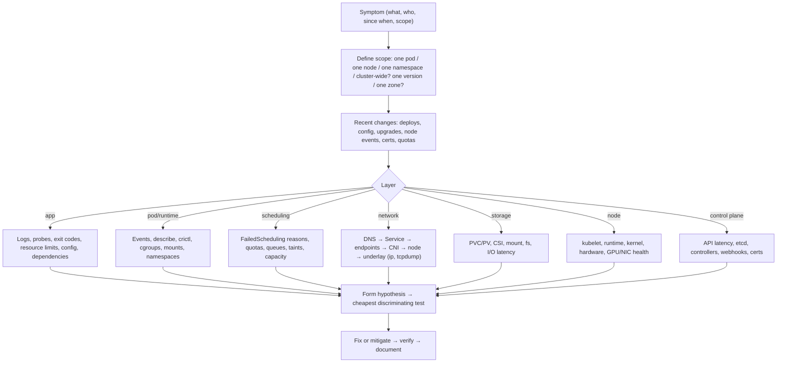

# 5.25 Troubleshooting Kubernetes from the node: crictl, nsenter, tcpdump and ip

| | |
|---|---|
| Level | Advanced |
| Priority tier | 0 |
| Lab venue | Multi-node cluster with root access to a worker; a netshoot image; `kubectl debug`; optional chaos tooling (Chaos Mesh, Litmus) for fault injection |
| Part | Part 5: Kubernetes |
| Status | Drafted, labs **untested** |

## Why this matters for AI infrastructure

Kubernetes failures on GPU platforms rarely announce themselves in `kubectl describe`. The pod says `Running`, the GPU sits idle, and the cause is a mount namespace, a missing device node, a NIC negotiating the wrong speed, a conntrack table full of stale entries, an IB link flapping, or a process stuck in uninterruptible I/O on a parallel filesystem. Speed matters: each minute a 1,000-GPU job is stalled costs real money. This chapter gives a repeatable method (isolate the layer, gather evidence, reduce the problem), the tools that work when Kubernetes' own abstractions are not enough (node-level inspection in the pod's namespaces), and playbooks for the commonly seen failures.

## Prerequisites and outcomes

Needs the whole of Part 5 so far, especially 5.8, 5.9, 5.10, 5.13, and Linux/networking Parts 1 and 2. After this chapter you can:

- Apply a layered diagnostic method (symptom → layer → hypothesis → test) and avoid common troubleshooting traps.
- Use kubectl effectively for diagnosis (describe, events, logs, `get -o yaml`, `jsonpath`, `top`, `debug`, `auth can-i`, `explain`, `diff`, `rollout`, `get --raw`).
- Debug at the node: runtime state with `crictl`, container namespaces with `nsenter`, networking with `ip`, `ss`, `tcpdump`, `conntrack`, `iptables/nft`, storage mounts, cgroups, processes with `strace`/`perf`/`bpftrace`, kernel logs.
- Debug distroless/minimal pods via ephemeral containers and node debug pods.
- Run playbooks for Pending pods, `CrashLoopBackOff`, `ImagePullBackOff`, network failures, DNS, Service issues, storage mount failures, node `NotReady`, OOM/eviction, GPU not visible, NCCL hangs, API slowness, Terminating pods.
- Collect and preserve evidence (support bundles, `sosreport`, `nvidia-bug-report`), and conduct blameless post-incident reviews that improve automation.

## 1. Method



Principles:

1. **Scope first.** Is it one pod, a replica set, all pods on one node (node problem), all pods in a zone (infra/network), everything after a change (rollback candidate)? Differences between failing and healthy instances are the most informative clue.
2. **Observe before changing.** Capture state (describe, logs, events, metrics, `crictl`, `dmesg`) before restarting anything; restarts destroy evidence (previous logs, process state, stuck I/O).
3. **Bisect the path.** Test each hop independently: pod IP vs Service IP vs DNS name; same-node vs cross-node; pod vs host network namespace; within vs outside cluster.
4. **One change at a time**, reversible; note timestamps.
5. **Prefer reproducible minimal tests** (netshoot pod, `curl`, `nc`, `dig`, `iperf3`, `fio`, `nccl-tests`) over reasoning from theory.
6. **Distinguish symptom from cause.** `CrashLoopBackOff` is a symptom; the cause is in the logs/exit code; `OOMKilled` might be a leak, a too-small limit, or `/dev/shm` pressure.
7. **Know the baseline.** What does healthy look like (latency, throughput, utilisation)? Dashboards and a documented "known good" bench (iperf, fio, NCCL) shorten diagnosis.
8. **Time-box and escalate** with evidence; communicate status.

## 2. kubectl toolkit

```bash
# Orientation
kubectl get nodes -o wide; kubectl get pods -A -o wide | grep -v Running
kubectl get events -A --sort-by=.lastTimestamp | tail -30
kubectl get events --field-selector type=Warning -A
kubectl describe node <n> | sed -n '/Conditions/,/Events/p'
# Pod deep-dive
kubectl get pod <p> -o yaml | less
kubectl get pod <p> -o jsonpath='{range .status.containerStatuses[*]}{.name}{"\t"}{.state}{"\t"}{.lastState}{"\n"}{end}'
kubectl describe pod <p>
kubectl logs <p> -c <c> --previous --timestamps --tail=300
kubectl logs -l app=trainer --all-containers --prefix --since=30m --max-log-requests=50
kubectl top pod <p> --containers; kubectl top node
# Exec and debug
kubectl exec -it <p> -c <c> -- sh
kubectl attach -it <p> -c <c>                                                             # attach to PID 1 stdin/stdout when no shell is installed
kubectl config set-context my-context --namespace=mystuff && kubectl config use-context my-context
kubectl apply -f myobj.yaml view-last-applied                                             # or edit-last-applied / set-last-applied
source <(kubectl completion bash)                                                         # enable bash tab completion for kubectl
kubectl debug -it <p> --image=nicolaka/netshoot --target=<c> --share-processes          # ephemeral container sharing namespaces
kubectl debug <p> -it --copy-to=<p>-debug --container=<c> --image=ubuntu -- bash         # copy with changed image/command (crashing app)
kubectl debug node/<n> -it --image=ubuntu -- chroot /host                                 # node debug pod with host filesystem at /host
kubectl cp <p>:/path ./local; kubectl port-forward pod/<p> 8080:80
# API-level
kubectl get --raw /readyz?verbose; kubectl get --raw /metrics | head
kubectl auth can-i create pods -n ns --as=system:serviceaccount:ns:sa
kubectl api-resources; kubectl explain pod.spec.containers.securityContext
kubectl diff -f manifest.yaml; kubectl rollout status deploy/x; kubectl rollout history deploy/x; kubectl rollout undo deploy/x
kubectl get pods -o custom-columns=NAME:.metadata.name,NODE:.spec.nodeName,IP:.status.podIP,QOS:.status.qosClass
kubectl get pod -A -o json | jq -r '.items[] | select(.status.containerStatuses[]?.lastState.terminated.reason=="OOMKilled") | .metadata.namespace+"/"+.metadata.name'
```

Reading `describe`: **Events** are chronological (Scheduled → Pulling → Pulled → Created → Started; Warnings like `FailedScheduling`, `FailedMount`, `Unhealthy`, `BackOff`, `Evicted`, `Killing`); **State/Last State** shows exit code and reason (137 = SIGKILL/OOM, 143 = SIGTERM, 1/2 = app error, 126/127 = command not executable/not found); **Conditions** (PodScheduled, Initialized, ContainersReady, Ready); **QoS**, **Node**, **IPs**, **Volumes**, **Tolerations**.

Debug image tips: keep a team-approved toolbox image (`netshoot`, `busybox`, or your own with `curl dig nc tcpdump iperf3 strace perf nvidia-smi ibstat`). Ephemeral containers need the `EphemeralContainers` feature (GA) and RBAC for `pods/ephemeralcontainers`; they cannot be removed once added. `kubectl debug node/...` runs a privileged pod with host namespaces: restrict by RBAC/policy (5.16, 5.21) and clean up after.

## 3. Node-level toolkit

### 3.1 Container runtime state (crictl / ctr)

```bash
crictl pods; crictl ps -a; crictl images
crictl inspectp <pod-id> | jq '.status.network, .info.runtimeSpec.linux.namespaces, .info.cgroupPath'
crictl inspect <ctr-id> | jq '.info.pid, .status.state, .status.exitCode, .status.reason, .info.runtimeSpec.mounts, .info.runtimeSpec.linux.resources'
crictl logs --tail 100 <ctr-id>; crictl stats; crictl exec -it <ctr-id> sh
crictl pull <image>; crictl rmi <id>; crictl imagefsinfo; crictl info | jq '.config.containerd'
journalctl -u kubelet -u containerd --since "-30 min" | grep -E "error|fail|timeout|oom" -i | tail -50
ctr -n k8s.io tasks ls; ctr -n k8s.io containers info <id>
```

Map Kubernetes to runtime: pod UID → `/var/log/pods/<ns>_<name>_<uid>/`; container ID in `kubectl get pod -o jsonpath='{.status.containerStatuses[0].containerID}'` (`containerd://<id>`); `crictl pods --name`/`--namespace` filters.

### 3.2 Namespaces: nsenter, lsns, unshare

```bash
PID=$(crictl inspect --output go-template --template '{{.info.pid}}' <ctr-id>)
sudo nsenter -t $PID -n ip addr; sudo nsenter -t $PID -n ip route; sudo nsenter -t $PID -n ss -tnap
sudo nsenter -t $PID -n -- tcpdump -ni eth0 -c 50 port 8000
sudo nsenter -t $PID -m ls /; sudo nsenter -t $PID -m cat /proc/mounts; sudo nsenter -t $PID -m df -h
sudo nsenter -t $PID -p -r ps aux            # PID namespace + its root
sudo nsenter -t $PID -a bash                   # enter all namespaces (needs a shell in the image’s rootfs: use -a with host binaries via -n/-m selectively)
sudo lsns -p $PID                              # which namespaces this process belongs to
ls -l /proc/$PID/ns; cat /proc/$PID/cgroup; cat /proc/$PID/status | grep -E 'Cap|Seccomp|NoNewPrivs'
sudo ls -l /proc/$PID/fd | head; sudo cat /proc/$PID/limits; sudo cat /proc/$PID/stack  # kernel stack (D-state)
```

Use `nsenter -n` to run **host tools inside the pod's network namespace** (host `tcpdump`, `ip`, `ss`, `curl` binaries) without needing them in the image. `nsenter -m` with `-r`/chroot paths shows the container filesystem as the container sees it.

### 3.3 Networking tools

```bash
ip -br addr; ip -br link; ip route; ip rule; ip neigh; ip -s link show eth0           # errors/drops
bridge fdb show | head; bridge link; ip -d link show vxlan.calico
ss -ltnp; ss -s; ss -tin dst 10.0.0.5                                                 # listeners, summaries, TCP internals (rtt, cwnd, retrans)
nstat -az | grep -E 'Retrans|ListenOverflows|ListenDrops|TCPTimeouts'; netstat -s | head -40
conntrack -S; conntrack -L | wc -l; conntrack -L -p tcp --dport 443 | head
iptables-save | grep -E 'KUBE-SVC|KUBE-SEP|CNI|cali-|DROP|REJECT' | head -50; nft list ruleset | head -80
ipvsadm -Ln                                                                           # IPVS mode
tcpdump -ni any host 10.244.2.7 and tcp port 8000 -w /tmp/cap.pcap -c 2000            # then open in Wireshark
tcpdump -ni eth0 'icmp or (udp port 53)' -vv
tcpdump -ni any 'tcp[tcpflags] & (tcp-rst) != 0' -c 50                                  # resets
traceroute -n -T -p 8000 10.244.2.7; mtr -n -T -P 8000 10.244.2.7
ping -M do -s 1422 10.244.2.7                                                         # path MTU
curl -sv --connect-timeout 3 http://svc.ns.svc:8000/health -o /dev/null -w 'dns=%{time_namelookup} connect=%{time_connect} ttfb=%{time_starttransfer} total=%{time_total}\n'
dig +short svc.ns.svc.cluster.local @<coredns-ip>; dig +trace example.com
ethtool eth0; ethtool -S eth0 | grep -iE 'err|drop|discard'; ethtool -k eth0 | grep -E 'tso|gso|gro|udp_tnl'
ibstat; ibv_devinfo; rdma link; ibdev2netdev; perfquery; ib_write_bw -d mlx5_0 <peer>   # RDMA (Part 12)
```

Method for pod connectivity: from the **client pod** test (1) DNS, (2) ClusterIP, (3) a specific backend pod IP (bypasses kube-proxy), (4) the same from the **node** (host netns) vs inside the pod netns; capture on the **client veth**, the **node uplink**, and the **server veth** to see where packets disappear; check policy counters (`iptables -L -nv`, `cilium monitor --type drop`, `hubble observe --verdict DROPPED`), conntrack (`conntrack -E` live events), MTU, and ARP/neigh state.

### 3.4 Storage and filesystem

```bash
findmnt -T /var/lib/kubelet/pods/<uid>/volumes/kubernetes.io~csi/<pv>/mount; findmnt -R /var/lib/kubelet | head -40
lsblk -f; blkid; df -hT; df -i; mount | grep -E 'nfs|lustre|ceph|fuse'
dmesg -T | grep -iE 'ext4|xfs|nfs|lustre|blk_update_request|I/O error|nvme'
iostat -x 1 5; pidstat -d 1 5; cat /proc/pressure/io; iotop -oPa
nfsstat -c; nfsiostat 1; mountstats /mnt/x
fio --name=rd --filename=/data/test --rw=randread --bs=4k --iodepth=32 --direct=1 --runtime=30 --time_based --size=2g
ps -eo pid,stat,wchan:30,cmd | awk '$2 ~ /D/'                                          # uninterruptible sleep
kubectl get volumeattachment; kubectl get pv,pvc -A | grep -v Bound
```

### 3.5 Processes and performance

```bash
top -H; htop; pidstat -u -r -w 1; mpstat -P ALL 1; vmstat 1; sar -n DEV 1
perf top -p $PID; perf record -F 99 -g -p $PID -- sleep 30; perf report
strace -f -tt -T -p $PID -e trace=network,file -s 256 -o /tmp/strace.out       # syscalls (careful with overhead)
bpftrace -e 'tracepoint:syscalls:sys_enter_openat /pid==PID/ { printf("%s\n", str(args->filename)); }'
py-spy dump --pid $PID; py-spy top --pid $PID                                    # Python stacks without attaching a debugger
gdb -p $PID -batch -ex 'thread apply all bt' | head -80                         # native stacks (hung C/C++/CUDA processes)
cat /proc/$PID/stack; cat /proc/$PID/wchan; cat /proc/$PID/sched | head          # why is it sleeping?
cat /sys/fs/cgroup$(cut -d: -f3 /proc/$PID/cgroup)/{memory.events,cpu.stat,memory.max,memory.current,pids.current}
dmesg -T | tail -100; journalctl -k --since "-1h" | grep -iE 'oom|xid|nvrm|mlx|error|fail'
```

### 3.6 GPU and fabric hardware

```bash
nvidia-smi; nvidia-smi -q | less; nvidia-smi topo -m; nvidia-smi nvlink -s; nvidia-smi -q -d ECC,PAGE_RETIREMENT,PERFORMANCE,CLOCK
nvidia-smi --query-gpu=index,name,temperature.gpu,power.draw,clocks.sm,clocks_throttle_reasons.active,pcie.link.gen.current,pcie.link.width.current,ecc.errors.uncorrected.volatile.total --format=csv
dcgmi discovery -l; dcgmi health -c; dcgmi diag -r 2; dcgmi dmon -e 203,252,1004 -d 1000
journalctl -k | grep -E "Xid|NVRM"; dmesg -T | grep -i xid                                    # Xid error codes (13, 31, 43, 48, 61, 63, 64, 74, 79, ...)
nvidia-bug-report.sh                                                                          # support bundle
lspci -vv -s <addr> | grep -E 'LnkSta|LnkCap|AER'; cat /sys/bus/pci/devices/<addr>/aer_dev_*
fabric manager: systemctl status nvidia-fabricmanager; nvidia-smi nvlink -e
all_reduce_perf -b 8 -e 1G -f 2 -g 8                                                          # nccl-tests on node
NCCL_DEBUG=INFO NCCL_DEBUG_SUBSYS=INIT,NET,GRAPH ...                                         # inside the job
```

Evidence discipline: copy `dmesg`, journal ranges, `nvidia-bug-report`, `sosreport`/`kubectl cluster-info dump`, pcaps and metric screenshots to an incident folder with timestamps before remediation.

## 4. Failure playbooks

### 4.1 Pod Pending

1. `kubectl describe pod`: read the `FailedScheduling` message (counts by reason).
2. Resource: `Insufficient nvidia.com/gpu` → `kubectl describe nodes | grep -A8 Allocated`; check fragmentation, taints, device plugin health (`kubectl get nodes -o json | jq ... allocatable`), pending Kueue admission (`kubectl get workload`).
3. Placement: affinity/selector/taints/topology spread → relax or fix labels.
4. Volume: unbound PVC, zone conflict, attach limits (5.17).
5. Quota: `exceeded quota` at creation (not Pending, but rejected) vs Kueue not admitted (Pending with no pods).
6. Scheduler itself: `kubectl logs` scheduler, leader lease, API latency.

### 4.2 `ContainerCreating` for a long time

Events usually name it: `FailedMount` (CSI/volume: `kubectl get volumeattachment`, driver logs, `findmnt`), `FailedCreatePodSandBox` (CNI: `/etc/cni/net.d`, IPAM, MTU, runtime logs), `Pulling` (large image: registry bandwidth, `crictl images`, mirror), `FailedAttachVolume`, device plugin allocation errors, `ErrImagePull`. Look at kubelet log lines containing the pod name.

### 4.3 `CrashLoopBackOff`

`kubectl logs --previous` for the crash; exit code decides: 137 (OOM or SIGKILL: check `OOMKilled`, node pressure, memory limit vs `/dev/shm` and page cache), 139 (segfault: image/driver mismatch, bad CUDA lib), 126/127 (entrypoint missing/permission), 1/2 (app error: config, missing secret/env, dependency down, model path), 143 (SIGTERM: probe kill or eviction). Reproduce with `kubectl debug --copy-to` overriding the command to `sleep infinity`; check mounts, env, DNS, GPU visibility (`nvidia-smi`), permissions.

### 4.4 Network and Service failures

Use the 5.10 flow (DNS → endpoints → rules → datapath → backend) and these specific checks: pod egress to Internet (SNAT/NAT gateway), cross-node pods (CNI/underlay/MTU), policy drops (Hubble/Calico), conntrack exhaustion, `nf_conntrack` insert failures, kube-proxy not running on a node, stale IPVS entries, NodePort source IP and traffic policy, ingress/gateway 502/504s (5.12), DNS 5 s delays (5.11), host firewall/security groups, asymmetric routing with multiple NICs (rp_filter: `sysctl net.ipv4.conf.all.rp_filter`).

### 4.5 Node `NotReady`

`kubectl describe node` (reason/message), then on the node: `systemctl status kubelet containerd`, `journalctl -u kubelet -n 200`, `df -h /var/lib/kubelet /var/lib/containerd`, `free -h`, `dmesg -T | tail`, certificate validity (`openssl x509 -in /var/lib/kubelet/pki/kubelet-client-current.pem -noout -dates`), clock sync (`chronyc tracking`), network to the API server (`curl -k https://<api>:6443/healthz`), CNI readiness, PLEG, runtime socket responsiveness (`crictl ps` timing). Typical causes: kubelet cert expiry, runtime hang, disk full, OOM of system daemons, NIC down, time skew, firewall change.

### 4.6 OOM and eviction

Pod `OOMKilled`: cgroup memory events (`memory.events oom_kill`), working set vs limit, tmpfs/`/dev/shm` usage (`df -h /dev/shm`), page cache (counted but reclaimable), GPU pinned memory, dataloader workers × per-worker memory, memory leaks (`tracemalloc`, `memray`). Node-level OOM: `dmesg | grep -i 'out of memory'` shows victim and constraint (`CONSTRAINT_MEMCG` vs `CONSTRAINT_NONE`), kubelet eviction events (`Evicted`), reservations (5.9). Fix limits/requests, reserve system memory, reduce workers, enforce Guaranteed QoS.

### 4.7 Terminating pods that never finish

`kubectl get pod -o yaml` → `deletionTimestamp`, `finalizers`; on node: container still running? (`crictl ps`), process in D state (`/proc/PID/stack`, `wchan`: NFS/Lustre hangs), unmount stuck (`lsof +D`, `fuser -vm`), kubelet unresponsive (node NotReady), runtime shim hung, CNI DEL failing. Mitigate: fix the underlying I/O, restart kubelet/runtime, delete node object if node is gone (`kubectl delete node`), as last resort `--force --grace-period=0` after confirming no process can still write to RWO storage.

### 4.8 DNS issues

Test inside the pod (`/etc/resolv.conf`, `dig @kube-dns`, search path effects), CoreDNS pods/endpoints/logs/metrics, NodeLocal cache, upstream resolvers, conntrack races, NetworkPolicy blocking UDP/TCP 53, headless readiness (5.11).

### 4.9 Storage problems

PVC Pending/Multi-Attach/FailedMount playbook (5.17); filesystem full or read-only (`dmesg` remount-ro), inode exhaustion, quota; slow I/O (iostat, fio, backend metrics), D-state processes; CSI node plugin crash; FUSE mount broken.

### 4.10 GPU workloads

| Symptom | Checks |
|---|---|
| Pod can't see GPU (`nvidia-smi` missing/NVML error) | `nvidia.com/gpu` requested? device plugin/ClusterPolicy healthy? runtime configured (5.2)? `crictl inspect` devices/mounts; `NVIDIA_VISIBLE_DEVICES`; driver loaded on host; RuntimeClass |
| `CUDA error: no kernel image is available` / `driver version insufficient` | Host driver vs image CUDA; compute capability build flags (5.1) |
| Job slow, GPUs idle | Dataloader/storage bottleneck, CPU throttling, `/dev/shm`, NCCL fallback to TCP, straggler rank; DCGM tensor activity; `py-spy` on workers |
| NCCL hang at init | Rendezvous/DNS (headless Service, `publishNotReadyAddresses`), firewall/NetworkPolicy, `NCCL_SOCKET_IFNAME`, wrong interface, MTU, IB device missing in container; `NCCL_DEBUG=INFO` per rank; run `all_reduce_perf` across the same nodes |
| NCCL timeout mid-training | Failing link/GPU (Xid, PCIe/IB errors), straggler, preemption of one rank, switch congestion; correlate time with node events |
| One node slow | GPU throttling (`clocks_throttle_reasons`), ECC page retirements, PCIe link downtrained (`LnkSta`), NIC speed, noisy neighbour, power cap |
| `Xid 79 GPU has fallen off the bus` | Hardware/power/PCIe; drain node, reset or RMA (Part 17) |
| MIG/profile mismatches | `nvidia-smi mig -lgi`, MIG manager logs, node labels vs requested resource names |
| Training hung with all ranks idle | Deadlock in collective ordering/data loader; `py-spy dump` on each rank; `torch.distributed` timeouts; NCCL flight recorder |

### 4.11 Control-plane slowness

API latency by verb/resource, APF rejections, etcd fsync and DB size, controller queue depth, admission webhook latency, noisy clients in audit logs, node count/watch load (5.5). Mitigate: throttle clients, fix webhooks, defrag etcd, increase resources.

### 4.12 Cluster-wide incidents after change

Check recent changes (GitOps commits, Helm upgrades, node pool updates, certificate renewals, webhook/policy changes, CRD upgrades); roll back the most recent risky change; compare working vs failing zones/pools; look at shared dependencies (DNS, registry, identity provider, storage backend, time source, license servers).

## 5. Chaos and game days

Prove playbooks work by injecting faults in staging: kill pods and nodes, delay/drop packets (`tc netem`, Chaos Mesh NetworkChaos), fill disks, corrupt DNS, stop kubelet, break CNI, throttle CPU, inject GPU Xid events via simulators where available, expire a certificate in a lab, revoke registry credentials, take down etcd member. Measure time-to-detect and time-to-recover; update runbooks and alerts accordingly (5.19, 5.24).

## 6. Evidence, communication and learning

- **Incident log**: timeline (UTC), observations, commands run, changes made, who did what; record exact error strings.
- **Artifacts**: `kubectl get ... -o yaml` snapshots, `kubectl describe`, pod logs (including `--previous`), node journals, `dmesg`, pcaps, metrics screenshots/links with time ranges, `nvidia-bug-report`, Hubble flows, audit log excerpts. For support cases: `kubectl cluster-info dump`, `sosreport`, vendor bundles.
- **Communication**: status updates at fixed intervals; clear impact statement; ETA only with basis.
- **Post-incident review** (blameless): timeline, contributing factors (not "root cause" singular), detection gaps, mitigation effectiveness, action items with owners (automation, alerts, guardrails, docs, tests), and share learnings. Convert recurring manual diagnosis into automated checks (preflight, node problem detector rules, health probes).

## 7. Lab (untested)

1. **Toolbox**: build a debug image (netshoot-based plus nvidia-smi/ibstat/perftest/py-spy/fio); practise `kubectl debug` ephemeral, copy, and node modes; write the RBAC/policy that allows it only for the platform team.
2. **Pod-to-pod trace**: client pod to server pod across nodes; capture at client veth (via `nsenter -n tcpdump` from the host), node uplink, server veth; induce loss with `tc netem` and with a NetworkPolicy drop; locate where packets vanish using the three captures plus policy counters.
3. **Service failures**: break a Service five ways (selector typo, wrong targetPort, readiness failing, kube-proxy rule flush, conntrack stale UDP) and diagnose each using the method; record time-to-diagnose.
4. **Namespace tour**: for a running pod, from the host `nsenter` into net/mnt/pid separately, run host `ss`, `tcpdump`, `lsof` in each; compare outputs with `kubectl exec`; find the pod's veth and cgroup.
5. **Crash analysis**: create pods crashing with exit 1, 127, 137 (OOM), 139 (segfault via `kill -SEGV`), 143; interpret using `describe`, `--previous`, `dmesg`, cgroup events; reproduce OOM with `/dev/shm` pressure.
6. **Node NotReady drill**: fill the disk, kill containerd, expire a kubelet client cert (lab), block API access with iptables, skew the clock; diagnose each from symptoms alone; time it.
7. **D-state hang**: mount an NFS export, block the server with a firewall, run a pod writing to it, delete the pod; observe Terminating, find D-state processes via `/proc/PID/stack`, recover.
8. **GPU incident simulation**: (on GPU nodes) run a pod that doesn't see GPUs due to a mis-set runtime class; throttle clocks with `nvidia-smi -lgc` or power cap and detect via DCGM throttle reasons and step time; downtrain a PCIe link in a lab if possible, or use fake exporters; practise the table in 4.10.
9. **NCCL hang**: run a 2-node nccl-tests job; block a peer with NetworkPolicy/iptables; observe the hang pattern and NCCL debug output; fix; compare with wrong `NCCL_SOCKET_IFNAME`.
10. **Control-plane slowness**: create a noisy client (looping `kubectl get pods -A -w`) and a slow webhook; find the sources via metrics and audit logs; remediate with APF and webhook fixes.
11. **Game day**: run a 60-minute exercise with 3 injected faults unknown to responders; score detection, diagnosis, and recovery; write the post-incident review and update runbooks.
12. **Automate**: turn two playbooks into scripts or node-problem-detector custom plugins that run checks and publish node conditions/metrics.
13. **Clean up**.

Mark tested only after execution.

## 8. Common mistakes

- Restarting first and diagnosing later (losing evidence); deleting crashing pods instead of reading `--previous` logs.
- Debugging the application when the node, network or storage is at fault (or vice versa); not narrowing scope.
- Trusting `Running` status; ignoring readiness and events.
- Testing only via Service names (adds DNS, NAT, policy) when a direct pod IP test would localise faster.
- Running `tcpdump` only on the node's primary interface and missing veth/bridge hops; forgetting that tools in the host namespace see different interfaces than the pod.
- `kubectl delete pod --force` on stateful workloads; removing finalizers without understanding cleanup.
- Ignoring kernel logs (Xid, OOM, I/O errors).
- Changing multiple things at once; undocumented fixes; no post-incident learning.
- Leaving privileged debug pods and ephemeral containers running.
- Alerts that duplicate what an engineer would manually check at 3 a.m. but without the context links.

## 9. Interview angles

- "A pod is stuck in ContainerCreating. Walk me through diagnosing it." 
- "A service is intermittently failing. How do you localise whether it's DNS, kube-proxy, CNI or the app?" 
- "How do you capture traffic from inside a pod without tools in the image?" (`nsenter -n` from the node, ephemeral containers.)
- "A training job hangs after hours. What do you check?" (ranks, NCCL, Xid, `py-spy`, network counters, stragglers.)
- "A node goes NotReady intermittently. What are the likely causes and how do you confirm?" 
- "What do exit codes 137, 139, 143 mean?" 
- "How do you debug a distroless container?" 
- "How do you run effective incident response and post-incident reviews?" 

## 10. Checkpoint questions (40)

1. First step in troubleshooting? **A:** Define scope/symptom and recent changes.
2. Why bisect the path? **A:** Isolate the failing hop.
3. Exit code 137 means? **A:** SIGKILL (often OOM).
4. 143? **A:** SIGTERM.
5. 139? **A:** SIGSEGV.
6. 126/127? **A:** Not executable / not found.
7. Previous logs flag? **A:** `--previous`.
8. Ephemeral container command, and how does `kubectl attach` differ from `kubectl exec`? **A:** `kubectl debug -it --image --target`; `kubectl attach -it <pod-name>` attaches to the existing running process's `stdin`/`stdout` without spawning a new shell process.
9. Node debug command? **A:** `kubectl debug node/<n> -it --image=...`.
10. Runtime CLI for CRI? **A:** `crictl`.
11. Get container PID? **A:** `crictl inspect` → `.info.pid`.
12. Enter pod network ns from host? **A:** `nsenter -t PID -n`.
13. See namespaces of a PID? **A:** `lsns -p` / `/proc/PID/ns`.
14. Cgroup path? **A:** `/proc/PID/cgroup`.
15. OOM evidence? **A:** `memory.events`, `dmesg`.
16. Conntrack stats? **A:** `conntrack -S`.
17. Packet capture tool? **A:** `tcpdump`.
18. PMTU test? **A:** `ping -M do -s`.
19. DNS test tool? **A:** `dig`.
20. TCP internals? **A:** `ss -tin`.
21. Kernel stack of hung proc? **A:** `/proc/PID/stack`.
22. Python stack without attach? **A:** `py-spy dump`.
23. Native stacks? **A:** `gdb -p`.
24. Syscall tracing? **A:** `strace`.
25. GPU health tool? **A:** `dcgmi health` / `nvidia-smi -q`.
26. Xid error source? **A:** Kernel log (`dmesg`/journal).
27. GPU support bundle? **A:** `nvidia-bug-report.sh`.
28. PCIe link status? **A:** `lspci -vv` LnkSta.
29. NCCL debug env? **A:** `NCCL_DEBUG=INFO`.
30. RDMA tools? **A:** `ibstat`, `ib_write_bw`.
31. Stuck Terminating cause? **A:** Finalizers, D-state I/O, unmount, kubelet down.
32. FailedMount first check? **A:** Events, VolumeAttachment, CSI logs.
33. FailedCreatePodSandBox suspects? **A:** CNI/IPAM/runtime.
34. NotReady first checks? **A:** kubelet/runtime status, disk, certs, API reachability.
35. Pending message source? **A:** Scheduler event `FailedScheduling`.
36. API slowness metrics? **A:** `apiserver_request_duration_seconds`, APF, etcd fsync.
37. Compare healthy vs failing means? **A:** Find differentiating factor.
38. Chaos purpose? **A:** Validate runbooks and detection.
39. Blameless review goal? **A:** Systemic fixes.
40. Evidence to preserve? **A:** Logs, describes, journals, pcaps, metrics, bundles.

## 11. Sources and review notes

**Written in original words.** Principal sources:

- Brendan Burns, Joe Beda, Kelsey Hightower and Lachlan Evenson, *Kubernetes: Up and Running* (`kubernetes-up-and-running-3rd-edition`, 3rd edition; Chapter 4: `4. Common kubectl Commands` — read in full for `kubectl config set-context`/`use-context`, `view-last-applied`/`edit-last-applied`/`set-last-applied`, `kubectl attach`, and `kubectl completion bash`).
- Josh Rosso et al., *Production Kubernetes* (operations and troubleshooting chapters).
- James Strong and Vallery Lancey, *Networking and Kubernetes* (debugging network paths and tools).
- The author's `nvidia-devops` repository, volume 03 (troubleshooting scenarios, `crictl` debugging appendix, production logs analysis).
- Kubernetes documentation on debugging pods, services, nodes and ephemeral containers; Linux tooling manuals; NVIDIA DCGM and NCCL documentation.
- Examples are the author's constructions.

**Flagged for verification before publishing:** `crictl` output paths for your runtime version, `nsenter` flags on your distribution, Xid code meanings (verify against NVIDIA's current Xid catalogue), metric names, and every command listing; all labs are **untested**.
