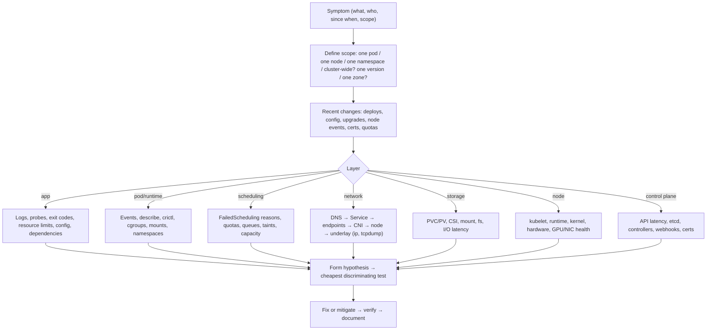

# 5.25 Troubleshooting Kubernetes from the node: crictl, nsenter, tcpdump and ip

| | |
|---|---|
| Level | Advanced |
| Priority tier | 0 |
| Lab venue | Multi-node cluster with root access to a worker; a netshoot image; `kubectl debug`; optional chaos tooling (Chaos Mesh, Litmus) for fault injection |
| Part | Part 5: Kubernetes |
| Status | Drafted, labs **untested** |

## Why this matters for AI infrastructure

Kubernetes failures on GPU platforms rarely announce themselves in `kubectl describe`. The pod says `Running`, the GPU sits idle, and the cause is a mount namespace, a missing device node, a NIC negotiating the wrong speed, a conntrack table full of stale entries, an IB link flapping, or a process stuck in uninterruptible I/O on a parallel filesystem. Speed matters: each minute a 1,000-GPU job is stalled costs real money. This chapter gives a repeatable method (isolate the layer, gather evidence, reduce the problem), the tools that work when Kubernetes' own abstractions are not enough (node-level inspection in the pod's namespaces), and playbooks for the commonly seen failures.

## Prerequisites and outcomes

Needs the whole of Part 5 so far, especially 5.8, 5.9, 5.10, 5.13, and Linux/networking Parts 1 and 2. After this chapter you can:

- Apply a layered diagnostic method (symptom → layer → hypothesis → test) and avoid common troubleshooting traps.
- Use kubectl effectively for diagnosis (describe, events, logs, `get -o yaml`, `jsonpath`, `top`, `debug`, `auth can-i`, `explain`, `diff`, `rollout`, `get --raw`).
- Debug at the node: runtime state with `crictl`, container namespaces with `nsenter`, networking with `ip`, `ss`, `tcpdump`, `conntrack`, `iptables/nft`, storage mounts, cgroups, processes with `strace`/`perf`/`bpftrace`, kernel logs.
- Debug distroless/minimal pods via ephemeral containers and node debug pods.
- Run playbooks for Pending pods, `CrashLoopBackOff`, `ImagePullBackOff`, network failures, DNS, Service issues, storage mount failures, node `NotReady`, OOM/eviction, GPU not visible, NCCL hangs, API slowness, Terminating pods.
- Collect and preserve evidence (support bundles, `sosreport`, `nvidia-bug-report`), and conduct blameless post-incident reviews that improve automation.

## 1. Method



Principles:

1. **Scope first.** Is it one pod, a replica set, all pods on one node (node problem), all pods in a zone (infra/network), everything after a change (rollback candidate)? Differences between failing and healthy instances are the most informative clue.
2. **Observe before changing.** Capture state (describe, logs, events, metrics, `crictl`, `dmesg`) before restarting anything; restarts destroy evidence (previous logs, process state, stuck I/O).
3. **Bisect the path.** Test each hop independently: pod IP vs Service IP vs DNS name; same-node vs cross-node; pod vs host network namespace; within vs outside cluster.
4. **One change at a time**, reversible; note timestamps.
5. **Prefer reproducible minimal tests** (netshoot pod, `curl`, `nc`, `dig`, `iperf3`, `fio`, `nccl-tests`) over reasoning from theory.
6. **Distinguish symptom from cause.** `CrashLoopBackOff` is a symptom; the cause is in the logs/exit code; `OOMKilled` might be a leak, a too-small limit, or `/dev/shm` pressure.
7. **Know the baseline.** What does healthy look like (latency, throughput, utilisation)? Dashboards and a documented "known good" bench (iperf, fio, NCCL) shorten diagnosis.
8. **Time-box and escalate** with evidence; communicate status.

## 2. kubectl toolkit

```bash
# Orientation
kubectl get nodes -o wide; kubectl get pods -A -o wide | grep -v Running
kubectl get events -A --sort-by=.lastTimestamp | tail -30
kubectl get events --field-selector type=Warning -A
kubectl describe node <n> | sed -n '/Conditions/,/Events/p'
# Pod deep-dive
kubectl get pod <p> -o yaml | less
kubectl get pod <p> -o jsonpath='{range .status.containerStatuses[*]}{.name}{"\t"}{.state}{"\t"}{.lastState}{"\n"}{end}'
kubectl describe pod <p>
kubectl logs <p> -c <c> --previous --timestamps --tail=300
kubectl logs -l app=trainer --all-containers --prefix --since=30m --max-log-requests=50
kubectl top pod <p> --containers; kubectl top node
# Exec and debug
kubectl exec -it <p> -c <c> -- sh
kubectl attach -it <p> -c <c>                                                             # attach to PID 1 stdin/stdout when no shell is installed
kubectl config set-context my-context --namespace=mystuff && kubectl config use-context my-context
kubectl apply -f myobj.yaml view-last-applied                                             # or edit-last-applied / set-last-applied
source <(kubectl completion bash)                                                         # enable bash tab completion for kubectl
kubectl debug -it <p> --image=nicolaka/netshoot --target=<c> --share-processes          # ephemeral container sharing namespaces
kubectl debug <p> -it --copy-to=<p>-debug --container=<c> --image=ubuntu -- bash         # copy with changed image/command (crashing app)
kubectl debug node/<n> -it --image=ubuntu -- chroot /host                                 # node debug pod with host filesystem at /host
kubectl cp <p>:/path ./local; kubectl port-forward pod/<p> 8080:80
# API-level
kubectl get --raw /readyz?verbose; kubectl get --raw /metrics | head
kubectl auth can-i create pods -n ns --as=system:serviceaccount:ns:sa
kubectl api-resources; kubectl explain pod.spec.containers.securityContext
kubectl diff -f manifest.yaml; kubectl rollout status deploy/x; kubectl rollout history deploy/x; kubectl rollout undo deploy/x
kubectl get pods -o custom-columns=NAME:.metadata.name,NODE:.spec.nodeName,IP:.status.podIP,QOS:.status.qosClass
kubectl get pod -A -o json | jq -r '.items[] | select(.status.containerStatuses[]?.lastState.terminated.reason=="OOMKilled") | .metadata.namespace+"/"+.metadata.name'
```

Reading `describe`: **Events** are chronological (Scheduled → Pulling → Pulled → Created → Started; Warnings like `FailedScheduling`, `FailedMount`, `Unhealthy`, `BackOff`, `Evicted`, `Killing`); **State/Last State** shows exit code and reason (137 = SIGKILL/OOM, 143 = SIGTERM, 1/2 = app error, 126/127 = command not executable/not found); **Conditions** (PodScheduled, Initialized, ContainersReady, Ready); **QoS**, **Node**, **IPs**, **Volumes**, **Tolerations**.

Debug image tips: keep a team-approved toolbox image (`netshoot`, `busybox`, or your own with `curl dig nc tcpdump iperf3 strace perf nvidia-smi ibstat`). Ephemeral containers need the `EphemeralContainers` feature (GA) and RBAC for `pods/ephemeralcontainers`; they cannot be removed once added. `kubectl debug node/...` runs a privileged pod with host namespaces: restrict by RBAC/policy (5.16, 5.21) and clean up after.

## 3. Node-level toolkit

### 3.1 Container runtime state (crictl / ctr)

```bash
crictl pods; crictl ps -a; crictl images
crictl inspectp <pod-id> | jq '.status.network, .info.runtimeSpec.linux.namespaces, .info.cgroupPath'
crictl inspect <ctr-id> | jq '.info.pid, .status.state, .status.exitCode, .status.reason, .info.runtimeSpec.mounts, .info.runtimeSpec.linux.resources'
crictl logs --tail 100 <ctr-id>; crictl stats; crictl exec -it <ctr-id> sh
crictl pull <image>; crictl rmi <id>; crictl imagefsinfo; crictl info | jq '.config.containerd'
journalctl -u kubelet -u containerd --since "-30 min" | grep -E "error|fail|timeout|oom" -i | tail -50
ctr -n k8s.io tasks ls; ctr -n k8s.io containers info <id>
```

Map Kubernetes to runtime: pod UID → `/var/log/pods/<ns>_<name>_<uid>/`; container ID in `kubectl get pod -o jsonpath='{.status.containerStatuses[0].containerID}'` (`containerd://<id>`); `crictl pods --name`/`--namespace` filters.

### 3.2 Namespaces: nsenter, lsns, unshare

```bash
PID=$(crictl inspect --output go-template --template '{{.info.pid}}' <ctr-id>)
sudo nsenter -t $PID -n ip addr; sudo nsenter -t $PID -n ip route; sudo nsenter -t $PID -n ss -tnap
sudo nsenter -t $PID -n -- tcpdump -ni eth0 -c 50 port 8000
sudo nsenter -t $PID -m ls /; sudo nsenter -t $PID -m cat /proc/mounts; sudo nsenter -t $PID -m df -h
sudo nsenter -t $PID -p -r ps aux            # PID namespace + its root
sudo nsenter -t $PID -a bash                   # enter all namespaces (needs a shell in the image’s rootfs: use -a with host binaries via -n/-m selectively)
sudo lsns -p $PID                              # which namespaces this process belongs to
ls -l /proc/$PID/ns; cat /proc/$PID/cgroup; cat /proc/$PID/status | grep -E 'Cap|Seccomp|NoNewPrivs'
sudo ls -l /proc/$PID/fd | head; sudo cat /proc/$PID/limits; sudo cat /proc/$PID/stack  # kernel stack (D-state)
```

Use `nsenter -n` to run **host tools inside the pod's network namespace** (host `tcpdump`, `ip`, `ss`, `curl` binaries) without needing them in the image. `nsenter -m` with `-r`/chroot paths shows the container filesystem as the container sees it.

### 3.3 Networking tools

```bash
ip -br addr; ip -br link; ip route; ip rule; ip neigh; ip -s link show eth0           # errors/drops
bridge fdb show | head; bridge link; ip -d link show vxlan.calico
ss -ltnp; ss -s; ss -tin dst 10.0.0.5                                                 # listeners, summaries, TCP internals (rtt, cwnd, retrans)
nstat -az | grep -E 'Retrans|ListenOverflows|ListenDrops|TCPTimeouts'; netstat -s | head -40
conntrack -S; conntrack -L | wc -l; conntrack -L -p tcp --dport 443 | head
iptables-save | grep -E 'KUBE-SVC|KUBE-SEP|CNI|cali-|DROP|REJECT' | head -50; nft list ruleset | head -80
ipvsadm -Ln                                                                           # IPVS mode
tcpdump -ni any host 10.244.2.7 and tcp port 8000 -w /tmp/cap.pcap -c 2000            # then open in Wireshark
tcpdump -ni eth0 'icmp or (udp port 53)' -vv
tcpdump -ni any 'tcp[tcpflags] & (tcp-rst) != 0' -c 50                                  # resets
traceroute -n -T -p 8000 10.244.2.7; mtr -n -T -P 8000 10.244.2.7
ping -M do -s 1422 10.244.2.7                                                         # path MTU
curl -sv --connect-timeout 3 http://svc.ns.svc:8000/health -o /dev/null -w 'dns=%{time_namelookup} connect=%{time_connect} ttfb=%{time_starttransfer} total=%{time_total}\n'
dig +short svc.ns.svc.cluster.local @<coredns-ip>; dig +trace example.com
ethtool eth0; ethtool -S eth0 | grep -iE 'err|drop|discard'; ethtool -k eth0 | grep -E 'tso|gso|gro|udp_tnl'
ibstat; ibv_devinfo; rdma link; ibdev2netdev; perfquery; ib_write_bw -d mlx5_0 <peer>   # RDMA (Part 12)
```

Method for pod connectivity: from the **client pod** test (1) DNS, (2) ClusterIP, (3) a specific backend pod IP (bypasses kube-proxy), (4) the same from the **node** (host netns) vs inside the pod netns; capture on the **client veth**, the **node uplink**, and the **server veth** to see where packets disappear; check policy counters (`iptables -L -nv`, `cilium monitor --type drop`, `hubble observe --verdict DROPPED`), conntrack (`conntrack -E` live events), MTU, and ARP/neigh state.

### 3.4 Storage and filesystem

```bash
findmnt -T /var/lib/kubelet/pods/<uid>/volumes/kubernetes.io~csi/<pv>/mount; findmnt -R /var/lib/kubelet | head -40
lsblk -f; blkid; df -hT; df -i; mount | grep -E 'nfs|lustre|ceph|fuse'
dmesg -T | grep -iE 'ext4|xfs|nfs|lustre|blk_update_request|I/O error|nvme'
iostat -x 1 5; pidstat -d 1 5; cat /proc/pressure/io; iotop -oPa
nfsstat -c; nfsiostat 1; mountstats /mnt/x
fio --name=rd --filename=/data/test --rw=randread --bs=4k --iodepth=32 --direct=1 --runtime=30 --time_based --size=2g
ps -eo pid,stat,wchan:30,cmd | awk '$2 ~ /D/'                                          # uninterruptible sleep
kubectl get volumeattachment; kubectl get pv,pvc -A | grep -v Bound
```

### 3.5 Processes and performance

```bash
top -H; htop; pidstat -u -r -w 1; mpstat -P ALL 1; vmstat 1; sar -n DEV 1
perf top -p $PID; perf record -F 99 -g -p $PID -- sleep 30; perf report
strace -f -tt -T -p $PID -e trace=network,file -s 256 -o /tmp/strace.out       # syscalls (careful with overhead)
bpftrace -e 'tracepoint:syscalls:sys_enter_openat /pid==PID/ { printf("%s\n", str(args->filename)); }'
py-spy dump --pid $PID; py-spy top --pid $PID                                    # Python stacks without attaching a debugger
gdb -p $PID -batch -ex 'thread apply all bt' | head -80                         # native stacks (hung C/C++/CUDA processes)
cat /proc/$PID/stack; cat /proc/$PID/wchan; cat /proc/$PID/sched | head          # why is it sleeping?
cat /sys/fs/cgroup$(cut -d: -f3 /proc/$PID/cgroup)/{memory.events,cpu.stat,memory.max,memory.current,pids.current}
dmesg -T | tail -100; journalctl -k --since "-1h" | grep -iE 'oom|xid|nvrm|mlx|error|fail'
```

### 3.6 GPU and fabric hardware

```bash
nvidia-smi; nvidia-smi -q | less; nvidia-smi topo -m; nvidia-smi nvlink -s; nvidia-smi -q -d ECC,PAGE_RETIREMENT,PERFORMANCE,CLOCK
nvidia-smi --query-gpu=index,name,temperature.gpu,power.draw,clocks.sm,clocks_throttle_reasons.active,pcie.link.gen.current,pcie.link.width.current,ecc.errors.uncorrected.volatile.total --format=csv
dcgmi discovery -l; dcgmi health -c; dcgmi diag -r 2; dcgmi dmon -e 203,252,1004 -d 1000
journalctl -k | grep -E "Xid|NVRM"; dmesg -T | grep -i xid                                    # Xid error codes (13, 31, 43, 48, 61, 63, 64, 74, 79, ...)
nvidia-bug-report.sh                                                                          # support bundle
lspci -vv -s <addr> | grep -E 'LnkSta|LnkCap|AER'; cat /sys/bus/pci/devices/<addr>/aer_dev_*
fabric manager: systemctl status nvidia-fabricmanager; nvidia-smi nvlink -e
all_reduce_perf -b 8 -e 1G -f 2 -g 8                                                          # nccl-tests on node
NCCL_DEBUG=INFO NCCL_DEBUG_SUBSYS=INIT,NET,GRAPH ...                                         # inside the job
```

Evidence discipline: copy `dmesg`, journal ranges, `nvidia-bug-report`, `sosreport`/`kubectl cluster-info dump`, pcaps and metric screenshots to an incident folder with timestamps before remediation.

## 4. Failure playbooks

### 4.1 Pod Pending

1. `kubectl describe pod`: read the `FailedScheduling` message (counts by reason).
2. Resource: `Insufficient nvidia.com/gpu` → `kubectl describe nodes | grep -A8 Allocated`; check fragmentation, taints, device plugin health (`kubectl get nodes -o json | jq ... allocatable`), pending Kueue admission (`kubectl get workload`).
3. Placement: affinity/selector/taints/topology spread → relax or fix labels.
4. Volume: unbound PVC, zone conflict, attach limits (5.17).
5. Quota: `exceeded quota` at creation (not Pending, but rejected) vs Kueue not admitted (Pending with no pods).
6. Scheduler itself: `kubectl logs` scheduler, leader lease, API latency.

### 4.2 `ContainerCreating` for a long time

Events usually name it: `FailedMount` (CSI/volume: `kubectl get volumeattachment`, driver logs, `findmnt`), `FailedCreatePodSandBox` (CNI: `/etc/cni/net.d`, IPAM, MTU, runtime logs), `Pulling` (large image: registry bandwidth, `crictl images`, mirror), `FailedAttachVolume`, device plugin allocation errors, `ErrImagePull`. Look at kubelet log lines containing the pod name.

### 4.3 `CrashLoopBackOff`

`kubectl logs --previous` for the crash; exit code decides: 137 (OOM or SIGKILL: check `OOMKilled`, node pressure, memory limit vs `/dev/shm` and page cache), 139 (segfault: image/driver mismatch, bad CUDA lib), 126/127 (entrypoint missing/permission), 1/2 (app error: config, missing secret/env, dependency down, model path), 143 (SIGTERM: probe kill or eviction). Reproduce with `kubectl debug --copy-to` overriding the command to `sleep infinity`; check mounts, env, DNS, GPU visibility (`nvidia-smi`), permissions.

### 4.4 Network and Service failures

Use the 5.10 flow (DNS → endpoints → rules → datapath → backend) and these specific checks: pod egress to Internet (SNAT/NAT gateway), cross-node pods (CNI/underlay/MTU), policy drops (Hubble/Calico), conntrack exhaustion, `nf_conntrack` insert failures, kube-proxy not running on a node, stale IPVS entries, NodePort source IP and traffic policy, ingress/gateway 502/504s (5.12), DNS 5 s delays (5.11), host firewall/security groups, asymmetric routing with multiple NICs (rp_filter: `sysctl net.ipv4.conf.all.rp_filter`).

### 4.5 Node `NotReady`

`kubectl describe node` (reason/message), then on the node: `systemctl status kubelet containerd`, `journalctl -u kubelet -n 200`, `df -h /var/lib/kubelet /var/lib/containerd`, `free -h`, `dmesg -T | tail`, certificate validity (`openssl x509 -in /var/lib/kubelet/pki/kubelet-client-current.pem -noout -dates`), clock sync (`chronyc tracking`), network to the API server (`curl -k https://<api>:6443/healthz`), CNI readiness, PLEG, runtime socket responsiveness (`crictl ps` timing). Typical causes: kubelet cert expiry, runtime hang, disk full, OOM of system daemons, NIC down, time skew, firewall change.

### 4.6 OOM and eviction

Pod `OOMKilled`: cgroup memory events (`memory.events oom_kill`), working set vs limit, tmpfs/`/dev/shm` usage (`df -h /dev/shm`), page cache (counted but reclaimable), GPU pinned memory, dataloader workers × per-worker memory, memory leaks (`tracemalloc`, `memray`). Node-level OOM: `dmesg | grep -i 'out of memory'` shows victim and constraint (`CONSTRAINT_MEMCG` vs `CONSTRAINT_NONE`), kubelet eviction events (`Evicted`), reservations (5.9). Fix limits/requests, reserve system memory, reduce workers, enforce Guaranteed QoS.

### 4.7 Terminating pods that never finish

`kubectl get pod -o yaml` → `deletionTimestamp`, `finalizers`; on node: container still running? (`crictl ps`), process in D state (`/proc/PID/stack`, `wchan`: NFS/Lustre hangs), unmount stuck (`lsof +D`, `fuser -vm`), kubelet unresponsive (node NotReady), runtime shim hung, CNI DEL failing. Mitigate: fix the underlying I/O, restart kubelet/runtime, delete node object if node is gone (`kubectl delete node`), as last resort `--force --grace-period=0` after confirming no process can still write to RWO storage.

### 4.8 DNS issues

Test inside the pod (`/etc/resolv.conf`, `dig @kube-dns`, search path effects), CoreDNS pods/endpoints/logs/metrics, NodeLocal cache, upstream resolvers, conntrack races, NetworkPolicy blocking UDP/TCP 53, headless readiness (5.11).

### 4.9 Storage problems

PVC Pending/Multi-Attach/FailedMount playbook (5.17); filesystem full or read-only (`dmesg` remount-ro), inode exhaustion, quota; slow I/O (iostat, fio, backend metrics), D-state processes; CSI node plugin crash; FUSE mount broken.

### 4.10 GPU workloads

| Symptom | Checks |
|---|---|
| Pod can't see GPU (`nvidia-smi` missing/NVML error) | `nvidia.com/gpu` requested? device plugin/ClusterPolicy healthy? runtime configured (5.2)? `crictl inspect` devices/mounts; `NVIDIA_VISIBLE_DEVICES`; driver loaded on host; RuntimeClass |
| `CUDA error: no kernel image is available` / `driver version insufficient` | Host driver vs image CUDA; compute capability build flags (5.1) |
| Job slow, GPUs idle | Dataloader/storage bottleneck, CPU throttling, `/dev/shm`, NCCL fallback to TCP, straggler rank; DCGM tensor activity; `py-spy` on workers |
| NCCL hang at init | Rendezvous/DNS (headless Service, `publishNotReadyAddresses`), firewall/NetworkPolicy, `NCCL_SOCKET_IFNAME`, wrong interface, MTU, IB device missing in container; `NCCL_DEBUG=INFO` per rank; run `all_reduce_perf` across the same nodes |
| NCCL timeout mid-training | Failing link/GPU (Xid, PCIe/IB errors), straggler, preemption of one rank, switch congestion; correlate time with node events |
| One node slow | GPU throttling (`clocks_throttle_reasons`), ECC page retirements, PCIe link downtrained (`LnkSta`), NIC speed, noisy neighbour, power cap |
| `Xid 79 GPU has fallen off the bus` | Hardware/power/PCIe; drain node, reset or RMA (Part 17) |
| MIG/profile mismatches | `nvidia-smi mig -lgi`, MIG manager logs, node labels vs requested resource names |
| Training hung with all ranks idle | Deadlock in collective ordering/data loader; `py-spy dump` on each rank; `torch.distributed` timeouts; NCCL flight recorder |

### 4.11 Control-plane slowness

API latency by verb/resource (`apiserver_request_duration_seconds`), APF rejections, etcd fsync and DB size, controller queue depth, admission webhook latency, noisy clients in audit logs, node count/watch load (5.5). Mitigate: throttle clients, fix webhooks, defrag etcd, increase resources.

### 4.12 Cluster-wide incidents after change

Check recent changes (GitOps commits, Helm upgrades, node pool updates, certificate renewals, webhook/policy changes, CRD upgrades); roll back the most recent risky change; compare working vs failing zones/pools; look at shared dependencies (DNS, registry, identity provider, storage backend, time source, license servers).

## 5. Chaos and game days

Prove playbooks work by injecting faults in staging: kill pods and nodes, delay/drop packets (`tc netem`, Chaos Mesh NetworkChaos), fill disks, corrupt DNS, stop kubelet, break CNI, throttle CPU, inject GPU Xid events via simulators where available, expire a certificate in a lab, revoke registry credentials, take down etcd member. Measure time-to-detect and time-to-recover; update runbooks and alerts accordingly (5.19, 5.24).

## 6. Evidence, communication and learning

- **Incident log**: timeline (UTC), observations, commands run, changes made, who did what; record exact error strings.
- **Artifacts**: `kubectl get ... -o yaml` snapshots, `kubectl describe`, pod logs (including `--previous`), node journals, `dmesg`, pcaps, metrics screenshots/links with time ranges, `nvidia-bug-report`, Hubble flows, audit log excerpts. For support cases: `kubectl cluster-info dump`, `sosreport`, vendor bundles.
- **Communication**: status updates at fixed intervals; clear impact statement; ETA only with basis.
- **Post-incident review** (blameless): timeline, contributing factors (not "root cause" singular), detection gaps, mitigation effectiveness, action items with owners (automation, alerts, guardrails, docs, tests), and share learnings. Convert recurring manual diagnosis into automated checks (preflight, node problem detector rules, health probes).

## 7. Lab

First, run the self-checking Python lab (`code/part05/k8s_node_troubleshooter_lab.py`) locally. It verifies the container exit-code and OOM classifier (`classify_container_exit_code`: decoding exit codes `137`, `139`, `143`, `126`, `127`, and `/dev/shm` cgroup OOM), the 4-hop Pod connectivity bisection engine (`diagnose_pod_connectivity_bisection`: isolating `Pod/App` vs `Cross-Node CNI` vs `Service/kube-proxy` vs `CoreDNS`), and the GPU/PCIe/XID hardware triager (`triage_gpu_node_symptoms`).

```bash
python3 code/part05/k8s_node_troubleshooter_lab.py
```

Next, on a multi-node Kubernetes cluster with node root access (all interactive shell steps below are `untested here`), work through these exercises:

1. **Toolbox**: build a debug image (netshoot-based plus nvidia-smi/ibstat/perftest/py-spy/fio); practise `kubectl debug` ephemeral, copy, and node modes; write the RBAC/policy that allows it only for the platform team.
2. **Pod-to-pod trace**: client pod to server pod across nodes; capture at client veth (via `nsenter -n tcpdump` from the host), node uplink, server veth; induce loss with `tc netem` and with a NetworkPolicy drop; locate where packets vanish using the three captures plus policy counters.
3. **Service failures**: break a Service five ways (selector typo, wrong targetPort, readiness failing, kube-proxy rule flush, conntrack stale UDP) and diagnose each using the method; record time-to-diagnose.
4. **Namespace tour**: for a running pod, from the host `nsenter` into net/mnt/pid separately, run host `ss`, `tcpdump`, `lsof` in each; compare outputs with `kubectl exec`; find the pod's veth and cgroup.
5. **Crash analysis**: create pods crashing with exit 1, 127, 137 (OOM), 139 (segfault via `kill -SEGV`), 143; interpret using `describe`, `--previous`, `dmesg`, cgroup events; reproduce OOM with `/dev/shm` pressure.
6. **Node NotReady drill**: fill the disk, kill containerd, expire a kubelet client cert (lab), block API access with iptables, skew the clock; diagnose each from symptoms alone; time it.
7. **D-state hang**: mount an NFS export, block the server with a firewall, run a pod writing to it, delete the pod; observe Terminating, find D-state processes via `/proc/PID/stack`, recover.
8. **GPU incident simulation**: (on GPU nodes) run a pod that doesn't see GPUs due to a mis-set runtime class; throttle clocks with `nvidia-smi -lgc` or power cap and detect via DCGM throttle reasons and step time; downtrain a PCIe link in a lab if possible, or use fake exporters; practise the table in 4.10.
9. **NCCL hang**: run a 2-node nccl-tests job; block a peer with NetworkPolicy/iptables; observe the hang pattern and NCCL debug output; fix; compare with wrong `NCCL_SOCKET_IFNAME`.
10. **Control-plane slowness**: create a noisy client (looping `kubectl get pods -A -w`) and a slow webhook; find the sources via metrics and audit logs; remediate with APF and webhook fixes.
11. **Game day**: run a 60-minute exercise with 3 injected faults unknown to responders; score detection, diagnosis, and recovery; write the post-incident review and update runbooks.
12. **Automate**: turn two playbooks into scripts or node-problem-detector custom plugins that run checks and publish node conditions/metrics.
13. **Clean up**.

## 8. Common mistakes

- Restarting first and diagnosing later (losing evidence); deleting crashing pods instead of reading `--previous` logs.
- Debugging the application when the node, network or storage is at fault (or vice versa); not narrowing scope.
- Trusting `Running` status; ignoring readiness and events.
- Testing only via Service names (adds DNS, NAT, policy) when a direct pod IP test would localise faster.
- Running `tcpdump` only on the node's primary interface and missing veth/bridge hops; forgetting that tools in the host namespace see different interfaces than the pod.
- `kubectl delete pod --force` on stateful workloads; removing finalizers without understanding cleanup.
- Ignoring kernel logs (Xid, OOM, I/O errors).
- Changing multiple things at once; undocumented fixes; no post-incident learning.
- Leaving privileged debug pods and ephemeral containers running.
- Alerts that duplicate what an engineer would manually check at 3 a.m. but without the context links.

## 9. Interview angles

- "A pod is stuck in ContainerCreating. Walk me through diagnosing it."
- "A service is intermittently failing. How do you localise whether it's DNS, kube-proxy, CNI or the app?"
- "How do you capture traffic from inside a pod without tools in the image?" (`nsenter -n` from the node, ephemeral containers.)
- "A training job hangs after hours. What do you check?" (ranks, NCCL, Xid, `py-spy`, network counters, stragglers.)
- "A node goes NotReady intermittently. What are the likely causes and how do you confirm?"
- "What do exit codes 137, 139, 143 mean?"
- "How do you debug a distroless container?"
- "How do you run effective incident response and post-incident reviews?"

## Exercises

1. **The Layered Diagnostic Method (`Scope -> Recent Changes -> Bisect Layer -> Hypothesis -> Test`) and `kubectl` Power Diagnostics (`KUR` Chapter 4):** Explain why you must capture evidence before restarting a failing Pod or node, compare the three `kubectl debug` modes (ephemeral container `--target`, Pod copy `--copy-to`, and node debug `node/<n>`), and write the `kubectl` commands to list all `OOMKilled` Pods across the cluster and inspect `--previous` logs.
2. **Container Runtime and Namespace Inspection from the Node (`crictl`, `ctr`, `nsenter`, `lsns`, `/proc/$PID`):** Trace the exact commands to map a Kubernetes Pod/Container to its host PID (`crictl inspect`), run host `tcpdump` and `ss -tnap` inside a distroless container's network namespace (`sudo nsenter -t $PID -n`), and inspect `/proc/$PID/stack`, `/proc/$PID/cgroup`, and `/sys/fs/cgroup/.../memory.events`.
3. **4-Hop Pod Network Bisection and Packet Capture (`ip`, `ss -tin`, `conntrack`, `iptables-save`, `tcpdump`, `ethtool`, `ibstat`):** Using `diagnose_pod_connectivity_bisection()` in `code/part05/k8s_node_troubleshooter.py`, trace how testing (1) Same-Node Pod IP, (2) Cross-Node Pod IP, (3) Service ClusterIP, and (4) Service DNS name isolates any network failure to a single layer, and show where to run `tcpdump` (`client veth`, `node uplink`, `server veth`) to catch dropped packets.
4. **Exit Code Triage (`137`, `139`, `143`, `126`, `127`), Cgroup vs. Host OOM (`CONSTRAINT_MEMCG` vs. `CONSTRAINT_NONE`), and Hung `Terminating` Pods (`D` State):** Using `classify_container_exit_code()` in `code/part05/k8s_node_troubleshooter.py`, explain the exact Linux signal or error behind exit codes `137`, `139`, `143`, `126`, and `127`, how to distinguish a container cgroup OOM from a host-wide OOM in `dmesg`, and how to diagnose a Pod stuck in `Terminating` with `D`-state processes.
5. **GPU, PCIe, NVLink, and Distributed `NCCL` Hang Playbooks:** Using `triage_gpu_node_symptoms()` in `code/part05/k8s_node_troubleshooter.py`, walk through the diagnostic steps for: (a) `nvidia-smi` missing inside a Pod, (b) `NCCL` hanging at `init_process_group` rendezvous vs timing out mid-training, (c) `py-spy dump --pid $PID` and `gdb -p $PID -batch -ex 'thread apply all bt'` on hung training ranks, and (d) `Xid 79` / PCIe link downtraining (`lspci -vv`).
6. **Incident Evidence Preservation (`nvidia-bug-report.sh`, `sosreport`, `cluster-info dump`), Blameless Post-Mortems, and Game-Day Chaos Drills:** List the exact artifacts to collect before remediating a 1,000-GPU training incident, and design a 60-minute Game Day drill testing three injected node/network/storage faults.

## Checkpoint questions (20)

<details>
<summary>1. Why is "Restart the Pod / Reboot the Node First" an anti-pattern on a production GPU cluster, and what should you capture before restarting?</summary>

Restarting a Pod or rebooting a node **destroys volatile forensic evidence**:
- In-memory Python/CUDA call stacks (`py-spy dump`, `gdb` backtraces) of a deadlocked collective vanish.
- Kernel `/proc/$PID/stack` and `conntrack` state are wiped.
- If a container crashes a second time after restart, the original crash logs in `kubectl logs --previous` are overwritten.
**Always capture first:** `kubectl describe pod`, `kubectl logs --previous`, `py-spy dump` / `gdb` thread stacks (if hung), `dmesg -T`, `journalctl -u kubelet -u containerd`, and `nvidia-bug-report.sh` before draining or rebooting.
</details>

<details>
<summary>2. Decode container exit codes `1`, `126`, `127`, `137`, `139`, and `143` (and explain the `128 + N` Linux signal rule).</summary>

In Linux, when a process is terminated by signal $N$, its exit status is reported as **`128 + N`**:
- **`1` / `2`:** Application exited normally with an error status (check `kubectl logs --previous`).
- **`126`:** Command invoked **cannot execute** (e.g., entrypoint script is missing `chmod +x` or binary architecture `arm64` vs `amd64` mismatch).
- **`127`:** **Command not found** (entrypoint binary path does not exist in the container image or `$PATH`).
- **`137` (`128 + 9 = SIGKILL`):** Process was forcefully killed by `SIGKILL`—caused by **Cgroup/Host OOM killer (`OOMKilled`)**, failing a `livenessProbe` after its grace period, or exceeding `terminationGracePeriodSeconds` during Pod deletion/eviction.
- **`139` (`128 + 11 = SIGSEGV`):** **Segmentation fault** (invalid memory access in C/C++/CUDA library, corrupt shared memory, or CUDA driver/runtime ABI mismatch).
- **`143` (`128 + 15 = SIGTERM`):** Process received **`SIGTERM`** (graceful shutdown signal from `kubelet`) and exited with the signal's status code.
</details>

<details>
<summary>3. Compare the three modes of `kubectl debug`: (a) Ephemeral Container on a live Pod, (b) Pod Copy (`--copy-to`), and (c) Node Debug (`node/<name>`).</summary>

1. **Ephemeral Container on a live running Pod (`kubectl debug -it <pod> --image=nicolaka/netshoot --target=<ctr>`):** Injects a debugging container directly into the *existing* running Pod (`spec.ephemeralContainers`), sharing its network, IPC, and target PID namespace. Ideal when a **distroless/minimal container is currently running (or hung)** and lacks a shell or `tcpdump`/`strace`.
2. **Pod Copy (`kubectl debug <pod> -it --copy-to=<pod>-debug --container=<ctr> -- bash`):** Creates a **clone Pod** with the exact same volumes, env vars, and labels, but overrides the entrypoint command (`bash` or `sleep infinity`) or image. Ideal when the original Pod is in **`CrashLoopBackOff`** (exiting in 100ms before you can `exec` into it).
3. **Node Debug (`kubectl debug node/<node-name> -it --image=ubuntu`):** Creates a privileged Pod in the host network/PID/IPC namespaces with the node's root filesystem mounted at **`/host`** (`chroot /host`). Ideal when SSH to the worker node is disabled or broken.
</details>

<details>
<summary>4. How do you run the host's `tcpdump`, `ss`, or `ip` binary inside a running Pod's network namespace without installing any tools inside the container image?</summary>

On the worker node hosting the Pod:
1. Find the container's host PID via `crictl`:
   `PID=$(sudo crictl inspect <container-id> | jq -r '.info.pid')`
2. Use **`nsenter -t $PID -n`** to enter *only* the container's **network namespace (`-n`)** while staying in the **host's mount namespace** (so you execute the host's `/usr/sbin/tcpdump`, `/usr/sbin/ss`, and `/usr/sbin/ip` binaries directly against the Pod's `eth0` and sockets):
   ```bash
   sudo nsenter -t $PID -n ss -tnap
   sudo nsenter -t $PID -n tcpdump -ni eth0 -nn port 8000
   ```
</details>

<details>
<summary>5. Why shouldn't you run `sudo nsenter -t $PID -a` (enter ALL namespaces, including the container's mount namespace `-m`) on an untrusted tenant container?</summary>

When you pass `-m` (or `-a`, which includes `-m`), `nsenter` switches your root filesystem (`/`) to the **container's filesystem**. Any command you run next (such as `bash`, `ps`, or `ls`) executes the **binary inside the tenant's container image**—with your **host root privileges**. If a malicious tenant replaced `/bin/bash` or `libc.so` inside their container with a trojan binary, running `nsenter -t $PID -a bash` gives the tenant instant root code execution on the host node. Always enter `-n` (network) or inspect `/proc/$PID/root/...` using trusted host binaries without chrooting into untrusted mounts.
</details>

<details>
<summary>6. Walk through the 4-Hop Bisection Method when Pod A cannot reach Service B (`http://vllm.serving.svc.cluster.local:80/health`).</summary>

From Pod A (or `nsenter -t $PID_A -n` on Pod A's node), test in order:
1. **Hop 1 — Same-node Backend Pod IP (`curl http://<pod-b1-same-node-ip>:8000/health`):** If this fails, the issue is the backend application (`ss -ltnp`), `targetPort`, or local CNI/NetworkPolicy.
2. **Hop 2 — Cross-node Backend Pod IP (`curl http://<pod-b2-other-node-ip>:8000/health`):** If Hop 1 works but Hop 2 fails, the issue is **cross-node CNI routing, overlay firewall (`UDP 4789`/`6081`, BGP `179`), or MTU**.
3. **Hop 3 — Service `ClusterIP` (`curl http://10.96.45.12:80/health`):** If Hops 1 & 2 work (direct Pod IPs work) but `ClusterIP` fails, the issue is **`EndpointSlice`s (0 Ready endpoints, wrong selector, or wrong `targetPort`), `kube-proxy` / Cilium Socket-LB rules, or `conntrack` exhaustion**.
4. **Hop 4 — Service DNS Name (`curl http://vllm.serving.svc.cluster.local:80/health`):** If Hop 3 (`ClusterIP`) works but the hostname fails, the issue is **CoreDNS, `/etc/resolv.conf`, or egress `NetworkPolicy` blocking port `53`**.
</details>

<details>
<summary>7. In Linux `dmesg` output after an OOM kill, what is the difference between `CONSTRAINT_MEMCG` and `CONSTRAINT_NONE`?</summary>

When the Linux kernel OOM killer (`oom-kill:constraint=...`) logs a kill in `dmesg -T`:
- **`CONSTRAINT_MEMCG` (`oom_memcg=/kubepods.slice/...`):** The **container's own cgroup memory limit (`resources.limits.memory` / `memory.max`)** was reached—even though the host node itself may have plenty of free RAM. Fix by increasing the Pod's `limits.memory` (remembering that `/dev/shm` tmpfs counts toward `memory.current`) or fixing the application/dataloader memory leak.
- **`CONSTRAINT_NONE`:** The **entire physical host node ran out of RAM** (host-level OOM). Fix by configuring `kubeReserved`, `systemReserved`, and `evictionHard` (`memory.available`) in `KubeletConfiguration` so `kubelet` evicts pods gracefully before the host kernel panics or kills system daemons.
</details>

<details>
<summary>8. How do you inspect what a hung Python/PyTorch training process AND its underlying C++/CUDA/NCCL threads are doing on a node without restarting the Pod?</summary>

Find the container's host PID (`crictl inspect`) and run two non-destructive stack samplers on the node:
1. **Python call stack (`py-spy`):**
   `sudo py-spy dump --pid $PID` (reads Python interpreter memory out-of-process with zero ptrace pause, showing the exact `.py` file and line number—e.g., stuck in `dist.all_reduce()`, `DataLoader.__next__()`, or `boto3` S3 download).
2. **Native C / C++ / CUDA / NCCL thread backtraces (`gdb` batch mode) and Kernel wait channel:**
   - Kernel sleep stack: `sudo cat /proc/$PID/task/*/stack` and `wchan`.
   - Native user-space stacks: `sudo gdb -p $PID -batch -ex 'thread apply all bt'` (shows whether threads are inside `ncclKernel_AllReduce`, `ibv_poll_cq`, `epoll_wait`, or `pthread_mutex_lock`).
</details>

<details>
<summary>9. A Pod is stuck in `Terminating` for 30 minutes. How do you determine why from the API server and from the worker node?</summary>

1. **Check the Pod YAML in the API server (`kubectl get pod <p> -o yaml`):**
   - Does `metadata.finalizers` contain a custom finalizer waiting on a dead controller?
   - Is the Pod's node `NotReady` / unreachable (so `kubelet` cannot confirm container death)?
2. **On the worker node (if reachable):**
   - Run `crictl ps -a | grep <pod>`: is the container still running?
   - Check for **uninterruptible kernel I/O sleep (`D` state)**: `ps -eo pid,stat,wchan:30,cmd | awk '$2 ~ /D/'` and `sudo cat /proc/$PID/stack`. If the process is stuck in `nfs_wait_on_request` or `ll_file_io_generic` (Lustre), `SIGKILL` cannot take effect until the storage server recovers or the mount is force-unmounted (`umount -l` / node reboot).
   - Check `journalctl -u kubelet` for `UnmountVolume` (`device or resource busy` — find open file descriptors with `sudo lsof +D /var/lib/kubelet/pods/<uid>`).
</details>

<details>
<summary>10. What does `ss -tin dst <peer-pod-ip>` show on a Linux node when debugging slow pod-to-pod TCP throughput?</summary>

`ss -tin` prints the Linux kernel's live **internal TCP control block state** for every active socket to that destination:
- **`rtt:<ms>/<var>`:** Smoothed round-trip time and variance.
- **`cwnd:<segments>` and `ssthresh`:** Current TCP congestion window and slow-start threshold.
- **`retrans:<current>/<total>`:** Number of TCP packet retransmissions (a climbing `retrans` count with a collapsing `cwnd` immediately proves packet loss or MTU blackholing on the network path).
- **`send <bps>` / `pacing_rate` / `delivery_rate`** and whether `bbr` or `cubic` is active.
</details>

<details>
<summary>11. How do you check whether the Linux kernel is dropping packets due to `conntrack` table exhaustion or socket listen-queue overflows (`nstat` / `conntrack -S`)?</summary>

On the worker or gateway node:
1. **`conntrack -S` and `dmesg | grep conntrack`:** Check the `insert_failed` and **`drop`** counters in `conntrack -S`, and compare `cat /proc/sys/net/netfilter/nf_conntrack_count` against `nf_conntrack_max`.
2. **`nstat -az | grep -E 'ListenOverflows|ListenDrops|TcpExtTCPSynRetrans'`:**
   - If **`TcpExtListenOverflows`** / **`TcpExtListenDrops`** is incrementing inside the Pod's netns (`nsenter -t $PID -n nstat -az`), the application's `listen(fd, backlog)` queue (`somaxconn`) is overflowing because the server process is accepting connections too slowly (or is CPU-throttled).
</details>

<details>
<summary>12. What causes a multi-NIC GPU Pod (using primary CNI `eth0` + secondary Multus `net1..net8`) to silently drop incoming packets on `net1`, and which sysctl fixes it?</summary>

**Linux Reverse Path Filtering (`rp_filter`, Asymmetric Routing drop).**
By default on many Linux distributions, `net.ipv4.conf.all.rp_filter = 1` (Strict mode): when a packet arrives on `net1` from source IP `192.168.50.20`, the kernel checks whether the Pod's routing table would send a reply to `192.168.50.20` out `net1`. If `192.168.50.20` matches the Pod's **default route (which points out `eth0`)**, strict `rp_filter=1` treats the packet on `net1` as spoofed and **silently drops it in the kernel** (`IPReversePathFilter` counter in `nstat -az`).
**Fix:** Set **`rp_filter = 2` (Loose mode)** or `0` on multi-homed interfaces, or configure explicit subnet/policy routes for each secondary interface.
</details>

<details>
<summary>13. A GPU Pod is `Running`, `nvidia-smi` works on the host node, but inside the Pod `nvidia-smi` returns `command not found` or `Failed to initialize NVML: Driver/library version mismatch`. Diagnose both cases.</summary>

- **Case 1 (`nvidia-smi: command not found` or `No devices were found` inside Pod):**
  1. Did the Pod spec include `resources.limits["nvidia.com/gpu"]: 1`? (If omitted, `kubelet` never calls the device plugin and the runtime does not inject `/dev/nvidia*` or `nvidia-smi` unless `NVIDIA_VISIBLE_DEVICES=all` was used on an unguarded runtime.)
  2. Is `RuntimeClass` (`runtimeClassName: nvidia`) or the default `containerd` runtime configured with the `nvidia-container-runtime` hook / CDI (`crictl inspect <ctr-id> | jq '.info.runtimeSpec.linux.devices'`)?
- **Case 2 (`Failed to initialize NVML: Driver/library version mismatch`):**
  The host kernel module (`nvidia.ko`, seen in `cat /proc/driver/nvidia/version`) was upgraded (e.g., by unattended `apt-get upgrade`) **without unloading the old kernel module or restarting the driver/pods**, OR the container image bind-mounted a mismatched `libnvidia-ml.so` / `libcuda.so` into `LD_LIBRARY_PATH` shadowing the host driver library.
</details>

<details>
<summary>14. Why does a multi-node `PyTorch` job hang during `dist.init_process_group("nccl")` right after printing `NCCL INFO Bootstrap : Using eth0:10.244.1.15`, and how do you debug it?</summary>

During `init_process_group`, NCCL first establishes a TCP bootstrap ring over the socket interface (`NCCL_SOCKET_IFNAME`, here `eth0`) and then exchanges RDMA queue-pair (`QP`) / GID information to connect the high-speed data plane (`mlx5_0..7` or TCP sockets) on dynamic ephemeral ports:
1. Re-run with **`NCCL_DEBUG=INFO` and `NCCL_DEBUG_SUBSYS=INIT,NET,ENV`** to see the exact step where initialization stops.
2. **Common causes of a hang right after `Bootstrap: Using ...`:**
   - A **`NetworkPolicy` or host firewall** allows the `MASTER_PORT` (`29500`), **but blocks the dynamic ephemeral TCP ports** that NCCL opens between every rank pair during bootstrap ring formation.
   - **Wrong `NCCL_SOCKET_IFNAME` or `NCCL_IB_HCA`:** NCCL picked a non-routable interface (`docker0`, `lo`, or an unconfigured `net1`).
   - **Wrong RoCEv2 GID index (`NCCL_IB_GID_INDEX`):** On RoCEv2 Ethernet fabrics, if `NCCL_IB_GID_INDEX` (usually `3` for RoCEv2 IPv4) points to a RoCEv1 GID, queue-pair connection times out across L3 switches.
   - **Missing `/dev/shm` (`64 MiB` default) or missing `IPC_LOCK` (`ulimit memlock`).**
</details>

<details>
<summary>15. How do you check whether a GPU's PCIe link has downtrained (e.g., from PCIe Gen5 `x16` to Gen3 `x4`), causing a mysterious 4x slowdown on one node?</summary>

On the worker node, run:
```bash
nvidia-smi --query-gpu=index,gpu_bus_id,pcie.link.gen.max,pcie.link.gen.current,pcie.link.width.max,pcie.link.width.current --format=csv
```
and inspect the Linux PCIe Capabilities (`LnkCap` = maximum capable speed/width) vs. Link Status (`LnkSta` = currently negotiated speed/width) and PCIe Advanced Error Reporting (`AER`) counters:
```bash
sudo lspci -vv -s <bus_id> | grep -E 'LnkCap:|LnkSta:|AER'
```
If `LnkCap` says `Speed 32GT/s, Width x16` but `LnkSta` says **`Speed 8GT/s (downgraded), Width x4 (downgraded)`**, the riser card or PCIe slot has signal integrity issues; cordon the node for hardware repair.
</details>

<details>
<summary>16. What is the PyTorch / NCCL "Flight Recorder" (`TORCH_NCCL_TRACE_BUFFER_SIZE`), and how does it help diagnose mid-training hangs on 1,000-GPU jobs?</summary>

On a 1,000-GPU job, if 1 rank hangs or crashes, all other 999 ranks time out after 10 minutes (`Watchdog caught collective operation timeout`), making it hard to tell *which* rank caused the stall vs which ranks were merely waiting for it.
Enabling the **PyTorch NCCL Flight Recorder** (`TORCH_NCCL_TRACE_BUFFER_SIZE=2000`, `TORCH_NCCL_DUMP_ON_TIMEOUT=1`) maintains a ring buffer in each rank's memory recording the sequence number, collective type (`AllReduce`, `AllGather`), tensor size, and start/end timestamps of recent collectives, and dumps them on timeout:
- **The culprit rank(s)** are the ones that **never entered** collective sequence `#48291` (stuck earlier in a data loader, checkpoint write, or custom CUDA kernel).
- **The victim ranks** are the 999 ranks that **entered** collective `#48291` and timed out waiting for the culprit rank.
</details>

<details>
<summary>17. How do you check on a worker node whether `kubelet`'s PLEG (Pod Lifecycle Event Generator) or `containerd` is the reason a node flipped to `NotReady`?</summary>

1. Check `kubectl describe node <node>` or `journalctl -u kubelet` for:
   `PLEG is not healthy: pleg was last seen active 3m12s ago; threshold is 3m0s`
2. Time a direct CRI call on the node:
   `time sudo crictl ps` and `time sudo crictl pods`
   - If `crictl ps` hangs or takes $> 10$ seconds, **`containerd` is overloaded or hung** (often blocked on slow disk I/O in `/var/lib/containerd` during image unpacking, or a hung `runc` shim process stuck in kernel `D` state).
   - Inspect `journalctl -u containerd` and check disk I/O latency with `iostat -xz 1` and `/proc/pressure/io` (PSI).
</details>

<details>
<summary>18. In *Kubernetes: Up and Running* Chapter 4, when debugging a container that has NO `/bin/sh` or `/bin/bash` (and where ephemeral containers are disabled), how can `kubectl attach` and `kubectl cp` / `port-forward` help?</summary>

- **`kubectl attach -it <pod> -c <ctr>`:** Connects your terminal directly to the `stdin`/`stdout`/`stderr` streams of the already-running PID 1 process without executing a shell binary inside the container.
- **`kubectl port-forward pod/<pod> 8080:8080`:** Tunnels a local workstation port over the API server to the Pod's localhost port—allowing you to hit internal debug/profiler endpoints (`/debug/pprof/`, `/metrics`, `/healthz`) that are not exposed on a Service.
</details>

<details>
<summary>19. What is the single command to generate an official NVIDIA hardware/driver diagnostic bundle on a GPU node, and what does `kubectl cluster-info dump` collect?</summary>

- **On the GPU worker node:**
  **`sudo nvidia-bug-report.sh`**
  Generates `nvidia-bug-report.log.gz` containing `nvidia-smi -q`, kernel `dmesg` XID logs, PCIe `lspci -vvv` topology, NVLink status, Fabric Manager logs, and driver module parameters (required for any NVIDIA Enterprise Support / RMA ticket).
- **From `kubectl`:**
  `kubectl cluster-info dump --namespaces kube-system,gpu-operator,training --output-directory=./incident-bundle`
  Exports nodes, events, pod descriptions, and container logs for the specified namespaces into a structured directory.
</details>

<details>
<summary>20. What are the core elements of a Blameless Post-Incident Review (Post-Mortem) after a major GPU cluster outage, and how should action items be structured?</summary>

1. **Impact Summary:** Duration, GPU-hours lost, affected teams/SLOs (`RTO`/`RPO` achieved).
2. **UTC Timeline:** Exact timestamps of trigger event, first alert fired, on-call acknowledgment (`TTD`), root layer isolation, mitigation applied (`TTR`), and full recovery.
3. **Contributing Factors (Five Whys across systems, never blaming individuals):** Why did the bug happen, why didn't staging/validation catch it, and why did detection/mitigation take as long as it did?
4. **Tracked Action Items (Categorized by `Prevent`, `Detect`, and `Mitigate`):** Every recurring manual diagnostic command run during the incident should be converted into an **automated preflight gate, a `node-problem-detector` rule, an admission policy, or a runbook link in the alert annotation**.
</details>

## Sources and review notes

- **Sources read in full:**
  - `kubernetes-up-and-running-3rd-edition` — Brendan Burns, Joe Beda, Kelsey Hightower & Lachlan Evenson, *Kubernetes: Up and Running*, 3rd ed., **Chapter 4: Common kubectl Commands** (read in full: `kubectl get/describe`, `logs`, `exec`, `attach`, `cp`, `port-forward`, `top`, `config set-context/use-context`, `view-last-applied`/`edit-last-applied`/`set-last-applied`, and `completion bash`).
  - `production-kubernetes` — Josh Rosso, Rich Lander, Alexander Brand & John Harris, *Production Kubernetes* (operations, runtime, networking, storage, and troubleshooting patterns).
  - `networking-and-kubernetes` — James Strong & Vallery Lancey, *Networking and Kubernetes* (debugging container and Kubernetes network paths with `ip`, `nsenter`, `tcpdump`, `iptables`, `conntrack`, and `dig`).
  - `nvidia-devops` (`volume-03/01-k8s-control-plane-scheduling-masterclass.md`, `volume-03/02-k8s-node-storage-masterclass.md`, and `volume-03/03-k8s-networking-security-ops-masterclass.md`): troubleshooting scenarios, `crictl` debugging appendix, and production logs analysis.
- **Run here:** `python3 code/part05/k8s_node_troubleshooter_lab.py` (3 passed, 0 failed).
- **Explicitly labelled inferences:** The `classify_container_exit_code`, `diagnose_pod_connectivity_bisection`, and `triage_gpu_node_symptoms` models in `code/part05/k8s_node_troubleshooter.py` and the layered diagnostic flowchart and failure playbooks are the author's constructions synthesizing `KUR` Chapter 4, `PK`, `NK`, and `volume-03` (plus original study items 21, 22, 23, 24, 25, 26, 27, 28, 29, 30, 31, 32, 33, 34, 35, 36, 37, 38, 39, and 40).
- **Not verified on live hardware:** Live `kubectl debug`, `crictl`, `nsenter`, `tcpdump`, `py-spy`, `gdb`, `dcgmi`, and `nvidia-bug-report.sh` executions (`1,000`-GPU job, exit codes `1`/`2`/`126`/`127`/`137`/`139`/`143`, `ping -M do -s 1422`, XIDs `13, 31, 43, 48, 61, 63, 64, 74, 79`, `60`-minute game day) are marked (`untested here`) where not executed by `k8s_node_troubleshooter_lab.py`.
