# 5.25 Troubleshooting Kubernetes from the node: crictl, nsenter, tcpdump and ip

| | |
|---|---|
| Level | Advanced |
| Priority tier | 0 |
| Lab venue | Multi-node cluster with root access to a worker; a netshoot image; `kubectl debug`; optional chaos tooling (Chaos Mesh, Litmus) for fault injection |
| Part | Part 5: Kubernetes |
| Status | Drafted, labs **untested** |

## Why this matters for AI infrastructure

It is the middle of the night, and a training job has stopped moving forward. The pod shows `Running`, and `kubectl describe` shows no warnings. The GPU graphs, however, are flat, and nobody can say why yet. Failures like this rarely show up in `kubectl describe`. The pod says `Running` because its main process is alive. That tells you nothing about whether traffic reaches it, whether it can see the device it was given, or whether it is waiting on a disk.

The cause could be almost anything. It could be a mount namespace that does not contain the dataset, a missing device node, a NIC that negotiated the wrong speed, a conntrack table full of stale entries, an IB link that keeps flapping, or a process stuck in uninterruptible I/O on a parallel filesystem. Speed matters here, because each minute a 1,000-GPU job stays stalled costs real money.

Kubernetes reports on the pod as an object. The fault often lives one layer lower, on the node, inside the namespaces the pod uses. This chapter gives you a repeatable method for that situation: isolate the layer, gather evidence, and then reduce the problem. It also covers the tools that still work when Kubernetes' own abstractions run out. Those are node-level tools that look inside the pod's namespaces. The chapter ends with playbooks for the failures you are most likely to meet.

## Prerequisites and outcomes

This chapter assumes you have read Part 5 up to this point, especially 5.8, 5.9, 5.10 and 5.13. It also assumes the Linux and networking material in Parts 1 and 2 feels familiar. If a word such as namespace or veth feels loose, pause and reread the chapter that covers it before you go on.

The sections below work as a self-check. Each one names an ability that a platform engineer uses every week. If something feels unfamiliar when you reach it, go back to that section and read it again slowly, ideally with a container running on your own machine.

The method runs from symptom to layer to hypothesis to test. The method also depends on knowing which traps to avoid. For diagnosis, the toolkit uses kubectl, including `describe`, events, `logs`, `get -o yaml`, `jsonpath`, `top`, `debug`, `auth can-i`, `explain`, `diff`, `rollout` and `get --raw`.

On the node, the toolkit reads runtime state with `crictl`, enters container namespaces with `nsenter`, and checks networking with `ip`, `ss`, `tcpdump`, `conntrack`, and `iptables/nft`. It also reads storage mounts, cgroups, processes with `strace`, `perf` and `bpftrace`, and kernel logs. Distroless and minimal pods need their own approach through ephemeral containers and node debug pods. The playbooks cover Pending pods, `CrashLoopBackOff`, `ImagePullBackOff`, network failures, DNS, Service issues, storage mount failures, node `NotReady`, OOM and eviction, GPUs that are not visible, NCCL hangs, API slowness and Terminating pods. Finally, the chapter shows how to collect evidence with support bundles, `sosreport` and `nvidia-bug-report`, and how to run blameless post-incident reviews that improve automation.

## 1. Method

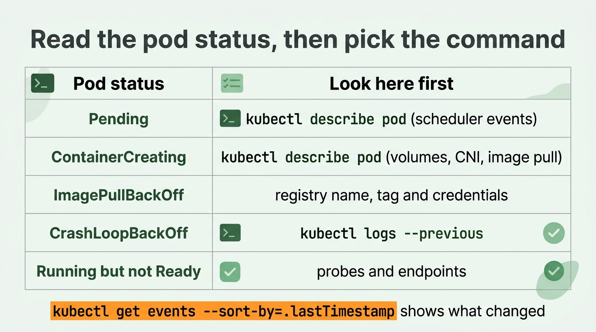

*Figure 5.25.1. Read the pod status first. It tells you which command to run next.*

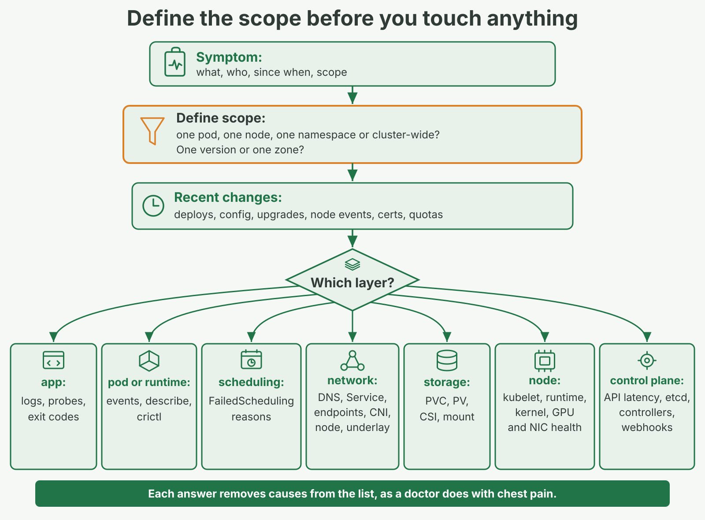

*Figure 5.25.2. Troubleshooting starts by defining the failure's scope and recent changes, then branches to the layer that holds the fault.*

A doctor facing a patient with chest pain does not start with surgery. The doctor asks where the pain is, how long it has lasted and who else feels it, and each answer removes some causes from the list. Debugging a cluster works the same way. A failing workload rarely tells you where the fault is, so the first job is to measure how wide the failure is. Before you touch anything, define how wide the failure is: one pod, one node, one namespace, or the whole cluster. The diagram below turns that scope into a choice of layer, and each layer has its own first checks.

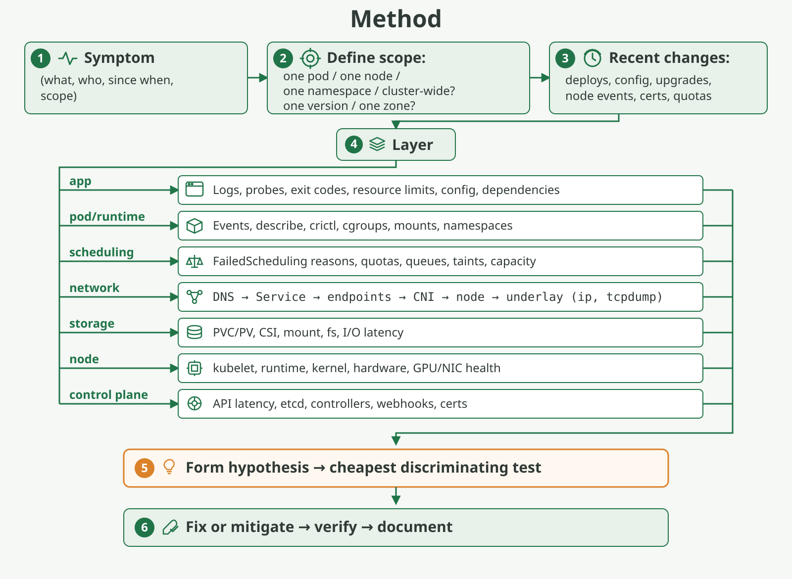

*Figure 5.25.3. Method, as a diagram.*

Read the diagram from the top. Scope comes first because it cuts the list fastest. If only one pod fails, the cause is probably in that pod, its app or its node. If every pod on one node fails, the node is the suspect. If the failures began right after a deploy, the deploy is the suspect. Recent changes come next, because most incidents follow a change. Then you pick the layer the symptom points to, form a hypothesis, and run the cheapest test that can tell it apart from the alternatives. That test is often one command, not a long investigation.

Keep these principles in mind at every step.

1. Scope first. Is this one pod, a replica set, all pods on one node, all pods in one zone, or everything that broke after a change? The differences between failing and healthy instances are the most informative clue. Think of a power cut: if one apartment is dark, you check its fuse box, but if the whole street is dark, you check the substation. If only one node is failing, you are probably looking at a node problem.
2. Observe before you change anything. Capture state with `describe`, logs, events, metrics, `crictl` and `dmesg` before you restart anything. A restart destroys evidence such as previous logs, process state and stuck I/O. Restarting a pod is a bit like rebooting a car that is making a strange noise. The noise may stop, and so does the clue.
3. Bisect the path. Test each hop on its own: a pod IP against a Service IP against a DNS name, same node against cross-node, pod namespace against host namespace, and inside the cluster against outside it. Bisect means cut in half. If a letter never arrives, you check the mailbox, then the post office, then the sorting centre, instead of asking everyone at once.
4. Change one thing at a time, keep each change reversible, and note the timestamp of every change. If you change three settings and the problem goes away, you do not know which one fixed it. The next incident then starts from zero.
5. Prefer reproducible minimal tests, such as a netshoot pod, `curl`, `nc`, `dig`, `iperf3`, `fio` or `nccl-tests`, over reasoning from theory alone. A small test you can run again is worth more than a long argument about what should happen.
6. Keep the symptom separate from the cause. `CrashLoopBackOff` is a symptom, and the cause is in the logs or the exit code. `OOMKilled` might be a leak, a limit that is too small, or `/dev/shm` pressure. A fever tells a doctor that something is wrong, but it does not name the infection.
7. Know the baseline. What does healthy look like for latency, throughput and utilisation? A GPU at a given level of use means nothing until you know what this job normally shows. Dashboards and a documented known-good benchmark, such as iperf, fio or NCCL, make diagnosis much shorter.
8. Time-box your work and escalate with evidence. Keep the status communicated as you go, so the people waiting on the fix know where things stand. A debugging session with no time limit tends to drift, and drift is expensive when GPUs are idle. Pick the layer, test the cheapest hypothesis first, and change one thing at a time.

## 2. kubectl toolkit

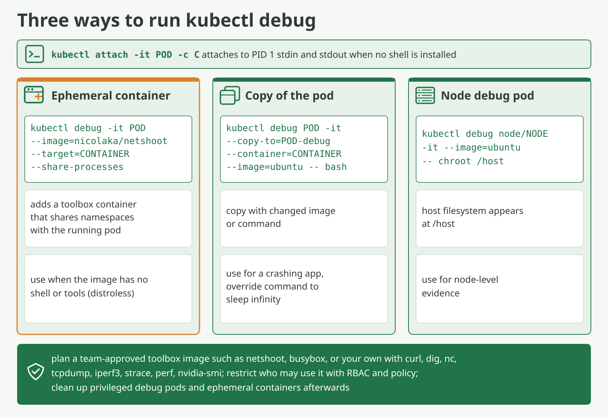

*Figure 5.25.4. Pick ephemeral, copy or node mode depending on whether the pod is healthy, crashing or the node is suspect.*

When a pod misbehaves, kubectl is usually the first tool you reach for. Think of it as the front desk of the cluster. It tells you what the API server believes is true, which is useful, but the answer can lag behind reality. The commands below move from a cluster-wide overview to a single pod, then to debugging, and finally to API-level checks.

```bash
# Orientation
kubectl get nodes -o wide; kubectl get pods -A -o wide | grep -v Running
kubectl get events -A --sort-by=.lastTimestamp | tail -30
kubectl get events --field-selector type=Warning -A
kubectl describe node <n> | sed -n '/Conditions/,/Events/p'
# Pod deep-dive
kubectl get pod <p> -o yaml | less
kubectl get pod <p> -o jsonpath='{range .status.containerStatuses[*]}{.name}{"\t"}{.state}{"\t"}{.lastState}{"\n"}{end}'
kubectl describe pod <p>
kubectl logs <p> -c <c> --previous --timestamps --tail=300
kubectl logs -l app=trainer --all-containers --prefix --since=30m --max-log-requests=50
kubectl top pod <p> --containers; kubectl top node
# Exec and debug
kubectl exec -it <p> -c <c> -- sh
kubectl attach -it <p> -c <c>                                                             # attach to PID 1 stdin/stdout when no shell is installed
kubectl config set-context my-context --namespace=mystuff && kubectl config use-context my-context
kubectl apply -f myobj.yaml view-last-applied                                             # or edit-last-applied / set-last-applied
source <(kubectl completion bash)                                                         # enable bash tab completion for kubectl
kubectl debug -it <p> --image=nicolaka/netshoot --target=<c> --share-processes          # ephemeral container sharing namespaces
kubectl debug <p> -it --copy-to=<p>-debug --container=<c> --image=ubuntu -- bash         # copy with changed image/command (crashing app)
kubectl debug node/<n> -it --image=ubuntu -- chroot /host                                 # node debug pod with host filesystem at /host
kubectl cp <p>:/path ./local; kubectl port-forward pod/<p> 8080:80
# API-level
kubectl get --raw /readyz?verbose; kubectl get --raw /metrics | head
kubectl auth can-i create pods -n ns --as=system:serviceaccount:ns:sa
kubectl api-resources; kubectl explain pod.spec.containers.securityContext
kubectl diff -f manifest.yaml; kubectl rollout status deploy/x; kubectl rollout history deploy/x; kubectl rollout undo deploy/x
kubectl get pods -o custom-columns=NAME:.metadata.name,NODE:.spec.nodeName,IP:.status.podIP,QOS:.status.qosClass
kubectl get pod -A -o json | jq -r '.items[] | select(.status.containerStatuses[]?.lastState.terminated.reason=="OOMKilled") | .metadata.namespace+"/"+.metadata.name'
```

Reading `describe` comes down to three things: the events, the state and the exit code. Events run in time order, so the newest one sits at the bottom. A normal start reads Scheduled, then Pulling, Pulled, Created and Started. Warnings such as FailedScheduling, FailedMount, Unhealthy, BackOff, Evicted and Killing show where things went wrong. Here is a short example. Suppose the events end with a FailedMount warning. You now know the pod was scheduled and the image was pulled, so the problem lies in the volume, not in the image or the scheduler.

The State and Last State fields hold the exit code and the reason. Exit code 137 means SIGKILL, which covers OOM kills. A signal is a short message the kernel sends to a process, and SIGKILL is the one a process cannot catch or ignore. Exit code 143 means SIGTERM, a polite request to stop. Exit codes 1 and 2 point to an application error, and exit codes 126 and 127 mean the command could not be executed or was not found. The Conditions list shows PodScheduled, Initialized, ContainersReady and Ready. The QoS, Node, IPs, Volumes and Tolerations fields complete the picture.

Plan your debug image before you need it. Keep a team-approved toolbox image, such as `netshoot`, `busybox`, or your own image with `curl`, `dig`, `nc`, `tcpdump`, `iperf3`, `strace`, `perf`, `nvidia-smi` and `ibstat`. Ephemeral containers need the EphemeralContainers feature, which is GA, plus RBAC for `pods/ephemeralcontainers`. Once added, they cannot be removed. A `kubectl debug node/...` session runs a privileged pod with host namespaces, so restrict it with RBAC and policy, as covered in 5.16 and 5.21, and clean it up when you finish. Decide on the toolbox image before the next incident, not during it. Teams that wait until an outage to pick a toolbox end up debating image names while the GPUs sit idle.

## 3. Node-level toolkit

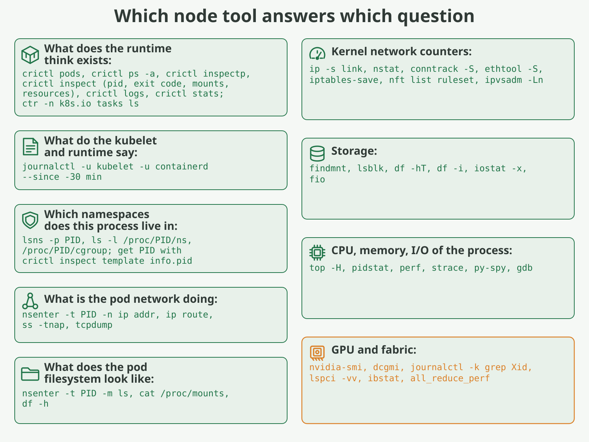

*Figure 5.25.5. Start from the question you need answered and reach for the matching tool.*

Some problems only show up on the worker node. Picture a pod that reports `Running` while its traffic never arrives. kubectl talks to the API server, which stores what should exist. The node is where things actually run, so kubectl cannot show you the packets, the namespaces or the runtime state. You need to look at the node itself. The tools below cover those layers one at a time.

### 3.1 Container runtime state (crictl / ctr)

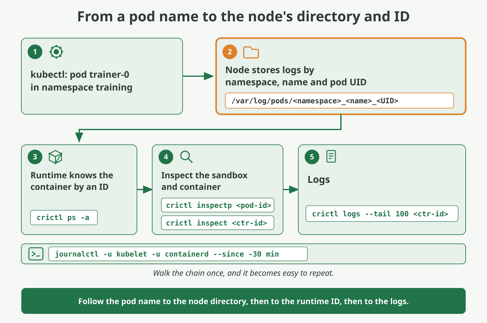

*Figure 5.25.6. Kubernetes names a pod by namespace and name, while the node finds its logs and containers by directory and ID, which crictl reads.*

```bash
crictl pods; crictl ps -a; crictl images
crictl inspectp <pod-id> | jq '.status.network, .info.runtimeSpec.linux.namespaces, .info.cgroupPath'
crictl inspect <ctr-id> | jq '.info.pid, .status.state, .status.exitCode, .status.reason, .info.runtimeSpec.mounts, .info.runtimeSpec.linux.resources'
crictl logs --tail 100 <ctr-id>; crictl stats; crictl exec -it <ctr-id> sh
crictl pull <image>; crictl rmi <id>; crictl imagefsinfo; crictl info | jq '.config.containerd'
journalctl -u kubelet -u containerd --since "-30 min" | grep -E "error|fail|timeout|oom" -i | tail -50
ctr -n k8s.io tasks ls; ctr -n k8s.io containers info <id>
```

Kubernetes names things by pod and container, but the node knows them by directory and ID. Walk the chain once, and it becomes easy to repeat. Say you have a pod called `trainer-0` in the `training` namespace. kubectl gives you that name. The node stores its logs in a directory built from the namespace, the name and the pod UID, so a pod's UID maps to `/var/log/pods/<ns>_<name>_<uid>/`. The runtime keeps a separate container ID, and the process table has a host process ID for the container's main process. To find the container ID, run `kubectl get pod -o jsonpath='{.status.containerStatuses[0].containerID}'`, which returns a value like `containerd://<id>`. Use the `--name` and `--namespace` filters on `crictl pods` to narrow the list when several pods share a name.

### 3.2 Namespaces: nsenter, lsns, unshare

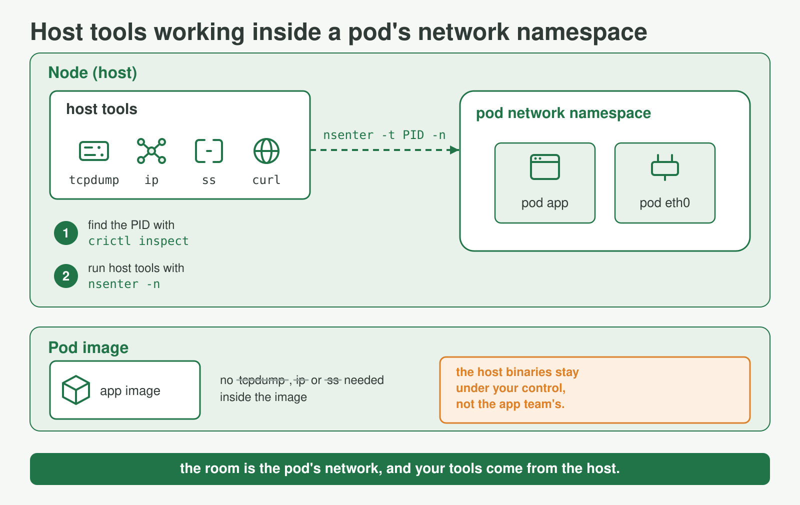

*Figure 5.25.7. The nsenter command runs the node's own tools inside a pod's network namespace, so the pod image needs none of them.*

```bash
PID=$(crictl inspect --output go-template --template '{{.info.pid}}' <ctr-id>)
sudo nsenter -t $PID -n ip addr; sudo nsenter -t $PID -n ip route; sudo nsenter -t $PID -n ss -tnap
sudo nsenter -t $PID -n -- tcpdump -ni eth0 -c 50 port 8000
sudo nsenter -t $PID -m ls /; sudo nsenter -t $PID -m cat /proc/mounts; sudo nsenter -t $PID -m df -h
sudo nsenter -t $PID -p -r ps aux            # PID namespace + its root
sudo nsenter -t $PID -a bash                   # enter all namespaces (needs a shell in the image’s rootfs: use -a with host binaries via -n/-m selectively)
sudo lsns -p $PID                              # which namespaces this process belongs to
ls -l /proc/$PID/ns; cat /proc/$PID/cgroup; cat /proc/$PID/status | grep -E 'Cap|Seccomp|NoNewPrivs'
sudo ls -l /proc/$PID/fd | head; sudo cat /proc/$PID/limits; sudo cat /proc/$PID/stack  # kernel stack (D-state)
```

The `nsenter -n` command runs host tools inside the pod's network namespace. Think of it as opening the door of a room and standing inside with your own tools. The room is the pod's network, and your tools are the host's copies of `tcpdump`, `ip`, `ss` and `curl`. Those binaries work this way, so the image does not need them. The pod never has to carry a debugging kit of its own, and the host binaries stay under your control, not the app team's. Use `nsenter -m` with `-r`, or with chroot-style paths, to see the container filesystem the way the container sees it. The mount namespace is where the container's files live, so this is the view to use when a file looks missing from inside the pod but present on the node.

The `-a` flag enters every namespace at once, and it changes the root filesystem too. Read the warning in the code comment before you use it. Only the host's trusted tools should run in that context, a point the checkpoint answers below return to.

### 3.3 Networking tools

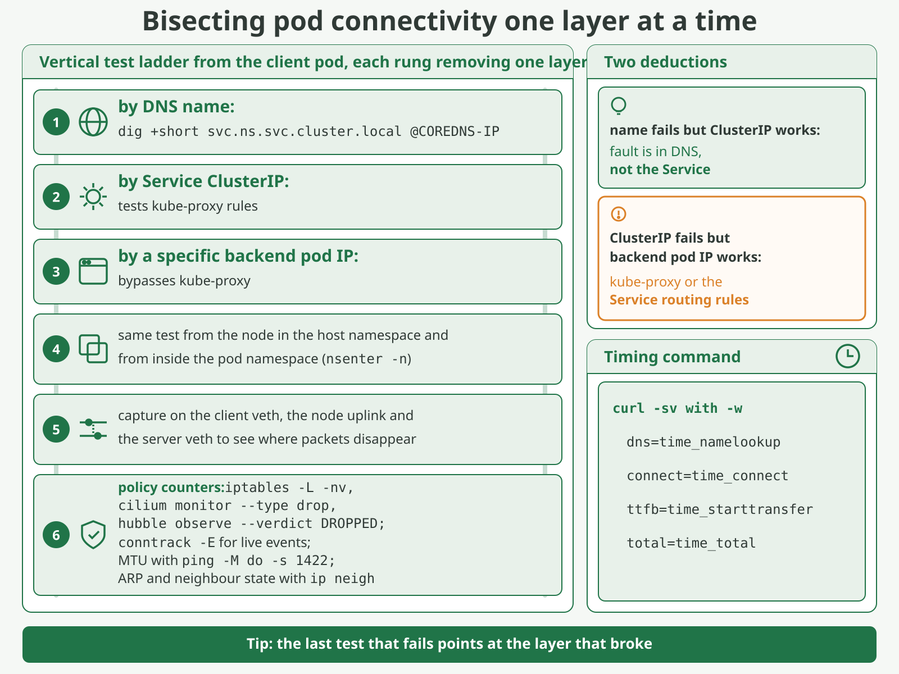

*Figure 5.25.8. Each test removes one layer, so the last rung that fails names the broken layer.*

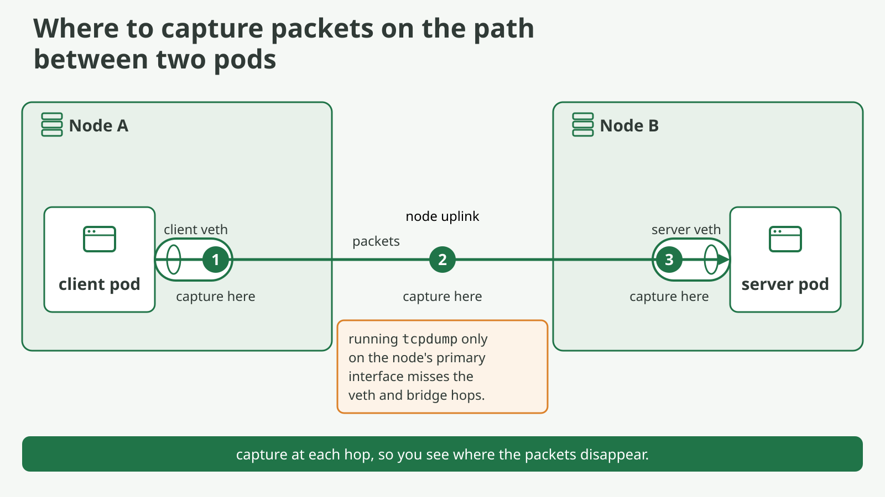

*Figure 5.25.9. Capturing packets at the client veth, the node uplink and the server veth shows the hop where traffic disappears.*

```bash
ip -br addr; ip -br link; ip route; ip rule; ip neigh; ip -s link show eth0           # errors/drops
bridge fdb show | head; bridge link; ip -d link show vxlan.calico
ss -ltnp; ss -s; ss -tin dst 10.0.0.5                                                 # listeners, summaries, TCP internals (rtt, cwnd, retrans)
nstat -az | grep -E 'Retrans|ListenOverflows|ListenDrops|TCPTimeouts'; netstat -s | head -40
conntrack -S; conntrack -L | wc -l; conntrack -L -p tcp --dport 443 | head
iptables-save | grep -E 'KUBE-SVC|KUBE-SEP|CNI|cali-|DROP|REJECT' | head -50; nft list ruleset | head -80
ipvsadm -Ln                                                                           # IPVS mode
tcpdump -ni any host 10.244.2.7 and tcp port 8000 -w /tmp/cap.pcap -c 2000            # then open in Wireshark
tcpdump -ni eth0 'icmp or (udp port 53)' -vv
tcpdump -ni any 'tcp[tcpflags] & (tcp-rst) != 0' -c 50                                  # resets
traceroute -n -T -p 8000 10.244.2.7; mtr -n -T -P 8000 10.244.2.7
ping -M do -s 1422 10.244.2.7                                                         # path MTU
curl -sv --connect-timeout 3 http://svc.ns.svc:8000/health -o /dev/null -w 'dns=%{time_namelookup} connect=%{time_connect} ttfb=%{time_starttransfer} total=%{time_total}\n'
dig +short svc.ns.svc.cluster.local @<coredns-ip>; dig +trace example.com
ethtool eth0; ethtool -S eth0 | grep -iE 'err|drop|discard'; ethtool -k eth0 | grep -E 'tso|gso|gro|udp_tnl'
ibstat; ibv_devinfo; rdma link; ibdev2netdev; perfquery; ib_write_bw -d mlx5_0 <peer>   # RDMA (Part 12)
```

To test pod connectivity, work from the client pod in a fixed order. Think of it as walking a pipe from the tap toward the main. You check the first junction before you open the valve in the middle. Check DNS first, then the ClusterIP, then a specific backend pod IP, which bypasses kube-proxy. Finally, run the same test from the node in the host namespace and from inside the pod namespace. Capture packets on the client veth, the node uplink and the server veth to see where they disappear. Then check policy counters (`iptables -L -nv`, `cilium monitor --type drop`, `hubble observe --verdict DROPPED`), conntrack (`conntrack -E` for live events), MTU, and ARP and neighbour state.

Here is how that order plays out. Suppose a client pod cannot reach a Service by name. A DNS lookup by name fails, but the same Service answers when you use its ClusterIP. The fault must sit in DNS, not in the Service itself. Now suppose the ClusterIP fails too, while a direct backend pod IP works. Then kube-proxy or the rules that route Service traffic are the suspects. Each test removes one layer, so the last test that fails points at the layer that broke.

### 3.4 Storage and filesystem

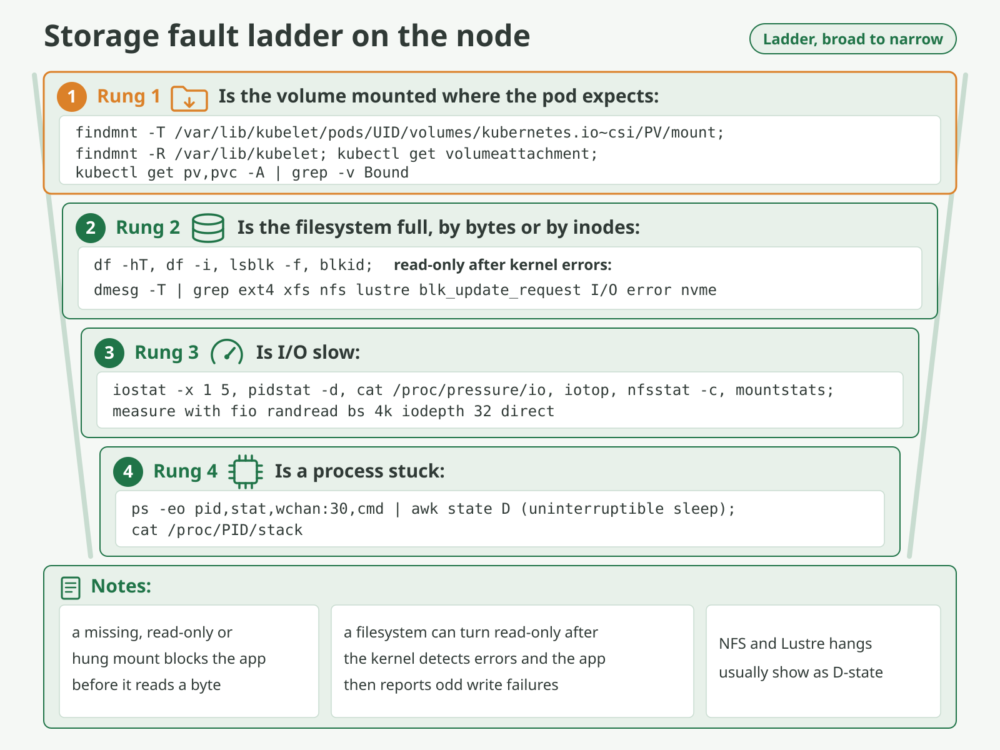

*Figure 5.25.10. Check the mount first, then space, then latency, then stuck processes.*

Storage faults often look like a stuck pod. Start with the mount, then the filesystem, then the I/O latency. A mount that is missing, read-only or hung blocks the app before it reads a single byte, and the app then looks broken from the outside.

```bash
findmnt -T /var/lib/kubelet/pods/<uid>/volumes/kubernetes.io~csi/<pv>/mount; findmnt -R /var/lib/kubelet | head -40
lsblk -f; blkid; df -hT; df -i; mount | grep -E 'nfs|lustre|ceph|fuse'
dmesg -T | grep -iE 'ext4|xfs|nfs|lustre|blk_update_request|I/O error|nvme'
iostat -x 1 5; pidstat -d 1 5; cat /proc/pressure/io; iotop -oPa
nfsstat -c; nfsiostat 1; mountstats /mnt/x
fio --name=rd --filename=/data/test --rw=randread --bs=4k --iodepth=32 --direct=1 --runtime=30 --time_based --size=2g
ps -eo pid,stat,wchan:30,cmd | awk '$2 ~ /D/'                                          # uninterruptible sleep
kubectl get volumeattachment; kubectl get pv,pvc -A | grep -v Bound
```

Work through these in order. `findmnt` tells you whether the volume is mounted where the pod expects it. `df` and `df -i` show whether the filesystem is full, either by bytes or by inodes, which are the records that name each file. `dmesg` shows whether the kernel has logged I/O errors. `iostat` and `fio` then measure how long each read and write takes. The `D` state in the `ps` output means a process is waiting on I/O and cannot be interrupted, even by a kill. That state is the classic sign of a hung network mount.

### 3.5 Processes and performance

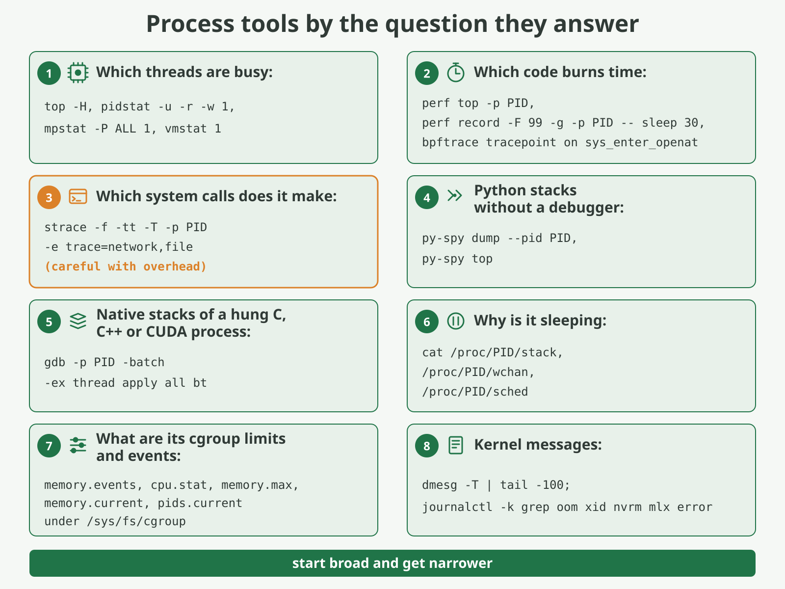

*Figure 5.25.11. Start broad with thread views and narrow to stacks and cgroup limits.*

When the process itself is the problem, you need to see what it is doing. The commands below sample CPU, memory and I/O first, then stacks, then the cgroup limits. Start broad and get narrower. A stack shows where a thread stopped, and a cgroup file shows whether the kernel was holding the process back.

```bash
top -H; htop; pidstat -u -r -w 1; mpstat -P ALL 1; vmstat 1; sar -n DEV 1
perf top -p $PID; perf record -F 99 -g -p $PID -- sleep 30; perf report
strace -f -tt -T -p $PID -e trace=network,file -s 256 -o /tmp/strace.out       # syscalls (careful with overhead)
bpftrace -e 'tracepoint:syscalls:sys_enter_openat /pid==PID/ { printf("%s\n", str(args->filename)); }'
py-spy dump --pid $PID; py-spy top --pid $PID                                    # Python stacks without attaching a debugger
gdb -p $PID -batch -ex 'thread apply all bt' | head -80                         # native stacks (hung C/C++/CUDA processes)
cat /proc/$PID/stack; cat /proc/$PID/wchan; cat /proc/$PID/sched | head          # why is it sleeping?
cat /sys/fs/cgroup$(cut -d: -f3 /proc/$PID/cgroup)/{memory.events,cpu.stat,memory.max,memory.current,pids.current}
dmesg -T | tail -100; journalctl -k --since "-1h" | grep -iE 'oom|xid|nvrm|mlx|error|fail'
```

Each tool answers a different question. `top -H` and `pidstat` ask which threads are busy. `perf` and `bpftrace` ask which kernel and user code is burning time. `strace` asks which system calls the process makes, and it slows the process down, so use it with care. `py-spy` and `gdb` ask where the code currently sits, and `py-spy` is safe for Python because it reads the process from outside. The `cgroup` files ask whether the kernel has been throttling or limiting the process, and the kernel log asks whether it has killed anything.

### 3.6 GPU and fabric hardware

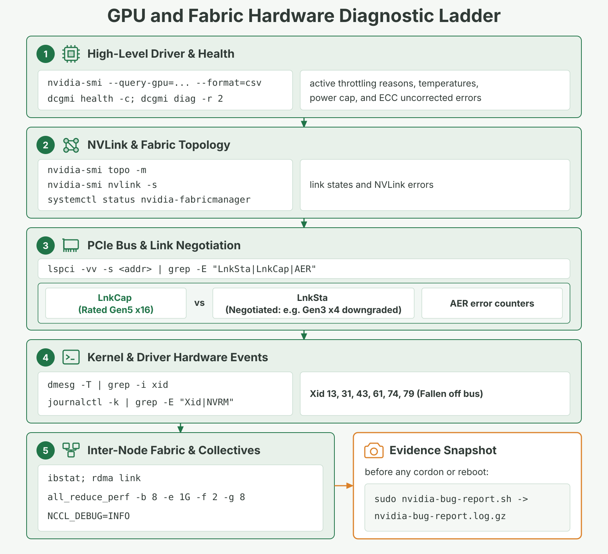

*Figure 5.25.12. GPU and fabric hardware triage moves through five layers from NVML queries down to PCIe link negotiation and kernel Xid errors before generating an official bug report.*

When a GPU or a fabric link misbehaves, the hardware tools and the kernel log are where you look first. A GPU can run hot, throttle its clocks, or drop off the PCIe bus, and none of those events show up as a Kubernetes error. The kernel log is the one place where the hardware reports its own faults.

```bash
nvidia-smi; nvidia-smi -q | less; nvidia-smi topo -m; nvidia-smi nvlink -s; nvidia-smi -q -d ECC,PAGE_RETIREMENT,PERFORMANCE,CLOCK
nvidia-smi --query-gpu=index,name,temperature.gpu,power.draw,clocks.sm,clocks_throttle_reasons.active,pcie.link.gen.current,pcie.link.width.current,ecc.errors.uncorrected.volatile.total --format=csv
dcgmi discovery -l; dcgmi health -c; dcgmi diag -r 2; dcgmi dmon -e 203,252,1004 -d 1000
journalctl -k | grep -E "Xid|NVRM"; dmesg -T | grep -i xid                                    # Xid error codes (13, 31, 43, 48, 61, 63, 64, 74, 79, ...)
nvidia-bug-report.sh                                                                          # support bundle
lspci -vv -s <addr> | grep -E 'LnkSta|LnkCap|AER'; cat /sys/bus/pci/devices/<addr>/aer_dev_*
fabric manager: systemctl status nvidia-fabricmanager; nvidia-smi nvlink -e
all_reduce_perf -b 8 -e 1G -f 2 -g 8                                                          # nccl-tests on node
NCCL_DEBUG=INFO NCCL_DEBUG_SUBSYS=INIT,NET,GRAPH ...                                         # inside the job
```

The first line asks the driver what it sees and how the GPUs are configured. The second line is the health dashboard in one row. It shows throttling reasons and link state, so you can tell a slow GPU from a GPU that is working as designed. The `dcgmi` lines ask the monitoring stack for a health check and a short diagnostic. The Xid lines search the kernel log for error codes that the NVIDIA driver writes when the hardware reports a fault. The `lspci` line checks the PCIe link, which can silently run at a lower speed or width than the hardware supports. The NCCL lines test the fabric itself and then show what the training job sees while it runs.

Before you remediate, copy the evidence to an incident folder with timestamps: `dmesg`, journal ranges, `nvidia-bug-report`, `sosreport` or `kubectl cluster-info dump`, pcaps and metric screenshots. A fix that erases the fault makes the next incident harder to explain, so the evidence comes first.

## 4. Failure playbooks

Most failures in this section follow one pattern. An event or a log names the layer, and the checks for that layer confirm it. Read each playbook as a short story. It starts with what you see, then names the layer, then lists the checks in the order that narrows the list fastest.

### 4.1 Pod Pending

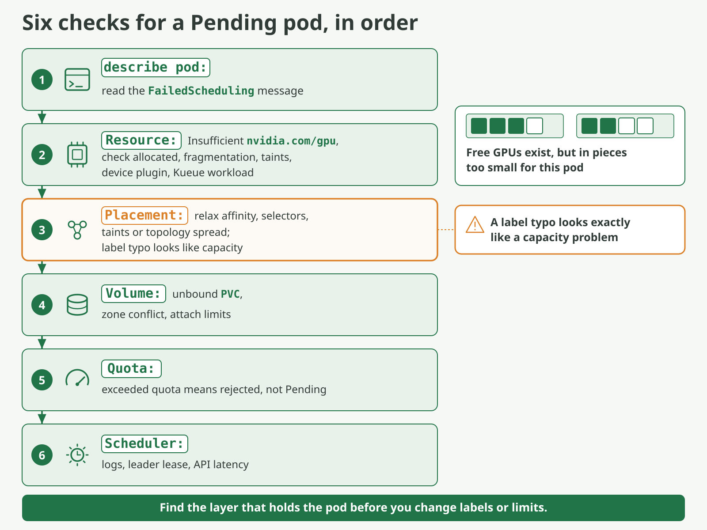

*Figure 5.25.13. A Pending pod is checked in six steps, from the FailedScheduling message through resources, placement, volumes, quota and the scheduler.*

Suppose your pod has been Pending for a while and nothing is running yet. Pending means the scheduler has not placed the pod on a node yet, so the problem is before the node, not on it.

1. Start with `kubectl describe pod` and read the `FailedScheduling` message, which counts the nodes by reason. Each count tells you how many nodes rejected the pod for one cause.
2. Resource: if it says `Insufficient nvidia.com/gpu`, check `kubectl describe nodes | grep -A8 Allocated`, fragmentation, taints, device plugin health (`kubectl get nodes -o json | jq ... allocatable`) and pending Kueue admission (`kubectl get workload`). Fragmentation means the free GPUs exist, but they are spread across nodes in pieces too small for this pod.
3. Placement: relax affinity, selectors, taints or topology spread, or fix the labels. A label typo is a common cause, and it looks exactly like a capacity problem.
4. Volume: an unbound PVC, a zone conflict or attach limits (5.17). A volume in one zone cannot follow a pod into another zone.
5. Quota: `exceeded quota` at creation means the pod is rejected, not Pending. A Kueue job that is not admitted leaves the pod Pending with no pods to show for it.
6. Scheduler: check its logs with `kubectl logs`, the leader lease and API latency.

Find the layer that holds the pod before you change any labels or limits. Changing a label to fix a quota problem only moves the queue somewhere else.

### 4.2 `ContainerCreating` for a long time

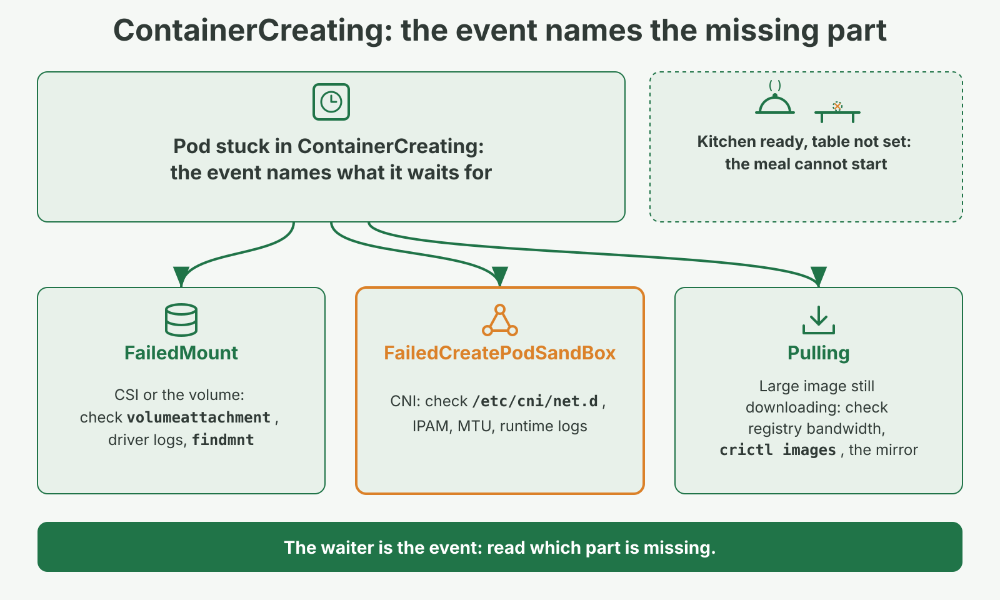

*Figure 5.25.14. A pod stuck in ContainerCreating shows the missing part in its event, such as FailedMount for storage or FailedCreatePodSandBox for CNI.*

A pod that stays in `ContainerCreating` is waiting for something before its container can start, and the event usually names what it is waiting for. Picture a restaurant where the kitchen is ready, but the table is not set. The meal cannot start until the table is ready, and the event is the waiter who tells you which part is missing.

`FailedMount` points to CSI or the volume. Check `kubectl get volumeattachment`, the driver logs and `findmnt`. `FailedCreatePodSandBox` points to CNI, the plugin that wires the pod into the network. There you look at `/etc/cni/net.d`, IPAM, MTU and the runtime logs. `Pulling` means a large image is still downloading, so check registry bandwidth, `crictl images` and the mirror. `FailedAttachVolume`, device plugin allocation errors and `ErrImagePull` each have their own layer, and each one sends you to a different place.

### 4.3 `CrashLoopBackOff`

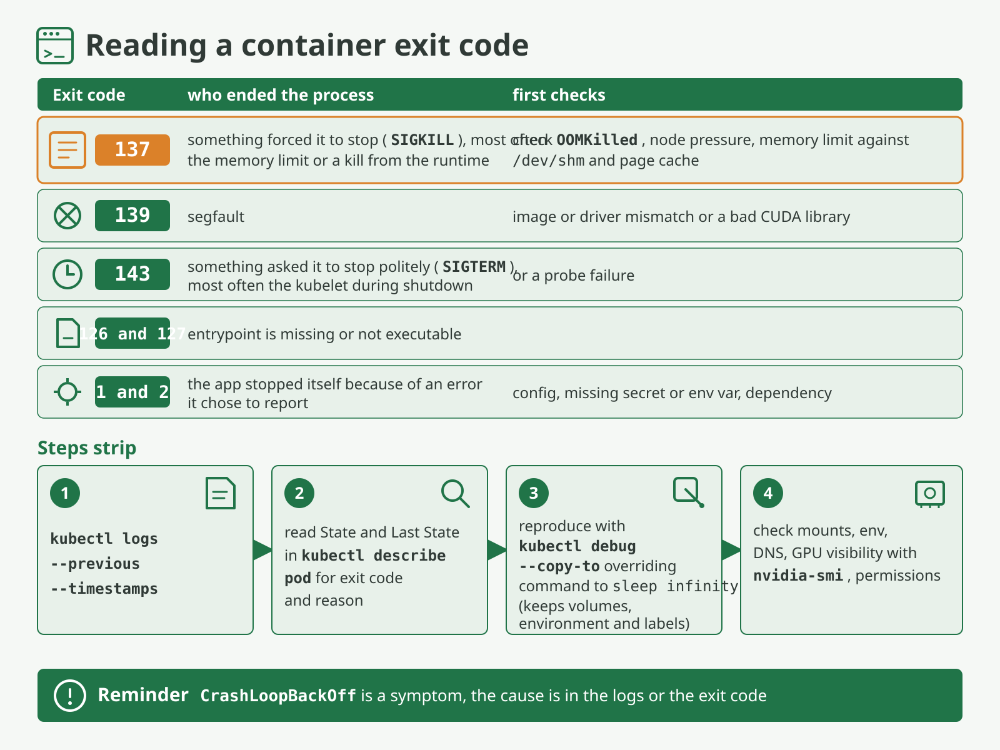

*Figure 5.25.15. The exit code tells you who ended the process, so read it before changing anything.*

Start with `kubectl logs --previous`, then let the exit code guide you. An exit code is a clue about who ended the process. Code 137 means something forced it to stop, most often the memory limit or a kill from the runtime. Code 143 means something asked it to stop politely, most often the kubelet during shutdown or a probe failure. Codes 1 and 2 mean the app stopped itself because of an error it chose to report.

Exit code 137 is an OOM kill or SIGKILL, so check `OOMKilled`, node pressure, and the memory limit against `/dev/shm` and page cache. Exit code 139 is a segfault, which points to an image or driver mismatch or a bad CUDA library. Exit codes 126 and 127 mean the entrypoint is missing or not executable. Exit codes 1 and 2 are application errors, often caused by config, a missing secret or env var, a dependency that is down, or a model path. Exit code 143 is SIGTERM, which may come from a probe kill or an eviction.

To reproduce the crash, run `kubectl debug --copy-to` and override the command to `sleep infinity`. The copy keeps the volumes, environment and labels, but it does not exit, so you can look around. Then check mounts, env, DNS, GPU visibility with `nvidia-smi`, and permissions. Most crashes that look mysterious are a missing file or a wrong path, and the sleeping copy shows you that in seconds.

### 4.4 Network and Service failures

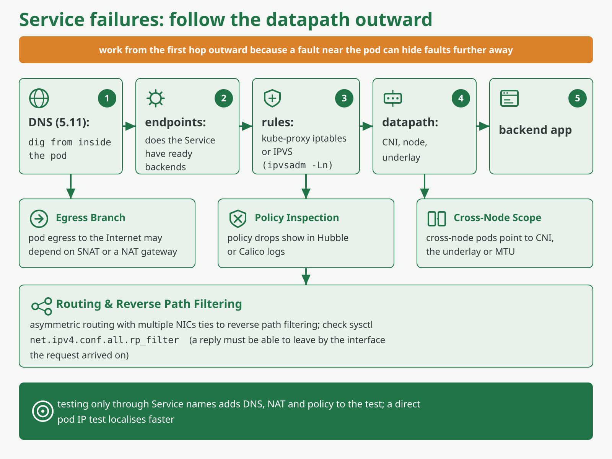

*Figure 5.25.16. Check hops from the pod outward and keep a direct pod IP test to localise faults.*

When a Service fails, traffic passes through DNS, endpoints, rules and the datapath. The datapath is the path the packets physically take through the kernel. Use the 5.10 flow (DNS → endpoints → rules → datapath → backend) with these checks. Look at pod egress to the Internet, which may depend on SNAT or a NAT gateway. Cross-node pods point to CNI, the underlay or MTU. Policy drops show up in Hubble or Calico. Check conntrack exhaustion, `nf_conntrack` insert failures, a kube-proxy that is not running on a node, stale IPVS entries, NodePort source IP and traffic policy, and ingress or gateway 502 and 504 errors (5.12). DNS 5 s delays are covered in 5.11.

Asymmetric routing with multiple NICs ties to reverse path filtering, which checks that a reply could leave by the same interface the request arrived on. Check it with `sysctl net.ipv4.conf.all.rp_filter`. Work from the first hop outward, because a fault near the pod can hide the faults further away.

### 4.5 Node `NotReady`

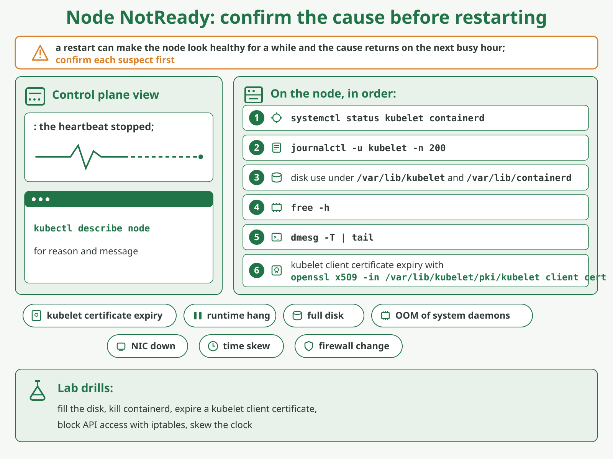

*Figure 5.25.17. Confirm each suspect on the node before you restart, or the cause returns.*

When a node is `NotReady`, the control plane has stopped hearing a heartbeat from it. Run `kubectl describe node` for the reason and message. On the node, check `systemctl status kubelet containerd`, `journalctl -u kubelet -n 200`, disk use under `/var/lib/kubelet` and `/var/lib/containerd`, `free -h`, and `dmesg -T | tail`. Then check the kubelet client certificate with `openssl x509 -in /var/lib/kubelet/pki/kubelet-client-current.pem -noout -dates`, clock sync with `chronyc tracking`, and API reachability with `curl -k https://<api>:6443/healthz`. Check CNI readiness, PLEG (the Pod Lifecycle Event Generator, the part of the kubelet that notices when containers change state), and how quickly `crictl ps` answers.

The usual causes are kubelet certificate expiry, a runtime hang, a full disk, OOM of system daemons, a NIC that is down, time skew, or a firewall change. Confirm each suspect on the node before you restart anything. A restart can make the node look healthy for a while, and the cause will come back on the next busy hour.

### 4.6 OOM and eviction

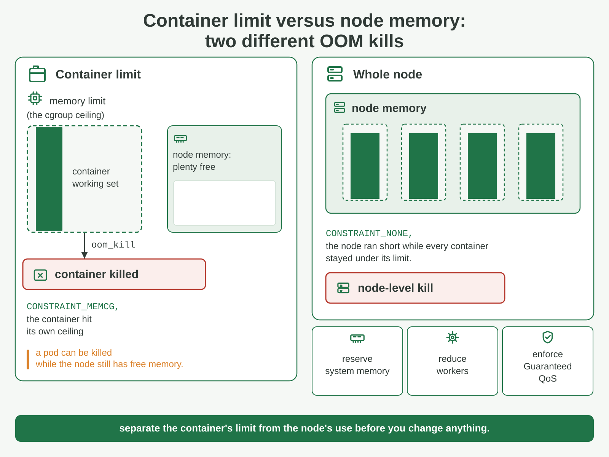

*Figure 5.25.18. A container OOM kill comes from its own memory limit, while a node-level kill means the whole host ran out of memory.*

Suppose a pod is `OOMKilled`, or the node is evicting pods. Separate the container's cgroup limit from the node's memory use before you change anything. A container can be killed while the node still has plenty of free memory, because the container hit its own ceiling. A node can also run short while every container stays under its limit.

For a pod, check `memory.events oom_kill`, the working set against the limit, and `df -h /dev/shm`. Page cache is counted but reclaimable, GPU pinned memory counts too, and dataloader workers multiply the memory each one uses. Memory leaks show up with `tracemalloc` or `memray`. For a node-level kill, `dmesg | grep -i 'out of memory'` names the victim and the constraint, which is `CONSTRAINT_MEMCG` or `CONSTRAINT_NONE`. Kubelet eviction shows as `Evicted`, and reservations are covered in 5.9. Fix the limits and requests, reserve system memory, reduce workers, and enforce Guaranteed QoS.

### 4.7 Terminating pods that never finish

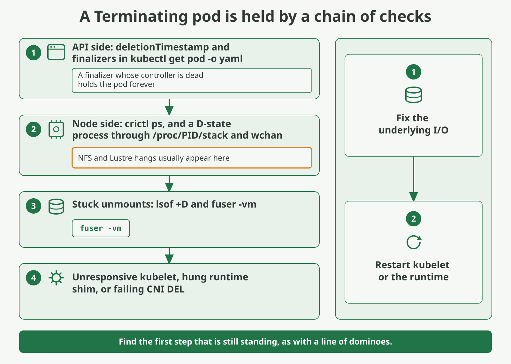

*Figure 5.25.19. A pod stuck in Terminating is checked for finalizers, D-state processes, stuck unmounts and a hung kubelet or runtime, and the I/O is fixed before any restart.*

A pod in Terminating has been asked to stop, but something is still holding it. On the API side, check `deletionTimestamp` and `finalizers` in `kubectl get pod -o yaml`. A finalizer is a marker that tells the API server to wait until some controller finishes its cleanup. A finalizer whose controller is dead will hold the pod forever.

On the node, check whether the container still runs with `crictl ps`, and look for a D-state process through `/proc/PID/stack` and `wchan`, where NFS and Lustre hangs usually appear. Check stuck unmounts with `lsof +D` and `fuser -vm`. Also look for an unresponsive kubelet (NotReady), a hung runtime shim, or failing CNI DEL. To mitigate, fix the underlying I/O, then restart kubelet or the runtime. If the node is gone, delete the node object with `kubectl delete node`. Use `--force --grace-period=0` only as a last resort, and only after you confirm that no process can still write to RWO storage. RWO means a volume that one node can write at a time, and a forced delete while a process still writes to it can corrupt data.

### 4.8 DNS issues

When a name does not resolve, test from inside the pod first. Check `/etc/resolv.conf`, `dig @kube-dns`, and the search path. The search path is the list of suffixes the resolver tries, and a long list can make every lookup slow. Then check the CoreDNS pods, endpoints, logs and metrics, NodeLocal cache, upstream resolvers, conntrack races, a NetworkPolicy that blocks UDP or TCP 53, and headless readiness (5.11).

### 4.9 Storage problems

A storage fault often looks like a slow job or a pod that never starts. Use the 5.17 playbook for PVC Pending, Multi-Attach and FailedMount. For a full or read-only filesystem, check `dmesg` for remount-ro, then inodes and quotas. A filesystem can turn read-only after the kernel detects errors, and the app then reports odd write failures. For slow I/O, use iostat, fio and backend metrics, and look for D-state processes. A crashed CSI node plugin or a broken FUSE mount belongs on the list too. Check whether the volume is full, slow or unmounted before you touch the workload.

### 4.10 GPU workloads

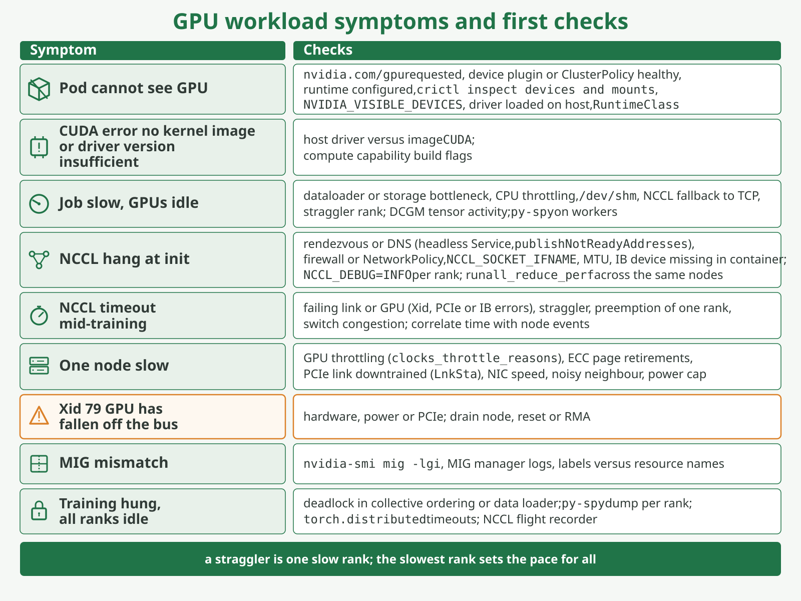

*Figure 5.25.20. Match the symptom row and work through its checks before changing the job.*

GPU workloads fail in ways Kubernetes does not report directly. The GPU is a device that the driver, the runtime and the scheduler each handle a little. Any one of them can fail quietly. The table pairs each symptom with the checks that narrow it down.

| Symptom | Checks |
|---|---|
| Pod can't see GPU (`nvidia-smi` missing/NVML error) | `nvidia.com/gpu` requested? device plugin/ClusterPolicy healthy? runtime configured (5.2)? `crictl inspect` devices/mounts; `NVIDIA_VISIBLE_DEVICES`; driver loaded on host; RuntimeClass |
| `CUDA error: no kernel image is available` / `driver version insufficient` | Host driver vs image CUDA; compute capability build flags (5.1) |
| Job slow, GPUs idle | Dataloader/storage bottleneck, CPU throttling, `/dev/shm`, NCCL fallback to TCP, straggler rank; DCGM tensor activity; `py-spy` on workers |
| NCCL hang at init | Rendezvous/DNS (headless Service, `publishNotReadyAddresses`), firewall/NetworkPolicy, `NCCL_SOCKET_IFNAME`, wrong interface, MTU, IB device missing in container; `NCCL_DEBUG=INFO` per rank; run `all_reduce_perf` across the same nodes |
| NCCL timeout mid-training | Failing link/GPU (Xid, PCIe/IB errors), straggler, preemption of one rank, switch congestion; correlate time with node events |
| One node slow | GPU throttling (`clocks_throttle_reasons`), ECC page retirements, PCIe link downtrained (`LnkSta`), NIC speed, noisy neighbour, power cap |
| `Xid 79 GPU has fallen off the bus` | Hardware/power/PCIe; drain node, reset or RMA (Part 17) |
| MIG/profile mismatches | `nvidia-smi mig -lgi`, MIG manager logs, node labels vs requested resource names |
| Training hung with all ranks idle | Deadlock in collective ordering/data loader; `py-spy dump` on each rank; `torch.distributed` timeouts; NCCL flight recorder |

Find the row that matches your symptom, and work through its checks before you change the job. A straggler is one slow rank that holds up every other rank at each synchronisation point. In a healthy job, the slowest rank sets the pace for all of them, so one weak GPU can make a whole cluster look slow.

### 4.11 Control-plane slowness

When every kubectl command feels slow, the control plane may be the problem. The API server is the front door for every component, so when it is slow, everything else looks slow too. Check API latency by verb and resource with `apiserver_request_duration_seconds`. A verb is the kind of request, such as a list or a watch. Then look at APF rejections, etcd fsync and database size, controller queue depth, webhook latency, noisy clients in audit logs, and node count and watch load (5.5). APF is the priority and fairness system that queues or rejects requests when the server is busy. The fixes are to throttle clients, repair webhooks, defragment etcd, or add resources.

### 4.12 Cluster-wide incidents after change

When many things break at once, look for a change that landed just before the failures began. Most large incidents have a change behind them, and the timing of the first failure is the strongest clue. Review GitOps commits, Helm upgrades, node pool updates, certificate renewals, webhook or policy changes and CRD upgrades. Roll back the most recent risky change, and compare working and failing zones or pools. Check shared dependencies too: DNS, the registry, the identity provider, the storage backend, the time source and license servers. A single shared dependency can break many unrelated services at once.

## 5. Chaos and game days

Playbooks only earn trust when they have been run against real faults, so test them in staging first. A game day is a planned drill in which a team gets a fault it has not seen and has to find it. It works like a fire drill. You do not want the first fire to be the real one.

You can kill pods and nodes, delay or drop packets with `tc netem` or Chaos Mesh NetworkChaos, and fill disks. You can also corrupt DNS, stop kubelet, break CNI, throttle CPU, and inject GPU Xid events through simulators where those are available. In a lab, you can expire a certificate, revoke registry credentials, or take down an etcd member. Measure time-to-detect and time-to-recover for each fault, then update runbooks and alerts to match (5.19, 5.24). Time-to-detect shows how fast your monitoring noticed the fault. Time-to-recover shows how fast the team restored service. Both numbers tell you where the next improvement should go.

## 6. Evidence, communication and learning

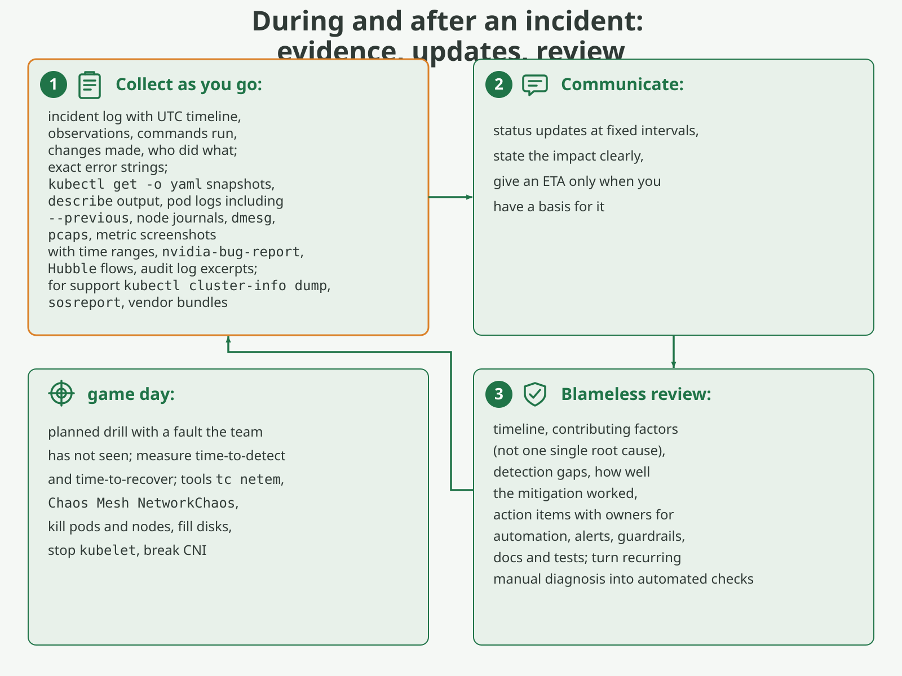

*Figure 5.25.21. Snapshots taken during the incident are worth far more than memory afterwards.*

Incidents leave evidence behind, but only if someone collects it and writes down what happened in time order. Keep an incident log. It holds a timeline in UTC, the observations, the commands you ran, the changes you made, and who did what. Record the exact error strings, because a search for an exact message later can find the same fault in another incident.

Collect the artifacts as you go: `kubectl get ... -o yaml` snapshots, `kubectl describe` output, pod logs (including `--previous`), node journals, `dmesg`, pcaps, and metric screenshots or links with their time ranges. Also keep `nvidia-bug-report`, Hubble flows and audit log excerpts. For support cases, add `kubectl cluster-info dump`, `sosreport` and vendor bundles. Snapshots taken during the incident are worth far more than a memory of it written down a week later.

Send status updates at fixed intervals, state the impact clearly, and give an ETA only when you have a basis for it. A steady stream of short, honest updates calms people who are waiting, and a guessed ETA that slips breaks their trust.

The post-incident review is blameless. It covers the timeline, the contributing factors (not one single "root cause"), detection gaps, how well the mitigation worked, and action items with owners for automation, alerts, guardrails, docs and tests. Blameless means the review asks why the system allowed the mistake, not who made it. Turn recurring manual diagnosis into automated checks, such as preflight checks, node problem detector rules and health probes. Every command you typed by hand during the incident is a candidate for a check that runs on its own next time.

## 7. Lab

Start with the self-checking Python lab, which you can run on your own machine. It verifies the container exit-code and OOM classifier, `classify_container_exit_code`, which decodes exit codes `137`, `139`, `143`, `126` and `127`, along with the `/dev/shm` cgroup OOM. It also verifies the 4-hop Pod connectivity bisection engine, `diagnose_pod_connectivity_bisection`, which isolates Pod/App, Cross-Node CNI, Service/kube-proxy and CoreDNS. Finally, it checks the GPU, PCIe and Xid hardware triager, `triage_gpu_node_symptoms`. Running it first gives you a feel for the classifiers before you point the same logic at a real node.

```bash
python3 code/part05/k8s_node_troubleshooter_lab.py
```

Next, move to a multi-node Kubernetes cluster with node root access. The interactive shell steps below were not run on live hardware, so check each result yourself as you go. Work through these exercises in order.

1. Build a debug image from netshoot, and add nvidia-smi, ibstat, perftest, py-spy and fio to it. Practise `kubectl debug` in ephemeral, copy and node modes. Then write the RBAC and policy that lets only the platform team use the image.
2. Trace traffic from a client pod to a server pod on another node. Capture at the client veth (using `nsenter -n tcpdump` from the host), at the node uplink and at the server veth. Induce loss with `tc netem`, then again with a NetworkPolicy drop. Where do the packets vanish, given the three captures and the policy counters?
3. Break a Service in five ways: a selector typo, a wrong targetPort, a failing readiness check, a kube-proxy rule flush, and stale UDP in conntrack. Diagnose each one with the method from this chapter. Record how long each diagnosis takes.
4. Take a tour of the namespaces for a running pod. Use host `nsenter` to enter the net, mnt and pid namespaces one at a time. Run host `ss`, `tcpdump` and `lsof` in each one, and compare the output with `kubectl exec`. Where are the pod's veth and cgroup?
5. Create pods that exit with codes 1 and 127. Create pods that exit with codes 137 and 139. Create a pod that exits with code 143. Code 137 is an OOM kill, and code 139 is a segfault, which you can trigger with `kill -SEGV`. Interpret each pod with `describe`, `--previous`, `dmesg` and cgroup events. Then reproduce an OOM with `/dev/shm` pressure.
6. Run a node NotReady drill. Fill the disk. Kill containerd. Expire a kubelet client certificate in the lab. Block API access with iptables. Skew the clock. Diagnose each fault from its symptoms alone, and time each diagnosis.
7. Mount an NFS export. Block the server with a firewall. Run a pod that writes to the export, then delete the pod. Watch the pod sit in Terminating. Find the D-state processes through `/proc/PID/stack`, and recover.
8. On GPU nodes, run a pod that cannot see the GPUs because its runtime class is set wrong. Throttle the clocks with `nvidia-smi -lgc` or a power cap. Detect the throttling through DCGM throttle reasons and step time. If you can, downtrain a PCIe link in a lab. If you cannot, use fake exporters. Practise the table in 4.10.
9. Run a 2-node nccl-tests job. Block a peer with a NetworkPolicy or an iptables rule. Watch the hang pattern and the NCCL debug output. Fix the problem. Then compare the result with a wrong `NCCL_SOCKET_IFNAME`.
10. Create a noisy client that loops `kubectl get pods -A -w`. Add a slow webhook. Find the sources through metrics and audit logs. Then remediate with APF and webhook fixes.
11. Run a 60-minute exercise with three injected faults that the responders do not know about. Score detection, diagnosis and recovery. Then write the post-incident review and update the runbooks.
12. Turn two playbooks into scripts or node-problem-detector custom plugins. The scripts should run checks and publish node conditions and metrics.
13. Clean up everything the exercises left behind. Check for privileged debug pods, ephemeral containers and test namespaces before you finish.

## 8. Common mistakes

Troubleshooting goes wrong in predictable ways, and many of the mistakes come from habits that feel reasonable at 3 a.m. Restarting before you diagnose loses the evidence, and so does deleting a crashing pod instead of reading its `--previous` logs. Trusting `Running` status, and ignoring readiness and events, leads to the same trap. A pod can be Running, Ready in name, and still broken, because the process is alive but serving nothing.

Scope mistakes are common too. You can debug the application when the node, network or storage is at fault, or the other way round, if you never narrow the scope. Testing only through Service names adds DNS, NAT and policy to the test, when a direct pod IP test would localise the fault faster. Each extra layer in a test is another place the test can fail for an unrelated reason.

Packet capture has its own traps. Running `tcpdump` only on the node's primary interface misses the veth and bridge hops, because tools in the host namespace see different interfaces than the pod does. A capture at the wrong point looks like a clean network, and that false comfort wastes hours.

Changing several things at once, or leaving fixes undocumented, makes it impossible to tell which change helped. Two other habits cause trouble: `kubectl delete pod --force` on stateful workloads, and removing finalizers without understanding the cleanup they do. A finalizer that is removed too early can skip a cleanup step that the storage or the network still needs. Ignoring kernel logs such as Xid, OOM and I/O errors hides the hardware and memory evidence. Leaving privileged debug pods and ephemeral containers running means the cleanup never happens, and a forgotten privileged pod is a security hole that stays open.

Alerts that repeat a manual check but come without the context links make the engineer do the same work anyway. A good alert links to the playbook, the dashboard and the command that confirms the cause. Write down what you know before you change anything, even if the note is only a few lines in the incident log.

## 9. Interview angles

These questions test the method in this chapter. Each one can be answered with the playbooks and tools above. Try to answer out loud, in the order you would act, rather than listing every tool you know.

- "A pod is stuck in ContainerCreating. Walk me through diagnosing it."
- "A service is intermittently failing. How do you localise whether it's DNS, kube-proxy, CNI or the app?"
- "How do you capture traffic from inside a pod without tools in the image?" (`nsenter -n` from the node, ephemeral containers.)
- "A training job hangs after hours. What do you check?" (ranks, NCCL, Xid, `py-spy`, network counters, stragglers.)
- "A node goes NotReady intermittently. What are the likely causes and how do you confirm?"
- "What do exit codes 137, 139, 143 mean?"
- "How do you debug a distroless container?"
- "How do you run effective incident response and post-incident reviews?"

Practise the first question out loud, using the layered method from the start of this chapter.

## Exercises

Each exercise below asks you to put one part of this chapter into practice. Work through them in order, because the first one sets up the method the others rely on.

1. A pod is Running, but its behaviour looks wrong, and you have to choose how to look at it. Work through the layered diagnostic method (`Scope -> Recent Changes -> Bisect Layer -> Hypothesis -> Test`) and the kubectl power diagnostics from *Kubernetes: Up and Running*, Chapter 4. Why must you capture evidence before you restart a failing Pod or node? Compare the three `kubectl debug` modes: an ephemeral container with `--target`, a Pod copy with `--copy-to`, and node debug with `node/<n>`. Then write the kubectl commands that list all `OOMKilled` Pods across the cluster and inspect their `--previous` logs.
2. You need to find a Pod's host PID and then look inside its network. Learn runtime and namespace inspection from the node, using `crictl`, `ctr`, `nsenter`, `lsns` and `/proc/$PID`. Trace the exact commands that map a Kubernetes Pod or container to its host PID with `crictl inspect`. Run host `tcpdump` and `ss -tnap` inside a distroless container's network namespace with `sudo nsenter -t $PID -n`. Then inspect `/proc/$PID/stack`, `/proc/$PID/cgroup`, and `/sys/fs/cgroup/.../memory.events`.
3. Pod A cannot reach a Service, and you want to find the failing layer. Run the 4-hop pod network bisection with `ip`, `ss -tin`, `conntrack`, `iptables-save`, `tcpdump`, `ethtool` and `ibstat`. Use `diagnose_pod_connectivity_bisection()` from `code/part05/k8s_node_troubleshooter.py`. Start with the same-node pod IP, then the cross-node pod IP, then the Service ClusterIP, and finally the Service DNS name. Which test isolates the failure to one layer at each step? Show where to run `tcpdump` to catch dropped packets: the client veth, the node uplink and the server veth.
4. A pod exits with a code you do not recognise, and you need to triage it. Practise exit code triage with `classify_container_exit_code()` in `code/part05/k8s_node_troubleshooter.py`. Explain the exact Linux signal or error behind exit code 137 and exit code 139. Explain the same for exit code 143, exit code 126 and exit code 127. Show how to tell a container cgroup OOM from a host-wide OOM in `dmesg`, by reading `CONSTRAINT_MEMCG` against `CONSTRAINT_NONE`. Then explain how to diagnose a Pod stuck in Terminating with D-state processes.
5. A GPU job is failing in one of four ways, and you need to tell them apart. Walk through the GPU, PCIe, NVLink and distributed NCCL hang playbooks with `triage_gpu_node_symptoms()` from `code/part05/k8s_node_troubleshooter.py`. The first case is `nvidia-smi` missing inside a Pod. The second case is NCCL hanging at `init_process_group` rendezvous, which you compare with NCCL timing out mid-training. The third case is hung training ranks, where you run `py-spy dump --pid $PID` and `gdb -p $PID -batch -ex 'thread apply all bt'`. The fourth case is Xid 79 together with PCIe link downtraining, which you check with `lspci -vv`.
6. A 1,000-GPU training job has failed, and you must gather evidence before you fix anything. Work out the exact artifacts to collect with `nvidia-bug-report.sh`, `sosreport` and `cluster-info dump`. Then design a 60-minute game day drill with three injected faults that cover node, network and storage faults. Which fault should the drill inject first, and why?

## Checkpoint questions (20)

Each question below checks one idea from this chapter. The answers give the reasoning and the commands.

<details>
<summary>1. Why is "Restart the Pod / Reboot the Node First" an anti-pattern on a production GPU cluster, and what should you capture before restarting?</summary>

Restarting a Pod or rebooting a node destroys the evidence you need to find the cause. The in-memory Python and CUDA call stacks of a deadlocked collective disappear, which `py-spy dump` and `gdb` backtraces would have shown. Kernel `/proc/$PID/stack` data and `conntrack` state are wiped too. If the container crashes again after a restart, the original crash logs in `kubectl logs --previous` are overwritten. Capture first: run `kubectl describe pod`, `kubectl logs --previous`, `py-spy dump` or `gdb` thread stacks if the process is hung, `dmesg -T`, `journalctl -u kubelet -u containerd`, and `nvidia-bug-report.sh` before you drain or reboot.
</details>

<details>
<summary>2. Decode container exit codes `1`, `126`, `127`, `137`, `139`, and `143` (and explain the `128 + N` Linux signal rule).</summary>

When a process ends because of signal N, Linux reports its exit status as `128 + N`. Exit codes `1` and `2` mean the application exited with an error status, so check `kubectl logs --previous`. Exit code `126` means the command cannot execute, for example because the entrypoint script lacks `chmod +x` or the binary architecture is `arm64` instead of `amd64`. Exit code `127` means the command was not found, so the entrypoint path does not exist in the image or on `$PATH`. Exit code `137` is `128 + 9`, which is SIGKILL. It comes from the cgroup or host OOM killer (`OOMKilled`), from a failed `livenessProbe` after its grace period, or from exceeding `terminationGracePeriodSeconds` during Pod deletion or eviction. Exit code `139` is `128 + 11`, which is SIGSEGV, a segmentation fault from invalid memory access in a C, C++ or CUDA library, corrupt shared memory, or a CUDA driver or runtime ABI mismatch. Exit code `143` is `128 + 15`, which is SIGTERM. It means the process received the graceful shutdown signal from `kubelet` and exited with that status.
</details>

<details>
<summary>3. Compare the three modes of `kubectl debug`: (a) Ephemeral Container on a live Pod, (b) Pod Copy (`--copy-to`), and (c) Node Debug (`node/<name>`).</summary>

Each mode suits a different situation. An ephemeral container, started with `kubectl debug -it <pod> --image=nicolaka/netshoot --target=<ctr>`, is injected into the running Pod's `spec.ephemeralContainers`. It shares the Pod's network and IPC namespaces, and the target PID namespace. It fits best when the container is distroless or minimal, still running or hung, and has no shell, `tcpdump` or `strace`. A Pod copy, made with `kubectl debug <pod> -it --copy-to=<pod>-debug --container=<ctr> -- bash`, is a clone with the same volumes, env vars and labels, but its command or image is overridden, for example with `bash` or `sleep infinity`. It fits when the original Pod is in `CrashLoopBackOff` and exits in 100ms, before you can `exec` into it. Node debug, started with `kubectl debug node/<node-name> -it --image=ubuntu`, creates a privileged Pod in the host network, PID and IPC namespaces, with the node's root filesystem mounted at `/host`, so you can run `chroot /host`. It fits when SSH to the worker node is disabled or broken.
</details>

<details>
<summary>4. How do you run the host's `tcpdump`, `ss`, or `ip` binary inside a running Pod's network namespace without installing any tools inside the container image?</summary>

On the worker node that hosts the Pod, start by finding the container's host PID with `crictl`: `PID=$(sudo crictl inspect <container-id> | jq -r '.info.pid')`. Then use `nsenter -t $PID -n` to enter only the container's network namespace. You stay in the host's mount namespace, so you run the host's `/usr/sbin/tcpdump`, `/usr/sbin/ss` and `/usr/sbin/ip` binaries directly against the Pod's `eth0` and sockets. The commands look like this:

```bash
sudo nsenter -t $PID -n ss -tnap
sudo nsenter -t $PID -n tcpdump -ni eth0 -nn port 8000
```
</details>

<details>
<summary>5. Why shouldn't you run `sudo nsenter -t $PID -a` (enter ALL namespaces, including the container's mount namespace `-m`) on an untrusted tenant container?</summary>

Passing `-m` switches the root filesystem to the container's filesystem, and `-a` includes `-m`. Every command you run after that, such as `bash`, `ps` or `ls`, executes the binary inside the tenant's container image, and it runs with your host root privileges. If a malicious tenant replaced `/bin/bash` or `libc.so` inside their container with a trojan binary, then `nsenter -t $PID -a bash` would give the tenant instant root code execution on the host node. Enter with `-n` for the network namespace instead, or inspect `/proc/$PID/root/...` using trusted host binaries, and avoid chrooting into untrusted mounts.
</details>

<details>
<summary>6. Walk through the 4-Hop Bisection Method when Pod A cannot reach Service B (`http://vllm.serving.svc.cluster.local:80/health`).</summary>

From Pod A, or with `nsenter -t $PID_A -n` on Pod A's node, test the four hops in order. Hop 1 is a same-node backend Pod IP, tested with `curl http://<pod-b1-same-node-ip>:8000/health`. If it fails, the problem is in the backend application, so check `ss -ltnp`, the `targetPort`, or the local CNI and NetworkPolicy. Hop 2 is a cross-node backend Pod IP, tested with `curl http://<pod-b2-other-node-ip>:8000/health`. If Hop 1 works but Hop 2 fails, look at cross-node CNI routing, overlay firewall rules for UDP 4789 or 6081 and BGP 179, or the MTU. Hop 3 is the Service ClusterIP, tested with `curl http://10.96.45.12:80/health`. If the Pod IPs work but the ClusterIP fails, check the EndpointSlices (zero Ready endpoints, a wrong selector, or a wrong `targetPort`), the kube-proxy or Cilium Socket-LB rules, or conntrack exhaustion. Hop 4 is the Service DNS name, tested with `curl http://vllm.serving.svc.cluster.local:80/health`. If the ClusterIP works but the hostname fails, look at CoreDNS, `/etc/resolv.conf`, or an egress NetworkPolicy that blocks port 53.
</details>

<details>
<summary>7. In Linux `dmesg` output after an OOM kill, what is the difference between `CONSTRAINT_MEMCG` and `CONSTRAINT_NONE`?</summary>

When the Linux kernel OOM killer logs a kill with `oom-kill:constraint=...` in `dmesg -T`, the constraint tells you where the memory ran out. `CONSTRAINT_MEMCG`, shown with `oom_memcg=/kubepods.slice/...`, means the container's own cgroup memory limit (`resources.limits.memory`, which maps to `memory.max`) was reached, even though the host node may have plenty of free RAM. Fix it by raising the Pod's `limits.memory`, remembering that `/dev/shm` tmpfs counts toward `memory.current`, or by fixing the application or dataloader memory leak. `CONSTRAINT_NONE` means the whole physical host ran out of RAM. Fix it by setting `kubeReserved`, `systemReserved` and `evictionHard` (`memory.available`) in `KubeletConfiguration`, so kubelet evicts Pods gracefully before the host kernel panics or kills system daemons.
</details>

<details>
<summary>8. How do you inspect what a hung Python/PyTorch training process AND its underlying C++/CUDA/NCCL threads are doing on a node without restarting the Pod?</summary>

Find the container's host PID with `crictl inspect`, then run two non-destructive stack samplers on the node. First, `sudo py-spy dump --pid $PID` reads the Python interpreter's memory from outside the process, without a ptrace pause. It shows the exact `.py` file and line, such as a stop in `dist.all_reduce()`, `DataLoader.__next__()`, or a boto3 S3 download. Second, check the native threads. `sudo cat /proc/$PID/task/*/stack` and `wchan` show the kernel sleep stack. `sudo gdb -p $PID -batch -ex 'thread apply all bt'` gives the native user-space stacks, which show whether threads are inside `ncclKernel_AllReduce`, `ibv_poll_cq`, `epoll_wait`, or `pthread_mutex_lock`.
</details>

<details>
<summary>9. A Pod is stuck in `Terminating` for 30 minutes. How do you determine why from the API server and from the worker node?</summary>

Start with the Pod YAML in the API server, using `kubectl get pod <p> -o yaml`. Does `metadata.finalizers` contain a custom finalizer that waits on a dead controller? Is the Pod's node NotReady or unreachable, so that `kubelet` cannot confirm the container died? If the node is reachable, run `crictl ps -a | grep <pod>` to see whether the container is still running. Then look for uninterruptible kernel I/O sleep, which is the D state, with `ps -eo pid,stat,wchan:30,cmd | awk '$2 ~ /D/'` and `sudo cat /proc/$PID/stack`. If the process is stuck in `nfs_wait_on_request` or `ll_file_io_generic` (Lustre), `SIGKILL` cannot take effect until the storage server recovers or the mount is force-unmounted with `umount -l` or a node reboot. Last, check `journalctl -u kubelet` for `UnmountVolume` with `device or resource busy`, and find the open file descriptors with `sudo lsof +D /var/lib/kubelet/pods/<uid>`.
</details>

<details>
<summary>10. What does `ss -tin dst <peer-pod-ip>` show on a Linux node when debugging slow pod-to-pod TCP throughput?</summary>

`ss -tin` prints the Linux kernel's live internal TCP control block state for every active socket to that destination. `rtt:<ms>/<var>` gives the smoothed round-trip time and its variance. `cwnd:<segments>` and `ssthresh` give the current TCP congestion window and the slow-start threshold. `retrans:<current>/<total>` counts TCP retransmissions. A climbing `retrans` count together with a collapsing `cwnd` immediately proves packet loss or MTU blackholing on the network path. The output also shows `send <bps>`, `pacing_rate` and `delivery_rate`, and whether `bbr` or `cubic` is active.
</details>

<details>
<summary>11. How do you check whether the Linux kernel is dropping packets due to `conntrack` table exhaustion or socket listen-queue overflows (`nstat` / `conntrack -S`)?</summary>

On the worker or gateway node, start with `conntrack -S` and `dmesg | grep conntrack`. Check the `insert_failed` and `drop` counters in `conntrack -S`, then compare `cat /proc/sys/net/netfilter/nf_conntrack_count` with `nf_conntrack_max`. Next, run `nstat -az | grep -E 'ListenOverflows|ListenDrops|TcpExtTCPSynRetrans'`. If `TcpExtListenOverflows` or `TcpExtListenDrops` keeps climbing inside the Pod's network namespace, as seen with `nsenter -t $PID -n nstat -az`, the application's `listen(fd, backlog)` queue is overflowing. That happens because the server accepts connections too slowly, or because it is CPU-throttled. The queue limit is set by `somaxconn`.
</details>

<details>
<summary>12. What causes a multi-NIC GPU Pod (using primary CNI `eth0` + secondary Multus `net1..net8`) to silently drop incoming packets on `net1`, and which sysctl fixes it?</summary>

The cause is Linux reverse path filtering, which drops asymmetric traffic. On many Linux distributions, `net.ipv4.conf.all.rp_filter` defaults to `1`, which is strict mode. Suppose a packet arrives on `net1` from source IP `192.168.50.20`. The kernel checks whether the Pod's routing table would send a reply to `192.168.50.20` out `net1`. If that address matches the Pod's default route, which points out `eth0`, strict mode, set by `rp_filter=1`, treats the packet as spoofed and drops it silently in the kernel. The `IPReversePathFilter` counter in `nstat -az` records these drops. The fix is to set `rp_filter` to `2` (loose mode) or `0` on multi-homed interfaces, or to configure explicit subnet or policy routes for each secondary interface.
</details>

<details>
<summary>13. A GPU Pod is `Running`, `nvidia-smi` works on the host node, but inside the Pod `nvidia-smi` returns `command not found` or `Failed to initialize NVML: Driver/library version mismatch`. Diagnose both cases.</summary>

Decide which case you have first, because each has a different cause. In case 1, `nvidia-smi` is missing, or it reports `No devices were found` inside the Pod. Check whether the Pod spec includes `resources.limits["nvidia.com/gpu"]: 1`. If it is omitted, kubelet never calls the device plugin, and the runtime does not inject `/dev/nvidia*` or `nvidia-smi`. The exception is an unguarded runtime that was given `NVIDIA_VISIBLE_DEVICES=all`. Next, check whether the RuntimeClass (`runtimeClassName: nvidia`), or the default containerd runtime, is configured with the `nvidia-container-runtime` hook or CDI. You can inspect the devices with `crictl inspect <ctr-id> | jq '.info.runtimeSpec.linux.devices'`.

In case 2, the error is `Failed to initialize NVML: Driver/library version mismatch`. One cause is that the host kernel module, `nvidia.ko`, was upgraded, for example by an unattended `apt-get upgrade`, without unloading the old module or restarting the driver and Pods. You can see the loaded version in `cat /proc/driver/nvidia/version`. The other cause is that the container image bind-mounted a mismatched `libnvidia-ml.so` or `libcuda.so` into `LD_LIBRARY_PATH`, which shadows the host driver library.
</details>

<details>
<summary>14. Why does a multi-node `PyTorch` job hang during `dist.init_process_group("nccl")` right after printing `NCCL INFO Bootstrap : Using eth0:10.244.1.15`, and how do you debug it?</summary>

`init_process_group` first builds a TCP bootstrap ring over the socket interface, which here is `eth0`, as set by `NCCL_SOCKET_IFNAME`. After that, it exchanges RDMA queue-pair (`QP`) and GID information. That connects the high-speed data plane, on `mlx5_0..7` or over TCP sockets, using dynamic ephemeral ports. The hang appears right after the bootstrap message, so the step that follows it is where to look. Start by re-running with `NCCL_DEBUG=INFO` and `NCCL_DEBUG_SUBSYS=INIT,NET,ENV`, which shows the exact step where initialization stops.

Several causes produce this pattern. A NetworkPolicy or host firewall may allow `MASTER_PORT` (`29500`), yet block the dynamic ephemeral TCP ports that NCCL opens between every rank pair during bootstrap ring formation. NCCL may also pick a non-routable interface, such as `docker0`, `lo` or an unconfigured `net1`, because of a wrong `NCCL_SOCKET_IFNAME` or `NCCL_IB_HCA`. On RoCEv2 Ethernet fabrics, a wrong `NCCL_IB_GID_INDEX` (usually `3` for RoCEv2 IPv4) can point to a RoCEv1 GID, and then queue-pair connections time out across L3 switches. Finally, a missing `/dev/shm` (`64 MiB` by default) or a missing `IPC_LOCK` capability (`ulimit memlock`) can cause the hang.
</details>

<details>
<summary>15. How do you check whether a GPU's PCIe link has downtrained (e.g., from PCIe Gen5 `x16` to Gen3 `x4`), causing a mysterious 4x slowdown on one node?</summary>

On the worker node, first ask `nvidia-smi` for the maximum and current PCIe generation and width:

```bash
nvidia-smi --query-gpu=index,gpu_bus_id,pcie.link.gen.max,pcie.link.gen.current,pcie.link.width.max,pcie.link.width.current --format=csv
```

Then compare the Linux PCIe capabilities with the negotiated link status, and check the PCIe Advanced Error Reporting (AER) counters. `LnkCap` shows the maximum speed and width the link can reach, and `LnkSta` shows what it actually negotiated:

```bash
sudo lspci -vv -s <bus_id> | grep -E 'LnkCap:|LnkSta:|AER'
```

If `LnkCap` says `Speed 32GT/s, Width x16`, but `LnkSta` says `Speed 8GT/s (downgraded), Width x4 (downgraded)`, the riser card or PCIe slot has signal integrity issues. Cordon the node for hardware repair.
</details>

<details>
<summary>16. What is the PyTorch / NCCL "Flight Recorder" (`TORCH_NCCL_TRACE_BUFFER_SIZE`), and how does it help diagnose mid-training hangs on 1,000-GPU jobs?</summary>

If 1 rank hangs or crashes on a 1,000-GPU job, the other 999 ranks wait, and they time out after 10 minutes with `Watchdog caught collective operation timeout`. The log alone does not show which rank caused the stall. The PyTorch NCCL Flight Recorder solves this. Enable it with `TORCH_NCCL_TRACE_BUFFER_SIZE=2000` and `TORCH_NCCL_DUMP_ON_TIMEOUT=1`. Each rank then keeps a ring buffer in its memory, which records the sequence number, collective type (`AllReduce`, `AllGather`), tensor size, and start and end timestamps of recent collectives. The buffer is dumped on timeout. The culprit ranks are the ones that never entered collective sequence `#48291`, which means they were stuck earlier, in a data loader, a checkpoint write or a custom CUDA kernel. The victim ranks are the 999 that entered `#48291` and timed out waiting for the culprit.
</details>

<details>
<summary>17. How do you check on a worker node whether `kubelet`'s PLEG (Pod Lifecycle Event Generator) or `containerd` is the reason a node flipped to `NotReady`?</summary>

Start with `kubectl describe node <node>` or `journalctl -u kubelet`. Look for a line such as `PLEG is not healthy: pleg was last seen active 3m12s ago; threshold is 3m0s`. Then time a direct CRI call on the node with `time sudo crictl ps` and `time sudo crictl pods`. If `crictl ps` hangs or takes more than 10 seconds, containerd is overloaded or hung. This often happens when it is blocked on slow disk I/O in `/var/lib/containerd` during image unpacking, or when a hung `runc` shim is stuck in kernel D state. Then inspect `journalctl -u containerd`, and check disk I/O latency with `iostat -xz 1` and `/proc/pressure/io` (PSI).
</details>

<details>
<summary>18. In *Kubernetes: Up and Running* Chapter 4, when debugging a container that has NO `/bin/sh` or `/bin/bash` (and where ephemeral containers are disabled), how can `kubectl attach` and `kubectl cp` / `port-forward` help?</summary>

Use `kubectl attach -it <pod> -c <ctr>` to connect your terminal to the stdin, stdout and stderr streams of the process that is already running as PID 1. This works without starting a shell inside the container. Use `kubectl port-forward pod/<pod> 8080:8080` to tunnel a local port, through the API server, to the Pod's localhost port. That lets you reach internal debug or profiler endpoints, such as `/debug/pprof/`, `/metrics` and `/healthz`, which a Service does not expose.
</details>

<details>
<summary>19. What is the single command to generate an official NVIDIA hardware/driver diagnostic bundle on a GPU node, and what does `kubectl cluster-info dump` collect?</summary>

On the GPU worker node, run `sudo nvidia-bug-report.sh`. It generates `nvidia-bug-report.log.gz`, which holds `nvidia-smi -q`, the kernel `dmesg` XID logs, the PCIe `lspci -vvv` topology, the NVLink status, the Fabric Manager logs and the driver module parameters. Any NVIDIA Enterprise Support or RMA ticket requires this file. From `kubectl`, run `kubectl cluster-info dump --namespaces kube-system,gpu-operator,training --output-directory=./incident-bundle`. It exports the nodes, events, Pod descriptions and container logs for the namespaces you name into a structured directory.
</details>

<details>
<summary>20. What are the core elements of a Blameless Post-Incident Review (Post-Mortem) after a major GPU cluster outage, and how should action items be structured?</summary>

A good post-incident review covers four things. First is the impact summary: how long the outage lasted, how many GPU-hours were lost, which teams and SLOs were affected, and the RTO and RPO you achieved. Second is a UTC timeline with exact timestamps for the trigger event, the first alert, the on-call acknowledgment (TTD), the layer you isolated, the mitigation (TTR) and full recovery. Third are the contributing factors, found with Five Whys across systems rather than by blaming people. Ask why the bug happened, why staging or validation did not catch it, and why detection and mitigation took as long as they did. Fourth are the action items, grouped as Prevent, Detect and Mitigate. Turn every recurring manual diagnostic command from the incident into an automated preflight gate, a node-problem-detector rule, an admission policy, or a runbook link in the alert annotation.
</details>

## Sources and review notes

- **Sources read in full:**
  - `kubernetes-up-and-running-3rd-edition` — Brendan Burns, Joe Beda, Kelsey Hightower & Lachlan Evenson, *Kubernetes: Up and Running*, 3rd ed., **Chapter 4: Common kubectl Commands** (read in full: `kubectl get/describe`, `logs`, `exec`, `attach`, `cp`, `port-forward`, `top`, `config set-context/use-context`, `view-last-applied`/`edit-last-applied`/`set-last-applied`, and `completion bash`).
  - `production-kubernetes` — Josh Rosso, Rich Lander, Alexander Brand & John Harris, *Production Kubernetes* (operations, runtime, networking, storage, and troubleshooting patterns).
  - `networking-and-kubernetes` — James Strong & Vallery Lancey, *Networking and Kubernetes* (debugging container and Kubernetes network paths with `ip`, `nsenter`, `tcpdump`, `iptables`, `conntrack`, and `dig`).
  - `nvidia-devops` (`volume-03/01-k8s-control-plane-scheduling-masterclass.md`, `volume-03/02-k8s-node-storage-masterclass.md`, and `volume-03/03-k8s-networking-security-ops-masterclass.md`): troubleshooting scenarios, `crictl` debugging appendix, and production logs analysis.
- **Run here:** `python3 code/part05/k8s_node_troubleshooter_lab.py` (3 passed, 0 failed).
- **Explicitly labelled inferences:** The `classify_container_exit_code`, `diagnose_pod_connectivity_bisection`, and `triage_gpu_node_symptoms` models in `code/part05/k8s_node_troubleshooter.py` and the layered diagnostic flowchart and failure playbooks are the author's constructions synthesizing *Kubernetes: Up and Running* Chapter 4, *Production Kubernetes*, *Networking and Kubernetes*, and `volume-03` (plus original study items 21, 22, 23, 24, 25, 26, 27, 28, 29, 30, 31, 32, 33, 34, 35, 36, 37, 38, 39, and 40).
- **Not verified on live hardware:** Live `kubectl debug`, `crictl`, `nsenter`, `tcpdump`, `py-spy`, `gdb`, `dcgmi`, and `nvidia-bug-report.sh` executions (`1,000`-GPU job, exit codes `1`/`2`/`126`/`127`/`137`/`139`/`143`, `ping -M do -s 1422`, XIDs `13, 31, 43, 48, 61, 63, 64, 74, 79`, `60`-minute game day) are marked (`untested here`) where not executed by `k8s_node_troubleshooter_lab.py`.
