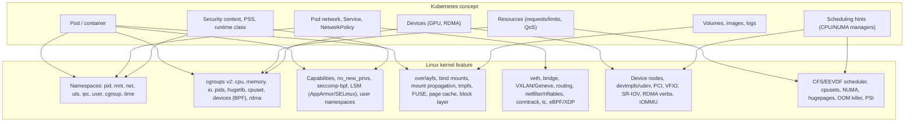

# 5.26 How Kubernetes uses the Linux kernel: a complete map

| | |
|---|---|
| Level | Advanced |
| Priority tier | 1 |
| Lab venue | Linux VM/bare metal with root and a kubeadm/kind cluster; `lsns`, `systemd-cgls`, `bpftool`, `perf`, `strace`, `sysctl` |
| Part | Part 5: Kubernetes |
| Status | Drafted, labs **untested** |

## Why this matters for AI infrastructure

Suppose a container on a GPU node is killed with exit 137, or a pod sees only some of its GPUs. Your first look usually goes to Kubernetes, because that is where the pod is described. The cause often sits lower. Kubernetes does not isolate, schedule or limit anything by itself. It is more like a manager who writes instructions and hands them to the building staff. The staff are the Linux kernel, and they do the actual work of walling off processes, counting memory and moving packets. So every behaviour you debug on a GPU node is a kernel mechanism that shows up through a Kubernetes API.

A throttled data loader, pods that cannot connect after a rule update, and memory that seems to disappear all come from this layer. So do an RDMA NIC that is unusable inside a pod and a kernel upgrade that breaks the GPU driver. Each of these symptoms looks like a Kubernetes problem on the surface, and each one has a kernel feature underneath it. This chapter maps each Kubernetes concept to its kernel feature. It also covers the kernel parameters, versions and failure modes that matter for GPU hosts. It draws together Parts 1 and 2 (Linux and networking) with Part 5, so that the two halves meet in one place.

## Prerequisites and outcomes

This chapter assumes you have worked through Parts 1 and 2, and 5.1 to 5.15. If a kernel term such as cgroup or namespace is hazy, the earlier chapters are the fastest way to clear it up. Read them first, because the map below uses those words without stopping to define them again.

The list below is a self-check. If you can do each item by the end of the chapter, you are ready for the incident work in the later chapters. If an item feels unfamiliar, go back to the section that covers it and read again, ideally with a container running on a machine you control.

- Take any Kubernetes feature, name the kernel mechanism behind it, and find where to inspect that mechanism, using `/proc`, `/sys` or a tool.
- Explain what a container is at the kernel level: a process with namespaces, cgroup membership, a capability set, a seccomp filter, an LSM label and a mount namespace with a rootfs. Know which features need which kernel versions.
- Reason about resource enforcement, covering CPU CFS quota and weight, memory max, high and OOM, pids, I/O and hugetlb, and about the failure modes you can observe.
- Understand how networking features implement CNI and Services. These features include veth, bridges, VXLAN, netfilter, conntrack, eBPF, tc and XDP.
- Understand storage mechanics such as overlayfs, bind mounts, mount propagation, block devices, FUSE, NFS clients and the page cache. Understand device access through the cgroup device controller, including GPU and RDMA devices.
- Choose and tune kernel versions, boot parameters and sysctls for GPU Kubernetes nodes, and diagnose kernel-level issues.

The next section gives you the master map from Kubernetes features to kernel mechanisms.

## 1. The master map

Start from the Kubernetes side when you debug a symptom. A symptom is what the user sees, such as a pod that dies or a service that times out, and the kernel is where the answer lives. The diagram groups Kubernetes concepts on one side and the kernel features they rely on in the other. Read it the way you would read a wiring diagram for a house. Each switch on one side connects to a specific circuit on the other.



| Kubernetes feature | Kernel mechanism | Inspect with |
|---|---|---|
| Pod isolation (PID, mount, UTS, IPC, network) | Namespaces (`clone`/`unshare`/`setns`) | `lsns`, `/proc/PID/ns/*`, `nsenter` |
| Pod network namespace shared by containers | A single netns joined by all containers' setns | `ip netns`, `/proc/PID/ns/net` inode comparison |
| User namespaces for pods (`hostUsers: false`) | `CLONE_NEWUSER` + idmapped mounts | `/proc/PID/uid_map`, kernel ≥ 6.3 for idmapped overlay |
| CPU limit | CFS bandwidth control (`cpu.max`) | `cpu.stat` (`nr_throttled`, `throttled_usec`) |
| CPU request | CPU weight (`cpu.weight`, formerly shares) | `cpu.weight` |
| Exclusive CPUs (static CPU manager) | cpusets (`cpuset.cpus`) | `cpuset.cpus.effective`, `taskset -pc` |
| Memory limit / OOM | memory controller (`memory.max`, `memory.high`, `memory.min`), OOM killer, `oom_score_adj` | `memory.events`, `dmesg`, `/proc/PID/oom_score*` |
| Ephemeral storage limit / eviction | kubelet accounting of filesystem usage (du/inode counting, project quotas optional) | `df`, XFS quotas |
| PID limit (`podPidsLimit`) | pids controller (`pids.max`) | `pids.current`, `pids.events` |
| Block I/O limits (rare) | io controller (`io.max`, `io.weight`), blk-throttle | `io.stat`, `io.pressure` |
| Hugepages resources | hugetlb controller, hugetlbfs | `/sys/kernel/mm/hugepages`, `hugetlb.*` files |
| Image layers / writable layer | overlayfs (`lowerdir`, `upperdir`, `workdir`) | `mount \| grep overlay`, `/var/lib/containerd/.../snapshots` |
| Volumes into containers | bind mounts, mount propagation | `findmnt`, `/proc/PID/mountinfo` |
| Secrets/ConfigMaps/`emptyDir{Memory}` | tmpfs | `df -h`, `mount \| grep tmpfs` |
| `/dev/shm` | tmpfs mounted at `/dev/shm` | `df -h /dev/shm` |
| Device exposure (GPU, RDMA) | devtmpfs nodes + cgroup devices allowlist (BPF device filter) | `ls -l /dev/nvidia*`, `bpftool cgroup tree` |
| Capabilities, `allowPrivilegeEscalation` | capability sets, `PR_SET_NO_NEW_PRIVS` | `/proc/PID/status` (`CapEff`, `NoNewPrivs`), `capsh --decode` |
| `seccompProfile` | seccomp-bpf filters | `/proc/PID/status` (`Seccomp: 2`), `strace` EPERM |
| AppArmor/SELinux | LSMs | `aa-status`, `ps -Z`, `ausearch -m avc` |
| `hostNetwork` | Use the root network namespace | `ip addr` identical to host |
| veth/bridge/routes (CNI) | veth, bridge, FIB, ARP/neighbour | `ip link/route/neigh`, `bridge` |
| Overlay (VXLAN/Geneve/IPIP) | tunnel devices with UDP encap | `ip -d link`, `bridge fdb` |
| Services (kube-proxy) | netfilter NAT (iptables/nft), IPVS, or BPF maps; conntrack | `iptables-save`, `ipvsadm`, `conntrack`, `bpftool map` |
| NetworkPolicy | netfilter rules/ipsets or eBPF programs on tc/XDP | `iptables`, `bpftool prog`, `cilium bpf` |
| Bandwidth limits (annotation) | tc (HTB/TBF or EDT with fq) | `tc qdisc show`, `tc -s class show` |
| Load balancing node ports | netfilter/IPVS/BPF; `route_localnet` | sysctls |
| Probes (exec) | `setns` + `execve` inside container namespaces | n/a |
| Logs | pipes/pty to runtime, files on host | `/var/log/pods` |
| Time (`time` namespace, rarely) | CLOCK_MONOTONIC offsets | n/a |
| Node resource pressure signals | PSI (`/proc/pressure/*`), memory counters | `cat /proc/pressure/memory` |
| Pod QoS and eviction ordering | cgroup placement + `oom_score_adj` | cgroup tree |
| Container checkpoint/restore (alpha) | CRIU, ptrace, userfaultfd | `criu check` |
| User-space networking (DPDK/RDMA) | VFIO, hugepages, IOMMU, uverbs | `/dev/vfio`, `/dev/infiniband` |

Read the last column as the command or file that proves the mechanism is in place on a node. Most rows point to a namespace, a cgroup file or a netfilter rule. The same few kernel features keep returning under different Kubernetes names, which is why the table is short in one sense and long in another. Use this table as your first stop whenever a Kubernetes symptom needs a kernel explanation. If a row does not match what you see on the node, that mismatch is itself a finding worth recording.

## 2. Namespaces in depth

Picture two containers in one pod that talk to each other over `localhost`, while a container in another pod must not see their processes at all. Namespaces make both behaviours possible. A namespace is a private view of one kind of system resource. Think of an office building where every tenant gets a floor plan and a directory of their own, even though they all share the same walls, wires and lifts. Linux has eight namespace types, and `man 7 namespaces` lists them. Each type hides a different part of the system from a process.

The mnt namespace holds the mount table, and `pivot_root` moves a container into its image rootfs. The pid namespace controls process numbering and which processes can signal each other. The net namespace holds interfaces, routing tables, netfilter rules and sockets. The uts namespace holds the hostname, and the ipc namespace holds SysV IPC and POSIX message queues. The user namespace maps UIDs and GIDs and scopes capabilities. The cgroup namespace virtualises the cgroup root, and the time namespace holds clock offsets.

You create namespaces with the `clone(2)` flags, `unshare(2)` and `setns(2)`. A namespace lives on while a process is in it, while a file descriptor to `/proc/PID/ns/*` stays open, or while that file is bind-mounted, such as at `/var/run/netns/<name>`. Keeping the namespace alive without a process inside it is useful for tools that need to join it later. A pod is a group of containers that share the net, ipc and uts namespaces, and optionally the pid namespace when `shareProcessNamespace` is set. The pause container creates those shared namespaces. It does almost nothing else, which is why it sits quietly in the pod and holds the shared view open. Each container still gets its own mnt namespace and usually its own pid namespace.

The pid namespace causes the most surprises, so start there. PID 1 ignores any signal that has no handler installed. A signal is a short message the kernel sends to a process, and SIGTERM is the polite request to stop. An application that never registers a handler for SIGTERM therefore does nothing when asked to stop, and the kubelet then has to wait out the grace period before it escalates. PID 1 also reaps orphan processes, which makes it responsible for clearing zombies. A zombie is a finished process whose parent has not collected its exit status. A `kill -9` from outside works only when it comes from an ancestor namespace. With `shareProcessNamespace: true`, containers can see each other's processes, which helps with debug sidecars, but PID 1 is still the pause container.

The network namespace hides sockets. A socket bound in one netns is invisible in another, and `localhost` is private to each netns. Most `net.*` sysctls are per-netns, such as `net.ipv4.ip_local_port_range`, and newer kernels make `tcp_*` per-netns as well. Others stay host-global. `nf_conntrack_max` is host-global, `net.core.somaxconn` is per-netns, and `fs.*` is global. Pods can set safe namespaced sysctls through `securityContext.sysctls`. The lesson is that a sysctl you change inside a pod may or may not affect the host, so check the scope before you rely on it.

The mount namespace starts as a copy of the parent's mounts. Propagation flags (`shared`, `slave`, `private`, `unbindable`) decide whether a later mount shows up in other namespaces. Think of propagation as a mailing list. A `shared` mount sends copies of every new entry to everyone on the list, while a `private` mount keeps its mail to itself. kubelet and CSI use `Bidirectional` propagation for the node plugin, so the plugin's mounts reach the host.

The user namespace maps UID 0 inside a container to an unprivileged range of host UIDs. Capabilities inside the child namespace do not apply to resources the parent owns, such as mounting an arbitrary filesystem. In other words, root inside the namespace is only a costume that works inside the namespace. Pod user namespaces (`hostUsers: false`) need kernel support for idmapped mounts on the volumes and the overlay. That means kernel 5.12 or later for idmapped mounts, 5.19 or later for idmapped overlayfs, and CRI support. The payoff is a much smaller impact from any container escape, because a process that breaks out is still unprivileged on the host.

The ipc namespace covers POSIX shared memory, which lives on `/dev/shm`. That path is a tmpfs in the mount namespace, while SysV IPC is separate. Setting `hostIPC: true` shares IPC with the host, which some HPC and MPI shared-memory setups use. It weakens isolation, so treat it as a trade-off you accept on purpose rather than a convenience. Finally, the cgroup namespace makes `/sys/fs/cgroup` appear rooted at the container's own cgroup. Inside the container, the tree looks as if the container were the top of the world, and that illusion is part of what keeps the view small.

## 3. cgroups v2 in depth

Suppose a training pod slows down with no visible CPU spike. Its average CPU looks fine, yet requests time out. The explanation usually sits in cgroup v2 files. A cgroup is a group of processes that the kernel treats as one unit for accounting and limits. cgroup v2 is a single unified hierarchy mounted at `/sys/fs/cgroup`, so every controller lives in one tree. You enable controllers per subtree through `cgroup.subtree_control`. Processes live only in leaf cgroups, which is the "no internal process" rule (the root is the exception). Kubernetes and systemd build the tree from `kubepods.slice` down through QoS slices and pod slices to container scopes, as described in 5.9.

Think of the tree as a set of nested boxes. The outer box holds the budget for every pod on the node. Each smaller box inside holds a pod, and each box inside that holds one container. The rules flow downward, so a limit set on a parent box caps the total of everything inside it. The table below is a lookup from each controller to its files and to the Kubernetes setting that uses them.

| Controller | Files | Kubernetes use |
|---|---|---|
| **cpu** | `cpu.weight` (1–10000, default 100), `cpu.max` ("quota period", e.g., `200000 100000` = 2 CPUs), `cpu.stat`, `cpu.pressure`, `cpu.idle` | requests → weight, limits → max; throttling shows as `nr_throttled`/`throttled_usec`; burst (`cpu.max.burst`) |
| **memory** | `memory.max` (hard), `memory.high` (throttle/reclaim threshold), `memory.min`/`memory.low` (protection), `memory.swap.max`, `memory.current`, `memory.stat`, `memory.events` (`low, high, max, oom, oom_kill`), `memory.oom.group` | limit → `max`; MemoryQoS sets `high`/`min`; includes page cache, kernel memory (slab), tmpfs/shmem |
| **io** | `io.max`, `io.weight`, `io.latency`, `io.stat`, `io.pressure` | rarely set by Kubernetes; used by node tuning |
| **pids** | `pids.max`, `pids.current`, `pids.events` | `podPidsLimit` |
| **cpuset** | `cpuset.cpus`, `cpuset.mems`, `cpuset.cpus.effective` | static CPU manager exclusivity, memory manager NUMA pinning |
| **hugetlb** | `hugetlb.<size>.max/current` | hugepages-* resources |
| **rdma** | `rdma.max`, `rdma.current` | RDMA resource limits (rarely used by Kubernetes today) |
| **devices** | Implemented as cgroup BPF programs (`BPF_PROG_TYPE_CGROUP_DEVICE`) in v2 | Runtime attaches an allow-list program per container: only allocated `/dev/nvidia*` etc. |
| **misc** | `misc.max` | scalar resources |
| **freezer** | `cgroup.freeze` | pause/checkpoint |
| **PSI** | `cpu/memory/io.pressure` | node pressure signals, load-shedding |

Notice that requests become weights and limits become maxima. That split explains the throttling behaviour below. A request is a promise about how the CPU is shared when there is competition. A limit is a hard ceiling that applies even when the rest of the node is idle. Three behaviours explain most incidents.

CPU throttling comes first. Take a process with 8 threads under a `limits.cpu: "2"` limit, which maps to `cpu.max` of `200000 100000`. The quota allows 200 ms of CPU time in each 100 ms period. Eight threads running together burn through that quota in 25 ms of wall-clock time. The arithmetic is 8 × 25 ms = 200 ms, which is the whole quota. The cgroup then stalls every thread for the remaining 75 ms. Average utilisation looks low, but tail latency spikes and probes time out. The lesson is that a limit is measured in CPU time across all threads, not in cores at each instant, so a burst of parallel work can drain the budget in a fraction of the period.

The fixes follow from that arithmetic. For latency-sensitive pods, remove the CPU limit and keep the request. Match thread counts to the limit with `OMP_NUM_THREADS` or `GOMAXPROCS`, set through the downward API or `automaxprocs`. The downward API is the way Kubernetes passes pod facts into the container as environment variables. You can also use the static CPU manager, or newer kernels with burst or `cpu.idle`. Kernel CFS bandwidth bugs in kernels below 5.4 over-throttled workloads, so run current kernels.

Memory accounting comes second. `memory.current` includes anonymous pages, file cache (page cache), tmpfs, and kernel memory such as page tables, slab and socket buffers. Under `memory.max` pressure, the kernel can reclaim page cache. Active tmpfs pages and pinned or `mlock`ed memory cannot be reclaimed. An OOM happens when reclaim fails, and the kernel then kills a process in the cgroup. With `memory.oom.group=1`, it kills the whole group instead, and newer Kubernetes versions enable this for containers. The kubelet uses `container_memory_working_set_bytes` for eviction decisions. That metric is current minus inactive_file, so compare it with `memory.max`. The reason it subtracts the inactive file cache is simple. Inactive file cache can be dropped at no cost, so it should not count as memory the container truly needs.

Swap comes next. Kubernetes disables swap by default. The NodeSwap feature (beta) permits limited swap for Burstable pods on cgroup v2, through `memory.swap.max`. The chapter does not recommend it for GPU or ML nodes, because a job that waits on swapped-out memory wastes expensive GPU time.

Hierarchy limits follow the same logic. A pod-level limit caps the sum of its containers. The kubelet's node allocatable sets the maximum for `kubepods`, as described in 5.9. Allocatable is the amount of the node left over after the system daemons and the kubelet take their reserved share.

I/O is the next concern. Container log writes and image unpacks can saturate disks, and that hurts latency for every workload on the same disk. Put container storage on separate devices, and use `io.weight` to balance system work against pod work where you need to.

Many cgroups carry a cost of their own. With tens of thousands of them, `cat memory.stat` and cAdvisor scans slow down. Dead cgroups can also linger until the page cache drains, which is called a cgroup leak. The symptoms are high kernel CPU in `mem_cgroup_*` and a growing `nr_dying_descendants` in `cgroup.stat`. A node that runs many short batch jobs is the most likely place to see this.

Finally, consider the cgroup version. cgroup v1 is deprecated in Kubernetes and sits in maintenance mode, and some features require v2. Run `stat -fc %T /sys/fs/cgroup` to check: `cgroup2fs` means v2. The boot parameter `systemd.unified_cgroup_hierarchy=1` selects v2. RHEL 8 and later, Ubuntu 22.04 and later, and Debian 11 and later default to v2. Confirm the mode on each node before you tune any limit, because a number you read from a v1 file path means nothing on a v2 host.

## 4. Security primitives

Containers share the host kernel, so a kernel flaw can become a way out of a container. The primitives in this section shrink what a process is allowed to do, and each one closes a different door. Think of them as layers of locks on the same door. Each lock stops a different kind of intruder, so one lock alone is never the whole answer.

Capabilities split root into about 40 privileges, such as CAP_NET_ADMIN, CAP_SYS_ADMIN, CAP_NET_RAW, CAP_IPC_LOCK and CAP_SYS_PTRACE. A capability is one key from a large key ring that the traditional root user holds all of. Giving a process only the keys it needs is safer than giving it the whole ring. The default set for Docker and containerd is CHOWN, DAC_OVERRIDE, FSETID, FOWNER, MKNOD, NET_RAW, SETGID, SETUID, SETFCAP, SETPCAP, NET_BIND_SERVICE, SYS_CHROOT, KILL and AUDIT_WRITE. A safer habit is `drop: [ALL]`, then adding back only what the workload needs. Each process carries five capability sets: permitted, effective, inheritable, bounding and ambient. You do not need to memorise the five. The point is that a process can hold a capability in one set without actually using it. CAP_SYS_ADMIN is close to full root, so avoid it. The DCGM exporter has historically asked for it.

The `allowPrivilegeEscalation: false` setting turns on `no_new_privs`, which the kernel sets with `PR_SET_NO_NEW_PRIVS`. That blocks setuid and file capability elevation across `execve`, so a process cannot gain privileges by running a binary that carries them. Think of it as a sign on the door that says no upgrades beyond this point. Once the sign is up, a program started from inside the container cannot become more powerful than the program that started it.

seccomp-bpf is a syscall filter. The RuntimeDefault profile blocks around 40 to 60 dangerous syscalls, including `kexec_load`, the `ptrace` variants, `mount`, `keyctl` and `bpf`. A syscall is the way a program asks the kernel to do something, such as open a file or create a socket. A seccomp filter is a bouncer that checks each request against a list before it reaches the kernel. The kubelet setting `seccompDefault` applies a profile to every pod, while custom profiles such as Localhost fit a single application. A blocked call fails with `EPERM` or `Operation not permitted`, or it can send `SIGSYS`. To find the cause, use `strace`, the audit logs or the Security Profiles Operator recorder.

The LSMs add labels on top of that. An LSM is a Linux Security Module, a second policy engine that checks access after the normal permission checks. AppArmor is path-based, and its default profile is `cri-containerd.apparmor.d`. A path-based policy says which file paths a program may open. SELinux is label-based. Containers run as the `container_t` type, and MCS categories keep containers apart. A label-based policy attaches a tag to every file and process, and the rules say which tags may touch which others. GPU access under SELinux needs the right labels on `/dev/nvidia*`. You can set the `container_use_devices` boolean, or write a custom policy with `nvidia-container-toolkit` SELinux support.

Landlock, IMA, kernel lockdown, Yama ptrace_scope and seccomp user notifications are further levers. Yama's `kernel.yama.ptrace_scope` affects debugging with `strace -p`, which is worth knowing when a debugging session fails for no obvious reason. User namespaces and rootless pods were covered in section 2 above.

Containers share the host kernel, so kernel CVEs become container escapes. A CVE is a publicly recorded security weakness with its own identifier. Dirty Pipe, overlayfs and netfilter nf_tables bugs are examples. Patch kernels promptly, and cut the syscall surface with seccomp. Restrict `CAP_SYS_ADMIN` and `CAP_NET_ADMIN`. If you do not use unprivileged user namespaces, disable them with `user.max_user_namespaces` or `kernel.unprivileged_userns_clone`, or confine them. For untrusted code, use a sandboxed runtime, as covered in 5.2.

On a multi-tenant node, decide early whether you need unprivileged user namespaces at all, because that choice sets how much kernel surface you expose. Making that decision after the cluster is full of tenants is much harder than making it while the node is still empty.

## 5. Filesystems, mounts and block I/O

Your data loader reads many small files, and it runs far slower inside a container than on a plain volume. The storage path explains why. Each piece of this section adds a cost or a limit you can measure. Storage is where Kubernetes abstractions meet the slowest parts of the machine, so small details here decide how fast a training job feeds its GPUs.

overlayfs unions read-only `lowerdir` layers, which hold the image, with a writable `upperdir` and a `workdir`. The `workdir` is scratch space the kernel uses while it assembles changes. A union is like a stack of transparent sheets, where the top sheet shows through wherever it has ink. The first write to a file copies the whole file up into `upperdir`. That is slow for huge files, such as checkpoints written inside the container filesystem. Think of it as photocopying an entire book before you are allowed to underline one word. Deletions leave whiteouts behind, which are markers that hide a file from the layers below. Inode and `st_dev` quirks show up with hard links, and a `rename` across layers returns EXDEV, the error for a rename that would cross a filesystem boundary. The filesystem needs `d_type` support, and XFS needs `ftype=1`. The `metacopy` and `redirect_dir` options matter here, and identical lower layers share page cache. Metadata-heavy workloads, such as many small files, suffer compared with a dedicated volume, so keep datasets and checkpoints on volumes.

Kubernetes volumes reach containers as bind mounts. A bind mount makes a directory appear at a second path, without copying anything. The `mountPropagation` modes control how mounts pass between them, and `subPath` creates a bind mount of one subdirectory. tmpfs backs `emptyDir{medium: Memory}`, `/dev/shm`, and Secret and ConfigMap volumes. A tmpfs is a filesystem that lives in RAM. Those bytes count against the container's memory cgroup, and the `sizeLimit` is enforced through tmpfs `size=`. So a volume that looks like a disk can still consume the memory budget of the pod.

Large writes, such as checkpoints, fill dirty pages in the page cache. A dirty page is a page of memory that holds data not yet written to disk. `vm.dirty_ratio` and `vm.dirty_background_ratio`, together with cgroup writeback limits, can cause stalls. Those stalls show up as freezes while the kernel flushes. On large-memory nodes, use smaller ratios or absolute byte limits instead, through `vm.dirty_bytes` and `vm.dirty_background_bytes`. The reason is that a percentage of a huge memory is a huge amount of data to flush at once, which the section on sysctls returns to. In checkpoint code, pick the `O_DIRECT` and `fsync` strategy with care. Use `posix_fadvise` or `drop_caches` only for testing, because dropping caches in production hides the real behaviour.

The block layer uses NVMe queues, IRQ affinity, I/O schedulers and `blk-mq`. NVMe usually runs with the `none` scheduler. An I/O scheduler decides the order in which requests reach the disk, and NVMe devices have so many internal queues that a scheduler adds little. XFS suits large files and parallel writes, and ext4 is the default. Mount with `noatime`, and decide your discard and trim policies deliberately. Discard tells an SSD which blocks are free, and running it at the wrong time can slow writes.

Network filesystems add their own limits. NFS clients expose `nconnect`, `rsize` and `wsize`, `hard` and `soft`, and `actimeo`. A `hard` mount keeps retrying until the server answers, and a `soft` mount gives up and returns an error. Lustre, WEKA and BeeGFS kernel clients have module versions tied to the kernel and to OFED, and the CephFS kernel client has its own. FUSE mounts such as S3 and GCS FUSE, and JuiceFS, route everything through one user-space daemon, which can become the bottleneck. Containers reach FUSE through `/dev/fuse`.

inotify and fanotify limits matter too. inotify is the kernel's way of telling a program that a file changed. kubelet, log shippers and config reloaders depend on `fs.inotify.max_user_watches` and `max_user_instances`, so raise them on busy nodes. File descriptor limits work in layers as well. A file descriptor is a small number that stands for an open file or socket. `fs.file-max` and `fs.nr_open` set system-wide ceilings, and `ulimit -n` sets the per-process value. Containers inherit runtime defaults, and containerd's `LimitNOFILE=infinity` causes problems for some apps. Training processes that open many dataset files need a higher `nofile`.

Put datasets and checkpoints on volumes, not in the container layer. A volume is the place where the writes are cheap and the data survives the container. The container layer is a scratch area that disappears when the pod does.

## 6. Networking in the kernel

This section is detailed in Part 2 and in 5.10 to 5.15. It is summarised here so the map stays complete. Think of it as the wiring diagram after the electricians have finished. You do not need to rewire the building to read it, but you do need to know where each cable goes.

Start with the devices. Pods reach the network through veth pairs and bridges. A veth pair is a virtual cable with two ends, one inside the pod and one on the host side. A bridge is a virtual switch that the host-side ends plug into. You can create a bridge with `brctl` or `ip link add type bridge`. Its STP is off, and `hairpin_mode` controls traffic that loops back out the port it arrived on. STP is the spanning tree protocol that prevents loops in a network of switches. macvlan and ipvlan, VXLAN, Geneve, IPIP and WireGuard tunnels, dummy devices such as `kube-ipvs0`, SR-IOV VFs and RDMA devices round out the list.

Routing decides where those packets go. The FIB, or forwarding information base, is the routing table the kernel consults for each packet. Per-netns tables keep each pod's routes separate, and policy routing through `ip rule` handles multi-homed nodes and CNIs such as Calico and Cilium. Set `rp_filter` to 0 or 2 on multi-NIC GPU nodes, so asymmetric traffic is not dropped. `ip_forward` and the ECMP hashing policy `fib_multipath_hash_policy` also matter here. ECMP spreads traffic across several equal paths.

Netfilter hooks run at PREROUTING, INPUT, FORWARD, OUTPUT and POSTROUTING, and iptables or nftables attach to them. A hook is a checkpoint that every packet passes through at a fixed point in its journey. `br_netfilter` makes bridged traffic traverse iptables, which kube-proxy and NetworkPolicy need on bridge CNIs. Conntrack keeps the connection table, governed by `nf_conntrack_max`, buckets and timeouts. Think of conntrack as a guest list at a door. It remembers each open connection so that the replies find their way back. NAT does the rest, with DNAT for Services and MASQUERADE for egress. DNAT rewrites a destination address, which is how a Service IP turns into a real pod IP. MASQUERADE rewrites a source address for traffic leaving the cluster. ipset handles large sets, and `xt_statistic` handles random load balancing.

IPVS uses the `ip_vs*` modules and their schedulers. nftables is the newer kube-proxy mode. eBPF has its own set of program types. eBPF lets small verified programs run inside the kernel at hook points. Kubernetes networking uses `sched_cls` for tc, XDP, `cgroup_sock_addr` (`connect4` and `sendmsg4`) for socket load balancing, `sock_ops`, `sk_msg`, `cgroup_skb` and `cgroup_device`. Maps come in hash, LRU, LPM trie and array forms. A map is a table that programs share with user space and with each other. Kernel features arrived over time: BPF host routing in 5.10, netkit in 6.7 and BIG TCP in 5.19. Inspect programs and maps with `bpftool prog show`, `bpftool map dump`, `bpftool net` and `bpftool cgroup tree`.

On the traffic-shaping side, tc uses `fq`, `fq_codel`, `htb`, `netem` (for testing), and `clsact` for BPF. tc is the traffic control subsystem, and netem is the part that can add delay or loss on purpose. Netem is what lets you test how an application behaves on a bad network. Cilium's bandwidth manager uses EDT, which schedules each packet's departure time instead of queueing it blindly.

Socket buffers and TCP are tuned through `net.core.rmem_max/wmem_max`, `net.ipv4.tcp_rmem/wmem`, `tcp_congestion_control` (bbr or cubic), `tcp_mtu_probing`, `somaxconn`, `tcp_max_syn_backlog` and `ip_local_port_range`. TIME_WAIT behaviour depends on `tcp_tw_reuse`. TIME_WAIT is the short wait a closed connection spends in the kernel before its port is reused. Keepalive settings are namespaced per pod where the kernel allows it.

Offloads and queues set the packet path's speed. GRO, GSO, TSO and LRO, checksum offload, RSS, RPS, RFS and XPS, IRQ affinity, NAPI budgets and ring sizes (`ethtool -G`) all contribute. Offload means the network card does part of the work that the CPU would otherwise do. On RoCE NICs, PFC, ECN and DCQCN come into play, as covered in Part 12. PFC pauses traffic class by class, ECN marks packets when a queue grows, and DCQCN turns those marks into rate changes.

The RDMA stack includes `ib_core`, `rdma_cm`, `ib_uverbs`, vendor drivers such as `mlx5_core` and `mlx5_ib`, and `nvidia_peermem` for GPUDirect RDMA. Its device nodes live under `/dev/infiniband/*`. Locked memory is limited by `ulimit -l` and `CAP_IPC_LOCK`. Setting `iommu=pt` helps performance, and SR-IOV VF management runs through `devlink`.

Time matters for debugging, too. `chrony` or PTP (`ptp4l`) keeps clocks aligned for training logs and collectives. A collective is a synchronised exchange in which every GPU waits for the others, so badly aligned clocks make logs hard to read. `CLOCK_MONOTONIC` is unaffected by an NTP step, which is a sudden clock correction. That is why timers and timeouts use it, and why logs that compare wall-clock times across nodes need the NTP or PTP service to be healthy.

Before you troubleshoot a multi-NIC GPU node, check `rp_filter` first, because it decides whether asymmetric traffic survives.

## 7. CPU, memory and NUMA

Suppose the same GPU job runs at different speeds on two nodes with identical hardware. The difference often comes from where the threads and memory sit in the machine, not from the GPU itself. Two identical servers can behave differently because one of them has its memory, its network card and its GPU on different sides of the CPU.

The scheduler is CFS (EEVDF from 6.6), and it applies cgroup hierarchical weights. The Completely Fair Scheduler gives each runnable thread a fair share of CPU time, weighted by the cgroup it belongs to. EEVDF is the newer scheduler that replaced it in later kernels, and the principle is still fair sharing. Its `sched_*` tunables are rarely tuned, and Kubernetes does not use real-time classes. Latency-sensitive pods that rely on the static CPU manager need cores isolated at boot. The boot parameters `isolcpus`, `nohz_full` and `rcu_nocbs` do that job. Isolating a core means the scheduler stops placing ordinary work on it. Use `irqaffinity` to keep IRQs off the isolated cores. Best-effort work can use `cpu.idle` or `SCHED_IDLE`. NIC and NVMe IRQ affinity should match the NUMA node of the device.

NUMA adds a second layer. NUMA means non-uniform memory access. On a two-socket server, each CPU socket has its own bank of memory, and a CPU reads its local bank faster than the other socket's bank. Think of a restaurant with two kitchens, where each kitchen has its own pantry. Cooking is fastest when the chef uses the pantry in the same kitchen. Check nodes, distances and memory policies with `numactl -H` and `lscpu`. Memory policies are set with `mbind` and `set_mempolicy`, and automatic migration comes from `numa_balancing`. On GPU nodes, disable it for stability with `kernel.numa_balancing=0`. Device NUMA affinity is in `/sys/bus/pci/devices/*/numa_node`, and `cpuset.mems` pins memory. The Kubernetes Topology Manager aligns CPU, memory and devices, as covered in 5.9. Cross-NUMA copies between GPU and host memory, or between a NIC and a GPU, reduce bandwidth. Use `nvidia-smi topo -m` and `lspci -tv` to see the PCIe topology, which shows which device sits behind which socket.

Memory management has its own knobs. Kubelet's `protectKernelDefaults` requires `vm.overcommit_memory=1`, because heuristic mode 0 may refuse large allocations. Overcommit means the kernel promises more memory than it has, betting that not every promise will be claimed at once. Set `vm.swappiness`, `vm.min_free_kbytes` and `vm.max_map_count` as well. Elasticsearch and ML workloads often need `vm.max_map_count` at 262144 or higher, because each memory mapping uses one of the available slots. Transparent hugepages should be `madvise` or `never` for databases and some latency-sensitive workloads, because `always` can cause compaction stalls. Compaction is the kernel shuffling memory to make large pages, and that shuffling can freeze a process. Explicit hugepages are set with the `hugepages=` boot parameter or a sysctl, in 2 MiB or 1 GiB sizes, allocated NUMA-local. Leave KSM off, watch memory cgroup events and direct reclaim stalls (PSI memory full), and keep `kswapd` in mind. kswapd is the background kernel thread that frees memory when it runs low. Set `vm.zone_reclaim_mode=0`.

When memory runs out, the OOM killer picks the process with the highest `oom_score`, adjusted by `oom_score_adj`. The choice happens inside the cgroup or across the whole system. The kernel logs the constraint type to `dmesg`. `vm.panic_on_oom` and `kernel.panic` also matter, and kubelet expects `kernel.panic=10` and `panic_on_oops=1` when `protectKernelDefaults` is on.

Pinned and device memory sits outside these controls. `mlock` and `memlock` limits apply to pinned memory, such as CUDA pinned host memory. GPU memory is not in cgroups, because the driver accounts for it, and `nvidia-smi` shows it per process. UVM (`nvidia_uvm`) handles migration, Grace-Hopper provides unified memory, and DMA-BUF covers buffer sharing.

Kernel memory is the last piece. Slab holds dentries and inodes for millions of small files, and socket buffers and page tables for huge mappings also count. A dentry is a cached directory entry, and an inode is the record that describes a file. Check `slabtop`, `/proc/meminfo` and `/proc/slabinfo`. A leak shows up as growing non-container memory, meaning memory that climbs even though no container is using more.

On GPU nodes, the chapter's guidance is to disable NUMA balancing with `kernel.numa_balancing=0`.

## 8. Devices and the GPU/RDMA stack in the kernel

A GPU does not appear in a container by magic. The driver creates device nodes, the device filter decides who may open them, and the hardware reports its faults back to the kernel log. This section walks through that chain, one link at a time, so that you can tell which link broke.

The GPU driver is a set of kernel modules: `nvidia.ko`, `nvidia_uvm.ko`, `nvidia_modeset.ko`, `nvidia_drm.ko`, `nvidia_peermem.ko`, and `nvidia_fs.ko` for GDS. A kernel module is a piece of code loaded into the running kernel. It creates `/dev/nvidia0..N`, `/dev/nvidiactl`, `/dev/nvidia-uvm` and `/dev/nvidia-caps/*`. User space talks to the driver through an ioctl-based interface. An ioctl is a special call that passes a request to a device. That interface is versioned, so userspace `libcuda` must match the kernel driver's major interface, as covered in 5.1. Fabric Manager manages NVSwitch. You can choose the open kernel modules (`nvidia-open`) or the proprietary ones. Modules are tied to the kernel version through DKMS or precompiled builds. DKMS rebuilds a module each time the kernel changes. Secure Boot requires signed modules. Module parameters named `NVreg_*` live in `/etc/modprobe.d`, and persistence mode keeps driver state initialised.

IOMMU and VFIO handle device passthrough. The IOMMU is a hardware unit that translates the addresses a device uses for memory access, which keeps a device from reading memory it has no business touching. VFIO is the framework that hands a device to a user-space program or a virtual machine. `intel_iommu=on iommu=pt` gives host devices passthrough mode for performance. Full translation is used for VM passthrough. `/dev/vfio/*` passes GPUs and VFs to VMs under Kata, KubeVirt or vGPU. ACS and PCIe topology decide which IOMMU groups can be passed through together, because devices in the same group must move as one unit.

SR-IOV works through the PF driver, which creates VFs (`sriov_numvfs`). SR-IOV lets one physical network card present several smaller virtual cards, called virtual functions. Each VF appears as a PCI device, and the CNI moves it into a pod's netns. Switchdev mode allows hardware offload, which moves the switch logic onto the card itself.

The container runtime adds device nodes and attaches the cgroup device filter, as covered in 5.8. A device filter is the bouncer at the device door. udev and devtmpfs handle device node creation and permissions, such as the mode and group on `/dev/nvidia*`, plus the rules for MIG caps and persistent names. MIG is Multi-Instance GPU, which splits one physical GPU into isolated slices, 

Hardware errors reach the kernel log through several channels. `rasdaemon`, EDAC for ECC memory, and AER for PCIe errors all write to `dmesg`, and `mce` logs cover machine checks. A machine check is the processor reporting a serious internal fault. The NVIDIA driver emits Xid messages, and NVLink error counters track link faults. Xid is the NVIDIA driver's numbered error code for a GPU event. A GPU that falls off the bus is a PCIe or driver event that shows up in kernel logs. Ship those logs off the node, as covered in 5.24, because a node that dies with its logs still on its disk teaches you nothing.

## 9. Kernel versions, boot parameters and sysctls for GPU Kubernetes nodes

Picture a fleet where some GPU nodes run one kernel and others run another. A driver that works on one pool fails on the next, and nobody can say why. The kernel version, boot parameters and sysctls must be chosen together, and they must match across the pool. A pool that drifts apart is the hardest kind of system to debug, because each node looks correct on its own.

Treat the version guidance as principles, and verify each one against your distro and driver support. Use an LTS kernel with modern cgroup v2, eBPF and idmapped-mount support. An LTS kernel is a long-term support release that receives fixes for years. The minimum is 5.15, and 6.1 or 6.6 is preferred. The kernel must be supported by the NVIDIA driver, OFED and the CNI you run. Pin one exact kernel across the fleet, and test every kernel upgrade with the full stack, as covered in 4.17. Watch for differences in distro HWE and backports, and do not mix kernels within one pool. HWE is the hardware enablement stack that some distributions use to ship newer kernels on older releases, and a backport is a fix copied into an older kernel. The features arrive at roughly these versions: cgroup v2 matured by 5.2, idmapped mounts arrived in 5.12, and BPF cgroup improvements came in 5.x. The `memory.oom.group` file came in 4.19, PSI in 4.20, and io_uring in 5.1, which you should disable for untrusted workloads. EEVDF came in 6.6, netkit in 6.7, and user-namespaced pods on idmapped overlay in 5.19.

Boot parameters are the next layer. They are settings the kernel reads once, at startup, from the boot loader. The following are examples, and you should adapt them: `systemd.unified_cgroup_hierarchy=1`, `intel_iommu=on iommu=pt` or `amd_iommu=on iommu=pt`, and `default_hugepagesz=1G hugepagesz=1G hugepages=N` if you use hugepages. Others are `transparent_hugepage=madvise`, `numa_balancing=disable`, and `isolcpus=...`, `nohz_full=...` and `rcu_nocbs=...` for latency-critical pinned pools only. You can also see `processor.max_cstate=1 intel_idle.max_cstate=0`, which trades latency for power, and `pci=realloc` for resizable BAR on some platforms. `nvme_core.default_ps_max_latency_us=0` and `audit=1` appear too, along with `cgroup_no_v1=all`. The `mitigations=` policy is a security and performance trade-off, so understand its impact before you pick one. Mitigations are the kernel's defences against CPU side-channel attacks, and they cost some speed.

Sysctls come next. A sysctl is a kernel setting you change at runtime through a file under `/proc/sys`, and it usually takes effect without a reboot. The block below lists examples. Most of the baseline values come from the 4.17 and 5.4 chapters.

```text
vm.overcommit_memory = 1            kernel.panic = 10          kernel.panic_on_oops = 1
vm.swappiness = 1                   vm.max_map_count = 1048576  vm.min_free_kbytes = 1048576   (scale with RAM)
vm.dirty_background_bytes = 268435456   vm.dirty_bytes = 1073741824   (avoid huge write stalls)
kernel.numa_balancing = 0           kernel.pid_max = 4194304   kernel.threads-max = 4194304
fs.inotify.max_user_watches = 1048576   fs.inotify.max_user_instances = 8192   fs.file-max = 26214400
net.core.somaxconn = 65535          net.core.netdev_max_backlog = 250000
net.core.rmem_max = 268435456       net.core.wmem_max = 268435456
net.ipv4.tcp_rmem = 4096 87380 134217728   net.ipv4.tcp_wmem = 4096 65536 134217728
net.ipv4.tcp_mtu_probing = 1        net.ipv4.ip_local_port_range = 10240 65000
net.netfilter.nf_conntrack_max = 2097152   net.netfilter.nf_conntrack_buckets = 524288
net.ipv4.conf.all.rp_filter = 0 (or 2)     net.ipv4.ip_forward = 1   net.bridge.bridge-nf-call-iptables = 1
user.max_user_namespaces = 0 on nodes that don't need them (tradeoff with rootless/userns pods)
```

Apply these through files in `/etc/sysctl.d/*.conf`, which Ansible manages in 4.7 and 4.17. Keeping them in files means a reboot restores them, and the same files can be copied to every node in the pool. Kubelet's `allowedUnsafeSysctls` should cover only specific pools, and `protectKernelDefaults` helps you detect drift. Drift is the gradual difference that creeps in when one node is changed by hand.

Finally, the kernel modules. Nodes need `overlay`, `br_netfilter`, `nf_conntrack`, `nf_nat`, the `ip_vs*` modules for IPVS, `vxlan`, `wireguard`, the `xt_*` and `nft_*` modules, and `ip_tables`. They also need `rdma_cm`, the `ib_*` and `mlx5_*` modules, `nvidia*`, `nvme_tcp` and `nvme_rdma` for NVMe-oF, `fuse`, the `lustre` or `wekafs` clients, `vfio_pci`, and `tun`. NVMe-oF is NVMe over a network fabric, so remote storage can appear as a local disk.

Before you upgrade a pool, pin the kernel, test the full stack on it, and confirm the sysctls against the baseline. A baseline is the recorded state you trust, and every change should be measured against it.

## 10. Observing the kernel from Kubernetes

When a pod misbehaves, you need to see what the kernel is doing. Each row of this table pairs a question with the tool that answers it. Find your question first, then run the tool. Kubernetes gives you the pod's view, and these tools give you the kernel's view of the same pod.

| Need | Tool/Source |
|---|---|
| Where is time going in the kernel? | `perf top`, `perf record -g`, `bpftrace`, `bcc`/`libbpf-tools` (`runqlat`, `biolatency`, `tcpconnlat`, `tcpretrans`, `opensnoop`, `execsnoop`, `oomkill`) |
| Per-container kernel metrics | cAdvisor (cgroup files), node-exporter (`/proc`), `kubelet /metrics/resource`, PSI exporters |
| Syscalls, files, network | `strace -f`, `ltrace`, `tcpdump`, `ss`, `lsof`, `fatrace` |
| Kernel logs | `dmesg -T`, `journalctl -k`, `/var/log/kern.log`, remote log shipping; `rasdaemon`, `mcelog` |
| Security/auditing | auditd (`execve`, `openat` on secrets), Falco/Tetragon (eBPF), seccomp audit logs |
| Latency of scheduling | `perf sched`, `runqlat`, `sched:` tracepoints; PSI cpu |
| Memory issues | `/proc/meminfo`, `smem`, `slabtop`, `numastat`, `memory.stat`, `perf mem`, `bpftrace` oom tracepoints |
| Tracing Kubernetes-aware | Pixie, Inspektor Gadget (`kubectl gadget trace tcp/dns/oomkill/exec/open`), Tetragon, Hubble |

The commands below cover the most common checks. Inspektor Gadget scopes its traces to pods, and the bcc tools run directly on the node. The difference matters. Inspektor Gadget knows which pod an event belongs to, while bcc tools see only processes and need you to match them to a pod yourself.

```bash
# Inspektor Gadget examples (eBPF gadgets scoped to pods)
kubectl gadget trace oomkill; kubectl gadget trace tcpconnect -n serving; kubectl gadget profile cpu -n training --podname trainer-0
# Common bcc/libbpf tools on the node
runqlat 10 1; biolatency -D 10 1; tcpretrans; tcplife; cachestat; oomkill
```

Use the table as a lookup, and pick the row that matches the kind of problem you are chasing. If you do not know the kind of problem yet, start with the kernel logs and the PSI files. Those two sources are cheap, and they point to the family of problem quickly.

## 11. Failure modes mapped to kernel causes

A pod fails, and the error message names a Kubernetes symptom. The kernel cause sits behind it. This table pairs each symptom with its likely cause and with the check that confirms it, so you can move from what you see to what the kernel did. Treat each row as a hypothesis to confirm, not a verdict. Two rows can look alike from the outside, and only the confirming check tells them apart.

| Symptom in Kubernetes | Kernel cause | How to confirm |
|---|---|---|
| Container exit 137 | cgroup memory OOM or SIGKILL by kubelet/runtime | `memory.events oom_kill`, `dmesg` "Memory cgroup out of memory" |
| Latency spikes at low CPU % | CFS throttling | `cpu.stat nr_throttled`, `container_cpu_cfs_throttled_*` |
| `fork: retry: Resource temporarily unavailable` | `pids.max` or `kernel.pid_max` | `pids.events`, `/proc/sys/kernel/pid_max` |
| `Too many open files` | `ulimit -n`, `fs.file-max`, inotify limits | `/proc/PID/limits`, `sysctl fs.inotify` |
| Intermittent connection drops | conntrack table full, insert failures, SYN backlog overflow | `conntrack -S`, `nstat ListenOverflows` |
| Large transfers stall | MTU/PMTUD blackhole, offload bugs | `ping -M do`, `ethtool -k`, capture |
| Pods can't connect after rule changes | netfilter/iptables lock contention, kube-proxy sync, stale conntrack | kube-proxy logs, `iptables --wait`, conntrack flush |
| Mount failures / stale handles | NFS server issues, FUSE crash, namespace propagation | `dmesg`, `findmnt`, `mountstats` |
| Directory/file operations slow in container | overlayfs copy-up/metadata, many small files, dentry cache pressure | move data to volume, `slabtop`, `perf` |
| Process unkillable | D-state on hung I/O or driver | `/proc/PID/stack`, kernel logs, storage health |
| GPU lost after kernel update | DKMS build failed/unsigned module/ABI mismatch | `dkms status`, `modinfo nvidia`, journal |
| `Operation not permitted` in a container | seccomp, missing capability, LSM denial, user namespace restrictions | `strace` EPERM, audit logs, `capsh`, `aa-status` |
| Node unresponsive under load | Memory pressure without reservations, softlockups, IRQ storms | PSI, `dmesg`, `perf`, `mpstat -I` |
| NUMA-related low throughput | Cross-socket memory/device access, `numa_balancing` | `numastat -p`, `nvidia-smi topo -m`, `perf stat` |
| Clock skew / odd timeouts | NTP failure, VM time drift | `chronyc tracking`, `timedatectl` |

Each row gives one likely kernel cause and the check that confirms it. Run that check before you change a limit or a sysctl. Changing a limit to fix a symptom you have not confirmed is a guess, and a guess can hide the real cause for weeks.

Read the "How to confirm" column first, because it tells you which file to open on the node. In practice, that means you open the file, read the one line that matters, and only then decide what to change.

## 12. Lab

Begin with the self-checking Python lab at `code/part05/k8s_kernel_primitives_map_lab.py`. Run it locally first. It checks the cgroup v2 CFS CPU quota throttling and the `working_set` memory calculator. The `simulate_cgroup_v2_cpu_and_memory` function shows 8 threads on a 2-CPU limit burning a 200 ms quota in 25 ms, then stalling for 75 ms. The same run shows how `working_set = memory.current - inactive_file` triggers OOM. The lab also audits GPU node sysctls for `protectKernelDefaults` compliance, through `audit_gpu_node_kernel_sysctls`, and it checks kernel version features through `check_kernel_version_features`. Running the simulation first lets you see the arithmetic before you measure it on a real node.

```bash
python3 code/part05/k8s_kernel_primitives_map_lab.py
```

The rest of the lab runs on a Linux Kubernetes node with root access. The interactive shell steps below were not run on a live node, so check each result yourself as you go. Work through these exercises in order.

1. Build a container by hand. Create a rootfs, then use `unshare -fp --mount-proc --mount --net --uts --ipc` and `pivot_root`. Create a cgroup v2 directory with `cpu.max`, `memory.max` and `pids.max`. Add the device allow-list with the `bpftool` or `systemd-run -p DeviceAllow=` equivalents. Compare the result with `runc`.
2. Take a namespace tour. For one pod, list the namespaces with `lsns`. Compare the inode numbers of its containers with those of a container in a different pod. Join each namespace with `nsenter` and run commands inside it. Then show what `shareProcessNamespace` changes.
3. Run cgroup experiments. Create pods with CPU, memory and pids limits, and read their cgroup files. Cause throttling with a multi-threaded burn, and measure `nr_throttled`. Trigger an OOM and read `memory.events`. Compare `memory.current` with the working set, and show that tmpfs is charged to the cgroup.
4. Test the device filter. Run a GPU pod and a non-GPU pod, and compare what each one sees in `/dev`. From the non-GPU pod's namespace, try to open `/dev/nvidia0` with `nsenter -m`, so you can watch the cgroup device denial happen. Inspect the BPF program with `bpftool cgroup tree`.
5. Check the security layers. Run containers with different capabilities, seccomp settings and `no_new_privs` values. Demonstrate the failures for mount, ptrace, raw sockets and `setuid`. Read the status files, and test a custom seccomp profile. On SELinux nodes, trigger an AVC denial and read it.
6. Explore overlayfs. Write a large file in the container layer, then write the same file to a volume. Measure the copy-up cost of modifying a 5 GB image file. Look at `lowerdir/upperdir` in `/proc/mounts`.
7. Trace netfilter and eBPF. Dump the kube-proxy rules for a Service. If you run Cilium, dump the BPF LB maps. Trace a connection with `bpftrace` or `tcpconnect`, and observe the conntrack entries. Then measure the effect of exhausting `nf_conntrack_max`.
8. Measure memory and NUMA. On a two-socket node, run a memory benchmark pinned to local NUMA memory, and then to remote NUMA memory. Show how `numa_balancing` changes the result. Enable hugepages, run a pod that requests them, and inspect the `hugetlb` cgroup files.
9. Observe a writeback stall. Write a large checkpoint-sized file with the default `vm.dirty_*` values, and watch for stalls with `iostat` and your application timing. Tune the values, then repeat the test and compare.
10. Build a version matrix. Record the kernel, cgroup mode, driver, OFED and CNI versions on a node. Check the feature availability list from section 9 against them, then plan an upgrade test.
11. Use eBPF for observability. Install Inspektor Gadget or the bcc tools. Trace `oomkill`, `execsnoop`, `tcpretrans` and `runqlat` while you run load in pods. Correlate the results with the symptoms.
12. Audit the sysctls. Gather `sysctl -a` from a GPU node, and compare it with the baseline in section 9. List each deviation, and decide whether it is safe. Encode the baseline in Ansible (4.7), and verify it with `protectKernelDefaults`.
13. Clean up everything the exercises left behind.

## 13. Common mistakes

Most of these mistakes come from one wrong picture: that a container behaves like a small virtual machine. A container shares the host kernel, so namespace isolation is not the same as VM isolation. Keep that in mind for every item below. When a mistake costs you time, it is usually because someone trusted the picture instead of checking the kernel.

Setting a CPU limit equal to a small request on a multi-threaded ML process is a common error, and it produces poor latency. The process has the threads to run in parallel, but the quota does not let them. Counting only RSS when you size memory limits is another, because it ignores tmpfs, page cache, pinned memory and kernel memory. RSS is the resident set size, the memory a process currently holds in RAM, and it leaves out most of what the cgroup charges. Mixing up cgroup v1 assumptions and tools with v2 hosts, or the reverse, causes trouble too. The same goes for running old runtimes on v2.

Running mixed kernels across a GPU pool is a mistake, and so is upgrading the kernel without validating the driver, OFED, CNI or CSI modules. Ignoring conntrack, inotify and PID limits works until the node falls over, and then it fails all at once. Leaving THP at `always`, leaving NUMA balancing on, or keeping the default dirty-page ratios on large-memory GPU nodes causes the same kind of problem. Each one is quiet on a small test and loud on a full node.

Assuming `privileged: true` is how to make GPUs work is wrong, because proper device exposure is the right path. A privileged container can reach nearly everything on the host, which is far more power than a GPU needs. Treating seccomp or LSM failures as application bugs sends you in the wrong direction. A blocked syscall looks like an app error, but the real fix is in the profile. Not shipping kernel logs (Xid, EDAC, AER) off the node leaves you with no evidence when a GPU fails.

## 14. Interview angles

These questions test whether you can connect a Kubernetes behaviour to the kernel mechanism behind it. Answer them by naming the mechanism first, then the file or tool that proves it, and then the fix.

- "What is a container at the kernel level? Which kernel features does Kubernetes use for isolation and limits?"
- "How does the kernel enforce CPU and memory limits? Why does CPU throttling happen at low average usage?"
- "What happens in the kernel when a container exceeds its memory limit? How is it different from node-pressure eviction?"
- "How does a Service get implemented in the kernel under iptables, IPVS, and eBPF?"
- "How does a GPU device get into a container and what stops other containers from using it?"
- "Which sysctls and boot parameters do you set on GPU nodes and why?"
- "What are the container-escape surfaces and how do seccomp/capabilities/user namespaces reduce them?"
- "How would you diagnose a node that's slow but whose pods look healthy?" (PSI, softirq, IO wait, throttling, NUMA.)

## Exercises

Each exercise asks you to explain a behaviour and to check it against the lab code. Use How Linux Works (chapter 17), Networking and Kubernetes (chapters 2 to 5) and Production Kubernetes (chapters 3 to 5) as background. Start with the exercise that matches the section you have just read, and move on only when you can explain the mechanism without looking.

1. Build the complete map from Kubernetes to the Linux kernel. For each Kubernetes primitive in section 1, name the exact kernel subsystem. Then name the `/proc`, `/sys` or CLI command that verifies it on the node. The primitives are Pod Sandbox, CPU, memory and PID requests and limits, Exclusive CPUs, Volumes, Images and Secrets, `/dev/shm`, GPU and RDMA devices, `securityContext`, `Service` and `NetworkPolicy`.
2. Explain the eight Linux namespaces (`mnt`, `pid`, `net`, `uts`, `ipc`, `user`, `cgroup`, `time`) and pod user namespaces (`hostUsers: false`). Say which namespaces a pod shares across its containers. Say which namespaces stay isolated per container. Explain why PID 1 inside a PID namespace ignores `SIGTERM` unless a signal handler is registered. Then name the kernel features that enable `hostUsers: false` pods. Use `check_kernel_version_features()` in `code/part05/k8s_kernel_primitives_map.py` to check them. Idmapped mounts need kernel 5.12 or later, and idmapped `overlayfs` needs 5.19 or later.
3. Work through cgroup v2 unified hierarchy, multi-threaded CFS CPU throttling (`cpu.max`), and `memory.current` versus `working_set` (Production Kubernetes, chapter 12). Use `simulate_cgroup_v2_cpu_and_memory()` in `code/part05/k8s_kernel_primitives_map.py`. Show why an 8-thread process inside a `limits.cpu: "2"` container stalls for 75 ms out of every 100 ms period, even at low average CPU usage. Then explain which memory categories count toward `memory.max` OOM. The categories are `anon`, `tmpfs`, `active_file`, `inactive_file` and `slab`. Explain which of them count toward kubelet `working_set` eviction.
4. Explain how kernel security primitives and overlayfs writeback behave. Cover Capabilities, `no_new_privs`, `seccomp-bpf`, `AppArmor`/`SELinux`. Describe how `drop: ["ALL"]`, `allowPrivilegeEscalation: false` (`PR_SET_NO_NEW_PRIVS`) and `seccompProfile: RuntimeDefault` shrink the kernel syscall attack surface. Then explain why writing a 50 GB checkpoint inside the container rootfs triggers an `overlayfs` copy-up stall. Explain why `vm.dirty_bytes` and `vm.dirty_background_bytes` must be tuned on GPU nodes with 1 to 2 TiB of RAM.
5. Trace the kernel networking and the GPU/RDMA stacks. Follow the kernel modules and hooks behind the CNI and Service datapaths. These are `veth`, `bridge`, `VXLAN`/`Geneve`, `netfilter`/`conntrack`, `IPVS`, and `eBPF`/`XDP`/`tc`/`netkit`. Then follow the NVIDIA GPU, RDMA and GPUDirect Storage (GDS) driver stack. The stack is `nvidia.ko`, `nvidia_peermem.ko`, `nvidia_fs.ko`, `mlx5` and `IOMMU`. Explain why `intel_iommu=on iommu=pt` and `CAP_IPC_LOCK` (`ulimit -l`) are required.
6. Audit boot parameters, sysctl baselines and kernel observability with PSI, `perf`, `bpftrace` and Inspektor Gadget. Use `audit_gpu_node_kernel_sysctls()` in `code/part05/k8s_kernel_primitives_map.py` to explain the section 9 sysctl baseline. Include the `protectKernelDefaults` requirements. Then match each of the 15 Kubernetes failure symptoms in section 11 to its exact kernel cause and verification command.

## Checkpoint questions (20)

<details>
<summary>1. What is a \"Container\" from the perspective of the Linux kernel (How Linux Works chapter 17 and Production Kubernetes chapter 3)?</summary>

The kernel has no single object called a "container". A container is an ordinary Linux process, or a group of processes, created with `clone(2)`, `unshare(2)` or `execve(2)`. Four settings are applied to it at the same time, and together they decide what it can see and what it can use:
1. **Eight Linux namespaces (`mnt`, `pid`, `net`, `uts`, `ipc`, `user`, `cgroup`, `time`)** control what the process can see.
2. **Cgroup v2 membership (`/sys/fs/cgroup/kubepods.slice/...`)** controls how much CPU, memory, PIDs and I/O the process can use. It also controls which device nodes it can reach (`BPF_PROG_TYPE_CGROUP_DEVICE`).
3. **A `pivot_root(2)` into an `overlayfs` union root filesystem**, with volumes bind-mounted into it.
4. **Restricted Linux capabilities, `PR_SET_NO_NEW_PRIVS`, a `seccomp-bpf` syscall filter and an AppArmor or SELinux profile.**
</details>

<details>
<summary>2. What are the eight Linux namespaces (`man 7 namespaces`), and what three mechanisms keep a namespace alive in the kernel?</summary>

- **The eight namespaces:** `mnt` (mount points), `pid` (process IDs), `net` (network devices, IP addresses, routing tables, sockets and netfilter), `uts` (hostname and domainname), `ipc` (SysV IPC and POSIX message queues), `user` (UID and GID mappings, plus capabilities scoped to the namespace), `cgroup` (a virtualised `/sys/fs/cgroup` root) and `time` (`CLOCK_MONOTONIC` and `CLOCK_BOOTTIME` offsets).
- **Three things keep a namespace alive:**
  1. At least one live process is a member of it, such as the `pause` container.
  2. A process holds an open file descriptor to `/proc/$PID/ns/<type>`.
  3. `/proc/$PID/ns/<type>` is **bind-mounted** onto the filesystem, such as at `/var/run/netns/cni-<uuid>`.
</details>

<details>
<summary>3. How do Pod User Namespaces (`spec.hostUsers: false`) protect a node against container escape vulnerabilities, and what kernel version features did they require?</summary>

With `hostUsers: true`, which was the historical default, UID `0` inside the container is real host UID `0`, which is root in the initial user namespace. A process that escapes its container through a runc or kernel bug is therefore root on the host straight away.

With `hostUsers: false`, which uses `CLONE_NEWUSER`, UID `0` inside the pod maps to an unprivileged high UID range on the host, such as `65536..131071`. Any capabilities the container holds, such as `CAP_NET_ADMIN` or `CAP_SYS_ADMIN`, apply only inside its own user namespace. They give no privilege over host files or host namespaces.

Making this practical, without a slow recursive `chown`, required idmapped mounts (Linux 5.12 or later) and idmapped `overlayfs` support. The chapter lists 5.19 for idmapped overlayfs, and 6.3 for idmapped overlay in the master map.
</details>

<details>
<summary>4. What is the "No Internal Process Constraint" in Cgroup v2, and how does `kubelet` structure `kubepods.slice` to satisfy it?</summary>

In cgroup v2, processes (`cgroup.procs`) may reside only in leaf cgroups, apart from the root cgroup. An interior cgroup that enables controllers for its children through `cgroup.subtree_control` (`+cpu +memory +pids`) cannot also hold processes directly. Trying to do so fails with `EBUSY`.

So `kubelet` and `systemd` place all the hierarchy and QoS limits on interior `.slice` nodes, such as `kubepods.slice`, then `kubepods-burstable.slice`, then `kubepods-burstable-pod<uid>.slice`. They put the actual container processes only in leaf `.scope` nodes, such as `cri-containerd-<container-id>.scope`.
</details>

<details>
<summary>5. Explain how a Pod with `limits.cpu: "2"` (`cpu.max: "200000 100000"`) can suffer severe 75 ms latency stalls even when its average CPU utilization is only 30% (Production Kubernetes chapter 12).</summary>

In cgroup v2 with `cpu.max = 200000 100000`, the CFS bandwidth controller grants 200 ms of CPU time across all threads in each 100 ms wall-clock period.

Suppose a Python, Go or Java server spawns 8 worker threads that all wake up when a batch of requests arrives. The 8 threads run in parallel on 8 physical cores for 25 ms of wall-clock time, which uses the whole quota: `8 * 25 ms = 200 ms`. At `T = 25 ms` the quota for that period is gone, so the kernel throttles, or freezes, all 8 threads for the remaining 75 ms. The `nr_throttled` and `throttled_usec` counters in `cpu.stat` record that stall.

If no requests arrive in the next two periods, average CPU utilization looks low, at about 30%. Yet p99 request latency has still spiked by 75 ms or more.
</details>

<details>
<summary>6. Compare `memory.max`, `memory.high`, `memory.min` and `memory.oom.group` in Cgroup v2 (`MemoryQoS`).</summary>

- **`memory.max` (mapped from `resources.limits.memory`):** This is a hard limit. If usage reaches `memory.max` and synchronous page cache reclaim cannot free enough pages, the kernel OOM killer runs in the cgroup, and `oom_kill` appears in `memory.events`.
- **`memory.high` (used by Kubernetes `MemoryQoS`):** This is a soft threshold. Above it, the kernel sends allocating threads into direct memory reclaim and throttles their allocation rate, without an immediate OOM kill.
- **`memory.min` and `memory.low` (mapped from `resources.requests.memory` in `MemoryQoS`):** These protect the cgroup's pages from host-level `kswapd` reclaim when noisy containers on the node cause memory pressure.
- **`memory.oom.group = 1`:** If an OOM kill happens inside the container cgroup, every process in that cgroup is killed together as one unit. This stops a multi-process training rank from limping on in a half-dead state after one helper process was OOM-killed.
</details>

<details>
<summary>7. Which five types of memory are charged to a container's Cgroup v2 `memory.current`, and why does `kubelet` use `working_set` instead of `memory.current`?</summary>

`memory.current` charges these types of memory:
1. **Anonymous memory (`anon`):** heap, stack and `mmap(MAP_ANONYMOUS)` allocations.
2. **`tmpfs` and shared memory (`shmem`):** every byte written to `/dev/shm` (`emptyDir: { medium: Memory }`).
3. **Active file cache (`active_file`) and inactive file cache (`inactive_file`):** the Linux page cache for files the container reads or writes.
4. **Kernel memory (`slab_reclaimable`, `slab_unreclaimable`, `pagetables`, `sock`):** dentries, inodes, page tables and socket buffers allocated for the container.

Inactive file cache can be discarded easily under memory pressure, so kubelet uses `working_set = memory.current - inactive_file` for eviction decisions. Note that tmpfs in `/dev/shm` and `mlock`ed pinned buffers cannot be discarded. They count fully toward both `working_set` and OOM.
</details>

<details>
<summary>8. What is a "Dying Cgroup Leak" (`nr_dying_descendants` in `/sys/fs/cgroup/cgroup.stat`), and how does it hurt high-churn Kubernetes nodes?</summary>

When a container exits, `runc` removes its cgroup directory with `rmdir`. The cgroup disappears from `/sys/fs/cgroup`, but the kernel keeps its `mem_cgroup` structure in memory as a dying cgroup, which `nr_dying_descendants` counts. It stays for as long as page cache or slab dentries charged to that container remain in RAM.

On a node that churns thousands of short-lived batch pods reading large dataset files, tens of thousands of these zombie `mem_cgroup` structures can pile up. Then cAdvisor and kubelet scans of `memory.stat` burn high kernel CPU, which shows up as `mem_cgroup_*` in `perf top`. Modern kernels (5.19 and later, and 6.x) reparent page cache and slab on cgroup deletion to reduce this.
</details>

<details>
<summary>9. How does Cgroup v2 enforce GPU device access isolation (`BPF_PROG_TYPE_CGROUP_DEVICE`), and how can you inspect it on a node?</summary>

In cgroup v1, device access was controlled through the text files `devices.allow` and `devices.deny`. Cgroup v2 has no `devices.*` files. Instead, `runc` or `crun` compiles an eBPF program of type `BPF_PROG_TYPE_CGROUP_DEVICE` and attaches it to the container's cgroup file descriptor.

When a process in the container calls `open()`, `mknod()` or `ioctl()` on a character or block device, the filter checks the `(type, major, minor, access_mode)` tuple. It returns `0` (`EPERM`) for any GPU device that is not allocated to the container, such as `/dev/nvidia*` (major `195`), and likewise for an InfiniBand device.

To inspect the device filters across the cgroup tree, run:
`sudo bpftool cgroup tree /sys/fs/cgroup/kubepods.slice`
</details>

<details>
<summary>10. What does `allowPrivilegeEscalation: false` do in the Linux kernel (`PR_SET_NO_NEW_PRIVS`)?</summary>

Setting `securityContext.allowPrivilegeEscalation: false` makes the container runtime call `prctl(PR_SET_NO_NEW_PRIVS, 1, ...)` before it runs `execve` on the container process. Once the `NoNewPrivs: 1` bit is set on a task, which you can see in `/proc/$PID/status`, the kernel guarantees that no `execve(2)` call by that process or any of its children can grant new privileges.

That holds even when the image contains a setuid-root binary, marked with `chmod u+s`, such as `/usr/bin/sudo` or `/bin/su`. It holds for a binary with file capabilities too. The `PodSecurity: restricted` profile requires `allowPrivilegeEscalation: false` on every container.
</details>

<details>
<summary>11. Why does writing a 50 GB training checkpoint inside a container's root filesystem (instead of a mounted Volume) cause a severe I/O stall (`overlayfs` copy-up)?</summary>

A container's root filesystem is an `overlayfs` union mount. The `lowerdir` holds the read-only image layers, and the `upperdir` is the writable container layer on the node's root or containerd disk. Two effects follow.

1. **Copy-up penalty.** If a process opens an existing multi-GB file from a `lowerdir` layer for modification, with `O_WRONLY` or `O_RDWR`, `overlayfs` must copy the entire file to `upperdir`. It does this synchronously, inside the `open(2)` call, before the first one-byte write can proceed.
2. **Metadata and root-disk contention.** Writing 50 GB into `upperdir` fills `imagefs` or `nodefs`, which triggers `DiskPressure` eviction. Every write also goes through `overlayfs` redirection. Always mount a dedicated `emptyDir` on scratch NVMe, or a CSI `PVC`, for checkpoints and datasets.
</details>

<details>
<summary>12. Why do default Linux dirty-page writeback ratios (`vm.dirty_ratio = 20`, `vm.dirty_background_ratio = 10`) cause multi-second system freezes on 1–2 TiB RAM GPU nodes, and what sysctls fix it?</summary>

Take a GPU node with 2 TiB (2,048 GiB) of system RAM. With `vm.dirty_background_ratio = 10`, the kernel waits until 204 GiB of dirty pages build up before the background flusher threads start writing to disk.

With `vm.dirty_ratio = 20`, writers can leave 409 GiB of dirty RAM before they are throttled. When a training job checkpoints or calls `fsync()`, the node must flush hundreds of gigabytes of dirty page cache at once. That flush saturates the NVMe queues for tens of seconds, which stalls kubelet, containerd and every other process on the host.

The fix is to replace the percentage ratios with explicit byte thresholds in `/etc/sysctl.d/`. Set `vm.dirty_background_bytes = 268435456` (256 MiB) and `vm.dirty_bytes = 1073741824` (1 GiB).
</details>

<details>
<summary>13. Why should `kernel.numa_balancing` be set to `0` (`disable`) and Transparent HugePages (`THP`) set to `madvise` on GPU training nodes?</summary>

- **`kernel.numa_balancing = 0`:** Automatic NUMA balancing periodically unmaps pages from process page tables to catch soft page faults. It then migrates pages toward the CPU thread that touches them. On a GPU node, kubelet's Topology Manager or `torchrun` has already pinned processes, and CUDA DMA buffers (`mlock` or pinned memory), to specific NUMA sockets. Background NUMA scanning and page migration then add latency jitter across every rank during synchronous collectives.
- **`transparent_hugepage = madvise`:** With `always`, the kernel can stall in synchronous direct memory compaction while it defragments 2 MiB contiguous chunks under heavy memory load. `madvise` gives 2 MiB hugepages only to regions that request them with `MADV_HUGEPAGE`.
</details>

<details>
<summary>14. What are the six kernel modules in the NVIDIA GPU, NVSwitch, GPUDirect RDMA, and GPUDirect Storage (`GDS`) stack, and what does each do?</summary>

1. `nvidia.ko` is the core GPU driver. It manages `/dev/nvidia0..N` and `/dev/nvidiactl`, context management, and power and clock settings. On NVSwitch HGX and DGX systems it pairs with the `nvidia-fabricmanager` daemon.
2. `nvidia_uvm.ko` (`/dev/nvidia-uvm`) is the Unified Virtual Memory manager. It enables CUDA managed memory, page fault handling and HBM allocations.
3. `nvidia_modeset.ko` and `nvidia_drm.ko` are the display and DRM kernel modesetting modules.
4. `nvidia_peermem.ko` registers with `ib_core`, the InfiniBand and RDMA subsystem. That lets RDMA NICs such as `mlx5_ib` perform GPUDirect RDMA peer-to-peer DMA straight to and from GPU BAR1 HBM memory, without host CPU copies.
5. `nvidia_fs.ko` (`/dev/nvidia-fs*`) enables GPUDirect Storage (`cuFile`) DMA. It moves data between NVMe or parallel filesystems, such as WEKA, Lustre and VAST, and GPU HBM memory.
</details>

<details>
<summary>15. Why do bare-metal GPU nodes set `intel_iommu=on iommu=pt` (or `amd_iommu=on iommu=pt`) on the kernel command line?</summary>

Enabling the IOMMU with `intel_iommu=on` is required to expose SR-IOV Virtual Functions and VFIO devices. Full IOMMU DMA remapping, however, adds page-table lookup latency and IOTLB shootdowns to every 400 Gb/s RDMA and NVMe DMA transfer. That can reduce GPUDirect RDMA throughput by 10–30%.

Adding `iommu=pt`, which means pass-through mode, gives host and container drivers an identity (1:1 physical) mapping with no IOMMU translation overhead. Full IOMMU isolation still applies whenever a device is explicitly bound to `vfio-pci` for VM passthrough.
</details>

<details>
<summary>16. What are the exact six kernel `sysctl` values required by `kubelet` when `protectKernelDefaults: true` is enabled?</summary>

If `protectKernelDefaults: true` is set in `KubeletConfiguration`, kubelet checks these six sysctls at startup and exits if any of them does not match:
1. **`vm.overcommit_memory = 1`:** always allow `malloc` and `mmap` to overcommit virtual address space. This is required because Go, JVM, Python and CUDA reserve large virtual address ranges before they touch physical pages.
2. **`vm.panic_on_oom = 0`:** invoke the OOM killer on OOM, rather than panicking the kernel.
3. **`kernel.panic = 10`:** reboot automatically 10 seconds after a fatal kernel panic.
4. **`kernel.panic_on_oops = 1`:** treat a kernel oops as a panic, so a corrupted kernel reboots cleanly instead of limping along.
5. **`kernel.keys.root_maxkeys = 1000000`**
6. **`kernel.keys.root_maxbytes = 25000000`**.
</details>

<details>
<summary>17. What is Linux **PSI (`Pressure Stall Information`)** in `/proc/pressure/{cpu,memory,io}`, and what is the difference between the `some` and `full` lines?</summary>

PSI lives in `/proc/pressure/cpu`, `/proc/pressure/memory` and `/proc/pressure/io`, and per-cgroup files also exist as `cpu.pressure`, `memory.pressure` and `io.pressure`. It reports the percentage of wall-clock time over the `avg10`, `avg60` and `avg300` windows during which tasks were stalled waiting for that resource.

- **`some` line:** the share of time when at least one runnable task was delayed, for example while waiting in the CPU run queue, on page reclaim or on block I/O. Other tasks may still make progress during that time.
- **`full` line:** the share of time when every non-idle task was stalled on the resource at once, so no productive work happened. A high `full` `avg10` on memory or I/O above 10–20% means the node is thrashing.
</details>

<details>
<summary>18. Why can upgrading the host Linux kernel (`apt-get dist-upgrade`) break a working GPU Kubernetes node on reboot, and how do you prevent it?</summary>

The NVIDIA GPU driver (`nvidia.ko`, `nvidia_peermem.ko`), Mellanox OFED (`mlx5_core`, `ib_core`) and kernel storage clients such as `lustre` and `wekafs` are out-of-tree kernel modules. They are compiled against the exact kernel headers and ABI of the running kernel, which `uname -r` reports.

If an unattended update installs a new kernel and reboots, three things can go wrong:
1. The DKMS build may fail, because `linux-headers-$(uname -r)` is missing or the compiler version does not match.
2. UEFI Secure Boot may reject the newly compiled, unsigned `.ko` module with `Required key not available`.
3. The GPU Operator's precompiled driver container for the new kernel tag may not exist in your registry.

Prevent this by holding the kernel packages (`apt-mark hold linux-image-generic linux-headers-generic`), by using immutable, tested node images built with Packer or CAPI, or by using GPU Operator precompiled driver containers that you validate in staging before you roll out a kernel update.
</details>

<details>
<summary>19. What is `Inspektor Gadget` (`kubectl gadget`), and how does it help debug kernel-level container issues in Kubernetes?</summary>

**Inspektor Gadget** is a CNCF project. It packages eBPF diagnostic programs, called gadgets, as OCI artifacts, and runs them through a DaemonSet on your Kubernetes nodes. It enriches low-level kernel eBPF trace events with the Kubernetes `namespace`, `pod` and `container` names.

- `kubectl gadget trace oomkill` catches every cgroup OOM kill, with the victim PID, the command and the pod name.
- `kubectl gadget trace exec -n team-a` traces every short-lived `execve()` inside containers. That includes processes that crash after 5ms, before `ps` can see them.
- `kubectl gadget trace tcpdrop` and `tcpretrans` show the exact kernel stack locations, including the `kfree_skb` reason, where packets are dropped.
- `kubectl gadget profile cpu -p trainer-0` captures eBPF CPU flamegraphs of a pod.
</details>

<details>
<summary>20. Why do many security-hardened Kubernetes nodes disable `io_uring` (`kernel.io_uring_disabled = 2`) for untrusted multi-tenant containers?</summary>

Linux's `io_uring` asynchronous I/O subsystem submits ring-buffer operations straight to kernel threads, skipping the usual per-operation syscalls. That bypasses per-syscall argument filtering in `seccomp-bpf`. It also accounts for a large share of high-severity Linux kernel privilege-escalation CVEs in recent years. Google disabled `io_uring` by default on GKE nodes and on Android.

Unless a trusted storage or database workload specifically needs it, set `kernel.io_uring_disabled = 2` and block `io_uring_setup` in `seccomp`. That removes a major kernel escape surface.
</details>

## Sources and review notes

- **Sources read in full:**
  - `how-linux-works-3rd-edition` — Brian Ward, *How Linux Works*, 3rd ed., **Chapter 17: Virtualization** (read in full: VMs vs containers, overlay filesystems, namespaces, and cgroups).
  - `networking-and-kubernetes` — James Strong & Vallery Lancey, *Networking and Kubernetes*, **Chapters 2–5** (*Linux Networking*, *Container Networking Basics*, *Kubernetes Networking Introduction*, and *Kubernetes Networking Abstractions*: netfilter, conntrack, routing, `veth`, bridges, CNI, and `kube-proxy` modes).
  - `production-kubernetes` — Josh Rosso, Rich Lander, Alexander Brand & John Harris, *Production Kubernetes*, **Chapters 3–5** (*Container Runtime*, *Container Storage*, and *Pod Networking*) and **Chapter 12** (CPU CFS quota throttling).
- **Run here:** `python3 code/part05/k8s_kernel_primitives_map_lab.py` (3 passed, 0 failed).
- **Explicitly labelled inferences:** The `simulate_cgroup_v2_cpu_and_memory`, `audit_gpu_node_kernel_sysctls`, and `check_kernel_version_features` models in `code/part05/k8s_kernel_primitives_map.py` and the master Kubernetes-to-kernel mapping table (Section 1) and sysctl baseline (Section 9) are the author's constructions synthesizing How Linux Works, Chapter 17, Networking and Kubernetes, Chapters 2–5, and Production Kubernetes, Chapters 3–5 & 12 (plus original study items 21, 22, 23, 24, 25, 26, 27, 28, 29, 30, 31, 32, 33, 34, 35, 36, 37, 38, 39, and 40).
- **Not verified on live hardware:** Live `unshare`, `bpftool`, `kubectl gadget`, `bcc`, and `sysctl` executions (`8` namespaces, kernels `4.19`/`4.20`/`5.1`/`5.2`/`5.4`/`5.10`/`5.12`/`5.15`/`5.19`/`6.1`/`6.3`/`6.6`/`6.7`, `200000 100000` `cpu.max`, `25 ms` / `75 ms` throttling, `~40-60` blocked syscalls, `262144` / `1048576` `max_map_count`, `268435456` / `1073741824` dirty bytes, `2097152` `nf_conntrack_max`) are marked (`untested here`) where not executed by `k8s_kernel_primitives_map_lab.py`.
