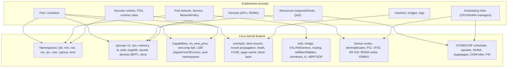

# 5.26 How Kubernetes uses the Linux kernel: a complete map

| | |
|---|---|
| Level | Advanced |
| Priority tier | 1 |
| Lab venue | Linux VM/bare metal with root and a kubeadm/kind cluster; `lsns`, `systemd-cgls`, `bpftool`, `perf`, `strace`, `sysctl` |
| Part | Part 5: Kubernetes |
| Status | Drafted, labs **untested** |

## Why this matters for AI infrastructure

Kubernetes does not isolate, schedule or limit anything by itself: it asks the Linux kernel to do it. Every behaviour you will debug on a GPU node (a container killed with exit 137, a pod that sees only some GPUs, a throttled data loader, pods unable to connect after a rule update, memory that "disappears", an RDMA NIC unusable inside a pod, a kernel upgrade that breaks the GPU driver) is a kernel mechanism surfacing through a Kubernetes API. This chapter is the map from Kubernetes concepts to kernel features, with the kernel parameters, versions, and failure modes that matter for GPU hosts. It consolidates Parts 1 and 2 (Linux and networking) with Part 5.

## Prerequisites and outcomes

Needs Parts 1 and 2 and 5.1 to 5.15. After this chapter you can:

- For any Kubernetes feature, name the kernel mechanism(s) behind it and where to inspect them (`/proc`, `/sys`, tools).
- Explain precisely what a container is at the kernel level (a process with namespaces, cgroup membership, capability set, seccomp filter, LSM label, mount namespace with a rootfs) and which features require which kernel versions.
- Reason about resource enforcement (CPU CFS quota/weight, memory max/high/OOM, pids, I/O, hugetlb) and its observable failure modes.
- Understand how networking features (veth, bridges, VXLAN, netfilter, conntrack, eBPF, tc, XDP) implement CNI and Services.
- Understand storage mechanics (overlayfs, bind mounts, mount propagation, block devices, FUSE, NFS clients, page cache) and device access (cgroup device controller, GPU/RDMA devices).
- Choose and tune kernel versions, boot parameters, and sysctls for GPU Kubernetes nodes; diagnose kernel-level issues.

## 1. The master map



| Kubernetes feature | Kernel mechanism | Inspect with |
|---|---|---|
| Pod isolation (PID, mount, UTS, IPC, network) | Namespaces (`clone`/`unshare`/`setns`) | `lsns`, `/proc/PID/ns/*`, `nsenter` |
| Pod network namespace shared by containers | A single netns joined by all containers' setns | `ip netns`, `/proc/PID/ns/net` inode comparison |
| User namespaces for pods (`hostUsers: false`) | `CLONE_NEWUSER` + idmapped mounts | `/proc/PID/uid_map`, kernel ≥ 6.3 for idmapped overlay |
| CPU limit | CFS bandwidth control (`cpu.max`) | `cpu.stat` (`nr_throttled`, `throttled_usec`) |
| CPU request | CPU weight (`cpu.weight`, formerly shares) | `cpu.weight` |
| Exclusive CPUs (static CPU manager) | cpusets (`cpuset.cpus`) | `cpuset.cpus.effective`, `taskset -pc` |
| Memory limit / OOM | memory controller (`memory.max`, `memory.high`, `memory.min`), OOM killer, `oom_score_adj` | `memory.events`, `dmesg`, `/proc/PID/oom_score*` |
| Ephemeral storage limit / eviction | kubelet accounting of filesystem usage (du/inode counting, project quotas optional) | `df`, XFS quotas |
| PID limit (`podPidsLimit`) | pids controller (`pids.max`) | `pids.current`, `pids.events` |
| Block I/O limits (rare) | io controller (`io.max`, `io.weight`), blk-throttle | `io.stat`, `io.pressure` |
| Hugepages resources | hugetlb controller, hugetlbfs | `/sys/kernel/mm/hugepages`, `hugetlb.*` files |
| Image layers / writable layer | overlayfs (`lowerdir`, `upperdir`, `workdir`) | `mount \| grep overlay`, `/var/lib/containerd/.../snapshots` |
| Volumes into containers | bind mounts, mount propagation | `findmnt`, `/proc/PID/mountinfo` |
| Secrets/ConfigMaps/`emptyDir{Memory}` | tmpfs | `df -h`, `mount \| grep tmpfs` |
| `/dev/shm` | tmpfs mounted at `/dev/shm` | `df -h /dev/shm` |
| Device exposure (GPU, RDMA) | devtmpfs nodes + cgroup devices allowlist (BPF device filter) | `ls -l /dev/nvidia*`, `bpftool cgroup tree` |
| Capabilities, `allowPrivilegeEscalation` | capability sets, `PR_SET_NO_NEW_PRIVS` | `/proc/PID/status` (`CapEff`, `NoNewPrivs`), `capsh --decode` |
| `seccompProfile` | seccomp-bpf filters | `/proc/PID/status` (`Seccomp: 2`), `strace` EPERM |
| AppArmor/SELinux | LSMs | `aa-status`, `ps -Z`, `ausearch -m avc` |
| `hostNetwork` | Use the root network namespace | `ip addr` identical to host |
| veth/bridge/routes (CNI) | veth, bridge, FIB, ARP/neighbour | `ip link/route/neigh`, `bridge` |
| Overlay (VXLAN/Geneve/IPIP) | tunnel devices with UDP encap | `ip -d link`, `bridge fdb` |
| Services (kube-proxy) | netfilter NAT (iptables/nft), IPVS, or BPF maps; conntrack | `iptables-save`, `ipvsadm`, `conntrack`, `bpftool map` |
| NetworkPolicy | netfilter rules/ipsets or eBPF programs on tc/XDP | `iptables`, `bpftool prog`, `cilium bpf` |
| Bandwidth limits (annotation) | tc (HTB/TBF or EDT with fq) | `tc qdisc show`, `tc -s class show` |
| Load balancing node ports | netfilter/IPVS/BPF; `route_localnet` | sysctls |
| Probes (exec) | `setns` + `execve` inside container namespaces | n/a |
| Logs | pipes/pty to runtime, files on host | `/var/log/pods` |
| Time (`time` namespace, rarely) | CLOCK_MONOTONIC offsets | n/a |
| Node resource pressure signals | PSI (`/proc/pressure/*`), memory counters | `cat /proc/pressure/memory` |
| Pod QoS and eviction ordering | cgroup placement + `oom_score_adj` | cgroup tree |
| Container checkpoint/restore (alpha) | CRIU, ptrace, userfaultfd | `criu check` |
| User-space networking (DPDK/RDMA) | VFIO, hugepages, IOMMU, uverbs | `/dev/vfio`, `/dev/infiniband` |

## 2. Namespaces in depth

Eight namespace types (`man 7 namespaces`): **mnt** (mount table; `pivot_root` into the image rootfs), **pid** (PID numbering and signal visibility; PID 1 semantics), **net** (interfaces, routing tables, netfilter, sockets), **uts** (hostname), **ipc** (SysV IPC/POSIX message queues), **user** (UID/GID mapping, capabilities scoped to the namespace), **cgroup** (virtualised cgroup root), **time** (clock offsets). Creating: `clone(2)` flags, `unshare(2)`, `setns(2)`; persistence: a namespace lives while a process is in it, an open fd to `/proc/PID/ns/*`, or a bind mount of that file (`/var/run/netns/<name>`). A pod = containers sharing net/ipc/uts (+ optionally pid with `shareProcessNamespace`) namespaces created by the **pause** container; each container has its own mnt (and usually pid) namespace.

Key details:

- **PID namespace**: PID 1 ignores signals without handlers (SIGTERM won't kill an app that doesn't install a handler), reaps orphans (zombie reaping responsibility); `kill -9` from outside works only from an ancestor namespace. `shareProcessNamespace: true` lets containers see each other's processes (debug sidecars) but PID 1 is the pause container.
- **Network namespace**: sockets bound in a netns are invisible elsewhere; `localhost` is per-netns; `net.*` sysctls are mostly per-netns (`net.ipv4.ip_local_port_range`, `tcp_*` per-netns since newer kernels), others host-global (`nf_conntrack_max`, `net.core.somaxconn` is per-netns, `fs.*` global); pods may set "safe" namespaced sysctls via `securityContext.sysctls`.
- **Mount namespace**: copy of the parent's mounts at creation; propagation flags (`shared`, `slave`, `private`, `unbindable`) determine whether later mounts appear in other namespaces; kubelet/CSI use `Bidirectional` propagation for the node plugin.
- **User namespace**: maps container UID 0 to an unprivileged host UID range; capabilities in the child namespace don't apply to resources owned by the parent (e.g., mounting arbitrary filesystems); pod user namespaces (`hostUsers: false`) need kernel support for idmapped mounts on the volumes/overlay (≥ 5.12 for idmapped mounts; overlayfs idmapped ≥ 5.19; CRI support), greatly reducing the impact of container escapes.
- **IPC namespace**: POSIX shared memory (`/dev/shm` is tmpfs in the *mount* namespace; SysV IPC separate); `hostIPC: true` shares with host (used by some HPC/MPI shared memory setups; weakens isolation).
- **cgroup namespace**: container sees `/sys/fs/cgroup` rooted at its own cgroup.

## 3. cgroups v2 in depth

cgroup v2 is a single unified hierarchy (`/sys/fs/cgroup`) with controllers enabled per subtree through `cgroup.subtree_control`; processes live only in leaf cgroups ("no internal process" rule, except the root). Kubernetes (and systemd) create `kubepods.slice` → QoS slices → pod slices → container scopes (5.9). Controllers and the Kubernetes mapping:

| Controller | Files | Kubernetes use |
|---|---|---|
| **cpu** | `cpu.weight` (1–10000, default 100), `cpu.max` ("quota period", e.g., `200000 100000` = 2 CPUs), `cpu.stat`, `cpu.pressure`, `cpu.idle` | requests → weight, limits → max; throttling shows as `nr_throttled`/`throttled_usec`; burst (`cpu.max.burst`) |
| **memory** | `memory.max` (hard), `memory.high` (throttle/reclaim threshold), `memory.min`/`memory.low` (protection), `memory.swap.max`, `memory.current`, `memory.stat`, `memory.events` (`low, high, max, oom, oom_kill`), `memory.oom.group` | limit → `max`; MemoryQoS sets `high`/`min`; includes page cache, kernel memory (slab), tmpfs/shmem |
| **io** | `io.max`, `io.weight`, `io.latency`, `io.stat`, `io.pressure` | rarely set by Kubernetes; used by node tuning |
| **pids** | `pids.max`, `pids.current`, `pids.events` | `podPidsLimit` |
| **cpuset** | `cpuset.cpus`, `cpuset.mems`, `cpuset.cpus.effective` | static CPU manager exclusivity, memory manager NUMA pinning |
| **hugetlb** | `hugetlb.<size>.max/current` | hugepages-* resources |
| **rdma** | `rdma.max`, `rdma.current` | RDMA resource limits (rarely used by Kubernetes today) |
| **devices** | Implemented as cgroup BPF programs (`BPF_PROG_TYPE_CGROUP_DEVICE`) in v2 | Runtime attaches an allow-list program per container: only allocated `/dev/nvidia*` etc. |
| **misc** | `misc.max` | scalar resources |
| **freezer** | `cgroup.freeze` | pause/checkpoint |
| **PSI** | `cpu/memory/io.pressure` | node pressure signals, load-shedding |

Behaviours that explain incidents:

- **CPU throttling**: with `cpu.max` quota, a multi-threaded process using 8 threads on a 2-CPU limit burns its quota in the first 25 ms of each 100 ms period and stalls for 75 ms ("throttling") although average utilisation looks low; tail latency spikes, probe timeouts. Remedies: remove CPU limits (keep requests) for latency-sensitive pods, align thread counts with limits (`OMP_NUM_THREADS`, `GOMAXPROCS` via downward API/`automaxprocs`), use static CPU manager, newer kernels with burst or `cpu.idle`. Kernel CFS bandwidth bugs in old kernels (< 5.4) over-throttled; ensure current kernels.
- **Memory accounting**: `memory.current` includes anonymous pages, file cache (page cache), tmpfs, and kernel memory (page tables, slab, socket buffers). Page cache is reclaimable under `memory.max` pressure, but active tmpfs pages and pinned/mlock'd memory are not. OOM happens when reclaim fails: kernel kills a process in the cgroup (`memory.oom.group=1` kills the whole group, which Kubernetes enables for containers in newer versions). Metrics: `container_memory_working_set_bytes` (current − inactive_file) is what the kubelet uses for eviction decisions; compare to `memory.max`.
- **Swap**: disabled by default in Kubernetes; the NodeSwap feature (beta) permits limited swap for Burstable pods on cgroup v2 (`memory.swap.max`), not recommended for GPU/ML nodes.
- **Hierarchy limits**: a pod-level limit constrains the sum of containers; kubelet node allocatable sets `kubepods` max (5.9).
- **io/blk**: container log writes and image unpacks can saturate disks, impacting latency; use separate devices for container storage; apply io.weight on system vs pods where needed.
- **Accounting cost**: memory cgroup kernel-memory accounting and many cgroups (tens of thousands) slow `cat memory.stat`/cAdvisor scans and cause "cgroup leaks" (dead cgroups lingering until page cache drains); symptoms: high kernel CPU in `mem_cgroup_*`, growing number of `nr_dying_descendants` in `cgroup.stat`.

Hybrid vs unified: cgroup v1 is deprecated in Kubernetes (maintenance mode; some features require v2). Check `stat -fc %T /sys/fs/cgroup` → `cgroup2fs`; boot parameter `systemd.unified_cgroup_hierarchy=1`; RHEL 8+, Ubuntu 22.04+, Debian 11+ default to v2.

## 4. Security primitives

- **Capabilities** split root into ~40 privileges (CAP_NET_ADMIN, CAP_SYS_ADMIN, CAP_NET_RAW, CAP_IPC_LOCK, CAP_SYS_PTRACE...). Container default set (Docker/containerd): CHOWN, DAC_OVERRIDE, FSETID, FOWNER, MKNOD, NET_RAW, SETGID, SETUID, SETFCAP, SETPCAP, NET_BIND_SERVICE, SYS_CHROOT, KILL, AUDIT_WRITE. `drop: [ALL]` then add only what's needed. Sets: permitted, effective, inheritable, bounding, ambient. `CAP_SYS_ADMIN` is nearly root (avoid; DCGM exporter historically asks for it).
- **`no_new_privs`** (`allowPrivilegeEscalation: false`): blocks setuid/file capability elevation across `execve`.
- **seccomp-bpf**: syscall filter. RuntimeDefault profile blocks ~40 to 60 dangerous syscalls (`kexec_load`, `ptrace` variants, `mount`, `keyctl`, `bpf` etc.); `seccompDefault` in kubelet applies it to all; custom profiles (Localhost) tailored to apps; failure shows as `EPERM`/`Operation not permitted` or `SIGSYS`; debug with `strace`, audit logs, or the Security Profiles Operator recorder.
- **LSMs**: AppArmor (path-based; default `cri-containerd.apparmor.d`), SELinux (label-based; `container_t` type with MCS categories isolating containers); GPU device access under SELinux requires correct labels for `/dev/nvidia*` (`container_use_devices` boolean or custom policy via `nvidia-container-toolkit` SELinux support).
- **Landlock, IMA, kernel lockdown, Yama ptrace_scope, seccomp user notifications** are additional levers (`kernel.yama.ptrace_scope` affects debugging with `strace -p`).
- **User namespaces & rootless**: see above.
- **Kernel attack surface**: because containers share the host kernel, kernel CVEs (e.g., Dirty Pipe, overlayfs, netfilter nf_tables bugs) are container escapes; patch kernels promptly, reduce syscall surface (seccomp), restrict `CAP_SYS_ADMIN`/`CAP_NET_ADMIN`, disable unprivileged user namespaces if unused (`user.max_user_namespaces`, `kernel.unprivileged_userns_clone`) or confine them, use sandboxed runtimes for untrusted code (5.2).

## 5. Filesystems, mounts and block I/O

- **overlayfs**: union mount of read-only `lowerdir`s (image layers) with `upperdir` (container writable layer) and `workdir`; copy-up on first write (whole file; slow for huge files like checkpoints written inside the container filesystem), whiteouts for deletions, inode/`st_dev` quirks (hard links, `rename` across layers returning EXDEV), `d_type` support required (xfs needs `ftype=1`), `metacopy`/`redirect_dir` options, page cache sharing for identical lowers. Performance: metadata-heavy workloads (many small files) suffer vs a dedicated volume; keep datasets and checkpoints on volumes.
- **Bind mounts and propagation**: Kubernetes volumes are bind-mounted into containers; `mountPropagation` modes; `subPath` bind mounts.
- **tmpfs**: `emptyDir{medium: Memory}`, `/dev/shm`, Secret/ConfigMap volumes; charged to the container's memory cgroup; `sizeLimit` enforced by tmpfs `size=`.
- **Page cache and writeback**: large writes (checkpoints) fill dirty pages; `vm.dirty_ratio`/`dirty_background_ratio` and cgroup writeback limits cause stalls ("freezes" when flushing); tune for large-memory nodes (smaller ratios or absolute bytes: `vm.dirty_bytes`, `vm.dirty_background_bytes`); `O_DIRECT`, `fsync` strategy in checkpoint code; `posix_fadvise`/`drop_caches` only for testing.
- **Block layer**: NVMe queues and IRQ affinity, I/O schedulers (`none` for NVMe), `blk-mq`; filesystem choice (XFS for large files/parallel writes; ext4 default); mount options `noatime`; discard/trim policies.
- **Network filesystems**: NFS client (`nconnect`, rsize/wsize, `hard`/`soft`, `actimeo`), Lustre/WEKA/BeeGFS kernel clients (module versions tied to kernel and OFED), CephFS kernel client, FUSE (S3/GCS FUSE, JuiceFS: single user-space daemon bottleneck; `fuse` device `/dev/fuse` access in containers).
- **inotify/fanotify** limits (`fs.inotify.max_user_watches`, `max_user_instances`) affect kubelet, log shippers, config reloaders: raise on busy nodes.
- **File descriptors and limits**: `fs.file-max`, `fs.nr_open`, per-process `ulimit -n` (containers inherit runtime defaults: containerd `LimitNOFILE=infinity` pitfalls with some apps), `nofile` for training processes with many open files (datasets).

## 6. Networking in the kernel

(Detailed in Part 2 and 5.10 to 5.15; summarised for the map.)

- **Devices**: veth pairs, bridges (`brctl`/`ip link add type bridge`, STP off, `hairpin_mode`), macvlan/ipvlan, VXLAN/Geneve/IPIP/WireGuard tunnels, dummy (`kube-ipvs0`), SR-IOV VFs, RDMA devices.
- **Routing**: FIB, per-netns tables, policy routing (`ip rule`) for multi-homed nodes and CNIs (Calico/Cilium), `rp_filter` (set to 0/2 on multi-NIC GPU nodes to avoid dropping asymmetric traffic), `ip_forward`, ECMP hashing policy `fib_multipath_hash_policy`.
- **Netfilter** hooks (PREROUTING, INPUT, FORWARD, OUTPUT, POSTROUTING) with iptables/nftables; `br_netfilter` makes bridged traffic traverse iptables (needed by kube-proxy/NetworkPolicy on bridge CNIs); **conntrack** (`nf_conntrack_max`, buckets, timeouts), **NAT** (DNAT for Services, MASQUERADE for egress), ipset for large sets, `xt_statistic` for random LB.
- **IPVS** (`ip_vs*` modules, schedulers), **nftables** (kube-proxy nft mode).
- **eBPF**: program types used by Kubernetes networking: `sched_cls` (tc), XDP, `cgroup_sock_addr` (`connect4`, `sendmsg4`: socket LB), `sock_ops`, `sk_msg`, `cgroup_skb`, `cgroup_device`; maps (hash, LRU, LPM trie, array); verifier constraints; kernel version features (BPF host routing 5.10, netkit 6.7, BIG TCP 5.19). Inspect: `bpftool prog show`, `bpftool map dump`, `bpftool net`, `bpftool cgroup tree`.
- **tc/qdisc**: `fq`, `fq_codel`, `htb`, `netem` (testing), `clsact` for BPF; EDT for Cilium bandwidth manager.
- **Socket buffers & TCP**: `net.core.rmem_max/wmem_max`, `net.ipv4.tcp_rmem/wmem`, `tcp_congestion_control` (bbr/cubic), `tcp_mtu_probing`, `somaxconn`, `tcp_max_syn_backlog`, `ip_local_port_range`, TIME_WAIT tuning (`tcp_tw_reuse`), keepalive: namespaced per pod where allowed.
- **Offloads & queues**: GRO/GSO/TSO/LRO, checksum offload, RSS/RPS/RFS/XPS, IRQ affinity (`irqbalance` vs pinning), NAPI budgets, ring sizes (`ethtool -G`), PFC/ECN/DCQCN on RoCE NICs (Part 12).
- **RDMA stack**: `ib_core`, `rdma_cm`, `ib_uverbs`, vendor drivers (`mlx5_core`, `mlx5_ib`), `nvidia_peermem` (GPUDirect RDMA), `/dev/infiniband/*`, `ulimit -l` (memlock) and `CAP_IPC_LOCK`, IOMMU `iommu=pt` for performance, SR-IOV VF management via `devlink`.
- **Time & clocks**: `chrony`/PTP (`ptp4l`) for training logs/collectives debugging; `CLOCK_MONOTONIC` unaffected by NTP step.

## 7. CPU, memory and NUMA

- **Scheduler**: CFS (EEVDF from 6.6) with cgroup hierarchical weights; `sched_*` tunables rarely tuned; real-time classes not used by Kubernetes; `isolcpus`, `nohz_full`, `rcu_nocbs` boot parameters isolate cores for latency-sensitive pods with the static CPU manager; `cpu.idle`/`SCHED_IDLE` for best-effort; `irqaffinity` to keep IRQs off isolated cores; IRQ affinity for NICs/NVMe aligned to NUMA nodes of the device.
- **NUMA**: nodes, distances (`numactl -H`, `lscpu`), memory policies (`mbind`, `set_mempolicy`, `numa_balancing` automatic migration: disable on GPU nodes for stability, `kernel.numa_balancing=0`), device NUMA affinity (`/sys/bus/pci/devices/*/numa_node`), `cpuset.mems`; Kubernetes Topology Manager aligns CPU/memory/device (5.9). Cross-NUMA GPU↔host memory copies and NIC↔GPU paths degrade bandwidth; PCIe topology (`nvidia-smi topo -m`, `lspci -tv`).
- **Memory management**: overcommit (`vm.overcommit_memory=1` required by kubelet `protectKernelDefaults`; heuristic mode 0 may refuse large allocations), `vm.swappiness`, `vm.min_free_kbytes`, `vm.max_map_count` (large for Elasticsearch/ML: 262144+), transparent hugepages (`madvise`/`never` for databases and some latency-sensitive workloads; `always` can cause compaction stalls), explicit hugepages (`hugepages=` boot param / sysctl; 2 MiB, 1 GiB; NUMA-local allocation), KSM off, memory cgroup events, direct reclaim stalls (PSI `memory` full), `kswapd`, zone reclaim (`vm.zone_reclaim_mode=0`).
- **OOM killer**: chooses the highest `oom_score` (adjusted by `oom_score_adj`) in the cgroup (or system); logs to `dmesg` with constraint type; `vm.panic_on_oom`, `kernel.panic` (kubelet expects `kernel.panic=10` and `panic_on_oops=1` with `protectKernelDefaults`).
- **Pinned and device memory**: `mlock`/`memlock` limits; CUDA pinned host memory; GPU memory is not in cgroups (accounted by driver; per-process via `nvidia-smi`); UVM (`nvidia_uvm`) migration; Grace-Hopper unified memory; DMA-BUF.
- **Kernel memory**: slab (dentries/inodes for millions of small files), socket buffers, page tables for huge mappings; `slabtop`, `/proc/meminfo`, `/proc/slabinfo`; leaks manifest as growing non-container memory.

## 8. Devices and the GPU/RDMA stack in the kernel

- **GPU driver** (`nvidia.ko`, `nvidia_uvm.ko`, `nvidia_modeset.ko`, `nvidia_drm.ko`, `nvidia_peermem.ko`, `nvidia_fs.ko` for GDS): creates `/dev/nvidia0..N`, `/dev/nvidiactl`, `/dev/nvidia-uvm`, `/dev/nvidia-caps/*`; ioctl-based user-kernel interface; versioned: userspace `libcuda` must match the kernel driver's major interface (driver compatibility rules, 5.1); Fabric Manager manages NVSwitch; open kernel modules (`nvidia-open`) vs proprietary; kernel version coupling via DKMS/precompiled modules; Secure Boot requires signed modules; module parameters (`NVreg_*`) set in `/etc/modprobe.d`; persistence mode keeps driver state initialised.
- **IOMMU/VFIO**: `intel_iommu=on iommu=pt` (passthrough mode for host devices, performance) or full translation for VM passthrough; `/dev/vfio/*` for passing GPUs/VFs to VMs (Kata, KubeVirt, vGPU); ACS/PCIe topology and IOMMU groups constrain what can be passed through together.
- **SR-IOV/VFs**: PF driver creates VFs (`sriov_numvfs`), VFs appear as PCI devices; moved into pod netns by CNI; switchdev mode for hardware offload.
- **CDI/device cgroup**: container runtime adds device nodes and attaches the cgroup device filter (5.8).
- **udev/devtmpfs**: device node creation, permissions (`/dev/nvidia*` mode/group), rules for MIG caps and persistent names.
- **Hardware error reporting**: `rasdaemon`, EDAC (ECC memory), AER (PCIe errors) in `dmesg`, `mce` logs, Xid messages from the NVIDIA driver, NVLink error counters; GPU "falling off the bus" is a PCIe/driver event surfaced in kernel logs; nodes need these logs shipped (5.24).

## 9. Kernel versions, boot parameters and sysctls for GPU Kubernetes nodes

**Kernel version guidance** (principles; verify against your distro and driver support): use an LTS kernel with modern cgroup v2, eBPF and idmapped-mount support (5.15+ minimum, 6.1+/6.6+ preferred), supported by the NVIDIA driver, OFED and CNI you run; pin the exact kernel across the fleet; test kernel upgrades with the full stack (4.17); watch distro HWE/backport differences; avoid mixing kernels within a pool. Features by version (approximate): cgroup v2 mature ≥ 5.2, idmapped mounts 5.12, BPF cgroup improvements 5.x, `memory.oom.group` 4.19, PSI 4.20, io_uring 5.1 (disable for untrusted workloads), EEVDF 6.6, netkit 6.7, user-namespaced pods idmapped overlay 5.19.

Boot parameters (examples, adapt): `systemd.unified_cgroup_hierarchy=1`, `intel_iommu=on iommu=pt` / `amd_iommu=on iommu=pt`, `default_hugepagesz=1G hugepagesz=1G hugepages=N` (if used), `transparent_hugepage=madvise`, `numa_balancing=disable`, `isolcpus=...`/`nohz_full=...`/`rcu_nocbs=...` (only for latency-critical pinned pools), `processor.max_cstate=1 intel_idle.max_cstate=0` (latency vs power), `pci=realloc` (resizable BAR/large BARs on some platforms), `nvme_core.default_ps_max_latency_us=0`, `mitigations=` policy (security vs performance trade-off; understand impact), `audit=1`, `cgroup_no_v1=all`.

Sysctls (examples; most baseline values come from 4.17 and 5.4 chapters):

```text
vm.overcommit_memory = 1            kernel.panic = 10          kernel.panic_on_oops = 1
vm.swappiness = 1                   vm.max_map_count = 1048576  vm.min_free_kbytes = 1048576   (scale with RAM)
vm.dirty_background_bytes = 268435456   vm.dirty_bytes = 1073741824   (avoid huge write stalls)
kernel.numa_balancing = 0           kernel.pid_max = 4194304   kernel.threads-max = 4194304
fs.inotify.max_user_watches = 1048576   fs.inotify.max_user_instances = 8192   fs.file-max = 26214400
net.core.somaxconn = 65535          net.core.netdev_max_backlog = 250000
net.core.rmem_max = 268435456       net.core.wmem_max = 268435456
net.ipv4.tcp_rmem = 4096 87380 134217728   net.ipv4.tcp_wmem = 4096 65536 134217728
net.ipv4.tcp_mtu_probing = 1        net.ipv4.ip_local_port_range = 10240 65000
net.netfilter.nf_conntrack_max = 2097152   net.netfilter.nf_conntrack_buckets = 524288
net.ipv4.conf.all.rp_filter = 0 (or 2)     net.ipv4.ip_forward = 1   net.bridge.bridge-nf-call-iptables = 1
user.max_user_namespaces = 0 on nodes that don't need them (tradeoff with rootless/userns pods)
```

Apply via `/etc/sysctl.d/*.conf` (managed by Ansible, 4.7/4.17); kubelet `allowedUnsafeSysctls` only for specific pools; `protectKernelDefaults` to detect drift.

Kernel modules for Kubernetes nodes: `overlay`, `br_netfilter`, `nf_conntrack`, `nf_nat`, `ip_vs*` (IPVS), `vxlan`, `wireguard`, `xt_*`/`nft_*`, `ip_tables`, `rdma_cm`/`ib_*`/`mlx5_*`, `nvidia*`, `nvme_tcp`/`nvme_rdma` (NVMe-oF), `fuse`, `lustre`/`wekafs` clients, `vfio_pci`, `tun`.

## 10. Observing the kernel from Kubernetes

| Need | Tool/Source |
|---|---|
| Where is time going in the kernel? | `perf top`, `perf record -g`, `bpftrace`, `bcc`/`libbpf-tools` (`runqlat`, `biolatency`, `tcpconnlat`, `tcpretrans`, `opensnoop`, `execsnoop`, `oomkill`) |
| Per-container kernel metrics | cAdvisor (cgroup files), node-exporter (`/proc`), `kubelet /metrics/resource`, PSI exporters |
| Syscalls, files, network | `strace -f`, `ltrace`, `tcpdump`, `ss`, `lsof`, `fatrace` |
| Kernel logs | `dmesg -T`, `journalctl -k`, `/var/log/kern.log`, remote log shipping; `rasdaemon`, `mcelog` |
| Security/auditing | auditd (`execve`, `openat` on secrets), Falco/Tetragon (eBPF), seccomp audit logs |
| Latency of scheduling | `perf sched`, `runqlat`, `sched:` tracepoints; PSI cpu |
| Memory issues | `/proc/meminfo`, `smem`, `slabtop`, `numastat`, `memory.stat`, `perf mem`, `bpftrace` oom tracepoints |
| Tracing Kubernetes-aware | Pixie, Inspektor Gadget (`kubectl gadget trace tcp/dns/oomkill/exec/open`), Tetragon, Hubble |

```bash
# Inspektor Gadget examples (eBPF gadgets scoped to pods)
kubectl gadget trace oomkill; kubectl gadget trace tcpconnect -n serving; kubectl gadget profile cpu -n training --podname trainer-0
# Common bcc/libbpf tools on the node
runqlat 10 1; biolatency -D 10 1; tcpretrans; tcplife; cachestat; oomkill
```

## 11. Failure modes mapped to kernel causes

| Symptom in Kubernetes | Kernel cause | How to confirm |
|---|---|---|
| Container exit 137 | cgroup memory OOM or SIGKILL by kubelet/runtime | `memory.events oom_kill`, `dmesg` "Memory cgroup out of memory" |
| Latency spikes at low CPU % | CFS throttling | `cpu.stat nr_throttled`, `container_cpu_cfs_throttled_*` |
| `fork: retry: Resource temporarily unavailable` | `pids.max` or `kernel.pid_max` | `pids.events`, `/proc/sys/kernel/pid_max` |
| `Too many open files` | `ulimit -n`, `fs.file-max`, inotify limits | `/proc/PID/limits`, `sysctl fs.inotify` |
| Intermittent connection drops | conntrack table full, insert failures, SYN backlog overflow | `conntrack -S`, `nstat ListenOverflows` |
| Large transfers stall | MTU/PMTUD blackhole, offload bugs | `ping -M do`, `ethtool -k`, capture |
| Pods can't connect after rule changes | netfilter/iptables lock contention, kube-proxy sync, stale conntrack | kube-proxy logs, `iptables --wait`, conntrack flush |
| Mount failures / stale handles | NFS server issues, FUSE crash, namespace propagation | `dmesg`, `findmnt`, `mountstats` |
| Directory/file operations slow in container | overlayfs copy-up/metadata, many small files, dentry cache pressure | move data to volume, `slabtop`, `perf` |
| Process unkillable | D-state on hung I/O or driver | `/proc/PID/stack`, kernel logs, storage health |
| GPU lost after kernel update | DKMS build failed/unsigned module/ABI mismatch | `dkms status`, `modinfo nvidia`, journal |
| `Operation not permitted` in a container | seccomp, missing capability, LSM denial, user namespace restrictions | `strace` EPERM, audit logs, `capsh`, `aa-status` |
| Node unresponsive under load | Memory pressure without reservations, softlockups, IRQ storms | PSI, `dmesg`, `perf`, `mpstat -I` |
| NUMA-related low throughput | Cross-socket memory/device access, `numa_balancing` | `numastat -p`, `nvidia-smi topo -m`, `perf stat` |
| Clock skew / odd timeouts | NTP failure, VM time drift | `chronyc tracking`, `timedatectl` |

## 12. Lab

First, run the self-checking Python lab (`code/part05/k8s_kernel_primitives_map_lab.py`) locally. It verifies the Cgroup v2 CFS CPU quota throttling and `working_set` memory calculator (`simulate_cgroup_v2_cpu_and_memory`: showing how 8 threads on a 2-CPU limit burn a 200ms quota in 25ms and stall for 75ms, and how `working_set = memory.current - inactive_file` triggers OOM), the GPU node `sysctl` and `protectKernelDefaults` compliance auditor (`audit_gpu_node_kernel_sysctls`), and the Linux kernel version capability checker (`check_kernel_version_features`).

```bash
python3 code/part05/k8s_kernel_primitives_map_lab.py
```

Next, on a Linux Kubernetes node with root access (all interactive shell steps below are `untested here`), work through these exercises:

1. **Build a container by hand**: create a rootfs, then use `unshare -fp --mount-proc --mount --net --uts --ipc`, `pivot_root`, a cgroup v2 directory with `cpu.max`, `memory.max`, `pids.max`, and device allow-list via `bpftool`/`systemd-run -p DeviceAllow=` equivalents; compare with `runc`.
2. **Namespace tour**: for a pod, list namespaces with `lsns`; compare inode numbers across containers of one pod and a different pod; join each with `nsenter` and run commands; show `shareProcessNamespace` effect.
3. **cgroup experiments**: create pods with CPU/memory/pids limits; read cgroup files; cause throttling (multi-threaded burn) and measure `nr_throttled`; trigger OOM and read `memory.events`; compare `memory.current` vs working set; show tmpfs charged to the cgroup.
4. **Device filter**: run a GPU pod and a non-GPU pod; compare `/dev` contents and attempt to open `/dev/nvidia0` from the other pod's namespace (`nsenter -m`) to see cgroup device denial; inspect the BPF program with `bpftool cgroup tree`.
5. **Security layers**: run containers with different caps/seccomp/no_new_privs and demonstrate failures for mount, ptrace, raw sockets, `setuid`; read status files; test a custom seccomp profile; (SELinux nodes) trigger and read an AVC denial.
6. **overlayfs behaviour**: write a large file in the container layer vs a volume; measure copy-up cost modifying a 5 GB image file; look at `lowerdir/upperdir` in `/proc/mounts`.
7. **Netfilter/eBPF**: dump kube-proxy rules for a Service; with Cilium dump BPF LB maps; trace a connection with `bpftrace`/`tcpconnect`; observe conntrack entries; measure the effect of `nf_conntrack_max` exhaustion.
8. **Memory and NUMA**: on a two-socket node, run a memory benchmark pinned to local vs remote NUMA; show `numa_balancing` impact; enable hugepages and a pod requesting them; inspect `hugetlb` cgroup files.
9. **Writeback stall**: write a large checkpoint-sized file with default `vm.dirty_*` and observe stalls (`iostat`, app timing); tune and compare.
10. **Version matrix**: record kernel, cgroup mode, driver, OFED, CNI versions on a node; check feature availability list from section 9; plan an upgrade test.
11. **eBPF observability**: install Inspektor Gadget or bcc tools; trace `oomkill`, `execsnoop`, `tcpretrans`, `runqlat` while running load in pods; correlate to symptoms.
12. **Sysctl audit**: gather `sysctl -a` from a GPU node and compare with the baseline in section 9; list deviations and whether each is safe; encode the baseline in Ansible (4.7) with `protectKernelDefaults` verification.
13. **Clean up**.

## 13. Common mistakes

- Thinking containers have their own kernel; assuming namespace isolation equals VM isolation.
- Setting CPU limits equal to a small request on multi-threaded ML processes and wondering why latency is bad.
- Counting only RSS when sizing memory limits (ignoring tmpfs, page cache, pinned memory, kernel memory).
- Using cgroup v1 assumptions/tools on v2 hosts (and vice versa); old runtimes on v2.
- Running mixed kernels across a GPU pool; upgrading the kernel without validating driver/OFED/CNI/CSI modules.
- Ignoring conntrack, inotify and PID limits until the node falls over.
- Leaving THP `always`, NUMA balancing on, or default dirty-page ratios on large-memory GPU nodes.
- Assuming `privileged: true` is how to "make GPUs work" instead of proper device exposure.
- Treating seccomp/LSM failures as application bugs.
- Not shipping kernel logs (Xid, EDAC, AER) off the node.

## 14. Interview angles

- "What is a container at the kernel level? Which kernel features does Kubernetes use for isolation and limits?"
- "How does the kernel enforce CPU and memory limits? Why does CPU throttling happen at low average usage?"
- "What happens in the kernel when a container exceeds its memory limit? How is it different from node-pressure eviction?"
- "How does a Service get implemented in the kernel under iptables, IPVS, and eBPF?"
- "How does a GPU device get into a container and what stops other containers from using it?"
- "Which sysctls and boot parameters do you set on GPU nodes and why?"
- "What are the container-escape surfaces and how do seccomp/capabilities/user namespaces reduce them?"
- "How would you diagnose a node that's slow but whose pods look healthy?" (PSI, softirq, IO wait, throttling, NUMA.)

## Exercises

1. **The Complete Kubernetes-to-Linux-Kernel Master Map (`HLW` Ch. 17, `NK` Ch. 2–5, `PK` Ch. 3–5):** For each Kubernetes primitive in Section 1 (Pod Sandbox, CPU/Memory/PID requests & limits, Exclusive CPUs, Volumes/Images/Secrets, `/dev/shm`, GPU/RDMA devices, `securityContext`, `Service`, and `NetworkPolicy`), name the exact Linux kernel subsystem and the `/proc`, `/sys`, or CLI inspection command that verifies it on the node.
2. **The Eight Linux Namespaces (`mnt`, `pid`, `net`, `uts`, `ipc`, `user`, `cgroup`, `time`) and Pod User Namespaces (`hostUsers: false`):** Explain which namespaces are shared across a Pod vs isolated per container, why PID 1 inside a PID namespace ignores `SIGTERM` unless a signal handler is registered, and what kernel features (`check_kernel_version_features()` in `code/part05/k8s_kernel_primitives_map.py`: idmapped mounts $\ge 5.12$ and idmapped `overlayfs` $\ge 5.19$) enable `hostUsers: false` Pods.
3. **Cgroup v2 Unified Hierarchy, Multi-Threaded CFS CPU Throttling (`cpu.max`), and `memory.current` vs. `working_set` (`PK` Chapter 12):** Using `simulate_cgroup_v2_cpu_and_memory()` in `code/part05/k8s_kernel_primitives_map.py`, prove why an 8-thread process inside a `limits.cpu: "2"` container stalls for 75 ms out of every 100 ms period even at low average CPU usage, and explain which memory categories (`anon`, `tmpfs`, `active_file`, `inactive_file`, `slab`) count toward `memory.max` OOM vs kubelet `working_set` eviction.
4. **Kernel Security Primitives (`Capabilities`, `no_new_privs`, `seccomp-bpf`, `AppArmor`/`SELinux`) and `overlayfs` / Page-Cache Writeback Stalls:** Explain how `drop: ["ALL"]`, `allowPrivilegeEscalation: false` (`PR_SET_NO_NEW_PRIVS`), and `seccompProfile: RuntimeDefault` shrink the kernel syscall attack surface, why writing a 50 GB checkpoint inside the container rootfs triggers an `overlayfs` copy-up stall, and why `vm.dirty_bytes` / `vm.dirty_background_bytes` must be tuned on 1–2 TiB RAM GPU nodes.
5. **Kernel Networking (`veth`, `bridge`, `VXLAN`/`Geneve`, `netfilter`/`conntrack`, `IPVS`, `eBPF`/`XDP`/`tc`/`netkit`) and the GPU/RDMA Kernel Stack (`nvidia.ko`, `nvidia_peermem.ko`, `nvidia_fs.ko`, `mlx5`, `IOMMU`):** Trace the kernel modules and hooks behind CNI/Service datapaths and the NVIDIA GPU + RDMA + GPUDirect Storage (`GDS`) kernel driver stack, explaining why `intel_iommu=on iommu=pt` and `CAP_IPC_LOCK` (`ulimit -l`) are required.
6. **Auditing Boot Parameters, `sysctl` Baselines, and Kernel Observability (`PSI`, `perf`, `bpftrace`, `Inspektor Gadget`):** Using `audit_gpu_node_kernel_sysctls()` in `code/part05/k8s_kernel_primitives_map.py`, explain the Section 9 sysctl baseline (including `protectKernelDefaults` requirements) and match the 15 Kubernetes failure symptoms in Section 11 to their exact kernel cause and verification command.

## Checkpoint questions (20)

<details>
<summary>1. What is a \"Container\" from the perspective of the Linux kernel (`HLW` Chapter 17 & `PK` Chapter 3)?</summary>

There is no single kernel object called a "container" in Linux. At the kernel level, a container is simply **an ordinary Linux process (or group of processes)** created via `clone(2)`/`unshare(2)`/`execve(2)` that is simultaneously configured with:
1. **Eight Linux Namespaces (`mnt`, `pid`, `net`, `uts`, `ipc`, `user`, `cgroup`, `time`)** governing *what the process can see*.
2. **Cgroup v2 membership (`/sys/fs/cgroup/kubepods.slice/...`)** governing *how much CPU, memory, PIDs, I/O, and which device nodes (`BPF_PROG_TYPE_CGROUP_DEVICE`) the process can use*.
3. **A `pivot_root(2)` into an `overlayfs` union root filesystem** with bind-mounted volumes.
4. **Restricted Linux Capabilities, `PR_SET_NO_NEW_PRIVS`, a `seccomp-bpf` syscall filter, and an AppArmor/SELinux LSM profile.**
</details>

<details>
<summary>2. What are the eight Linux namespaces (`man 7 namespaces`), and what three mechanisms keep a namespace alive in the kernel?</summary>

- **The 8 namespaces:** **`mnt`** (mount points), **`pid`** (process IDs), **`net`** (network devices, IPs, routing tables, sockets, netfilter), **`uts`** (hostname/domainname), **`ipc`** (SysV IPC & POSIX message queues), **`user`** (UID/GID mappings & namespace-scoped capabilities), **`cgroup`** (virtualized `/sys/fs/cgroup` root), and **`time`** (`CLOCK_MONOTONIC` / `CLOCK_BOOTTIME` offsets).
- **Three things that keep a namespace alive:**
  1. At least one live process is a member of the namespace (e.g., the `pause` container).
  2. An open file descriptor to `/proc/$PID/ns/<type>` is held by a process.
  3. `/proc/$PID/ns/<type>` is **bind-mounted** onto the filesystem (such as `/var/run/netns/cni-<uuid>`).
</details>

<details>
<summary>3. How do Pod User Namespaces (`spec.hostUsers: false`) protect a node against container escape vulnerabilities, and what kernel version features did they require?</summary>

When a container runs with `hostUsers: true` (the historical default), UID `0` inside the container is **real host UID `0` (root)** in the initial user namespace—so if a process escapes its container (via a runc or kernel bug), it is immediately root on the host.
With **`hostUsers: false`** (`CLONE_NEWUSER`), UID `0` inside the Pod is mapped to an **unprivileged high UID range (e.g., `65536..131071`)** on the host, and any Linux capabilities the container holds (`CAP_NET_ADMIN`, `CAP_SYS_ADMIN`) are valid *only* inside its own user namespace, with zero privilege over host files or host namespaces.
Making `hostUsers: false` practical without slow recursive `chown` required **idmapped mounts (Linux 5.12+)** and **idmapped `overlayfs` support (Linux 5.19+ / 6.3+)**.
</details>

<details>
<summary>4. What is the "No Internal Process Constraint" in Cgroup v2, and how does `kubelet` structure `kubepods.slice` to satisfy it?</summary>

In Cgroup v2, **processes (`cgroup.procs`) are only allowed to reside in leaf cgroup nodes** (except the root cgroup)—an interior cgroup node that enables controllers for its children via `cgroup.subtree_control` (`+cpu +memory +pids`) cannot simultaneously hold processes directly (`EBUSY`).
Therefore, `kubelet` and `systemd` place all hierarchy and QoS limits on interior `.slice` nodes (`kubepods.slice` -> `kubepods-burstable.slice` -> `kubepods-burstable-pod<uid>.slice`) and place the actual container processes exclusively inside leaf **`.scope` nodes** (`cri-containerd-<container-id>.scope`).
</details>

<details>
<summary>5. Explain how a Pod with `limits.cpu: "2"` (`cpu.max: "200000 100000"`) can suffer severe 75 ms latency stalls even when its average CPU utilization is only 30% (`PK` Chapter 12).</summary>

In Cgroup v2 (`cpu.max = 200000 100000`), the CFS bandwidth controller grants **200 ms of total CPU execution time across all threads** in each **100 ms wall-clock period**.
Suppose a Python/Go/Java server spawns **8 worker threads** that wake up simultaneously when a batch of requests arrives:
- All 8 threads run in parallel across 8 physical cores for **25 ms of wall-clock time**, consuming $8 \times 25\text{ ms} = \mathbf{200\text{ ms}}$ of CPU quota.
- At `T = 25 ms`, the cgroup's quota for that 100 ms period is 0—so the kernel **throttles (freezes) all 8 threads for the remaining 75 ms** (`nr_throttled` and `throttled_usec` in `cpu.stat`) until the next 100 ms period refills the bucket.
If no requests arrive in the next two periods, average CPU utilization looks low (~30%), yet p99 request latency spiked by 75+ ms.
</details>

<details>
<summary>6. Compare `memory.max`, `memory.high`, `memory.min`, and `memory.oom.group` in Cgroup v2 (`MemoryQoS`).</summary>

- **`memory.max` (mapped from `resources.limits.memory`):** Hard limit. If usage reaches `memory.max` and synchronous page cache reclaim cannot free pages, the kernel **OOM killer** is invoked in the cgroup (`oom_kill` in `memory.events`).
- **`memory.high` (used by Kubernetes `MemoryQoS`):** Soft throttling threshold. When usage exceeds `memory.high`, the kernel puts allocating threads into **direct memory reclaim and throttles their allocation rate** without immediately OOM-killing them.
- **`memory.min` / `memory.low` (mapped from `resources.requests.memory` in `MemoryQoS`):** Protects the cgroup's pages from being reclaimed by host-level `kswapd` when other noisy containers on the node cause memory pressure.
- **`memory.oom.group = 1`:** Instructs the kernel that if an OOM kill occurs inside the container cgroup, **all processes in the container cgroup must be killed together as an atomic unit** (preventing a multi-process training rank from limping along in a corrupted half-dead state after one helper process was OOM-killed).
</details>

<details>
<summary>7. Which five types of memory are charged to a container's Cgroup v2 `memory.current`, and why does `kubelet` use `working_set` instead of `memory.current`?</summary>

`memory.current` charges:
1. **Anonymous memory (`anon`):** Process heap, stack, and `mmap(MAP_ANONYMOUS)` allocations.
2. **`tmpfs` / shared memory (`shmem`):** Every byte written to `/dev/shm` (`emptyDir: { medium: Memory }`).
3. **Active file cache (`active_file`)** and **Inactive file cache (`inactive_file`):** Linux VFS page cache from files read/written by the container.
4. **Kernel memory (`slab_reclaimable`, `slab_unreclaimable`, `pagetables`, `sock`):** Dentries, inodes, page tables, and socket buffers allocated on behalf of the container.
Because **`inactive_file` page cache can be trivially discarded by the kernel under memory pressure**, `kubelet` defines:
$$\text{working\_set} = \text{memory.current} - \text{inactive\_file}$$
for eviction decisions (note that `/dev/shm` `tmpfs` and `mlock`ed pinned buffers are **not** discardable and count 100% toward both `working_set` and OOM).
</details>

<details>
<summary>8. What is a "Dying Cgroup Leak" (`nr_dying_descendants` in `/sys/fs/cgroup/cgroup.stat`), and how does it hurt high-churn Kubernetes nodes?</summary>

When a container exits and `runc` removes its cgroup directory (`rmdir`), the cgroup disappears from `/sys/fs/cgroup`, **but the kernel `mem_cgroup` structure remains in memory as a "dying cgroup" (`nr_dying_descendants`) as long as any cached file pages (`page cache`) or slab dentries charged to that container remain in RAM**. On a node that churns thousands of short-lived batch Pods reading large dataset files, tens of thousands of zombie `mem_cgroup` structs accumulate in the kernel, causing `cAdvisor` and `kubelet` scans of `memory.stat` to burn high kernel CPU (`mem_cgroup_*` in `perf top`). Modern kernels (5.19+/6.x) reparent page cache/slab on cgroup deletion to mitigate this.
</details>

<details>
<summary>9. How does Cgroup v2 enforce GPU device access isolation (`BPF_PROG_TYPE_CGROUP_DEVICE`), and how can you inspect it on a node?</summary>

In Cgroup v1, device access was controlled via ASCII text files (`devices.allow` / `devices.deny`). In **Cgroup v2**, there are no `devices.*` files—instead, `runc`/`crun` compiles and attaches an **eBPF program of type `BPF_PROG_TYPE_CGROUP_DEVICE`** directly to the container's cgroup fd.
Whenever a process in the container calls `open()`, `mknod()`, or `ioctl()` on a character or block device, the eBPF filter checks the `(type, major, minor, access_mode)` tuple and returns `0` (`EPERM`) for any unallocated GPU (`/dev/nvidia*` major `195`) or InfiniBand device.
Inspect attached device filters across the cgroup tree with:
`sudo bpftool cgroup tree /sys/fs/cgroup/kubepods.slice`
</details>

<details>
<summary>10. What does `allowPrivilegeEscalation: false` do in the Linux kernel (`PR_SET_NO_NEW_PRIVS`)?</summary>

Setting `securityContext.allowPrivilegeEscalation: false` makes the container runtime call **`prctl(PR_SET_NO_NEW_PRIVS, 1, ...)`** before `execve`ing the container process. Once the `NoNewPrivs: 1` bit is set on a task (visible in `/proc/$PID/status`), the Linux kernel **guarantees that no `execve(2)` call by that process or any of its children can ever grant new privileges**—even if the container image contains a `setuid-root` (`chmod u+s`) binary like `/usr/bin/sudo` or `/bin/su` or a binary with file capabilities (`setcap`). (`PodSecurity: restricted` requires `allowPrivilegeEscalation: false` on every container.)
</details>

<details>
<summary>11. Why does writing a 50 GB training checkpoint inside a container's root filesystem (instead of a mounted Volume) cause a severe I/O stall (`overlayfs` copy-up)?</summary>

A container's root filesystem is an **`overlayfs`** union mount (`lowerdir` = read-only image layers, `upperdir` = writable container layer on the node's root/containerd disk).
1. **Copy-up penalty:** If a process opens an existing multi-GB file from a `lowerdir` layer for modification (`O_WRONLY` / `O_RDWR`), `overlayfs` must **synchronously copy the entire file from `lowerdir` to `upperdir`** inside the `open(2)` syscall before the first 1-byte write can proceed.
2. **Metadata & root-disk contention:** Writing 50 GB into `upperdir` fills `imagefs`/`nodefs` (triggering `DiskPressure` eviction) and goes through `overlayfs` vfs redirection. Always mount a dedicated `emptyDir` (on scratch NVMe) or CSI `PVC` for checkpoints and datasets.
</details>

<details>
<summary>12. Why do default Linux dirty-page writeback ratios (`vm.dirty_ratio = 20`, `vm.dirty_background_ratio = 10`) cause multi-second system freezes on 1–2 TiB RAM GPU nodes, and what sysctls fix it?</summary>

On a GPU node with **2 TiB (2,048 GiB) of system RAM**, `vm.dirty_background_ratio = 10` means the kernel waits until **204 GiB of dirty pages** accumulate in RAM before background `flusher` threads start writing to disk, and `vm.dirty_ratio = 20` allows **409 GiB** of dirty RAM before throttling writers. When a training job checkpoints or flushes `fsync()`, flushing hundreds of gigabytes of dirty page cache at once saturates NVMe queues for tens of seconds, stalling `kubelet`, `containerd`, and all processes on the host.
**Fix:** Replace percentage ratios with explicit byte thresholds in `/etc/sysctl.d/`:
`vm.dirty_background_bytes = 268435456` (**256 MiB**) and `vm.dirty_bytes = 1073741824` (**1 GiB**).
</details>

<details>
<summary>13. Why should `kernel.numa_balancing` be set to `0` (`disable`) and Transparent HugePages (`THP`) set to `madvise` on GPU training nodes?</summary>

- **`kernel.numa_balancing = 0`:** Automatic NUMA balancing periodically unmaps pages from process page tables to trap soft page faults and migrate pages toward the CPU thread touching them. On a GPU node where `Kubelet` Topology Manager / `torchrun` has already pinned processes and CUDA DMA buffers (`mlock` / pinned memory) to specific NUMA sockets, background NUMA scanning and page migration injects latency jitter across all ranks during synchronous collectives.
- **`transparent_hugepage = madvise`:** Setting THP to `always` causes synchronous **direct memory compaction stalls** when the kernel tries to defragment 2 MiB contiguous physical chunks under heavy memory load; `madvise` provides 2 MiB hugepages only to memory regions that explicitly request them (`MADV_HUGEPAGE`).
</details>

<details>
<summary>14. What are the six kernel modules in the NVIDIA GPU, NVSwitch, GPUDirect RDMA, and GPUDirect Storage (`GDS`) stack, and what does each do?</summary>

1. **`nvidia.ko`:** Core GPU driver managing `/dev/nvidia0..N` and `/dev/nvidiactl`, context management, and power/clocks (paired with `nvidia-fabricmanager` daemon on NVSwitch HGX/DGX systems).
2. **`nvidia_uvm.ko` (`/dev/nvidia-uvm`):** Unified Virtual Memory manager enabling CUDA managed memory, page fault handling, and HBM allocations.
3. **`nvidia_modeset.ko` & `nvidia_drm.ko`:** Display/DRM kernel modesetting modules.
4. **`nvidia_peermem.ko`:** Registers with the InfiniBand/RDMA subsystem (`ib_core`) so RDMA NICs (`mlx5_ib`) can perform **GPUDirect RDMA** peer-to-peer DMA directly to/from GPU BAR1 HBM memory without host CPU copies.
5. **`nvidia_fs.ko` (`/dev/nvidia-fs*`):** Enables **GPUDirect Storage (`GDS` / `cuFile`)** DMA between NVMe / parallel filesystems (WEKA, Lustre, VAST) and GPU HBM memory.
</details>

<details>
<summary>15. Why do bare-metal GPU nodes set `intel_iommu=on iommu=pt` (or `amd_iommu=on iommu=pt`) on the kernel command line?</summary>

Enabling the IOMMU (`intel_iommu=on`) is required to expose SR-IOV Virtual Functions and VFIO devices, **but full IOMMU DMA remapping adds page-table lookup latency and IOTLB shootdowns on every 400 Gb/s RDMA and NVMe DMA transfer** (reducing GPUDirect RDMA throughput by 10–30%).
Adding **`iommu=pt` (Pass-Through mode)** tells the kernel to use **identity (1:1 physical) mapping with zero IOMMU translation overhead for host/container drivers**, while still enabling full IOMMU isolation whenever a device is explicitly bound to `vfio-pci` for VM passthrough.
</details>

<details>
<summary>16. What are the exact six kernel `sysctl` values required by `kubelet` when `protectKernelDefaults: true` is enabled?</summary>

If `protectKernelDefaults: true` is set in `KubeletConfiguration`, `kubelet` checks these six sysctls at startup and exits if any do not match:
1. **`vm.overcommit_memory = 1`** (always allow `malloc`/`mmap` virtual address space overcommit; required because Go/JVM/Python/CUDA reserve large virtual address ranges before touching physical pages).
2. **`vm.panic_on_oom = 0`** (invoke the OOM killer on OOM rather than panicking the kernel).
3. **`kernel.panic = 10`** (automatically reboot 10 seconds after a fatal kernel panic).
4. **`kernel.panic_on_oops = 1`** (treat a kernel oops as a panic so a corrupted kernel reboots cleanly instead of limping along).
5. **`kernel.keys.root_maxkeys = 1000000`**
6. **`kernel.keys.root_maxbytes = 25000000`**.
</details>

<details>
<summary>17. What is Linux **PSI (`Pressure Stall Information`)** in `/proc/pressure/{cpu,memory,io}`, and what is the difference between the `some` and `full` lines?</summary>

PSI (`/proc/pressure/cpu`, `/proc/pressure/memory`, `/proc/pressure/io`, available per-cgroup too in `cpu.pressure`, `memory.pressure`, `io.pressure`) measures the exact percentage of wall-clock time over `avg10`, `avg60`, and `avg300` seconds that tasks were **stalled waiting for that resource**:
- **`some` line:** Percentage of time during which **at least one runnable task** was delayed waiting for the resource (e.g., waiting in the CPU runqueue, waiting on page reclaim, or waiting on block I/O) while other tasks may still have been making progress.
- **`full` line:** Percentage of time during which **ALL non-idle tasks simultaneously were stalled** on the resource and **zero productive work was happening** (a high `memory` or `io` `full` avg10 > 10–20% means the node is thrashing).
</details>

<details>
<summary>18. Why can upgrading the host Linux kernel (`apt-get dist-upgrade`) break a working GPU Kubernetes node on reboot, and how do you prevent it?</summary>

The NVIDIA GPU driver (`nvidia.ko`, `nvidia_peermem.ko`), Mellanox OFED (`mlx5_core`, `ib_core`), and kernel storage clients (`lustre`, `wekafs`) are **out-of-tree kernel modules** compiled against the exact kernel headers and ABI of the running kernel (`uname -r`).
If an unattended update installs a new kernel and reboots:
1. **DKMS build may fail** (missing `linux-headers-$(uname -r)` or compiler version mismatch), OR
2. **UEFI Secure Boot** may reject the newly compiled unsigned `.ko` module (`Required key not available`), OR
3. The GPU Operator's precompiled driver container for the new kernel tag may not exist in your registry.
**Prevention:** Hold kernel packages (`apt-mark hold linux-image-generic linux-headers-generic`), use immutable tested node images (Packer/CAPI), or use GPU Operator precompiled driver containers validated in staging before rolling kernel updates.
</details>

<details>
<summary>19. What is `Inspektor Gadget` (`kubectl gadget`), and how does it help debug kernel-level container issues in Kubernetes?</summary>

**Inspektor Gadget** is a CNCF project that packages eBPF diagnostic programs ("gadgets") as OCI artifacts and runs them via a DaemonSet on your Kubernetes nodes, automatically **enriching low-level kernel eBPF trace events with Kubernetes `namespace`, `pod`, and `container` names**:
- `kubectl gadget trace oomkill`: catches every cgroup OOM kill with victim PID, command, and Pod name.
- `kubectl gadget trace exec -n team-a`: traces every short-lived process `execve()` inside containers (catching processes that crash in 5ms before `ps` can see them).
- `kubectl gadget trace tcpdrop` / `tcpretrans`: shows exact kernel stack locations (`kfree_skb` reason) where packets are dropped.
- `kubectl gadget profile cpu -p trainer-0`: captures eBPF CPU flamegraphs of a Pod.
</details>

<details>
<summary>20. Why do many security-hardened Kubernetes nodes disable `io_uring` (`kernel.io_uring_disabled = 2`) for untrusted multi-tenant containers?</summary>

Linux's **`io_uring`** asynchronous I/O subsystem submits ring-buffer operations directly to kernel threads without going through traditional per-operation syscalls—which both **bypasses traditional `seccomp-bpf` per-syscall argument filtering** and has accounted for a large share of high-severity Linux kernel privilege-escalation CVEs in recent years (to the point that Google disabled `io_uring` by default on GKE nodes and Android). Unless a trusted storage/database workload specifically requires `io_uring`, setting `kernel.io_uring_disabled = 2` (and blocking `io_uring_setup` in `seccomp`) eliminates a major kernel escape surface.
</details>

## Sources and review notes

- **Sources read in full:**
  - `how-linux-works-3rd-edition` — Brian Ward, *How Linux Works*, 3rd ed., **Chapter 17: Virtualization** (read in full: VMs vs containers, overlay filesystems, namespaces, and cgroups).
  - `networking-and-kubernetes` — James Strong & Vallery Lancey, *Networking and Kubernetes*, **Chapters 2–5** (*Linux Networking*, *Container Networking Basics*, *Kubernetes Networking Introduction*, and *Kubernetes Networking Abstractions*: netfilter, conntrack, routing, `veth`, bridges, CNI, and `kube-proxy` modes).
  - `production-kubernetes` — Josh Rosso, Rich Lander, Alexander Brand & John Harris, *Production Kubernetes*, **Chapters 3–5** (*Container Runtime*, *Container Storage*, and *Pod Networking*) and **Chapter 12** (CPU CFS quota throttling).
- **Run here:** `python3 code/part05/k8s_kernel_primitives_map_lab.py` (3 passed, 0 failed).
- **Explicitly labelled inferences:** The `simulate_cgroup_v2_cpu_and_memory`, `audit_gpu_node_kernel_sysctls`, and `check_kernel_version_features` models in `code/part05/k8s_kernel_primitives_map.py` and the master Kubernetes-to-kernel mapping table (Section 1) and sysctl baseline (Section 9) are the author's constructions synthesizing `HLW` Chapter 17, `NK` Chapters 2–5, and `PK` Chapters 3–5 & 12 (plus original study items 21, 22, 23, 24, 25, 26, 27, 28, 29, 30, 31, 32, 33, 34, 35, 36, 37, 38, 39, and 40).
- **Not verified on live hardware:** Live `unshare`, `bpftool`, `kubectl gadget`, `bcc`, and `sysctl` executions (`8` namespaces, kernels `4.19`/`4.20`/`5.1`/`5.2`/`5.4`/`5.10`/`5.12`/`5.15`/`5.19`/`6.1`/`6.3`/`6.6`/`6.7`, `200000 100000` `cpu.max`, `25 ms` / `75 ms` throttling, `~40-60` blocked syscalls, `262144` / `1048576` `max_map_count`, `268435456` / `1073741824` dirty bytes, `2097152` `nf_conntrack_max`) are marked (`untested here`) where not executed by `k8s_kernel_primitives_map_lab.py`.
