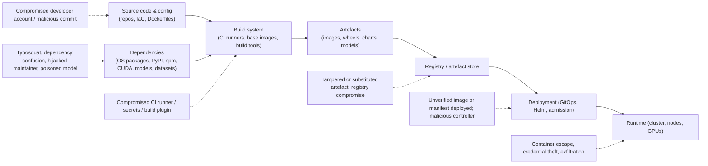
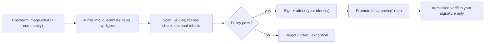

# 5.27 Software supply chain security

| | |
|---|---|
| Level | Advanced |
| Priority tier | 1 |
| Lab venue | Docker/BuildKit, GitHub Actions or GitLab CI (OIDC), registry (Harbor/GHCR/Artifact Registry), `cosign`, `syft`, `grype`/`trivy`, Kyverno or Sigstore policy-controller, `slsa-verifier` |
| Part | Part 5: Kubernetes |
| Status | Drafted, labs **untested** |

## Why this matters for AI infrastructure

AI stacks have one of the widest and least-audited supply chains in computing: multi-gigabyte base images from vendors, thousands of Python packages (PyTorch, CUDA wheels, custom CUDA extensions compiled at install time), pretrained models downloaded from hubs as pickles, datasets scraped from the Internet, build scripts that `curl | bash`, GPU drivers and kernel modules that run with kernel privileges, and notebooks that `pip install` arbitrary things. A compromised dependency in a training image can exfiltrate proprietary data and model weights or tamper with the model itself; a poisoned model file can execute code on load; a malicious package in a CI environment can steal cloud credentials. Kubernetes gives you the control points (admission, network policy, runtime isolation); this chapter shows how to combine them with build-time and registry-time controls into a verifiable chain from source to production, including the AI-specific parts (models, datasets, GPU stack).

## Prerequisites and outcomes

Needs 5.1, 5.16, 5.21 and CI/CD basics (4.2). After this chapter you can:

- Describe the supply-chain threat model (source, build, dependencies, artefacts, registry, deploy, runtime) with real attack classes (typosquatting, dependency confusion, compromised maintainers/build systems, poisoned base images, malicious updates, stolen CI credentials, tampered artefacts, unsigned models) and map controls to each.
- Explain SLSA levels, in-toto attestations, provenance and how to generate and verify them.
- Produce and consume SBOMs (SPDX, CycloneDX); scan images and dependencies; manage vulnerability triage with VEX and exceptions.
- Sign and verify images, SBOMs and attestations with Sigstore/cosign (keyless OIDC and key-based), publish transparency log entries, and enforce verification at admission in Kubernetes.
- Harden builds (hermetic, ephemeral, least-privilege runners, pinned inputs, reproducibility) and registries (immutability, scanning, replication, access control).
- Secure Python/ML dependency chains (lockfiles with hashes, private indexes, `--require-hashes`, wheel-only, pinned CUDA stacks), and model/dataset provenance (safetensors, signed model artefacts, hashes, model scanning).
- Add runtime protections (read-only rootfs, seccomp, egress control, detection) and prepare incident response (blast-radius analysis via SBOMs, key/CI credential rotation, image revocation).

## 1. Threat model



Representative incidents and lessons (class-level): the SolarWinds build compromise (build system integrity), Codecov bash uploader (modified script harvesting CI secrets), `event-stream`/`ua-parser-js` (maintainer takeover), dependency confusion (internal package names claimed on public indexes), PyPI typosquats of ML libraries, malicious pickle models on public hubs, the `xz` backdoor (long-game maintainer social engineering), compromised GitHub Actions or Docker Hub images, leaked CI tokens used to push images. AI-specific: pickled checkpoints executing code on `torch.load`, compromised conda/pip mirrors, notebook environments with ad-hoc installs, third-party CUDA extension builds, vulnerable inference servers exposed to the network, tampered datasets (poisoning) altering model behaviour.

Security objectives: **integrity** (what runs is exactly what was built from reviewed source), **provenance** (who/what/how built it), **transparency** (what it contains), **least privilege** (builders and deployers have minimal rights), **detectability** (tampering causes verification failure), **recoverability** (you can find and remove affected artefacts quickly).

## 2. Frameworks and standards

- **SLSA (Supply-chain Levels for Software Artifacts)**: tracks (Build L1–L3, with source and dependency tracks evolving). Build L1: provenance exists; L2: hosted build platform signs provenance; L3: hardened build platform (isolated builds, non-falsifiable provenance, no secret exposure to user steps). Use the **SLSA GitHub generator** / GitLab / Google Cloud Build provenance, `slsa-verifier` to validate provenance before deploy.
- **in-toto attestations**: signed statements about artefacts (provenance, SBOM, vulnerability scan, test results, review/approval) in DSSE envelopes with predicates (`https://slsa.dev/provenance/v1`, `https://spdx.dev/Document`, `https://cyclonedx.org/bom`, `https://cosign.sigstore.dev/attestation/vuln/v1`).
- **Sigstore**: **cosign** (sign/verify OCI artefacts, store signatures as OCI referrers/tags), **Fulcio** (short-lived certs bound to OIDC identities: "keyless"), **Rekor** (public transparency log), **policy-controller** (admission). **Notary v2 / notation** (X.509, enterprise PKI) is the alternative; **OCI 1.1 referrers API** attaches signatures/SBOMs/attestations to images.
- **NIST SSDF (SP 800-218)**, **CISA/ NSA guidance**, **CNCF supply chain best practices**, **OpenSSF Scorecard**, **CIS benchmarks**, **US EO 14028 SBOM requirements**, **EU Cyber Resilience Act** (SBOMs/vulnerability handling) drive compliance.
- **Frameworks for AI**: model signing (OpenSSF **model-signing**, Sigstore for models), SBOM extensions for ML (CycloneDX ML-BOM, SPDX AI profile), NIST AI RMF, MLCommons/Hugging Face safetensors guidance.

## 3. Source and build

### Source integrity

Protected branches, required reviews and CODEOWNERS (4.1), signed commits/tags (gitsign for keyless signing), MFA/passkeys for maintainers, secret scanning and push protection, dependency update bots with review, restricted workflow permissions, branch protection for IaC and Dockerfiles, 2-person review for build config. Monitor repository settings drift (OpenSSF Scorecard, `allstar`).

### Build integrity

1. **Build in CI, never on developer laptops** for released artefacts; ephemeral, isolated builders (one job per VM/container, destroyed after); no long-lived credentials on runners; OIDC federation to registries/clouds (4.2); least-privilege tokens (push only to the target repository); separate build and deploy credentials.
2. **Hermetic and pinned inputs**: pin base images by digest, OS packages by version (and snapshot repositories), language dependencies by lockfile with hashes, tools by checksum; vendor or mirror dependencies through an internal proxy (Artifactory/Nexus/devpi/Harbor proxy cache) so builds do not hit the live Internet; deny network egress during the compile phase where possible (BuildKit `--network=none` for steps after dependency fetch; Bazel/Nix hermetic builds).
3. **Reproducibility**: same inputs → same bits (`SOURCE_DATE_EPOCH`, sorted tar, no timestamps, deterministic ordering, `--build-arg` pins); verify with independent rebuilds (reproducible-builds tooling, `diffoscope`); not always achievable for Python/CUDA stacks but base image + application layers can be.
4. **Minimal, trusted bases**: distroless/Chainguard/Wolfi, vendor-curated bases (NGC), your own hardened golden bases rebuilt nightly; avoid arbitrary community images; verify base signatures; track base image updates (Renovate) and rebuild dependents.
5. **Build secrets** only via BuildKit secret mounts (5.1), never baked; **no `curl | bash`** — download with checksum/signature verification.
6. **Provenance generation**: `docker buildx build --provenance=mode=max --sbom=true`, or SLSA generators, producing attestations attached to the image digest.
7. **Isolate CI from production**: separate accounts/projects; build agents cannot reach production networks; deploy via GitOps pull (4.26) so CI holds no cluster credentials.
8. **Protect the CI platform**: pinned and reviewed third-party actions/plugins (by SHA), restricted `pull_request_target`, no secrets for forks, workflow file protection (CODEOWNERS), audit logs, runner hardening, ephemeral self-hosted runners with network egress filtering; treat the CI system as tier-0.

## 4. SBOMs and vulnerability management

### SBOM

A **Software Bill of Materials** lists components (packages, versions, licences, hashes, supplier, relationships). Formats: **SPDX** (ISO standard), **CycloneDX** (OWASP; VEX and ML-BOM support). Generate at build with **Syft** (`syft packages registry/app@sha256:... -o spdx-json`), BuildKit `--sbom`, Trivy (`trivy image --format cyclonedx`), language tools (`pip-audit`, `cyclonedx-py`), `docker sbom`. Attach as attestation (`cosign attest --type spdxjson --predicate sbom.json image@digest`) and store in the registry (referrers). Use SBOMs to answer "which running workloads contain log4j / this torch version / this OpenSSL?" instantly: ingest into a database (Dependency-Track, GUAC, Grype with SBOM input) and cross-reference with deployed digests from the cluster (`kubectl get pods -A -o jsonpath` images → digests).

### Scanning

- **Image scanners**: Trivy, Grype, Clair, Snyk, Docker Scout, cloud-native (ECR/Artifact Registry/ACR scanning), Anchore. Scan OS packages and language ecosystems (pip, npm, Go modules, Java); note limitations: wheels with bundled libs (PyTorch bundles CUDA libs), statically linked binaries, vendored code, and compiled CUDA extensions are hard to attribute; false positives from distro backports.
- **Where to scan**: PR time (Dockerfile lint `hadolint`, dependency review), build time (fail on critical/high with fixes available), registry (continuous rescans as new CVEs emerge), cluster (Trivy Operator / Kubescape scanning running workloads), nodes (host packages, kernel).
- **Triage with context**: reachability, exploitability (EPSS, CISA KEV), whether the component is loaded, mitigations; record decisions with **VEX** (Vulnerability Exploitability eXchange) statements (OpenVEX/CSAF/CycloneDX VEX) so scanners suppress not-affected findings with justification; time-bound exceptions with owners.
- **Patch SLAs**: critical (hours to days), high (days to weeks), with automated rebuild pipelines for bases; image freshness policy (max age) enforced by admission or reporting.
- **Config and IaC scanning**: Trivy config/Checkov/Kubescape for manifests and Terraform (4.2, 4.23); secrets scanning (gitleaks, trufflehog) on repos, images, and registries.
- **GPU stack CVEs**: NVIDIA publishes security bulletins for drivers, Container Toolkit, GPU Operator, Triton, NeMo, DCGM; track and patch (container toolkit escape CVEs have occurred: update promptly and restrict `privileged`).

## 5. Signing and verification

### Cosign basics

```bash
# Keyless signing in CI (GitHub Actions with id-token: write)
cosign sign --yes registry.example.com/ml/trainer@sha256:abc...            # signs digest using Fulcio cert bound to the workflow identity; entry in Rekor
cosign attest --yes --type slsaprovenance --predicate provenance.json registry.example.com/ml/trainer@sha256:abc...
cosign attest --yes --type spdxjson --predicate sbom.spdx.json registry.example.com/ml/trainer@sha256:abc...
# Verify
cosign verify registry.example.com/ml/trainer@sha256:abc... \
  --certificate-identity-regexp 'https://github.com/acme/.+/.github/workflows/release.yml@refs/tags/v.*' \
  --certificate-oidc-issuer https://token.actions.githubusercontent.com
cosign verify-attestation --type slsaprovenance --certificate-identity-regexp ... --certificate-oidc-issuer ... image@digest
cosign tree image@digest                                                  # signatures/attestations attached
# Key-based (air-gapped or KMS)
cosign generate-key-pair --kms gcpkms://projects/p/locations/global/keyRings/r/cryptoKeys/k
cosign sign --key gcpkms://... image@digest ; cosign verify --key gcpkms://.../versions/1 image@digest
```

Principles: **sign digests, not tags**; define **who is allowed to sign** (identity = CI workflow path + ref, not "any signature"); keep a **private Sigstore** (Fulcio/Rekor/TUF) or key-based/KMS signing for air-gapped environments; protect signing keys in KMS/HSM; set certificate-identity policies tightly; record verification policy as code; sign **all** artefacts: images, Helm charts (OCI), SBOMs, attestations, Terraform modules, models.

### Admission-time enforcement in Kubernetes

Enforce verification where workloads are admitted (5.21):

```yaml
apiVersion: kyverno.io/v1
kind: ClusterPolicy
metadata: { name: require-signed-images-and-provenance }
spec:
  validationFailureAction: Enforce
  webhookTimeoutSeconds: 15
  rules:
    - name: verify-signature
      match: { any: [ { resources: { kinds: [Pod], namespaceSelector: { matchLabels: { env: prod } } } } ] }
      verifyImages:
        - imageReferences: ["registry.example.com/ml/*"]
          mutateDigest: true
          verifyDigest: true
          required: true
          attestors:
            - entries:
                - keyless:
                    issuer: https://token.actions.githubusercontent.com
                    subjectRegExp: "^https://github.com/acme/.+/\\.github/workflows/release\\.yml@refs/tags/v.*$"
                    rekor: { url: https://rekor.sigstore.dev }
          attestations:
            - type: https://slsa.dev/provenance/v1
              attestors: [ { entries: [ { keyless: { issuer: https://token.actions.githubusercontent.com, subjectRegExp: "^https://github.com/acme/.+" } } ] } ]
              conditions:
                - all:
                    - key: "{{ buildDefinition.buildType }}"
                      operator: Equals
                      value: "https://actions.github.io/buildtypes/workflow/v1"
    - name: only-approved-registries
      match: { any: [ { resources: { kinds: [Pod] } } ] }
      validate:
        message: "Images must come from registry.example.com or nvcr.io."
        pattern:
          spec:
            containers:
              - image: "registry.example.com/* | nvcr.io/*"
```

Alternatives: **Sigstore policy-controller** (`ClusterImagePolicy`), **Ratify** (with Gatekeeper, Notation/cosign verifiers), **Connaisseur**, cloud-native **Binary Authorization** (GKE) / **ECR signing with Notation + Kyverno/Gatekeeper** / **Azure Policy for Kubernetes** with Notation. Operational concerns: verification latency (cache results), registry availability dependency (decide fail-open vs fail-closed), exemptions for system namespaces/bootstrap images (mirror them into your registry and sign), rolling out in `Audit` first, handling third-party images (re-sign after your own scanning/mirroring: "image promotion pipeline"), verifying **init containers and ephemeral containers**, and re-verification on Deployment updates.

### Image promotion pipeline



Clusters trust only the `approved` repository and your signer; upstream trust decisions are made once, centrally, with evidence.

## 6. Registries and artefact stores

- **Access control**: separate repos for quarantine/dev/prod; push rights only to CI identities; read-only for clusters (pull credentials via workload identity); no shared admin tokens; audit logs.
- **Immutability**: tag immutability for release tags; digest references in manifests; retention to keep deployed digests available; deletion protections; replicated copies for DR.
- **Scanning and policy in the registry** (Harbor policies: block pull of vulnerable images, require signed images), pull-through caches with allow-lists, rate limits and malware/quarantine features.
- **Other artefact types**: Helm charts (OCI), Python packages (private PyPI/devpi/Artifactory with proxy and curation), conda channels, OS package mirrors (snapshots), model registries (MLflow/Hugging Face Hub private, OCI model artefacts via ORAS/KitOps), datasets (versioned buckets with hashes), Terraform modules/providers (mirrors, lock files with hashes, 4.22).
- **Dependency confusion defences**: scoped/private package names, reserved names on public indexes, index priority configuration (`--index-url` only your proxy; `--extra-index-url` is dangerous), namespace claims; artefact curation (allow-list of approved packages/versions), delay new releases ("cooldown") before adoption.

## 7. Python and ML dependency hygiene

- **Lockfiles with hashes**: `pip-compile --generate-hashes` / `uv pip compile --generate-hashes` / Poetry lock / PDM; install with `pip install --require-hashes -r requirements.txt` (`--no-deps` after a full lock) so any substituted wheel fails.
- **Prefer wheels over sdists** (`--only-binary=:all:`) to avoid running arbitrary `setup.py` at install; for packages that need compilation (custom CUDA ops), build in a dedicated, hermetic, network-restricted stage and ship the wheel from your internal index.
- **Private index as the only source** for CI and production images; mirror vetted public packages; automated scanning (`pip-audit`, OSV scanner, Safety) and licence checks; Renovate/Dependabot with review and a cool-down for fresh releases.
- **Pinned CUDA/PyTorch stacks**: use vendor-published matched wheels/containers (NGC, PyTorch index with CUDA tag); avoid ad-hoc `pip install` in running containers/notebooks; image rebuild instead of mutation; restrict outbound access from training pods to package indexes except via a proxy.
- **Notebook environments**: curated base images with approved libraries; per-user environments in volumes scanned regularly; disallow `pip install` from the Internet in production namespaces (egress policy), allow via proxy with allow-list; log installs.
- **Conda/mamba**: pinned `conda-lock` files, trusted channels (conda-forge with signature verification), avoid mixed pip/conda drift.
- **C/C++/CUDA extensions**: vendor and review; reproducible builds; compile with hardening flags; keep ABI/driver compatibility documented (5.1).
- **Python startup attack surface**: `.pth` files, `sitecustomize`, `PYTHONSTARTUP`; read-only site-packages in production images; remove pip/compilers from runtime images.
- **Inference servers**: patch quickly (public CVEs in popular servers like Ray, vLLM, Triton, Jupyter, MLflow, TorchServe have enabled RCE when exposed); never expose management ports; authenticate; network policies (5.15).

## 8. Model and data supply chain

- **Serialization safety**: Python pickle (`torch.load` default pre-2.6, many `.bin`/`.pt`/`.pkl` checkpoints) executes arbitrary code on load. Use **safetensors** (no code execution, zero-copy), `torch.load(weights_only=True)`, ONNX/TensorRT engines from trusted builds, and avoid `trust_remote_code=True` with unreviewed model repositories (it downloads and runs Python from the model repo). Scan model files (ProtectAI `modelscan`, `fickling`, Hugging Face scanners) as defence in depth, not as proof of safety.
- **Provenance & integrity**: record model source (repo, commit SHA), file hashes (SHA-256), licence, training data lineage, and evaluation results; **sign models** (OpenSSF model-signing with Sigstore; cosign for OCI model artefacts via ORAS/KitOps/ModelPack); verify on download and before serving; store approved models in an internal registry; pin by commit/digest, not "main".
- **Download hygiene**: from allow-listed hubs through a proxy/mirror; checksum verification; no runtime downloads in production pods (pre-stage to PVC/object storage/image volume); deny egress to model hubs from serving namespaces.
- **Datasets**: content-addressed/versioned storage (DVC, lakeFS, object versioning with checksums), access control and audit, validation of external data (schema, outlier and poisoning checks, deduplication, licence/PII scanning), reproducible snapshots for each training run (data hashes in run metadata), separation of raw vs curated zones.
- **Fine-tuning and adapters**: LoRA adapters are small but can alter behaviour; sign and review; restrict who can promote adapters to production serving.
- **Training pipeline integrity**: pipelines as code with reviews; artifact lineage (MLflow, W&B, OpenLineage); reproducible environments (image digest + lockfile + data hash + config + seed = run ID); protect experiment trackers and registries with RBAC; guardrails against tampering with evaluation sets.
- **Output side**: model cards, SBOM/ML-BOM, evaluation attestations (safety/bias/performance gates as signed attestations enforced before promotion), watermark/provenance (C2PA) for generated content where relevant.
- **Secrets in model artefacts**: scan checkpoints/notebooks/logs for credentials; avoid embedding tokens.

## 9. Runtime and detection

Supply-chain controls fail eventually; limit the blast radius (5.15, 5.21):

- **Least privilege at runtime**: non-root, read-only rootfs, drop capabilities, seccomp, no host namespaces, minimal ServiceAccount, no cloud credentials unless workload identity with narrow scopes.
- **Egress control**: default-deny egress with explicit allow-lists (object store, registry mirror, package proxy); blocks callbacks and exfiltration from compromised packages; DNS logging/FQDN policy.
- **Runtime detection**: Falco/Tetragon rules for unexpected process execution (`curl`, `wget`, shells in prod images), writes to unexpected paths, connections to unfamiliar IPs, reading mounted secrets, loading unexpected kernel modules; audit logs for ServiceAccount token use anomalies.
- **Node integrity**: signed/ measured boot where available, immutable node images (4.17), kernel module signing, restricting `privileged`; GPU driver containers/operators verified (signed images).
- **Secrets hygiene**: short-lived credentials, workload identity, rotation, no long-lived keys in images.
- **Honeytokens/canaries** in registries and buckets to detect scanning/theft.

## 10. Incident response for supply-chain events

1. **Identify scope** from SBOMs/inventory: which images/digests contain the affected component or came from the compromised pipeline; which clusters/namespaces run them (`kubectl` image digest inventory, GUAC/Dependency-Track queries); which models/datasets were built or touched.
2. **Contain**: block the digests (admission deny list / policy exception removal), scale down or isolate affected workloads, disable affected CI pipelines/tokens, revoke signing identities or add to a revocation/deny list (cosign has no revocation; rely on policy by identity+time, or rotate keys and update policies), quarantine registry repositories.
3. **Eradicate & rebuild**: rotate all credentials the build/runtime could have touched (CI tokens, cloud keys, registry creds, secrets), rebuild from known-good sources and bases with patched dependencies, verify provenance, redeploy progressively; scan nodes for persistence if container escape is suspected.
4. **Investigate**: audit logs (CI, registry, Kubernetes API, cloud), Rekor entries, network egress logs, runtime detections; preserve evidence.
5. **Communicate & learn**: notify stakeholders/customers per policy; blameless review; add detection and controls (e.g., enforce signature policy, cooldown for new dependencies, hermetic builds).
6. **Prepare in peacetime**: maintain an up-to-date inventory, practise "log4shell drills" (find every instance of component X in 1 hour), keep rebuild pipelines healthy, document break-glass procedures.

## 11. Maturity roadmap

| Stage | Capabilities |
|---|---|
| **Baseline** | Private registry; pinned bases/digests; image scanning in CI; no secrets in images; non-root; lockfiles |
| **Managed** | SBOMs per build; continuous registry rescan; hash-pinned Python deps via private index; signed images (key or keyless); admission allow-list of registries; renovation bot with review |
| **Verified** | SLSA L2–3 provenance; admission enforces signature + provenance; image promotion pipeline; VEX-driven triage; hermetic builds; egress allow-lists; signed models |
| **Advanced** | Reproducible builds; policy on source reviews and dependency ages; GUAC/graph-based queries; runtime attestation (confidential computing/attested nodes); continuous verification and automated revocation; supplier attestation requirements |

## 12. Lab (untested)

1. **Scan and SBOM**: build a PyTorch-based image; generate SPDX/CycloneDX SBOMs with Syft; scan with Trivy and Grype; compare findings; triage a CVE with VEX; show how a PyTorch-bundled CUDA library appears.
2. **Hash-pinned Python**: create `requirements.in`, compile with hashes, install with `--require-hashes`; swap a wheel on a mirror to prove failure; configure a private index and demonstrate dependency confusion (in a sandbox) and the fix (single index, name reservation).
3. **Keyless signing in CI**: GitHub Actions with OIDC: build, push, `cosign sign`, `cosign attest` SBOM and provenance; verify locally with identity constraints; inspect Rekor entry; tamper with the image tag and show verification failure.
4. **Admission enforcement**: deploy Kyverno (or policy-controller) with verifyImages; start in Audit, review reports; switch to Enforce; test an unsigned image, a signed-by-wrong-identity image, and an allowed one; test init containers and Deployment updates.
5. **SLSA provenance**: use the SLSA generator or BuildKit provenance; verify with `slsa-verifier`; add a policy condition on builder identity and source repo.
6. **Promotion pipeline**: mirror an NGC/community image into quarantine, scan, sign, promote; make the cluster accept only the approved repo; update the image and re-run end-to-end; measure time.
7. **Hermetic build**: build with BuildKit using an internal proxy and `--network=none` for the compile stage; show a build that tries to `curl` the Internet failing; compare reproducibility with `diffoscope`.
8. **Model supply chain**: craft a malicious pickle (harmless payload) and show `torch.load` execution vs `weights_only=True` vs safetensors; scan with modelscan; sign a model artefact with model-signing/cosign and verify before serving in an init container; block `trust_remote_code` via policy.
9. **Egress control**: run a "compromised dependency" simulation (a package that tries to call an external URL and read env/secrets); show default-deny egress NetworkPolicy and runtime detection (Falco/Tetragon) catching it; rotate the exposed secret.
10. **Inventory & incident drill**: collect all running image digests and SBOMs into Dependency-Track/GUAC; answer "which workloads include package X version Y?" quickly; run a drill for a hypothetical critical CVE and measure time to inventory, patch, rebuild, redeploy.
11. **CI hardening review**: audit a GitHub Actions workflow set: unpinned actions, `pull_request_target`, broad `GITHUB_TOKEN`, secrets exposure; fix using SHA pins, least-privilege permissions, environment protections, OIDC; run `zizmor`/`actionlint`/Scorecard.
12. **Policy as code tests**: unit-test Kyverno policies with `kyverno test` and fixtures in CI (4.13).
13. **Clean up**.

Mark tested only after execution.

## 13. Common mistakes

- Scanning without acting; or blocking on every finding without context and getting policy disabled.
- Signing tags or "trusting any valid signature" instead of binding to the expected identity and digest.
- Leaving a fail-open admission webhook that can be bypassed under load; verifying only the main containers (not init/ephemeral).
- Public indexes in production builds; `--extra-index-url`; no hashes; installing from the Internet at container start.
- Pulling base images directly from public registries in prod builds; mutable tags; no rebuild cadence.
- Treating SBOMs as compliance paperwork rather than an operational inventory; not storing them with digests.
- Long-lived CI secrets and cluster credentials in CI; self-hosted runners with persistent state.
- Loading pickled models from unknown sources; `trust_remote_code=True` by default; downloading models at runtime.
- Ignoring GPU stack and inference-server CVEs; exposing management endpoints.
- No inventory of what is running, so incident scoping takes days.

## 14. Interview angles

- "Walk me through securing the supply chain for container images in a Kubernetes cluster." 
- "What is SLSA? What are provenance and attestations? How do you verify them in the cluster?" 
- "How does cosign keyless signing work? What are Fulcio and Rekor?" 
- "What's in an SBOM and how do you use it during a Log4Shell-type event?" 
- "How do you defend against dependency confusion and typosquatting in Python?" 
- "Why are pickled models dangerous? What are the alternatives and controls?" 
- "How would you design an image promotion pipeline for third-party GPU images?" 
- "How do you respond if a CI token was leaked and malicious images were pushed?" 

## 15. Checkpoint questions (40)

1. What does SLSA stand for? **A:** Supply-chain Levels for Software Artifacts.
2. Build L3 means? **A:** Hardened platform with non-falsifiable provenance.
3. in-toto is? **A:** Framework/format for signed supply-chain attestations.
4. SBOM formats? **A:** SPDX, CycloneDX.
5. SBOM tool? **A:** Syft.
6. Scanner tools? **A:** Trivy, Grype.
7. VEX purpose? **A:** State whether a CVE is exploitable in the product.
8. Cosign signs what? **A:** OCI artefact digests.
9. Keyless signing uses? **A:** OIDC identity + Fulcio cert + Rekor log.
10. Rekor is? **A:** Transparency log.
11. Notary v2 CLI? **A:** notation.
12. Verify by what? **A:** Digest + expected identity/issuer.
13. Admission enforcers? **A:** Kyverno, policy-controller, Ratify.
14. `mutateDigest` does? **A:** Rewrite tags to digests.
15. Why not trust tags? **A:** Mutable.
16. Image promotion idea? **A:** Quarantine, scan, sign, promote.
17. Dependency confusion? **A:** Public package shadows private name.
18. `--require-hashes` does? **A:** Enforce hash-pinned installs.
19. Safer file format for weights? **A:** safetensors.
20. `weights_only=True` effect? **A:** Restricts unpickling.
21. `trust_remote_code` risk? **A:** Runs repo-provided code.
22. Model signing tools? **A:** model-signing (Sigstore), cosign.
23. Reproducible build meaning? **A:** Same inputs yield identical output.
24. Hermetic build? **A:** No uncontrolled network/inputs.
25. BuildKit secret mount why? **A:** Keep secrets out of layers.
26. CI hardening for third-party actions? **A:** Pin by SHA.
27. `pull_request_target` risk? **A:** Runs with secrets on untrusted code.
28. OIDC for CI benefit? **A:** No long-lived cloud keys.
29. Registry immutability? **A:** Tags cannot be overwritten.
30. Continuous rescan why? **A:** New CVEs appear after build.
31. EPSS/KEV purpose? **A:** Exploit likelihood/known exploitation.
32. Egress allow-list purpose? **A:** Block exfiltration/callbacks.
33. Runtime detection tool? **A:** Falco/Tetragon.
34. Inventory source for incident scope? **A:** SBOMs + running digests.
35. Cosign revocation? **A:** None; use policy/key rotation.
36. Referrers API? **A:** Attach signatures/SBOMs to images in OCI 1.1.
37. NVIDIA toolkit CVEs matter because? **A:** Container escape risk.
38. Dataset provenance practice? **A:** Version + hash datasets per run.
39. ML-BOM? **A:** BOM extension for models/datasets.
40. Fail-open vs fail-closed admission? **A:** Availability vs enforcement trade-off.

## 16. Sources and review notes

**Written in original words.** Principal sources:

- Josh Rosso, Rich Lander, Alex Brand and John Harris, *Production Kubernetes* (chapter 15 on software supply chain: image trust, scanning, signing, admission).
- SLSA specification, in-toto, Sigstore (cosign, Fulcio, Rekor), Notary Project, OpenSSF (Scorecard, model-signing), SPDX/CycloneDX, NIST SSDF, CNCF Software Supply Chain Best Practices, Kyverno/policy-controller/Ratify documentation, NVIDIA security bulletins.
- Incident references are described at a class level without detailed claims; verify specifics before citing.
- Examples are the author's constructions.

**Flagged for verification before publishing:** cosign/Kyverno policy syntax and attestation predicate type URIs for your versions, SLSA level definitions (the spec has evolved to tracks), Hugging Face/torch default behaviours for `torch.load` by version, tool names/flags for model signing and scanning, and every command/manifest; all labs are **untested**.
