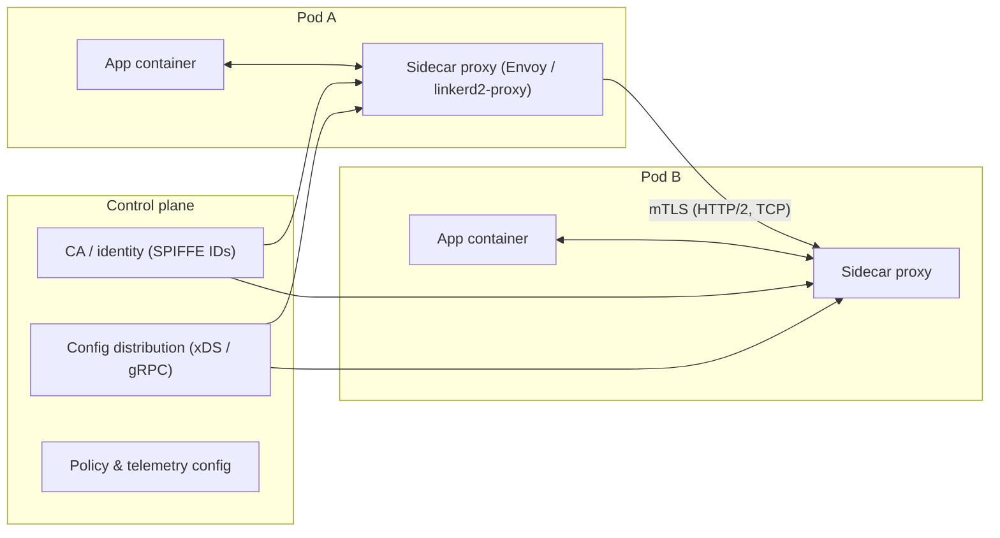

# 5.28 Service mesh

| | |
|---|---|
| Level | Advanced |
| Priority tier | 2 |
| Lab venue | 3-node cluster; Istio (sidecar and ambient), Linkerd, or Cilium Service Mesh; Kiali/Grafana; fortio/hey; gRPC sample apps |
| Part | Part 5: Kubernetes |
| Status | Drafted, labs **untested** |

## Why this matters for AI infrastructure

Inference platforms are service graphs: gateways, routers, retrievers, rerankers, vector stores, tool servers, model servers. Teams want encrypted service-to-service traffic with workload identity, per-route retries and timeouts, canary and shadow traffic for new model versions, consistent metrics and traces across languages, and policy such as "only the router may call the model server". A service mesh moves these concerns out of every application into infrastructure. But a mesh adds latency, CPU/memory per pod, operational complexity and failure modes that matter for long-lived streaming and GPU-adjacent traffic. Knowing what a mesh does, how its data plane works, and when it earns its cost is a design skill; it is also relevant for interviews because meshes are a common topic in platform roles.

## Prerequisites and outcomes

Needs 5.10, 5.12, 5.15, 5.21. After this chapter you can:

- Explain the mesh architecture (control plane, data plane proxies) and compare sidecar, ambient (node + waypoint proxies) and eBPF-based models.
- Describe core capabilities: workload identity and mTLS (SPIFFE), traffic management (routing, splitting, retries, timeouts, circuit breaking, mirroring, fault injection), security policy (authz), observability (golden signals, tracing), multi-cluster.
- Install and use Istio and Linkerd for common tasks; know Cilium's mesh features; express canary releases and policies.
- Evaluate overhead and failure modes; tune for gRPC/streaming and LLM traffic (long timeouts, HTTP/2, SSE).
- Decide if you need a mesh, and what alternatives (gateway-only, library, eBPF CNI) fit.

## 1. Concepts

A **service mesh** is an infrastructure layer for service-to-service communication providing, uniformly and without app changes: **identity and mutual TLS**, **L7 traffic control**, **resilience features**, **telemetry**, and **policy enforcement**. Architecture:



Key ideas:

- **Data plane**: proxies intercept traffic (via iptables/eBPF redirect or explicit proxying) and perform TLS, routing, retries, metrics. **Envoy** is the dominant proxy (Istio, Consul, Kuma, Gateway API implementations); Linkerd uses a purpose-built Rust micro-proxy.
- **Control plane**: distributes configuration (xDS APIs), issues short-lived workload certificates, injects proxies (mutating webhook), exposes policy CRDs.
- **Identity**: each workload gets an identity (SPIFFE ID such as `spiffe://cluster.local/ns/serving/sa/vllm`) tied to its ServiceAccount; certificates rotate frequently (hours); **mTLS** authenticates both sides and encrypts traffic (zero-trust east-west).
- **Policy**: authorisation by identity (which service accounts/namespaces may call which workloads/paths/methods), deny-by-default models, request authentication (JWT validation at the edge).
- **Telemetry**: consistent L7 golden signals (request rate, success rate, latency histograms), distributed tracing headers propagation, access logs, topology graphs (Kiali, Linkerd viz, Hubble).
- **Traffic management**: weighted routing (canary), header-based routing, mirroring (shadow traffic), retries with budgets, timeouts, circuit breaking/outlier detection, rate limiting, locality-aware load balancing, fault injection.

## 2. Data-plane models

| Model | How | Pros | Cons |
|---|---|---|---|
| **Sidecar** (classic Istio, Linkerd, Consul) | A proxy container per pod; traffic redirected with iptables (init container/CNI plugin) | Strong per-pod isolation of proxy; mature; per-workload config | Resource overhead per pod (CPU/memory), startup ordering (sidecar must be ready before app; native sidecars help), Job completion issues (sidecar keeps pod alive), upgrades require pod restarts, extra latency hops (client proxy + server proxy), iptables/port conflicts |
| **Ambient mesh** (Istio ambient) | Per-node **ztunnel** (L4 mTLS/identity, Rust) + optional per-namespace/service **waypoint proxies** (Envoy, L7) | No sidecars; lower overhead; incremental adoption (L4 secure overlay first); no pod restarts | Newer; waypoint adds an L7 hop; node-level component is shared (blast radius); evolving features |
| **eBPF / kernel-based** (Cilium Service Mesh) | eBPF datapath in the CNI for L3/L4 + Envoy per node for L7 as needed; mutual authentication using SPIFFE and WireGuard/IPsec for encryption | Minimal per-pod overhead; integrates with CNI/policy/Hubble | Requires Cilium as CNI; L7 features rely on node-level Envoy; features differ from Istio |
| **Proxyless gRPC (xDS)** | gRPC library speaks xDS to the control plane; no proxy | Lowest overhead for gRPC | Library/language support limited; per-app changes |
| **Library-based** (Finagle, Resilience4j, Spring Cloud) | App-level libraries | No proxy | Per-language, inconsistent, upgrades via app releases |
| **Gateway-only** (no east-west mesh) | Ingress/Gateway API (5.12) handles north-south | Simple | No east-west mTLS/telemetry |

## 3. Istio essentials

Components: **istiod** (pilot: xDS config; citadel: CA; galley/injection), **ingress/egress gateways** (Envoy deployments, now commonly via Gateway API `Gateway`/`HTTPRoute`), sidecars (`istio-proxy`) or ambient (ztunnel DaemonSet, waypoints). Install with `istioctl install --set profile=default` or Helm; enable injection per namespace: `kubectl label ns serving istio-injection=enabled` (or `istio.io/dataplane-mode=ambient`). Key CRDs:

```yaml
apiVersion: security.istio.io/v1
kind: PeerAuthentication
metadata: { name: default, namespace: serving }
spec: { mtls: { mode: STRICT } }                  # require mTLS for all workloads in the namespace
---
apiVersion: security.istio.io/v1
kind: AuthorizationPolicy
metadata: { name: model-server-allow-router, namespace: serving }
spec:
  selector: { matchLabels: { app: vllm } }
  action: ALLOW
  rules:
    - from: [ { source: { principals: ["cluster.local/ns/edge/sa/router"] } } ]
      to:   [ { operation: { methods: ["POST"], paths: ["/v1/*"] } } ]
---
apiVersion: networking.istio.io/v1
kind: DestinationRule
metadata: { name: vllm, namespace: serving }
spec:
  host: vllm.serving.svc.cluster.local
  subsets:
    - { name: v1, labels: { version: v1 } }
    - { name: v2, labels: { version: v2 } }
  trafficPolicy:
    loadBalancer: { simple: LEAST_REQUEST }
    connectionPool:
      http: { http2MaxRequests: 1000, maxRequestsPerConnection: 0, idleTimeout: 3600s }
      tcp: { maxConnections: 1000 }
    outlierDetection: { consecutive5xxErrors: 5, interval: 10s, baseEjectionTime: 30s, maxEjectionPercent: 50 }
---
apiVersion: networking.istio.io/v1
kind: VirtualService
metadata: { name: vllm, namespace: serving }
spec:
  hosts: [vllm.serving.svc.cluster.local]
  http:
    - match: [ { headers: { x-canary: { exact: "true" } } } ]
      route: [ { destination: { host: vllm.serving.svc.cluster.local, subset: v2 } } ]
    - route:
        - { destination: { host: vllm.serving.svc.cluster.local, subset: v1 }, weight: 95 }
        - { destination: { host: vllm.serving.svc.cluster.local, subset: v2 }, weight: 5 }
      timeout: 600s
      retries: { attempts: 0 }                     # do not retry generation requests
      mirror: { host: vllm.serving.svc.cluster.local, subset: v2 }
      mirrorPercentage: { value: 10.0 }
```

(Istio increasingly uses the Kubernetes **Gateway API** for traffic routing (HTTPRoute) in place of VirtualService, including for mesh (GAMMA) use.) Other: `Sidecar` resource (limit config scope), `ServiceEntry` (external services), `Telemetry` (metrics/trace config), `EnvoyFilter` (advanced, fragile), `RequestAuthentication` (JWT), `WasmPlugin`, `ProxyConfig`. Debug: `istioctl proxy-status`, `istioctl analyze`, `istioctl proxy-config routes/clusters/listeners/endpoints <pod>`, `istioctl x describe pod`, Envoy admin (`:15000/config_dump`, `/stats`), `kubectl logs -c istio-proxy`.

## 4. Linkerd essentials

Linkerd (CNCF graduated) emphasises simplicity and low overhead: control plane (destination, identity, proxy-injector), `linkerd2-proxy` sidecars, viz extension (Prometheus/Grafana-based dashboards), multicluster and policy extensions. Install: `linkerd install --crds | kubectl apply -f -; linkerd install | kubectl apply -f -; linkerd check`; inject: annotate namespace `linkerd.io/inject: enabled`. Features: automatic mTLS by default (no config), golden metrics per route (`linkerd viz stat deploy`, `linkerd viz top`), retries/timeouts via `ServiceProfile` or Gateway API HTTPRoute/policy CRDs (`Server`, `ServerAuthorization`/`AuthorizationPolicy`, `HTTPRoute`), traffic split (SMI/HTTPRoute weights), multi-cluster service mirroring (gateway or flat network), load balancing by EWMA latency (peak EWMA), HTTP/2, gRPC and TCP support. Differences: fewer knobs, lower footprint, opinionated; no Envoy extensions; stable release availability model (vendor-driven; check licensing of stable distributions).

## 5. Cilium Service Mesh

Cilium adds mesh features to its eBPF CNI: **L7 policy and observability** via per-node Envoy (HTTP/gRPC/Kafka/DNS visibility with Hubble), **mutual authentication** (SPIFFE/SPIRE-based identity; encryption via WireGuard/IPsec), **Gateway API**/Ingress controller, **traffic management** with `CiliumEnvoyConfig` and Gateway API, **ClusterMesh** for multi-cluster service discovery and policy. Pros: no sidecars, shared datapath, uniform policy language across L3–L7. Cons: ties you to Cilium; less mature feature surface than Istio for complex traffic management.

## 6. Capabilities in practice

### Mutual TLS and zero-trust

Enable STRICT mTLS mesh-wide after a PERMISSIVE migration phase; combine with AuthorizationPolicies so identity, not network location, grants access; rotate certificate roots (plugin CAs from Vault/cert-manager `istio-csr`); monitor certificate expiry and handshake failures. mTLS protects against sniffing and spoofing inside the cluster and across multi-cluster links; it complements (does not replace) NetworkPolicy (defence in depth) and requires that all clients are meshed (non-mesh clients need exemptions).

### Traffic management for model rollouts

- **Canary**: weights 99/1 → 90/10 → 50/50 → 0/100, gated by metrics (Argo Rollouts/Flagger drive mesh weights from Prometheus analysis, 4.26).
- **Shadow (mirroring)**: duplicate a percentage of requests to the new model server, discarding responses, to compare latency/error rates and sampled outputs offline (beware cost: mirrored GPU load, side effects for non-idempotent calls).
- **Header routing**: route by `x-model-version`, tenant, or experiment group; sticky sessions/consistent hash for KV/prefix cache locality (`consistentHash` in DestinationRule).
- **Retries and timeouts**: retries multiply load and, for generation requests, duplicate expensive GPU work and may produce side effects; set `retries.attempts: 0` for POST generation, use retries for idempotent calls (embeddings, health) with `retryOn: connect-failure,refused-stream` and per-try timeouts; configure retry budgets (Linkerd) to avoid retry storms.
- **Circuit breaking / outlier detection**: eject failing replicas (consecutive 5xx), cap pending requests (`http1MaxPendingRequests`, `http2MaxRequests`) to shed load instead of queueing indefinitely.
- **Rate limiting**: local (Envoy local rate limit) or global (rate limit service) per client identity or API key; for LLMs, token-based limits generally need app/gateway awareness.
- **Locality-aware routing**: prefer same-zone endpoints, fail over across zones/regions (`localityLbSetting`).
- **Fault injection**: delays and aborts for resilience testing.

### Observability

Automatic golden signals per service/route; topology graphs (Kiali, Linkerd Viz, Hubble UI); access logs with request IDs; tracing headers (`traceparent`, B3) must be **propagated by applications** (the mesh creates spans per hop but cannot link inbound to outbound calls without app propagation); export to OTel Collector/Tempo/Jaeger; Envoy stats volume can be huge: restrict with `proxyStatsMatcher`, `Telemetry` API, drop unneeded histograms to control cardinality (5.24).

## 7. Costs, performance and failure modes

- **Latency**: sidecar adds roughly 0.2 to 1 ms per hop (two proxies in a request path) plus TLS; ambient L4 via ztunnel typically lower; L7 waypoints add a hop. For token-streaming LLM traffic the per-request overhead is negligible relative to generation time, but extra buffering/idle-timeout behaviour matters (long-lived streams).
- **CPU/memory**: Envoy sidecar ~50 to 100+ MiB and some CPU per pod (grows with config size: `Sidecar` resources limit scope); at 5,000 pods this is hundreds of GiB; ambient reduces to per-node cost. Linkerd proxy is lighter (~10 to 20 MiB typical).
- **Control-plane scale**: xDS pushes to thousands of proxies; large clusters need `Sidecar` scoping, revision-based upgrades, and tuned istiod resources; config churn (endpoint changes) triggers pushes.
- **Startup/shutdown ordering**: app may start before the proxy is ready (connection refused) → use `holdApplicationUntilProxyStarts`, native sidecars; at shutdown the proxy may terminate before the app finishes draining (`EXIT_ON_ZERO_ACTIVE_CONNECTIONS`, `terminationDrainDuration`); Jobs with sidecars never complete unless the proxy is told to quit (`/quitquitquit`, native sidecar support).
- **Traffic interception pitfalls**: protocol sniffing (server-first protocols like MySQL break; declare ports with `appProtocol`/port names), UDP and multicast unsupported, non-TCP and raw sockets bypass; `hostNetwork` pods can't be meshed; init containers run before the proxy (no mesh egress); localhost traffic exempt; ports `15001/15006/15020/15021/15090` reserved.
- **HTTP/2, gRPC, WebSocket, SSE**: supported, but check idle timeouts: Envoy's stream idle timeout defaults to 5 minutes, and Envoy's own default route timeout is 15 s (Istio configures routes without a route timeout unless you set one; verify for your version). For LLM streaming set explicit long or disabled route timeouts, raise idle timeouts, disable response buffering features, and set `maxRequestsPerConnection` / maximum connection duration so connections rebalance.
- **mTLS and non-mesh traffic**: STRICT breaks health checks from kubelets (Istio rewrites probes via the sidecar `15021` or `rewriteAppHTTPProbe`), Prometheus scrapes (use metrics merging or exclude ports), external clients/other namespaces not in the mesh.
- **Upgrades**: control plane revisions and canary upgrades (`istioctl install --revision`, `istio.io/rev` labels), sidecars updated only on pod restart (version skew within supported window), data-plane CVEs in Envoy require restarts across the cluster.
- **Debuggability**: extra layer in every failure analysis: 503s with `UF`/`UH`/`NR` Envoy response flags, upstream connect errors, mTLS handshake mismatches, stale xDS config; use `istioctl proxy-config` and access logs with response flags.
- **Security of the mesh itself**: control plane has high privilege (CA keys); protect `istio-system`; restrict who can create `EnvoyFilter`/`WasmPlugin`; network policy for control plane ports; keep proxies patched.
- **Multi-cluster complexity**: cross-cluster identities (shared root CA), endpoint discovery (remote secrets), east-west gateways, DNS (`clusterset.local` vs `.global`), latency and failure domains (5.35).

## 8. When to use (and not use) a mesh

Use when you need: uniform mTLS/identity for many services across languages with compliance requirements; fine-grained L7 traffic control (canary, mirroring, header routing) without code; consistent telemetry; multi-cluster service networking; zero-trust authorisation policy. Avoid or defer when: you have a small number of services (a gateway + library TLS/OTel may suffice), latency-critical or very high-QPS hot paths where sidecars dominate costs, raw-TCP/UDP protocols (RDMA/NCCL traffic is entirely outside the mesh and shouldn't be proxied), teams lack operational capacity, or the main need is just north-south ingress. For AI platforms a pragmatic path: **Gateway API + cert-manager + OTel + NetworkPolicy** first (5.12, 5.15, 5.24); add **ambient/eBPF mesh** for mTLS and identity-based policy when compliance requires east-west encryption; reserve sidecar meshes for service-rich inference graphs that need advanced traffic shaping. Training traffic (NCCL over RDMA/TCP between pods) must bypass the mesh (exclude via annotations/ports or secondary networks).

Annotations to exclude traffic (Istio): `traffic.sidecar.istio.io/excludeOutboundPorts`, `excludeOutboundIPRanges`, `sidecar.istio.io/inject: "false"` for training pods and storage clients; Linkerd: `config.linkerd.io/skip-outbound-ports`, `skip-inbound-ports`.

## 9. Lab (untested)

1. **Install and mesh an app**: install Istio (default profile) or Linkerd; deploy a three-tier sample (gateway → router → model-mock); enable injection; verify proxies, mTLS (`istioctl x describe`, `linkerd viz edges`), and metrics in Grafana/Kiali.
2. **Strict mTLS migration**: start PERMISSIVE, introduce a non-mesh client, switch to STRICT, observe failures and fix with exemptions or inclusion; verify encrypted traffic with `tcpdump`.
3. **AuthorizationPolicy**: deny-by-default for the model namespace, allow only the router identity on `POST /v1/*`; test with allowed and denied callers; compare with NetworkPolicy.
4. **Canary and mirror**: deploy `v1`/`v2` mock servers; route 90/10; mirror 10% to `v2`; drive load with fortio; compare metrics; automate the rollout with Flagger or Argo Rollouts.
5. **Resilience**: inject 503s and delays into `v2`; configure timeouts, retries (idempotent GET vs non-idempotent POST), outlier detection; observe retry amplification and fix with budgets; test circuit breaking limits with high concurrency.
6. **Streaming**: build an SSE token-stream mock (5-minute stream); verify behaviour through sidecars with default timeouts; fix stream idle/route timeouts; test rolling restart behaviour and graceful drain.
7. **gRPC load balancing**: single-connection gRPC client against a Service with 4 pods: show imbalance without mesh and balanced requests with mesh L7 load balancing; compare `LEAST_REQUEST`, EWMA.
8. **Overhead measurement**: benchmark p50/p99 latency and CPU/memory with and without sidecars; with ambient mode; with Cilium mesh; plot per-pod overhead and cost at 1,000 pods.
9. **Ambient mode**: enable ambient for a namespace; observe ztunnel mTLS without sidecars; add a waypoint for L7 policy; compare resource usage and failure behaviours.
10. **Startup and Job issues**: reproduce app-before-proxy connection failures and a Job that never completes with a sidecar; fix with hold-until-ready and native sidecars/quit endpoint.
11. **Multi-cluster (optional)**: link two kind clusters with shared root CA, discover remote services, and test failover.
12. **Exclusions**: run a distributed training job pair of pods with NCCL over TCP inside a meshed namespace and show the performance penalty and breakage; exclude ports/namespaces and compare.
13. **Clean up**.

Mark tested only after execution.

## 10. Common mistakes

- Adopting a mesh for resume value without a concrete requirement; underestimating operational load.
- Strict mTLS enabled before all clients are meshed; breaking probes and scrapes.
- Default retries on non-idempotent LLM requests; retry storms.
- Forgetting HTTP/2 stream idle timeouts and route timeouts for streaming endpoints.
- Proxying RDMA/NCCL or storage traffic; meshing training pods.
- Huge sidecar configs (no `Sidecar` scoping) causing memory bloat and slow xDS pushes.
- Treating the mesh as a replacement for NetworkPolicy, authN/Z in apps, or secrets management.
- Trace propagation assumptions (mesh cannot join spans without app header propagation).
- Never upgrading proxies; mixed versions beyond support window.

## 11. Interview angles

- "What problems does a service mesh solve? What does it cost?" 
- "Sidecar vs ambient vs eBPF data planes: trade-offs." 
- "How does mTLS identity work in Istio/Linkerd? What is SPIFFE?" 
- "How would you canary a new model version with a mesh? What about mirroring?" 
- "Why are retries dangerous for LLM inference requests?" 
- "Why does gRPC load balance badly without a mesh?" 
- "How do sidecars interact with Kubernetes Jobs and startup/shutdown?" 
- "When would you not use a service mesh?" 

## 12. Checkpoint questions (35)

1. Mesh planes? **A:** Control and data plane.
2. Main proxy? **A:** Envoy (Linkerd uses its own).
3. Identity standard? **A:** SPIFFE.
4. mTLS gives? **A:** Mutual auth + encryption.
5. Istio control plane binary? **A:** istiod.
6. Istio mTLS CRD? **A:** PeerAuthentication.
7. Authorization CRD? **A:** AuthorizationPolicy.
8. Traffic split CRD? **A:** VirtualService / HTTPRoute.
9. LB/outlier CRD? **A:** DestinationRule.
10. External services CRD? **A:** ServiceEntry.
11. Ambient components? **A:** ztunnel + waypoint.
12. ztunnel layer? **A:** L4 mTLS.
13. Waypoint layer? **A:** L7.
14. Linkerd CLI check? **A:** `linkerd check`.
15. Linkerd viz stat? **A:** `linkerd viz stat`.
16. Cilium mesh L7 via? **A:** Envoy per node.
17. Mirroring purpose? **A:** Shadow traffic testing.
18. Canary weights? **A:** Route percentages.
19. Retry danger? **A:** Duplicate expensive work/side effects.
20. Outlier detection does? **A:** Eject failing endpoints.
21. Circuit breaking limits? **A:** Concurrency/pending requests.
22. gRPC imbalance fix? **A:** L7 LB via mesh/proxy.
23. Sidecar overhead? **A:** CPU/memory per pod + latency hops.
24. xDS is? **A:** Envoy dynamic config API.
25. `Sidecar` resource reduces? **A:** Config scope/memory.
26. Startup issue? **A:** App starts before proxy ready.
27. Job issue? **A:** Sidecar keeps pod alive.
28. Native sidecars help? **A:** Proper ordering/termination.
29. Strict mTLS risk? **A:** Breaks non-mesh clients/probes.
30. Probe handling? **A:** Rewritten via sidecar.
31. Excluding traffic annotation? **A:** `traffic.sidecar.istio.io/exclude*`.
32. Trace propagation needs? **A:** App header forwarding.
33. Envoy response flags example? **A:** UF, UH, NR.
34. Multi-cluster needs? **A:** Shared trust, discovery, gateways.
35. Alternatives to mesh? **A:** Gateway API + cert-manager + OTel + policy.

## 13. Sources and review notes

**Written in original words.** Principal sources:

- Brendan Burns et al., *Kubernetes: Up and Running* (3rd edition; chapter 15 on service meshes: capabilities, mTLS, traffic splitting, observability).
- James Strong and Vallery Lancey, *Networking and Kubernetes* (chapter 6 on service meshes and API gateways).
- Istio, Linkerd, Cilium, Envoy and SPIFFE documentation.
- Examples are the author's constructions.

**Flagged for verification before publishing:** Istio API versions (`networking.istio.io/v1`), ambient maturity and feature parity, default timeout values, overhead figures (measure on your hardware), Linkerd distribution/licensing model, and every manifest/command; all labs are **untested**.
