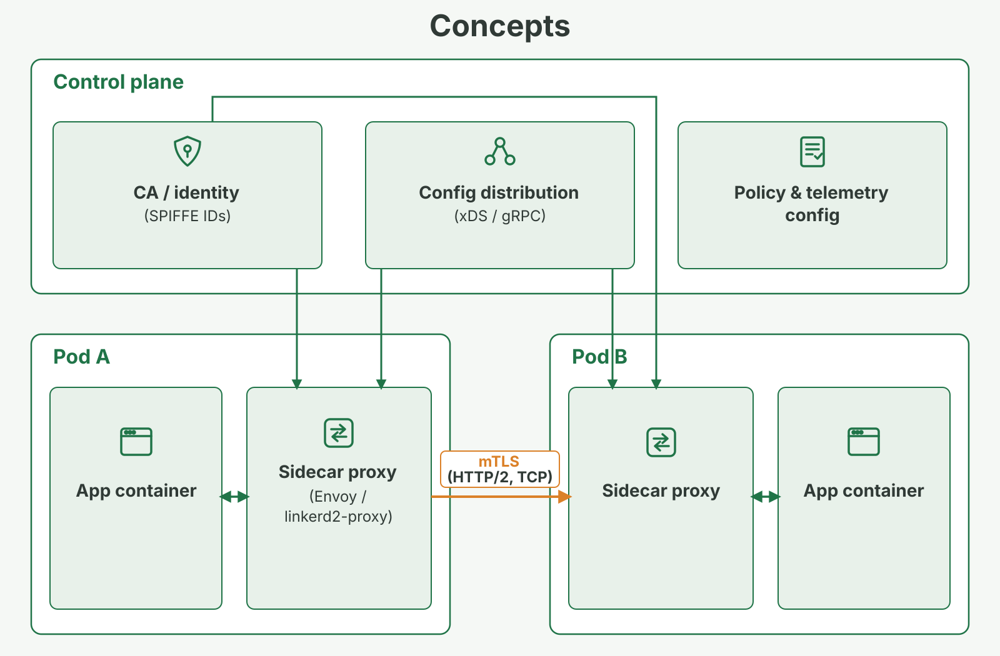

# 5.28 Service mesh

| | |
|---|---|
| Level | Advanced |
| Priority tier | 2 |
| Lab venue | 3-node cluster; Istio (sidecar and ambient), Linkerd, or Cilium Service Mesh; Kiali/Grafana; fortio/hey; gRPC sample apps |
| Part | Part 5: Kubernetes |
| Status | Drafted, labs **untested** |


## Why this matters for AI infrastructure

Picture an inference request on its way to a model. It may pass through a gateway, then a router, then a retriever, a reranker, a vector store, a tool server and finally a model server. That is a long chain, and every link in it is a network call. Each call needs encryption, so that nobody on the network can read the prompt. It needs a verified identity, so the model server knows the caller really is the router. It needs sensible retries and timeouts, and it needs a way to send a small slice of traffic to a new model version without a big-bang switch.

Think of a hospital corridor. A patient moves from the front desk to triage, then to the ward, then to the imaging room. Each hand-off needs a name badge check, a clear record of where the patient went and a rule for what happens when a room is busy. A hospital could make every nurse learn those rules on her own. It is far more reliable to set the rules once, for the whole building.

Teams also want the same things from every service. They want the same metrics and traces whether a service is written in Python, Go or Rust. They often want a rule such as "only the router may call the model server." A service mesh moves these concerns out of each application and into the infrastructure around it. The application team can then spend its time on the model code instead of on networking code that every team writes again.

A mesh is not free, though. It adds a little delay to every call, it uses CPU and memory in every pod, and it adds one more system that someone has to operate. Its failure modes matter most for long-lived streaming responses and for traffic that sits next to GPUs, where a small delay can leave expensive hardware waiting. So you need to know what a mesh does, how its data plane works and when it earns its cost. This is also a design question that comes up often in interviews for platform roles.

## Prerequisites and outcomes

Before you start, you should be comfortable with sections 5.10, 5.12, 5.15 and 5.21. Those sections cover Services, Ingress, NetworkPolicy and identity, and this chapter builds on each of them. A mesh adds a layer on top of those ideas rather than replacing them. If one of them feels fuzzy, go back and reread it first.

The list below is a self-check, not a test you have to pass in order. Each line asks a question that a working platform engineer answers every week. If a question still feels unfamiliar when you reach the end of the chapter, go back to the section that covers it and read again slowly.

- Can you draw the mesh's two halves, the control plane and the data-plane proxies, and compare the sidecar, ambient (node and waypoint proxies) and eBPF-based models?
- Can you name the core capabilities, which are workload identity and mTLS built on SPIFFE, traffic management such as routing, splitting, retries, timeouts, circuit breaking, mirroring and fault injection, security policy, observability and multi-cluster networking?
- Can you install and use Istio and Linkerd for common tasks, say what Cilium's mesh features do, and express a canary release and a policy?
- Can you measure the overhead and failure modes of a mesh, and tune it for gRPC, streaming and LLM traffic, which needs long timeouts, HTTP/2 and SSE?
- Can you decide whether you need a mesh at all, and name the alternatives that fit, such as gateway-only designs, client libraries or an eBPF CNI?

## 1. Concepts

Picture a router calling a `vllm` model server. Without a mesh, the router and the model server each need their own TLS code, their own retry logic and their own metrics. Every team writes that code again, in its own language, and every team gets some of it slightly wrong in its own way. A service mesh is an infrastructure layer for service-to-service communication that provides all of this for you. It gives you identity and mutual TLS, L7 traffic control, resilience features, telemetry and policy enforcement, all applied uniformly and without app changes.

The idea is a lot like a postal service. You do not build your own roads, sort your own letters or check every seal yourself. You write the letter, drop it in the box, and the postal system carries it, seals it and keeps a record. The mesh does the same job for the traffic between your pods. The app writes its request, and the mesh handles the delivery.

The diagram below shows the architecture. Each pod runs your app container next to a sidecar proxy. The proxies talk to each other over mTLS, while a control plane hands them their configuration and certificates. Read it from the top down. The control plane is the office that writes the rules, and the proxies are the staff who follow those rules on every single call.



*Figure 5.28.1. Concepts, as a diagram.*

Each part of this picture has a clear job. Start with the data plane, which is the set of proxies. Each proxy intercepts traffic, using `iptables`, eBPF redirection or explicit proxying. Then it handles TLS, routing, retries and metrics. You can think of a proxy as a doorkeeper and translator standing at the door of each pod, because every request going in or out walks past it. Envoy is the dominant proxy, and Istio, Consul, Kuma and Gateway API implementations all use it. Linkerd takes a different route. It uses its own purpose-built Rust micro-proxy, which stays small because it does only the jobs Linkerd needs.

The control plane is the other half. It distributes configuration through the xDS APIs. An xDS API is a stream. When something changes, such as a new pod or a new route, the control plane pushes the update down the stream, and the proxy applies it without a restart. The control plane also issues short-lived workload certificates, injects proxies through a mutating webhook and exposes policy CRDs that you write by hand.

Every workload gets an identity as well, and you can think of it as a badge. The badge is a SPIFFE ID, which is a standard format for naming a workload. An example is `spiffe://cluster.local/ns/serving/sa/vllm`. That ID is tied to the workload's ServiceAccount. Certificates rotate frequently, on a scale of hours, so a leaked certificate goes stale quickly. mTLS then checks the badge on both sides of a connection and encrypts the traffic in between. This is the zero-trust approach to traffic between services, where the network itself is not trusted to keep anyone out.

Policy is based on identity. You say which service accounts or namespaces may call which workloads, and you can narrow that to particular paths or methods. Some models deny by default, so anything you did not allow is refused. Request authentication checks JWTs at the edge, which means it verifies the tokens that callers present. Telemetry works the same way for every service. The mesh emits consistent L7 golden signals, which here means request rate, success rate and latency histograms. It also passes along tracing headers, writes access logs and draws topology graphs with Kiali, Linkerd viz or Hubble.

Traffic management covers a long list of tools. Weighted routing sends a fixed share of calls to each version, which is how canaries work. Header-based routing sends calls based on a header value. Mirroring copies traffic to a shadow version. Retries come with budgets, so they cannot pile up. Timeouts, circuit breaking and outlier detection protect callers from a sick backend. Rate limiting, locality-aware load balancing and fault injection round out the set.

*Kubernetes: Up and Running*, Chapter 15 (*Service Meshes*), explains why teams add a service mesh on top of Kubernetes' built-in `Service` and `Ingress` objects. It also shows how to look inside a mesh's implementation. Three points from that chapter matter here.

1. Plain Kubernetes `Service`s and `Ingress` are not enough for complex service graphs. Built-in `Service`s, run by `kube-proxy`, work at Layer 4 TCP/UDP. They have no awareness of HTTP status codes, gRPC methods, TLS certificates or latency outliers. `Ingress` only governs north-south traffic at the cluster perimeter. Getting east-west mTLS, automatic certificate rotation, canary percentage splits (`95/5`), circuit breaking and consistent golden-signal telemetry into application code means keeping duplicate client libraries in every language. That includes Python, Go, C++ and Rust. Each library has to be upgraded and tested on its own schedule, and each one can drift from the others.
2. A sidecar mesh intercepts traffic without touching the app. When a pod starts, an init container or a CNI plugin programs `iptables` rules inside the pod's network namespace. Those rules redirect all inbound and outbound TCP traffic to the local Envoy sidecar, or to `linkerd2-proxy`. The application container's code and configuration stay unchanged, so the app does not know the proxy exists. Meanwhile, the control plane watches the Kubernetes API for `Services`, `EndpointSlices`, `Pods` and mesh policy CRDs. It pushes routing, endpoint and certificate updates to every sidecar over Envoy's gRPC xDS discovery APIs: LDS (Listener), RDS (Route), CDS (Cluster), EDS (Endpoint) and SDS (Secret Discovery Service).
3. Before you adopt a mesh, the chapter suggests you ask three questions. First, do you have a multi-hop microservice architecture that needs east-west mTLS or L7 traffic shaping? Second, can you afford the CPU and memory overhead of sidecar proxies, plus the operational complexity of a second control plane? Third, which implementation fits your team's operational maturity? The candidates are Istio, Linkerd, Consul Connect, Cilium, and the vendor-neutral Service Mesh Interface (`SMI`) and Gateway API GAMMA specification.

Keep those three questions in mind. The rest of this chapter returns to them, one at a time.

### Where service meshes came from

The mesh idea is older than containers. Before Kubernetes, large internet companies already ran many microservices, and each one needed retries, load balancing and metrics. Those needs were so common that engineers started building them as shared code. Twitter built Finagle, a Scala library that its microservices embedded. It handled load balancing, circuit breaking, automatic retries, telemetry and more. Netflix built Hystrix, a similar library for Java applications.

Those libraries were the ancestors of today's meshes. Their weakness was language lock-in. A service had to be written in the language the library supported, or it simply could not use the library. A team that wanted to write a service in a different language had to rebuild the same protections from scratch.

Containers and Kubernetes changed the shape of the idea. A modern mesh is no longer a library inside each app. It is a distributed system of its own. A control plane configures a collection of proxies, and those proxies form the data plane. Routing, load balancing and telemetry live in the proxy instead of the application. Because no code changes are needed, many more apps can join a mesh, whatever language they were written in.

### The three pillars

Service meshes cover three areas, and many products describe their features under these headings. Think of them as three rooms in the same building.

The first pillar is routing and reliability. It includes traffic shifting, traffic mirroring, retries and circuit breaking. The second pillar is security. It covers identity, certificate management and mutual TLS (mTLS) between services. The third pillar is observability. It gathers metrics and traces from every interaction in the mesh, without any extra work from developers.

You do not need all three on day one. Section 8 explains why it helps to pick one first.

### Why Services and Ingress are not enough

Kubernetes already has networking objects, so why add more? Suppose your payments service is running several pods behind a `Service`. The `Service` gives it one stable name, and it spreads connections across the pods. Both `Service` and `Ingress` use label selectors to find the Pods that receive traffic. Beyond that, a `Service` offers comparatively little. It treats your application as a destination and nothing more. An `Ingress` goes a little further as an HTTP load balancer. Its API, though, must fit many existing load balancers and proxies, ranging from bare-metal devices to public cloud APIs. A truly cloud native HTTP routing API would have to fit all of them, so the API can only offer so much.

That limit explains where the mesh APIs come from. Ingress brings HTTP traffic in from outside the cluster, and it has to work with infrastructure built long before Kubernetes. Inside the cluster, a mesh does not carry that burden. Its APIs can be written for cloud native applications, so they can offer richer networking. Those extra features bring complexity of their own, which is the trade-off the rest of this chapter weighs. Most mesh implementations add three general capabilities: network encryption and authorization, traffic shaping and observability.

Encryption comes first, because it is easy to get wrong when every team builds it alone. Mutual TLS, or mTLS, encrypts traffic between Pods and also proves each side's identity. A mesh adds a sidecar container to every Pod, which intercepts all network traffic. Install the mesh once, and every Pod in the cluster gets encryption without code changes.

Traffic shaping routes requests to different versions of a service based on the request itself. Picture a rollout that moves from version X to version Y. Both versions run at once for a while, so you can watch the new one before you trust it. Teams often keep a new version running for a day to a week for internal users, or send 10% of traffic to it. Without a mesh, each experiment needs custom code or a new copy of the application. With a mesh, you describe the split declaratively, and the mesh applies it.

Observability is the third capability. A request can span several microservices, and stitching its logs together by hand is slow and error-prone. Because the mesh sees every call between Pods, it knows where each request went. It can rebuild one trace for the whole user experience, and the data looks the same no matter which team wrote each service.

Adopting a mesh also has a cost, and the chapter is direct about it. A mesh sits deep in the core communication path, so when it fails, the application stops working too. Every mesh release also needs watching, so you pick up security fixes and roll out upgrades without downtime. For many small applications, that overhead outweighs the benefits. A managed mesh from your cloud provider reduces the work, though your developers still need to learn it. Decide at the cluster level, and ideally adopt the mesh for all services at once, rather than one team at a time.

### Choosing a mesh

Many mesh projects exist, and none has become the single standard. Istio is probably the most widely used. Others include Linkerd, Consul Connect and Open Service Mesh, and proprietary options such as AWS App Mesh also exist. Most of them share the same design patterns and technology, but their APIs differ, so the choice matters.

The chapter suggests that the best mesh for you may be the one your cloud provider supplies. If that is not an option, do your research before you commit. Do not be swayed by flashy demos alone. Mesh APIs are implementation specific, so switching meshes later is hard once your applications depend on one. In some cases, the right mesh for you turns out to be no mesh at all.

## 2. Data-plane models

Not every mesh puts a proxy in every pod. Each data-plane model places its proxy somewhere different, and that placement decides what you pay in overhead and what you risk when something fails. Think of it as deciding where to put the security guards in a building. Guards at every door cost more but watch each door closely. Guards at the front gate cost less but do not see the hallways. The table compares where each model runs, what it gives you and what it costs.

| Model | How | Pros | Cons |
|---|---|---|---|
| **Sidecar** (classic Istio, Linkerd, Consul) | A proxy container per pod; traffic redirected with iptables (init container/CNI plugin) | Strong per-pod isolation of proxy; mature; per-workload config | Resource overhead per pod (CPU/memory), startup ordering (sidecar must be ready before app; native sidecars help), Job completion issues (sidecar keeps pod alive), upgrades require pod restarts, extra latency hops (client proxy + server proxy), iptables/port conflicts |
| **Ambient mesh** (Istio ambient) | Per-node **ztunnel** (L4 mTLS/identity, Rust) + optional per-namespace/service **waypoint proxies** (Envoy, L7) | No sidecars; lower overhead; incremental adoption (L4 secure overlay first); no pod restarts | Newer; waypoint adds an L7 hop; node-level component is shared (blast radius); evolving features |
| **eBPF / kernel-based** (Cilium Service Mesh) | eBPF datapath in the CNI for L3/L4 + Envoy per node for L7 as needed; mutual authentication using SPIFFE and WireGuard/IPsec for encryption | Minimal per-pod overhead; integrates with CNI/policy/Hubble | Requires Cilium as CNI; L7 features rely on node-level Envoy; features differ from Istio |
| **Proxyless gRPC (xDS)** | gRPC library speaks xDS to the control plane; no proxy | Lowest overhead for gRPC | Library/language support limited; per-app changes |
| **Library-based** (Finagle, Resilience4j, Spring Cloud) | App-level libraries | No proxy | Per-language, inconsistent, upgrades via app releases |
| **Gateway-only** (no east-west mesh) | Ingress/Gateway API (5.12) handles north-south | Simple | No east-west mTLS/telemetry |

Read the table row by row, and ask two questions each time. Where does the proxy run? And what does that location cost you? The sidecar model gives the strongest per-pod isolation, while the ambient and eBPF models share more of the work and lower the per-pod overhead.

### Node proxy

Sidecars are not the only option. Picture a building where every tenant on a floor shares one front desk. The node proxy model works the same way. It runs one proxy on each node, instead of one proxy in every pod, and that single proxy handles the traffic for every service running on the node. Consul Connect and Maesh follow this design. The first version of Linkerd also used node proxies, but the project moved to the sidecar model in version 2.

The trade-off is isolation. Because every service on a node shares one proxy, a busy service can slow down its neighbors. This is the noisy neighbor problem, and it is the same reason one loud tenant can disturb everyone on a shared floor. The shared proxy can also become a network bottleneck. Sidecars avoid that sharing, but a sidecar upgrade requires re-creating every pod it runs in. Weigh both costs before you pick a model.

## 3. Istio essentials

Suppose the `serving` namespace holds a `vllm` model server, and you want only the router to reach it. Nothing in the server's own code can enforce that rule. Istio can enforce it with a few custom resources, and the rest of this section walks through them.

The control plane is a single program, `istiod`. It sends xDS configuration to the proxies, acts as the certificate authority for mTLS, and injects sidecars. Older Istio releases ran these jobs as separate components called Pilot, Citadel and Galley. Istio merged them into `istiod` in release 1.5. Ingress and egress gateways are Envoy deployments, and they are now commonly configured with the Gateway API `Gateway` and `HTTPRoute` resources. The data plane is either sidecars, which run as `istio-proxy` containers, or ambient mode, which uses a ztunnel DaemonSet and waypoints. A DaemonSet runs one copy of a pod on every node, which is why ztunnel sits on each node rather than inside each app pod.

To install Istio, run `istioctl install --set profile=default`, or use Helm. Then turn on injection for each namespace. Use `kubectl label ns serving istio-injection=enabled` for sidecars, or `istio.io/dataplane-mode=ambient` for ambient mode. The label is the switch. Without it, the namespace's pods never get a proxy, and nothing in the rest of this section applies to them.

The YAML below defines the key resources. Read it as four steps. First comes mTLS for the namespace. Second is a rule that lets only the router make POST calls on `/v1/*`. Third are the `v1` and `v2` subsets, which name the two versions. Fourth is a 95/5 split, with 10 percent of traffic mirrored to `v2`.

```yaml
apiVersion: security.istio.io/v1
kind: PeerAuthentication
metadata: { name: default, namespace: serving }
spec: { mtls: { mode: STRICT } }                  # require mTLS for all workloads in the namespace
---
apiVersion: security.istio.io/v1
kind: AuthorizationPolicy
metadata: { name: model-server-allow-router, namespace: serving }
spec:
  selector: { matchLabels: { app: vllm } }
  action: ALLOW
  rules:
    - from: [ { source: { principals: ["cluster.local/ns/edge/sa/router"] } } ]
      to:   [ { operation: { methods: ["POST"], paths: ["/v1/*"] } } ]
---
apiVersion: networking.istio.io/v1
kind: DestinationRule
metadata: { name: vllm, namespace: serving }
spec:
  host: vllm.serving.svc.cluster.local
  subsets:
    - { name: v1, labels: { version: v1 } }
    - { name: v2, labels: { version: v2 } }
  trafficPolicy:
    loadBalancer: { simple: LEAST_REQUEST }
    connectionPool:
      http: { http2MaxRequests: 1000, maxRequestsPerConnection: 0, idleTimeout: 3600s }
      tcp: { maxConnections: 1000 }
    outlierDetection: { consecutive5xxErrors: 5, interval: 10s, baseEjectionTime: 30s, maxEjectionPercent: 50 }
---
apiVersion: networking.istio.io/v1
kind: VirtualService
metadata: { name: vllm, namespace: serving }
spec:
  hosts: [vllm.serving.svc.cluster.local]
  http:
    - match: [ { headers: { x-canary: { exact: "true" } } } ]
      route: [ { destination: { host: vllm.serving.svc.cluster.local, subset: v2 } } ]
    - route:
        - { destination: { host: vllm.serving.svc.cluster.local, subset: v1 }, weight: 95 }
        - { destination: { host: vllm.serving.svc.cluster.local, subset: v2 }, weight: 5 }
      timeout: 600s
      retries: { attempts: 0 }                     # do not retry generation requests
      mirror: { host: vllm.serving.svc.cluster.local, subset: v2 }
      mirrorPercentage: { value: 10.0 }
```

Notice that the `DestinationRule` must define the `v2` subset before any route points at it. Otherwise Envoy has no cluster for the route, as the checkpoint questions explain. The order matters because each piece refers to the one before it. The rule names the versions, and the route then splits traffic between those names. Istio also increasingly routes traffic with the Kubernetes Gateway API, using `HTTPRoute` in place of `VirtualService`, including for mesh use under the GAMMA initiative.

The `Sidecar` resource limits the scope of configuration. `ServiceEntry` describes external services, so the mesh knows about destinations outside the cluster. `Telemetry` configures metrics and traces. `EnvoyFilter` is advanced and fragile, because it edits Envoy's raw configuration directly, so a small mistake can be hard to trace. `RequestAuthentication` handles JWT, and `WasmPlugin` and `ProxyConfig` cover the rest. You will rarely need the last few on day one.

When something breaks, start at the control plane and work down to the pod. Begin with `istioctl proxy-status` and `istioctl analyze`. They tell you whether each proxy has received its latest configuration and whether any of your resources are invalid. Then run `istioctl proxy-config routes/clusters/listeners/endpoints <pod>` on the pod in question, so you can see what that one proxy actually holds. Also use `istioctl x describe pod`. Envoy's admin interface is at `:15000/config_dump` and `/stats`, and `kubectl logs -c istio-proxy` shows the sidecar's own log.

When a route misbehaves, run `istioctl analyze` and `istioctl proxy-status` before you read the proxy logs. The logs are the most detailed source, but they are also the noisiest, so the two summary commands should come first.

### Envoy and the xDS APIs

Many proxies were built before Envoy, but they were designed for static servers. They read a configuration file, and any change needed a restart. Kubernetes changes far too quickly for that. A service can scale up and down many times a day, and a restart for every change would drop connections over and over. Envoy was developed at Lyft and open-sourced in late 2016. It takes its configuration through gRPC or REST, and it supports hot restarts. A hot restart reinitializes Envoy without dropping active connections.

Envoy is the proxy behind many products. Contour, Ambassador, Gloo, Istio and OSM all use it. Its dynamic configuration comes from a family of xDS APIs. The main ones are the Listener Discovery Service (LDS), the Cluster Discovery Service (CDS), the Endpoint Discovery Service (EDS) and the Route Discovery Service (RDS). At startup, Envoy connects to a configuration server and subscribes to updates. The server then streams changes as the environment shifts, so Envoy's view of the world follows the cluster's view.

Four ideas explain how Envoy routes a request. Follow them in order, the way a letter travels through a sorting office. A listener binds to a port and accepts clients, such as ports 80 and 443. That is the front door. Each listener has filter chains that decide what happens to incoming traffic, which is the sorting step. The HTTP connection manager filter gets its routes from RDS, and those routes match requests by path or header. Each route points to a cluster, which is the group of endpoints that belong to one service. That is the delivery van.

Clusters get their endpoints from EDS. Envoy has no Endpoint object in the EDS API, though. The endpoints are attached to a cluster through a `ClusterLoadAssignment`. In short, listeners accept, filters decide, and clusters receive the traffic.

### istiod, sidecar injection and traffic shifting

Istio's control plane is a single program called `istiod`. It does three jobs. It serves Envoy configuration, implementing the xDS APIs and streaming configuration to every sidecar. It acts as the certificate authority, minting the identities and certificates that mTLS uses. It also reads Istio configuration from Kubernetes and translates it for the proxies. Before Istio 1.5 these jobs ran as separate components named Pilot, Citadel and Galley, and you will still see those names in older books and posts.

`istiod` also includes a mutating admission webhook. The webhook injects an Envoy sidecar into each pod that joins the mesh. Injection can be opt-in or opt-out. Adding the proxy is not enough on its own, though. Traffic must also be redirected into it. So Istio adds an init container that installs `iptables` rules. Those rules capture the pod's traffic and send it to Envoy. *Kubernetes: Up and Running* shows a trimmed version of that init container:

```
...
initContainers:
- args:
  - istio-iptables
  - --envoy-port
  - "15001"
  - --inbound-capture-port
  - "15006"
  - --proxy-uid
  - "1337"
  - --istio-inbound-interception-mode
  - REDIRECT
  - --istio-service-cidr
  - '*'
  - --istio-inbound-ports
  - '*'
  - --istio-local-exclude-ports
  - 15090,15021,15020
  image: docker.io/istio/proxyv2:1.6.7
  imagePullPolicy: Always
  name: istio-init
...
```

Read the arguments in pairs, and each pair is one setting. `--envoy-port 15001` is the port that captures all outbound traffic. `--inbound-capture-port 15006` captures all inbound traffic. The `--istio-service-cidr '*'` and `--istio-inbound-ports '*'` settings redirect every CIDR and every port. The `--istio-local-exclude-ports` setting lists the ports 15090, 15021 and 15020, which the init container leaves out of the redirection. This example is from Istio 1.6.7.

Istio uses two resources for traffic shifting. The `VirtualService` names a service in the mesh and holds the routing rules that choose a destination. The `DestinationRule` lists the real backends as subsets, and each subset can carry its own policy, such as a load balancing setting or an mTLS mode. A subset is a named group of pods, usually picked out by a label such as `version: v2`.

*Kubernetes: Up and Running* walks through a slow rollout of version 2 of a service. The `DestinationRule` defines two subsets, `v1` and `v2`. The `VirtualService` then sends 90% of traffic to `v1` and 10% to `v2`. Notice how the rollout works. Nothing is redeployed. Only the weights change, so you can move the split up or down as the new version earns trust.

```
apiVersion: networking.istio.io/v1alpha3
kind: DestinationRule
metadata:
  name: flights
spec:
  host: flights
  subsets:
  - name: v1
    labels:
      version: v1
  - name: v2
    labels:
      version: v2
---
apiVersion: networking.istio.io/v1alpha3
kind: VirtualService
metadata:
  name: flights
spec:
  hosts:
  - flights
  http:
  - route:
    - destination:
        host: flights
        subset: v1
      weight: 90
    - destination:
        host: flights
        subset: v2
      weight: 10
```

Service metrics come almost for free with this design. Every service pair has a proxy between them, so the proxy can count requests without any change to application code. The metrics use the Prometheus format. *Kubernetes: Up and Running* shows one example, with some labels removed for brevity. It counts 7,183 successful requests from the `bookings` service to the `payments` service. Read the labels as the question each metric answers. Who called, who was called, which version, and what came back.

```
istio_requests_total{
connection_security_policy="mutual_tls",
destination_service_name="payments",
destination_service_namespace="payments",
destination_version="v1",
request_protocol="http",
...
response_code="200",
source_app="bookings",
source_version="v1",
source_workload="bookings-v1",
source_workload_namespace="flights"
} 7183
```

Istio supports every feature in the SMI, but at Istio v1.6 it did not implement the SMI APIs directly. The SMI community maintains an adapter that makes the SMI APIs work with Istio. Istio is the mesh most often seen in the field, and Linkerd, Consul Connect and Maesh are other common choices. How each one builds its data plane varies, and that difference is the next point to compare.


## 4. Linkerd essentials

Imagine a platform team of three people who need encryption and metrics this quarter, and who do not have time to learn a large mesh first. That is the team Linkerd is written for. The chapter calls it simple and light, because it trades many configuration options for a smaller and more opinionated design. Linkerd is a CNCF graduated project. Its control plane has destination, identity and proxy-injector parts, and each pod gets a `linkerd2-proxy` sidecar. Extensions add viz dashboards, based on Prometheus and Grafana, plus multicluster and policy features.

Install with `linkerd install --crds | kubectl apply -f -; linkerd install | kubectl apply -f -; linkerd check`. The first command installs the resource definitions, the second installs the control plane, and the third checks that everything is healthy. Then annotate the namespace with `linkerd.io/inject: enabled` to turn on injection. As with Istio, the annotation is the switch that tells the injector which namespace to watch.

mTLS is on by default, so you get encryption before you write any policy. You can read route metrics with `linkerd viz stat deploy` or `linkerd viz top`. `stat` gives you a summary, and `top` shows live traffic as it flows. Retries and timeouts use a `ServiceProfile`, or Gateway API and policy CRDs such as `Server`, `ServerAuthorization`, `AuthorizationPolicy` and `HTTPRoute`. Load balancing uses EWMA latency, specifically peak EWMA. EWMA stands for exponentially weighted moving average, a running average that gives recent samples more weight, so the balancer prefers the replicas that are answering fastest right now. HTTP/2, gRPC and TCP are supported.

The trade-off is fewer knobs, a lower footprint and an opinionated design, with no Envoy extensions. If you need to write custom Envoy filters, Linkerd will not let you. In exchange, there are fewer settings to get wrong. Stable release availability is vendor-driven, so the release you can get depends on the vendor's decisions, not only on the open-source project.

Check the licensing of the stable distribution before you pick Linkerd. Licensing decides what you may legally run in production, so it belongs in the same conversation as the technical comparison.

## 5. Cilium Service Mesh

Picture a mesh that does not add a proxy to every pod at all. Cilium adds mesh features to its eBPF CNI, with no sidecars. eBPF lets the kernel run small, checked programs at the networking hooks, so Cilium can make many decisions in the kernel instead of in a proxy. A per-node Envoy provides L7 policy and observability through Hubble. SPIFFE/SPIRE-based identity gives mutual authentication, and WireGuard or IPsec encrypts the traffic. Cilium also works as a Gateway API and Ingress controller. Traffic management uses `CiliumEnvoyConfig`, and ClusterMesh covers multi-cluster discovery and policy.

The upside is one policy language across L3 through L7. You write the rules once, and they cover the network layer as well as the application layer. The downside is that you are tied to Cilium, and its traffic management is less mature than Istio's. Check that Cilium's features cover your traffic rules before you commit. A feature gap found after go-live is much more expensive than one found on a test cluster.

### The Service Mesh Interface (SMI)

Kubernetes already defines interfaces for pluggable parts, such as the Container Runtime Interface (CRI) and the Container Networking Interface (CNI). An interface is a contract. It says what one side must offer, so the other side can be swapped without rewriting everything. A mesh needs the same kind of contract. The Service Mesh Interface (SMI) is a vendor-neutral set of APIs that describes how Kubernetes and a mesh interact. It is not part of core Kubernetes. The SMI project defines its APIs as CRDs and houses libraries for them, such as the SMI SDK for Go. The SMI covers the three pillars through a set of CRDs.

The Traffic Split API handles routing across services. It splits traffic by percentage, which supports blue-green deployments and A/B tests. The following `TrafficSplit` performs a canary of the `flights` service. Read it as a single decision: most calls go to the old version, and a smaller share goes to the new one.

```
apiVersion: split.smi-spec.io/v1alpha3
kind: TrafficSplit
metadata:
  name: flights-canary
  namespace: bookings
spec:
  service: flights
  backends:
  - service: flights-v1
    weight: 70
  - service: flights-v2
    weight: 30
```

The `service` field names the top-level Service that clients connect to, which is `flights.bookings.cluster.svc.local`. The `backends` list names the Services that receive the traffic. Version 1 gets 70% and version 2 gets the remaining 30%. Clients keep using one name, and the split happens behind it. That is the whole point of the API.

The Traffic Access Control and Traffic Specs APIs handle security. Access control decides which services may talk to each other, and under which conditions, such as the allowed HTTP methods. Traffic specs describe the traffic itself. `HTTPRouteGroup` covers HTTP, and `TCPRoute` covers TCP. Together, these apply policy at the application level. The next example allows every request from the `bookings` service to the `payments` service. The `HTTPRouteGroup` describes the traffic, and the `TrafficTarget` names the source and destination. Read the two documents as a pair. The first describes what traffic looks like, and the second says who may send it.

```
apiVersion: specs.smi-spec.io/v1alpha3
kind: HTTPRouteGroup
metadata:
  name: payment-processing
  namespace: payments
spec:
  matches:
  - name: everything
    pathRegex: ".*"
    methods: ["*"]
---
apiVersion: access.smi-spec.io/v1alpha2
kind: TrafficTarget
metadata:
  name: allow-bookings
  namespace: payments
spec:
  destination:
    kind: ServiceAccount
    name: payments
    namespace: payments
  port: 8080
  rules:
  - kind: HTTPRouteGroup
    name: payment-processing
    matches:
    - everything
  sources:
  - kind: ServiceAccount
    name: flights
    namespace: bookings
```

In that listing, `everything` allows all requests in the `HTTPRouteGroup`. The `destination` is the Pods that use the `payments` ServiceAccount in the `payments` Namespace. The `rules` list names the `HTTPRouteGroup` that controls traffic between the two services. The `sources` list is the `flights` ServiceAccount in the `bookings` Namespace. Notice that the policy names identities, not IP addresses, so the rule still holds when pods are replaced.

The Traffic Metrics API handles telemetry. It differs from the others because it defines outputs rather than inputs. It sets a standard way to expose service metrics. Monitoring systems, autoscalers and dashboards can then read those metrics in one consistent format. The goal is that a dashboard can read these numbers without knowing which mesh produced them. *Kubernetes: Up and Running* shows a `TrafficMetrics` resource for traffic between two Pods:

```
apiVersion: metrics.smi-spec.io/v1alpha1
kind: TrafficMetrics
resource:
  name: flights-19sk18sj11-a9od2
  namespace: bookings
  kind: Pod
edge:
  direction: to
  side: client
  resource:
    name: payments-ks8xoa999x-xkop0
    namespace: payments
    kind: Pod
timestamp: 2020-08-09T01:07:23Z
window: 30s
metrics:
- name: p99_response_latency
  unit: seconds
  value: 13m
- name: p90_response_latency
  unit: seconds
  value: 7m
- name: p50_response_latency
  unit: seconds
  value: 3m
- name: success_count
  value: 100
- name: failure_count
  value: 0
```

Read the resource from the top. The `resource` is the caller, the `edge` is the link to the callee, and the `metrics` list holds the numbers for that link over a 30-second window. The latency values are the 50th, 90th and 99th percentiles, so you can see both the typical call and the slowest few. A percentile is the value that a given share of calls stays under. A p99 of 13 minutes, as the example shows, would mean that one call in a hundred took at least that long.

The SMI is still under development, and it changes as the community learns. It still shows where the community is heading. Its main benefit is portability. A platform team can offer a mesh through provider-agnostic APIs, and the choice of implementation stays open. If you later move from one mesh to another, the parts that already use SMI move with you.

## 6. Capabilities in practice

Picture a Friday afternoon when someone proposes turning on strict encryption for the whole mesh. It sounds like a free improvement. It is also the change that most often breaks a working system on its first day. This section shows how to get the benefits of each capability without the surprise.

### Mutual TLS and zero-trust

Turning on STRICT mTLS across the whole mesh can break callers, so you do it in stages. Start in PERMISSIVE mode, where a workload accepts both encrypted and plain traffic. Then move to STRICT once the migration is complete. The staged path gives you time to find the callers that are still plain. Pair STRICT with AuthorizationPolicies, so that identity, not network location, decides who gets access. Rotate certificate roots too. You can use plugin CAs from Vault, or cert-manager through `istio-csr`. Monitor certificate expiry and handshake failures as well, because a certificate that expires quietly can take down a path that worked yesterday.

mTLS protects traffic against sniffing and spoofing inside the cluster and across multi-cluster links. It complements NetworkPolicy rather than replacing it, which gives you defence in depth. Two independent controls are harder to defeat than one. mTLS also requires that every client is meshed, so non-mesh clients need exemptions. A client outside the mesh cannot present a valid identity, and a STRICT policy will refuse it.

Before you switch to STRICT, list every client that is not meshed and decide how each one will be handled. Each entry on that list should end with one of two outcomes: the client joins the mesh, or it gets a documented exemption.

### Traffic management for model rollouts

Canary releases shift weight in steps: 99/1, then 90/10, then 50/50, and finally 0/100. Think of each step as a small bet. You move a little more traffic to the new model, watch the results, and only then move again. Each step is gated by metrics, so a bad result stops the rollout before it reaches everyone. Argo Rollouts or Flagger can drive the mesh weights from Prometheus analysis, which chapter 4.26 covers.

Shadow traffic, also called mirroring, sends a percentage of requests to the new model server and discards the responses. The users never see the shadow answers. You then compare latency and error rates, and you can check sampled outputs offline. Watch the cost, though. Mirrored requests add GPU load, and non-idempotent calls can cause side effects, because the shadow copy may write something real. An idempotent call gives the same result when repeated, so repeating it is safe. A generation request usually does not have that property.

Header routing sends requests by `x-model-version`, by tenant or by experiment group. For KV-cache locality, use sticky sessions or consistent hashing, which is `consistentHash` in a DestinationRule. Sticky routing sends the same caller to the same replica, so the cache built for that caller's earlier prompts is still there when the next prompt arrives.

Retries multiply load. Suppose a model server is slow and every caller retries once. The load on it doubles at the exact moment it can least afford more. For generation requests, a retry also repeats expensive GPU work and can produce side effects. Set `retries.attempts: 0` for POST generation requests. For idempotent calls such as embeddings and health checks, retry on `retryOn: connect-failure,refused-stream` with per-try timeouts. Linkerd's retry budgets help you avoid retry storms.

Circuit breaking and outlier detection eject failing replicas after consecutive 5xx errors. A circuit breaker is like a fuse. When one replica keeps failing, the mesh stops sending it traffic for a while, so the rest of the pool can absorb the load. Limits on pending requests, `http1MaxPendingRequests` and `http2MaxRequests`, shed load instead of letting requests queue indefinitely. A request that is refused quickly is easier to handle than one that waits forever and then times out.

Rate limiting can be local, using Envoy's local rate limit, or global, using a rate limit service. A local limit lives in each proxy and needs no shared state. A global limit asks a separate service before it lets a call through. Either way it applies per client identity or per API key. For LLMs, token-based limits generally need the application or gateway to be aware of tokens, because the mesh sees requests and responses, not how many tokens a model produced.

Locality-aware routing prefers endpoints in the same zone, and it fails over across zones or regions with `localityLbSetting`. Keeping traffic in one zone saves time and cross-zone cost. Failing over keeps the service up when that zone is the one that is sick. Fault injection adds delays and aborts, which lets you test resilience on purpose. It is the mesh version of a fire drill.

### Observability

The mesh gives you golden signals for each service and each route automatically. Those signals are the request rate, the error rate and the latency, which are the first things an on-call engineer checks. Topology graphs appear in Kiali, Linkerd Viz or Hubble UI, and access logs carry request IDs, so you can follow one request across the proxies that handled it.

One gap needs your attention. The mesh creates spans for each hop, but it cannot link an inbound call to the outbound calls it triggers. A span is one timed step in a trace. The proxy sees the request arrive and sees the new request leave, but it does not know that they belong to the same user action unless the app passes an ID along. Applications must propagate tracing headers such as `traceparent` and B3 themselves. Export the data to an OTel Collector, Tempo or Jaeger.

Envoy's stats volume can be huge. Every route, cluster and listener produces counters, and histograms multiply the count again. Restrict it with `proxyStatsMatcher`, with the `Telemetry` API, or by dropping histograms you do not need. That keeps cardinality under control, as chapter 5.24 explains. Cardinality here means the number of distinct time series, and every extra series costs memory and storage in Prometheus.

Before you add more metrics, decide which histograms your dashboards actually need. Each histogram you keep is paid for on every proxy, so keeping only the ones a dashboard reads is the cheapest form of tuning.

## 7. Costs, performance and failure modes

Every mesh has a price, and the price shows up in the places you least expect. A sidecar adds a small delay to every hop. Your proxies use memory and CPU in every pod. Control planes can slow down in large clusters. Each one is a failure mode you need to plan for, and each one is easy to miss on a small test cluster and painful in production.

Latency comes first. A sidecar adds roughly 0.2 to 1 ms per hop, and a request crosses two proxies, plus TLS. A request from one pod to another passes through the client's proxy and then the server's proxy, and the delays add up across both. Ambient L4 traffic through ztunnel typically adds less, and an L7 waypoint adds one more hop. For token-streaming LLM traffic, that per-request overhead is small next to the time the model spends generating. Buffering and idle-timeout behaviour still matter, though, because long-lived streams feel them.

CPU and memory come next. An Envoy sidecar uses roughly 50 to 100+ MiB and some CPU per pod, and that grows with the size of its configuration. `Sidecar` resources limit that scope, so each proxy only learns about the services it needs. Take 5,000 pods at 50 MiB each. That is 250,000 MiB, or about 244 GiB. At 100 MiB each, the total reaches about 488 GiB, which is why the cost reaches hundreds of GiB. Ambient mode reduces that to a per-node cost, because one ztunnel serves every pod on its node. A Linkerd proxy is lighter, at roughly 10 to 20 MiB typically. The arithmetic is simple, but it adds up fast. Multiply the per-pod number by the pod count before you approve a rollout.

Control-plane scale is the next concern. xDS pushes go out to thousands of proxies. Every change, including an endpoint change, can trigger a push to all of them. Large clusters need `Sidecar` scoping, revision-based upgrades and tuned istiod resources. Scoping limits what each proxy receives, which reduces the work istiod does for each push.

Startup and shutdown ordering can also bite. The app may start before its proxy is ready, which produces connection refused errors. Use `holdApplicationUntilProxyStarts` or native sidecars to prevent that. At shutdown, the proxy can exit before the app finishes draining. Draining means finishing the requests that are already in flight. `EXIT_ON_ZERO_ACTIVE_CONNECTIONS` and `terminationDrainDuration` help here. A Job with a sidecar never completes unless the proxy is told to quit, through `/quitquitquit` or native sidecar support. The main container finishes its work and exits, but the proxy keeps running, so Kubernetes still sees a live pod.

Traffic interception has its own pitfalls. Protocol sniffing breaks server-first protocols such as MySQL, because the proxy waits for the client to speak first and the server speaks first. So you should declare ports with `appProtocol` or port names. UDP and multicast are unsupported, and non-TCP and raw sockets bypass the proxy. `hostNetwork` pods cannot be meshed. Init containers run before the proxy exists, so they have no mesh egress. Localhost traffic is exempt, and the ports `15001/15006/15020/15021/15090` are reserved for the mesh's own use.

HTTP/2, gRPC, WebSocket and SSE are supported, but idle timeouts need checking. An idle timeout closes a connection that has gone quiet for too long, and a token stream can look quiet between tokens. Envoy's stream idle timeout defaults to 5 minutes. Envoy's own default route timeout is 15 s, although Istio configures routes without a route timeout unless you set one. Verify this for your version. For LLM streaming, set explicit long or disabled route timeouts, raise the idle timeouts, disable response buffering features, and set `maxRequestsPerConnection` or a maximum connection duration so connections rebalance. Rebalancing matters because a long-lived connection otherwise stays pinned to one replica forever.

Strict mTLS affects traffic that is not in the mesh. It breaks kubelet health checks, which Istio avoids by rewriting probes through the sidecar on port `15021` or with `rewriteAppHTTPProbe`. The kubelet sits outside the mesh, so it cannot present an identity. It also breaks Prometheus scrapes, which you can fix with metrics merging or port exclusions. External clients and other namespaces outside the mesh are affected too. Each of these shows up as a sudden failure right after the switch to STRICT, which is why the staged path matters.

Upgrades happen in revisions. Use `istioctl install --revision` and `istio.io/rev` labels for canary upgrades. A revision is a second control plane that runs next to the first, so you can move namespaces to it one at a time. Sidecars update only when a pod restarts, so version skew is possible within the supported window. Data-plane CVEs in Envoy require restarts across the whole cluster, which is a large change to schedule.

Debugging gets harder, because there is one more layer to check. A 503 can carry the `UF`, `UH` or `NR` Envoy response flags. Each flag is a short code that tells you where the request failed. You may also see upstream connect errors, mTLS handshake mismatches or stale xDS configuration. Use `istioctl proxy-config` and the access logs with their response flags to sort them out. Read the flag first, then check the proxy's view of the route.

The mesh itself is a security target. The control plane holds high privilege, including the CA keys. Whoever controls it can mint identities. Protect `istio-system`, restrict who can create `EnvoyFilter` and `WasmPlugin` resources, add network policy for control-plane ports, and keep the proxies patched.

Multi-cluster setups add their own complexity. You need cross-cluster identities with a shared root CA, endpoint discovery through remote secrets, east-west gateways, and DNS names such as `clusterset.local` or `.global`. Latency and failure domains also change, as chapter 5.35 covers. A failure domain is the set of things that break together, and a second cluster adds one more domain to reason about.

Before you add a sidecar to a new namespace, check its proxy memory, its timeouts and its startup order against the numbers above. Make that check a habit, the same way you would check the size of a new node before you add it to a pool.

## 8. When to use (and not use) a mesh

Start with the case for a mesh. Use one when you need uniform mTLS and identity across many services written in different languages, especially where compliance requires it. It also helps when you want fine-grained L7 traffic control, such as canaries, mirroring and header routing, without changing code. Consistent telemetry, multi-cluster service networking and zero-trust authorization policy are the other reasons. Each of these is a problem a mesh solves once, for everyone, instead of once per team.

Avoid a mesh, or defer it, in several situations. You may have only a few services, where a gateway with library TLS and OTel may be enough. Latency-critical or very high-QPS hot paths can see sidecar costs dominate. Raw TCP and UDP protocols are a poor fit: RDMA and NCCL traffic sits entirely outside the mesh and should not be proxied. Your team may lack the operational capacity to run it, or your main need may simply be north-south ingress. In each of those cases the mesh adds cost without solving a problem you actually have.

For an AI platform, a pragmatic path starts with Gateway API, cert-manager, OTel and NetworkPolicy, covered in chapters 5.12, 5.15 and 5.24. Add an ambient or eBPF mesh for mTLS and identity-based policy when compliance requires east-west encryption. Reserve sidecar meshes for service-rich inference graphs that need advanced traffic shaping. Training traffic is different. NCCL over RDMA or TCP between pods must bypass the mesh, which you can do with annotations, excluded ports or secondary networks. A secondary network is a second network interface that the training traffic uses, so it never touches the mesh's proxy.

To exclude traffic in Istio, use `traffic.sidecar.istio.io/excludeOutboundPorts`, `excludeOutboundIPRanges`, or `sidecar.istio.io/inject: "false"` for training pods and storage clients. In Linkerd, use `config.linkerd.io/skip-outbound-ports` and `skip-inbound-ports`. The annotation names differ between meshes, so write down which one your cluster uses.

Decide early which workloads stay out of the mesh, because training and storage traffic cannot be proxied safely. It is much easier to plan the exclusions before the first training job runs than to find them after a job slows down.

### Adopting too early: a cautionary tale

Service meshes are popular, and some teams adopt one because it looks like a shortcut. Kubernetes is already a complex distributed system. Building a platform on top of it is a lot of work, with many chapters' worth of building blocks. Tackling a mesh while you are still starting out can slow you down, or take you off course entirely. Wait until you have operational experience in production before you adopt a mesh.

Start from your requirements. Ask which problems you are trying to solve. Putting the cart before the horse increases the chance that the platform fails, and it wastes engineering effort. One team built a mesh while its platform was not yet in production. Their reason was, "We want a service mesh because we need everything it provides." Twelve months later, the only feature they used was the mesh's Ingress capability. They used no mutual TLS, no advanced routing and no tracing. A dedicated Ingress controller would have taken far less engineering effort to get into production.

A minimum viable product that runs in production, followed by iterative features, is often the better path. A minimum viable product here means the smallest platform that carries real traffic, so you learn from production instead of from a diagram. A service mesh can solve many problems, but only if you have those problems. Success comes from adopting it at the right time and for the right reasons.

## 9. Lab

This lab starts with a Python file, and it needs no cluster. Run it first, because it checks the policy logic before you touch live traffic. The self-checking Python lab runs on your own machine, and you can start it with `python3 code/part05/service_mesh_policy_sim_lab.py`, shown below. It verifies the Istio `PeerAuthentication` modes, `PERMISSIVE` against `STRICT`, and the `AuthorizationPolicy` SPIFFE identity evaluator, `evaluate_mesh_mtls_and_authz`. It also checks the `VirtualService` canary router and the `DestinationRule` `outlierDetection` endpoint ejector, `evaluate_outlier_detection_and_routing`. Finally, it checks `compute_mesh_fleet_memory_overhead`, the calculator that compares sidecar and ambient memory across a fleet.

```bash
python3 code/part05/service_mesh_policy_sim_lab.py
```

Next comes the cluster work. Use a 3-node cluster with Istio, Linkerd or Cilium. The shell steps below have not been run against live hardware, so expect to adjust them on your own cluster. Treat each step as a plan you check against what the cluster actually does, and write down the differences you find.

1. Install Istio with the default profile, or install Linkerd. Deploy a three-tier sample of gateway, router and model-mock. Enable injection. Then check the proxies, mTLS with `istioctl x describe` or `linkerd viz edges`, and the metrics in Grafana and Kiali.
2. Start in PERMISSIVE mode and add a non-mesh client. Switch to STRICT, and watch the failures you cause. Fix them with exemptions or by including the client in the mesh. Then confirm that the traffic is encrypted with `tcpdump`.
3. Deny everything by default in the model namespace. Then allow only the router identity on `POST /v1/*`. Test with an allowed caller and a denied one. Compare the result with NetworkPolicy.
4. Deploy `v1` and `v2` mock servers. Route traffic 90/10 between `v1` and `v2`. Then mirror 10% of it to `v2`. Drive load with fortio, and compare the metrics. Then automate the rollout with Flagger or Argo Rollouts.
5. Inject 503s and delays into `v2`. Configure timeouts. Allow retries for an idempotent GET, but not for a non-idempotent POST. Add outlier detection. Watch the retry amplification, and fix it with budgets. Then test the circuit breaking limits under high concurrency.
6. Build an SSE token-stream mock that runs for 5 minutes. Check how it behaves through sidecars with default timeouts. Fix the stream idle and route timeouts. Test a rolling restart and a graceful drain.
7. Use a single-connection gRPC client against a Service with 4 pods. Show the imbalance without a mesh. Then show the balanced requests with mesh L7 load balancing. Compare `LEAST_REQUEST` with EWMA.
8. Benchmark p50 and p99 latency, plus CPU and memory, with sidecars, with ambient mode and with the Cilium mesh. Plot the per-pod overhead, and the cost at 1,000 pods.
9. Enable ambient mode for a namespace. Observe the mTLS that ztunnel provides without sidecars. Add a waypoint for L7 policy, then compare resource use and failure behaviour.
10. Reproduce the connection failures that happen when an app starts before its proxy. Reproduce a Job that never completes with a sidecar. Fix both with hold-until-ready, native sidecars or the quit endpoint.
11. Optional: link two kind clusters with a shared root CA. Discover remote services there, then test failover.
12. Run a pair of distributed training pods that use NCCL over TCP inside a meshed namespace. Measure the performance penalty and note what breaks. Then exclude the ports or the namespace, and compare the results.
13. Clean up.

When you finish, keep a short log of what each step showed. Write the expected result next to the actual one. The gap between those two is where most of the learning happens, and it is the habit that keeps a mesh from surprising you in production.

## 10. Common mistakes

Most mesh failures come from a small set of habits, and they are worth reading before you start. The first trap is adopting a mesh for its resume value, without a concrete requirement behind it. Teams also tend to underestimate the operational load that comes with it, because the setup is the easy part and the upgrades, certificates and debugging are the ongoing work.

Enabling strict mTLS before every client is meshed breaks probes and scrapes. Default retries on non-idempotent LLM requests lead to retry storms. Forgetting the HTTP/2 stream idle timeouts and route timeouts on streaming endpoints causes the same kind of break. Each of these mistakes looks harmless in a test with one short request, and only shows up under real traffic.

Proxying RDMA, NCCL or storage traffic, or meshing training pods, is a mistake. So is a huge sidecar configuration with no `Sidecar` scoping, which causes memory bloat and slow xDS pushes.

Treating the mesh as a replacement for NetworkPolicy, for authentication and authorization in the apps, or for secrets management is another error. The mesh is one layer among several, and each layer covers different risks. Assuming that the mesh can join spans without app header propagation is one more. Finally, never upgrading proxies, or letting versions drift beyond the support window, leaves the cluster exposed.

Review this list before each rollout, and fix any item you find before your mesh takes live traffic.

## 11. Interview angles

Meshes come up in platform interviews, and most of the questions ask about a trade-off. An interviewer is rarely checking whether you remember a flag name. They want to hear how you weigh one cost against one benefit. Be ready to answer each of these.

- "What problems does a service mesh solve? What does it cost?"
- "Sidecar vs ambient vs eBPF data planes: trade-offs."
- "How does mTLS identity work in Istio/Linkerd? What is SPIFFE?"
- "How would you canary a new model version with a mesh? What about mirroring?"
- "Why are retries dangerous for LLM inference requests?"
- "Why does gRPC load balance badly without a mesh?"
- "How do sidecars interact with Kubernetes Jobs and startup/shutdown?"
- "When would you not use a service mesh?"

For each question, lead with the trade-off, then support it with the mechanism. A strong answer names the cost first, shows that you understand how the mechanism causes it, and then says when the benefit is worth paying for.

## Exercises

Each exercise is one question about running a mesh. The helper functions live in `code/part05/service_mesh_policy_sim.py`. Work through them in order, because later ones build on the mechanisms in earlier ones.

1. Explain why plain Services and Ingress cannot give you east-west mTLS or L7 retries. Kubernetes: Up and Running, Chapter 15, makes the case.
2. Trace how iptables or eBPF redirection sends a pod's traffic through its sidecar. Then say how `istiod` programs the proxies through Envoy's xDS APIs while they run.
3. Run `compute_mesh_fleet_memory_overhead()` for 5,000 pods on 200 nodes. Check the totals against the chapter. The Envoy sidecar total should be about 390 GiB. The Linkerd total should be about 88 GiB. Istio ambient should be about 8.8 GiB. Say which trade-off matters most for your workload.
4. Run `evaluate_mesh_mtls_and_authz()` on `PeerAuthentication/default` and `AuthorizationPolicy/model-server-allow-router`. Explain why a `PERMISSIVE` phase comes before `STRICT`. Then say what the principal `cluster.local/ns/edge/sa/router` proves about the caller.
5. Run `evaluate_outlier_detection_and_routing()` on the `vllm` `DestinationRule` and `VirtualService`. Check the 95/5 canary with the `x-canary: true` header match. Check the 10 percent shadow mirror. Then say why the route sets a 600-second timeout and zero retries.
6. A batch `Job` in a meshed namespace never finishes after its main container exits. Explain why. Then explain how native sidecars or `/quitquitquit` fix it.
7. Explain what `holdApplicationUntilProxyStarts` does. Then say what the Envoy response flags `UF`, `UH`, `UO`, `NR` and `UT` mean in an access log.
8. Explain why NCCL traffic must bypass the mesh proxy. Then explain why parallel filesystem traffic must bypass it too. Write the exclusion annotations for Istio and Linkerd.
9. Outline a staged adoption path. Start with Gateway API. Add ambient or eBPF mTLS next. Use waypoints or sidecars only where you need L7 features.

## Checkpoint questions (20)

<details>
<summary>1. In *Kubernetes: Up and Running* Chapter 15, what five capabilities does a Service Mesh add that standard Kubernetes `Service`s (`kube-proxy`) and `Ingress` do not provide?</summary>

A service mesh adds five things that plain `Service`s and `Ingress` cannot give you. The first is east-west mTLS with cryptographic workload identity under SPIFFE. Every pod-to-pod call inside the cluster gets automatic encryption and mutual X.509 authentication, with identities such as `spiffe://cluster.local/ns/<ns>/sa/<sa>`, and no application code changes.

The second is fine-grained L7 traffic shifting between services. Weighted canary splits such as `95%` `v1` and `5%` `v2`, header-based routing and shadow mirroring all work between internal microservices, not just at the north-south edge.

The third is L7 resilience and load balancing. The mesh balances HTTP/2 and gRPC requests one at a time, using `LEAST_REQUEST` or Peak EWMA. It also provides circuit breaking, outlier detection that ejects pods returning 5xx errors, timeouts and retry budgets.

The fourth is identity-based L7 authorization with `AuthorizationPolicy`. A rule can say that only the ServiceAccount `edge/router` may call `POST /v1/chat/completions` on `serving/vllm`.

The fifth is uniform L7 telemetry. Every proxy emits the same request-rate, error-rate and latency histograms, plus distributed tracing spans, whether the app is written in Python, C++, Rust or Go.
</details>

<details>
<summary>2. How does a Sidecar Service Mesh transparently intercept a Pod's inbound and outbound TCP traffic without modifying the application container (*Kubernetes: Up and Running*, Chapter 15)?</summary>

When a Pod is created in a meshed namespace, a mutating admission webhook injects two things. The first is the `istio-init` container, or the `istio-cni` or `linkerd-cni` node plugin. It sets up `iptables` or eBPF `sockops` and `cgroup` redirection rules inside the Pod's network namespace before the application starts.

Those rules handle both directions. Inbound TCP connections that arrive on the Pod's `eth0` are redirected to the sidecar's inbound listener, port `15006` in Istio, unless the port is excluded. Outbound TCP connections from the application are redirected to the sidecar's outbound listener, port `15001` in Istio. That listener upgrades the connection to mTLS and forwards it to the destination Pod's sidecar.

The second thing injected is the sidecar container itself, either `istio-proxy` running Envoy or `linkerd2-proxy`.
</details>

<details>
<summary>3. What is `xDS` in Envoy and Istio, and what do `LDS`, `RDS`, `CDS`, `EDS`, and `SDS` stand for?</summary>

`xDS` is Envoy's family of gRPC streaming discovery APIs. The control plane, `istiod`, uses them to configure data-plane Envoy proxies while they keep running, with no restart.

Each letter in the name stands for one kind of configuration. `LDS`, the Listener Discovery Service, configures virtual listeners, meaning their IPs, ports and filter chains. `RDS`, the Route Discovery Service, configures HTTP and gRPC virtual hosts, path and header matches, timeouts and weighted canary routes, which come from `VirtualService` or `HTTPRoute`.

`CDS`, the Cluster Discovery Service, configures upstream clusters, their load-balancing algorithms such as `LEAST_REQUEST`, connection pools and outlier detection, which come from `DestinationRule`. `EDS`, the Endpoint Discovery Service, streams the live Pod IP endpoints for each cluster, taken from Kubernetes `EndpointSlice`s.

`SDS`, the Secret Discovery Service, streams short-lived X.509 workload certificates and mTLS CA trust bundles to Envoy in memory, without writing private keys to disk.
</details>

<details>
<summary>4. Compare the three Service Mesh Data-Plane architectures: (a) **Sidecar**, (b) **Istio Ambient (`ztunnel` + `Waypoint`)**, and (c) **Cilium eBPF Service Mesh**.</summary>

The three architectures differ mainly in where the work happens, and that changes the overhead you pay. The table compares them.

| Architecture | L4 mTLS & Identity | L7 Routing / AuthZ / Telemetry | Resource & Operational Profile |
|---|---|---|---|
| **Sidecar (`Istio` classic, `Linkerd`)** | Per-Pod sidecar proxy container | Per-Pod sidecar proxy container | Strong per-Pod isolation, but adds **2 proxy hops per call**, **50–100 MiB RAM per Pod**, Job-completion/startup races, and requires Pod restarts to upgrade Envoy |
| **Ambient (`Istio` ambient mode)** | Per-Node **`ztunnel` DaemonSet** (lightweight Rust proxy over HBONE HTTP/2 tunnels) | Optional shared per-namespace/service **Envoy `Waypoint` proxy** deployed only where L7 features are needed | **Zero sidecars in Pods** (no Job hangs, no Pod restarts on mesh upgrade); ~95% lower memory footprint if most services only need L4 mTLS |
| **Cilium Service Mesh (`eBPF` + per-node Envoy)** | eBPF in kernel + **WireGuard / IPsec** encryption + SPIFFE identity handshake | Per-Node Envoy daemon (invoked via eBPF redirection only on L7-policy flows) | Sidecar-free, unified with CNI `CiliumNetworkPolicy` and Hubble observability |

Notice, as you compare the rows, that the sidecar model costs the most per pod. The ambient model moves most of that cost to the node, and the Cilium model runs in the kernel and on each node.
</details>

<details>
<summary>5. How is a workload's cryptographic identity formatted in `Istio` / `Linkerd` (`SPIFFE ID`), and where is it placed inside the X.509 certificate?</summary>

Each Pod receives an X.509 certificate. Its Subject Alternative Name (`SAN`) URI extension carries the SPIFFE ID, in this form:

```text
spiffe://<trust-domain>/ns/<namespace>/sa/<service-account-name>
```

For example, the ID might be `spiffe://cluster.local/ns/edge/sa/router`. The certificate is issued only after `istiod`, `linkerd-identity` or `spire-agent` checks the Pod's bound Kubernetes ServiceAccount token through `TokenReview`. That check is why no Pod can spoof another namespace's or ServiceAccount's SPIFFE identity.
</details>

<details>
<summary>6. Why should you migrate a namespace to mTLS using `PeerAuthentication` mode `PERMISSIVE` first before switching to `STRICT`?</summary>

`PERMISSIVE` is the default mode. The receiving sidecar accepts both mTLS-encrypted connections from meshed peers and legacy plaintext TCP connections. Those plaintext connections come from unmeshed namespaces, Prometheus scrapers or health probes. While you are in `PERMISSIVE` mode, check Kiali or Prometheus for `istio_requests_total{connection_security_policy="none"}`. That metric shows which plaintext callers remain.

`STRICT` mode rejects every plaintext connection. You switch to it only once `connection_security_policy="none"` reaches `0`. That step prevents surprise outages.
</details>

<details>
<summary>7. In Istio's `AuthorizationPolicy`, what is the evaluation order when `CUSTOM`, `DENY`, and `ALLOW` policies exist in the same namespace?</summary>

Istio checks `AuthorizationPolicy` rules in a fixed order. `CUSTOM` policies run first. They are external authorization callouts, `ext_authz`, to a tool such as OPA or `oauth2-proxy`.

`DENY` policies run second. If any `DENY` rule matches, the request is denied at once with `403 RBAC: access denied`.

`ALLOW` policies run third. If no `ALLOW` policy exists for the workload, the request is allowed by default, unless an earlier step denied it. If at least one `ALLOW` policy exists for the workload, only requests that match an `ALLOW` rule get through, and everything else is denied. An `AuthorizationPolicy` with `spec: {}` has no `action` and no `rules`, so it is the standard default-deny-all policy for a namespace.
</details>

<details>
<summary>8. How do `DestinationRule` (`subsets`, `loadBalancer`, `outlierDetection`) and `VirtualService` (or Gateway API `HTTPRoute`) work together in Istio?</summary>

A `VirtualService`, or an `HTTPRoute`, decides how traffic is routed to a destination host. It matches on URL paths and HTTP headers such as `x-canary: true`. It makes weighted splits, for example 95% to subset `v1` and 5% to subset `v2`. It also sets shadow mirroring with `mirror`, timeouts such as `600s`, and retries.

A `DestinationRule` decides what happens after a route is chosen. It defines the named label `subsets`, such as `v1` and `v2`. It also sets the load-balancing algorithm, which can be `LEAST_REQUEST`, `ROUND_ROBIN`, `PASSTHROUGH` or `consistentHash` for KV-cache affinity. Connection-pool limits such as `http2MaxRequests`, TLS settings and `outlierDetection` for circuit breaking, which ejects unhealthy Pod IPs, live here too.

*(Trap: if a `VirtualService` routes to `subset: v2` before the `DestinationRule` defining `subset: v2` exists, Envoy has no cluster definition for `v2` and returns `503 NR` (`No Route`). Always apply the `DestinationRule` before the `VirtualService`, or apply them together.)*
</details>

<details>
<summary>9. How does a Service Mesh fix the gRPC / HTTP/2 single-connection load-balancing problem without changing client code?</summary>

Without a mesh, a gRPC client opens one single TCP connection to a `ClusterIP` Service. L4 `kube-proxy` then pins all 10,000 multiplexed HTTP/2 streams on that connection to one backend Pod.

With a Service Mesh such as Istio, Linkerd or Cilium at L7, the client's sidecar, or a waypoint proxy, inspects the HTTP/2 protocol at Layer 7. It keeps an active pool of HTTP/2 connections to all Ready backend Pods, learned through EDS. It then balances every individual gRPC request, `POST /package.Service/Method`, across those Pods. The scoring uses `LEAST_REQUEST` or Peak EWMA latency.
</details>

<details>
<summary>10. What is "Traffic Mirroring" (`mirror` / Shadow Traffic) in a Service Mesh, and what two caveats apply when mirroring LLM inference requests?</summary>

Traffic mirroring is configured with `mirror: { host: vllm, subset: v2 }, mirrorPercentage: { value: 10.0 }`. The primary request goes to `v1`, and `v1`'s response goes back to the user. At the same time, a fire-and-forget copy of the request goes to `v2`. The response from `v2` is discarded, but its latency and error metrics are recorded.

Two caveats apply to LLM inference. The first is GPU compute cost. Mirroring 10% of production traffic to `v2` uses real GPU prefill and decode compute, and KV-cache, on `v2`. Make sure `v2` has enough GPU capacity for the mirrored load. The second is side effects. Never mirror requests to an agent endpoint that runs external actions, such as charging credit cards, sending emails or changing a database.
</details>

<details>
<summary>11. Why does Envoy's default `retries` policy cause catastrophic "Retry Storms" on LLM inference servers, and how should retries be configured?</summary>

By default in Istio, Envoy retries failed HTTP requests up to 2 times, on `connect-failure,refused-stream,unavailable,cancelled,retriable-status-codes`. Suppose a `vLLM` replica is overloaded. It returns `503`, or it times out after 30 seconds of GPU generation. Each failed request then gets 2 more attempts. That triples the GPU load (`3x` amplification) across the remaining replicas, so every replica in the pool saturates and collapses.

The rule is to set `retries: { attempts: 0 }` for `POST /v1/chat/completions` and `/v1/completions`. Alternatively, limit retries to `retryOn: connect-failure,refused-stream`, which fires only before an upstream worker accepts the request. Pair that with a strict retry budget that caps retries at $\le 10\%$ of total request volume.
</details>

<details>
<summary>12. What is `outlierDetection` in an Istio `DestinationRule`, and why is `maxEjectionPercent: 50` important?</summary>

`outlierDetection` is Envoy's passive health checking and circuit breaker. Suppose one `vLLM` pod's GPU hits an XID error, so every inference call on that pod fails with a 500. If it returns `consecutive5xxErrors: 5` within `interval: 10s`, Envoy ejects that pod IP from the load-balancing pool at once. The ejection lasts `baseEjectionTime: 30s`, multiplied by the number of times that pod has been ejected. The kubelet's livenessProbe is slower, so Envoy acts first.

`maxEjectionPercent: 50` is the safeguard. Suppose a database outage makes all replicas return 500s at the same time. Envoy never ejects more than 50% of the pool, so the whole service cannot be blackholed.
</details>

<details>
<summary>13. Why does a sidecar-meshed `Deployment` in a 5,000-Pod cluster consume hundreds of gigabytes of Envoy RAM if you don't create an Istio `Sidecar` resource?</summary>

By default, `istiod` pushes the Envoy cluster, listener and endpoint configuration, the xDS data, for every Service and every Pod in the whole cluster to every `istio-proxy` sidecar. In a cluster of 5,000 Pods and 2,000 Services, each sidecar holds a large routing table in RAM. At 100 to 300 MiB per proxy, multiplied by 5,000 proxies, that is 500 to 1,500 GiB of cluster RAM. Every Pod churn event also triggers a cluster-wide xDS push.

Creating a default `Sidecar` resource in each namespace fixes this. Use this configuration:

```yaml
spec:
  egress:
    - hosts:
        - "./*"
        - "istio-system/*"
```

It limits each sidecar's configuration to Services in its own namespace, `./*`, and in `istio-system`, plus any namespaces you import explicitly. That cuts sidecar RAM and `istiod` CPU by 80–90%.
</details>

<details>
<summary>14. What are the two classic Kubernetes lifecycle bugs caused by Sidecar Proxies (at Pod Startup and at `Job` Completion), and how do Kubernetes Native Sidecars (`restartPolicy: Always` in `initContainers`) solve both?</summary>

The first bug is a startup race. When `istio-proxy` is a regular container in `spec.containers`, `kubelet` starts it in parallel with your app. If the app makes an outbound HTTP call in its first 500 ms, before Envoy has received its initial xDS config, `iptables` sends the packet to port `15001`. Nothing is listening there yet, so the call fails with `Connection refused`.

The second bug hangs a batch `Job`. When the worker container exits with code `0`, the `istio-proxy` container in `spec.containers` keeps running forever, showing `1/2 Ready`. The `Job` never completes.

Native sidecars fix both problems. They are `initContainers` with `restartPolicy: Always`, enabled by default in modern Istio through `ENABLE_NATIVE_SIDECARS=true`, and by Linkerd too. `kubelet` starts the proxy first, during the init phase. It waits for the proxy's `startupProbe`, `/healthz/ready` on `:15021`, before it starts the app container. Then it stops the native sidecar as soon as all the main `spec.containers` exit.
</details>

<details>
<summary>15. Why does a Service Mesh NOT automatically link inbound and outbound Distributed Tracing spans across a microservice unless your application code forwards headers?</summary>

Suppose Service A calls Service B. The `istio-proxy` on B creates an inbound trace span. Then B's Python code makes an outbound HTTP call to Service C, and the `istio-proxy` on B creates an outbound span. Envoy is an out-of-process network proxy. It cannot tell which inbound request inside your Python process triggered which outbound call. The link exists only if your code copies the W3C `traceparent` and `tracestate` headers, or `x-request-id` and the B3 `x-b3-*` headers, from the incoming request onto the outgoing one. Always propagate trace headers in your application code, or use OpenTelemetry auto-instrumentation.
</details>

<details>
<summary>16. Decode the five most common Envoy Access Log `RESPONSE_FLAGS`: `UF`, `UH`, `UO`, `NR`, and `UT`.</summary>

When an Envoy sidecar or gateway logs a `503` or `504`, the `%RESPONSE_FLAGS%` field shows the stage that failed.

- `UF` (`UpstreamConnectionFailure`) means Envoy tried to connect to the backend Pod IP, but the TCP connection failed or was refused, or the mTLS handshake failed.
- `UH` (`NoHealthyUpstream`) means the upstream cluster has zero healthy endpoints in EDS. All its Pods are unready or ejected by `outlierDetection`.
- `UO` (`UpstreamOverflow`) means a circuit breaker tripped. The limit `http1MaxPendingRequests`, `http2MaxRequests` or `maxConnections` in `DestinationRule` was exceeded.
- `NR` (`NoRouteConfigured`) means Envoy has no matching route or subset in RDS or CDS. For example, a `VirtualService` may reference a `subset: v2` that does not exist in the `DestinationRule`.
- `UT` (`UpstreamRequestTimeout`) means the backend Pod did not respond within the `VirtualService` `timeout`. The client gets a `504 Gateway Timeout`.
</details>

<details>
<summary>17. Why do "Server-First" TCP protocols (like MySQL, PostgreSQL, Redis, or custom binary RPCs) sometimes hang when meshed if `Service.spec.ports[].name` or `appProtocol` is not set?</summary>

When Envoy intercepts an outbound connection on a port with an undeclared protocol, such as `name: custom-port`, it reads the first few bytes the client sends. It uses them to detect whether the traffic is HTTP/1.1, HTTP/2 or raw TCP. This is called protocol sniffing. A server-first protocol such as MySQL breaks this. The client sends nothing until the server sends its greeting packet. The server, in turn, never receives the connection until Envoy finishes sniffing. The result is a 5-second sniffing timeout or a deadlock.

Set `appProtocol: tcp`, or `http`, `http2`, `grpc` or `mysql`, on every Kubernetes `Service`. You can also prefix `ports[].name` with `tcp-`, as in `tcp-mysql`, `http-web` or `grpc-infer`.
</details>

<details>
<summary>18. Why must you NEVER route distributed GPU training collectives (`NCCL` over RDMA or TCP) or high-bandwidth parallel-filesystem storage traffic through a Service Mesh proxy?</summary>

The first reason is that RDMA bypasses the kernel. `GPUDirect RDMA`, over `ib_uverbs`, RoCEv2 or InfiniBand, skips the OS kernel TCP/IP stack entirely. A user-space TCP proxy cannot intercept or proxy RDMA queue pairs.

The second reason is throughput on TCP. Even if NCCL or storage runs over TCP, sending 100 to 400 Gb/s of bulk tensor streams through two user-space Envoy proxies is costly. The path is App, then `iptables`, then Envoy, then mTLS, then Envoy, then `iptables`, then App. Socket copies and TLS encryption saturate the host CPU cores. Collective throughput can fall by 80–90%, and NCCL's dynamic ephemeral port discovery breaks.

You should always exclude training namespaces and pods from mesh injection. Use `sidecar.istio.io/inject: "false"`, or exclude the NCCL and storage port ranges with `traffic.sidecar.istio.io/excludeOutboundPorts` and `excludeInboundPorts`.
</details>

<details>
<summary>19. How does Istio handle `kubelet` `httpGet` Liveness and Readiness Probes when `PeerAuthentication: STRICT` is enabled?</summary>

The kubelet runs on the host node, outside the service mesh. It holds no mesh SPIFFE client certificate. So if the kubelet sent a plaintext HTTP health probe straight to the container's port under STRICT mTLS, Envoy would reject it, and the kubelet would kill the Pod.

To prevent this, Istio's mutating webhook rewrites the Pod's `livenessProbe`, `readinessProbe` and `startupProbe`. It sets `rewriteAppHTTPProbe: true`, and the probes point at the sidecar's unencrypted health-relay port, `http://localhost:15021/healthz/app-health/<container>/livez`. The `istio-proxy` sidecar then forwards each probe over localhost inside the Pod to the application container.
</details>

<details>
<summary>20. What is the `GAMMA` initiative in the Kubernetes Gateway API, and why is it important for Service Mesh portability?</summary>

Every service mesh used to invent its own incompatible CRDs for traffic splitting and routing. Examples are Istio's `VirtualService`, Linkerd's `TrafficSplit` and `ServiceProfile`, and Consul's `ServiceRouter`. GAMMA, which stands for Gateway API for Mesh Management and Administration, standardizes east-west service mesh routing. It uses the same upstream `HTTPRoute` and `GRPCRoute` CRDs from `gateway.networking.k8s.io`.

The difference is in what the route attaches to. A north-south `Gateway` is the usual `parentRefs` target. An east-west mesh `HTTPRoute` instead sets `parentRefs` to the target Kubernetes `Service`, such as `kind: Service, name: vllm`. Canary splits, header routing and timeouts then become portable across Istio, Linkerd and Cilium.
</details>

## Sources and review notes

- **Sources read in full:**
  - `kubernetes-up-and-running-3rd-edition` — Brendan Burns, Joe Beda, Kelsey Hightower & Lachlan Evenson, *Kubernetes: Up and Running*, 3rd ed., **Chapter 15: Service Meshes** (read in full: why use a service mesh beyond Services and Ingress, encryption and authentication with mTLS, traffic shaping/canary/circuit breaking, introspecting a service mesh via `iptables` + Envoy sidecar + `xDS` control plane, "Do You Really Need a Service Mesh?" decision framework, and the Service Mesh Interface `SMI` / landscape).
  - `production-kubernetes` — Josh Rosso, Rich Lander, Alexander Brand & John Harris, *Production Kubernetes*, **Chapter 6: Service Routing** and **Chapter 10: Identity** (Service Mesh routing, Envoy `SDS`, and SPIFFE/SPIRE).
  - `networking-and-kubernetes` — James Strong & Vallery Lancey, *Networking and Kubernetes*, **Chapters 5 and 6** (Service Mesh overview, Istio, Linkerd, and Consul).
- **Run here:** `python3 code/part05/service_mesh_policy_sim_lab.py` (3 passed, 0 failed).
- **Explicitly labelled inferences:** The `evaluate_mesh_mtls_and_authz`, `evaluate_outlier_detection_and_routing`, and `compute_mesh_fleet_memory_overhead` models in `code/part05/service_mesh_policy_sim.py` and the `PeerAuthentication`, `AuthorizationPolicy`, `DestinationRule`, and `VirtualService` manifests for `vllm` are the author's constructions synthesizing *Kubernetes: Up and Running* Chapter 15, *Production Kubernetes* Chapters 6 & 10, and *Networking and Kubernetes* Chapters 5 & 6 (plus original study items 21, 22, 23, 24, 25, 26, 27, 28, 29, 30, 31, 32, 33, 34, and 35).
- **Not verified on live hardware:** Live `istioctl`, `linkerd`, `cilium`, and `fortio` executions (`http2MaxRequests: 1000`, `idleTimeout: 3600s`, `consecutive5xxErrors: 5`, `interval: 10s, baseEjectionTime: 30s, maxEjectionPercent: 50`, `weight: 95/5`, `timeout: 600s`, `mirrorPercentage: 10.0`, `:15000`, `0.2 to 1 ms` latency, `50 to 100+ MiB` Envoy vs `10 to 20 MiB` Linkerd, `5,000` pods, ports `15001/15006/15020/15021/15090`, `5 minutes` stream idle / `15 s` route timeout) are marked (not run against live hardware here) where not executed by `service_mesh_policy_sim_lab.py`.
- **Checked against current documentation:** The Istio blog post introducing istiod describes it as a single binary that consolidates Pilot, Galley, Citadel and the sidecar injector. The current Istio architecture page describes istiod as one component that handles service discovery, configuration and certificate management. The chapter names the older components only as history.
