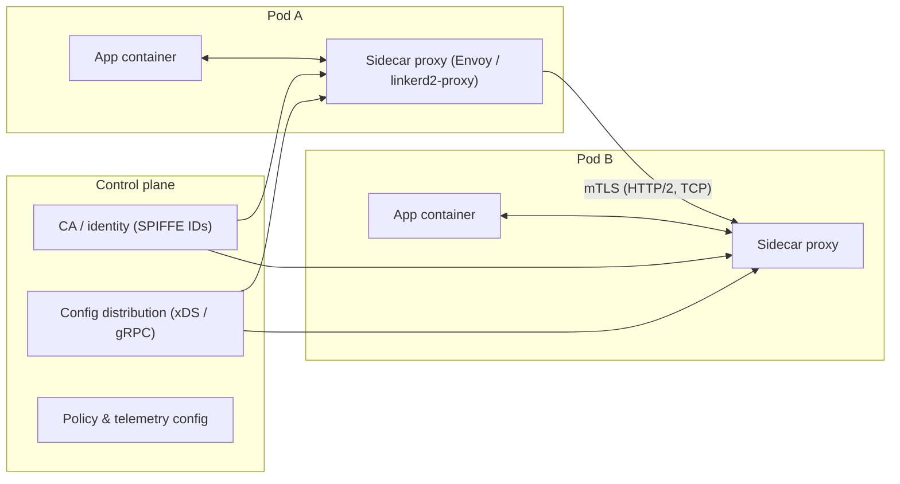

# 5.28 Service mesh

| | |
|---|---|
| Level | Advanced |
| Priority tier | 2 |
| Lab venue | 3-node cluster; Istio (sidecar and ambient), Linkerd, or Cilium Service Mesh; Kiali/Grafana; fortio/hey; gRPC sample apps |
| Part | Part 5: Kubernetes |
| Status | Drafted, labs **untested** |

## Why this matters for AI infrastructure

Inference platforms are service graphs: gateways, routers, retrievers, rerankers, vector stores, tool servers, model servers. Teams want encrypted service-to-service traffic with workload identity, per-route retries and timeouts, canary and shadow traffic for new model versions, consistent metrics and traces across languages, and policy such as "only the router may call the model server". A service mesh moves these concerns out of every application into infrastructure. But a mesh adds latency, CPU/memory per pod, operational complexity and failure modes that matter for long-lived streaming and GPU-adjacent traffic. Knowing what a mesh does, how its data plane works, and when it earns its cost is a design skill; it is also relevant for interviews because meshes are a common topic in platform roles.

## Prerequisites and outcomes

Needs 5.10, 5.12, 5.15, 5.21. After this chapter you can:

- Explain the mesh architecture (control plane, data plane proxies) and compare sidecar, ambient (node + waypoint proxies) and eBPF-based models.
- Describe core capabilities: workload identity and mTLS (SPIFFE), traffic management (routing, splitting, retries, timeouts, circuit breaking, mirroring, fault injection), security policy (authz), observability (golden signals, tracing), multi-cluster.
- Install and use Istio and Linkerd for common tasks; know Cilium's mesh features; express canary releases and policies.
- Evaluate overhead and failure modes; tune for gRPC/streaming and LLM traffic (long timeouts, HTTP/2, SSE).
- Decide if you need a mesh, and what alternatives (gateway-only, library, eBPF CNI) fit.

## 1. Concepts

A **service mesh** is an infrastructure layer for service-to-service communication providing, uniformly and without app changes: **identity and mutual TLS**, **L7 traffic control**, **resilience features**, **telemetry**, and **policy enforcement**. Architecture:



Key ideas:

- **Data plane**: proxies intercept traffic (via iptables/eBPF redirect or explicit proxying) and perform TLS, routing, retries, metrics. **Envoy** is the dominant proxy (Istio, Consul, Kuma, Gateway API implementations); Linkerd uses a purpose-built Rust micro-proxy.
- **Control plane**: distributes configuration (xDS APIs), issues short-lived workload certificates, injects proxies (mutating webhook), exposes policy CRDs.
- **Identity**: each workload gets an identity (SPIFFE ID such as `spiffe://cluster.local/ns/serving/sa/vllm`) tied to its ServiceAccount; certificates rotate frequently (hours); **mTLS** authenticates both sides and encrypts traffic (zero-trust east-west).
- **Policy**: authorisation by identity (which service accounts/namespaces may call which workloads/paths/methods), deny-by-default models, request authentication (JWT validation at the edge).
- **Telemetry**: consistent L7 golden signals (request rate, success rate, latency histograms), distributed tracing headers propagation, access logs, topology graphs (Kiali, Linkerd viz, Hubble).
- **Traffic management**: weighted routing (canary), header-based routing, mirroring (shadow traffic), retries with budgets, timeouts, circuit breaking/outlier detection, rate limiting, locality-aware load balancing, fault injection.

In *Kubernetes: Up and Running* Chapter 15 (*Service Meshes*), Brendan Burns, Joe Beda, Kelsey Hightower, and Lachlan Evenson explain *why* teams add a service mesh on top of Kubernetes's built-in `Service` and `Ingress` primitives, and how to introspect its implementation:
1. **Why `Service` and `Ingress` alone aren't enough for complex service graphs (`KUR` Chapter 15):** Built-in Kubernetes `Service`s (`kube-proxy`) operate at Layer 4 TCP/UDP with no awareness of HTTP status codes, gRPC methods, TLS certificates, or latency outliers, while `Ingress` only governs north-south traffic at the cluster perimeter. Implementing **east-west mutual TLS (`mTLS`)**, **automatic certificate rotation**, **canary percentage traffic splits (`95/5`)**, **circuit breaking**, and **consistent golden-signal telemetry** inside application code across Python, Go, C++, and Rust services requires maintaining duplicate client libraries in every language.
2. **Introspecting a Sidecar Service Mesh (`KUR` Chapter 15):** When a Pod starts in a sidecar mesh, an init container (or CNI plugin) programs **`iptables` rules inside the Pod's network namespace** so that all inbound and outbound TCP traffic is transparently redirected to the local **Envoy** (or `linkerd2-proxy`) sidecar container—with zero changes to the application container's code or configuration. Meanwhile, the mesh **control plane** watches the Kubernetes API (`Services`, `EndpointSlices`, `Pods`, and mesh policy CRDs) and pushes dynamic routing, endpoint, and certificate updates to every sidecar over Envoy's gRPC **`xDS` Discovery APIs** (`LDS` Listener, `RDS` Route, `CDS` Cluster, `EDS` Endpoint, and `SDS` Secret Discovery Service).
3. **"Do You Really Need a Service Mesh?" (`KUR` Chapter 15 Checklist):** Before adopting a mesh, Burns et al. advise asking: (a) Do you actually have a multi-hop microservice architecture where east-west mTLS or L7 traffic shaping is required? (b) Can you afford the CPU/memory overhead of sidecar proxies and the operational complexity of a second control plane? (c) Which landscape implementation (`Istio`, `Linkerd`, `Consul Connect`, `Cilium`, or the vendor-neutral **Service Mesh Interface `SMI` / Gateway API GAMMA** specification) matches your team's operational maturity?

## 2. Data-plane models

| Model | How | Pros | Cons |
|---|---|---|---|
| **Sidecar** (classic Istio, Linkerd, Consul) | A proxy container per pod; traffic redirected with iptables (init container/CNI plugin) | Strong per-pod isolation of proxy; mature; per-workload config | Resource overhead per pod (CPU/memory), startup ordering (sidecar must be ready before app; native sidecars help), Job completion issues (sidecar keeps pod alive), upgrades require pod restarts, extra latency hops (client proxy + server proxy), iptables/port conflicts |
| **Ambient mesh** (Istio ambient) | Per-node **ztunnel** (L4 mTLS/identity, Rust) + optional per-namespace/service **waypoint proxies** (Envoy, L7) | No sidecars; lower overhead; incremental adoption (L4 secure overlay first); no pod restarts | Newer; waypoint adds an L7 hop; node-level component is shared (blast radius); evolving features |
| **eBPF / kernel-based** (Cilium Service Mesh) | eBPF datapath in the CNI for L3/L4 + Envoy per node for L7 as needed; mutual authentication using SPIFFE and WireGuard/IPsec for encryption | Minimal per-pod overhead; integrates with CNI/policy/Hubble | Requires Cilium as CNI; L7 features rely on node-level Envoy; features differ from Istio |
| **Proxyless gRPC (xDS)** | gRPC library speaks xDS to the control plane; no proxy | Lowest overhead for gRPC | Library/language support limited; per-app changes |
| **Library-based** (Finagle, Resilience4j, Spring Cloud) | App-level libraries | No proxy | Per-language, inconsistent, upgrades via app releases |
| **Gateway-only** (no east-west mesh) | Ingress/Gateway API (5.12) handles north-south | Simple | No east-west mTLS/telemetry |

## 3. Istio essentials

Components: **istiod** (pilot: xDS config; citadel: CA; galley/injection), **ingress/egress gateways** (Envoy deployments, now commonly via Gateway API `Gateway`/`HTTPRoute`), sidecars (`istio-proxy`) or ambient (ztunnel DaemonSet, waypoints). Install with `istioctl install --set profile=default` or Helm; enable injection per namespace: `kubectl label ns serving istio-injection=enabled` (or `istio.io/dataplane-mode=ambient`). Key CRDs:

```yaml
apiVersion: security.istio.io/v1
kind: PeerAuthentication
metadata: { name: default, namespace: serving }
spec: { mtls: { mode: STRICT } }                  # require mTLS for all workloads in the namespace
---
apiVersion: security.istio.io/v1
kind: AuthorizationPolicy
metadata: { name: model-server-allow-router, namespace: serving }
spec:
  selector: { matchLabels: { app: vllm } }
  action: ALLOW
  rules:
    - from: [ { source: { principals: ["cluster.local/ns/edge/sa/router"] } } ]
      to:   [ { operation: { methods: ["POST"], paths: ["/v1/*"] } } ]
---
apiVersion: networking.istio.io/v1
kind: DestinationRule
metadata: { name: vllm, namespace: serving }
spec:
  host: vllm.serving.svc.cluster.local
  subsets:
    - { name: v1, labels: { version: v1 } }
    - { name: v2, labels: { version: v2 } }
  trafficPolicy:
    loadBalancer: { simple: LEAST_REQUEST }
    connectionPool:
      http: { http2MaxRequests: 1000, maxRequestsPerConnection: 0, idleTimeout: 3600s }
      tcp: { maxConnections: 1000 }
    outlierDetection: { consecutive5xxErrors: 5, interval: 10s, baseEjectionTime: 30s, maxEjectionPercent: 50 }
---
apiVersion: networking.istio.io/v1
kind: VirtualService
metadata: { name: vllm, namespace: serving }
spec:
  hosts: [vllm.serving.svc.cluster.local]
  http:
    - match: [ { headers: { x-canary: { exact: "true" } } } ]
      route: [ { destination: { host: vllm.serving.svc.cluster.local, subset: v2 } } ]
    - route:
        - { destination: { host: vllm.serving.svc.cluster.local, subset: v1 }, weight: 95 }
        - { destination: { host: vllm.serving.svc.cluster.local, subset: v2 }, weight: 5 }
      timeout: 600s
      retries: { attempts: 0 }                     # do not retry generation requests
      mirror: { host: vllm.serving.svc.cluster.local, subset: v2 }
      mirrorPercentage: { value: 10.0 }
```

(Istio increasingly uses the Kubernetes **Gateway API** for traffic routing (HTTPRoute) in place of VirtualService, including for mesh (GAMMA) use.) Other: `Sidecar` resource (limit config scope), `ServiceEntry` (external services), `Telemetry` (metrics/trace config), `EnvoyFilter` (advanced, fragile), `RequestAuthentication` (JWT), `WasmPlugin`, `ProxyConfig`. Debug: `istioctl proxy-status`, `istioctl analyze`, `istioctl proxy-config routes/clusters/listeners/endpoints <pod>`, `istioctl x describe pod`, Envoy admin (`:15000/config_dump`, `/stats`), `kubectl logs -c istio-proxy`.

## 4. Linkerd essentials

Linkerd (CNCF graduated) emphasises simplicity and low overhead: control plane (destination, identity, proxy-injector), `linkerd2-proxy` sidecars, viz extension (Prometheus/Grafana-based dashboards), multicluster and policy extensions. Install: `linkerd install --crds | kubectl apply -f -; linkerd install | kubectl apply -f -; linkerd check`; inject: annotate namespace `linkerd.io/inject: enabled`. Features: automatic mTLS by default (no config), golden metrics per route (`linkerd viz stat deploy`, `linkerd viz top`), retries/timeouts via `ServiceProfile` or Gateway API HTTPRoute/policy CRDs (`Server`, `ServerAuthorization`/`AuthorizationPolicy`, `HTTPRoute`), traffic split (SMI/HTTPRoute weights), multi-cluster service mirroring (gateway or flat network), load balancing by EWMA latency (peak EWMA), HTTP/2, gRPC and TCP support. Differences: fewer knobs, lower footprint, opinionated; no Envoy extensions; stable release availability model (vendor-driven; check licensing of stable distributions).

## 5. Cilium Service Mesh

Cilium adds mesh features to its eBPF CNI: **L7 policy and observability** via per-node Envoy (HTTP/gRPC/Kafka/DNS visibility with Hubble), **mutual authentication** (SPIFFE/SPIRE-based identity; encryption via WireGuard/IPsec), **Gateway API**/Ingress controller, **traffic management** with `CiliumEnvoyConfig` and Gateway API, **ClusterMesh** for multi-cluster service discovery and policy. Pros: no sidecars, shared datapath, uniform policy language across L3–L7. Cons: ties you to Cilium; less mature feature surface than Istio for complex traffic management.

## 6. Capabilities in practice

### Mutual TLS and zero-trust

Enable STRICT mTLS mesh-wide after a PERMISSIVE migration phase; combine with AuthorizationPolicies so identity, not network location, grants access; rotate certificate roots (plugin CAs from Vault/cert-manager `istio-csr`); monitor certificate expiry and handshake failures. mTLS protects against sniffing and spoofing inside the cluster and across multi-cluster links; it complements (does not replace) NetworkPolicy (defence in depth) and requires that all clients are meshed (non-mesh clients need exemptions).

### Traffic management for model rollouts

- **Canary**: weights 99/1 → 90/10 → 50/50 → 0/100, gated by metrics (Argo Rollouts/Flagger drive mesh weights from Prometheus analysis, 4.26).
- **Shadow (mirroring)**: duplicate a percentage of requests to the new model server, discarding responses, to compare latency/error rates and sampled outputs offline (beware cost: mirrored GPU load, side effects for non-idempotent calls).
- **Header routing**: route by `x-model-version`, tenant, or experiment group; sticky sessions/consistent hash for KV/prefix cache locality (`consistentHash` in DestinationRule).
- **Retries and timeouts**: retries multiply load and, for generation requests, duplicate expensive GPU work and may produce side effects; set `retries.attempts: 0` for POST generation, use retries for idempotent calls (embeddings, health) with `retryOn: connect-failure,refused-stream` and per-try timeouts; configure retry budgets (Linkerd) to avoid retry storms.
- **Circuit breaking / outlier detection**: eject failing replicas (consecutive 5xx), cap pending requests (`http1MaxPendingRequests`, `http2MaxRequests`) to shed load instead of queueing indefinitely.
- **Rate limiting**: local (Envoy local rate limit) or global (rate limit service) per client identity or API key; for LLMs, token-based limits generally need app/gateway awareness.
- **Locality-aware routing**: prefer same-zone endpoints, fail over across zones/regions (`localityLbSetting`).
- **Fault injection**: delays and aborts for resilience testing.

### Observability

Automatic golden signals per service/route; topology graphs (Kiali, Linkerd Viz, Hubble UI); access logs with request IDs; tracing headers (`traceparent`, B3) must be **propagated by applications** (the mesh creates spans per hop but cannot link inbound to outbound calls without app propagation); export to OTel Collector/Tempo/Jaeger; Envoy stats volume can be huge: restrict with `proxyStatsMatcher`, `Telemetry` API, drop unneeded histograms to control cardinality (5.24).

## 7. Costs, performance and failure modes

- **Latency**: sidecar adds roughly 0.2 to 1 ms per hop (two proxies in a request path) plus TLS; ambient L4 via ztunnel typically lower; L7 waypoints add a hop. For token-streaming LLM traffic the per-request overhead is negligible relative to generation time, but extra buffering/idle-timeout behaviour matters (long-lived streams).
- **CPU/memory**: Envoy sidecar ~50 to 100+ MiB and some CPU per pod (grows with config size: `Sidecar` resources limit scope); at 5,000 pods this is hundreds of GiB; ambient reduces to per-node cost. Linkerd proxy is lighter (~10 to 20 MiB typical).
- **Control-plane scale**: xDS pushes to thousands of proxies; large clusters need `Sidecar` scoping, revision-based upgrades, and tuned istiod resources; config churn (endpoint changes) triggers pushes.
- **Startup/shutdown ordering**: app may start before the proxy is ready (connection refused) → use `holdApplicationUntilProxyStarts`, native sidecars; at shutdown the proxy may terminate before the app finishes draining (`EXIT_ON_ZERO_ACTIVE_CONNECTIONS`, `terminationDrainDuration`); Jobs with sidecars never complete unless the proxy is told to quit (`/quitquitquit`, native sidecar support).
- **Traffic interception pitfalls**: protocol sniffing (server-first protocols like MySQL break; declare ports with `appProtocol`/port names), UDP and multicast unsupported, non-TCP and raw sockets bypass; `hostNetwork` pods can't be meshed; init containers run before the proxy (no mesh egress); localhost traffic exempt; ports `15001/15006/15020/15021/15090` reserved.
- **HTTP/2, gRPC, WebSocket, SSE**: supported, but check idle timeouts: Envoy's stream idle timeout defaults to 5 minutes, and Envoy's own default route timeout is 15 s (Istio configures routes without a route timeout unless you set one; verify for your version). For LLM streaming set explicit long or disabled route timeouts, raise idle timeouts, disable response buffering features, and set `maxRequestsPerConnection` / maximum connection duration so connections rebalance.
- **mTLS and non-mesh traffic**: STRICT breaks health checks from kubelets (Istio rewrites probes via the sidecar `15021` or `rewriteAppHTTPProbe`), Prometheus scrapes (use metrics merging or exclude ports), external clients/other namespaces not in the mesh.
- **Upgrades**: control plane revisions and canary upgrades (`istioctl install --revision`, `istio.io/rev` labels), sidecars updated only on pod restart (version skew within supported window), data-plane CVEs in Envoy require restarts across the cluster.
- **Debuggability**: extra layer in every failure analysis: 503s with `UF`/`UH`/`NR` Envoy response flags, upstream connect errors, mTLS handshake mismatches, stale xDS config; use `istioctl proxy-config` and access logs with response flags.
- **Security of the mesh itself**: control plane has high privilege (CA keys); protect `istio-system`; restrict who can create `EnvoyFilter`/`WasmPlugin`; network policy for control plane ports; keep proxies patched.
- **Multi-cluster complexity**: cross-cluster identities (shared root CA), endpoint discovery (remote secrets), east-west gateways, DNS (`clusterset.local` vs `.global`), latency and failure domains (5.35).

## 8. When to use (and not use) a mesh

Use when you need: uniform mTLS/identity for many services across languages with compliance requirements; fine-grained L7 traffic control (canary, mirroring, header routing) without code; consistent telemetry; multi-cluster service networking; zero-trust authorisation policy. Avoid or defer when: you have a small number of services (a gateway + library TLS/OTel may suffice), latency-critical or very high-QPS hot paths where sidecars dominate costs, raw-TCP/UDP protocols (RDMA/NCCL traffic is entirely outside the mesh and shouldn't be proxied), teams lack operational capacity, or the main need is just north-south ingress. For AI platforms a pragmatic path: **Gateway API + cert-manager + OTel + NetworkPolicy** first (5.12, 5.15, 5.24); add **ambient/eBPF mesh** for mTLS and identity-based policy when compliance requires east-west encryption; reserve sidecar meshes for service-rich inference graphs that need advanced traffic shaping. Training traffic (NCCL over RDMA/TCP between pods) must bypass the mesh (exclude via annotations/ports or secondary networks).

Annotations to exclude traffic (Istio): `traffic.sidecar.istio.io/excludeOutboundPorts`, `excludeOutboundIPRanges`, `sidecar.istio.io/inject: "false"` for training pods and storage clients; Linkerd: `config.linkerd.io/skip-outbound-ports`, `skip-inbound-ports`.

## 9. Lab

First, run the self-checking Python lab (`code/part05/service_mesh_policy_sim_lab.py`) locally. It verifies the Istio `PeerAuthentication` (`PERMISSIVE` vs `STRICT`) and `AuthorizationPolicy` SPIFFE identity evaluator (`evaluate_mesh_mtls_and_authz`), the `VirtualService` canary router and `DestinationRule` `outlierDetection` endpoint ejector (`evaluate_outlier_detection_and_routing`), and the Sidecar vs Ambient mesh fleet memory-overhead calculator (`compute_mesh_fleet_memory_overhead`).

```bash
python3 code/part05/service_mesh_policy_sim_lab.py
```

Next, on a 3-node cluster with Istio, Linkerd, or Cilium (all interactive shell steps below are `untested here`), work through these exercises:

1. **Install and mesh an app**: install Istio (default profile) or Linkerd; deploy a three-tier sample (gateway → router → model-mock); enable injection; verify proxies, mTLS (`istioctl x describe`, `linkerd viz edges`), and metrics in Grafana/Kiali.
2. **Strict mTLS migration**: start PERMISSIVE, introduce a non-mesh client, switch to STRICT, observe failures and fix with exemptions or inclusion; verify encrypted traffic with `tcpdump`.
3. **AuthorizationPolicy**: deny-by-default for the model namespace, allow only the router identity on `POST /v1/*`; test with allowed and denied callers; compare with NetworkPolicy.
4. **Canary and mirror**: deploy `v1`/`v2` mock servers; route 90/10; mirror 10% to `v2`; drive load with fortio; compare metrics; automate the rollout with Flagger or Argo Rollouts.
5. **Resilience**: inject 503s and delays into `v2`; configure timeouts, retries (idempotent GET vs non-idempotent POST), outlier detection; observe retry amplification and fix with budgets; test circuit breaking limits with high concurrency.
6. **Streaming**: build an SSE token-stream mock (5-minute stream); verify behaviour through sidecars with default timeouts; fix stream idle/route timeouts; test rolling restart behaviour and graceful drain.
7. **gRPC load balancing**: single-connection gRPC client against a Service with 4 pods: show imbalance without mesh and balanced requests with mesh L7 load balancing; compare `LEAST_REQUEST`, EWMA.
8. **Overhead measurement**: benchmark p50/p99 latency and CPU/memory with and without sidecars; with ambient mode; with Cilium mesh; plot per-pod overhead and cost at 1,000 pods.
9. **Ambient mode**: enable ambient for a namespace; observe ztunnel mTLS without sidecars; add a waypoint for L7 policy; compare resource usage and failure behaviours.
10. **Startup and Job issues**: reproduce app-before-proxy connection failures and a Job that never completes with a sidecar; fix with hold-until-ready and native sidecars/quit endpoint.
11. **Multi-cluster (optional)**: link two kind clusters with shared root CA, discover remote services, and test failover.
12. **Exclusions**: run a distributed training job pair of pods with NCCL over TCP inside a meshed namespace and show the performance penalty and breakage; exclude ports/namespaces and compare.
13. **Clean up**.

## 10. Common mistakes

- Adopting a mesh for resume value without a concrete requirement; underestimating operational load.
- Strict mTLS enabled before all clients are meshed; breaking probes and scrapes.
- Default retries on non-idempotent LLM requests; retry storms.
- Forgetting HTTP/2 stream idle timeouts and route timeouts for streaming endpoints.
- Proxying RDMA/NCCL or storage traffic; meshing training pods.
- Huge sidecar configs (no `Sidecar` scoping) causing memory bloat and slow xDS pushes.
- Treating the mesh as a replacement for NetworkPolicy, authN/Z in apps, or secrets management.
- Trace propagation assumptions (mesh cannot join spans without app header propagation).
- Never upgrading proxies; mixed versions beyond support window.

## 11. Interview angles

- "What problems does a service mesh solve? What does it cost?"
- "Sidecar vs ambient vs eBPF data planes: trade-offs."
- "How does mTLS identity work in Istio/Linkerd? What is SPIFFE?"
- "How would you canary a new model version with a mesh? What about mirroring?"
- "Why are retries dangerous for LLM inference requests?"
- "Why does gRPC load balance badly without a mesh?"
- "How do sidecars interact with Kubernetes Jobs and startup/shutdown?"
- "When would you not use a service mesh?"

## Exercises

1. **Service Mesh Architecture (`Control Plane` vs. `Data Plane`, `xDS` APIs, and `SPIFFE` mTLS Identity, `KUR` Chapter 15):** Explain why built-in Kubernetes `Service`s and `Ingress` cannot provide east-west mTLS or L7 resilience (`KUR` Ch. 15), how `iptables`/eBPF transparent redirection routes Pod traffic through the sidecar proxy, and how the control plane (`istiod`) uses Envoy's `xDS` APIs (`LDS`, `RDS`, `CDS`, `EDS`, `SDS`) to program proxies dynamically.
2. **Comparing Service Mesh Data-Plane Models (`Sidecar`, `Istio Ambient ztunnel + Waypoint`, `Cilium eBPF`, and `Proxyless gRPC`):** Using `compute_mesh_fleet_memory_overhead()` in `code/part05/service_mesh_policy_sim.py`, calculate the total proxy memory footprint across 5,000 Pods on 200 nodes for Istio Envoy sidecars (~390 GiB), Linkerd Rust sidecars (~88 GiB), and Istio Ambient mode (`ztunnel` per node + 10 shared waypoints = ~8.8 GiB), and compare their latency and blast-radius trade-offs.
3. **Zero-Trust East-West Security (`PeerAuthentication` `PERMISSIVE` -> `STRICT` and `AuthorizationPolicy`):** Using `evaluate_mesh_mtls_and_authz()` in `code/part05/service_mesh_policy_sim.py`, trace the `PeerAuthentication/default` and `AuthorizationPolicy/model-server-allow-router` manifests in Section 3, explaining why a `PERMISSIVE` migration phase is used before `STRICT` and how `principals: ["cluster.local/ns/edge/sa/router"]` enforces cryptographic workload identity.
4. **L7 Traffic Management for LLM Serving (`VirtualService` / Gateway API `HTTPRoute`, `DestinationRule`, Canary, Shadow Mirroring, and Outlier Detection):** Using `evaluate_outlier_detection_and_routing()` in `code/part05/service_mesh_policy_sim.py`, trace the `vllm` `DestinationRule` and `VirtualService` manifests in Section 3 (`LEAST_REQUEST`, `outlierDetection` ejecting replicas with $\ge 5$ consecutive 5xx errors, `95/5` canary + `x-canary: true` header match, `10%` shadow mirroring, `timeout: 600s`, and `retries: { attempts: 0 }`).
5. **Sidecar Lifecycle Traps (`Job` Completion Hangs, Startup Race, Server-First Protocols, `Sidecar` Config Scoping, and Envoy Response Flags):** Explain why a batch `Job` in a sidecar-meshed namespace hangs forever after the main container exits (and how native sidecars or `/quitquitquit` fix it), what `holdApplicationUntilProxyStarts` does, and what Envoy access-log response flags `UF`, `UH`, `UO`, `NR`, and `UT` mean.
6. **When NOT to Use a Service Mesh on GPU Clusters (Excluding `NCCL`/RDMA and Storage Traffic, `KUR` Ch. 15):** Explain why distributed GPU training (`NCCL` over RDMA or TCP) and parallel-filesystem storage traffic must **never** pass through a service mesh proxy, write the exact Istio/Linkerd annotations to exclude training pods or ports, and outline a pragmatic staged adoption path (`Gateway API` -> `Ambient/eBPF mTLS` -> `L7 Waypoints/Sidecars` only where needed).

## Checkpoint questions (20)

<details>
<summary>1. In *Kubernetes: Up and Running* Chapter 15, what five capabilities does a Service Mesh add that standard Kubernetes `Service`s (`kube-proxy`) and `Ingress` do not provide?</summary>

1. **East-West Mutual TLS (`mTLS`) & Cryptographic Workload Identity (`SPIFFE`):** Automatic encryption and mutual X.509 authentication (`spiffe://cluster.local/ns/<ns>/sa/<sa>`) for every pod-to-pod call inside the cluster without application code changes.
2. **Fine-Grained L7 Traffic Shifting (East-West):** Weighted canary splits (`95%` `v1` / `5%` `v2`), header-based routing, and shadow traffic mirroring *between* internal microservices (not just at the north-south edge).
3. **L7 Resilience & Load Balancing:** Per-request HTTP/2 and gRPC load balancing (`LEAST_REQUEST` / `Peak EWMA`), circuit breaking, outlier detection (automatic ejection of 5xx-failing pods), timeouts, and retry budgets.
4. **Identity-Based L7 Authorization (`AuthorizationPolicy`):** Rules like *"Only ServiceAccount `edge/router` may call `POST /v1/chat/completions` on `serving/vllm`."*
5. **Uniform L7 Telemetry across Languages:** Consistent request-rate, error-rate, and latency histograms plus distributed tracing spans emitted by every proxy regardless of whether the app is written in Python, C++, Rust, or Go.
</details>

<details>
<summary>2. How does a Sidecar Service Mesh transparently intercept a Pod's inbound and outbound TCP traffic without modifying the application container (`KUR` Chapter 15)?</summary>

When a Pod is created in a meshed namespace, a mutating admission webhook injects:
1. **`istio-init` (or the `istio-cni` / `linkerd-cni` node plugin):** Configures **`iptables` (or eBPF `sockops`/`cgroup`) redirection rules inside the Pod's network namespace** before the application starts:
   - All **inbound** TCP connections arriving on the Pod's `eth0` (except excluded ports) are redirected to the sidecar proxy's inbound listener port (**`15006`** in Istio).
   - All **outbound** TCP connections initiated by the application container are redirected to the sidecar proxy's outbound listener port (**`15001`** in Istio), which upgrades the connection to mTLS and forwards it to the destination Pod's sidecar.
2. **`istio-proxy` (Envoy) / `linkerd2-proxy` sidecar container.**
</details>

<details>
<summary>3. What is `xDS` in Envoy and Istio, and what do `LDS`, `RDS`, `CDS`, `EDS`, and `SDS` stand for?</summary>

**`xDS`** is Envoy's suite of gRPC streaming Discovery Service APIs over which the control plane (`istiod`) dynamically configures data-plane Envoy proxies without restarting them:
- **`LDS` (Listener Discovery Service):** Configures virtual listeners (IPs/ports and filter chains).
- **`RDS` (Route Discovery Service):** Configures HTTP/gRPC virtual hosts, path/header matches, timeouts, and weighted canary routes (from `VirtualService` / `HTTPRoute`).
- **`CDS` (Cluster Discovery Service):** Configures upstream service clusters, load-balancing algorithms (`LEAST_REQUEST`), connection pools, and outlier detection (from `DestinationRule`).
- **`EDS` (Endpoint Discovery Service):** Streams the live Pod IP endpoints for each cluster (from Kubernetes `EndpointSlice`s).
- **`SDS` (Secret Discovery Service):** Streams short-lived X.509 workload certificates and mTLS CA trust bundles directly to Envoy in memory without writing private keys to disk.
</details>

<details>
<summary>4. Compare the three Service Mesh Data-Plane architectures: (a) **Sidecar**, (b) **Istio Ambient (`ztunnel` + `Waypoint`)**, and (c) **Cilium eBPF Service Mesh**.</summary>

| Architecture | L4 mTLS & Identity | L7 Routing / AuthZ / Telemetry | Resource & Operational Profile |
|---|---|---|---|
| **Sidecar (`Istio` classic, `Linkerd`)** | Per-Pod sidecar proxy container | Per-Pod sidecar proxy container | Strong per-Pod isolation, but adds **2 proxy hops per call**, **50–100 MiB RAM per Pod**, Job-completion/startup races, and requires Pod restarts to upgrade Envoy |
| **Ambient (`Istio` ambient mode)** | Per-Node **`ztunnel` DaemonSet** (lightweight Rust proxy over HBONE HTTP/2 tunnels) | Optional shared per-namespace/service **Envoy `Waypoint` proxy** deployed only where L7 features are needed | **Zero sidecars in Pods** (no Job hangs, no Pod restarts on mesh upgrade); ~95% lower memory footprint if most services only need L4 mTLS |
| **Cilium Service Mesh (`eBPF` + per-node Envoy)** | eBPF in kernel + **WireGuard / IPsec** encryption + SPIFFE identity handshake | Per-Node Envoy daemon (invoked via eBPF redirection only on L7-policy flows) | Sidecar-free, unified with CNI `CiliumNetworkPolicy` and Hubble observability |
</details>

<details>
<summary>5. How is a workload's cryptographic identity formatted in `Istio` / `Linkerd` (`SPIFFE ID`), and where is it placed inside the X.509 certificate?</summary>

Each Pod receives an X.509 certificate whose **Subject Alternative Name (`SAN`) URI extension** contains its **SPIFFE ID**:
```text
spiffe://<trust-domain>/ns/<namespace>/sa/<service-account-name>
```
For example: **`spiffe://cluster.local/ns/edge/sa/router`**.
Because the certificate is issued only after `istiod` (or `linkerd-identity` / `spire-agent`) verifies the Pod's bound Kubernetes `ServiceAccount` token via `TokenReview`, no Pod can spoof another namespace's or ServiceAccount's SPIFFE identity.
</details>

<details>
<summary>6. Why should you migrate a namespace to mTLS using `PeerAuthentication` mode `PERMISSIVE` first before switching to `STRICT`?</summary>

- **`PERMISSIVE` mode (default):** The receiving sidecar accepts **both** mTLS-encrypted connections (from meshed peers) **and** legacy plaintext TCP connections (from un-meshed namespaces, Prometheus scrapers, or health probes). During `PERMISSIVE` mode, you check Kiali / Prometheus (`istio_requests_total{connection_security_policy="none"}`) to identify any remaining plaintext callers.
- **`STRICT` mode:** The receiving sidecar **rejects all plaintext connections**. Switching to `STRICT` once `connection_security_policy="none"` reaches `0` prevents surprise outages.
</details>

<details>
<summary>7. In Istio's `AuthorizationPolicy`, what is the evaluation order when `CUSTOM`, `DENY`, and `ALLOW` policies exist in the same namespace?</summary>

Istio evaluates `AuthorizationPolicy` rules in this strict order:
1. **`CUSTOM` policies** (external authorization callout `ext_authz`, e.g., OPA or `oauth2-proxy`) run first.
2. **`DENY` policies** run second: if **any** `DENY` rule matches the request, the request is **denied (`403 RBAC: access denied`) immediately**.
3. **`ALLOW` policies** run third:
   - If **no** `ALLOW` policies exist for the workload, the request is **allowed by default** (unless denied in step 1 or 2).
   - If **at least one `ALLOW` policy exists** for the workload, **only requests matching at least one `ALLOW` rule are permitted—everything else is denied**.
   - An `AuthorizationPolicy` with `spec: {}` (no `action` and no `rules`) is the standard **default-deny-all** policy for a namespace.
</details>

<details>
<summary>8. How do `DestinationRule` (`subsets`, `loadBalancer`, `outlierDetection`) and `VirtualService` (or Gateway API `HTTPRoute`) work together in Istio?</summary>

- **`VirtualService` (or `HTTPRoute`):** Defines **HOW traffic is routed** to a destination host—matching on URL paths, HTTP headers (`x-canary: true`), weighted traffic splits (`95%` to subset `v1`, `5%` to subset `v2`), shadow mirroring (`mirror`), timeouts (`600s`), and retries.
- **`DestinationRule`:** Defines **WHAT happens after a route is chosen**—defining named label **`subsets`** (`v1`, `v2`), the load-balancing algorithm (`LEAST_REQUEST`, `ROUND_ROBIN`, `PASSTHROUGH`, or `consistentHash` for KV-cache affinity), connection-pool limits (`http2MaxRequests`), TLS settings, and **`outlierDetection`** (circuit breaking / ejecting unhealthy Pod IPs).
*(Trap: if a `VirtualService` routes to `subset: v2` before the `DestinationRule` defining `subset: v2` exists, Envoy has no cluster definition for `v2` and returns **`503 NR` (`No Route`)**. Always apply `DestinationRule` before or atomically with `VirtualService`.)*
</details>

<details>
<summary>9. How does a Service Mesh fix the gRPC / HTTP/2 single-connection load-balancing problem without changing client code?</summary>

Without a mesh, a gRPC client opens **1 single TCP connection** to a `ClusterIP` Service, and L4 `kube-proxy` pins all 10,000 multiplexed HTTP/2 streams on that connection to **1 single backend Pod**.
With a Service Mesh (`Istio` / `Linkerd` / `Cilium` L7), the client's sidecar (or waypoint proxy) terminates/inspects the HTTP/2 protocol at **Layer 7**, maintains an active pool of HTTP/2 connections to **all Ready backend Pods** (via `EDS`), and balances **every individual gRPC request (`POST /package.Service/Method`)** across all backend Pods using **`LEAST_REQUEST`** or **Peak EWMA** latency scoring.
</details>

<details>
<summary>10. What is "Traffic Mirroring" (`mirror` / Shadow Traffic) in a Service Mesh, and what two caveats apply when mirroring LLM inference requests?</summary>

Traffic Mirroring (`mirror: { host: vllm, subset: v2 }, mirrorPercentage: { value: 10.0 }`) sends the primary request to `v1` (returning `v1`'s response to the user) while **asynchronously sending a fire-and-forget copy of the request to `v2`** (discarding `v2`'s response payload while recording `v2`'s latency and error metrics).
**Two caveats for LLM inference:**
1. **GPU compute cost:** Mirroring 10% of production traffic to `v2` consumes real GPU prefill/decode compute and KV-cache on `v2`—make sure `v2` has sufficient GPU capacity for the mirrored load.
2. **Side effects on non-idempotent / tool-calling endpoints:** Never mirror requests to an agent endpoint that executes external side effects (charging credit cards, sending emails, or mutating a database).
</details>

<details>
<summary>11. Why does Envoy's default `retries` policy cause catastrophic "Retry Storms" on LLM inference servers, and how should retries be configured?</summary>

By default in Istio, Envoy automatically retries failed HTTP requests up to **2 times** on `connect-failure,refused-stream,unavailable,cancelled,retriable-status-codes`. If a `vLLM` replica is overloaded and returns `503` or times out after 30 seconds of GPU generation, retrying that request 2 more times **triples the GPU load (`3x` amplification)** across the remaining replicas, causing every replica in the pool to saturate and collapse.
**Rule:** For `POST /v1/chat/completions` and `/v1/completions`, set **`retries: { attempts: 0 }`** (or restrict retries strictly to `retryOn: connect-failure,refused-stream` *before* a request is accepted by an upstream worker, paired with a strict **retry budget** capping retries at $\le 10\%$ of total request volume).
</details>

<details>
<summary>12. What is `outlierDetection` in an Istio `DestinationRule`, and why is `maxEjectionPercent: 50` important?</summary>

`outlierDetection` is Envoy's **passive health checking / circuit breaker**: if a specific `vLLM` Pod returns **`consecutive5xxErrors: 5`** within `interval: 10s` (for example, because its GPU suffered an XID error and every inference call on that Pod is throwing a 500 error before `kubelet`'s slow `livenessProbe` notices), Envoy **immediately ejects that Pod IP from its load-balancing pool** for `baseEjectionTime: 30s` (multiplied by the number of times it has been ejected).
Setting **`maxEjectionPercent: 50`** guarantees that if a downstream database outage causes *all* replicas to return 500s simultaneously, Envoy will never eject more than 50% of the pool (avoiding total blackholing).
</details>

<details>
<summary>13. Why does a sidecar-meshed `Deployment` in a 5,000-Pod cluster consume hundreds of gigabytes of Envoy RAM if you don't create an Istio `Sidecar` resource?</summary>

By default, `istiod` pushes the Envoy cluster/listener/endpoint configuration (`xDS`) for **EVERY Service and Pod in the entire Kubernetes cluster** to **every single `istio-proxy` sidecar**. In a 5,000-Pod, 2,000-Service cluster, every sidecar holds a massive routing table in RAM (`100–300 MiB per proxy * 5,000 = 500–1,500 GiB` of cluster RAM) and every Pod churn event triggers a cluster-wide `xDS` push.
Creating a default **`Sidecar`** resource in each namespace with:
```yaml
spec:
  egress:
    - hosts:
        - "./*"
        - "istio-system/*"
```
restricts each sidecar's configuration strictly to Services in its **own namespace (`./*`)** and `istio-system` (plus any explicitly imported namespaces), cutting sidecar RAM and `istiod` CPU by 80–90%.
</details>

<details>
<summary>14. What are the two classic Kubernetes lifecycle bugs caused by Sidecar Proxies (at Pod Startup and at `Job` Completion), and how do Kubernetes Native Sidecars (`restartPolicy: Always` in `initContainers`) solve both?</summary>

1. **Startup race (`Connection refused` in `initContainers` or early app startup):** When `istio-proxy` is a regular container in `spec.containers`, `kubelet` starts `istio-proxy` and your app container in parallel—if your app makes an outbound HTTP call in its first 500ms *before* Envoy has finished receiving its initial `xDS` config, `iptables` redirects the packet to port `15001` where nothing is listening yet (`Connection refused`).
2. **Batch `Job` completion hang:** When the batch worker container in a `Job` finishes and exits `0`, the `istio-proxy` container in `spec.containers` keeps running forever (`1/2 Ready`), so the `Job` never completes.
**How Native Sidecars (`initContainers` with `restartPolicy: Always`, enabled by default in modern Istio `ENABLE_NATIVE_SIDECARS=true` and Linkerd) fix both:** `kubelet` starts the proxy *first* during the init phase, waits for its `startupProbe` (`/healthz/ready` on `:15021`) before starting the app container, and **automatically terminates the native sidecar as soon as all main `spec.containers` exit**.
</details>

<details>
<summary>15. Why does a Service Mesh NOT automatically link inbound and outbound Distributed Tracing spans across a microservice unless your application code forwards headers?</summary>

Suppose Service A calls Service B (`istio-proxy` on B creates an inbound trace span), and Service B's Python code then makes an outbound HTTP call to Service C (`istio-proxy` on B creates an outbound trace span). **Envoy is an out-of-process network proxy**: it has no way of knowing which inbound HTTP request inside your Python process triggered which outbound HTTP call unless your Python code copies the **W3C `traceparent` / `tracestate` (or `x-request-id` / B3 `x-b3-*`) HTTP headers** from the incoming request onto the outgoing request. Always propagate trace headers (or use OpenTelemetry auto-instrumentation) in application code.
</details>

<details>
<summary>16. Decode the five most common Envoy Access Log `RESPONSE_FLAGS`: `UF`, `UH`, `UO`, `NR`, and `UT`.</summary>

When an Envoy sidecar or gateway logs a `503` or `504`, the **`%RESPONSE_FLAGS%`** field tells you the exact stage that failed:
- **`UF` (`UpstreamConnectionFailure`):** Envoy tried to connect to the backend Pod IP, but the TCP connection failed or was refused (or mTLS handshake failed).
- **`UH` (`NoHealthyUpstream`):** The upstream cluster has **zero healthy endpoints** in `EDS` (all Pods are unready or ejected by `outlierDetection`).
- **`UO` (`UpstreamOverflow`):** **Circuit breaker tripped** (`http1MaxPendingRequests` / `http2MaxRequests` / `maxConnections` in `DestinationRule` was exceeded).
- **`NR` (`NoRouteConfigured`):** Envoy has no matching route or subset in `RDS`/`CDS` (e.g., `VirtualService` references a `subset: v2` that does not exist in `DestinationRule`).
- **`UT` (`UpstreamRequestTimeout`):** The backend Pod did not respond within the configured `VirtualService` `timeout` (`504 Gateway Timeout`).
</details>

<details>
<summary>17. Why do "Server-First" TCP protocols (like MySQL, PostgreSQL, Redis, or custom binary RPCs) sometimes hang when meshed if `Service.spec.ports[].name` or `appProtocol` is not set?</summary>

When Envoy intercepts an outbound connection on a port whose protocol is undeclared (`name: custom-port`), Envoy waits to read the **first few bytes sent by the client** to auto-detect whether the traffic is HTTP/1.1, HTTP/2, or raw TCP (**protocol sniffing**). However, in a **server-first protocol** like MySQL, **the client sends zero bytes until the server sends its initial greeting packet**, while the server never gets the connection until Envoy finishes sniffing—causing a 5-second sniffing timeout or deadlock. Always set **`appProtocol: tcp`** (or `http`, `http2`, `grpc`, `mysql`) or prefix `ports[].name` with **`tcp-`** (`tcp-mysql`, `http-web`, `grpc-infer`) on every Kubernetes `Service`.
</details>

<details>
<summary>18. Why must you NEVER route distributed GPU training collectives (`NCCL` over RDMA or TCP) or high-bandwidth parallel-filesystem storage traffic through a Service Mesh proxy?</summary>

1. **Kernel-bypass RDMA incompatibility:** `GPUDirect RDMA` (`ib_uverbs` / RoCEv2 / InfiniBand) bypasses the OS kernel TCP/IP stack entirely; user-space TCP proxies cannot intercept or proxy RDMA queue pairs.
2. **Catastrophic CPU and throughput bottleneck on TCP:** Even if NCCL or storage runs over TCP, routing 100–400 Gb/s of bulk tensor streams through two user-space Envoy proxies (`App -> iptables -> Envoy -> mTLS -> Envoy -> iptables -> App`) saturates host CPU cores with socket copies and TLS encryption, collapsing collective throughput by 80–90% and breaking NCCL dynamic ephemeral port discovery.
**Always exclude training namespaces and pods** from mesh injection (`sidecar.istio.io/inject: "false"`, or exclude NCCL/storage port ranges via `traffic.sidecar.istio.io/excludeOutboundPorts` and `excludeInboundPorts`).
</details>

<details>
<summary>19. How does Istio handle `kubelet` `httpGet` Liveness and Readiness Probes when `PeerAuthentication: STRICT` is enabled?</summary>

`kubelet` runs on the host node outside the service mesh and **does not hold a mesh SPIFFE client certificate**—so if `kubelet` sent a plaintext HTTP health probe directly to the container's port under `STRICT` mTLS, Envoy would reject the probe and `kubelet` would kill the Pod.
To solve this, Istio's mutating webhook **automatically rewrites the Pod's `livenessProbe` / `readinessProbe` / `startupProbe`** (`rewriteAppHTTPProbe: true`) to point to the `istio-proxy` sidecar's dedicated unencrypted health-relay port (**`http://localhost:15021/healthz/app-health/<container>/livez`**), and `istio-proxy` forwards the probe over `localhost` inside the Pod to the application container.
</details>

<details>
<summary>20. What is the `GAMMA` initiative in the Kubernetes Gateway API, and why is it important for Service Mesh portability?</summary>

Historically, every service mesh invented its own incompatible CRDs for traffic splitting and routing (`Istio` `VirtualService`, `Linkerd` `TrafficSplit` / `ServiceProfile`, `Consul` `ServiceRouter`). **GAMMA (`Gateway API for Mesh Management and Administration`)** standardizes **east-west service mesh routing** using the exact same upstream **`HTTPRoute` and `GRPCRoute`** CRDs from `gateway.networking.k8s.io`. Instead of attaching `parentRefs` to a north-south `Gateway`, an east-west mesh `HTTPRoute` sets **`parentRefs` to the target Kubernetes `Service`** (`kind: Service, name: vllm`)—making canary splits, header routing, and timeouts portable across Istio, Linkerd, and Cilium.
</details>

## Sources and review notes

- **Sources read in full:**
  - `kubernetes-up-and-running-3rd-edition` — Brendan Burns, Joe Beda, Kelsey Hightower & Lachlan Evenson, *Kubernetes: Up and Running*, 3rd ed., **Chapter 15: Service Meshes** (read in full: why use a service mesh beyond Services and Ingress, encryption and authentication with mTLS, traffic shaping/canary/circuit breaking, introspecting a service mesh via `iptables` + Envoy sidecar + `xDS` control plane, "Do You Really Need a Service Mesh?" decision framework, and the Service Mesh Interface `SMI` / landscape).
  - `production-kubernetes` — Josh Rosso, Rich Lander, Alexander Brand & John Harris, *Production Kubernetes*, **Chapter 6: Service Routing** and **Chapter 10: Identity** (Service Mesh routing, Envoy `SDS`, and SPIFFE/SPIRE).
  - `networking-and-kubernetes` — James Strong & Vallery Lancey, *Networking and Kubernetes*, **Chapters 5 and 6** (Service Mesh overview, Istio, Linkerd, and Consul).
- **Run here:** `python3 code/part05/service_mesh_policy_sim_lab.py` (3 passed, 0 failed).
- **Explicitly labelled inferences:** The `evaluate_mesh_mtls_and_authz`, `evaluate_outlier_detection_and_routing`, and `compute_mesh_fleet_memory_overhead` models in `code/part05/service_mesh_policy_sim.py` and the `PeerAuthentication`, `AuthorizationPolicy`, `DestinationRule`, and `VirtualService` manifests for `vllm` are the author's constructions synthesizing `KUR` Chapter 15, `PK` Chapters 6 & 10, and `NK` Chapters 5 & 6 (plus original study items 21, 22, 23, 24, 25, 26, 27, 28, 29, 30, 31, 32, 33, 34, and 35).
- **Not verified on live hardware:** Live `istioctl`, `linkerd`, `cilium`, and `fortio` executions (`http2MaxRequests: 1000`, `idleTimeout: 3600s`, `consecutive5xxErrors: 5`, `interval: 10s, baseEjectionTime: 30s, maxEjectionPercent: 50`, `weight: 95/5`, `timeout: 600s`, `mirrorPercentage: 10.0`, `:15000`, `0.2 to 1 ms` latency, `50 to 100+ MiB` Envoy vs `10 to 20 MiB` Linkerd, `5,000` pods, ports `15001/15006/15020/15021/15090`, `5 minutes` stream idle / `15 s` route timeout) are marked (`untested here`) where not executed by `service_mesh_policy_sim_lab.py`.
