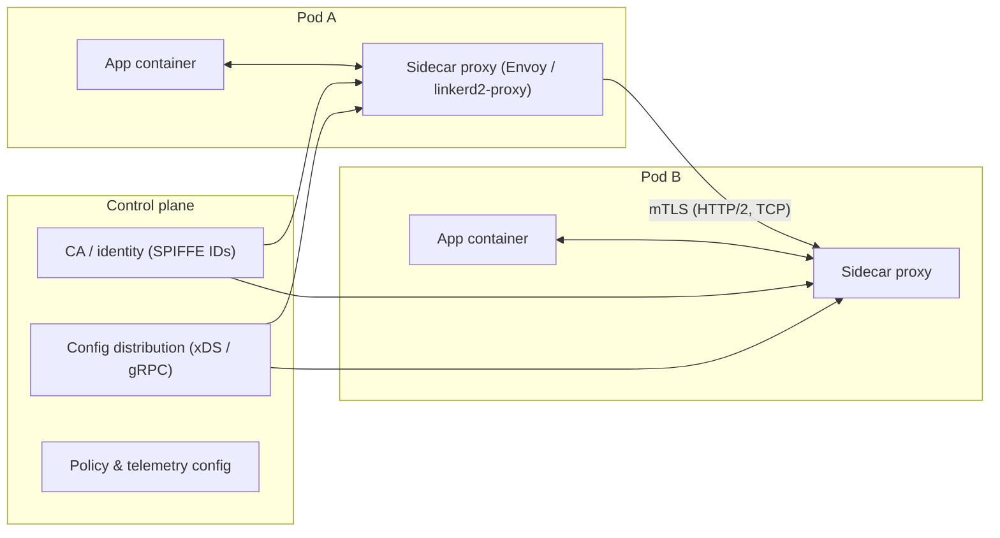

# 5.28 Service mesh

| | |
|---|---|
| Level | Advanced |
| Priority tier | 2 |
| Lab venue | 3-node cluster; Istio (sidecar and ambient), Linkerd, or Cilium Service Mesh; Kiali/Grafana; fortio/hey; gRPC sample apps |
| Part | Part 5: Kubernetes |
| Status | Drafted, labs **untested** |

## Why this matters for AI infrastructure

Picture an inference request that reaches a model. It may pass through a gateway, a router, a retriever, a reranker, a vector store, a tool server and finally a model server. Every hop is a network call, and each one needs encryption, a verified identity, sensible retries and timeouts, and a way to send a slice of traffic to a new model version.

Teams want the same things from every service, so they also want consistent metrics and traces across languages. They often want a rule such as "only the router may call the model server." A service mesh moves these concerns out of every application and into infrastructure.

A mesh is not free, though. It adds latency, uses CPU and memory in every pod, and brings operational complexity. Its failure modes matter most for long-lived streaming traffic and for traffic that sits next to GPUs. You need to know what a mesh does, how its data plane works and when it earns its cost. That is also a design skill that comes up often in interviews, because meshes are a common topic for platform roles.

## Prerequisites and outcomes

Before you start, you should be comfortable with sections 5.10, 5.12, 5.15 and 5.21. By the end of this chapter, you should be able to do the following.

- Explain the mesh architecture, with its control plane and data-plane proxies, and compare the sidecar, ambient (node and waypoint proxies) and eBPF-based models.
- Describe the core capabilities: workload identity and mTLS built on SPIFFE, traffic management such as routing, splitting, retries, timeouts, circuit breaking, mirroring and fault injection, security policy, observability and multi-cluster networking.
- Install and use Istio and Linkerd for common tasks, know what Cilium's mesh features do, and express canary releases and policies.
- Evaluate the overhead and failure modes of a mesh, and tune it for gRPC, streaming and LLM traffic, which needs long timeouts, HTTP/2 and SSE.
- Decide whether you need a mesh at all, and which alternatives fit: gateway-only designs, client libraries, or an eBPF CNI.

## 1. Concepts

Picture a router calling a `vllm` model server. Without a mesh, the router and the model server each need their own TLS code, their own retry logic and their own metrics. A service mesh is an infrastructure layer for service-to-service communication that provides all of this for you. It gives you identity and mutual TLS, L7 traffic control, resilience features, telemetry and policy enforcement, uniformly and without app changes.

The diagram below shows the architecture. Each pod runs your app container next to a sidecar proxy. The proxies talk to each other over mTLS, while a control plane hands them their configuration and certificates.



Each part of this picture has a clear job. The data plane is the set of proxies. They intercept traffic, using `iptables`, eBPF redirection or explicit proxying, and then handle TLS, routing, retries and metrics. Envoy is the dominant proxy, and Istio, Consul, Kuma and Gateway API implementations all use it. Linkerd uses its own purpose-built Rust micro-proxy instead.

The control plane distributes configuration through the xDS APIs. It issues short-lived workload certificates, injects proxies through a mutating webhook and exposes policy CRDs. Every workload gets an identity as well. That identity is a SPIFFE ID such as `spiffe://cluster.local/ns/serving/sa/vllm`, and it is tied to the workload's ServiceAccount. Certificates rotate frequently, on a scale of hours. mTLS then authenticates both sides and encrypts the traffic, which is the zero-trust approach to east-west traffic.

Policy is based on identity. You say which service accounts or namespaces may call which workloads, paths or methods. Some models deny by default. Request authentication validates JWTs at the edge. Telemetry works the same way for every service: the mesh emits consistent L7 golden signals, which here means request rate, success rate and latency histograms. It also propagates tracing headers, writes access logs and draws topology graphs with Kiali, Linkerd viz or Hubble.

Traffic management covers weighted routing for canaries, header-based routing, mirroring for shadow traffic, retries with budgets, timeouts, circuit breaking and outlier detection, rate limiting, locality-aware load balancing and fault injection.

The book *Kubernetes: Up and Running*, Chapter 15 (*Service Meshes*), by Brendan Burns, Joe Beda, Kelsey Hightower and Lachlan Evenson, explains why teams add a service mesh on top of Kubernetes' built-in `Service` and `Ingress` objects. It also shows how to introspect the mesh's implementation. Three points from that chapter matter here.

1. Plain Kubernetes `Service`s and `Ingress` are not enough for complex service graphs. Built-in `Service`s, run by `kube-proxy`, work at Layer 4 TCP/UDP. They have no awareness of HTTP status codes, gRPC methods, TLS certificates or latency outliers. `Ingress` only governs north-south traffic at the cluster perimeter. Getting east-west mTLS, automatic certificate rotation, canary percentage splits (`95/5`), circuit breaking and consistent golden-signal telemetry into application code means keeping duplicate client libraries in every language. That includes Python, Go, C++ and Rust.
2. A sidecar mesh intercepts traffic without touching the app. When a pod starts, an init container or a CNI plugin programs `iptables` rules inside the pod's network namespace. Those rules redirect all inbound and outbound TCP traffic to the local Envoy sidecar, or to `linkerd2-proxy`. The application container's code and configuration stay unchanged. Meanwhile, the control plane watches the Kubernetes API for `Services`, `EndpointSlices`, `Pods` and mesh policy CRDs. It pushes routing, endpoint and certificate updates to every sidecar over Envoy's gRPC xDS discovery APIs: LDS (Listener), RDS (Route), CDS (Cluster), EDS (Endpoint) and SDS (Secret Discovery Service).
3. Before you adopt a mesh, Burns et al. suggest you ask three questions. First, do you have a multi-hop microservice architecture that needs east-west mTLS or L7 traffic shaping? Second, can you afford the CPU and memory overhead of sidecar proxies, plus the operational complexity of a second control plane? Third, which implementation fits your team's operational maturity? The candidates are Istio, Linkerd, Consul Connect, Cilium, and the vendor-neutral Service Mesh Interface (`SMI`) and Gateway API GAMMA specification.

Those three questions are the decision that the rest of this chapter depends on.

## 2. Data-plane models

Not every mesh puts a proxy in every pod. Each data-plane model places its proxy somewhere different, and that placement decides what you pay in overhead and what you risk when something fails. The table compares where each model runs, what it gives you and what it costs.

| Model | How | Pros | Cons |
|---|---|---|---|
| **Sidecar** (classic Istio, Linkerd, Consul) | A proxy container per pod; traffic redirected with iptables (init container/CNI plugin) | Strong per-pod isolation of proxy; mature; per-workload config | Resource overhead per pod (CPU/memory), startup ordering (sidecar must be ready before app; native sidecars help), Job completion issues (sidecar keeps pod alive), upgrades require pod restarts, extra latency hops (client proxy + server proxy), iptables/port conflicts |
| **Ambient mesh** (Istio ambient) | Per-node **ztunnel** (L4 mTLS/identity, Rust) + optional per-namespace/service **waypoint proxies** (Envoy, L7) | No sidecars; lower overhead; incremental adoption (L4 secure overlay first); no pod restarts | Newer; waypoint adds an L7 hop; node-level component is shared (blast radius); evolving features |
| **eBPF / kernel-based** (Cilium Service Mesh) | eBPF datapath in the CNI for L3/L4 + Envoy per node for L7 as needed; mutual authentication using SPIFFE and WireGuard/IPsec for encryption | Minimal per-pod overhead; integrates with CNI/policy/Hubble | Requires Cilium as CNI; L7 features rely on node-level Envoy; features differ from Istio |
| **Proxyless gRPC (xDS)** | gRPC library speaks xDS to the control plane; no proxy | Lowest overhead for gRPC | Library/language support limited; per-app changes |
| **Library-based** (Finagle, Resilience4j, Spring Cloud) | App-level libraries | No proxy | Per-language, inconsistent, upgrades via app releases |
| **Gateway-only** (no east-west mesh) | Ingress/Gateway API (5.12) handles north-south | Simple | No east-west mTLS/telemetry |

Read the table row by row and ask two questions each time. Where does the proxy run? And what does that location cost you? The sidecar model gives the strongest per-pod isolation, while the ambient and eBPF models share more of the work and lower the per-pod overhead.

## 3. Istio essentials

Suppose the `serving` namespace holds a `vllm` model server, and you want only the router to reach it. Istio can enforce that rule with a few custom resources.

The control plane, `istiod`, covers three jobs: pilot, which sends xDS configuration, citadel, which acts as the certificate authority, and galley and injection. Ingress and egress gateways are Envoy deployments, and they are now commonly configured with the Gateway API `Gateway` and `HTTPRoute` resources. The data plane is either sidecars, which run as `istio-proxy` containers, or ambient mode, which uses a ztunnel DaemonSet and waypoints.

To install Istio, run `istioctl install --set profile=default`, or use Helm. Then turn on injection for each namespace. Use `kubectl label ns serving istio-injection=enabled` for sidecars, or `istio.io/dataplane-mode=ambient` for ambient mode.

The YAML below defines the key resources. Read it as four steps: mTLS for the namespace, a rule that lets only the router make POST calls on `/v1/*`, the `v1` and `v2` subsets, and a 95/5 split with 10 percent mirroring to `v2`.

```yaml
apiVersion: security.istio.io/v1
kind: PeerAuthentication
metadata: { name: default, namespace: serving }
spec: { mtls: { mode: STRICT } }                  # require mTLS for all workloads in the namespace
---
apiVersion: security.istio.io/v1
kind: AuthorizationPolicy
metadata: { name: model-server-allow-router, namespace: serving }
spec:
  selector: { matchLabels: { app: vllm } }
  action: ALLOW
  rules:
    - from: [ { source: { principals: ["cluster.local/ns/edge/sa/router"] } } ]
      to:   [ { operation: { methods: ["POST"], paths: ["/v1/*"] } } ]
---
apiVersion: networking.istio.io/v1
kind: DestinationRule
metadata: { name: vllm, namespace: serving }
spec:
  host: vllm.serving.svc.cluster.local
  subsets:
    - { name: v1, labels: { version: v1 } }
    - { name: v2, labels: { version: v2 } }
  trafficPolicy:
    loadBalancer: { simple: LEAST_REQUEST }
    connectionPool:
      http: { http2MaxRequests: 1000, maxRequestsPerConnection: 0, idleTimeout: 3600s }
      tcp: { maxConnections: 1000 }
    outlierDetection: { consecutive5xxErrors: 5, interval: 10s, baseEjectionTime: 30s, maxEjectionPercent: 50 }
---
apiVersion: networking.istio.io/v1
kind: VirtualService
metadata: { name: vllm, namespace: serving }
spec:
  hosts: [vllm.serving.svc.cluster.local]
  http:
    - match: [ { headers: { x-canary: { exact: "true" } } } ]
      route: [ { destination: { host: vllm.serving.svc.cluster.local, subset: v2 } } ]
    - route:
        - { destination: { host: vllm.serving.svc.cluster.local, subset: v1 }, weight: 95 }
        - { destination: { host: vllm.serving.svc.cluster.local, subset: v2 }, weight: 5 }
      timeout: 600s
      retries: { attempts: 0 }                     # do not retry generation requests
      mirror: { host: vllm.serving.svc.cluster.local, subset: v2 }
      mirrorPercentage: { value: 10.0 }
```

Notice that the `DestinationRule` must define the `v2` subset before any route points at it. Otherwise Envoy has no cluster for the route, as the checkpoint questions explain. Istio also increasingly routes traffic with the Kubernetes Gateway API, using `HTTPRoute` in place of `VirtualService`, including for mesh use under the GAMMA initiative.

The `Sidecar` resource limits the scope of configuration, `ServiceEntry` describes external services, and `Telemetry` configures metrics and traces. `EnvoyFilter` is advanced and fragile. `RequestAuthentication` handles JWT, and `WasmPlugin` and `ProxyConfig` cover the rest.

When something breaks, start with `istioctl proxy-status` and `istioctl analyze`. Then run `istioctl proxy-config routes/clusters/listeners/endpoints <pod>` on the pod in question. Also use `istioctl x describe pod`. Envoy's admin interface is at `:15000/config_dump` and `/stats`, and `kubectl logs -c istio-proxy` shows the sidecar's own log.

When a route misbehaves, run `istioctl analyze` and `istioctl proxy-status` before you read the proxy logs.

## 4. Linkerd essentials

If your team wants a mesh with fewer knobs, Linkerd is the option the chapter calls simple and light. It is a CNCF graduated project. Its control plane has destination, identity and proxy-injector parts, and each pod gets a `linkerd2-proxy` sidecar. Extensions add viz dashboards, based on Prometheus and Grafana, plus multicluster and policy.

Install with `linkerd install --crds | kubectl apply -f -; linkerd install | kubectl apply -f -; linkerd check`. Then annotate the namespace with `linkerd.io/inject: enabled` to turn on injection.

mTLS is on by default, and you can read route metrics with `linkerd viz stat deploy` or `linkerd viz top`. Retries and timeouts use a `ServiceProfile`, or Gateway API and policy CRDs such as `Server`, `ServerAuthorization`, `AuthorizationPolicy` and `HTTPRoute`. Load balancing uses EWMA latency, specifically peak EWMA. HTTP/2, gRPC and TCP are supported.

The trade-off is fewer knobs, a lower footprint and an opinionated design, with no Envoy extensions. Stable release availability is vendor-driven.

Check the licensing of the stable distribution before you pick Linkerd.

## 5. Cilium Service Mesh

Cilium adds mesh features to its eBPF CNI, with no sidecars. A per-node Envoy provides L7 policy and observability through Hubble. SPIFFE/SPIRE-based identity gives mutual authentication, and WireGuard or IPsec encrypts the traffic. Cilium also works as a Gateway API and Ingress controller, and Traffic management uses `CiliumEnvoyConfig`, and ClusterMesh covers multi-cluster discovery and policy.

The upside is one policy language across L3 through L7. The downside is that you are tied to Cilium, and its traffic management is less mature than Istio's. Check that Cilium's features cover your traffic rules before you commit.

## 6. Capabilities in practice

### Mutual TLS and zero-trust

Turning on STRICT mTLS across the whole mesh can break callers, so you do it in stages. Start in PERMISSIVE mode, then move to STRICT once the migration is complete. Pair STRICT with AuthorizationPolicies, so that identity, not network location, decides who gets access. Rotate certificate roots too. You can use plugin CAs from Vault, or cert-manager through `istio-csr`. Monitor certificate expiry and handshake failures as well.

mTLS protects traffic against sniffing and spoofing inside the cluster and across multi-cluster links. It complements NetworkPolicy rather than replacing it, which gives you defence in depth. It also requires that every client is meshed, so non-mesh clients need exemptions.

Before you switch to STRICT, list every client that is not meshed and decide how each one will be handled.

### Traffic management for model rollouts

Canary releases shift weight in steps: 99/1, then 90/10, then 50/50, and finally 0/100. Each step is gated by metrics. Argo Rollouts or Flagger can drive the mesh weights from Prometheus analysis, which chapter 4.26 covers.

Shadow traffic, also called mirroring, sends a percentage of requests to the new model server and discards the responses. You then compare latency and error rates, and you can check sampled outputs offline. Watch the cost, though. Mirrored requests add GPU load, and non-idempotent calls can cause side effects.

Header routing sends requests by `x-model-version`, by tenant or by experiment group. For KV-cache locality, use sticky sessions or consistent hashing, which is `consistentHash` in a DestinationRule.

Retries multiply load. For generation requests, a retry repeats expensive GPU work and can produce side effects. Set `retries.attempts: 0` for POST generation requests. For idempotent calls such as embeddings and health checks, retry on `retryOn: connect-failure,refused-stream` with per-try timeouts. Linkerd's retry budgets help you avoid retry storms.

Circuit breaking and outlier detection eject failing replicas after consecutive 5xx errors. Limits on pending requests, `http1MaxPendingRequests` and `http2MaxRequests`, shed load instead of letting requests queue indefinitely.

Rate limiting can be local, using Envoy's local rate limit, or global, using a rate limit service. Either way it applies per client identity or per API key. For LLMs, token-based limits generally need the application or gateway to be aware of tokens.

Locality-aware routing prefers endpoints in the same zone, and it fails over across zones or regions with `localityLbSetting`. Fault injection adds delays and aborts, which lets you test resilience on purpose.

### Observability

The mesh gives you golden signals for each service and each route automatically. Topology graphs appear in Kiali, Linkerd Viz or Hubble UI, and access logs carry request IDs.

One gap needs your attention. The mesh creates spans for each hop, but it cannot link an inbound call to the outbound calls it triggers. Applications must propagate tracing headers such as `traceparent` and B3 themselves. Export the data to an OTel Collector, Tempo or Jaeger.

Envoy's stats volume can be huge. Restrict it with `proxyStatsMatcher`, with the `Telemetry` API, or by dropping histograms you do not need. That keeps cardinality under control, as chapter 5.24 explains.

Before you add more metrics, decide which histograms your dashboards actually need, because Envoy's stats volume can be huge.

## 7. Costs, performance and failure modes

Every mesh has a price, and the price shows up in the places you least expect. A sidecar adds a small delay to every hop. Your proxies use memory and CPU in every pod. Control planes can slow down under large clusters. Each one is a failure mode you need to plan for.

Latency comes first. A sidecar adds roughly 0.2 to 1 ms per hop, and a request crosses two proxies, plus TLS. Ambient L4 traffic through ztunnel typically adds less, and an L7 waypoint adds one more hop. For token-streaming LLM traffic, that per-request overhead is negligible next to generation time. Buffering and idle-timeout behaviour still matter, though, because long-lived streams feel them.

CPU and memory come next. An Envoy sidecar uses roughly 50 to 100+ MiB and some CPU per pod, and that grows with the size of its configuration. `Sidecar` resources limit that scope. Take 5,000 pods at 50 MiB each: that is 250,000 MiB, or about 244 GiB. At 100 MiB each, the total reaches about 488 GiB, which is why the cost reaches hundreds of GiB. Ambient mode reduces that to a per-node cost. A Linkerd proxy is lighter, at roughly 10 to 20 MiB typically.

Control-plane scale is the next concern. xDS pushes go out to thousands of proxies. Large clusters need `Sidecar` scoping, revision-based upgrades and tuned istiod resources. Endpoint changes also trigger pushes.

Startup and shutdown ordering can also bite. The app may start before its proxy is ready, which produces connection refused errors. Use `holdApplicationUntilProxyStarts` or native sidecars to prevent that. At shutdown, the proxy can exit before the app finishes draining. `EXIT_ON_ZERO_ACTIVE_CONNECTIONS` and `terminationDrainDuration` help here. A Job with a sidecar never completes unless the proxy is told to quit, through `/quitquitquit` or native sidecar support.

Traffic interception has its own pitfalls. Protocol sniffing breaks server-first protocols such as MySQL, so you should declare ports with `appProtocol` or port names. UDP and multicast are unsupported, and non-TCP and raw sockets bypass the proxy. `hostNetwork` pods cannot be meshed. Init containers run before the proxy exists, so they have no mesh egress. Localhost traffic is exempt, and the ports `15001/15006/15020/15021/15090` are reserved.

HTTP/2, gRPC, WebSocket and SSE are supported, but idle timeouts need checking. Envoy's stream idle timeout defaults to 5 minutes. Envoy's own default route timeout is 15 s, although Istio configures routes without a route timeout unless you set one. Verify this for your version. For LLM streaming, set explicit long or disabled route timeouts, raise the idle timeouts, disable response buffering features, and set `maxRequestsPerConnection` or a maximum connection duration so connections rebalance.

Strict mTLS affects traffic that is not in the mesh. It breaks kubelet health checks, which Istio avoids by rewriting probes through the sidecar on port `15021` or with `rewriteAppHTTPProbe`. It also breaks Prometheus scrapes, which you can fix with metrics merging or port exclusions. External clients and other namespaces outside the mesh are affected too.

Upgrades happen in revisions. Use `istioctl install --revision` and `istio.io/rev` labels for canary upgrades. Sidecars update only when a pod restarts, so version skew is possible within the supported window. Data-plane CVEs in Envoy require restarts across the whole cluster.

Debugging gets harder, because there is one more layer to check. A 503 can carry the `UF`, `UH` or `NR` Envoy response flags. You may also see upstream connect errors, mTLS handshake mismatches or stale xDS configuration. Use `istioctl proxy-config` and the access logs with their response flags to sort them out.

The mesh itself is a security target. The control plane holds high privilege, including the CA keys. Protect `istio-system`, restrict who can create `EnvoyFilter` and `WasmPlugin` resources, add network policy for control-plane ports, and keep the proxies patched.

Multi-cluster setups add their own complexity. You need cross-cluster identities with a shared root CA, endpoint discovery through remote secrets, east-west gateways, and DNS names such as `clusterset.local` or `.global`. Latency and failure domains also change, as chapter 5.35 covers.

Before you add a sidecar to a new namespace, check its proxy memory, its timeouts and its startup order against the numbers above.

## 8. When to use (and not use) a mesh

Use a mesh when you need uniform mTLS and identity across many services written in different languages, especially where compliance requires it. It also helps when you want fine-grained L7 traffic control, such as canaries, mirroring and header routing, without changing code. Consistent telemetry, multi-cluster service networking and zero-trust authorisation policy are the other reasons.

Avoid a mesh, or defer it, in several situations. You may have only a few services, where a gateway with library TLS and OTel may be enough. Latency-critical or very high-QPS hot paths can see sidecar costs dominate. Raw TCP and UDP protocols are a poor fit: RDMA and NCCL traffic sits entirely outside the mesh and should not be proxied. Your team may lack the operational capacity to run it, or your main need may simply be north-south ingress.

For an AI platform, a pragmatic path starts with Gateway API, cert-manager, OTel and NetworkPolicy, covered in chapters 5.12, 5.15 and 5.24. Add an ambient or eBPF mesh for mTLS and identity-based policy when compliance requires east-west encryption. Reserve sidecar meshes for service-rich inference graphs that need advanced traffic shaping. Training traffic is different. NCCL over RDMA or TCP between pods must bypass the mesh, which you can do with annotations, excluded ports or secondary networks.

To exclude traffic in Istio, use `traffic.sidecar.istio.io/excludeOutboundPorts`, `excludeOutboundIPRanges`, or `sidecar.istio.io/inject: "false"` for training pods and storage clients. In Linkerd, use `config.linkerd.io/skip-outbound-ports` and `skip-inbound-ports`.

Decide early which workloads stay out of the mesh, because training and storage traffic cannot be proxied safely.

## 9. Lab

Start with the self-checking Python lab. You can run it locally, and it needs no cluster: `python3 code/part05/service_mesh_policy_sim_lab.py`. It verifies the Istio `PeerAuthentication` modes, `PERMISSIVE` against `STRICT`, and the `AuthorizationPolicy` SPIFFE identity evaluator, `evaluate_mesh_mtls_and_authz`. It also checks the `VirtualService` canary router and the `DestinationRule` `outlierDetection` endpoint ejector, `evaluate_outlier_detection_and_routing`. Finally, it checks `compute_mesh_fleet_memory_overhead`, the calculator that compares sidecar and ambient memory across a fleet.

```bash
python3 code/part05/service_mesh_policy_sim_lab.py
```

Next comes the cluster work. Use a 3-node cluster with Istio, Linkerd or Cilium. Every interactive shell step below is `untested here`, so you should expect to adjust them on your own cluster.

1. Install Istio with the default profile, or install Linkerd. Deploy a three-tier sample of gateway, router and model-mock. Enable injection, then check the proxies, mTLS with `istioctl x describe` or `linkerd viz edges`, and the metrics in Grafana and Kiali.
2. Start in PERMISSIVE mode and add a non-mesh client. Switch to STRICT, and watch the failures you cause. Fix them with exemptions or by including the client in the mesh. Then confirm that the traffic is encrypted with `tcpdump`.
3. Deny everything by default in the model namespace, then allow only the router identity on `POST /v1/*`. Test with an allowed caller and a denied one. Compare the result with NetworkPolicy.
4. Deploy `v1` and `v2` mock servers. Route 90/10, mirror 10% to `v2`, and drive load with fortio. Compare the metrics. Then automate the rollout with Flagger or Argo Rollouts.
5. Inject 503s and delays into `v2`. Configure timeouts, and retries for an idempotent GET but not for a non-idempotent POST. Add outlier detection. Watch the retry amplification, and fix it with budgets. Then test the circuit breaking limits under high concurrency.
6. Build an SSE token-stream mock that runs for 5 minutes. Check how it behaves through sidecars with default timeouts. Fix the stream idle and route timeouts. Test a rolling restart and a graceful drain.
7. Use a single-connection gRPC client against a Service with 4 pods. Show the imbalance without a mesh, then the balanced requests with mesh L7 load balancing. Compare `LEAST_REQUEST` with EWMA.
8. Benchmark p50 and p99 latency, plus CPU and memory, with sidecars, with ambient mode and with the Cilium mesh. Plot the per-pod overhead, and the cost at 1,000 pods.
9. Enable ambient mode for a namespace. Observe the mTLS that ztunnel provides without sidecars. Add a waypoint for L7 policy, then compare resource use and failure behaviour.
10. Reproduce the connection failures that happen when an app starts before its proxy. Reproduce a Job that never completes with a sidecar. Fix both with hold-until-ready, native sidecars or the quit endpoint.
11. Optional: link two kind clusters with a shared root CA. Discover remote services there, then test failover.
12. Run a pair of distributed training pods that use NCCL over TCP inside a meshed namespace. Measure the performance penalty and note what breaks. Then exclude the ports or the namespace, and compare the results.
13. Clean up.

Run the Python lab first, since it needs no cluster and checks the policy logic before you touch live traffic.

## 10. Common mistakes

Adopting a mesh for its resume value, without a concrete requirement behind it, is the first trap. Teams also tend to underestimate the operational load that comes with it.

Enabling strict mTLS before every client is meshed breaks probes and scrapes. Default retries on non-idempotent LLM requests lead to retry storms. Forgetting the HTTP/2 stream idle timeouts and route timeouts on streaming endpoints causes the same kind of break.

Proxying RDMA, NCCL or storage traffic, or meshing training pods, is a mistake. So is a huge sidecar configuration with no `Sidecar` scoping, which causes memory bloat and slow xDS pushes.

Treating the mesh as a replacement for NetworkPolicy, for authentication and authorization in the apps, or for secrets management is another error. Assuming that the mesh can join spans without app header propagation is one more. Finally, never upgrading proxies, or letting versions drift beyond the support window, leaves the cluster exposed.

Review this list before each rollout, and fix any item you find before your mesh takes live traffic.

## 11. Interview angles

Meshes come up in platform interviews, and most of the questions ask about a trade-off. Be ready to answer each of these.

- "What problems does a service mesh solve? What does it cost?"
- "Sidecar vs ambient vs eBPF data planes: trade-offs."
- "How does mTLS identity work in Istio/Linkerd? What is SPIFFE?"
- "How would you canary a new model version with a mesh? What about mirroring?"
- "Why are retries dangerous for LLM inference requests?"
- "Why does gRPC load balance badly without a mesh?"
- "How do sidecars interact with Kubernetes Jobs and startup/shutdown?"
- "When would you not use a service mesh?"

For each question, lead with the trade-off, then support it with the mechanism.

## Exercises

1. Explain why plain Kubernetes `Service`s and `Ingress` cannot give you east-west mTLS or L7 resilience (*Kubernetes: Up and Running*, Chapter 15). Then trace how `iptables` or eBPF redirection sends pod traffic through the sidecar proxy. Finally, show how `istiod` uses Envoy's xDS APIs, `LDS`, `RDS`, `CDS`, `EDS` and `SDS`, to program the proxies dynamically while they run.
2. Use `compute_mesh_fleet_memory_overhead()` in `code/part05/service_mesh_policy_sim.py` to total the proxy memory across 5,000 pods on 200 nodes. Compare three cases. Istio Envoy sidecars come to ~390 GiB, Linkerd Rust sidecars to ~88 GiB, and Istio ambient mode, which is `ztunnel` on each node plus 10 shared waypoints, to ~8.8 GiB. Then compare their latency and blast-radius trade-offs, and decide which trade-off matters most for your workload.
3. Using `evaluate_mesh_mtls_and_authz()` in `code/part05/service_mesh_policy_sim.py`, trace the `PeerAuthentication/default` and `AuthorizationPolicy/model-server-allow-router` manifests from Section 3. Explain why a `PERMISSIVE` migration phase comes before `STRICT`. Then explain how `principals: ["cluster.local/ns/edge/sa/router"]` enforces cryptographic SPIFFE workload identity, so you can see which caller gets through.
4. Using `evaluate_outlier_detection_and_routing()` in `code/part05/service_mesh_policy_sim.py`, study L7 traffic management for LLM serving. Cover the `VirtualService` or Gateway API `HTTPRoute`, the `DestinationRule`, canary releases, shadow mirroring and `outlierDetection`. Trace the `vllm` `DestinationRule` and `VirtualService` manifests from Section 3. Look at `LEAST_REQUEST`, and at outlier detection that ejects replicas after $\ge 5$ consecutive 5xx errors. Then check the 95/5 canary with the `x-canary: true` header match, the 10% shadow mirroring, `timeout: 600s`, and `retries: { attempts: 0 }`.
5. Explain why a batch `Job` in a sidecar-meshed namespace hangs forever after its main container exits. Say how native sidecars or `/quitquitquit` fix that. Then explain what `holdApplicationUntilProxyStarts` does, and what the Envoy access-log response flags `UF`, `UH`, `UO`, `NR` and `UT` mean when you see them in a log.
6. Explain why distributed GPU training, meaning `NCCL` over RDMA or TCP, and parallel-filesystem storage traffic must never pass through a service mesh proxy. Write the exact Istio and Linkerd annotations that exclude training pods or ports. Then outline a staged adoption path: start with `Gateway API`, add `Ambient/eBPF mTLS`, and use `L7 Waypoints/Sidecars` only where you need them.

## Checkpoint questions (20)

<details>
<summary>1. In *Kubernetes: Up and Running* Chapter 15, what five capabilities does a Service Mesh add that standard Kubernetes `Service`s (`kube-proxy`) and `Ingress` do not provide?</summary>

A service mesh adds five things that plain `Service`s and `Ingress` cannot give you. The first is east-west mTLS with cryptographic workload identity under SPIFFE. Every pod-to-pod call inside the cluster gets automatic encryption and mutual X.509 authentication, with identities such as `spiffe://cluster.local/ns/<ns>/sa/<sa>`, and no application code changes.

The second is fine-grained L7 traffic shifting between services. Weighted canary splits such as `95%` `v1` and `5%` `v2`, header-based routing and shadow mirroring all work between internal microservices, not just at the north-south edge.

The third is L7 resilience and load balancing. The mesh balances HTTP/2 and gRPC requests one at a time, using `LEAST_REQUEST` or Peak EWMA. It also provides circuit breaking, outlier detection that ejects pods returning 5xx errors, timeouts and retry budgets.

The fourth is identity-based L7 authorization with `AuthorizationPolicy`. A rule can say that only the ServiceAccount `edge/router` may call `POST /v1/chat/completions` on `serving/vllm`.

The fifth is uniform L7 telemetry. Every proxy emits the same request-rate, error-rate and latency histograms, plus distributed tracing spans, whether the app is written in Python, C++, Rust or Go.
</details>

<details>
<summary>2. How does a Sidecar Service Mesh transparently intercept a Pod's inbound and outbound TCP traffic without modifying the application container (*Kubernetes: Up and Running*, Chapter 15)?</summary>

When a Pod is created in a meshed namespace, a mutating admission webhook injects two things. The first is the `istio-init` container, or the `istio-cni` or `linkerd-cni` node plugin. It sets up `iptables` or eBPF `sockops` and `cgroup` redirection rules inside the Pod's network namespace before the application starts.

Those rules handle both directions. Inbound TCP connections that arrive on the Pod's `eth0` are redirected to the sidecar's inbound listener, port `15006` in Istio, unless the port is excluded. Outbound TCP connections from the application are redirected to the sidecar's outbound listener, port `15001` in Istio. That listener upgrades the connection to mTLS and forwards it to the destination Pod's sidecar.

The second thing injected is the sidecar container itself, either `istio-proxy` running Envoy or `linkerd2-proxy`.
</details>

<details>
<summary>3. What is `xDS` in Envoy and Istio, and what do `LDS`, `RDS`, `CDS`, `EDS`, and `SDS` stand for?</summary>

`xDS` is Envoy's family of gRPC streaming discovery APIs. The control plane, `istiod`, uses them to configure data-plane Envoy proxies while they keep running, with no restart.

Each letter in the name stands for one kind of configuration. `LDS`, the Listener Discovery Service, configures virtual listeners, meaning their IPs, ports and filter chains. `RDS`, the Route Discovery Service, configures HTTP and gRPC virtual hosts, path and header matches, timeouts and weighted canary routes, which come from `VirtualService` or `HTTPRoute`.

`CDS`, the Cluster Discovery Service, configures upstream clusters, their load-balancing algorithms such as `LEAST_REQUEST`, connection pools and outlier detection, which come from `DestinationRule`. `EDS`, the Endpoint Discovery Service, streams the live Pod IP endpoints for each cluster, taken from Kubernetes `EndpointSlice`s.

`SDS`, the Secret Discovery Service, streams short-lived X.509 workload certificates and mTLS CA trust bundles to Envoy in memory, without writing private keys to disk.
</details>

<details>
<summary>4. Compare the three Service Mesh Data-Plane architectures: (a) **Sidecar**, (b) **Istio Ambient (`ztunnel` + `Waypoint`)**, and (c) **Cilium eBPF Service Mesh**.</summary>

The three architectures differ mainly in where the work happens, and that changes the overhead you pay. The table compares them.

| Architecture | L4 mTLS & Identity | L7 Routing / AuthZ / Telemetry | Resource & Operational Profile |
|---|---|---|---|
| **Sidecar (`Istio` classic, `Linkerd`)** | Per-Pod sidecar proxy container | Per-Pod sidecar proxy container | Strong per-Pod isolation, but adds **2 proxy hops per call**, **50–100 MiB RAM per Pod**, Job-completion/startup races, and requires Pod restarts to upgrade Envoy |
| **Ambient (`Istio` ambient mode)** | Per-Node **`ztunnel` DaemonSet** (lightweight Rust proxy over HBONE HTTP/2 tunnels) | Optional shared per-namespace/service **Envoy `Waypoint` proxy** deployed only where L7 features are needed | **Zero sidecars in Pods** (no Job hangs, no Pod restarts on mesh upgrade); ~95% lower memory footprint if most services only need L4 mTLS |
| **Cilium Service Mesh (`eBPF` + per-node Envoy)** | eBPF in kernel + **WireGuard / IPsec** encryption + SPIFFE identity handshake | Per-Node Envoy daemon (invoked via eBPF redirection only on L7-policy flows) | Sidecar-free, unified with CNI `CiliumNetworkPolicy` and Hubble observability |

Notice, as you compare the rows, that the sidecar model costs the most per pod. The ambient model moves most of that cost to the node, and the Cilium model runs in the kernel and on each node.
</details>

<details>
<summary>5. How is a workload's cryptographic identity formatted in `Istio` / `Linkerd` (`SPIFFE ID`), and where is it placed inside the X.509 certificate?</summary>

Each Pod receives an X.509 certificate. Its Subject Alternative Name (`SAN`) URI extension carries the SPIFFE ID, in this form:

```text
spiffe://<trust-domain>/ns/<namespace>/sa/<service-account-name>
```

For example, the ID might be `spiffe://cluster.local/ns/edge/sa/router`. The certificate is issued only after `istiod`, `linkerd-identity` or `spire-agent` checks the Pod's bound Kubernetes ServiceAccount token through `TokenReview`. That check is why no Pod can spoof another namespace's or ServiceAccount's SPIFFE identity.
</details>

<details>
<summary>6. Why should you migrate a namespace to mTLS using `PeerAuthentication` mode `PERMISSIVE` first before switching to `STRICT`?</summary>

`PERMISSIVE` is the default mode. The receiving sidecar accepts both mTLS-encrypted connections from meshed peers and legacy plaintext TCP connections. Those plaintext connections come from unmeshed namespaces, Prometheus scrapers or health probes. While you are in `PERMISSIVE` mode, check Kiali or Prometheus for `istio_requests_total{connection_security_policy="none"}`. That metric shows which plaintext callers remain.

`STRICT` mode rejects every plaintext connection. You switch to it only once `connection_security_policy="none"` reaches `0`. That step prevents surprise outages.
</details>

<details>
<summary>7. In Istio's `AuthorizationPolicy`, what is the evaluation order when `CUSTOM`, `DENY`, and `ALLOW` policies exist in the same namespace?</summary>

Istio checks `AuthorizationPolicy` rules in a fixed order. `CUSTOM` policies run first. They are external authorization callouts, `ext_authz`, to a tool such as OPA or `oauth2-proxy`.

`DENY` policies run second. If any `DENY` rule matches, the request is denied at once with `403 RBAC: access denied`.

`ALLOW` policies run third. If no `ALLOW` policy exists for the workload, the request is allowed by default, unless an earlier step denied it. If at least one `ALLOW` policy exists for the workload, only requests that match an `ALLOW` rule get through, and everything else is denied. An `AuthorizationPolicy` with `spec: {}` has no `action` and no `rules`, so it is the standard default-deny-all policy for a namespace.
</details>

<details>
<summary>8. How do `DestinationRule` (`subsets`, `loadBalancer`, `outlierDetection`) and `VirtualService` (or Gateway API `HTTPRoute`) work together in Istio?</summary>

A `VirtualService`, or an `HTTPRoute`, decides how traffic is routed to a destination host. It matches on URL paths and HTTP headers such as `x-canary: true`. It makes weighted splits, for example 95% to subset `v1` and 5% to subset `v2`. It also sets shadow mirroring with `mirror`, timeouts such as `600s`, and retries.

A `DestinationRule` decides what happens after a route is chosen. It defines the named label `subsets`, such as `v1` and `v2`. It also sets the load-balancing algorithm, which can be `LEAST_REQUEST`, `ROUND_ROBIN`, `PASSTHROUGH` or `consistentHash` for KV-cache affinity. Connection-pool limits such as `http2MaxRequests`, TLS settings and `outlierDetection` for circuit breaking, which ejects unhealthy Pod IPs, live here too.

*(Trap: if a `VirtualService` routes to `subset: v2` before the `DestinationRule` defining `subset: v2` exists, Envoy has no cluster definition for `v2` and returns `503 NR` (`No Route`). Always apply the `DestinationRule` before the `VirtualService`, or apply them together.)*
</details>

<details>
<summary>9. How does a Service Mesh fix the gRPC / HTTP/2 single-connection load-balancing problem without changing client code?</summary>

Without a mesh, a gRPC client opens one single TCP connection to a `ClusterIP` Service. L4 `kube-proxy` then pins all 10,000 multiplexed HTTP/2 streams on that connection to one backend Pod.

With a Service Mesh such as Istio, Linkerd or Cilium at L7, the client's sidecar, or a waypoint proxy, inspects the HTTP/2 protocol at Layer 7. It keeps an active pool of HTTP/2 connections to all Ready backend Pods, learned through EDS. It then balances every individual gRPC request, `POST /package.Service/Method`, across those Pods. The scoring uses `LEAST_REQUEST` or Peak EWMA latency.
</details>

<details>
<summary>10. What is "Traffic Mirroring" (`mirror` / Shadow Traffic) in a Service Mesh, and what two caveats apply when mirroring LLM inference requests?</summary>

Traffic mirroring is configured with `mirror: { host: vllm, subset: v2 }, mirrorPercentage: { value: 10.0 }`. The primary request goes to `v1`, and `v1`'s response goes back to the user. At the same time, a fire-and-forget copy of the request goes to `v2`. The response from `v2` is discarded, but its latency and error metrics are recorded.

Two caveats apply to LLM inference. The first is GPU compute cost. Mirroring 10% of production traffic to `v2` uses real GPU prefill and decode compute, and KV-cache, on `v2`. Make sure `v2` has enough GPU capacity for the mirrored load. The second is side effects. Never mirror requests to an agent endpoint that runs external actions, such as charging credit cards, sending emails or changing a database.
</details>

<details>
<summary>11. Why does Envoy's default `retries` policy cause catastrophic "Retry Storms" on LLM inference servers, and how should retries be configured?</summary>

By default in Istio, Envoy retries failed HTTP requests up to 2 times, on `connect-failure,refused-stream,unavailable,cancelled,retriable-status-codes`. Suppose a `vLLM` replica is overloaded. It returns `503`, or it times out after 30 seconds of GPU generation. Each failed request then gets 2 more attempts. That triples the GPU load (`3x` amplification) across the remaining replicas, so every replica in the pool saturates and collapses.

The rule is to set `retries: { attempts: 0 }` for `POST /v1/chat/completions` and `/v1/completions`. Alternatively, limit retries to `retryOn: connect-failure,refused-stream`, which fires only before an upstream worker accepts the request. Pair that with a strict retry budget that caps retries at $\le 10\%$ of total request volume.
</details>

<details>
<summary>12. What is `outlierDetection` in an Istio `DestinationRule`, and why is `maxEjectionPercent: 50` important?</summary>

`outlierDetection` is Envoy's passive health checking and circuit breaker. Suppose one `vLLM` pod's GPU hits an XID error, so every inference call on that pod fails with a 500. If it returns `consecutive5xxErrors: 5` within `interval: 10s`, Envoy ejects that pod IP from the load-balancing pool at once. The ejection lasts `baseEjectionTime: 30s`, multiplied by the number of times that pod has been ejected. The kubelet's livenessProbe is slower, so Envoy acts first.

`maxEjectionPercent: 50` is the safeguard. Suppose a database outage makes all replicas return 500s at the same time. Envoy never ejects more than 50% of the pool, so the whole service cannot be blackholed.
</details>

<details>
<summary>13. Why does a sidecar-meshed `Deployment` in a 5,000-Pod cluster consume hundreds of gigabytes of Envoy RAM if you don't create an Istio `Sidecar` resource?</summary>

By default, `istiod` pushes the Envoy cluster, listener and endpoint configuration, the xDS data, for every Service and every Pod in the whole cluster to every `istio-proxy` sidecar. In a cluster of 5,000 Pods and 2,000 Services, each sidecar holds a large routing table in RAM. At 100 to 300 MiB per proxy, multiplied by 5,000 proxies, that is 500 to 1,500 GiB of cluster RAM. Every Pod churn event also triggers a cluster-wide xDS push.

Creating a default `Sidecar` resource in each namespace fixes this. Use this configuration:

```yaml
spec:
  egress:
    - hosts:
        - "./*"
        - "istio-system/*"
```

It limits each sidecar's configuration to Services in its own namespace, `./*`, and in `istio-system`, plus any namespaces you import explicitly. That cuts sidecar RAM and `istiod` CPU by 80–90%.
</details>

<details>
<summary>14. What are the two classic Kubernetes lifecycle bugs caused by Sidecar Proxies (at Pod Startup and at `Job` Completion), and how do Kubernetes Native Sidecars (`restartPolicy: Always` in `initContainers`) solve both?</summary>

The first bug is a startup race. When `istio-proxy` is a regular container in `spec.containers`, `kubelet` starts it in parallel with your app. If the app makes an outbound HTTP call in its first 500 ms, before Envoy has received its initial xDS config, `iptables` sends the packet to port `15001`. Nothing is listening there yet, so the call fails with `Connection refused`.

The second bug hangs a batch `Job`. When the worker container exits with code `0`, the `istio-proxy` container in `spec.containers` keeps running forever, showing `1/2 Ready`. The `Job` never completes.

Native sidecars fix both problems. They are `initContainers` with `restartPolicy: Always`, enabled by default in modern Istio through `ENABLE_NATIVE_SIDECARS=true`, and by Linkerd too. `kubelet` starts the proxy first, during the init phase. It waits for the proxy's `startupProbe`, `/healthz/ready` on `:15021`, before it starts the app container. Then it stops the native sidecar as soon as all the main `spec.containers` exit.
</details>

<details>
<summary>15. Why does a Service Mesh NOT automatically link inbound and outbound Distributed Tracing spans across a microservice unless your application code forwards headers?</summary>

Suppose Service A calls Service B. The `istio-proxy` on B creates an inbound trace span. Then B's Python code makes an outbound HTTP call to Service C, and the `istio-proxy` on B creates an outbound span. Envoy is an out-of-process network proxy. It cannot tell which inbound request inside your Python process triggered which outbound call. The link exists only if your code copies the W3C `traceparent` and `tracestate` headers, or `x-request-id` and the B3 `x-b3-*` headers, from the incoming request onto the outgoing one. Always propagate trace headers in your application code, or use OpenTelemetry auto-instrumentation.
</details>

<details>
<summary>16. Decode the five most common Envoy Access Log `RESPONSE_FLAGS`: `UF`, `UH`, `UO`, `NR`, and `UT`.</summary>

When an Envoy sidecar or gateway logs a `503` or `504`, the `%RESPONSE_FLAGS%` field shows the stage that failed.

- `UF` (`UpstreamConnectionFailure`) means Envoy tried to connect to the backend Pod IP, but the TCP connection failed or was refused, or the mTLS handshake failed.
- `UH` (`NoHealthyUpstream`) means the upstream cluster has zero healthy endpoints in EDS. All its Pods are unready or ejected by `outlierDetection`.
- `UO` (`UpstreamOverflow`) means a circuit breaker tripped. The limit `http1MaxPendingRequests`, `http2MaxRequests` or `maxConnections` in `DestinationRule` was exceeded.
- `NR` (`NoRouteConfigured`) means Envoy has no matching route or subset in RDS or CDS. For example, a `VirtualService` may reference a `subset: v2` that does not exist in the `DestinationRule`.
- `UT` (`UpstreamRequestTimeout`) means the backend Pod did not respond within the `VirtualService` `timeout`. The client gets a `504 Gateway Timeout`.
</details>

<details>
<summary>17. Why do "Server-First" TCP protocols (like MySQL, PostgreSQL, Redis, or custom binary RPCs) sometimes hang when meshed if `Service.spec.ports[].name` or `appProtocol` is not set?</summary>

When Envoy intercepts an outbound connection on a port with an undeclared protocol, such as `name: custom-port`, it reads the first few bytes the client sends. It uses them to detect whether the traffic is HTTP/1.1, HTTP/2 or raw TCP. This is called protocol sniffing. A server-first protocol such as MySQL breaks this. The client sends nothing until the server sends its greeting packet. The server, in turn, never receives the connection until Envoy finishes sniffing. The result is a 5-second sniffing timeout or a deadlock.

Set `appProtocol: tcp`, or `http`, `http2`, `grpc` or `mysql`, on every Kubernetes `Service`. You can also prefix `ports[].name` with `tcp-`, as in `tcp-mysql`, `http-web` or `grpc-infer`.
</details>

<details>
<summary>18. Why must you NEVER route distributed GPU training collectives (`NCCL` over RDMA or TCP) or high-bandwidth parallel-filesystem storage traffic through a Service Mesh proxy?</summary>

The first reason is that RDMA bypasses the kernel. `GPUDirect RDMA`, over `ib_uverbs`, RoCEv2 or InfiniBand, skips the OS kernel TCP/IP stack entirely. A user-space TCP proxy cannot intercept or proxy RDMA queue pairs.

The second reason is throughput on TCP. Even if NCCL or storage runs over TCP, sending 100 to 400 Gb/s of bulk tensor streams through two user-space Envoy proxies is costly. The path is App, then `iptables`, then Envoy, then mTLS, then Envoy, then `iptables`, then App. Socket copies and TLS encryption saturate the host CPU cores. Collective throughput can fall by 80–90%, and NCCL's dynamic ephemeral port discovery breaks.

You should always exclude training namespaces and pods from mesh injection. Use `sidecar.istio.io/inject: "false"`, or exclude the NCCL and storage port ranges with `traffic.sidecar.istio.io/excludeOutboundPorts` and `excludeInboundPorts`.
</details>

<details>
<summary>19. How does Istio handle `kubelet` `httpGet` Liveness and Readiness Probes when `PeerAuthentication: STRICT` is enabled?</summary>

The kubelet runs on the host node, outside the service mesh. It holds no mesh SPIFFE client certificate. So if the kubelet sent a plaintext HTTP health probe straight to the container's port under STRICT mTLS, Envoy would reject it, and the kubelet would kill the Pod.

To prevent this, Istio's mutating webhook rewrites the Pod's `livenessProbe`, `readinessProbe` and `startupProbe`. It sets `rewriteAppHTTPProbe: true`, and the probes point at the sidecar's unencrypted health-relay port, `http://localhost:15021/healthz/app-health/<container>/livez`. The `istio-proxy` sidecar then forwards each probe over localhost inside the Pod to the application container.
</details>

<details>
<summary>20. What is the `GAMMA` initiative in the Kubernetes Gateway API, and why is it important for Service Mesh portability?</summary>

Every service mesh used to invent its own incompatible CRDs for traffic splitting and routing. Examples are Istio's `VirtualService`, Linkerd's `TrafficSplit` and `ServiceProfile`, and Consul's `ServiceRouter`. GAMMA, which stands for Gateway API for Mesh Management and Administration, standardizes east-west service mesh routing. It uses the same upstream `HTTPRoute` and `GRPCRoute` CRDs from `gateway.networking.k8s.io`.

The difference is in what the route attaches to. A north-south `Gateway` is the usual `parentRefs` target. An east-west mesh `HTTPRoute` instead sets `parentRefs` to the target Kubernetes `Service`, such as `kind: Service, name: vllm`. Canary splits, header routing and timeouts then become portable across Istio, Linkerd and Cilium.
</details>

## Sources and review notes

- **Sources read in full:**
  - `kubernetes-up-and-running-3rd-edition` — Brendan Burns, Joe Beda, Kelsey Hightower & Lachlan Evenson, *Kubernetes: Up and Running*, 3rd ed., **Chapter 15: Service Meshes** (read in full: why use a service mesh beyond Services and Ingress, encryption and authentication with mTLS, traffic shaping/canary/circuit breaking, introspecting a service mesh via `iptables` + Envoy sidecar + `xDS` control plane, "Do You Really Need a Service Mesh?" decision framework, and the Service Mesh Interface `SMI` / landscape).
  - `production-kubernetes` — Josh Rosso, Rich Lander, Alexander Brand & John Harris, *Production Kubernetes*, **Chapter 6: Service Routing** and **Chapter 10: Identity** (Service Mesh routing, Envoy `SDS`, and SPIFFE/SPIRE).
  - `networking-and-kubernetes` — James Strong & Vallery Lancey, *Networking and Kubernetes*, **Chapters 5 and 6** (Service Mesh overview, Istio, Linkerd, and Consul).
- **Run here:** `python3 code/part05/service_mesh_policy_sim_lab.py` (3 passed, 0 failed).
- **Explicitly labelled inferences:** The `evaluate_mesh_mtls_and_authz`, `evaluate_outlier_detection_and_routing`, and `compute_mesh_fleet_memory_overhead` models in `code/part05/service_mesh_policy_sim.py` and the `PeerAuthentication`, `AuthorizationPolicy`, `DestinationRule`, and `VirtualService` manifests for `vllm` are the author's constructions synthesizing `KUR` Chapter 15, `PK` Chapters 6 & 10, and `NK` Chapters 5 & 6 (plus original study items 21, 22, 23, 24, 25, 26, 27, 28, 29, 30, 31, 32, 33, 34, and 35).
- **Not verified on live hardware:** Live `istioctl`, `linkerd`, `cilium`, and `fortio` executions (`http2MaxRequests: 1000`, `idleTimeout: 3600s`, `consecutive5xxErrors: 5`, `interval: 10s, baseEjectionTime: 30s, maxEjectionPercent: 50`, `weight: 95/5`, `timeout: 600s`, `mirrorPercentage: 10.0`, `:15000`, `0.2 to 1 ms` latency, `50 to 100+ MiB` Envoy vs `10 to 20 MiB` Linkerd, `5,000` pods, ports `15001/15006/15020/15021/15090`, `5 minutes` stream idle / `15 s` route timeout) are marked (`untested here`) where not executed by `service_mesh_policy_sim_lab.py`.
