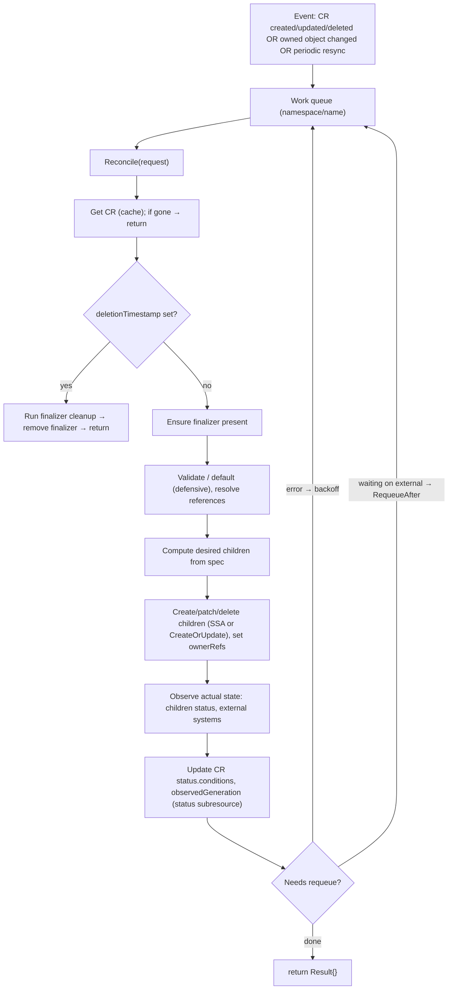

# 5.29 Extending Kubernetes: CRDs and operators

| | |
|---|---|
| Level | Advanced |
| Priority tier | 1 |
| Lab venue | kind or kubeadm; `kubectl`, `kubectl-explain`, `kubeconform`; kubebuilder/Operator SDK for 5.31 |
| Part | Part 5: Kubernetes |
| Status | Drafted, labs **untested** |

## Why this matters for AI infrastructure

Picture an on-call morning. A GPU platform has just been upgraded, and new training jobs no longer start. To find the cause, you need to know which custom resources exist and which controller acts on each one. Almost every AI-specific component on Kubernetes is a custom resource plus an operator.

You will meet these resources. `ClusterPolicy` belongs to the GPU Operator, and `NicClusterPolicy` to the Network Operator. `NetworkAttachmentDefinition` comes from Multus, and `Workload` and `ClusterQueue` come from Kueue. Training runs use `PyTorchJob`, `MPIJob` and `JobSet`, while `RayCluster` and `RayJob` cover Ray. `InferenceService` comes from KServe, and `Application` from Argo. It also includes `Notebook`, `Certificate` and `ServiceMonitor`.

Operating GPU platforms means installing, upgrading, debugging and sometimes writing operators. This chapter explains the extension mechanism from two sides. The API side covers CRDs, their schemas, validation and versioning. The controller side covers the operator pattern, its maturity levels and the tooling choices. Then you can read an operator's design, reason about how it fails, and decide whether to build your own (5.31, 5.32).

When an operator misbehaves, start by reading the custom resources it manages and the design behind them.

## Prerequisites and outcomes

This chapter builds on 5.5 and 5.6, which cover API machinery and controllers. Read those first if the terms are new to you. When you finish, you should be able to do the following.

- Write CRDs with structural schemas. Validate them with OpenAPI v3, `x-kubernetes-validations` CEL rules, enums, formats and defaults. Add printer columns, short names, scope and categories, and understand pruning and `preserveUnknownFields`.
- Design API versions and conversion, including the storage version, conversion webhooks and deprecation. Add subresources such as `status` and `scale`, and manage field ownership with server-side apply.
- Design good CRD APIs with spec and status, conditions, immutability, references, references to secrets, idempotent semantics and extensibility. You should also be able to spot and avoid the common anti-patterns.
- Explain the operator pattern, the capability levels, and how operators manage install, upgrade, backup, scaling and failure recovery. Choose between Helm, Ansible, Go with kubebuilder or Operator SDK, kopf, Metacontroller, Crossplane compositions, Kyverno generate, or a plain controller.
- Package and distribute operators as a Helm chart, as OLM bundles and catalogs, or with kustomize. Manage CRD upgrades safely, and set least-privilege RBAC.
- Test and operate operators. That covers observability, leader election, metrics, events, webhooks and failure handling.

## 1. Extension points recap

Before you write a CRD, it helps to know what else Kubernetes lets you extend. Each mechanism changes a different part of the system. Use the table as a quick lookup, and read the Use column to see which mechanism fits the problem in front of you.

| Mechanism | Extends | Use |
|---|---|---|
| **CRD** | The API with new resource types (served by the API server, stored in etcd) | Declarative config for your domain |
| **Aggregated API server** | The API with a separate server for your types | Custom storage, special semantics (metrics API) |
| **Controller/operator** | Behaviour: reconcile custom (and built-in) resources | Automation |
| **Admission webhooks / ValidatingAdmissionPolicy** | Validation/mutation on writes | Policy, defaulting (5.21) |
| **Custom schedulers/plugins** | Placement | Batch/gang (5.18) |
| **CRI/CNI/CSI/device plugin/DRA** | Node-level integrations | Runtime, network, storage, GPUs |
| **kubectl plugins, Krew** | Client UX | Operator-specific CLIs |

CRDs are the dominant approach. They give you the Kubernetes API machinery for free, including REST, watch, RBAC, audit, server-side apply, `kubectl` support and OpenAPI docs. You do not have to build any of that yourself.

## 2. Custom resources and CRDs

A CustomResourceDefinition, or CRD, tells the API server about a new kind of object. Take a GPU health policy as the running example. The first manifest below registers the new kind, and the second creates one instance of it.

```yaml
apiVersion: apiextensions.k8s.io/v1
kind: CustomResourceDefinition
metadata:
  name: gpuhealthpolicies.platform.example.com        # <plural>.<group>
spec:
  group: platform.example.com
  scope: Cluster                                       # Namespaced | Cluster
  names:
    kind: GPUHealthPolicy
    listKind: GPUHealthPolicyList
    plural: gpuhealthpolicies
    singular: gpuhealthpolicy
    shortNames: [ghp]
    categories: [platform]
  versions:
    - name: v1alpha1
      served: true
      storage: true
      subresources:
        status: {}                                    # /status subresource: spec and status writes separated
      additionalPrinterColumns:
        - { name: Selector, type: string, jsonPath: .spec.nodeSelectorString }
        - { name: XidAction, type: string, jsonPath: .spec.xid.action }
        - { name: Matched, type: integer, jsonPath: .status.matchedNodes }
        - { name: Ready, type: string, jsonPath: ".status.conditions[?(@.type=='Ready')].status" }
        - { name: Age, type: date, jsonPath: .metadata.creationTimestamp }
      schema:
        openAPIV3Schema:
          type: object
          required: [spec]
          properties:
            spec:
              type: object
              required: [xid]
              properties:
                nodeSelector:
                  type: object
                  additionalProperties: { type: string }
                xid:
                  type: object
                  required: [codes, action]
                  properties:
                    codes:
                      type: array
                      minItems: 1
                      items: { type: integer, minimum: 1, maximum: 200 }
                    action:
                      type: string
                      enum: [Ignore, Cordon, CordonAndDrain]
                      default: Cordon
                    windowSeconds: { type: integer, minimum: 30, default: 600 }
                maxUnavailableNodes:
                  x-kubernetes-int-or-string: true
                  default: "5%"
              x-kubernetes-validations:
                - rule: "self.xid.action != 'CordonAndDrain' || has(self.maxUnavailableNodes)"
                  message: "maxUnavailableNodes is required when action is CordonAndDrain"
            status:
              type: object
              properties:
                observedGeneration: { type: integer, format: int64 }
                matchedNodes: { type: integer }
                conditions:
                  type: array
                  x-kubernetes-list-type: map
                  x-kubernetes-list-map-keys: [type]
                  items:
                    type: object
                    required: [type, status]
                    properties:
                      type: { type: string }
                      status: { type: string, enum: ["True", "False", "Unknown"] }
                      reason: { type: string }
                      message: { type: string }
                      lastTransitionTime: { type: string, format: date-time }
                      observedGeneration: { type: integer, format: int64 }
```

```yaml
apiVersion: platform.example.com/v1alpha1
kind: GPUHealthPolicy
metadata: { name: default }
spec:
  nodeSelector: { nvidia.com/gpu.present: "true" }
  xid: { codes: [48, 63, 64, 79], action: CordonAndDrain, windowSeconds: 300 }
  maxUnavailableNodes: "2"
```

### Schema and validation

Version 1 CRDs must use structural schemas. Every field needs a type, and no node may be left without one. The exceptions use `x-kubernetes-preserve-unknown-fields`, `x-kubernetes-int-or-string` or `x-kubernetes-embedded-resource`. The API server prunes unknown fields on write by default, because `preserveUnknownFields` is `false`. Any field you did not declare is silently dropped, which is a common surprise.

Validation uses OpenAPI v3 keywords. You can write `type`, `required`, `enum`, `minimum/maximum`, `minLength/maxLength`, `pattern`, and `format` for values such as `date-time`, `int64` and `uuid`. You can also use `minItems/maxItems/uniqueItems`, `additionalProperties` and `nullable`. The combinators `oneOf/anyOf/allOf/not` are available too, with some restrictions.

Defaults set with `default:` apply on create and on update. They also apply when the object is read back from etcd, so keep defaults simple. CEL validation rules in `x-kubernetes-validations` are generally available. Immutability uses `self == oldSelf` with `optionalOldSelf` or transition rules. They handle cross-field checks such as `self.a < self.b`, immutability, format checks and cost-limited expressions. The API server enforces a CEL cost budget when the CRD is created, so bound your string and list lengths. For most rules, a CEL rule is a better choice than a validating webhook.

To make a field immutable, add `x-kubernetes-validations: [{rule: "self == oldSelf", message: "immutable"}]` to it. This suits a value such as a storage class or model name that must not change after creation.

Lists need extra care when several controllers write to them. `x-kubernetes-list-type` takes `atomic`, `set` or `map`, and `x-kubernetes-list-map-keys` names the key. `x-kubernetes-map-type` takes `granular` or `atomic`. These settings matter for server-side apply, especially for lists of conditions or containers.

Printer columns decide what `kubectl get gpuhealthpolicies` shows. Categories group resources together. Adding `categories: [all]` makes the kind appear in `kubectl get all`. Choose the scope carefully. `Namespaced` suits objects that a tenant owns, and `Cluster` suits global policy and infrastructure objects. Name the group with a DNS name you own, and keep the plural lowercase. Avoid `*.k8s.io` groups unless upstream approves them.

Before you publish a CRD, test valid and invalid objects against its schema, because pruning can drop a field without any error.

### Subresources

The `status` subresource gives the object its own `/status` endpoint. Spec and status updates then go through separate paths and separate RBAC rules. Controllers can write status without bumping `metadata.generation`. When the `status` subresource is enabled, writes to `status` through the main endpoint are ignored, so users cannot spoof it.

The `scale` subresource maps `specReplicasPath`, `statusReplicasPath` and `labelSelectorPath`. Those mappings let the HPA, `kubectl scale` and Kueue scale your custom resource. Other subresources, such as `exec` and `log`, come from aggregated APIs or controllers. CRDs do not get them.

### Versions and conversion

A CRD can serve several versions at the same time, but exactly one of them is the storage version. The conversion strategy decides how objects move between versions. The `None` strategy only rewrites `apiVersion`, so the schemas must already be compatible. The `Webhook` strategy uses a conversion webhook. It converts losslessly in a hub-and-spoke pattern, where every version converts through a hub version. Controller-runtime and kubebuilder scaffold conversion for you.

The upgrade follows four steps. First, add `v1beta1` as a served version that is not the storage version. Second, make `v1beta1` the storage version, but leave existing objects in the old version until something rewrites them. Run a storage-version migration with `kube-storage-version-migrator`, or rewrite every object with `kubectl get ... -o json | kubectl replace`. Third, stop serving the old version once clients have moved to the new one. Fourth, remove the old version from `status.storedVersions` before you drop it from the CRD.

Follow the Kubernetes convention for maturity levels: alpha, beta and stable. A `v1alpha1` version may change. Deprecate a version with `deprecated: true` and a `deprecationWarning` in its version spec.

### Garbage collection, owner references and finalizers

Operators create child objects with `ownerReferences` that point to the CR. Set a controller reference, and deleting the CR garbage-collects those children. External resources work differently. Cloud load balancers, DNS records, node labels and cordons, and storage buckets live outside the cluster, so garbage collection cannot clean them up. For these, use a finalizer such as `platform.example.com/cleanup`. The controller sees a `deletionTimestamp`, performs the cleanup, and then removes the finalizer.

If you uninstall the operator before its CRs are deleted, nobody removes the finalizer. The CRs then stay stuck in Terminating. Uninstall in the right order: delete the CRs first, then the operator, then the CRDs.

### Status and conditions

Follow the conventions for status. Use a `conditions` list where each entry has `type`, `status`, a CamelCase `reason`, `message`, `observedGeneration` and `lastTransitionTime`. Keep a top-level `observedGeneration` as well. Prefer conditions over a `phase` field. Users and automation depend on these fields. GitOps health checks and `kubectl wait --for=condition=Ready` both read them.

### API design guidance

1. Keep the spec declarative. It describes the desired end state, not a list of actions. Avoid imperative fields such as `restartNow: true`. Model a one-off action as its own resource, such as a `Request` or `Job`-like CR with a status, or as an annotation that the controller handles idempotently.

2. Keep the core spec small and stable, and add optional blocks as the API grows. Point to secrets and large data with references such as `secretRef`, `configMapRef` and `targetRef`, rather than embedding them. Use typed references with kind, name and namespace. When a reference is missing, report it through a condition.

3. Make identity fields immutable with CEL rules. If a fundamental field must change, create a new object instead.

4. Make reconcile idempotent, so running it again gives the same result. Status should reflect what was actually observed. Do not keep controller state only in memory. Store it in the status or in child objects.

5. Do not let status grow without limit. Long lists of events or logs belong somewhere else. Use Events for history and metrics for time series. If a list must exist in status, cap it and summarise it.

6. Make additive changes within a version. Put breaking changes into a new version with conversion.

7. Do not hide dangerous behaviour behind a harmless-looking field. Document side effects, defaults and failure behaviour. Write a field `description` so that `kubectl explain` can show it.

8. Choose scope with care. Cluster-scoped CRs need strong RBAC. Namespaced CRs that reference objects in other namespaces need explicit allow rules, such as the ReferenceGrant in Gateway API.

9. Watch object size. An object in etcd is limited to about 1.5 MiB. Thousands of CRs with large status can overload the API server and etcd, so keep status small.

10. Generate docs and clients from the types, using controller-gen and crd-ref-docs.

## 3. The operator pattern

Imagine an application that needs more than a Deployment. Someone has to install it, upgrade it, back it up and recover it when it fails. An operator is a custom controller that holds this operational knowledge as software. It manages the application through custom resources. Its typical jobs are to install and configure, scale, upgrade with rolling updates and migrations, back up and restore, fail over, remediate health problems, rotate certificates, correct drift, and expose status and metrics.

### Capability levels (Operator Framework model)

The Operator Framework describes five capability levels. Each level takes on more of the lifecycle work for you. The example column shows what each level means for a GPU operator.

| Level | Capability | Example for a GPU operator |
|---|---|---|
| 1 | Basic install: provision resources, configuration via CR | Deploy driver DaemonSet from `ClusterPolicy` |
| 2 | Seamless upgrades: patch and minor version upgrades | Rolling driver upgrade with node drain policy |
| 3 | Full lifecycle: backup, failure recovery, storage lifecycle | Re-validate nodes after maintenance |
| 4 | Deep insights: metrics, alerts, log processing, workload analysis | DCGM exporter and ServiceMonitors, health conditions |
| 5 | Auto pilot: auto-scaling, auto-tuning, abnormality detection, scheduling tuning | Auto-cordon unhealthy GPUs, MIG reconfiguration based on demand |

Notice the progression. Level 1 only installs the software from a CR. Level 5 makes decisions on its own, such as cordoning unhealthy GPUs and reconfiguring MIG profiles based on demand.

### Typical operator reconcile structure

Every reconcile starts from an event. The event can be a CR being created, updated or deleted, a change to an object the operator owns, or a periodic resync. The flowchart shows what happens next.



Each path through the flowchart ends in one of three places. An error sends the key back to the queue with backoff. A wait on something external schedules a `RequeueAfter`. If the work is finished, the reconcile simply returns `Result{}`.

The core rules echo 5.6. Reconciles must be idempotent, and they should be level-triggered. Keep each reconcile short. If you must wait, requeue instead of blocking. Retry on conflicts, and do not assume the cache is current.

Keep each object's reconciliation independent of the others. Watch the children you own with `Owns()`, and watch the objects you reference with `Watches()` and map functions. Predicates prevent hot loops. For example, `GenerationChangedPredicate` ignores status-only changes, so a status write does not trigger another reconcile. Log with the CR key, so each line traces back to one object.

Emit Events for milestones that users should see. Expose Prometheus metrics for reconcile counts, latency, errors and queue depth.

### Operator implementation choices

Several tools can build an operator. Each one trades effort, language support and control differently, as the table shows.

| Option | Language | Pros | Cons |
|---|---|---|---|
| **kubebuilder / controller-runtime** | Go | De facto standard; strong typing, webhooks, envtest; large ecosystem | Go knowledge; boilerplate; steep for beginners |
| **Operator SDK** | Go (kubebuilder-based), Helm, Ansible | Scaffolding for OLM bundles; supports Helm/Ansible operators | Overlaps with kubebuilder; projects converging |
| **Helm-based operator** | Helm charts | Quick for existing charts; maps CR spec to values | Limited logic (no complex orchestration, only template + install/upgrade) |
| **Ansible-based operator** | Ansible | Operational playbooks as reconcile logic; ops teams' skills (4.3–4.17) | Slower, harder to test at scale; shell-heavy |
| **Metacontroller / shell-operator** | Webhooks/scripts | Lightweight; any language | Less control; custom framework |
| **kopf** | Python | Python-native (ML teams) | Performance/scale limits; fewer features |
| **Java Operator SDK, Rust kube-rs** | Java/Rust | Language fit | Smaller ecosystems |
| **Crossplane Compositions / KCL / Kro** | Declarative functions | Compose existing resources into higher-level APIs; no custom controller code | Limited to composition semantics |
| **Kyverno/Argo-based automation** | YAML policies/workflows | Quick for generate/mutate patterns | Not a general operator |
| **GitOps + Helm only** | None | Simplest | No runtime reconciliation of application-specific logic |

If you only need templated resources, Helm, Kustomize or Crossplane is enough. If the operator must make runtime decisions about health, ordering, rolling operations, node hardware or external APIs, write a controller. Use Go for production-grade work. Use Python with kopf for prototypes and small scopes.

Before you write a controller, check whether templated resources from Helm, Kustomize or Crossplane would do the job.

### Programming the Kubernetes API from Python (`kubernetes` OpenAPI client)

Go, with `client-go` and `controller-runtime` covered in 5.30 and 5.31, is the primary language for cluster-core controllers. ML platform engineers, however, often write automation, job launch wrappers and light controllers in Python. The official `kubernetes` client is generated from the OpenAPI specification. The Python, Java and .NET clients therefore share a structure. They organise calls by API group, such as `CoreV1Api` and `AppsV1Api`, and they separate namespaced methods from cluster-scoped ones. You can see the exact HTTP calls behind any `kubectl` command by passing `--v=10`.

As *Kubernetes: Up and Running* (third edition, Chapter 18) shows, the core Python patterns look like this (untested here):

```python
from kubernetes import client, config, watch
from kubernetes.stream import portforward, stream

# 1. Authenticate: load $KUBECONFIG / ~/.kube/config outside a cluster,
#    or the mounted ServiceAccount token + CA inside a Pod:
config.load_kube_config()          # or: config.load_incluster_config()

v1 = client.CoreV1Api()
apps_v1 = client.AppsV1Api()

# 2. List namespaced Pods:
pod_list = v1.list_namespaced_pod("default")

# 3. Construct and create a Pod (or patch a resource):
container = client.V1Container(name="myapp", image="my_cool_image:v1")
pod = client.V1Pod(
    metadata=client.V1ObjectMeta(name="myapp"),
    spec=client.V1PodSpec(containers=[container]),
)
v1.create_namespaced_pod(namespace="default", body=pod)
# Partial updates use patch_namespaced_pod / patch_namespaced_deployment:
# v1.patch_namespaced_pod(name="myapp", namespace="default", body=pod)

# 4. Watch a resource stream (event-driven hanging GET instead of polling):
w = watch.Watch()
for event in w.stream(v1.list_namespaced_pod, "some-namespace"):
    print(event["type"], event["object"].metadata.name)

# 5. Read Pod logs, execute commands over WebSockets (stream), and port-forward:
log = v1.read_namespaced_pod_log(name="my-pod", namespace="some-namespace")
cmd = ["ls", "/foo"]
response = stream(
    v1.connect_get_namespaced_pod_exec,
    "my-pod",
    "some-namespace",
    command=cmd,
    stderr=True,
    stdin=False,
    stdout=True,
    tty=False,
)
pf = portforward(
    v1.connect_get_namespaced_pod_portforward,
    "my-pod",
    "some-namespace",
    ports="8080",
)
```

The code follows five steps that match its numbered comments. It authenticates, lists Pods, creates a Pod, watches for changes, and then reads logs, runs commands and forwards ports. Each step uses a different part of the client.

For higher-level platform abstractions built on CRDs and operators, see 5.22, section 4. That section covers the `Team` self-service onboarding CRD and Pinterest's `PinterestService` workload CRD from *Production Kubernetes*, Chapter 16.

### But what about `kubectl x`?

Most people learn Kubernetes through `kubectl`, so they expect each command to match one API call. That guess is partly right. Simple commands like `kubectl get pods` map straight to the API. Richer features are many API calls wrapped in logic inside `kubectl` itself.

The line between client and server has moved over time. Many features began as client-side code in `kubectl`. Rollouts now run on the server, in the Deployment resource. In the same way, `kubectl apply` moved to the server as server-side apply.

Some logic still lives in the client, so every client library has to rebuild it. How closely a library matches `kubectl` depends on the language. The Java client is a thick client, and it copies much of what `kubectl` does.

When a feature is missing from your library, try a trick. Add `--v=10` to a command, as in `kubectl get pods --v=10`. That turns on verbose logging, which shows every HTTP request and response sent to the API server. If you need more detail, the `kubectl` source code is in the Kubernetes repository.

### OpenAPI and generated client libraries

Writing a client by hand is the alternative. The API has many resources in many groups, and each one has many operations. Every language would need its own copy of all of that, which would be a huge and dull job.

So the clients are generated. A code generator reads a data specification of the API and writes the client for one language. You can think of it as a compiler that runs in reverse. The API is described in OpenAPI, the most common format for RESTful APIs. The OpenAPI specification on GitHub is over four megabytes.

The official Python, Java and .NET clients all come from the same core generation logic, which is also on GitHub. You will rarely generate them yourself. Still, knowing the process helps when something breaks. Generated code is overwritten the next time the API is generated, so you never fix it by hand. A mistake in the specification gets fixed in the specification. A mistake in the generated output gets fixed in the code generator.

The process is complex, but it is the only way a small group of authors can keep up with an API this large. Each client project also publishes a compatibility matrix. It shows which client versions work with which Kubernetes API versions.

### Authenticating to the Kubernetes API

The API server would be unsafe if anyone in the world could read or change what it manages. So the first step is identity. The API server is an HTTP server at heart, so it uses standard HTTP authentication. The first versions of Kubernetes used a user name and password. That approach is deprecated now.

When you use `kubectl`, you rarely think about this, and the client libraries make it easy too. Knowing how it works still helps when a connection fails. Clients get their login details in one of two ways. They read a kubeconfig file, or they take the details from the Pod they run in.

Code outside a cluster needs a kubeconfig file. By default, the client looks in `${HOME}/.kube/config`. If the `KUBECONFIG` variable is set, it takes priority over that home location. The file holds everything needed to reach the API server. In Python you call `config.load_kube_config()`. In Java you call `Config.defaultClient()` and then `Configuration.setDefaultApiClient(client)`. In .NET you call `KubernetesClientConfiguration.BuildDefaultConfig()`.

Some cloud providers get the token from an outside program. That program often comes with the provider's command-line tools. Your code must be able to run that program too, or it cannot get a token.

Code running inside a Pod works differently. The Pod has a service account, and Kubernetes places its token and certificate authority into the Pod as a volume. The API server is always reachable at a fixed DNS name, generally `kubernetes`. Because all the data is already in the Pod, no kubeconfig is needed. In Python you call `config.load_incluster_config()`. In Java you call `ClientBuilder.cluster().build()`. In .NET you call `KubernetesClientConfiguration.InClusterConfig()`.

The default service account has very few permissions, so code in a Pod often cannot do much at first. If you see authorization errors, give the Pod a service account made for your code, with the roles it needs in the cluster.

### Namespaced and cluster-level resources

Before you call the API, know where a resource lives. Namespaced resources exist inside a namespace, such as a Pod or a Deployment in `kube-system`. Cluster-level resources exist only once in the whole cluster. A Namespace is the obvious example, and CustomResourceDefinitions and ClusterRoleBindings are others.

The difference shows up in the function names. To list Pods in the `default` namespace in Python, you write `api.list_namespaced_pods('default')`. To list Namespaces, you write `api.list_namespaces()`. Once you see the pattern, the names are easy to guess.

### API groups

Kubernetes sorts its resources into API groups. `kubectl` users rarely notice this, but you can see the group in the `apiVersion` field of a YAML file. When you program against the API, the grouping matters, because each group often has its own client class. For example, a Deployment lives in the `apps/v1` group. To work with Deployments, you create an `AppsV1Api` object, which knows how to handle every resource in the `apps/v1` group and version. In Java, that is `new AppsV1Api()`.

### Listing and creating Pods

Start by creating a client object, then use it to list the Pods in the `default` namespace. In Python you create `client.CoreV1Api()` and call `list_namespaced_pod('default')`. In Java the same call is `listNamespacedPod("default")`, which returns a `V1PodList`. In .NET it is `ListNamespacedPod("default")`.

Creating a resource is the next task. The create call is easy to find, such as `create_namespaced_pod` in Python. Defining the new Pod is the harder part. In Python you build a `client.V1Container` and place it inside a `client.V1Pod`. The Pod's name goes in a `client.V1ObjectMeta`. Java uses a `V1PodBuilder` with chained `withNewMetadata()` and `withNewSpec()` calls. .NET sets the `Metadata` and `Spec` properties of a new `V1Pod`.

### Creating, replacing, and patching objects

You will see three verbs for changing a resource: `create`, `replace` and `patch`. They look alike, but each one works differently.

| Verb | What it does | Watch out for |
|---|---|---|
| Create | Makes a new resource | Fails if the resource already exists |
| Replace | Replaces an existing resource completely, without reading the old one | You must send a complete resource |
| Patch | Changes only the parts you name, and leaves the rest alone | You send a special Patch resource, not the whole object |

Patching is not always simple, and in many cases replacing is easier. With large resources, though, patching can save network bandwidth and API server work. It also helps when several actors change different parts of one resource, because they do not fight over write conflicts.

To patch, you build a Patch object that describes the change. Kubernetes supports three patch formats: JSON Patch, JSON Merge Patch and strategic merge patch. The first two are RFC standards used in other places. The third is a format Kubernetes developed itself. Each has its pros and cons. This section uses JSON Patch, because it is the simplest to read.

Here is the idea for raising a Deployment to three replicas. In Python you set `deployment.spec.replicas = 3` and then call `patch_namespaced_deployment`. In Java the JSON Patch body is `[{"op":"replace","path":"/spec/replicas","value":3}]`, and `PatchUtils.patch` sends it. The .NET sample uses the same JSON Patch body. In each sample, the Deployment ends up with three replicas.

### Watching for changes instead of polling

Kubernetes resources are declarative. They describe the desired state of the system, so a program has to watch that state and act when it changes. Watching is one of the most common jobs when you program against the API.

The simplest method is polling. Polling calls the list function at a fixed interval, such as every 60 seconds, and then goes through every resource it cares about. Polling is easy to write, but it has real costs. A change can wait until the next poll, so it arrives late. Polling also loads the API server, because it keeps returning resources that have not changed. Many simple clients start with polling, and too many of them can overload the server.

Kubernetes also offers watch semantics, which are event-based. You tell the API server what you care about, and it sends a notice whenever that changes. In practice, the client makes a GET request that hangs open. The TCP connection stays open for the length of the watch. The server writes to that stream each time something changes, and it never closes the stream.

A watch turns a `while` loop that polls into a set of callbacks. In Java you wrap `listNamespacedPodCall` in `Watch.createWatch`, then loop over each item and print its type and name. You close the watch in a `finally` block. Each change reaches your code without a polling delay. The server also does less work, because it does not resend unchanged resources.

### Interacting with Pods

The API also lets your code work directly with the apps running in a Pod. `kubectl` has `logs`, `exec` and `port-forward` for this, and your own code can do the same things.

These three calls do not follow the usual REST pattern. Each client library needs custom logic for them, so they differ more from one client to the next. There is no shortcut. You have to learn how each language handles them.

**Reading and streaming logs**

When you get Pod logs, you choose between two modes. A snapshot shows the logs as they are right now. Streaming keeps a connection open, so new lines arrive as they are written. Streaming is the same as `kubectl logs -f`. Without it, you get only the current contents.

In Python you call `read_namespaced_pod_log` with a `name` and a `namespace`. In Java, `PodLogs` has a `streamNamespacedPodLog` method. In .NET, `ReadNamespacedPodLogWithHttpMessagesAsync` takes `follow: true` to stream.

**Running a command in a Pod**

Another common task is running a command inside a Pod and reading its output. `kubectl exec` does this from the command line. Under the hood, the API opens a WebSocket connection to the server. A WebSocket lets several streams share one HTTP connection. Here the streams are `stdin`, `stdout` and `stderr`. The client libraries handle the WebSocket details for you.

To run `ls /foo` in a Pod, Python wraps `connect_get_namespaced_pod_exec` in `stream` and passes `command=cmd`. Java uses an `Exec` object and its `exec` method. .NET calls `WebSocketNamespacedPodExecAsync` and reads the output through a `StreamDemuxer`.

**Port forwarding**

You can also forward network connections from a Pod to your local machine. As with `exec`, the forwarded traffic travels over a WebSocket. What you do with that socket is up to your code. You could send one request and read back a string of bytes, or build a full proxy server, the way `kubectl port-forward` does.

The setup is the same either way. In Python you call `portforward` with `connect_get_namespaced_pod_portforward`, the Pod name, the namespace and `ports='8080'`. Java uses a `PortForward` object and its `forward` method. .NET calls `WebSocketNamespacedPodPortForwardAsync` with the `v4.channel.k8s.io` protocol.

Each of these examples connects port 8080 in the Pod to port 8080 in your program. The code gets back the byte streams for that channel, and you use those streams to send and receive messages. Because these samples are untested here, run them against your own cluster before you rely on them.

## 4. Packaging, distribution and lifecycle

An operator that works on your laptop still has to reach other clusters. Packaging decides how the manager image, its manifests and its CRDs get there, and lifecycle decides how they change over time.

Packaging the manager means a container image for the manager, plus a Kustomize or Helm chart to deploy it. CRDs usually ship separately. A Helm `crds/` directory installs CRDs, but it never upgrades them. Many projects therefore ship CRDs in their own chart, apply them with a `kubectl apply --server-side` step, or let the operator apply its own CRDs. The package also carries RBAC, generated as a ClusterRole or Role from `+kubebuilder:rbac` markers. Webhook certificates come from cert-manager, and `caBundle` is injected into the webhook configuration. The manager itself may need a ServiceMonitor, PodDisruptionBudget, NetworkPolicy and PriorityClass.

OLM, the Operator Lifecycle Manager, is OpenShift's default. It also runs on vanilla Kubernetes. It uses ClusterServiceVersion, CatalogSource, Subscription and OperatorGroup objects to handle installation, upgrade graphs, dependency resolution and automatic updates from channels. Upgrade graphs use `replaces` and `skipRange`. The bundle format and operator-sdk bundle tooling go with it. Other options include OperatorHub, Helm charts, and GitOps with pinned versions. Many AI platforms prefer GitOps with pinned versions for explicit control.

Upgrading CRDs needs care. Schema changes must stay backward compatible while old objects exist. Tighten validation carefully, because existing invalid objects will block updates. Add new fields as optional with defaults, and handle storage version migrations. Test upgrades with real objects, for example by applying the new CRD on top of a populated cluster. Never delete a CRD during an upgrade, because that deletes all its CRs. Pin the operator and CRD versions together.

Grant least privilege. Give the controller only the verbs on the resources it reconciles, and split cluster-scoped permissions from namespaced ones. Avoid `*`, review the generated rules (5.16), and use `resourceNames` where you can. Give webhooks their own ServiceAccounts, and restrict who can create CRs of powerful kinds.

Operators can be cluster-wide, or you can make them namespace-scoped to watch a set of namespaces. Watch out for version skew across clusters. Watch out too for CRD ownership conflicts, which happen when two operators claim the same kind.

Operational readiness covers several things. Use leader election with a Lease, graceful shutdown, and resource requests. Give infrastructure operators `priorityClassName: system-cluster-critical`. Add PDBs, and liveness and readiness probes from controller-runtime (`healthz` and `readyz`). Expose a secured metrics endpoint, and write structured logs. Add tracing, runbooks and alerts for reconcile error rate, queue depth and webhook latency. Include an SBOM and signing (5.27), upgrade tests, and chaos tests that kill the manager mid-reconcile.

Failure modes to plan for include a webhook outage that blocks CR creation, finalizer deadlocks, and reconcile hot loops. Unbounded retries can hammer external APIs. Two controllers can manage the same child. Leaked external resources appear when finalizers are missing. Stale caches can cause duplicate creates, and huge status growth can hurt. CRD conversion bugs can corrupt data, and an operator can crash-loop after a schema change. A CR deleted before its operator was installed gets no cleanup at all.

Decide your upgrade and uninstall procedure before the first release, since either one can strand CRs.

## 5. AI-platform operators (what to know)

Most AI platforms on Kubernetes run several operators side by side, and each one owns its own CRDs. The table lists the ones you will meet and what each one manages.

| Operator | Key CRDs | What it manages | Notes |
|---|---|---|---|
| **NVIDIA GPU Operator** | `ClusterPolicy`, `NVIDIADriver` | Driver, container toolkit, device plugin, GFD/NFD, DCGM + exporter, MIG manager, validator, vGPU manager, GDS/GDRCopy, CC manager | Node-feature-based DaemonSets (5.33) |
| **NVIDIA Network Operator** | `NicClusterPolicy`, `HostDeviceNetwork`, `MacvlanNetwork`, `IPoIBNetwork`, `SriovNetworkNodePolicy` (with SR-IOV operator) | MOFED driver, RDMA shared device plugin, Multus, CNI plugins, NV-IPAM, NIC firmware/config | Secondary networks for RDMA (5.13) |
| **NVIDIA DRA driver, NIM Operator** | `ResourceClaim` (core), `NIMService`, `NIMCache` | GPU DRA kubelet plugin, NIM microservice lifecycle and model caching | Newer |
| **Kueue** | `ResourceFlavor`, `ClusterQueue`, `LocalQueue`, `Workload` | Admission/quotas (5.18) | Integrates with Jobs, JobSet, MPIJob, PyTorchJob, RayJob |
| **JobSet** | `JobSet` | Groups of Jobs with policies | Multi-slice training |
| **Kubeflow Training Operator / Trainer v2** | `PyTorchJob`, `TFJob`, `MPIJob` (+ `TrainJob`, `TrainingRuntime`) | Distributed training pods, rendezvous env, elastic policies | v2 unifies APIs |
| **MPI Operator** | `MPIJob` | Launcher/worker pods and hostfiles with SSH or kubectl-exec bootstrapping | |
| **KubeRay** | `RayCluster`, `RayJob`, `RayService` | Ray clusters, autoscaling, zero-downtime service upgrades | Inference and training |
| **KServe** | `InferenceService`, `ServingRuntime`, `InferenceGraph`, `LLMInferenceService` | Model serving, autoscaling, canary, protocol adapters | Knative or raw deployment mode |
| **Volcano** | `Queue`, `PodGroup`, `Job` | Batch scheduler | |
| **Prometheus Operator** | `ServiceMonitor`, `PrometheusRule` ... | Monitoring (5.24) | |
| **cert-manager** | `Certificate`, `Issuer` | PKI (5.12, 5.21) | |
| **Argo CD / Argo Workflows / Rollouts** | `Application`, `Workflow`, `Rollout` | GitOps, pipelines, progressive delivery | |
| **Cluster API** | `Cluster`, `Machine*` | Cluster lifecycle (5.19) | |
| **Rook-Ceph, CSI operators** | `CephCluster`, ... | Storage | |
| **Slurm operators (Slinky/Soperator)** | `Cluster`, `NodeSet`, `Controller` ... | Slurm on Kubernetes | Part 6 |
| **Node problem/health operators** | Custom (5.32) | GPU node health remediation | You will build one |

Notice that the operators cover different layers. Some handle the node software and the network. Others handle job admission, distributed training, serving, and delivery of the platform itself.

When you evaluate an operator, start with its maturity level and its upgrade story, including how it handles CRDs. Then look at RBAC breadth and failure semantics, which means what happens when the operator is down or its CRs are deleted. Check observability and resource footprint too. Also consider the support policy, the supply-chain posture such as signed images and SBOMs, the documentation, and API stability, including whether the API is alpha or v1.

Before you install an operator, check how it upgrades its CRDs and what happens when its controller goes down.

## 6. Lab

Start with the self-checking Python lab. You can run it locally. It checks three things: the CRD structural schema pruner, defaulter and `x-kubernetes-validations` CEL rule evaluator (`evaluate_crd_schema_and_cel`); the hub-and-spoke multi-version conversion and `status.storedVersions` migrator (`convert_crd_via_hub_and_migrate_storage`); and the operator finalizer and `/status` subresource reconciler (`reconcile_cr_with_finalizer_and_status`).

```bash
python3 code/part05/crd_schema_conversion_sim_lab.py
```

Next, move to a `kind` or `kubeadm` cluster, where you can work through the steps below. Every interactive shell step below is `untested here`. Work through these exercises:

1. Write a CRD. Create the `GPUHealthPolicy` CRD above and apply it. Test valid and invalid objects, including an enum violation, a missing `codes` field, a CEL rule failure and an unknown field that gets pruned. Run `kubectl explain gpuhealthpolicy.spec --recursive`, add printer columns, and check the output of `kubectl get`.
2. Try defaults and pruning. Remove a field from the schema and watch what gets pruned. Then add `x-kubernetes-preserve-unknown-fields` and compare the two results. Finally, test defaulting on create and on update.
3. Work with CEL. Add an immutability rule to a field, and add a cross-field validation. Add a transition rule too. Then hit the CEL cost limits by leaving arrays unbounded, and fix them with `maxItems` and `maxLength`.
4. Test the status subresource. Patch `status` with `kubectl patch --subresource=status`. Then try writing status through the main endpoint, which the API server ignores. Check that `generation` does not change on status updates.
5. Test versions and conversion. Add `v1beta1` with a renamed field, and use `conversion.strategy: None` to observe the data loss. Then implement a minimal conversion webhook in Go or Python, and verify the round trips. Run the storage-version migration and verify `status.storedVersions`.
6. Test finalizers. Create a toy controller, either a shell loop with kubectl or a Python program with kopf, that adds a finalizer and cleans up an external file. Delete the CR and watch it stay in Terminating until the cleanup finishes. Uninstall the controller to reproduce the stuck CR, then recover from it.
7. Compare operator options. Implement the same trivial "ensure a ConfigMap per CR" three ways: as a Helm-based operator, as a kopf handler, and with controller-runtime (5.31). Compare code size, behaviour on restarts, and conflict handling.
8. Try server-side apply with CRs. Use two field managers to edit different list items in a `map`-type list and in an `atomic` list. Observe the conflicts and ownership with `--show-managed-fields`.
9. Inspect a real operator. Install the GPU Operator, or Kueue, in kind. List its CRDs, RBAC and webhooks. Read the CRD schemas and the `ClusterPolicy` spec. Find the finalizers, the owner references on its DaemonSets, and the status conditions. Then delete the operator, not the CRs, and note the effects.
10. Run failure drills. Kill the manager mid-reconcile. Delete a child object. Break the webhook. Apply an invalid CR that was created before a CRD tightening. Fill status with large data and observe the impact on the API.
11. Run an upgrade drill. Upgrade the operator image together with a CRD schema change in a populated cluster. Verify the existing CRs, then roll back. Document the playbook, which also matters for 5.20.
12. Review a design. Take a proposed `TrainingRun` CRD and review it against the API design guidance. Check spec and status separation, immutability, references, conditions and quotas. Then rewrite it.
13. Clean up when you finish.

Run the Python lab first. You can do it locally, and it checks the same mechanics that the cluster exercises rely on.

## 7. Common mistakes

Some CRDs have no structural schema or no validation at all, and that lets fields be silently pruned. Imperative fields, mutable identity fields and unbounded status cause trouble later. Writing status through the main resource, or without `observedGeneration`, is also a mistake.

Controllers that skip `ownerReferences`, or skip finalizers for external resources, leave things behind. Deleting the operator before its CRs is another trap. Helm `crds/` upgrades can mislead you, and deleting CRDs during an upgrade causes data loss.

Hot loops often come from status updates that trigger reconciles. They also come from missing backoff, or from stuffing long-running work into `Reconcile`. Webhooks can become single points of failure. Conversion webhooks without round-trip tests are risky.

Over-broad RBAC and cluster-scoped CRs without access control are mistakes too. Two operators or controllers that manage the same objects will fight, and that includes Terraform or GitOps fighting an operator. Building an operator when Helm or Crossplane would do is a mistake. So is using Helm when the work needs runtime decisions.

Review each controller's finalizers, owner references and RBAC before you ship the first release, since most of these mistakes show up there.

## 8. Interview angles

Expect questions like these about extensions and operators.

- What is a CRD? How is it different from an aggregated API server?
- What is an operator? Describe its reconcile loop and the capability levels.
- How do you version a CRD and migrate stored objects?
- What are finalizers and owner references? How do they apply to external resources?
- How do you validate custom resources? CEL vs webhooks?
- How do you decide between Helm, Ansible, Go and Crossplane for automation?
- What happens to CRs and workloads when an operator is uninstalled or crashes?
- Explain how the GPU Operator is structured and what could go wrong during an upgrade.

## Exercises

1. You will study the CRD anatomy, structural schemas, unknown-field pruning and `x-kubernetes-validations` CEL rules. Use `evaluate_crd_schema_and_cel()` in `code/part05/crd_schema_conversion_sim.py` to trace the `GPUHealthPolicy` CRD from Section 2. Explain why structural schemas are mandatory, and why undeclared fields are silently pruned on write when `preserveUnknownFields: false`. Then explain how `x-kubernetes-list-type: map` with `x-kubernetes-list-map-keys: [type]` works with Server-Side Apply. Finally, explain how CEL rules enforce cross-field validation, such as `CordonAndDrain` requiring `maxUnavailableNodes`, and immutability with `self == oldSelf`. Kubernetes Programming with Go, Chapter 8, covers the same ground.
2. You will work through CRD subresources (`/status` and `/scale`), multi-version serving, hub-and-spoke conversion and storage version migration. Using `convert_crd_via_hub_and_migrate_storage()` in `code/part05/crd_schema_conversion_sim.py`, explain why enabling `subresources.status: {}` stops `spec` updates from overwriting `status`, and the reverse. Explain why `etcd` stores only one `storage: true` version. Then trace the 4-step procedure that migrates a CRD from `v1alpha1` to `v1beta1` and removes `v1alpha1` from `status.storedVersions`.
3. You will study the operator pattern, the 5 operator capability levels and the reconcile loop. Using `reconcile_cr_with_finalizer_and_status()` in the same file, trace the reconcile flowchart from Section 3. Contrast `ownerReferences`, which fit Kubernetes child objects, with `finalizers`, which fit external resources such as node cordons or cloud buckets. Then explain why uninstalling an operator before deleting its CRs deadlocks CR deletion.
4. Program Kubernetes from Python with the `kubernetes` OpenAPI client and `kopf`, as covered in Kubernetes: Up and Running, Chapter 18. Trace the 5 Python patterns in Section 3. They are `config.load_kube_config()` versus `config.load_incluster_config()`, `CoreV1Api` and `AppsV1Api` CRUD with `patch_namespaced_deployment`, `watch.Watch().stream()`, `stream(v1.connect_get_namespaced_pod_exec, ...)`, and `portforward(v1.connect_get_namespaced_pod_portforward, ...)`. Then compare `kubebuilder` (Go), `Operator SDK` (Go, Helm or Ansible), `kopf` (Python), `Metacontroller` and `Crossplane`.
5. Work on packaging, distribution and upgrades: the Helm `crds/` pitfall, OLM, RBAC and operational readiness. Explain why Helm's `crds/` directory installs CRDs on `helm install` but never updates them on `helm upgrade`. Then explain how to upgrade CRDs safely in GitOps without deleting CRs. Finally, explain how OLM manages operator lifecycles with `ClusterServiceVersion`, `CatalogSource`, `Subscription` and `OperatorGroup`.
6. Map the AI-platform operator ecosystem, covering the GPU Operator, Network Operator, Kueue, JobSet, Kubeflow Training Operator, KubeRay and KServe. For each AI operator in Section 5, list its primary CRDs and the child resources it reconciles. Then describe what happens to running GPU workloads if the operator's controller Pod crashes or is upgraded.

## Checkpoint questions (20)

<details>
<summary>1. Compare a `CustomResourceDefinition` (`CRD`) with an `Aggregated API Server` (`APIService`).</summary>

A CRD needs no extra API server binaries or databases. `kube-apiserver` itself serves the REST endpoints under `/apis/<group>/<version>/...`, validates schemas and CEL rules, and stores the JSON objects in the cluster's main `etcd`. Most Kubernetes extensions, 99% of them, use this approach.

An aggregated API server, registered with an `APIService` (`apiregistration.k8s.io/v1`), is a different case. You run your own HTTPS API server Deployment behind the `kube-apiserver` front-proxy. You use it only when the resource should not be stored in `etcd`, as with `metrics-server` serving in-memory `metrics.k8s.io` or `prometheus-adapter` serving `custom.metrics.k8s.io`. You also use it when you need custom subresources that are not plain CRUD, such as `exec` or `portforward`.
</details>

<details>
<summary>2. What is a "Structural Schema" in a `v1` CRD, and what happens when a user applies a Custom Resource containing a field that is not declared in `openAPIV3Schema`?</summary>

A structural schema means every field, at every nesting level and in every version, declares its OpenAPI `type`. The type must be `object`, `array`, `string`, `integer` or `boolean`. Type-less polymorphism is not allowed.

By default in `apiextensions.k8s.io/v1`, `preserveUnknownFields` is `false`, so pruning is on. Suppose you apply a Custom Resource with a typo or an undeclared field, such as `spec.maxUnavailbleNodes` instead of `spec.maxUnavailableNodes`. The `kube-apiserver` then drops that field before it persists the object to `etcd`, and it does so silently. The exception is a client that uses `kubectl apply --validate=strict`, which catches unknown fields on the client/server.
</details>

<details>
<summary>3. How do `x-kubernetes-validations` (CEL rules) inside a CRD schema enforce (a) cross-field invariants and (b) field immutability (`self == oldSelf`) without a Validating Admission Webhook?</summary>

`x-kubernetes-validations` embeds Common Expression Language (`CEL`) rules directly in `openAPIV3Schema`, at any field or object level. For a cross-field invariant, you write a rule like this:

  ```yaml
  x-kubernetes-validations:
    - rule: "self.xid.action != 'CordonAndDrain' || has(self.maxUnavailableNodes)"
      message: "maxUnavailableNodes is required when action is CordonAndDrain"
  ```

For immutability, you compare `self` against `oldSelf` on UPDATE. The rule looks like this:

  ```yaml
  targetPool:
    type: string
    x-kubernetes-validations:
      - rule: "self == oldSelf"
        message: "spec.targetPool is immutable once set"
  ```

The `kube-apiserver` evaluates these rules in-process during schema validation. That means they run in microseconds and need no webhook over the network.
</details>

<details>
<summary>4. Why do `x-kubernetes-list-type: map` and `x-kubernetes-list-map-keys: [type]` matter on a `status.conditions` array in a CRD?</summary>

Without `x-kubernetes-list-type: map`, OpenAPI treats a YAML array as an `atomic` list. A Server-Side Apply (`SSA`) patch then replaces the whole list as one unit. Two controllers that each update a different condition type, such as `Ready` and `Validated`, can overwrite each other's conditions.

Marking `conditions` with `x-kubernetes-list-type: map` and `x-kubernetes-list-map-keys: [type]` tells the `kube-apiserver` to treat the array as a map keyed by `type`. Each controller can then merge its own entries cleanly.
</details>

<details>
<summary>5. What happens when `subresources.status: {}` is enabled on a CRD version?</summary>

Enabling `subresources.status: {}` adds a separate endpoint, `/apis/<group>/<version>/.../gpuhealthpolicies/<name>/status`. It changes three behaviours.

1. `PUT` and `PATCH` to the main resource endpoint ignore `.status`. A user running `kubectl apply -f policy.yaml` therefore cannot accidentally overwrite or spoof `.status`.
2. `PUT` and `PATCH` to the `/status` subresource ignore `.spec` and `.metadata`, except labels and annotations. They also do not increment `metadata.generation`.
3. RBAC is separate. You can grant `create` and `update` on `gpuhealthpolicies` to users, while only the operator's ServiceAccount gets `update` and `patch` on `gpuhealthpolicies/status`.
</details>

<details>
<summary>6. How does `subresources.scale` allow `HorizontalPodAutoscaler` (`HPA`), `Kueue`, and `kubectl scale` to scale a Custom Resource (`RayCluster` or `InferenceService`)?</summary>

Enabling `subresources.scale` on a CRD version maps three JSONPaths in the Custom Resource onto the standard `autoscaling/v1` `Scale` object.

`specReplicasPath: .spec.replicas` is where `kubectl scale --replicas=4` or the HPA writes the desired replica count. `statusReplicasPath: .status.replicas` is where the HPA reads the current active replicas. `labelSelectorPath: .status.selector` holds the serialised label selector that the HPA uses to query per-Pod custom metrics for the CR's Pods.
</details>

<details>
<summary>7. Walk through the exact 5-step procedure to evolve a CRD from `v1alpha1` to `v1beta1` with a breaking schema change and safely remove `v1alpha1`.</summary>

The procedure has five steps. First, deploy the hub-and-spoke conversion webhook in your operator by setting `conversion.strategy: Webhook` on the CRD. Add `v1beta1` with `served: true` and `storage: false`, and keep `v1alpha1` as `storage: true` during canary testing.

Second, flip the storage version. Set `v1beta1` to `storage: true`, and set `v1alpha1` to `served: true` with `storage: false`. New writes now go to `etcd` as `v1beta1`. Older objects are still stored as `v1alpha1`, so `crd.status.storedVersions` lists `["v1alpha1", "v1beta1"]`.

Third, migrate the stored objects. Run `kube-storage-version-migrator`, or rewrite every existing CR with `kubectl get ghp -A -o json | kubectl replace -f -`. Either way, `etcd` re-persists the objects as `v1beta1`.

Fourth, stop serving `v1alpha1`. Once all clients and manifests have moved, which you can verify through deprecated API metrics or audit logs, set `v1alpha1` to `served: false` and patch `crd.status.storedVersions` to `["v1beta1"]`.

Fifth, remove `v1alpha1` from `spec.versions` in a later release. If it is still listed in `status.storedVersions`, the `kube-apiserver` rejects the CRD update.
</details>

<details>
<summary>8. When should an Operator use `ownerReferences` vs. `finalizers` (`platform.example.com/cleanup`), and what happens if you uninstall an Operator *before* deleting its Custom Resources?</summary>

Use `ownerReferences` for in-cluster Kubernetes child objects, such as a `Deployment`, `DaemonSet`, `Service` or `ConfigMap` in the same namespace. If the owner is cluster-scoped, the children can be in any scope. The built-in Kubernetes garbage collector deletes them when the parent CR is deleted, even if the operator Pod is down.

Use `finalizers` whenever deleting the CR requires custom external cleanup that the garbage collector cannot perform. Examples are removing labels or uncordoning Nodes, deleting an external S3 bucket or DNS record, or draining a GPU driver cleanly.

Here is the uninstall trap. If a CR has `finalizers: ["platform.example.com/cleanup"]` and you delete the operator Deployment first, then run `kubectl delete ghp default`, the `kube-apiserver` sets `deletionTimestamp` on `ghp/default` and waits for the operator to remove the finalizer. The operator is gone, so the CR and its namespace stay stuck in `Terminating` forever. Always delete CRs before you uninstall their operator.
</details>

<details>
<summary>9. What are the five levels of the **Operator Capability Model** (Operator Framework), and how do they map to a GPU Operator?</summary>

The five levels run from basic to fully automatic.

1. Level 1 is basic install. It provisions the child resources, such as the driver, toolkit and device plugin DaemonSets, from a single `ClusterPolicy` CR.
2. Level 2 is seamless upgrades, with patch and minor upgrades of both the operator and its managed operands. For a GPU operator, that is a rolling driver upgrade controller that uses cordon and drain.
3. Level 3 is full lifecycle. It covers backup and restore, state management and failure recovery, such as re-validating GPU nodes after a reboot or maintenance.
4. Level 4 is deep insights. It exposes Prometheus metrics such as `dcgm-exporter`, along with `ServiceMonitor`s, alerts and detailed `status.conditions`.
5. Level 5 is auto pilot. It covers horizontal and vertical auto-scaling, auto-tuning, anomaly detection and self-healing. For a GPU operator, that means automatically cordoning a GPU node on fatal XID errors, or reconfiguring MIG profiles dynamically.
</details>

<details>
<summary>10. In `Reconcile(ctx, req)`, what are the three ways a `controller-runtime` reconciler can return (`Result{}`, `Result{RequeueAfter: d}`, or an `error`), and how does the WorkQueue handle each?</summary>

1. `return ctrl.Result{}, nil` means success and done. The worker calls `queue.Forget(req)` to reset the key's backoff counter, then `queue.Done(req)`. The key runs again only after a watched event, such as a Create, Update or Delete on the CR or an owned child.
2. `return ctrl.Result{RequeueAfter: 30 * time.Second}, nil` means success, but check the external state later. It resets the error backoff and requeues the key after a fixed 30-second delay. Use it when you wait on an external job that cannot be watched, or on a hardware power cycle.
3. `return ctrl.Result{}, err` signals a transient error. The worker calls `queue.AddRateLimited(req)`. That requeues the key with exponential backoff, starting at `5ms, 10ms, 20ms, ...` and capped at `1000s`. It also increments `controller_runtime_reconcile_errors_total`.
</details>

<details>
<summary>11. Why does Helm's built-in `crds/` directory cause upgrade bugs for Operators in production, and how do mature teams manage CRD upgrades?</summary>

Helm 3 installs the YAML files in a chart's `crds/` directory on `helm install`. It ignores that directory on `helm upgrade` and `helm rollback`. That design prevents accidental CRD deletion and the loss of cluster-wide CR data.

The result is an upgrade bug. Suppose you run `helm upgrade gpu-operator` to a chart that added new fields to `ClusterPolicy`. The operator Pod moves to the new binary, but the old CRD schema stays in `etcd`. The operator then fails when it writes the new fields.

In production, the fix is to manage CRDs as a separate, explicit step before you upgrade the operator chart. Teams use a dedicated `-crds` Helm chart, a pre-sync Argo CD wave with `argocd.argoproj.io/sync-wave: "-1"` and `ServerSideApply=true`, or an explicit `kubectl apply --server-side -f crds/` step in GitOps.
</details>

<details>
<summary>12. Why do large CRDs (like `kube-prometheus-stack`, `Istio`, or `GPU Operator` CRDs) often fail on client-side `kubectl apply -f crd.yaml` with `metadata.annotations: Too long: must have at most 262144 bytes`, and what flag fixes it?</summary>

Client-side `kubectl apply` copies the entire YAML of the CRD into the `kubectl.kubernetes.io/last-applied-configuration` annotation. That annotation is capped at 256 KiB, which is `262,144` bytes. A CRD with OpenAPI v3 schemas for several versions can easily exceed that limit.

Use `kubectl apply --server-side -f crd.yaml` instead, or set `ServerSideApply=true` in Argo CD. Server-Side Apply tracks ownership in `managedFields`. It does not use the `last-applied-configuration` annotation, so the 256 KiB annotation limit does not apply.
</details>

<details>
<summary>13. What happens to already-running GPU workloads (or `PyTorchJob` / `RayCluster` Pods) if the Operator controller Pod (`gpu-operator` or `kuberay-operator`) crashes or is scaled to 0?</summary>

Already-running Pods and DaemonSets keep running. Operators work by creating native Kubernetes child resources, such as DaemonSets, Pods, Services and ConfigMaps, or by configuring host drivers that are already active. A crashed operator therefore does not stop them.

Reconciliation does pause, though. New `PyTorchJob` or `RayCluster` CRs sit unhandled, and scaling and auto-healing do not happen. New worker nodes may not have their GPU state labels orchestrated until the operator Pod restarts.
</details>

<details>
<summary>14. In *Kubernetes: Up and Running* Chapter 18, how are the official Python, Java, and .NET Kubernetes client libraries generated, and how can you see the exact REST calls any `kubectl` command makes?</summary>

- **OpenAPI code generation:** `kube-apiserver` publishes an OpenAPI specification of more than 4 MB, at `/openapi/v2` and `/openapi/v3`. It describes every API group, version, kind and REST operation. The official Python (`kubernetes`), Java, .NET and JavaScript clients are generated from that spec with `openapi-generator`.
- **Seeing the raw HTTP calls:** Append `--v=10` to any `kubectl` command, as in `kubectl get pods --v=10`. The level `-v=8` shows headers and truncated bodies, while `-v=10` shows full `curl`-equivalent request and response dumps.
</details>

<details>
<summary>15. In the Python `kubernetes` client (`KUR` Chapter 18), what is the difference between `config.load_kube_config()` and `config.load_incluster_config()`?</summary>

- **`config.load_kube_config()`** reads `$KUBECONFIG` or `~/.kube/config` on a developer laptop or an external CI runner.
- **`config.load_incluster_config()`** is for code that runs inside a Kubernetes Pod. It reads the `KUBERNETES_SERVICE_HOST`/`PORT` environment variables, plus the Pod's mounted ServiceAccount token and `ca.crt` from `/var/run/secrets/kubernetes.io/serviceaccount/`. It needs no kubeconfig file.
</details>

<details>
<summary>16. In the Python `kubernetes` client (`KUR` Chapter 18), how do `watch.Watch().stream()`, `stream(v1.connect_get_namespaced_pod_exec, ...)`, and `portforward()` work under the hood?</summary>

1. `watch.Watch().stream(v1.list_namespaced_pod, "default")` opens a long-lived, chunked HTTP `GET /api/v1/namespaces/default/pods?watch=true` request. It yields events of type `ADDED`, `MODIFIED` or `DELETED`, each with a `V1Pod` object, as they arrive. That avoids a tight `while True:` polling loop.
2. `stream(v1.connect_get_namespaced_pod_exec, ...)` and `portforward(v1.connect_get_namespaced_pod_portforward, ...)` use the exec and portforward endpoints. Because `GET/POST /pods/<name>/exec` and `/portforward` upgrade the HTTP connection to a two-way multiplexing protocol, WebSockets or SPDY, calling `v1.connect_get_namespaced_pod_exec` directly fails. The `stream(...)` wrapper negotiates the WebSocket upgrade and separates the `stdin`, `stdout` and `stderr` channels.
</details>

<details>
<summary>17. When should you build an Operator in Go (`kubebuilder` / `controller-runtime`) vs. Python (`kopf`) vs. using `Crossplane` / `Kro` compositions?</summary>

- **Go with `kubebuilder` / `controller-runtime`** is the production standard for cluster-wide infrastructure, hardware and high-scale workload operators. The GPU Operator, Kueue, KubeRay and CAPI are examples. A Go operator compiles to one small binary, shares the upstream `apimachinery` and `client-go` types natively, and handles thousands of objects with minimal RAM.
- **Python with `kopf`** suits internal ML-platform glue controllers or prototypes. It fits teams that are heavy on Python, with modest object counts, under 500 CRs.
- **Crossplane compositions and `Kro`** (Kube Resource Orchestrator) are the best fit when your operator only needs to template and wire together a DAG of existing Kubernetes or cloud resources. You expose a simplified high-level CRD, such as `XPostgreSQLInstance` or `TeamEnv`, and skip custom imperative hardware or network control loops.
</details>

<details>
<summary>18. What is the "Two Controllers Fighting" anti-pattern (e.g., `Argo CD` vs. an Operator or `HPA`), and how does Server-Side Apply field ownership help diagnose it?</summary>

Two controllers fight when they disagree about a field on the same object. Argo CD and an in-cluster operator, or an HPA or a mutating webhook, might want different values for `spec.replicas` or an annotation. Controller A patches the field to `X`, and `resourceVersion` increments. That wakes controller B's watch, which patches the field back to `Y`. That wakes controller A again. The loop can burn 100% of the API server's QPS in an endless tug-of-war.

To diagnose it, run `kubectl get <obj> -o yaml --show-managed-fields` and check `metadata.managedFields`. Also check the API server audit logs. Look for two `manager` names that alternate `Update` and `Apply` operations on the same field. Then configure `ignoreDifferences` in Argo CD, or give up ownership of that field in one of the controllers.
</details>

<details>
<summary>19. Why should you NEVER store high-frequency telemetry, logs, or unbounded history arrays inside a Custom Resource's `.status` block?</summary>

Every update to `.status` rewrites the full object in `etcd` and triggers a Raft WAL `fsync` write. Each object is capped at `1.5 MiB`, and every Informer watching the CRD receives a full copy. If an operator appends to `.status.history[]`, or updates `.status.gpuTemperature` every 5 seconds across 1,000 CRs, it can saturate `etcd` disk I/O, trigger `NOSPACE` alarms and drive the watchers into out-of-memory (OOM) failures.

Store time-series telemetry in Prometheus metrics, and record discrete transitions as Kubernetes `Event`s. Keep `.status` to compact, level-triggered `conditions` and `observedGeneration`.
</details>

<details>
<summary>20. Compare the roles and primary CRDs of the **NVIDIA GPU Operator** (`ClusterPolicy`) and the **NVIDIA Network Operator** (`NicClusterPolicy`) (`bcm11-containerization` Chapter 6).</summary>

- **NVIDIA GPU Operator** manages the software stack inside each node. Its primary CRDs are `ClusterPolicy` and `NVIDIADriver`. It reconciles DaemonSets for the NVIDIA GPU driver (`nvidia.ko`), the NVIDIA Container Toolkit, which configures the `containerd` runtime, the Kubernetes Device Plugin, GPU Feature Discovery (`GFD`), DCGM and `dcgm-exporter`, MIG Manager, the Kata and Confidential Computing manager, and GPUDirect Storage (`nvidia-fs`).
- **NVIDIA Network Operator** manages the high-speed networking between nodes, meaning the RDMA, InfiniBand and RoCEv2 stack. Its primary CRDs are `NicClusterPolicy`, `MacvlanNetwork`, `HostDeviceNetwork`, `IPoIBNetwork` and `SriovNetworkNodePolicy`. It reconciles the DOCA and Mellanox OFED drivers (`mlx5`), the RDMA Shared Device Plugin, the SR-IOV Network Device Plugin, Multus CNI, secondary CNI plugins (`macvlan`, `sriov` and `ipoib`), and `NV-IPAM` for multi-node GPU collective fabrics.
</details>

## Sources and review notes

- **Sources read in full:**
  - `kubernetes-up-and-running-3rd-edition` — Brendan Burns, Joe Beda, Kelsey Hightower & Lachlan Evenson, *Kubernetes: Up and Running*, 3rd ed., **Chapter 17: Extending Kubernetes** (patterns of extension, CRDs, validation, and admission webhooks) and **Chapter 18: Accessing Kubernetes from Common Programming Languages** (read in full: OpenAPI specification >4 MB, `kubectl --v=10`, Python/Java/.NET client generation, `config.load_kube_config()` vs `config.load_incluster_config()`, `CoreV1Api` & `AppsV1Api` list/create/patch/delete, `watch.Watch().stream()`, `stream(connect_get_namespaced_pod_exec)`, and `portforward(connect_get_namespaced_pod_portforward)`).
  - `production-kubernetes` — Josh Rosso, Rich Lander, Alexander Brand & John Harris, *Production Kubernetes*, **Chapter 11: Building Platform Services** and **Chapter 16: Platform Abstractions** (operator history, `WebApp` and `AcmeNamespace` CRDs, Kubebuilder, Operator SDK, Metacontroller, and custom platform CRDs).
  - `kubernetes-programming-with-go-programming-kubernetes-clients-and-operators-using-go-and-the-kuberne` — Philippe Martin / Stefan Schimanski & Michael Hausenblas, *Kubernetes Programming with Go* / *Programming Kubernetes* (CRDs, structural schemas, subresources, conversion webhooks, and controllers).
  - `bcm11-containerization` — *NVIDIA Base Command Manager 11 Containerization Manual*, **Chapter 6: Kubernetes Operators** (GPU Operator and Network Operator architecture).
- **Run here:** `python3 code/part05/crd_schema_conversion_sim_lab.py` (3 passed, 0 failed).
- **Explicitly labelled inferences:** The `evaluate_crd_schema_and_cel`, `convert_crd_via_hub_and_migrate_storage`, and `reconcile_cr_with_finalizer_and_status` models in `code/part05/crd_schema_conversion_sim.py` and the `GPUHealthPolicy` CRD and instance manifests are the author's constructions synthesizing `KUR` Chapters 17 & 18, `PK` Chapters 11 & 16, `KPG`, and `bcm11-containerization` Chapter 6 (plus original study items 21, 22, 23, 24, 25, 26, 27, 28, 29, 30, 31, 32, 33, 34, and 35).
- **Not verified on live hardware:** Live `kubectl`, `kubebuilder`, `OLM`, and `GPU Operator` executions (`minimum: 1, maximum: 200`, `windowSeconds: 600` / `300`, `codes: [48, 63, 64, 79]`, `~1.5 MiB` object limit, `5` capability levels, `--v=10`, port `8080`) are marked (`untested here`) where not executed by `crd_schema_conversion_sim_lab.py`.
