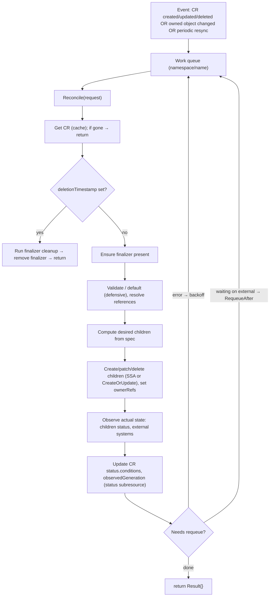

# 5.29 Extending Kubernetes: CRDs and operators

| | |
|---|---|
| Level | Advanced |
| Priority tier | 1 |
| Lab venue | kind or kubeadm; `kubectl`, `kubectl-explain`, `kubeconform`; kubebuilder/Operator SDK for 5.31 |
| Part | Part 5: Kubernetes |
| Status | Drafted, labs **untested** |

## Why this matters for AI infrastructure

Almost every AI-specific component on Kubernetes is a custom resource plus an operator: `ClusterPolicy` (GPU Operator), `NetworkAttachmentDefinition` (Multus), `NicClusterPolicy` (Network Operator), `Workload`/`ClusterQueue` (Kueue), `PyTorchJob`/`MPIJob`/`JobSet`, `RayCluster`/`RayJob`, `InferenceService` (KServe), `Notebook`, `Application` (Argo), `Certificate`, `ServiceMonitor`. Operating GPU platforms means installing, upgrading, debugging and sometimes writing operators. This chapter explains the extension mechanism from the API side (CRDs and their schemas, validation, versioning) and the controller side (operator pattern and maturity, tooling choices), so that you can read an operator's design, reason about its failure modes, and decide how to build your own (5.31, 5.32).

## Prerequisites and outcomes

Needs 5.5 and 5.6 (API machinery and controllers). After this chapter you can:

- Write CRDs with structural schemas, validation (OpenAPI v3, `x-kubernetes-validations` CEL rules, enums/formats/defaults), printer columns, short names, scope, categories; understand pruning and `preserveUnknownFields`.
- Design API versions and conversion (storage version, conversion webhooks, deprecation), subresources (`status`, `scale`), and field ownership (server-side apply).
- Design good CRD APIs (spec/status, conditions, immutability, references, references to secrets, idempotent semantics, extensibility) and avoid anti-patterns.
- Explain the operator pattern, capability levels, and how operators manage lifecycle (install, upgrade, backup, scaling, failure recovery); choose between Helm, Ansible, Go (kubebuilder/Operator SDK), kopf, Metacontroller, Crossplane compositions, Kyverno generate or plain controllers.
- Package and distribute operators (Helm chart, OLM bundles/catalogs, kustomize), manage CRD upgrades safely, and set least-privilege RBAC.
- Test and operate operators: observability, leader election, metrics, events, webhooks, and failure handling.

## 1. Extension points recap

| Mechanism | Extends | Use |
|---|---|---|
| **CRD** | The API with new resource types (served by the API server, stored in etcd) | Declarative config for your domain |
| **Aggregated API server** | The API with a separate server for your types | Custom storage, special semantics (metrics API) |
| **Controller/operator** | Behaviour: reconcile custom (and built-in) resources | Automation |
| **Admission webhooks / ValidatingAdmissionPolicy** | Validation/mutation on writes | Policy, defaulting (5.21) |
| **Custom schedulers/plugins** | Placement | Batch/gang (5.18) |
| **CRI/CNI/CSI/device plugin/DRA** | Node-level integrations | Runtime, network, storage, GPUs |
| **kubectl plugins, Krew** | Client UX | Operator-specific CLIs |

CRDs are the dominant approach: they give you the Kubernetes API machinery (REST, watch, RBAC, audit, server-side apply, `kubectl` support, OpenAPI docs) for free.

## 2. Custom resources and CRDs

A **CustomResourceDefinition** registers a new kind. Example for a GPU health policy:

```yaml
apiVersion: apiextensions.k8s.io/v1
kind: CustomResourceDefinition
metadata:
  name: gpuhealthpolicies.platform.example.com        # <plural>.<group>
spec:
  group: platform.example.com
  scope: Cluster                                       # Namespaced | Cluster
  names:
    kind: GPUHealthPolicy
    listKind: GPUHealthPolicyList
    plural: gpuhealthpolicies
    singular: gpuhealthpolicy
    shortNames: [ghp]
    categories: [platform]
  versions:
    - name: v1alpha1
      served: true
      storage: true
      subresources:
        status: {}                                    # /status subresource: spec and status writes separated
      additionalPrinterColumns:
        - { name: Selector, type: string, jsonPath: .spec.nodeSelectorString }
        - { name: XidAction, type: string, jsonPath: .spec.xid.action }
        - { name: Matched, type: integer, jsonPath: .status.matchedNodes }
        - { name: Ready, type: string, jsonPath: ".status.conditions[?(@.type=='Ready')].status" }
        - { name: Age, type: date, jsonPath: .metadata.creationTimestamp }
      schema:
        openAPIV3Schema:
          type: object
          required: [spec]
          properties:
            spec:
              type: object
              required: [xid]
              properties:
                nodeSelector:
                  type: object
                  additionalProperties: { type: string }
                xid:
                  type: object
                  required: [codes, action]
                  properties:
                    codes:
                      type: array
                      minItems: 1
                      items: { type: integer, minimum: 1, maximum: 200 }
                    action:
                      type: string
                      enum: [Ignore, Cordon, CordonAndDrain]
                      default: Cordon
                    windowSeconds: { type: integer, minimum: 30, default: 600 }
                maxUnavailableNodes:
                  x-kubernetes-int-or-string: true
                  default: "5%"
              x-kubernetes-validations:
                - rule: "self.xid.action != 'CordonAndDrain' || has(self.maxUnavailableNodes)"
                  message: "maxUnavailableNodes is required when action is CordonAndDrain"
            status:
              type: object
              properties:
                observedGeneration: { type: integer, format: int64 }
                matchedNodes: { type: integer }
                conditions:
                  type: array
                  x-kubernetes-list-type: map
                  x-kubernetes-list-map-keys: [type]
                  items:
                    type: object
                    required: [type, status]
                    properties:
                      type: { type: string }
                      status: { type: string, enum: ["True", "False", "Unknown"] }
                      reason: { type: string }
                      message: { type: string }
                      lastTransitionTime: { type: string, format: date-time }
                      observedGeneration: { type: integer, format: int64 }
```

```yaml
apiVersion: platform.example.com/v1alpha1
kind: GPUHealthPolicy
metadata: { name: default }
spec:
  nodeSelector: { nvidia.com/gpu.present: "true" }
  xid: { codes: [48, 63, 64, 79], action: CordonAndDrain, windowSeconds: 300 }
  maxUnavailableNodes: "2"
```

### Schema and validation

- **Structural schemas** are required (v1 CRDs): every field typed, no `type`-less nodes (except with `x-kubernetes-preserve-unknown-fields` or `x-kubernetes-int-or-string`/`x-kubernetes-embedded-resource`). The API server **prunes** unknown fields on write by default (`preserveUnknownFields: false`), so unspecified fields are silently dropped unless you declare them: a common surprise.
- **OpenAPI v3 validation**: `type`, `required`, `enum`, `minimum/maximum`, `minLength/maxLength`, `pattern`, `format` (`date-time`, `int64`, `uuid`, ...), `minItems/maxItems/uniqueItems`, `additionalProperties`, `nullable`, `oneOf/anyOf/allOf/not` (with restrictions).
- **Defaulting** (`default:`) applied on create/update and when reading from etcd; keep defaults simple.
- **CEL validation rules** (`x-kubernetes-validations`; GA): cross-field checks (`self.a < self.b`), immutability (`self == oldSelf` with `optionalOldSelf`/`transition rules`), format checks, cost-limited expressions (CEL cost budget enforced at CRD creation; bound string/list lengths); better than writing validating webhooks for most rules.
- **Immutability**: `x-kubernetes-validations: [{rule: "self == oldSelf", message: "immutable"}]` on a field (e.g., immutable storage class or model name).
- **List semantics for server-side apply**: `x-kubernetes-list-type: atomic|set|map` and `x-kubernetes-list-map-keys`; `x-kubernetes-map-type: granular|atomic`. Critical for multi-writer coexistence and for lists of conditions/containers.
- **Printer columns & categories**: `kubectl get gpuhealthpolicies` shows useful columns; `kubectl get all` includes `categories: [all]`.
- **Scope**: `Namespaced` for tenant-owned objects; `Cluster` for global policy/infra.
- **Naming**: group should be a DNS name you own; plural lowercase; avoid `*.k8s.io` groups unless upstream-approved.

### Subresources

- `status`: spec and status updates via `/status` with separate RBAC; controllers write status without bumping `metadata.generation`; users cannot spoof status (when `status` subresource is enabled, writes to `status` through the main endpoint are ignored).
- `scale`: maps `specReplicasPath`, `statusReplicasPath`, `labelSelectorPath` so HPA, `kubectl scale`, and Kueue can scale your CR.
- Others implemented by aggregated APIs or controllers (e.g., `exec`, `log`) are not available to CRDs.

### Versions and conversion

Multiple versions can be served simultaneously; exactly one is the **storage version**. Conversion strategies: `None` (only `apiVersion` rewritten; schemas must be compatible) or a **conversion webhook** (`Webhook`) implementing lossless round-trip conversion (hub-and-spoke: convert via a hub version; controller-runtime/kubebuilder scaffolds conversion). Upgrade flow: add `v1beta1` (served, not storage) → migrate storage version (`storage: true` on new, existing objects remain in old until rewritten: run a storage-version migration (`kube-storage-version-migrator`, or re-write all objects via `kubectl get ... -o json | kubectl replace`) → stop serving old versions after clients migrate → remove from `status.storedVersions` before removing the version from the CRD. Follow Kubernetes API conventions: alpha (v1alpha1: may change), beta, stable; deprecate with `deprecated: true` and `deprecationWarning` in the version spec.

### Garbage collection, owner references and finalizers

Operators create child objects with `ownerReferences` pointing to the CR (set controller reference) so deleting the CR garbage-collects children. For **external** resources (cloud load balancers, DNS, GPU node labels/cordons, storage buckets) GC can't help: use **finalizers** (`platform.example.com/cleanup`) to run cleanup before the CR disappears: controller sees `deletionTimestamp`, performs cleanup, removes the finalizer. Failure to remove finalizers (operator uninstalled before CRs deleted) leaves CRs stuck Terminating: uninstall order matters (delete CRs first, then the operator, then CRDs).

### Status and conditions

Follow conventions (`conditions` list with `type`, `status`, `reason` (CamelCase), `message`, `observedGeneration`, `lastTransitionTime`; top-level `observedGeneration`, `phase` discouraged in favour of conditions). Users and automation (GitOps health checks, `kubectl wait --for=condition=Ready`) rely on these.

### API design guidance

1. **Declarative spec = desired end state**, not actions; avoid imperative fields ("restartNow: true"); model one-off actions as separate resources (`Request`/`Job`-like CRs with status) or annotations handled idempotently.
2. **Small, stable core spec** with extensible, optional blocks; prefer references (`secretRef`, `configMapRef`, `targetRef`) over embedding secrets/big blobs; use typed references (kind/name/namespace) and validate/handle missing references with conditions.
3. **Immutable identity fields**; use CEL immutability rules; changing fundamental fields means a new object.
4. **Idempotent reconcile**; status reflects observed truth; do not store controller state only in memory (store it in status or child objects).
5. **Avoid unbounded growth** in status (lists of events/logs); use Events for history, metrics for time series, and caps with summarisation.
6. **Version for evolution**: additive changes within a version; breaking changes in a new version with conversion.
7. **Do not hide dangerous behaviour** behind innocuous fields; document side effects, defaults, and failure semantics; provide `kubectl explain` text (CRD field `description`).
8. **Scope carefully**: cluster-scoped CRs need strong RBAC; namespaced CRs with cross-namespace references require explicit allow semantics (like Gateway API's ReferenceGrant).
9. **Size limits**: objects are limited to ~1.5 MiB in etcd; thousands of CRs with large status can load the API/etcd: keep status small.
10. **Generate docs and clients** from types (controller-gen, crd-ref-docs).

## 3. The operator pattern

An **operator** is a custom controller that encodes operational knowledge for an application or infrastructure component as software, managing it through CRs. Typical responsibilities: install/configure, scale, upgrade (rolling, with migrations), backup/restore, failover, health remediation, certificate rotation, reconcile drift, and expose status/metrics.

### Capability levels (Operator Framework model)

| Level | Capability | Example for a GPU operator |
|---|---|---|
| 1 | Basic install: provision resources, configuration via CR | Deploy driver DaemonSet from `ClusterPolicy` |
| 2 | Seamless upgrades: patch and minor version upgrades | Rolling driver upgrade with node drain policy |
| 3 | Full lifecycle: backup, failure recovery, storage lifecycle | Re-validate nodes after maintenance |
| 4 | Deep insights: metrics, alerts, log processing, workload analysis | DCGM exporter and ServiceMonitors, health conditions |
| 5 | Auto pilot: auto-scaling, auto-tuning, abnormality detection, scheduling tuning | Auto-cordon unhealthy GPUs, MIG reconfiguration based on demand |

### Typical operator reconcile structure



Core rules (mirrors 5.6): idempotence; level-triggered; short reconciles (no long blocking calls: use requeue); handle conflicts (retry); don't assume the cache is current; keep reconciliation per-object independent; watch what you own (`Owns()`) and what you reference (`Watches()` with map functions); predicates to avoid hot loops (ignore status-only changes with `GenerationChangedPredicate`); structured logging with the CR key; emit Events for user-visible milestones; expose Prometheus metrics (reconcile counts/latency/errors, queue depth).

### Operator implementation choices

| Option | Language | Pros | Cons |
|---|---|---|---|
| **kubebuilder / controller-runtime** | Go | De facto standard; strong typing, webhooks, envtest; large ecosystem | Go knowledge; boilerplate; steep for beginners |
| **Operator SDK** | Go (kubebuilder-based), Helm, Ansible | Scaffolding for OLM bundles; supports Helm/Ansible operators | Overlaps with kubebuilder; projects converging |
| **Helm-based operator** | Helm charts | Quick for existing charts; maps CR spec to values | Limited logic (no complex orchestration, only template + install/upgrade) |
| **Ansible-based operator** | Ansible | Operational playbooks as reconcile logic; ops teams' skills (4.3–4.17) | Slower, harder to test at scale; shell-heavy |
| **Metacontroller / shell-operator** | Webhooks/scripts | Lightweight; any language | Less control; custom framework |
| **kopf** | Python | Python-native (ML teams) | Performance/scale limits; fewer features |
| **Java Operator SDK, Rust kube-rs** | Java/Rust | Language fit | Smaller ecosystems |
| **Crossplane Compositions / KCL / Kro** | Declarative functions | Compose existing resources into higher-level APIs; no custom controller code | Limited to composition semantics |
| **Kyverno/Argo-based automation** | YAML policies/workflows | Quick for generate/mutate patterns | Not a general operator |
| **GitOps + Helm only** | None | Simplest | No runtime reconciliation of application-specific logic |

Guideline: if you only need templated resources, use Helm/Kustomize/Crossplane; if you need runtime decisions (health, ordering, rolling operations, interaction with node hardware or external APIs), write a controller (Go for production-grade; Python/kopf for prototypes and small scopes).

### Programming the Kubernetes API from Python (`kubernetes` OpenAPI client)

While Go (`client-go` and `controller-runtime`, covered in 5.30 and 5.31) is the primary language for cluster-core controllers, ML platform engineers frequently write automation, job launch wrappers, and lightweight controllers in Python using the official OpenAPI-generated `kubernetes` client library (`pip install kubernetes`). Because the official Python, Java, and .NET clients are generated from Kubernetes's OpenAPI specification (and you can inspect the exact HTTP calls any `kubectl` command makes by passing `--v=10`), they share a uniform structure around API groups (`CoreV1Api`, `AppsV1Api`) and namespaced versus cluster-scoped methods. As *Kubernetes: Up and Running* (3rd edition, Chapter 18) demonstrates, the core Python patterns are (untested here):

```python
from kubernetes import client, config, watch
from kubernetes.stream import portforward, stream

# 1. Authenticate: load $KUBECONFIG / ~/.kube/config outside a cluster,
#    or the mounted ServiceAccount token + CA inside a Pod:
config.load_kube_config()          # or: config.load_incluster_config()

v1 = client.CoreV1Api()
apps_v1 = client.AppsV1Api()

# 2. List namespaced Pods:
pod_list = v1.list_namespaced_pod("default")

# 3. Construct and create a Pod (or patch a resource):
container = client.V1Container(name="myapp", image="my_cool_image:v1")
pod = client.V1Pod(
    metadata=client.V1ObjectMeta(name="myapp"),
    spec=client.V1PodSpec(containers=[container]),
)
v1.create_namespaced_pod(namespace="default", body=pod)
# Partial updates use patch_namespaced_pod / patch_namespaced_deployment:
# v1.patch_namespaced_pod(name="myapp", namespace="default", body=pod)

# 4. Watch a resource stream (event-driven hanging GET instead of polling):
w = watch.Watch()
for event in w.stream(v1.list_namespaced_pod, "some-namespace"):
    print(event["type"], event["object"].metadata.name)

# 5. Read Pod logs, execute commands over WebSockets (stream), and port-forward:
log = v1.read_namespaced_pod_log(name="my-pod", namespace="some-namespace")
cmd = ["ls", "/foo"]
response = stream(
    v1.connect_get_namespaced_pod_exec,
    "my-pod",
    "some-namespace",
    command=cmd,
    stderr=True,
    stdin=False,
    stdout=True,
    tty=False,
)
pf = portforward(
    v1.connect_get_namespaced_pod_portforward,
    "my-pod",
    "some-namespace",
    ports="8080",
)
```

For higher-level platform abstractions built on top of CRDs and operators (such as the `Team` self-service onboarding CRD and Pinterest's `PinterestService` workload CRD from *Production Kubernetes*, Chapter 16), see Chapter 5.22 (§4).

## 4. Packaging, distribution and lifecycle

- **Packaging**: container image for the manager; Kustomize/Helm chart for deployment; **CRDs** shipped separately (Helm `crds/` directory installs but never upgrades; many projects ship CRDs as a separate chart or `kubectl apply --server-side` step, or rely on the operator to apply its own CRDs); RBAC (ClusterRole/Role generated from `+kubebuilder:rbac` markers); webhooks (cert-manager-issued certs, `caBundle` injection); ServiceMonitor, PodDisruptionBudget, NetworkPolicy, PriorityClass for the manager.
- **OLM (Operator Lifecycle Manager)**: OpenShift's default and available on vanilla Kubernetes: `ClusterServiceVersion`, `CatalogSource`, `Subscription`, `OperatorGroup`; handles installation, upgrade graphs (`replaces`, `skipRange`), dependency resolution, and automatic updates from channels; **bundle format** and **operator-sdk bundle** tooling. Alternatives: OperatorHub, Helm charts, GitOps with pinned versions (preferred in many AI platforms for explicit control).
- **Upgrading CRDs**: schema changes must be backward compatible while old objects exist; tighten validation carefully (existing invalid objects block updates); add new fields as optional with defaults; handle storage version migrations; test upgrades with real objects (`kubectl apply` new CRD on top of populated cluster). Never delete a CRD on upgrade (deletes all CRs). Pin operator and CRD versions together.
- **RBAC least privilege**: grant only the verbs on the resources the controller reconciles; split cluster-scoped from namespaced permissions; avoid `*`; review generated rules (5.16); use `resourceNames` where feasible; separate ServiceAccounts for webhooks; restrict who can create CRs of powerful kinds.
- **Multi-tenancy of operators**: cluster-wide operators vs namespace-scoped (watch a namespace set); version skew across clusters; CRD ownership conflicts when two operators claim the same kind.
- **Operational readiness**: leader election (Lease), graceful shutdown, resource requests, `priorityClassName: system-cluster-critical` for infrastructure operators, PDBs, liveness/readiness (`healthz`/`readyz` from controller-runtime), metrics endpoint (secured), structured logs, tracing, runbooks, alerts (reconcile error rate, queue depth, webhook latency), SBOM/signing (5.27), upgrade tests, chaos tests (kill the manager mid-reconcile).
- **Failure modes**: webhook outage blocking CR creation; finalizer deadlocks; reconcile hot loops; unbounded retries hammering external APIs; conflicting controllers (two operators managing the same child); leaked external resources when finalizers are missing; stale caches causing duplicate creates; huge status growth; CRD conversion bugs corrupting data; operator crash loops after schema change; CR deleted before operator installed (no cleanup).

## 5. AI-platform operators (what to know)

| Operator | Key CRDs | What it manages | Notes |
|---|---|---|---|
| **NVIDIA GPU Operator** | `ClusterPolicy`, `NVIDIADriver` | Driver, container toolkit, device plugin, GFD/NFD, DCGM + exporter, MIG manager, validator, vGPU manager, GDS/GDRCopy, CC manager | Node-feature-based DaemonSets (5.33) |
| **NVIDIA Network Operator** | `NicClusterPolicy`, `HostDeviceNetwork`, `MacvlanNetwork`, `IPoIBNetwork`, `SriovNetworkNodePolicy` (with SR-IOV operator) | MOFED driver, RDMA shared device plugin, Multus, CNI plugins, NV-IPAM, NIC firmware/config | Secondary networks for RDMA (5.13) |
| **NVIDIA DRA driver, NIM Operator** | `ResourceClaim` (core), `NIMService`, `NIMCache` | GPU DRA kubelet plugin, NIM microservice lifecycle and model caching | Newer |
| **Kueue** | `ResourceFlavor`, `ClusterQueue`, `LocalQueue`, `Workload` | Admission/quotas (5.18) | Integrates with Jobs, JobSet, MPIJob, PyTorchJob, RayJob |
| **JobSet** | `JobSet` | Groups of Jobs with policies | Multi-slice training |
| **Kubeflow Training Operator / Trainer v2** | `PyTorchJob`, `TFJob`, `MPIJob` (+ `TrainJob`, `TrainingRuntime`) | Distributed training pods, rendezvous env, elastic policies | v2 unifies APIs |
| **MPI Operator** | `MPIJob` | Launcher/worker pods and hostfiles with SSH or kubectl-exec bootstrapping | |
| **KubeRay** | `RayCluster`, `RayJob`, `RayService` | Ray clusters, autoscaling, zero-downtime service upgrades | Inference and training |
| **KServe** | `InferenceService`, `ServingRuntime`, `InferenceGraph`, `LLMInferenceService` | Model serving, autoscaling, canary, protocol adapters | Knative or raw deployment mode |
| **Volcano** | `Queue`, `PodGroup`, `Job` | Batch scheduler | |
| **Prometheus Operator** | `ServiceMonitor`, `PrometheusRule` ... | Monitoring (5.24) | |
| **cert-manager** | `Certificate`, `Issuer` | PKI (5.12, 5.21) | |
| **Argo CD / Argo Workflows / Rollouts** | `Application`, `Workflow`, `Rollout` | GitOps, pipelines, progressive delivery | |
| **Cluster API** | `Cluster`, `Machine*` | Cluster lifecycle (5.19) | |
| **Rook-Ceph, CSI operators** | `CephCluster`, ... | Storage | |
| **Slurm operators (Slinky/Soperator)** | `Cluster`, `NodeSet`, `Controller` ... | Slurm on Kubernetes | Part 6 |
| **Node problem/health operators** | Custom (5.32) | GPU node health remediation | You will build one |

When evaluating an operator: maturity level, upgrade story (CRD handling), RBAC breadth, failure semantics (what happens when the operator is down or CRs are deleted), observability, resource footprint, support policy, supply-chain posture (signed images/SBOM), documentation and API stability (alpha vs v1).

## 6. Lab

First, run the self-checking Python lab (`code/part05/crd_schema_conversion_sim_lab.py`) locally. It verifies the CRD structural schema pruner, defaulter, and `x-kubernetes-validations` CEL rule evaluator (`evaluate_crd_schema_and_cel`), the hub-and-spoke multi-version conversion and `status.storedVersions` migrator (`convert_crd_via_hub_and_migrate_storage`), and the operator finalizer and `/status` subresource reconciler (`reconcile_cr_with_finalizer_and_status`).

```bash
python3 code/part05/crd_schema_conversion_sim_lab.py
```

Next, on a `kind` or `kubeadm` cluster (all interactive shell steps below are `untested here`), work through these exercises:

1. **Write a CRD**: create the `GPUHealthPolicy` CRD above; apply; test valid and invalid objects (enum violation, missing `codes`, CEL rule failure, unknown field pruning); inspect `kubectl explain gpuhealthpolicy.spec --recursive`; add printer columns and check `kubectl get`.
2. **Defaults and pruning**: remove a field from the schema and observe pruning; add `x-kubernetes-preserve-unknown-fields` and compare; test defaulting on create vs update.
3. **CEL**: add immutability rule for a field; cross-field validation; transition rule; hit CEL cost limits by leaving unbounded arrays and fix with `maxItems`/`maxLength`.
4. **Status subresource**: patch `status` via `kubectl patch --subresource=status`; try writing status via the main endpoint (ignored); check that `generation` doesn't change on status updates.
5. **Versions and conversion**: add `v1beta1` with a renamed field, use `conversion.strategy: None` (observe data loss), then implement a minimal conversion webhook (Go/Python) and verify round trips; run the storage-version migration and verify `status.storedVersions`.
6. **Finalizers**: create a toy controller (shell loop with kubectl, or Python/kopf) that adds a finalizer and "cleans up" an external file; delete the CR and observe Terminating until cleanup; uninstall the controller to reproduce the stuck CR; recover.
7. **Operator options**: implement the same trivial "ensure a ConfigMap per CR" as (a) Helm-based operator, (b) kopf handler, (c) controller-runtime (5.31); compare code size, behaviour on restarts, conflict handling.
8. **Server-side apply with CRs**: two field managers editing different list items in a `map`-type vs `atomic` list; observe conflicts/ownership with `--show-managed-fields`.
9. **Inspect real operators**: install the GPU Operator (or Kueue) in kind; list CRDs/RBAC/webhooks; read the CRD schemas and `ClusterPolicy` spec; find finalizers, owner refs on its DaemonSets, and the status conditions; delete the operator (not CRs) and note effects.
10. **Failure drills**: kill the manager mid-reconcile; delete a child object; break the webhook; apply an invalid CR created before a CRD tightening; fill status with large data and observe API impact.
11. **Upgrade drill**: upgrade the operator image with a CRD schema change in a populated cluster; verify existing CRs; roll back; document the playbook (also relevant to 5.20).
12. **Design review**: take a proposed `TrainingRun` CRD and review against the API design guidance: spec/status separation, immutability, references, conditions, quotas; rewrite.
13. **Clean up**.

## 7. Common mistakes

- CRDs without structural schemas or without validation; silent pruning of fields.
- Imperative CRD fields; mutable identity fields; unbounded status.
- Writing status through the main resource or without `observedGeneration`.
- Controllers that don't set ownerReferences or finalizers for external resources; deleting the operator before CRs.
- Helm `crds/` upgrade assumptions; deleting CRDs during upgrades (data loss).
- Hot loops from status updates triggering reconciles; no backoff; stuffing long-running work into Reconcile.
- Webhooks as single points of failure; conversion webhooks without round-trip tests.
- Over-broad RBAC and cluster-scoped CRs without access control.
- Two operators/controllers managing the same objects (including Terraform/GitOps vs operator).
- Building an operator when Helm/Crossplane would do; or Helm when runtime decisions are needed.

## 8. Interview angles

- "What is a CRD? How is it different from an aggregated API server?"
- "What is an operator? Describe its reconcile loop and the capability levels."
- "How do you version a CRD and migrate stored objects?"
- "What are finalizers and owner references? How do they apply to external resources?"
- "How do you validate custom resources? CEL vs webhooks?"
- "How do you decide between Helm, Ansible, Go and Crossplane for automation?"
- "What happens to CRs and workloads when an operator is uninstalled or crashes?"
- "Explain how the GPU Operator is structured and what could go wrong during an upgrade."

## Exercises

1. **CustomResourceDefinition (`CRD`) Anatomy, Structural Schemas, Unknown-Field Pruning, and `x-kubernetes-validations` CEL Rules (`KPG` Ch. 8):** Using `evaluate_crd_schema_and_cel()` in `code/part05/crd_schema_conversion_sim.py`, trace the `GPUHealthPolicy` CRD in Section 2, explaining why structural schemas are mandatory, why undeclared fields are silently pruned on write (`preserveUnknownFields: false`), how `x-kubernetes-list-type: map` (`x-kubernetes-list-map-keys: [type]`) works with Server-Side Apply, and how CEL rules enforce cross-field validation (`CordonAndDrain` requiring `maxUnavailableNodes`) and immutability (`self == oldSelf`).
2. **CRD Subresources (`/status` and `/scale`), Multi-Version Serving, Hub-and-Spoke Conversion, and Storage Version Migration:** Using `convert_crd_via_hub_and_migrate_storage()` in `code/part05/crd_schema_conversion_sim.py`, explain why enabling `subresources.status: {}` prevents `spec` updates from overwriting `status` (and vice versa), why `etcd` stores only one `storage: true` version, and trace the 4-step procedure to migrate a CRD from `v1alpha1` to `v1beta1` and remove `v1alpha1` from `status.storedVersions`.
3. **The Operator Pattern, the 5 Operator Capability Levels, and the Reconcile Loop (`ownerReferences` vs. `finalizers`):** Using `reconcile_cr_with_finalizer_and_status()` in `code/part05/crd_schema_conversion_sim.py`, trace the Section 3 reconcile flowchart, contrasting `ownerReferences` (for Kubernetes child objects) with `finalizers` (for external resources like node cordons or cloud buckets) and explaining why uninstalling an operator before deleting its CRs deadlocks CR deletion.
4. **Programming Kubernetes from Python (`kubernetes` OpenAPI Client and `kopf`, `KUR` Chapter 18):** Trace the 5 Python patterns in Section 3 (`config.load_kube_config()` vs `config.load_incluster_config()`, `CoreV1Api`/`AppsV1Api` CRUD and `patch_namespaced_deployment`, `watch.Watch().stream()`, `stream(v1.connect_get_namespaced_pod_exec, ...)`, and `portforward(v1.connect_get_namespaced_pod_portforward, ...)`), and compare `kubebuilder` (Go), `Operator SDK` (Go/Helm/Ansible), `kopf` (Python), `Metacontroller`, and `Crossplane`.
5. **Packaging, Distributing, and Upgrading Operators (`Helm crds/` Pitfall, `OLM`, RBAC, and Operational Readiness):** Explain why Helm's `crds/` directory installs CRDs on `helm install` but **never updates them on `helm upgrade`**, how to safely upgrade CRDs in GitOps without deleting CRs, and how OLM (`ClusterServiceVersion`, `CatalogSource`, `Subscription`, `OperatorGroup`) manages operator lifecycles.
6. **Mapping the AI-Platform Operator Ecosystem (`GPU Operator`, `Network Operator`, `Kueue`, `JobSet`, `Kubeflow Training Operator`, `KubeRay`, `KServe`):** For each AI operator in Section 5, list its primary CRDs, what child resources it reconciles, and what happens to running GPU workloads if the operator controller Pod crashes or is upgraded.

## Checkpoint questions (20)

<details>
<summary>1. Compare a `CustomResourceDefinition` (`CRD`) with an `Aggregated API Server` (`APIService`).</summary>

- **`CustomResourceDefinition` (`CRD`, `apiextensions.k8s.io/v1`):** Requires **zero extra API server binaries or databases**—`kube-apiserver` itself serves the REST endpoints (`/apis/<group>/<version>/...`), validates schemas/CEL rules, and persists the JSON objects in the cluster's main **`etcd`**. Used for 99% of Kubernetes extensions.
- **`Aggregated API Server` (`APIService`, `apiregistration.k8s.io/v1`):** You run your own custom HTTPS API server Deployment behind `kube-apiserver`'s front-proxy. Used only when your resource **should NOT be stored in `etcd`** (like `metrics-server` serving in-memory `metrics.k8s.io` or `prometheus-adapter` serving `custom.metrics.k8s.io`) or requires custom non-CRUD subresources (like `exec`/`portforward`).
</details>

<details>
<summary>2. What is a "Structural Schema" in a `v1` CRD, and what happens when a user applies a Custom Resource containing a field that is not declared in `openAPIV3Schema`?</summary>

A **structural schema** requires that every field at every nesting level (and in every version) explicitly declares its OpenAPI `type` (`object`, `array`, `string`, `integer`, `boolean`) without ambiguous type-less polymorphism.
By default in `apiextensions.k8s.io/v1`, **`preserveUnknownFields` is `false` (Pruning enabled)**: if a user applies a Custom Resource YAML containing a typo or an undeclared field (e.g., `spec.maxUnavailbleNodes` instead of `spec.maxUnavailableNodes`), **`kube-apiserver` silently prunes (drops) the unknown field before persisting to `etcd`** (unless the client uses `kubectl apply --validate=strict`, which catches unknown fields on the client/server).
</details>

<details>
<summary>3. How do `x-kubernetes-validations` (CEL rules) inside a CRD schema enforce (a) cross-field invariants and (b) field immutability (`self == oldSelf`) without a Validating Admission Webhook?</summary>

`x-kubernetes-validations` embeds **Common Expression Language (`CEL`)** rules directly inside `openAPIV3Schema` at any field or object level:
- **Cross-field validation:**
  ```yaml
  x-kubernetes-validations:
    - rule: "self.xid.action != 'CordonAndDrain' || has(self.maxUnavailableNodes)"
      message: "maxUnavailableNodes is required when action is CordonAndDrain"
  ```
- **Transition / Immutability rule (comparing `self` against `oldSelf` on `UPDATE`):**
  ```yaml
  targetPool:
    type: string
    x-kubernetes-validations:
      - rule: "self == oldSelf"
        message: "spec.targetPool is immutable once set"
  ```
Because `kube-apiserver` evaluates these CEL rules in-process during schema validation, they execute in microseconds with zero webhook network dependency.
</details>

<details>
<summary>4. Why do `x-kubernetes-list-type: map` and `x-kubernetes-list-map-keys: [type]` matter on a `status.conditions` array in a CRD?</summary>

Without `x-kubernetes-list-type: map`, OpenAPI treats a YAML array as an **`atomic` list**—meaning any Server-Side Apply (`SSA`) patch or merge replaces the entire list as a single unit, causing two controllers that update different condition types (`Ready` vs `Validated`) to overwrite each other's conditions.
Annotating `conditions` with **`x-kubernetes-list-type: map`** and **`x-kubernetes-list-map-keys: [type]`** tells `kube-apiserver` to treat the array as an associative map keyed by the `type` field, allowing multiple controllers to merge individual condition entries cleanly.
</details>

<details>
<summary>5. What happens when `subresources.status: {}` is enabled on a CRD version?</summary>

Enabling `subresources.status: {}` exposes a separate REST endpoint `/apis/<group>/<version>/.../gpuhealthpolicies/<name>/status` and changes three behaviors:
1. **`PUT`/`PATCH` to the main resource endpoint ignores `.status`:** A user running `kubectl apply -f policy.yaml` cannot accidentally overwrite or spoof `.status`.
2. **`PUT`/`PATCH` to the `/status` subresource ignores `.spec` and `.metadata` (except labels/annotations)** and **does NOT increment `metadata.generation`**.
3. **Separate RBAC:** Users can be granted `create`/`update` on `gpuhealthpolicies` while only the operator's ServiceAccount is granted `update`/`patch` on **`gpuhealthpolicies/status`**.
</details>

<details>
<summary>6. How does `subresources.scale` allow `HorizontalPodAutoscaler` (`HPA`), `Kueue`, and `kubectl scale` to scale a Custom Resource (`RayCluster` or `InferenceService`)?</summary>

Enabling `subresources.scale` on a CRD version maps three JSONPaths in the Custom Resource to the standard `autoscaling/v1` `Scale` object:
- **`specReplicasPath: .spec.replicas`** (where `kubectl scale --replicas=4` or HPA writes desired replicas).
- **`statusReplicasPath: .status.replicas`** (where HPA reads current active replicas).
- **`labelSelectorPath: .status.selector`** (the serialized label selector string that HPA uses to query per-Pod custom metrics for the CR's Pods).
</details>

<details>
<summary>7. Walk through the exact 5-step procedure to evolve a CRD from `v1alpha1` to `v1beta1` with a breaking schema change and safely remove `v1alpha1`.</summary>

1. **Deploy the Hub-and-Spoke Conversion Webhook** in your operator (`conversion.strategy: Webhook` on the CRD) and add `v1beta1` to `spec.versions` with **`served: true, storage: false`** (`v1alpha1` remains `storage: true` during canary testing).
2. **Flip the Storage Version:** Set **`v1beta1` to `storage: true`** and `v1alpha1` to `served: true, storage: false`. All *new* writes are now persisted in `etcd` as `v1beta1`, while older untouched objects in `etcd` are still stored as `v1alpha1` (so `crd.status.storedVersions` lists `["v1alpha1", "v1beta1"]`).
3. **Migrate Existing Stored Objects in `etcd`:** Run `kube-storage-version-migrator` or rewrite every existing CR (`kubectl get ghp -A -o json | kubectl replace -f -`) so `etcd` re-persists all objects in `v1beta1`.
4. **Stop Serving `v1alpha1`:** Once all clients/manifests have migrated to `v1beta1` (verified via deprecated API metrics/audit logs), set `v1alpha1` to **`served: false`** and patch `crd.status.storedVersions` to `["v1beta1"]`.
5. **Remove `v1alpha1` from `spec.versions`** in a subsequent release. (If you try to remove `v1alpha1` from `spec.versions` while it is still listed in `status.storedVersions`, `kube-apiserver` rejects the CRD update.)
</details>

<details>
<summary>8. When should an Operator use `ownerReferences` vs. `finalizers` (`platform.example.com/cleanup`), and what happens if you uninstall an Operator *before* deleting its Custom Resources?</summary>

- **`ownerReferences`:** Used for **in-cluster Kubernetes child objects** (`Deployment`, `DaemonSet`, `Service`, `ConfigMap`) in the same namespace (or any scope if the owner is cluster-scoped). Kubernetes's built-in Garbage Collector deletes them automatically when the parent CR is deleted—even if the operator pod is down.
- **`finalizers`:** Mandatory whenever deleting the CR requires **custom external cleanup logic** that the Kubernetes Garbage Collector cannot perform (such as uncordoning/removing labels from Nodes, deleting an external S3 bucket/DNS record, or cleanly draining a GPU driver).
- **The Uninstall Trap:** If a CR has `finalizers: ["platform.example.com/cleanup"]` and you **delete the operator Deployment first** and then run `kubectl delete ghp default`, `kube-apiserver` sets `deletionTimestamp` on `ghp/default` and waits for the operator to remove the finalizer—leaving the CR (and its namespace) **stuck in `Terminating` forever**. Always delete CRs *before* uninstalling their operator.
</details>

<details>
<summary>9. What are the five levels of the **Operator Capability Model** (Operator Framework), and how do they map to a GPU Operator?</summary>

1. **Level 1 — Basic Install:** Automated provisioning and configuration of child resources (`DaemonSet`s for driver, toolkit, device plugin) from a single `ClusterPolicy` CR.
2. **Level 2 — Seamless Upgrades:** Automated patch and minor upgrades of both the operator and the managed operands (rolling GPU driver upgrade controller with cordon/drain).
3. **Level 3 — Full Lifecycle:** Backup/restore, state management, and failure recovery (re-validating GPU nodes after reboot or maintenance).
4. **Level 4 — Deep Insights:** Exposing Prometheus metrics (`dcgm-exporter`), `ServiceMonitor`s, alerts, and detailed `status.conditions`.
5. **Level 5 — Auto Pilot:** Horizontal/vertical auto-scaling, auto-tuning, anomaly detection, and self-healing (automatically cordoning a GPU node on fatal XID errors or reconfiguring MIG profiles dynamically).
</details>

<details>
<summary>10. In `Reconcile(ctx, req)`, what are the three ways a `controller-runtime` reconciler can return (`Result{}`, `Result{RequeueAfter: d}`, or an `error`), and how does the WorkQueue handle each?</summary>

1. **`return ctrl.Result{}, nil` (Success, Done):** The worker calls `queue.Forget(req)` (resetting the key's backoff counter) and `queue.Done(req)`. The key will not run again until a watched event (`Create`/`Update`/`Delete` on the CR or an owned child) occurs.
2. **`return ctrl.Result{RequeueAfter: 30 * time.Second}, nil` (Success, Poll External State):** Resets error backoff and schedules the key to be re-enqueued after a fixed 30-second delay (used when waiting on an external non-watchable job or hardware power-cycle).
3. **`return ctrl.Result{}, err` (Transient Error):** The worker calls **`queue.AddRateLimited(req)`**, which re-enqueues the key with **exponential backoff** (`5ms, 10ms, 20ms, ...` up to `1000s`) and increments `controller_runtime_reconcile_errors_total`.
</details>

<details>
<summary>11. Why does Helm's built-in `crds/` directory cause upgrade bugs for Operators in production, and how do mature teams manage CRD upgrades?</summary>

By design, **Helm 3 installs YAML files placed in a chart's `crds/` directory on `helm install`, but completely ignores the `crds/` directory on `helm upgrade` and `helm rollback`** (to prevent accidental CRD deletion and cluster-wide CR data loss).
Consequently, when you run `helm upgrade gpu-operator` to a new chart version that added new fields to `ClusterPolicy`, the operator Pod upgrades to the new binary while the old CRD schema remains in `etcd`—causing the operator to fail when writing the new fields.
**Production fix:** Manage CRDs as a **separate, explicit step before upgrading the operator chart**—either via a dedicated `-crds` Helm chart, a pre-sync Argo CD wave (`argocd.argoproj.io/sync-wave: "-1"` with `ServerSideApply=true`), or an explicit `kubectl apply --server-side -f crds/` step in GitOps.
</details>

<details>
<summary>12. Why do large CRDs (like `kube-prometheus-stack`, `Istio`, or `GPU Operator` CRDs) often fail on client-side `kubectl apply -f crd.yaml` with `metadata.annotations: Too long: must have at most 262144 bytes`, and what flag fixes it?</summary>

Client-side `kubectl apply` copies the entire YAML of the CRD into the **`kubectl.kubernetes.io/last-applied-configuration` annotation**, which is capped at **256 KiB (`262,144` bytes)**. A comprehensive CRD with OpenAPI v3 schemas for multiple versions easily exceeds 256 KiB.
Running **`kubectl apply --server-side -f crd.yaml`** (or `ServerSideApply=true` in Argo CD) uses **Server-Side Apply (`managedFields`)** instead of the `last-applied-configuration` annotation, completely avoiding the 256 KiB annotation limit.
</details>

<details>
<summary>13. What happens to already-running GPU workloads (or `PyTorchJob` / `RayCluster` Pods) if the Operator controller Pod (`gpu-operator` or `kuberay-operator`) crashes or is scaled to 0?</summary>

**Already-running Pods and DaemonSets continue running normally.** Because operators work by creating native Kubernetes child resources (`DaemonSet`, `Pod`, `Service`, `ConfigMap`) or configuring host drivers that are already active, a crashed operator does not kill running workloads.
However, while the operator is down, **reconciliation is paused**: new `PyTorchJob` or `RayCluster` CRs will sit unhandled, scaling/auto-healing actions will not occur, and new worker nodes joining the cluster may not have their GPU state labels orchestrated until the operator Pod restarts.
</details>

<details>
<summary>14. In *Kubernetes: Up and Running* Chapter 18, how are the official Python, Java, and .NET Kubernetes client libraries generated, and how can you see the exact REST calls any `kubectl` command makes?</summary>

- **OpenAPI Code Generation:** `kube-apiserver` publishes a >4 MB **OpenAPI specification** (`/openapi/v2` and `/openapi/v3`) describing every API group, version, kind, and REST operation. The official Python (`kubernetes`), Java, .NET, and JavaScript client libraries are automatically generated from this OpenAPI spec using `openapi-generator`.
- **Inspecting `kubectl`'s raw HTTP calls (`KUR` Chapter 18):** Append **`--v=10`** (or `-v=8` for headers + truncated bodies, `-v=10` for full `curl`-equivalent request/response dumps) to any `kubectl` command (`kubectl get pods --v=10`).
</details>

<details>
<summary>15. In the Python `kubernetes` client (`KUR` Chapter 18), what is the difference between `config.load_kube_config()` and `config.load_incluster_config()`?</summary>

- **`config.load_kube_config()`:** Reads `$KUBECONFIG` or `~/.kube/config` on a developer laptop or external CI runner.
- **`config.load_incluster_config()`:** Used when your Python script or operator runs **inside a Kubernetes Pod**; it automatically reads the `KUBERNETES_SERVICE_HOST`/`PORT` environment variables and the Pod's mounted ServiceAccount token and `ca.crt` from **`/var/run/secrets/kubernetes.io/serviceaccount/`** without needing a kubeconfig file.
</details>

<details>
<summary>16. In the Python `kubernetes` client (`KUR` Chapter 18), how do `watch.Watch().stream()`, `stream(v1.connect_get_namespaced_pod_exec, ...)`, and `portforward()` work under the hood?</summary>

1. **`watch.Watch().stream(v1.list_namespaced_pod, "default")`:** Opens a long-lived HTTP chunked streaming `GET /api/v1/namespaces/default/pods?watch=true` request and yields `{ "type": "ADDED"|"MODIFIED"|"DELETED", "object": V1Pod }` events as they arrive (avoiding tight `while True:` polling loops).
2. **`stream(v1.connect_get_namespaced_pod_exec, ...)` and `portforward(v1.connect_get_namespaced_pod_portforward, ...)`:** Because `GET/POST /pods/<name>/exec` and `/portforward` upgrade the HTTP connection to a **bidirectional multiplexing protocol (WebSockets / SPDY)**, calling `v1.connect_get_namespaced_pod_exec` directly without wrapping it in `kubernetes.stream.stream(...)` fails; `stream(...)` negotiates the WebSocket upgrade and demultiplexes `stdin`/`stdout`/`stderr` channels.
</details>

<details>
<summary>17. When should you build an Operator in Go (`kubebuilder` / `controller-runtime`) vs. Python (`kopf`) vs. using `Crossplane` / `Kro` compositions?</summary>

- **Go (`kubebuilder` / `controller-runtime`):** The production standard for cluster-wide infrastructure, hardware, and high-scale workload operators (like GPU Operator, Kueue, KubeRay, CAPI). Compiles to a single small binary, shares upstream `apimachinery`/`client-go` types natively, and handles thousands of objects with minimal RAM.
- **Python (`kopf`):** Great for internal ML-platform glue controllers or prototypes maintained by Python-heavy ML teams with modest object counts (`< 500` CRs).
- **`Crossplane` Compositions / `Kro` (Kube Resource Orchestrator):** Best when your "operator" only needs to **template and wire together a DAG of existing Kubernetes/cloud resources** from a simplified high-level CRD (`XPostgreSQLInstance` or `TeamEnv`) without custom imperative hardware or network control loops.
</details>

<details>
<summary>18. What is the "Two Controllers Fighting" anti-pattern (e.g., `Argo CD` vs. an Operator or `HPA`), and how does Server-Side Apply field ownership help diagnose it?</summary>

If two controllers (for example, Argo CD and an in-cluster Operator or HPA/MutatingWebhook) have different opinions about a field on the same object (e.g., `spec.replicas` or an annotation), Controller A patches the field to `X` (`resourceVersion` increments), which wakes Controller B's watch to patch it back to `Y`, which wakes Controller A—burning 100% API server QPS in an infinite tug-of-war.
Inspect **`kubectl get <obj> -o yaml --show-managed-fields`** (`metadata.managedFields`) and API server audit logs to see which two `manager` names are alternating `Update`/`Apply` operations on the same field, then configure `ignoreDifferences` in Argo CD or relinquish ownership of that field in one controller.
</details>

<details>
<summary>19. Why should you NEVER store high-frequency telemetry, logs, or unbounded history arrays inside a Custom Resource's `.status` block?</summary>

Every update to `.status` is a full-object serialization and Raft WAL `fsync` write in **`etcd`** (capped at `1.5 MiB` per object) and fans out a full copy of the CR to every Informer watching that CRD. If an operator appends a new entry to `.status.history[]` or updates `.status.gpuTemperature` every 5 seconds across 1,000 CRs, it will **saturate `etcd` disk I/O, trigger `NOSPACE` alarms, and OOM watchers**.
Store time-series telemetry in **Prometheus metrics**, discrete transition milestones in **Kubernetes `Event`s**, and keep `.status` strictly to compact **level-triggered `conditions` and `observedGeneration`**.
</details>

<details>
<summary>20. Compare the roles and primary CRDs of the **NVIDIA GPU Operator** (`ClusterPolicy`) and the **NVIDIA Network Operator** (`NicClusterPolicy`) (`bcm11-containerization` Chapter 6).</summary>

- **NVIDIA GPU Operator (`ClusterPolicy`, `NVIDIADriver`):** Manages the **intra-node GPU software stack**—reconciling DaemonSets for the NVIDIA GPU driver (`nvidia.ko`), NVIDIA Container Toolkit (`containerd` runtime configuration), Kubernetes Device Plugin, GPU Feature Discovery (`GFD`), DCGM & `dcgm-exporter`, MIG Manager, Kata/Confidential Computing manager, and GPUDirect Storage (`nvidia-fs`).
- **NVIDIA Network Operator (`NicClusterPolicy`, `MacvlanNetwork`, `HostDeviceNetwork`, `IPoIBNetwork`, `SriovNetworkNodePolicy`):** Manages the **inter-node high-speed RDMA / InfiniBand / RoCEv2 networking stack**—reconciling DOCA/Mellanox OFED drivers (`mlx5`), RDMA Shared Device Plugin, SR-IOV Network Device Plugin, Multus CNI, secondary CNI plugins (`macvlan`, `sriov`, `ipoib`), and `NV-IPAM` for multi-node GPU collective fabrics.
</details>

## Sources and review notes

- **Sources read in full:**
  - `kubernetes-up-and-running-3rd-edition` — Brendan Burns, Joe Beda, Kelsey Hightower & Lachlan Evenson, *Kubernetes: Up and Running*, 3rd ed., **Chapter 17: Extending Kubernetes** (patterns of extension, CRDs, validation, and admission webhooks) and **Chapter 18: Accessing Kubernetes from Common Programming Languages** (read in full: OpenAPI specification >4 MB, `kubectl --v=10`, Python/Java/.NET client generation, `config.load_kube_config()` vs `config.load_incluster_config()`, `CoreV1Api` & `AppsV1Api` list/create/patch/delete, `watch.Watch().stream()`, `stream(connect_get_namespaced_pod_exec)`, and `portforward(connect_get_namespaced_pod_portforward)`).
  - `production-kubernetes` — Josh Rosso, Rich Lander, Alexander Brand & John Harris, *Production Kubernetes*, **Chapter 11: Building Platform Services** and **Chapter 16: Platform Abstractions** (operator history, `WebApp` and `AcmeNamespace` CRDs, Kubebuilder, Operator SDK, Metacontroller, and custom platform CRDs).
  - `kubernetes-programming-with-go-programming-kubernetes-clients-and-operators-using-go-and-the-kuberne` — Philippe Martin / Stefan Schimanski & Michael Hausenblas, *Kubernetes Programming with Go* / *Programming Kubernetes* (CRDs, structural schemas, subresources, conversion webhooks, and controllers).
  - `bcm11-containerization` — *NVIDIA Base Command Manager 11 Containerization Manual*, **Chapter 6: Kubernetes Operators** (GPU Operator and Network Operator architecture).
- **Run here:** `python3 code/part05/crd_schema_conversion_sim_lab.py` (3 passed, 0 failed).
- **Explicitly labelled inferences:** The `evaluate_crd_schema_and_cel`, `convert_crd_via_hub_and_migrate_storage`, and `reconcile_cr_with_finalizer_and_status` models in `code/part05/crd_schema_conversion_sim.py` and the `GPUHealthPolicy` CRD and instance manifests are the author's constructions synthesizing `KUR` Chapters 17 & 18, `PK` Chapters 11 & 16, `KPG`, and `bcm11-containerization` Chapter 6 (plus original study items 21, 22, 23, 24, 25, 26, 27, 28, 29, 30, 31, 32, 33, 34, and 35).
- **Not verified on live hardware:** Live `kubectl`, `kubebuilder`, `OLM`, and `GPU Operator` executions (`minimum: 1, maximum: 200`, `windowSeconds: 600` / `300`, `codes: [48, 63, 64, 79]`, `~1.5 MiB` object limit, `5` capability levels, `--v=10`, port `8080`) are marked (`untested here`) where not executed by `crd_schema_conversion_sim_lab.py`.
