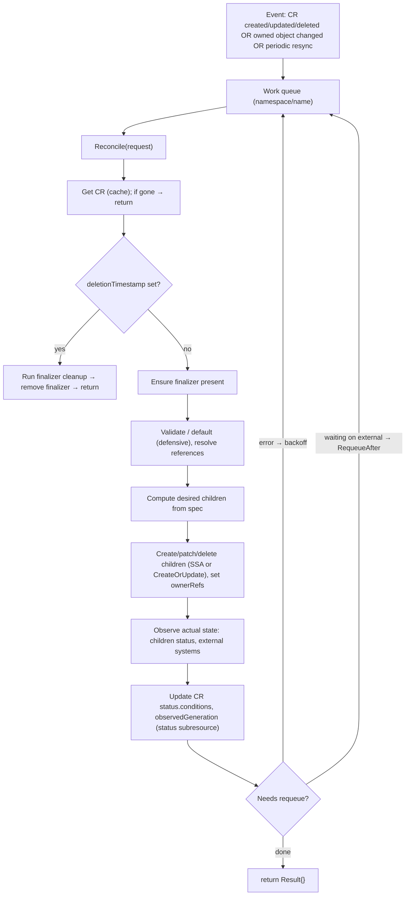

# 5.29 Extending Kubernetes: CRDs and operators

| | |
|---|---|
| Level | Advanced |
| Priority tier | 1 |
| Lab venue | kind or kubeadm; `kubectl`, `kubectl-explain`, `kubeconform`; kubebuilder/Operator SDK for 5.31 |
| Part | Part 5: Kubernetes |
| Status | Drafted, labs **untested** |

## Why this matters for AI infrastructure

Almost every AI-specific component on Kubernetes is a custom resource plus an operator: `ClusterPolicy` (GPU Operator), `NetworkAttachmentDefinition` (Multus), `NicClusterPolicy` (Network Operator), `Workload`/`ClusterQueue` (Kueue), `PyTorchJob`/`MPIJob`/`JobSet`, `RayCluster`/`RayJob`, `InferenceService` (KServe), `Notebook`, `Application` (Argo), `Certificate`, `ServiceMonitor`. Operating GPU platforms means installing, upgrading, debugging and sometimes writing operators. This chapter explains the extension mechanism from the API side (CRDs and their schemas, validation, versioning) and the controller side (operator pattern and maturity, tooling choices), so that you can read an operator's design, reason about its failure modes, and decide how to build your own (5.31, 5.32).

## Prerequisites and outcomes

Needs 5.5 and 5.6 (API machinery and controllers). After this chapter you can:

- Write CRDs with structural schemas, validation (OpenAPI v3, `x-kubernetes-validations` CEL rules, enums/formats/defaults), printer columns, short names, scope, categories; understand pruning and `preserveUnknownFields`.
- Design API versions and conversion (storage version, conversion webhooks, deprecation), subresources (`status`, `scale`), and field ownership (server-side apply).
- Design good CRD APIs (spec/status, conditions, immutability, references, references to secrets, idempotent semantics, extensibility) and avoid anti-patterns.
- Explain the operator pattern, capability levels, and how operators manage lifecycle (install, upgrade, backup, scaling, failure recovery); choose between Helm, Ansible, Go (kubebuilder/Operator SDK), kopf, Metacontroller, Crossplane compositions, Kyverno generate or plain controllers.
- Package and distribute operators (Helm chart, OLM bundles/catalogs, kustomize), manage CRD upgrades safely, and set least-privilege RBAC.
- Test and operate operators: observability, leader election, metrics, events, webhooks, and failure handling.

## 1. Extension points recap

| Mechanism | Extends | Use |
|---|---|---|
| **CRD** | The API with new resource types (served by the API server, stored in etcd) | Declarative config for your domain |
| **Aggregated API server** | The API with a separate server for your types | Custom storage, special semantics (metrics API) |
| **Controller/operator** | Behaviour: reconcile custom (and built-in) resources | Automation |
| **Admission webhooks / ValidatingAdmissionPolicy** | Validation/mutation on writes | Policy, defaulting (5.21) |
| **Custom schedulers/plugins** | Placement | Batch/gang (5.18) |
| **CRI/CNI/CSI/device plugin/DRA** | Node-level integrations | Runtime, network, storage, GPUs |
| **kubectl plugins, Krew** | Client UX | Operator-specific CLIs |

CRDs are the dominant approach: they give you the Kubernetes API machinery (REST, watch, RBAC, audit, server-side apply, `kubectl` support, OpenAPI docs) for free.

## 2. Custom resources and CRDs

A **CustomResourceDefinition** registers a new kind. Example for a GPU health policy:

```yaml
apiVersion: apiextensions.k8s.io/v1
kind: CustomResourceDefinition
metadata:
  name: gpuhealthpolicies.platform.example.com        # <plural>.<group>
spec:
  group: platform.example.com
  scope: Cluster                                       # Namespaced | Cluster
  names:
    kind: GPUHealthPolicy
    listKind: GPUHealthPolicyList
    plural: gpuhealthpolicies
    singular: gpuhealthpolicy
    shortNames: [ghp]
    categories: [platform]
  versions:
    - name: v1alpha1
      served: true
      storage: true
      subresources:
        status: {}                                    # /status subresource: spec and status writes separated
      additionalPrinterColumns:
        - { name: Selector, type: string, jsonPath: .spec.nodeSelectorString }
        - { name: XidAction, type: string, jsonPath: .spec.xid.action }
        - { name: Matched, type: integer, jsonPath: .status.matchedNodes }
        - { name: Ready, type: string, jsonPath: ".status.conditions[?(@.type=='Ready')].status" }
        - { name: Age, type: date, jsonPath: .metadata.creationTimestamp }
      schema:
        openAPIV3Schema:
          type: object
          required: [spec]
          properties:
            spec:
              type: object
              required: [xid]
              properties:
                nodeSelector:
                  type: object
                  additionalProperties: { type: string }
                xid:
                  type: object
                  required: [codes, action]
                  properties:
                    codes:
                      type: array
                      minItems: 1
                      items: { type: integer, minimum: 1, maximum: 200 }
                    action:
                      type: string
                      enum: [Ignore, Cordon, CordonAndDrain]
                      default: Cordon
                    windowSeconds: { type: integer, minimum: 30, default: 600 }
                maxUnavailableNodes:
                  x-kubernetes-int-or-string: true
                  default: "5%"
              x-kubernetes-validations:
                - rule: "self.xid.action != 'CordonAndDrain' || has(self.maxUnavailableNodes)"
                  message: "maxUnavailableNodes is required when action is CordonAndDrain"
            status:
              type: object
              properties:
                observedGeneration: { type: integer, format: int64 }
                matchedNodes: { type: integer }
                conditions:
                  type: array
                  x-kubernetes-list-type: map
                  x-kubernetes-list-map-keys: [type]
                  items:
                    type: object
                    required: [type, status]
                    properties:
                      type: { type: string }
                      status: { type: string, enum: ["True", "False", "Unknown"] }
                      reason: { type: string }
                      message: { type: string }
                      lastTransitionTime: { type: string, format: date-time }
                      observedGeneration: { type: integer, format: int64 }
```

```yaml
apiVersion: platform.example.com/v1alpha1
kind: GPUHealthPolicy
metadata: { name: default }
spec:
  nodeSelector: { nvidia.com/gpu.present: "true" }
  xid: { codes: [48, 63, 64, 79], action: CordonAndDrain, windowSeconds: 300 }
  maxUnavailableNodes: "2"
```

### Schema and validation

- **Structural schemas** are required (v1 CRDs): every field typed, no `type`-less nodes (except with `x-kubernetes-preserve-unknown-fields` or `x-kubernetes-int-or-string`/`x-kubernetes-embedded-resource`). The API server **prunes** unknown fields on write by default (`preserveUnknownFields: false`), so unspecified fields are silently dropped unless you declare them: a common surprise.
- **OpenAPI v3 validation**: `type`, `required`, `enum`, `minimum/maximum`, `minLength/maxLength`, `pattern`, `format` (`date-time`, `int64`, `uuid`, ...), `minItems/maxItems/uniqueItems`, `additionalProperties`, `nullable`, `oneOf/anyOf/allOf/not` (with restrictions).
- **Defaulting** (`default:`) applied on create/update and when reading from etcd; keep defaults simple.
- **CEL validation rules** (`x-kubernetes-validations`; GA): cross-field checks (`self.a < self.b`), immutability (`self == oldSelf` with `optionalOldSelf`/`transition rules`), format checks, cost-limited expressions (CEL cost budget enforced at CRD creation; bound string/list lengths); better than writing validating webhooks for most rules.
- **Immutability**: `x-kubernetes-validations: [{rule: "self == oldSelf", message: "immutable"}]` on a field (e.g., immutable storage class or model name).
- **List semantics for server-side apply**: `x-kubernetes-list-type: atomic|set|map` and `x-kubernetes-list-map-keys`; `x-kubernetes-map-type: granular|atomic`. Critical for multi-writer coexistence and for lists of conditions/containers.
- **Printer columns & categories**: `kubectl get gpuhealthpolicies` shows useful columns; `kubectl get all` includes `categories: [all]`.
- **Scope**: `Namespaced` for tenant-owned objects; `Cluster` for global policy/infra.
- **Naming**: group should be a DNS name you own; plural lowercase; avoid `*.k8s.io` groups unless upstream-approved.

### Subresources

- `status`: spec and status updates via `/status` with separate RBAC; controllers write status without bumping `metadata.generation`; users cannot spoof status (when `status` subresource is enabled, writes to `status` through the main endpoint are ignored).
- `scale`: maps `specReplicasPath`, `statusReplicasPath`, `labelSelectorPath` so HPA, `kubectl scale`, and Kueue can scale your CR.
- Others implemented by aggregated APIs or controllers (e.g., `exec`, `log`) are not available to CRDs.

### Versions and conversion

Multiple versions can be served simultaneously; exactly one is the **storage version**. Conversion strategies: `None` (only `apiVersion` rewritten; schemas must be compatible) or a **conversion webhook** (`Webhook`) implementing lossless round-trip conversion (hub-and-spoke: convert via a hub version; controller-runtime/kubebuilder scaffolds conversion). Upgrade flow: add `v1beta1` (served, not storage) → migrate storage version (`storage: true` on new, existing objects remain in old until rewritten: run a storage-version migration (`kube-storage-version-migrator`, or re-write all objects via `kubectl get ... -o json | kubectl replace`) → stop serving old versions after clients migrate → remove from `status.storedVersions` before removing the version from the CRD. Follow Kubernetes API conventions: alpha (v1alpha1: may change), beta, stable; deprecate with `deprecated: true` and `deprecationWarning` in the version spec.

### Garbage collection, owner references and finalizers

Operators create child objects with `ownerReferences` pointing to the CR (set controller reference) so deleting the CR garbage-collects children. For **external** resources (cloud load balancers, DNS, GPU node labels/cordons, storage buckets) GC can't help: use **finalizers** (`platform.example.com/cleanup`) to run cleanup before the CR disappears: controller sees `deletionTimestamp`, performs cleanup, removes the finalizer. Failure to remove finalizers (operator uninstalled before CRs deleted) leaves CRs stuck Terminating: uninstall order matters (delete CRs first, then the operator, then CRDs).

### Status and conditions

Follow conventions (`conditions` list with `type`, `status`, `reason` (CamelCase), `message`, `observedGeneration`, `lastTransitionTime`; top-level `observedGeneration`, `phase` discouraged in favour of conditions). Users and automation (GitOps health checks, `kubectl wait --for=condition=Ready`) rely on these.

### API design guidance

1. **Declarative spec = desired end state**, not actions; avoid imperative fields ("restartNow: true"); model one-off actions as separate resources (`Request`/`Job`-like CRs with status) or annotations handled idempotently.
2. **Small, stable core spec** with extensible, optional blocks; prefer references (`secretRef`, `configMapRef`, `targetRef`) over embedding secrets/big blobs; use typed references (kind/name/namespace) and validate/handle missing references with conditions.
3. **Immutable identity fields**; use CEL immutability rules; changing fundamental fields means a new object.
4. **Idempotent reconcile**; status reflects observed truth; do not store controller state only in memory (store it in status or child objects).
5. **Avoid unbounded growth** in status (lists of events/logs); use Events for history, metrics for time series, and caps with summarisation.
6. **Version for evolution**: additive changes within a version; breaking changes in a new version with conversion.
7. **Do not hide dangerous behaviour** behind innocuous fields; document side effects, defaults, and failure semantics; provide `kubectl explain` text (CRD field `description`).
8. **Scope carefully**: cluster-scoped CRs need strong RBAC; namespaced CRs with cross-namespace references require explicit allow semantics (like Gateway API's ReferenceGrant).
9. **Size limits**: objects are limited to ~1.5 MiB in etcd; thousands of CRs with large status can load the API/etcd: keep status small.
10. **Generate docs and clients** from types (controller-gen, crd-ref-docs).

## 3. The operator pattern

An **operator** is a custom controller that encodes operational knowledge for an application or infrastructure component as software, managing it through CRs. Typical responsibilities: install/configure, scale, upgrade (rolling, with migrations), backup/restore, failover, health remediation, certificate rotation, reconcile drift, and expose status/metrics.

### Capability levels (Operator Framework model)

| Level | Capability | Example for a GPU operator |
|---|---|---|
| 1 | Basic install: provision resources, configuration via CR | Deploy driver DaemonSet from `ClusterPolicy` |
| 2 | Seamless upgrades: patch and minor version upgrades | Rolling driver upgrade with node drain policy |
| 3 | Full lifecycle: backup, failure recovery, storage lifecycle | Re-validate nodes after maintenance |
| 4 | Deep insights: metrics, alerts, log processing, workload analysis | DCGM exporter and ServiceMonitors, health conditions |
| 5 | Auto pilot: auto-scaling, auto-tuning, abnormality detection, scheduling tuning | Auto-cordon unhealthy GPUs, MIG reconfiguration based on demand |

### Typical operator reconcile structure



Core rules (mirrors 5.6): idempotence; level-triggered; short reconciles (no long blocking calls: use requeue); handle conflicts (retry); don't assume the cache is current; keep reconciliation per-object independent; watch what you own (`Owns()`) and what you reference (`Watches()` with map functions); predicates to avoid hot loops (ignore status-only changes with `GenerationChangedPredicate`); structured logging with the CR key; emit Events for user-visible milestones; expose Prometheus metrics (reconcile counts/latency/errors, queue depth).

### Operator implementation choices

| Option | Language | Pros | Cons |
|---|---|---|---|
| **kubebuilder / controller-runtime** | Go | De facto standard; strong typing, webhooks, envtest; large ecosystem | Go knowledge; boilerplate; steep for beginners |
| **Operator SDK** | Go (kubebuilder-based), Helm, Ansible | Scaffolding for OLM bundles; supports Helm/Ansible operators | Overlaps with kubebuilder; projects converging |
| **Helm-based operator** | Helm charts | Quick for existing charts; maps CR spec to values | Limited logic (no complex orchestration, only template + install/upgrade) |
| **Ansible-based operator** | Ansible | Operational playbooks as reconcile logic; ops teams' skills (4.3–4.17) | Slower, harder to test at scale; shell-heavy |
| **Metacontroller / shell-operator** | Webhooks/scripts | Lightweight; any language | Less control; custom framework |
| **kopf** | Python | Python-native (ML teams) | Performance/scale limits; fewer features |
| **Java Operator SDK, Rust kube-rs** | Java/Rust | Language fit | Smaller ecosystems |
| **Crossplane Compositions / KCL / Kro** | Declarative functions | Compose existing resources into higher-level APIs; no custom controller code | Limited to composition semantics |
| **Kyverno/Argo-based automation** | YAML policies/workflows | Quick for generate/mutate patterns | Not a general operator |
| **GitOps + Helm only** | None | Simplest | No runtime reconciliation of application-specific logic |

Guideline: if you only need templated resources, use Helm/Kustomize/Crossplane; if you need runtime decisions (health, ordering, rolling operations, interaction with node hardware or external APIs), write a controller (Go for production-grade; Python/kopf for prototypes and small scopes).

## 4. Packaging, distribution and lifecycle

- **Packaging**: container image for the manager; Kustomize/Helm chart for deployment; **CRDs** shipped separately (Helm `crds/` directory installs but never upgrades; many projects ship CRDs as a separate chart or `kubectl apply --server-side` step, or rely on the operator to apply its own CRDs); RBAC (ClusterRole/Role generated from `+kubebuilder:rbac` markers); webhooks (cert-manager-issued certs, `caBundle` injection); ServiceMonitor, PodDisruptionBudget, NetworkPolicy, PriorityClass for the manager.
- **OLM (Operator Lifecycle Manager)**: OpenShift's default and available on vanilla Kubernetes: `ClusterServiceVersion`, `CatalogSource`, `Subscription`, `OperatorGroup`; handles installation, upgrade graphs (`replaces`, `skipRange`), dependency resolution, and automatic updates from channels; **bundle format** and **operator-sdk bundle** tooling. Alternatives: OperatorHub, Helm charts, GitOps with pinned versions (preferred in many AI platforms for explicit control).
- **Upgrading CRDs**: schema changes must be backward compatible while old objects exist; tighten validation carefully (existing invalid objects block updates); add new fields as optional with defaults; handle storage version migrations; test upgrades with real objects (`kubectl apply` new CRD on top of populated cluster). Never delete a CRD on upgrade (deletes all CRs). Pin operator and CRD versions together.
- **RBAC least privilege**: grant only the verbs on the resources the controller reconciles; split cluster-scoped from namespaced permissions; avoid `*`; review generated rules (5.16); use `resourceNames` where feasible; separate ServiceAccounts for webhooks; restrict who can create CRs of powerful kinds.
- **Multi-tenancy of operators**: cluster-wide operators vs namespace-scoped (watch a namespace set); version skew across clusters; CRD ownership conflicts when two operators claim the same kind.
- **Operational readiness**: leader election (Lease), graceful shutdown, resource requests, `priorityClassName: system-cluster-critical` for infrastructure operators, PDBs, liveness/readiness (`healthz`/`readyz` from controller-runtime), metrics endpoint (secured), structured logs, tracing, runbooks, alerts (reconcile error rate, queue depth, webhook latency), SBOM/signing (5.27), upgrade tests, chaos tests (kill the manager mid-reconcile).
- **Failure modes**: webhook outage blocking CR creation; finalizer deadlocks; reconcile hot loops; unbounded retries hammering external APIs; conflicting controllers (two operators managing the same child); leaked external resources when finalizers are missing; stale caches causing duplicate creates; huge status growth; CRD conversion bugs corrupting data; operator crash loops after schema change; CR deleted before operator installed (no cleanup).

## 5. AI-platform operators (what to know)

| Operator | Key CRDs | What it manages | Notes |
|---|---|---|---|
| **NVIDIA GPU Operator** | `ClusterPolicy`, `NVIDIADriver` | Driver, container toolkit, device plugin, GFD/NFD, DCGM + exporter, MIG manager, validator, vGPU manager, GDS/GDRCopy, CC manager | Node-feature-based DaemonSets (5.33) |
| **NVIDIA Network Operator** | `NicClusterPolicy`, `HostDeviceNetwork`, `MacvlanNetwork`, `IPoIBNetwork`, `SriovNetworkNodePolicy` (with SR-IOV operator) | MOFED driver, RDMA shared device plugin, Multus, CNI plugins, NV-IPAM, NIC firmware/config | Secondary networks for RDMA (5.13) |
| **NVIDIA DRA driver, NIM Operator** | `ResourceClaim` (core), `NIMService`, `NIMCache` | GPU DRA kubelet plugin, NIM microservice lifecycle and model caching | Newer |
| **Kueue** | `ResourceFlavor`, `ClusterQueue`, `LocalQueue`, `Workload` | Admission/quotas (5.18) | Integrates with Jobs, JobSet, MPIJob, PyTorchJob, RayJob |
| **JobSet** | `JobSet` | Groups of Jobs with policies | Multi-slice training |
| **Kubeflow Training Operator / Trainer v2** | `PyTorchJob`, `TFJob`, `MPIJob` (+ `TrainJob`, `TrainingRuntime`) | Distributed training pods, rendezvous env, elastic policies | v2 unifies APIs |
| **MPI Operator** | `MPIJob` | Launcher/worker pods and hostfiles with SSH or kubectl-exec bootstrapping | |
| **KubeRay** | `RayCluster`, `RayJob`, `RayService` | Ray clusters, autoscaling, zero-downtime service upgrades | Inference and training |
| **KServe** | `InferenceService`, `ServingRuntime`, `InferenceGraph`, `LLMInferenceService` | Model serving, autoscaling, canary, protocol adapters | Knative or raw deployment mode |
| **Volcano** | `Queue`, `PodGroup`, `Job` | Batch scheduler | |
| **Prometheus Operator** | `ServiceMonitor`, `PrometheusRule` ... | Monitoring (5.24) | |
| **cert-manager** | `Certificate`, `Issuer` | PKI (5.12, 5.21) | |
| **Argo CD / Argo Workflows / Rollouts** | `Application`, `Workflow`, `Rollout` | GitOps, pipelines, progressive delivery | |
| **Cluster API** | `Cluster`, `Machine*` | Cluster lifecycle (5.19) | |
| **Rook-Ceph, CSI operators** | `CephCluster`, ... | Storage | |
| **Slurm operators (Slinky/Soperator)** | `Cluster`, `NodeSet`, `Controller` ... | Slurm on Kubernetes | Part 6 |
| **Node problem/health operators** | Custom (5.32) | GPU node health remediation | You will build one |

When evaluating an operator: maturity level, upgrade story (CRD handling), RBAC breadth, failure semantics (what happens when the operator is down or CRs are deleted), observability, resource footprint, support policy, supply-chain posture (signed images/SBOM), documentation and API stability (alpha vs v1).

## 6. Lab (untested)

1. **Write a CRD**: create the `GPUHealthPolicy` CRD above; apply; test valid and invalid objects (enum violation, missing `codes`, CEL rule failure, unknown field pruning); inspect `kubectl explain gpuhealthpolicy.spec --recursive`; add printer columns and check `kubectl get`.
2. **Defaults and pruning**: remove a field from the schema and observe pruning; add `x-kubernetes-preserve-unknown-fields` and compare; test defaulting on create vs update.
3. **CEL**: add immutability rule for a field; cross-field validation; transition rule; hit CEL cost limits by leaving unbounded arrays and fix with `maxItems`/`maxLength`.
4. **Status subresource**: patch `status` via `kubectl patch --subresource=status`; try writing status via the main endpoint (ignored); check that `generation` doesn't change on status updates.
5. **Versions and conversion**: add `v1beta1` with a renamed field, use `conversion.strategy: None` (observe data loss), then implement a minimal conversion webhook (Go/Python) and verify round trips; run the storage-version migration and verify `status.storedVersions`.
6. **Finalizers**: create a toy controller (shell loop with kubectl, or Python/kopf) that adds a finalizer and "cleans up" an external file; delete the CR and observe Terminating until cleanup; uninstall the controller to reproduce the stuck CR; recover.
7. **Operator options**: implement the same trivial "ensure a ConfigMap per CR" as (a) Helm-based operator, (b) kopf handler, (c) controller-runtime (5.31); compare code size, behaviour on restarts, conflict handling.
8. **Server-side apply with CRs**: two field managers editing different list items in a `map`-type vs `atomic` list; observe conflicts/ownership with `--show-managed-fields`.
9. **Inspect real operators**: install the GPU Operator (or Kueue) in kind; list CRDs/RBAC/webhooks; read the CRD schemas and `ClusterPolicy` spec; find finalizers, owner refs on its DaemonSets, and the status conditions; delete the operator (not CRs) and note effects.
10. **Failure drills**: kill the manager mid-reconcile; delete a child object; break the webhook; apply an invalid CR created before a CRD tightening; fill status with large data and observe API impact.
11. **Upgrade drill**: upgrade the operator image with a CRD schema change in a populated cluster; verify existing CRs; roll back; document the playbook (also relevant to 5.20).
12. **Design review**: take a proposed `TrainingRun` CRD and review against the API design guidance: spec/status separation, immutability, references, conditions, quotas; rewrite.
13. **Clean up**.

Mark tested only after execution.

## 7. Common mistakes

- CRDs without structural schemas or without validation; silent pruning of fields.
- Imperative CRD fields; mutable identity fields; unbounded status.
- Writing status through the main resource or without `observedGeneration`.
- Controllers that don't set ownerReferences or finalizers for external resources; deleting the operator before CRs.
- Helm `crds/` upgrade assumptions; deleting CRDs during upgrades (data loss).
- Hot loops from status updates triggering reconciles; no backoff; stuffing long-running work into Reconcile.
- Webhooks as single points of failure; conversion webhooks without round-trip tests.
- Over-broad RBAC and cluster-scoped CRs without access control.
- Two operators/controllers managing the same objects (including Terraform/GitOps vs operator).
- Building an operator when Helm/Crossplane would do; or Helm when runtime decisions are needed.

## 8. Interview angles

- "What is a CRD? How is it different from an aggregated API server?" 
- "What is an operator? Describe its reconcile loop and the capability levels." 
- "How do you version a CRD and migrate stored objects?" 
- "What are finalizers and owner references? How do they apply to external resources?" 
- "How do you validate custom resources? CEL vs webhooks?" 
- "How do you decide between Helm, Ansible, Go and Crossplane for automation?" 
- "What happens to CRs and workloads when an operator is uninstalled or crashes?" 
- "Explain how the GPU Operator is structured and what could go wrong during an upgrade." 

## 9. Checkpoint questions (35)

1. CRD scope options? **A:** Namespaced, Cluster.
2. CRD name format? **A:** `<plural>.<group>`.
3. Structural schema required for? **A:** v1 CRDs.
4. Pruning means? **A:** Unknown fields dropped on write.
5. CEL validation field? **A:** `x-kubernetes-validations`.
6. Immutability CEL rule? **A:** `self == oldSelf`.
7. Default keyword? **A:** `default:` in schema.
8. Subresource for status? **A:** `/status`.
9. Why status subresource? **A:** Separate RBAC and avoid spec conflicts.
10. Scale subresource for? **A:** HPA/kubectl scale.
11. Storage version count? **A:** One.
12. Conversion strategies? **A:** None, Webhook.
13. Hub-and-spoke? **A:** Convert via a hub version.
14. storedVersions field? **A:** Tracks versions in etcd.
15. Owner reference purpose? **A:** Garbage collection of children.
16. Finalizer purpose? **A:** Run cleanup before deletion.
17. Stuck Terminating CR cause? **A:** Finalizer not removed.
18. Conditions convention? **A:** type/status/reason/message/time.
19. `observedGeneration` use? **A:** Status freshness.
20. List type map? **A:** Merge by key with SSA.
21. Operator definition? **A:** Controller encoding operational knowledge.
22. Capability levels count? **A:** Five.
23. Level 5 means? **A:** Auto pilot.
24. Standard Go framework? **A:** controller-runtime/kubebuilder.
25. Helm operator limit? **A:** Template-only logic.
26. Python operator framework? **A:** kopf.
27. Crossplane use? **A:** Compose resources into APIs.
28. OLM objects? **A:** CSV, CatalogSource, Subscription, OperatorGroup.
29. Helm `crds/` behaviour? **A:** Installs but doesn't upgrade/delete.
30. Safe CRD change? **A:** Additive optional fields.
31. Predicate to avoid hot loops? **A:** GenerationChanged.
32. Leader election for? **A:** Single active reconciler.
33. Webhook failure effect? **A:** Blocks matching writes.
34. GPU Operator main CRD? **A:** ClusterPolicy.
35. Network Operator main CRD? **A:** NicClusterPolicy.

## 10. Sources and review notes

**Written in original words.** Principal sources:

- Brendan Burns et al., *Kubernetes: Up and Running* (3rd edition; chapters 17 and 18 on extending Kubernetes and the operator pattern).
- Michael Hausenblas and Stefan Schimanski, *Programming Kubernetes* (custom resources, controllers, API machinery, versioning and conversion).
- BCM containerization material in the study corpus (operators in NVIDIA stacks) where referenced.
- Kubernetes CRD documentation, kubebuilder book, Operator SDK and OLM documentation, NVIDIA GPU Operator and Network Operator documentation.
- Examples are the author's constructions.

**Flagged for verification before publishing:** CEL feature and cost-limit details for your Kubernetes version, controller-gen markers, OLM resource API versions, operator CRD names/versions for the AI projects listed (they evolve quickly), and every manifest; all labs are **untested**.
