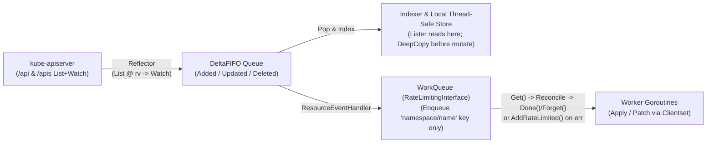

# 5.30 Go for Kubernetes engineers

| | |
|---|---|
| Level | Intermediate |
| Priority tier | 2 |
| Lab venue | Go 1.22 or newer, kind cluster, `kubectl`; modules `k8s.io/client-go`, `k8s.io/apimachinery`, `k8s.io/api`, `github.com/spf13/cobra` |
| Part | Part 5: Kubernetes |
| Status | Drafted; key listings compile and unit-test (Go 1.23.2, client-go v0.31.0); live-cluster labs **untested** |

## Why this matters for AI infrastructure

Kubernetes and most of its ecosystem (containerd, etcd, Prometheus, Terraform providers, the NVIDIA GPU Operator, device plugins, CSI drivers, Kueue, Argo, Cilium) are written in Go. Platform engineers who can read Go can debug operator behaviour from source, patch or extend components, write small controllers and CLI tools (a node-health remediator, a quota reporter, an admission webhook), and understand error messages and stack traces that come straight from the codebase. You do not need to be a Go expert, but you need fluency with the language subset and the client libraries that Kubernetes tooling uses. This chapter teaches that subset with Kubernetes examples, and sets up 5.31 (operators with controller-runtime), 5.32 (a GPU node health operator) and 5.33 (reading the GPU and Network Operator source).

## Prerequisites and outcomes

Needs programming experience (Part 3 Python) and 5.3 to 5.6. After this chapter you can:

- Set up a Go module, use the toolchain (`go build/test/vet/fmt/mod`, `gopls`, `golangci-lint`), and navigate a large Go repository.
- Use Go's core features correctly: types, structs, methods, interfaces (implicit satisfaction), embedding, pointers vs values, slices and maps, errors (wrapping, `errors.Is/As`), `defer`, `panic/recover`, generics.
- Write concurrent programs with goroutines, channels, `sync` primitives and `context`, avoiding leaks and races; use the race detector.
- Handle JSON/YAML and Kubernetes types (struct tags, `metav1.ObjectMeta`, `runtime.Object`, `unstructured`).
- Use client-go: build a client from kubeconfig/in-cluster config, list/get/create/patch/delete, watch, informers/listers, work queues, leader election, dynamic client, discovery; apply best practices for rate limits and retries.
- Write table-driven tests, fake clients, and use `envtest`; structure a CLI with cobra; produce small static container images.

## 1. Toolchain and project layout

```bash
go version                                  # 1.22+ recommended; check go.mod 'go' directive and toolchain line
mkdir nodectl && cd nodectl && go mod init example.com/nodectl
go get k8s.io/client-go@v0.31.0 k8s.io/apimachinery@v0.31.0 k8s.io/api@v0.31.0   # match your Kubernetes minor version (client-go v0.N ↔ Kubernetes 1.N)
go mod tidy
go build ./... && go vet ./... && go test ./... -race -count=1
gofmt -s -w . && goimports -w .             # formatting is not negotiable; CI should check
golangci-lint run                           # linters (errcheck, staticcheck, govet, ineffassign, unused, revive ...)
go doc k8s.io/client-go/kubernetes.Clientset
GOFLAGS=-mod=readonly go build -trimpath -ldflags='-s -w' -o bin/nodectl ./cmd/nodectl
CGO_ENABLED=0 GOOS=linux GOARCH=amd64 go build ...        # static binary for scratch/distroless images
```

Typical layout (the "standard" repo shape used by kubebuilder projects):

```text
nodectl/
├── go.mod, go.sum
├── cmd/nodectl/main.go          # entry point(s) (thin: parse flags, wire dependencies)
├── internal/                    # private packages (cannot be imported by other modules)
│   ├── kube/                    # client construction, helpers
│   └── health/                  # domain logic (pure, easily tested)
├── pkg/                         # public packages (optional)
├── api/v1alpha1/                # CRD Go types (kubebuilder)
├── Makefile, Dockerfile, .golangci.yml
└── hack/                        # scripts (codegen, tools)
```

Modules: semantic import versioning (`/v2` suffix), `replace` for local forks, `go.work` for multi-module work, vendoring optional (`go mod vendor`); Kubernetes libraries have a tight version coupling (client-go, apimachinery, api, controller-runtime versions must be compatible; check the compatibility matrix); `go.sum` verifies hashes; `GOPROXY`/`GOFLAGS` for private modules (`GOPRIVATE`).

## 2. Language essentials (the subset Kubernetes code uses)

### Types, structs, methods

```go
package health

import "time"

// XIDEvent is a GPU error event reported by DCGM or kernel logs.
type XIDEvent struct {
	Node  string
	GPU   int
	Code  int
	Seen  time.Time
}

type Severity int

const (
	SeverityInfo Severity = iota // iota: 0,1,2...
	SeverityWarn
	SeverityCritical
)

func (s Severity) String() string {
	switch s {
	case SeverityInfo:
		return "info"
	case SeverityWarn:
		return "warn"
	case SeverityCritical:
		return "critical"
	default:
		return "unknown"
	}
}

// Classify maps an XID code to a severity (illustrative mapping).
func (e XIDEvent) Classify() Severity {
	switch e.Code {
	case 79, 74, 48: // fallen off bus, NVLink error, double-bit ECC (illustrative; verify against NVIDIA's catalogue)
		return SeverityCritical
	case 13, 31:
		return SeverityWarn
	}
	return SeverityInfo
}
```

- Exported identifiers start with a capital letter; packages are the unit of encapsulation; no classes or inheritance; **methods** have receivers (value or pointer). Use pointer receivers when the method mutates, the struct is large, or for consistency (don't mix on one type). Zero values are useful (`var s []int` is a nil slice, valid to append to; `var mu sync.Mutex` is ready to use).
- **Struct tags** control marshalling: `json:"name,omitempty"`, and Kubernetes types use `json` tags (and `protobuf`); `yaml` handled by `sigs.k8s.io/yaml` converting YAML→JSON→struct (so only `json` tags matter).
- **Composition by embedding**: `type Node struct { metav1.TypeMeta; metav1.ObjectMeta; Spec NodeSpec; Status NodeStatus }` — fields and methods promoted from embedded types (this is how every Kubernetes object gets `GetName()`, `GetLabels()`).

### Interfaces (implicit) and polymorphism

```go
type Remediator interface {
	Cordon(ctx context.Context, node string) error
	Drain(ctx context.Context, node string) error
}

type kubeRemediator struct{ cs kubernetes.Interface }       // *kubeRemediator satisfies Remediator implicitly

var _ Remediator = (*kubeRemediator)(nil)                   // compile-time assertion
```

Interfaces are satisfied implicitly (no `implements`). Idiom: "accept interfaces, return structs"; define small interfaces at the consumer (e.g., `kubernetes.Interface` allows `fake.NewSimpleClientset()` in tests). `any` (alias for `interface{}`) holds any value; type assertions (`v, ok := x.(T)`) and type switches (`switch t := x.(type)`) recover concrete types. Kubernetes uses `runtime.Object` (interface with `GetObjectKind()` and `DeepCopyObject()`) as the common supertype of API objects and `client.Object` in controller-runtime.

### Errors

```go
var ErrNoSuchNode = errors.New("no such node")

func cordon(ctx context.Context, cs kubernetes.Interface, name string) error {
	n, err := cs.CoreV1().Nodes().Get(ctx, name, metav1.GetOptions{})
	if apierrors.IsNotFound(err) {
		return fmt.Errorf("cordon %q: %w", name, ErrNoSuchNode)       // wrap with %w
	}
	if err != nil {
		return fmt.Errorf("get node %q: %w", name, err)
	}
	if n.Spec.Unschedulable {
		return nil
	}
	patch := []byte(`{"spec":{"unschedulable":true}}`)
	_, err = cs.CoreV1().Nodes().Patch(ctx, name, types.StrategicMergePatchType, patch, metav1.PatchOptions{})
	return err
}

if errors.Is(err, ErrNoSuchNode) { ... }                           // unwrap chain
var se *apierrors.StatusError
if errors.As(err, &se) && se.ErrStatus.Code == http.StatusConflict { ... }
```

Errors are values returned as the last result; check them immediately (`if err != nil`); wrap with context (`fmt.Errorf("...: %w", err)`); compare with `errors.Is`, extract with `errors.As`; Kubernetes API errors have helpers (`apierrors.IsNotFound/IsConflict/IsAlreadyExists/IsForbidden/IsTimeout/IsServerTimeout`); never ignore errors silently (`errcheck` lint); `panic` only for programmer errors/initialisation; `defer` for cleanup (`defer resp.Body.Close()`, `defer cancel()`, `defer mu.Unlock()`); `recover` rare (HTTP servers). Use `errors.Join` for multiple errors; aggregate utilities exist in apimachinery (`utilerrors.NewAggregate`).

### Slices, maps, strings, generics

```go
gpuNodes := make([]string, 0, len(nodes))                          // len 0, cap hint
for _, n := range nodes.Items {                                    // range copies values: take &nodes.Items[i] if you need pointers
	if q, ok := n.Status.Allocatable["nvidia.com/gpu"]; ok && !q.IsZero() {
		gpuNodes = append(gpuNodes, n.Name)
	}
}
slices.Sort(gpuNodes)                                              // std lib 'slices' and 'maps' packages (Go 1.21+)
idx, found := slices.BinarySearch(gpuNodes, "node-7")

counts := map[string]int{}                                         // maps: iteration order is random; not safe for concurrent writes
for _, p := range pods { counts[p.Spec.NodeName]++ }
keys := slices.Sorted(maps.Keys(counts))                           // deterministic output (Go 1.23)

func Filter[T any](in []T, keep func(T) bool) []T {                // generics (type parameters)
	out := in[:0:0]
	for _, v := range in { if keep(v) { out = append(out, v) } }
	return out
}
```

Gotchas: slices share backing arrays (append may or may not reallocate); loop variable capture semantics changed in Go 1.22 (each iteration has its own variable); nil map writes panic; string iteration yields runes; `copy` vs assignment; `for range n` (1.22) and range-over-func iterators (1.23). `strings.Builder`, `bytes.Buffer`, `fmt.Sprintf` verbs (`%v %+v %#v %T %w %q`).

### Pointers and values

Go passes everything by value (copies); pointers share. Kubernetes API types use pointers for optional fields (`*int32 Replicas`) to distinguish unset from zero; helpers: `ptr.To(int32(3))` (k8s.io/utils/ptr), `ptr.Deref(p, default)`. Objects from listers are **shared cache objects**: never mutate them; call `DeepCopy()` before modification. Struct comparison with `==` requires comparable fields; use `reflect.DeepEqual`, `equality.Semantic.DeepEqual` (apimachinery; handles resource.Quantity, metav1.Time).

### Packages, visibility, init, build tags

One directory = one package; `internal/` restricts imports; `init()` functions run at import (avoid side effects; Kubernetes API groups register schemes via `AddToScheme` functions explicitly); build constraints (`//go:build linux`); `go:embed` for static assets; `go:generate` for code generation (deepcopy-gen, controller-gen, mockgen).

## 3. Concurrency

### Goroutines, channels, sync

```go
func probeAll(ctx context.Context, nodes []string, probe func(context.Context, string) (bool, error)) map[string]bool {
	type result struct {
		node string
		ok   bool
	}
	ctx, cancel := context.WithTimeout(ctx, 30*time.Second)
	defer cancel()

	results := make(chan result)
	sem := make(chan struct{}, 16)                      // bound concurrency
	var wg sync.WaitGroup
	for _, n := range nodes {
		wg.Add(1)
		go func() {                                      // Go 1.22: n is per-iteration
			defer wg.Done()
			sem <- struct{}{}
			defer func() { <-sem }()
			ok, err := probe(ctx, n)
			if err != nil { ok = false }
			select {
			case results <- result{n, ok}:
			case <-ctx.Done():
			}
		}()
	}
	go func() { wg.Wait(); close(results) }()           // close when all senders are done

	out := make(map[string]bool, len(nodes))
	for r := range results { out[r.node] = r.ok }
	return out
}
```

Principles: goroutines are cheap, but **every goroutine needs a clear exit** (context cancel, channel close); "don't communicate by sharing memory; share memory by communicating" (use mutexes when state is simple: `sync.Mutex/RWMutex`); `sync.WaitGroup`, `sync.Once`, `sync/atomic`, `sync.Map` (rare), `errgroup.Group` (`golang.org/x/sync/errgroup`: wait + first error + context cancel + `SetLimit`); channels: unbuffered (rendezvous) vs buffered; only the sender closes; receiving from a closed channel yields zero values; `select` with `default`, timeouts (`time.After` leaks timers in loops pre-1.23; use `time.NewTimer`), `ctx.Done()`; avoid goroutine leaks (blocked sends/receives with no reader); data races undefined behaviour: run tests with `-race`; deadlocks (`all goroutines are asleep`). Kubernetes code uses `wait.Until`, `wait.PollUntilContextTimeout` (apimachinery/util/wait), rate-limited work queues rather than raw goroutines in controllers.

### context.Context

Carries cancellation, deadlines and request-scoped values across API boundaries; first parameter by convention (`ctx context.Context`); derive with `WithCancel/WithTimeout/WithDeadline/WithValue`; always `defer cancel()`; never store contexts in structs for long-lived use; pass `ctx` to every client-go call (`Get(ctx, name, opts)`); respect `ctx.Err()` in loops; controller-runtime passes a per-reconcile context.

## 4. JSON, YAML and Kubernetes types

```go
import (
	corev1 "k8s.io/api/core/v1"
	metav1 "k8s.io/apimachinery/pkg/apis/meta/v1"
	"sigs.k8s.io/yaml"
)

pod := &corev1.Pod{
	ObjectMeta: metav1.ObjectMeta{Name: "gpu-test", Namespace: "default", Labels: map[string]string{"app": "gpu-test"}},
	Spec: corev1.PodSpec{
		RestartPolicy: corev1.RestartPolicyNever,
		Containers: []corev1.Container{{
			Name:    "cuda",
			Image:   "nvcr.io/nvidia/cuda:12.4.1-base-ubuntu22.04",
			Command: []string{"nvidia-smi"},
			Resources: corev1.ResourceRequirements{
				Limits: corev1.ResourceList{"nvidia.com/gpu": resource.MustParse("1")},
			},
		}},
	},
}
b, _ := yaml.Marshal(pod)                      // sigs.k8s.io/yaml: struct → JSON → YAML
var p2 corev1.Pod
_ = yaml.Unmarshal(b, &p2)
```

- `resource.Quantity` (`resource.MustParse("100Mi")`, `.Value()`, `.MilliValue()`, `.Cmp()`) for CPU/memory/GPU counts; `metav1.Time`, `metav1.Duration`; `intstr.IntOrString`; `metav1.LabelSelector` ↔ `labels.Selector` via `metav1.LabelSelectorAsSelector`.
- **Unstructured**: `unstructured.Unstructured` wraps `map[string]interface{}` for objects whose Go types you don't have (CRDs without generated types); helpers `unstructured.NestedString/NestedSlice/SetNestedField`; `runtime.DefaultUnstructuredConverter.FromUnstructured` to convert to typed.
- **Scheme and codecs**: `runtime.Scheme` maps Go types ↔ GroupVersionKind; `scheme.AddToScheme` registers types; serializers decode/encode; `client-go/kubernetes/scheme` for built-ins; custom types need their group's `AddToScheme`.
- **Meta helpers**: `metav1.NewControllerRef`, `controllerutil.SetControllerReference`, `metav1.IsControlledBy`, `labels.Set`, `fields.OneTermEqualSelector("spec.nodeName", n)`.
- **DeepCopy**: generated `DeepCopy()` methods for API types (never share and mutate).

In *Kubernetes Programming with Go* (`KPG`) Chapters 4 and 5 and *Network Programmability and Automation* (`NPA`) Chapter 7, Philippe Martin and Jason Edelman et al. detail the inner mechanics of `apimachinery` and Go type conventions:
1. **`resource.Quantity` Binary (`Ki..Ei`) vs. Decimal (`n..E`) Suffixes and `intstr.IntOrString` (`KPG` Chapter 4):**
   - `resource.Quantity` (`k8s.io/apimachinery/pkg/api/resource`) represents resource values with exact fixed-point arithmetic (avoiding IEEE-754 floating-point drift) using two exponent formats: **`BinarySI`** (`2^(10x)`: `Ki`, `Mi`, `Gi`, `Ti`, `Pi`, `Ei`, so `1Ki == 1024`) and **`DecimalSI`** (`10^(3x)`: `n`, `u`, `m`, `k`, `M`, `G`, `T`, `P`, `E`, so `1k == 1000` and `2500m == 2.5`).
   - `intstr.IntOrString` (`k8s.io/apimachinery/pkg/util/intstr`, used in `ServicePort.TargetPort`, `RollingUpdateDeployment.MaxSurge`/`MaxUnavailable`, and `PodDisruptionBudget`) holds either an `IntVal` or a `StrVal` (`"25%"`), evaluated via **`intstr.GetScaledValueFromIntOrPercent(&intOrStr, totalReplicas, roundUp)`** (modeled in `code/part05/client_go_mechanics_sim.py`).
2. **`runtime.Scheme`, `GVK <-> GVR` `RESTMapper`, and Serializers (`KPG` Chapter 5):**
   - **`runtime.Scheme`:** In-memory registry mapping Go `reflect.Type` structs $\leftrightarrow$ `schema.GroupVersionKind` (`GVK`, via `AddKnownTypes`, `ObjectKinds`, `New`), performing defaulting (`Default`) and version conversion (`Convert`).
   - **`RESTMapper` (`meta.DefaultRESTMapper` vs. `restmapper.NewDeferredDiscoveryRESTMapper`):** Because Go code operates on **`GVK`** (`apps/v1, Kind=Deployment`) while HTTP REST endpoints use **`GVR`** (`/apis/apps/v1/namespaces/{ns}/deployments`), a `RESTMapper` translates between `GVK` and `GVR` (`RESTMapping`, `KindFor`, `ResourceFor`) and reports whether a resource is `RESTScopeNamespace` or `RESTScopeRoot`. `NewDeferredDiscoveryRESTMapper(memory.NewMemCacheClient(discoveryClient))` queries `/apis` dynamically at runtime and caches discovery responses in memory.
   - **Serializers (`k8s.io/apimachinery/pkg/runtime/serializer`):** `json.NewSerializerWithOptions` (handling both JSON and YAML) and `protobuf.NewSerializer` (`application/vnd.kubernetes.protobuf` for high-throughput native core types).
3. **Go Pointer vs. Value Method Receivers and `net/netip` (`NPA` Chapter 7):** In Go, a type `T` with a **pointer receiver** method `func (r *Router) Trim()` only satisfies an interface when passed as a pointer (`*Router`), whereas a value `Router` causes a compile-time error (`Router does not implement Trimmable (method has pointer receiver)`). For IP and CIDR manipulation in Kubernetes network controllers, Go 1.18+'s **`net/netip`** (`netip.ParseAddr`, `netip.ParsePrefix`) provides an immutable, comparable, allocation-free value type replacing legacy `net.IP` slices.



## 5. client-go

### Building clients

```go
func newClient() (kubernetes.Interface, *rest.Config, error) {
	// precedence: in-cluster → kubeconfig (KUBECONFIG, ~/.kube/config)
	cfg, err := rest.InClusterConfig()
	if err != nil {
		loading := clientcmd.NewDefaultClientConfigLoadingRules()
		cfg, err = clientcmd.NewNonInteractiveDeferredLoadingClientConfig(loading, &clientcmd.ConfigOverrides{}).ClientConfig()
		if err != nil { return nil, nil, fmt.Errorf("load kubeconfig: %w", err) }
	}
	cfg.QPS, cfg.Burst = 50, 100            // default 5/10 is far too low for controllers; see 5.5 about APF
	cfg.UserAgent = "nodectl/0.1"
	cs, err := kubernetes.NewForConfig(cfg)
	return cs, cfg, err
}
```

Clients: **typed clientset** (`kubernetes.Interface`: `CoreV1()`, `AppsV1()`, `BatchV1()`, `RbacV1()`...), **dynamic client** (`dynamic.NewForConfig`; `Resource(gvr).Namespace(ns).List(...)` returns unstructured; for CRDs without types), **discovery client** (API groups/resources), **REST client** (low-level), **metadata client** (`PartialObjectMetadata`, cheap), **scale client**, generated clientsets for your CRDs (`client-gen`) or controller-runtime's `client.Client` (a unified typed/unstructured client with cache; 5.31).

### CRUD, patch, apply

```go
ctx := context.Background()
nodes, err := cs.CoreV1().Nodes().List(ctx, metav1.ListOptions{LabelSelector: "nvidia.com/gpu.present=true", Limit: 500})
for nodes.Continue != "" { /* paginate with opts.Continue */ }

pod, err := cs.CoreV1().Pods("training").Get(ctx, "trainer-0", metav1.GetOptions{})
pod.Labels["checked"] = "true"
_, err = cs.CoreV1().Pods("training").Update(ctx, pod, metav1.UpdateOptions{})            // full update; conflict if stale

// Conflict-safe read-modify-write
err = retry.RetryOnConflict(retry.DefaultRetry, func() error {
	n, err := cs.CoreV1().Nodes().Get(ctx, name, metav1.GetOptions{})
	if err != nil { return err }
	n.Annotations["platform.example.com/cordon-reason"] = "xid79"
	_, err = cs.CoreV1().Nodes().Update(ctx, n, metav1.UpdateOptions{})
	return err
})

// JSON merge patch / strategic merge patch (no read needed)
_, err = cs.CoreV1().Nodes().Patch(ctx, name, types.MergePatchType,
	[]byte(`{"metadata":{"labels":{"platform.example.com/quarantine":"true"}}}`), metav1.PatchOptions{})

// Server-side apply with typed apply configurations (field ownership; idempotent)
import applycorev1 "k8s.io/client-go/applyconfigurations/core/v1"
nodeAC := applycorev1.Node(name).WithLabels(map[string]string{"platform.example.com/quarantine": "true"})
_, err = cs.CoreV1().Nodes().Apply(ctx, nodeAC, metav1.ApplyOptions{FieldManager: "nodectl", Force: false})

// Eviction (respects PDBs) — preferred over Delete for draining
ev := &policyv1.Eviction{ObjectMeta: metav1.ObjectMeta{Name: pod.Name, Namespace: pod.Namespace}}
err = cs.CoreV1().Pods(pod.Namespace).EvictV1(ctx, ev)   // returns 429 if a PDB disallows; retry later
```

Prefer **patch/apply** over get-modify-update to avoid conflicts; use `Update` only with `resourceVersion` awareness and retry; use `DeleteOptions{PropagationPolicy: &fg, GracePeriodSeconds: &g}`; `Create` returns `AlreadyExists`; use `DryRun: []string{metav1.DryRunAll}` for validation.

### Watching

```go
w, err := cs.CoreV1().Nodes().Watch(ctx, metav1.ListOptions{ResourceVersion: list.ResourceVersion, AllowWatchBookmarks: true})
defer w.Stop()
for ev := range w.ResultChan() {
	switch ev.Type {
	case watch.Added, watch.Modified: n := ev.Object.(*corev1.Node); _ = n
	case watch.Deleted:
	case watch.Error:                                   // 410 Gone → relist
	}
}
```

Raw watches need reconnection, bookmark/RV handling, backoff: use `watchtools.NewRetryWatcher` or (almost always) **informers**.

### Informers, listers and work queues

```go
factory := informers.NewSharedInformerFactoryWithOptions(cs, 10*time.Hour,
	informers.WithTweakListOptions(func(o *metav1.ListOptions) { o.LabelSelector = "nvidia.com/gpu.present=true" }))
nodeInformer := factory.Core().V1().Nodes()
nodeLister := nodeInformer.Lister()                                   // cache-backed reads: Get(name), List(selector)

queue := workqueue.NewTypedRateLimitingQueue(workqueue.DefaultTypedControllerRateLimiter[string]())
defer queue.ShutDown()

_, _ = nodeInformer.Informer().AddEventHandler(cache.ResourceEventHandlerFuncs{
	AddFunc:    func(obj interface{}) { enqueue(queue, obj) },
	UpdateFunc: func(_, obj interface{}) { enqueue(queue, obj) },
	DeleteFunc: func(obj interface{}) { enqueue(queue, obj) },        // obj may be cache.DeletedFinalStateUnknown
})

func enqueue(q workqueue.TypedRateLimitingInterface[string], obj interface{}) {
	key, err := cache.DeletionHandlingMetaNamespaceKeyFunc(obj)
	if err == nil { q.Add(key) }
}

ctx, stop := signal.NotifyContext(context.Background(), os.Interrupt, syscall.SIGTERM)
defer stop()
factory.Start(ctx.Done())
if !cache.WaitForCacheSync(ctx.Done(), nodeInformer.Informer().HasSynced) { return errors.New("cache sync failed") }

for i := 0; i < 2; i++ {                                              // workers
	go wait.UntilWithContext(ctx, func(ctx context.Context) {
		for processNext(ctx, queue, nodeLister) {}
	}, time.Second)
}
<-ctx.Done()

func processNext(ctx context.Context, q workqueue.TypedRateLimitingInterface[string], l listersv1.NodeLister) bool {
	key, shutdown := q.Get()
	if shutdown { return false }
	defer q.Done(key)
	if err := reconcile(ctx, key, l); err != nil {
		q.AddRateLimited(key)                                          // retry with backoff
		return true
	}
	q.Forget(key)                                                      // reset backoff
	return true
}
```

Key rules: wait for cache sync before processing; read from the lister, write via the client; **never mutate cached objects** (DeepCopy); enqueue keys not objects; handle `DeletedFinalStateUnknown` tombstones; resync period = safety net; one worker handles a given key at a time; use `Forget` on success; shut down cleanly on SIGTERM. For multiple resource types create one factory; add indexers (`cache.Indexers{"byNode": func(...)}`) for efficient lookups (pods by node).

### Leader election

```go
lock := &resourcelock.LeaseLock{
	LeaseMeta:  metav1.ObjectMeta{Name: "nodectl-leader", Namespace: "platform"},
	Client:     cs.CoordinationV1(),
	LockConfig: resourcelock.ResourceLockConfig{Identity: hostname},
}
leaderelection.RunOrDie(ctx, leaderelection.LeaderElectionConfig{
	Lock: lock, ReleaseOnCancel: true,
	LeaseDuration: 15 * time.Second, RenewDeadline: 10 * time.Second, RetryPeriod: 2 * time.Second,
	Callbacks: leaderelection.LeaderCallbacks{
		OnStartedLeading: func(ctx context.Context) { run(ctx) },
		OnStoppedLeading: func() { klog.Info("lost leadership; exiting"); os.Exit(1) },     // restart to rejoin cleanly
	},
})
```

### Dynamic client for CRDs

```go
gvr := schema.GroupVersionResource{Group: "kueue.x-k8s.io", Version: "v1beta1", Resource: "clusterqueues"}
dc, _ := dynamic.NewForConfig(cfg)
list, err := dc.Resource(gvr).List(ctx, metav1.ListOptions{})
for _, item := range list.Items {
	nominal, found, _ := unstructured.NestedSlice(item.Object, "spec", "resourceGroups")
	_, _ = nominal, found
}
```

### Logging, metrics, flags

`klog` (Kubernetes' logging; `-v` levels, `klog.InfoS("msg", "key", val)` structured) or `log/slog` (std lib); controller-runtime uses `logr` (`ctrl.Log.WithName`); metrics via `prometheus/client_golang` (counters, gauges, histograms with bounded labels); flags via `flag`/`pflag`/cobra; health endpoints with `net/http`; graceful shutdown with `signal.NotifyContext`.

## 6. A small CLI: cordon nodes on XID events (walkthrough)

```go
// cmd/nodectl/main.go (condensed)
package main

import (
	"context"
	"fmt"
	"os"

	"github.com/spf13/cobra"
	corev1 "k8s.io/api/core/v1"
	metav1 "k8s.io/apimachinery/pkg/apis/meta/v1"
	"k8s.io/apimachinery/pkg/types"
	"k8s.io/client-go/kubernetes"
	"k8s.io/client-go/tools/clientcmd"
)

func main() {
	var kubeconfig, selector string
	var dryRun bool
	root := &cobra.Command{Use: "nodectl", SilenceUsage: true}
	root.PersistentFlags().StringVar(&kubeconfig, "kubeconfig", os.Getenv("KUBECONFIG"), "path to kubeconfig")

	cordon := &cobra.Command{
		Use:   "cordon-unhealthy",
		Short: "Cordon GPU nodes whose NodeCondition GPUHealthy is False",
		RunE: func(cmd *cobra.Command, _ []string) error {
			cs, err := client(kubeconfig)
			if err != nil { return err }
			ctx := cmd.Context()
			nodes, err := cs.CoreV1().Nodes().List(ctx, metav1.ListOptions{LabelSelector: selector})
			if err != nil { return err }
			var failed int
			for i := range nodes.Items {
				n := &nodes.Items[i]
				if !unhealthy(n) || n.Spec.Unschedulable { continue }
				fmt.Printf("cordon %s\n", n.Name)
				if dryRun { continue }
				patch := []byte(`{"spec":{"unschedulable":true},"metadata":{"annotations":{"platform.example.com/reason":"GPUHealthy=False"}}}`)
				if _, err := cs.CoreV1().Nodes().Patch(ctx, n.Name, types.MergePatchType, patch, metav1.PatchOptions{}); err != nil {
					fmt.Fprintf(os.Stderr, "error: %s: %v\n", n.Name, err); failed++
				}
			}
			if failed > 0 { return fmt.Errorf("%d nodes failed", failed) }
			return nil
		},
	}
	cordon.Flags().StringVar(&selector, "selector", "nvidia.com/gpu.present=true", "node label selector")
	cordon.Flags().BoolVar(&dryRun, "dry-run", true, "only print actions")   // safe by default (4.8 principles)
	root.AddCommand(cordon)
	if err := root.ExecuteContext(context.Background()); err != nil { os.Exit(1) }
}

func unhealthy(n *corev1.Node) bool {
	for _, c := range n.Status.Conditions {
		if c.Type == "GPUHealthy" { return c.Status == corev1.ConditionFalse }
	}
	return false
}

func client(path string) (kubernetes.Interface, error) {
	cfg, err := clientcmd.BuildConfigFromFlags("", path)
	if err != nil { return nil, err }
	return kubernetes.NewForConfig(cfg)
}
```

This listing, the informer program of section 5 (with imports `k8s.io/client-go/informers`, `listers/core/v1`, `tools/cache`, `util/workqueue`, `apimachinery/pkg/util/wait`, `k8s.io/klog/v2`) and the `health` package tests of section 7 were compiled and the unit tests run with Go 1.23.2 and client-go/apimachinery/api v0.31.0 (`go vet` clean, `go test` passing); the live-cluster behaviour was not exercised. It follows CLI principles from 3.8: dry-run default, explicit exit codes, errors aggregated, selectors, idempotent patch.

## 7. Testing

```go
// internal/health/classify_test.go
func TestClassify(t *testing.T) {
	tests := []struct {
		name string
		code int
		want Severity
	}{
		{"fallen off bus", 79, SeverityCritical},
		{"nvlink", 74, SeverityCritical},
		{"app error", 13, SeverityWarn},
		{"unknown", 999, SeverityInfo},
	}
	for _, tc := range tests {
		t.Run(tc.name, func(t *testing.T) {
			if got := (XIDEvent{Code: tc.code}).Classify(); got != tc.want {
				t.Fatalf("Classify(%d) = %v, want %v", tc.code, got, tc.want)
			}
		})
	}
}

// client-go fake clientset
func TestCordon(t *testing.T) {
	cs := fake.NewSimpleClientset(&corev1.Node{ObjectMeta: metav1.ObjectMeta{Name: "n1"}})
	if err := cordon(context.Background(), cs, "n1"); err != nil { t.Fatal(err) }
	n, _ := cs.CoreV1().Nodes().Get(context.Background(), "n1", metav1.GetOptions{})
	if !n.Spec.Unschedulable { t.Fatal("node not cordoned") }
	// fake clients support reactors to inject errors: cs.PrependReactor("patch", "nodes", ...)
}
```

- **Table-driven tests** with `t.Run`, `t.Parallel()`, `t.Helper()`, `testing.TB`, `cmp.Diff` (go-cmp), `testify` (`require`/`assert`) optionally; `go test -race -cover ./...`; fuzzing (`func FuzzParse(f *testing.F)`); benchmarks (`func BenchmarkX(b *testing.B)`).
- **Fakes**: `k8s.io/client-go/kubernetes/fake` (object tracker; no server semantics like admission/defaulting/field validation/resourceVersion conflicts), `dynamic/fake`, controller-runtime `fake.NewClientBuilder()`; **envtest** (`sigs.k8s.io/controller-runtime/pkg/envtest`) runs a real kube-apiserver and etcd binaries for integration tests (CRDs, webhooks, status subresources); e2e on kind (kuttl, chainsaw, Ginkgo).
- Design for testability: pure domain logic separate from I/O; small interfaces; inject clients and clocks (`k8s.io/utils/clock`, `clock/testing`).

## 8. Packaging

Multi-stage Dockerfile for a static binary:

```dockerfile
FROM golang:1.23 AS build
WORKDIR /src
COPY go.mod go.sum ./
RUN --mount=type=cache,target=/go/pkg/mod go mod download
COPY . .
RUN --mount=type=cache,target=/root/.cache/go-build CGO_ENABLED=0 go build -trimpath -ldflags="-s -w -X main.version=${VERSION}" -o /out/nodectl ./cmd/nodectl

FROM gcr.io/distroless/static:nonroot
COPY --from=build /out/nodectl /nodectl
USER 65532:65532
ENTRYPOINT ["/nodectl"]
```

`ko` builds images from Go without Dockerfiles (`ko build ./cmd/nodectl`), GoReleaser creates releases and SBOMs/signatures; embed version info with `-ldflags -X`; run as non-root; set resource requests; expose `/healthz` and `/metrics`.

## 9. Idioms and pitfalls checklist

| Idiom | Pitfall |
|---|---|
| Wrap errors with `%w` and check with `errors.Is/As` | Comparing error strings; swallowing errors |
| Pass `context.Context` first and honour cancellation | Using `context.Background()` deep in libraries; leaking goroutines |
| Use `DeepCopy()` before mutating objects from informers/listers | Mutating cached objects (corrupts the cache) |
| Use patch/SSA, `RetryOnConflict` | Get-modify-update without retry; overwriting others' fields |
| Bound concurrency (`errgroup.SetLimit`, semaphore) | Spawning thousands of goroutines hitting the API (client-side throttling) |
| Rate-limited work queue per key | Tight retry loops; processing event handlers synchronously in the handler |
| Set client `QPS/Burst` explicitly | Default QPS 5 throttles controllers; unlimited QPS floods API (APF) |
| Prefer informers over polling `List` | Listing the whole cluster repeatedly |
| `defer cancel()` and `defer Close()` | Forgetting; defers in loops (run at function end) |
| Table-driven tests, fakes | Testing against a live cluster only |
| Keep API-type conversions at boundaries | Passing `unstructured` everywhere |
| Run `go vet`, `staticcheck`, `-race` in CI | Data races in shared maps; copying mutexes |
| Small interfaces at the consumer | Large "god" interfaces and mocking everything |
| `internal/` for private code, minimal public API | Exporting everything; import cycles |
| Match client-go and Kubernetes versions | Mixed versions causing type or API mismatches |
| `ptr.To` for optional fields; check nil before dereferencing | Nil pointer panics on optional API fields |

## 10. Lab

First, run the self-checking Python lab (`code/part05/client_go_mechanics_sim_lab.py`) locally. It verifies the `KPG` Chapter 4 `resource.Quantity` (`BinarySI` `Ki..Ei` vs `DecimalSI` `m..T`) and `intstr.GetScaledValueFromIntOrPercent` calculator, the `KPG` Chapter 5 `DefaultRESTMapper` (`GVK <-> GVR` pluralization and scope mapping), and the `KPG` Chapters 6 & 7 `Lister` `DeepCopy()` cache safety guard + `fake.NewSimpleClientset` `PrependReactor` and `Actions()` verifier.

```bash
python3 code/part05/client_go_mechanics_sim_lab.py
```

Next, with a Go toolchain (`go 1.22+`) and a `kind` cluster (all interactive steps below are `untested here`), work through these exercises:

1. **Toolchain**: install Go, create the module, add client-go dependencies matching your kind cluster version, build and run a program that lists nodes with GPU labels (use fake labels on kind nodes).
2. **Language drills**: implement `Classify`, a generic `Filter/Map/GroupBy`, an `errors.Is/As` example with a custom error type, and a bounded-concurrency prober using `errgroup`; run `go vet` and `go test -race`.
3. **Informer program**: write the node informer + work queue example; log reconciles; kill/restart; observe resync and cache behaviour; add an indexer for pods by node and print pod counts per node.
4. **Patch vs update**: write conflicting writers (two goroutines updating annotations) with `Update` (observe conflicts) vs `Patch`/SSA (no conflicts, field ownership via `--show-managed-fields`).
5. **Watch and relist**: implement a raw watch, force a 410 by delaying; add `RetryWatcher`; compare with an informer.
6. **Drain tool**: implement `cordon` + eviction loop respecting PDBs with retries/backoff; test against kind with a PDB that blocks; add `--timeout` and context cancellation.
7. **Dynamic client**: write a tool that prints Kueue ClusterQueue usage using unstructured access; then generate typed structs by importing Kueue's API module and compare.
8. **CLI**: build the `nodectl cordon-unhealthy` command with cobra; add tests with the fake clientset; add `--output json`; cross-compile and package in a distroless image; run it as a Job with a ServiceAccount and RBAC (least privilege: nodes `get/list/patch`).
9. **Leader election**: run two replicas of an informer program with a Lease; kill the leader and measure failover.
10. **Read real code**: clone `kubernetes/kubernetes` or `kubernetes/sample-controller`; trace `pkg/controller/replicaset`'s `syncReplicaSet`; map to the reconcile pattern (5.6); find where informers are wired.
11. **Envtest**: write one integration test using envtest that installs a CRD and verifies status subresource behaviour.
12. **Clean up**.

## 11. Interview angles

- "Why is Go used for Kubernetes? What Go features matter (interfaces, goroutines, static binaries)?"
- "How do informers work and why must you not mutate objects from a lister?"
- "How do you avoid write conflicts when updating Kubernetes objects from code?"
- "How do you structure a controller's work queue and retries?"
- "Explain contexts and goroutine leaks. How do you test for data races?"
- "How do you test code that talks to the Kubernetes API?" (fake clientset, envtest, kind e2e.)
- "How would you write a tool that safely drains nodes at scale?"

## Exercises

1. **Go Type System, Pointer vs. Value Receivers, Error Wrapping (`%w`, `errors.Is`/`As`, `k8s.io/apimachinery/pkg/api/errors`), and `ptr.To` (`NPA` Ch. 7 & `KPG` Ch. 4):** Explain why optional fields in Kubernetes Go structs use pointers (`*int32`, `*bool` via `ptr.To` / `ptr.Deref`), why a method with a pointer receiver (`func (r *Router) Trim()`) does not satisfy an interface when passed by value (`NPA` Ch. 7), and how to wrap and inspect Kubernetes API status errors (`apierrors.IsNotFound`, `apierrors.IsConflict`).
2. **Concurrency, `context.Context`, `errgroup.WithContext`, and Race Detection (`-race`):** Trace the bounded-concurrency node prober (`errgroup` with `g.SetLimit(16)`) in Section 3, explaining how `context.Context` cancellation propagates when one worker returns an error, why every goroutine must have an explicit exit path, and why concurrent map writes panic at runtime.
3. **`apimachinery` Common Types (`resource.Quantity`, `intstr.IntOrString`, `metav1.Time`, `labels.Selector`) and `runtime.Scheme` / `RESTMapper` (`KPG` Chapters 4 & 5):** Using `parse_k8s_quantity_milli()`, `get_scaled_value_from_int_or_percent()`, and `DefaultRESTMapperSim` in `code/part05/client_go_mechanics_sim.py`, contrast `BinarySI` (`1Ki = 1024`) vs `DecimalSI` (`1k = 1000`, `2500m = 2.5`), explain how `runtime.Scheme` maps Go structs to `GVK`, and explain how `DefaultRESTMapper` and `DeferredDiscoveryRESTMapper` translate `GVK <-> GVR`.
4. **`client-go` Clients (`Clientset`, `Dynamic`, `Metadata`, `Discovery`), `QPS`/`Burst`, Conflict-Safe `RetryOnConflict`, and Server-Side Apply (`ApplyConfigurations`, `KPG` Chapter 6):** Compare `Update` (with `retry.RetryOnConflict`), `Patch` (`MergePatchType`/`StrategicMergePatchType`), and typed Server-Side Apply (`applycorev1.Node(name)` with `FieldManager`), and explain why `EvictV1` (`policyv1.Eviction`) is used instead of `Delete` when draining nodes.
5. **Inside `SharedInformerFactory`, `Lister`s (`DeepCopy`), `Indexer`s, `workqueue.TypedRateLimitingInterface`, and Leader Election (`KPG` Chapter 6):** Trace the Section 5 informer + workqueue program (`Reflector -> DeltaFIFO -> Indexer/Store + ResourceEventHandler -> WorkQueue -> Worker`), explaining why event handlers only enqueue `"namespace/name"` keys, why `cache.DeletedFinalStateUnknown` tombstones must be unwrapped on `DeleteFunc`, and why mutating an object returned by a `Lister` without `DeepCopy()` corrupts the shared process cache.
6. **Testing `client-go` Applications (`fake.NewSimpleClientset`, `Actions()`, `PrependReactor`, `fakediscovery`, and `envtest`, `KPG` Chapter 7) and Packaging Static Distroless Binaries:** Using `FakeClientsetWithCacheSim` in `code/part05/client_go_mechanics_sim.py`, show how to inject a `409 Conflict` or `500` error into a unit test with `cs.PrependReactor("patch", "nodes", ...)` and verify recorded client calls via `cs.Actions()`, compare `client-go/kubernetes/fake` with `envtest`, and trace the multi-stage `CGO_ENABLED=0` distroless `Dockerfile` in Section 8.

## Checkpoint questions (20)

<details>
<summary>1. Why are optional fields in Kubernetes Go API structs (such as `DeploymentSpec.Replicas` or `Container.SecurityContext.RunAsNonRoot`) defined as pointers (`*int32`, `*bool`) rather than plain values (`int32`, `bool`), and how do `ptr.To` and `ptr.Deref` help (`KPG` Chapter 4)?</summary>

In Go, every value type has a **zero value** (`0` for `int32`, `false` for `bool`, `""` for `string`). If `DeploymentSpec.Replicas` were a plain `int32`, the JSON/YAML serializer (`omitempty`) and `kube-apiserver` could not distinguish between:
- **"The user omitted `replicas` in their YAML (so default to `1`)"** vs.
- **"The user explicitly set `replicas: 0` (scale down to zero pods)"**.
Using a pointer (`*int32`) provides a third state—**`nil` (unspecified)** vs. **`&0` (`0`)** vs. **`&3` (`3`)**.
- **`ptr.To[T](v)` (`k8s.io/utils/ptr`):** Returns a pointer to any literal value (`Replicas: ptr.To(int32(3))`).
- **`ptr.Deref(p, defaultVal)`:** Safely dereferences pointer `p`, returning `defaultVal` if `p == nil` without panicking.
</details>

<details>
<summary>2. In *Network Programmability and Automation* Chapter 7, why does passing a value `rtr` of type `Router` fail to compile when a function expects an interface `Trimmable` whose method was defined as `func (r *Router) TrimHostname()`?</summary>

In Go's method-set rules:
- A **value type `T`** (`Router`) only has in its method set the methods declared with a **value receiver (`func (r Router) ...`)**.
- A **pointer type `*T`** (`*Router`) has in its method set **both pointer-receiver (`*Router`) and value-receiver (`Router`) methods**.
Because `TrimHostname` modifies the struct in place and was declared with a **pointer receiver (`func (r *Router)`)**, only `*Router` (e.g., `&rtr`) implements the `Trimmable` interface—passing `rtr` by value triggers `Router does not implement Trimmable (TrimHostname method has pointer receiver)`. (This is the exact same reason Kubernetes `runtime.Object` methods like `GetObjectKind()` and `DeepCopyObject()` are implemented on pointer receivers `*corev1.Pod`, so you always pass `&corev1.Pod{}` rather than `corev1.Pod{}` as a `runtime.Object`.)
</details>

<details>
<summary>3. How do you wrap errors in Go (`%w`), check for specific error values or types (`errors.Is`, `errors.As`), and classify Kubernetes API errors (`k8s.io/apimachinery/pkg/api/errors`)?</summary>

- **Wrapping:** `return fmt.Errorf("cordon node %s: %w", name, err)` preserves the underlying error chain.
- **Inspecting standard Go errors:** `errors.Is(err, context.DeadlineExceeded)` checks whether any error in the chain matches a target value; `errors.As(err, &targetErr)` extracts a specific error struct/interface type from the chain.
- **Inspecting Kubernetes API `StatusError`s (`apierrors`):** Use `apierrors.IsNotFound(err)` (`404`), `apierrors.IsAlreadyExists(err)` (`409`), `apierrors.IsConflict(err)` (`409` optimistic concurrency `resourceVersion` conflict), `apierrors.IsForbidden(err)` (`403`), and `apierrors.IsTooManyRequests(err)` (`429` PDB or APF rate limit).
</details>

<details>
<summary>4. Why does `sigs.k8s.io/yaml` work properly with Kubernetes Go structs (`corev1.Pod`), whereas calling `gopkg.in/yaml.v3` directly on a `corev1.Pod` produces broken field names?</summary>

All official Kubernetes API Go structs in `k8s.io/api` define **`json:"..."` struct tags** (and `protobuf:"..."` tags), **NOT `yaml:"..."` struct tags**.
- If you pass a `corev1.Pod` directly to `gopkg.in/yaml.v3`, it ignores `json:` tags and serializes Go struct field names in lowercase (`objectmeta`, ` restartpolicy`) and fails to invoke custom `MarshalJSON` methods on types like `resource.Quantity` and `metav1.Time`.
- **`sigs.k8s.io/yaml`** first marshals the Go struct to **JSON** (honoring all `json:"..."` tags and `MarshalJSON` methods) and then converts the JSON bytes to YAML (and vice versa on `Unmarshal`).
</details>

<details>
<summary>5. In *Kubernetes Programming with Go* Chapter 4, how does `resource.Quantity` avoid floating-point rounding bugs, and what is the difference between `100Mi` and `100M` or `500m`?</summary>

`resource.Quantity` stores every quantity as an exact scaled integer (`inf.Dec` / `int64` mantissa + base-2 or base-10 exponent):
- **BinarySI suffixes (`Ki`, `Mi`, `Gi`, `Ti`, `Pi`, `Ei` — powers of `2^10 = 1024`):** `resource.MustParse("100Mi")` equals `100 * 2^20 = 104,857,600` bytes.
- **DecimalSI suffixes (`n`, `u`, `m`, `k`, `M`, `G`, `T`, `P`, `E` — powers of `10^3 = 1000`):** `100M` equals `100 * 10^6 = 100,000,000`; `500m` (millicores) equals `0.5` (`q.MilliValue() == 500`).
Always compare two quantities using **`q1.Cmp(q2)`** (`-1`, `0`, `1`) or `q1.Equal(q2)`—never `q1 == q2` (because internal representations of `"1000m"` and `"1"` have different scale exponents even though they represent the same value).
</details>

<details>
<summary>6. In `KPG` Chapter 4, how does `intstr.GetScaledValueFromIntOrPercent` evaluate a `maxUnavailable` or `maxSurge` field?</summary>

Fields like `RollingUpdateDeployment.MaxUnavailable` or `PodDisruptionBudgetSpec.MinAvailable` use `intstr.IntOrString`, which can hold either an integer (`intstr.FromInt32(2)`) or a percentage string (`intstr.FromString("25%")`).
Calling **`intstr.GetScaledValueFromIntOrPercent(&val, totalReplicas, roundUp)`** returns `val.IntVal` directly if it is an integer, or computes `totalReplicas * (pct / 100.0)`—rounding **up (`ceil`)** when `roundUp == true` (e.g., `maxSurge: "25%"` of 10 pods $\rightarrow 3$) or **down (`floor`)** when `roundUp == false` (e.g., `maxUnavailable: "25%"` of 10 pods $\rightarrow 2$).
</details>

<details>
<summary>7. In `KPG` Chapter 5, what is the difference between `GVK` (`GroupVersionKind`) and `GVR` (`GroupVersionResource`), and what component translates between them?</summary>

- **`GVK` (`schema.GroupVersionKind`):** Identifies a **Go struct / YAML schema type**, e.g., `{Group: "apps", Version: "v1", Kind: "Deployment"}`.
- **`GVR` (`schema.GroupVersionResource`):** Identifies an **HTTP REST endpoint collection path** in `kube-apiserver`, e.g., `{Group: "apps", Version: "v1", Resource: "deployments"}` (`/apis/apps/v1/namespaces/{ns}/deployments`).
- **Translator (`meta.RESTMapper`):** Because pluralization in English is irregular (`Ingress -> ingresses`, `NetworkPolicy -> networkpolicies`, and CRDs can define arbitrary `spec.names.plural`), you cannot simply append `"s"` to a `Kind`. A **`RESTMapper`** (such as `restmapper.NewDeferredDiscoveryRESTMapper` backed by the Discovery API) translates `GVK <-> GVR` (`RESTMapping`, `ResourceFor`, `KindFor`) and tells the client whether the resource is namespaced or cluster-scoped.
</details>

<details>
<summary>8. In `KPG` Chapter 5, what are the four core responsibilities of `runtime.Scheme` (`k8s.io/apimachinery/pkg/runtime`)?</summary>

1. **Type Registration (`AddKnownTypes` / `AddToScheme`):** Maps Go `reflect.Type` structs (like `&corev1.Pod{}`) $\leftrightarrow$ `schema.GroupVersionKind` (`v1, Kind=Pod`).
2. **Object Instantiation (`scheme.New(gvk)`):** Allocates a new Go struct pointer given a `GVK` read from JSON/YAML (`apiVersion` + `kind`) during deserialization.
3. **Type Lookup (`scheme.ObjectKinds(obj)`):** Determines the `GVK`(s) registered for a given Go `runtime.Object` pointer.
4. **Defaulting & Conversion (`scheme.Default(obj)` and `scheme.Convert(in, out, ctx)`):** Invokes registered defaulting functions and hub-and-spoke version conversion functions.
</details>

<details>
<summary>9. Why are the default `rest.Config` `QPS` (`5.0`) and `Burst` (`10`) settings a major bottleneck for custom controllers and CLI tools (`KPG` Chapter 6)?</summary>

By default, `client-go` attaches a client-side token-bucket rate limiter (`flowcontrol.NewTokenBucketRateLimiter`) with **`QPS: 5` (5 requests/second)** and **`Burst: 10`**. If an operator reconciles 100 Pods or a CLI drains a 64-pod GPU node, `client-go` throttles itself on the client side and logs:
`Waited for 1.198s due to client-side throttling, not priority and fairness`
taking 20+ seconds to complete a batch of calls. For production controllers and administrative CLIs, explicitly set **`cfg.QPS = 50` and `cfg.Burst = 100`** (while relying on server-side API Priority and Fairness `APF` to protect `kube-apiserver`).
</details>

<details>
<summary>10. Compare the four main ways to modify an existing Kubernetes object in `client-go`: (a) `Get` + `Update`, (b) `Get` + `Update` inside `retry.RetryOnConflict`, (c) `Patch` (`MergePatchType` / `StrategicMergePatchType`), and (d) Server-Side `Apply` (`ApplyConfigurations`).</summary>

1. **Plain `Get` + `Update`:** Fragile—if any other controller (kubelet, HPA, status updater) modifies the object between your `Get` and `Update`, `resourceVersion` changes and `Update` fails with **`409 Conflict`**.
2. **`retry.RetryOnConflict(retry.DefaultRetry, func() error { Get -> mutate -> Update })`:** Re-fetches the latest `resourceVersion` and re-applies your mutation on `409 Conflict`. Good when mutation depends on reading current fields first.
3. **`Patch` (`types.MergePatchType` / `types.StrategicMergePatchType`):** Sends only the diff payload (`{"metadata":{"labels":{"quarantine":"true"}}}`) in a single round-trip without needing a prior `Get` or `resourceVersion`.
4. **Server-Side Apply (`Apply` with `applyconfigurations` and `FieldManager: "nodectl"`, `KPG` Chapter 6):** Declaratively applies only the fields your controller owns using type-safe builders (`applycorev1.Node(name).WithLabels(...)`); `kube-apiserver` tracks per-field ownership in `metadata.managedFields` and rejects conflicting edits from other managers unless `Force: true` is set.
</details>

<details>
<summary>11. Why should a node-drain CLI in Go call `cs.CoreV1().Pods(ns).EvictV1(ctx, eviction)` instead of `cs.CoreV1().Pods(ns).Delete(ctx, name, opts)`?</summary>

- **`Pods().Delete(...)`** bypasses **`PodDisruptionBudget` (`PDB`)** checks—it terminates the Pod immediately even if doing so takes down the last remaining replica of a critical quorum or inference service.
- **`Pods().EvictV1(...)` (`policy/v1` `Eviction` subresource)** asks `kube-apiserver` to check all matching `PodDisruptionBudget`s first: if `disruptionsAllowed == 0`, the API server rejects the eviction with **`429 Too Many Requests`** (so your drain loop can sleep and retry with backoff until replacement replicas become `Ready`).
</details>

<details>
<summary>12. Trace the internal data flow of a `client-go` Shared Informer (`Reflector -> DeltaFIFO -> Indexer/Lister -> ResourceEventHandler -> WorkQueue`, `KPG` Chapter 6).</summary>

1. **`Reflector`:** Performs an initial `List` (recording `resourceVersion`) followed by a long-lived `Watch` against `kube-apiserver` (automatically re-listing on `410 Gone`), and pushes `Added`, `Updated`, `Deleted`, and `Sync` deltas into the **`DeltaFIFO`** queue.
2. **`SharedInformer` / `Controller` loop:** Pops deltas from `DeltaFIFO`, updates the thread-safe local in-memory cache (**`Indexer` / `Store`**), and invokes all registered **`ResourceEventHandler`s** (`AddFunc`, `UpdateFunc`, `DeleteFunc`).
3. **`ResourceEventHandler`:** Extracts the `"namespace/name"` key (`cache.MetaNamespaceKeyFunc(obj)`) and calls **`queue.Add(key)`** on the rate-limited **`WorkQueue`**.
4. **Worker Goroutines:** Call `queue.Get()`, read the current object from the zero-network-hop **`Lister`** (backed by the local `Indexer`), reconcile desired state, and call `queue.Done(key)` + `queue.Forget(key)` (or `queue.AddRateLimited(key)` on error).
</details>

<details>
<summary>13. Why must you NEVER mutate an object pointer returned by a `Lister` (`node, _ := nodeLister.Get(name)`) without calling `node = node.DeepCopy()` first (`KPG` Chapter 6)?</summary>

For performance and memory efficiency, a **`SharedInformer`'s `Lister` returns a direct pointer to the shared object stored inside the in-memory `Indexer` cache**—the exact same pointer read concurrently by every other informer handler and worker goroutine in your process.
If you modify `node.Labels["foo"] = "bar"` without calling **`node = node.DeepCopy()`** first:
1. You trigger a **concurrent map/struct data race** (`fatal error: concurrent map read and map write`) with other goroutines reading the cache.
2. If your subsequent `Update()` API call fails, the **local Informer cache remains permanently corrupted** with your unsaved mutation, so future reconciles think the label is already set in `etcd` when it isn't.
</details>

<details>
<summary>14. What is `cache.DeletedFinalStateUnknown` (a "Tombstone") in an Informer's `DeleteFunc(obj interface{})`, and how do you handle it safely?</summary>

If a watch connection drops briefly and an object is deleted in `etcd` *while* the watch is disconnected, when the `Reflector` re-lists, it notices the object disappeared from the list without having seen the `DELETED` watch event. Because it doesn't know the exact final state at the moment of deletion, it wraps the **last known cached object** inside a **`cache.DeletedFinalStateUnknown`** struct (a "tombstone") and passes it to `DeleteFunc`.
Always unwrap it before casting or calling `MetaNamespaceKeyFunc` (`cache.DeletionHandlingMetaNamespaceKeyFunc` handles this automatically):
```go
node, ok := obj.(*corev1.Node)
if !ok {
    tombstone, ok := obj.(cache.DeletedFinalStateUnknown)
    if !ok { return }
    node, ok = tombstone.Obj.(*corev1.Node)
    if !ok { return }
}
```
</details>

<details>
<summary>15. In a `client-go` `WorkQueue` (`workqueue.TypedRateLimitingInterface`), what is the difference between `queue.Done(key)` and `queue.Forget(key)`?</summary>

- **`queue.Done(key)` (`defer queue.Done(key)`):** Tells the WorkQueue that the current worker goroutine has **finished processing `key` right now**. While `key` is between `Get()` and `Done()`, the WorkQueue guarantees no other worker goroutine will be handed the same `key` concurrently (and if a new event arrives for `key` while it is in flight, it is held in the `dirty` set until `Done(key)` is called).
- **`queue.Forget(key)`:** Resets the **rate-limiter failure counter** for `key` back to `0` after a successful reconcile. If you call `Done(key)` without calling `Forget(key)` on success, the next time `key` fails in the future, its exponential backoff will resume from its old high failure count instead of starting fresh.
</details>

<details>
<summary>16. How do you restrict a `SharedInformerFactory`'s memory usage when your controller only cares about GPU nodes or a specific label selector (`WithTweakListOptions`)?</summary>

By default, `informers.NewSharedInformerFactory(cs, resync)` caches **every object of each watched kind across all namespaces**, which can consume gigabytes of RAM in a large cluster (especially for Pods, Secrets, or ConfigMaps).
Use **`informers.NewSharedInformerFactoryWithOptions`** with **`informers.WithNamespace(ns)`** and **`informers.WithTweakListOptions`**:
```go
factory := informers.NewSharedInformerFactoryWithOptions(cs, 10*time.Minute,
    informers.WithTweakListOptions(func(opts *metav1.ListOptions) {
        opts.LabelSelector = "nvidia.com/gpu.present=true"
    }),
)
```
You can also register a **`cache.TransformFunc`** (`informer.SetTransform`) to strip large unused fields (like `managedFields` or large annotations) from objects before they enter the in-memory cache.
</details>

<details>
<summary>17. When should you use `client-go`'s `dynamic.Interface` (`unstructured.Unstructured`) vs. `metadata.Interface` (`metav1.PartialObjectMetadata`)?</summary>

- **`dynamic.Interface` (`k8s.io/client-go/dynamic`):** Operates on `unstructured.Unstructured` (`map[string]interface{}`) addressed by `schema.GroupVersionResource` (`GVR`). Use when your tool needs to inspect or mutate **arbitrary Custom Resources (`CRD`s) whose compiled Go structs you do not import** (like a generic backup tool, policy engine, or Kueue CLI).
- **`metadata.Interface` (`k8s.io/client-go/metadata`):** Sends `Accept: application/vnd.kubernetes.protobuf;as=PartialObjectMetadata` so `kube-apiserver` returns **only `TypeMeta` and `ObjectMeta` (`name`, `namespace`, `uid`, `labels`, `annotations`, `ownerReferences`, `finalizers`)** without `.spec` or `.status`. Ideal for garbage collectors, label auditors, or finalizer tools that scan tens of thousands of objects with ~90% lower memory and network overhead.
</details>

<details>
<summary>18. In *Kubernetes Programming with Go* Chapter 7, how do `fake.NewSimpleClientset`, `cs.Actions()`, and `cs.PrependReactor` work in unit tests, and what are the limitations of the fake clientset?</summary>

- **`fake.NewSimpleClientset(initialObjs...)`:** Creates an in-memory `kubernetes.Interface` backed by an `ObjectTracker` so unit tests run in milliseconds without a cluster.
- **`cs.Actions()`:** Returns the ordered slice of `testing.Action`s (`GetAction`, `CreateAction`, `PatchAction`) performed by your code under test so you can assert exact verbs, resources, and payloads.
- **`cs.PrependReactor(verb, resource, reactionFunc)` (`KPG` Chapter 7):** Intercepts matching client calls *before* the default `ObjectTracker` runs—allowing unit tests to simulate API server errors (`409 Conflict`, `429 Too Many Requests`, `500 Internal Error`) or custom server-side mutations:
  ```go
  cs.PrependReactor("patch", "nodes", func(action ktesting.Action) (bool, runtime.Object, error) {
      return true, nil, apierrors.NewConflict(schema.GroupResource{Resource: "nodes"}, "n1", errors.New("conflict"))
  })
  ```
- **Limitations of `fake.NewSimpleClientset`:** It does **not** enforce OpenAPI/CRD schema validation, CEL rules, defaulting, real `resourceVersion` optimistic concurrency, `/status` subresource isolation, or garbage collection—use **`envtest`** (`sigs.k8s.io/controller-runtime/pkg/envtest`, which spawns real local `kube-apiserver` and `etcd` binaries) for integration tests that need real API server semantics.
</details>

<details>
<summary>19. How does Leader Election (`leaderelection.RunOrDie` with `resourcelock.LeasesResourceLock`) prevent split-brain when running 2+ HA replicas of a custom controller?</summary>

All replicas of the controller attempt to acquire/renew a `coordination.k8s.io/v1` **`Lease`** object in the controller's namespace (`LeaseDuration: 15s`, `RenewDeadline: 10s`, `RetryPeriod: 2s`):
- Only the **1 replica holding the Lease (`OnStartedLeading`)** starts its active reconciliation workers and writes to the cluster.
- Standby replicas can pre-warm their read-only Informer caches so failover is fast.
- **`ReleaseOnCancel: true`:** When the leader Pod receives `SIGTERM` (`ctx` canceled), it immediately releases the `Lease` so a standby replica takes over in `< 2` seconds instead of waiting 15 seconds for `LeaseDuration` to expire.
- **`OnStoppedLeading: func() { os.Exit(1) }`:** If the leader ever fails to renew its Lease within `RenewDeadline: 10s` (e.g., due to a network partition), it must **immediately abort in-flight contexts and exit** so two replicas never reconcile simultaneously.
</details>

<details>
<summary>20. Explain the flags used in Section 8's multi-stage Dockerfile (`CGO_ENABLED=0 go build -trimpath -ldflags="-s -w -X main.version=${VERSION}"`) and why `gcr.io/distroless/static:nonroot` is used as the runtime base.</summary>

- **`CGO_ENABLED=0`:** Disables `cgo` and compiles a **100% pure-Go statically linked binary** with zero dependency on `libc.so` (`glibc` vs `musl`)—allowing the binary to run inside an empty `scratch` or `distroless/static` image.
- **`-trimpath`:** Strips local build-machine filesystem paths (`/Users/alice/go/src/...`) from stack traces inside the binary for reproducible builds.
- **`-ldflags="-s -w -X main.version=${VERSION}"`:** `-s` and `-w` strip symbol-table and DWARF debug headers (shrinking binary size by ~30%), and `-X main.version=...` injects the Git tag/commit version string into the Go `var version string` variable at link time.
- **`FROM gcr.io/distroless/static:nonroot` (`USER 65532:65532`):** Contains only CA certificates, `/etc/passwd` (`nonroot`), and tzdata—**no shell (`/bin/sh`), no package manager, and no root privileges**, minimizing image size (~2 MB + binary) and CVE surface.
</details>

## Sources and review notes

- **Sources read in full:**
  - `kubernetes-programming-with-go-programming-kubernetes-clients-and-operators-using-go-and-the-kuberne` — Philippe Martin / Stefan Schimanski & Michael Hausenblas, *Kubernetes Programming with Go* / *Programming Kubernetes*, **Chapter 4: Using Common Types** (`pointer`/`ptr`, `resource.Quantity` `BinarySI` vs `DecimalSI`, `intstr.IntOrString` and `GetScaledValueFromIntOrPercent`, `metav1.Time`), **Chapter 5: The API Machinery** (`GVK` vs `GVR`, `runtime.Scheme`, `DefaultRESTMapper` & `DeferredDiscoveryRESTMapper`, JSON/YAML/Protobuf serializers), **Chapter 6: The Client-go Library** (`rest.Config` `QPS`/`Burst`, typed/dynamic/discovery clients, `labels.NewRequirement`, `fields`, `ApplyConfigurations`, `SharedInformerFactory`, `Lister` `DeepCopy()`, and `workqueue`), and **Chapter 7: Testing Applications Using Client-go** (`fake.NewSimpleClientset`, `Actions()`, `PrependReactor`, and `fakediscovery.FakeDiscovery`).
  - `network-programmability-and-automation-2nd-edition` — Jason Edelman, Scott S. Lowe & Matt Oswalt, *Network Programmability and Automation*, 2nd ed., **Chapter 7: Go** (read in full: Go compilation and execution, types, slices/maps, pointer vs value method receivers on interfaces, structs, goroutines/channels, `context`, `encoding/json`, `net/netip` `ParsePrefix`, and testing).
- **Run here:** `python3 code/part05/client_go_mechanics_sim_lab.py` (3 passed, 0 failed); Go listings in Section 6 compiled and unit-tested with Go 1.23.2 / `client-go v0.31.0`.
- **Explicitly labelled inferences:** The `parse_k8s_quantity_milli`, `get_scaled_value_from_int_or_percent`, `DefaultRESTMapperSim`, and `FakeClientsetWithCacheSim` models in `code/part05/client_go_mechanics_sim.py` and the `nodectl`, `XIDEvent`, and informer+workqueue Go programs are the author's constructions synthesizing `KPG` Chapters 4–7 and `NPA` Chapter 7 (plus original study items 21, 22, 23, 24, 25, 26, 27, 28, 29, 30, 31, 32, 33, 34, and 35).
- **Not verified on live hardware:** Live cluster executions of `nodectl` (`go 1.22` / `1.23.2`, `client-go v0.31.0`, XIDs `79`/`74`/`13`/`999`, `g.SetLimit(16)`, `cuda:12.4.1-base-ubuntu22.04`, `100Mi`, `QPS: 50, Burst: 100` vs `5/10`, `Limit: 500`, `410 Gone`, `maxRetries = 5`, `LeaseDuration: 15s, RenewDeadline: 10s, RetryPeriod: 2s`, `USER 65532:65532`) are marked (`untested here`) where not executed by `client_go_mechanics_sim_lab.py`.
