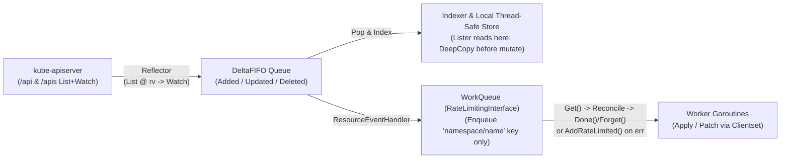

# 5.30 Go for Kubernetes engineers

| | |
|---|---|
| Level | Intermediate |
| Priority tier | 2 |
| Lab venue | Go 1.22 or newer, kind cluster, `kubectl`; modules `k8s.io/client-go`, `k8s.io/apimachinery`, `k8s.io/api`, `github.com/spf13/cobra` |
| Part | Part 5: Kubernetes |
| Status | Drafted; key listings compile and unit-test (Go 1.23.2, client-go v0.31.0); live-cluster labs **untested** |

## Why this matters for AI infrastructure

Suppose a controller pod crashes and its logs contain a Go stack trace. If you can read Go, that trace leads you straight into the source code. Kubernetes and most of its ecosystem are written in Go. That includes containerd, etcd, Prometheus, Terraform providers, the NVIDIA GPU Operator, device plugins, CSI drivers, Kueue, Argo and Cilium.

Platform engineers who read Go can debug operator behaviour from source. They can patch or extend components. They can also write small controllers and CLI tools, such as a node-health remediator, a quota reporter or an admission webhook.

You do not need to be a Go expert. You do need fluency with the language subset and the client libraries that Kubernetes tooling uses. This chapter teaches that subset with Kubernetes examples. It also sets up 5.31 (operators with controller-runtime), 5.32 (a GPU node health operator) and 5.33 (reading the GPU and Network Operator source).

## Prerequisites and outcomes

You need programming experience (Part 3 Python) and the material in 5.3 to 5.6 before you start. Once you finish this chapter, you should be able to do the following.

You can set up a Go module, use the toolchain (`go build/test/vet/fmt/mod`, `gopls`, `golangci-lint`), and find your way around a large Go repository.

You can use Go's core features correctly. That covers types, structs, methods, interfaces with implicit satisfaction, embedding, pointers versus values, slices and maps, and errors with wrapping, `errors.Is/As`. It also covers `defer`, `panic/recover` and generics.

You can write concurrent programs with goroutines, channels, `sync` primitives and `context`. Your goal is to avoid leaks and races, and you will use the race detector to check your work.

You can handle JSON, YAML and Kubernetes types, including struct tags, `metav1.ObjectMeta`, `runtime.Object` and `unstructured`.

You can use client-go to build a client from a kubeconfig or in-cluster config. You can list, get, create, patch and delete objects, and you can watch them with informers, listers, work queues, leader election, the dynamic client and discovery. You also know how to apply the best practices for rate limits and retries.

Finally, you can write table-driven tests and fake clients, use `envtest`, structure a CLI with cobra, and produce small static container images.

## 1. Toolchain and project layout

Start with the toolchain and a module before you write any Go code. The commands below create a project called `nodectl`, add the Kubernetes libraries, and run the checks you will repeat on every change.

```bash
go version                                  # 1.22+ recommended; check go.mod 'go' directive and toolchain line
mkdir nodectl && cd nodectl && go mod init example.com/nodectl
go get k8s.io/client-go@v0.31.0 k8s.io/apimachinery@v0.31.0 k8s.io/api@v0.31.0   # match your Kubernetes minor version (client-go v0.N ↔ Kubernetes 1.N)
go mod tidy
go build ./... && go vet ./... && go test ./... -race -count=1
gofmt -s -w . && goimports -w .             # formatting is not negotiable; CI should check
golangci-lint run                           # linters (errcheck, staticcheck, govet, ineffassign, unused, revive ...)
go doc k8s.io/client-go/kubernetes.Clientset
GOFLAGS=-mod=readonly go build -trimpath -ldflags='-s -w' -o bin/nodectl ./cmd/nodectl
CGO_ENABLED=0 GOOS=linux GOARCH=amd64 go build ...        # static binary for scratch/distroless images
```

The client-go version has to follow your Kubernetes minor version, so client-go v0.N pairs with Kubernetes 1.N. The last build line produces a static binary for scratch or distroless images.

The standard repository shape, the one kubebuilder projects use, looks like this:

```text
nodectl/
├── go.mod, go.sum
├── cmd/nodectl/main.go          # entry point(s) (thin: parse flags, wire dependencies)
├── internal/                    # private packages (cannot be imported by other modules)
│   ├── kube/                    # client construction, helpers
│   └── health/                  # domain logic (pure, easily tested)
├── pkg/                         # public packages (optional)
├── api/v1alpha1/                # CRD Go types (kubebuilder)
├── Makefile, Dockerfile, .golangci.yml
└── hack/                        # scripts (codegen, tools)
```

Keep `cmd/nodectl/main.go` thin, so it only parses flags and wires dependencies. Put the domain logic in `internal/health/`, where it stays pure and easy to test.

Modules bring a few rules of their own. Semantic import versioning uses a `/v2` suffix. Use `replace` for a local fork, `go.work` for multi-module work, and `go mod vendor` if you choose vendoring, which is optional.

The Kubernetes libraries are tightly coupled. client-go, apimachinery, api and controller-runtime must be compatible with one another, so check the compatibility matrix before you upgrade any of them. `go.sum` verifies the hashes of your dependencies.

For private modules, configure `GOPROXY` and `GOFLAGS` together with `GOPRIVATE`.

## 2. Language essentials (the subset Kubernetes code uses)

### Types, structs, methods

Most Kubernetes controllers rely on the same handful of language features. The example below models a GPU error event as a struct and maps its error code to a severity.

```go
package health

import "time"

// XIDEvent is a GPU error event reported by DCGM or kernel logs.
type XIDEvent struct {
	Node  string
	GPU   int
	Code  int
	Seen  time.Time
}

type Severity int

const (
	SeverityInfo Severity = iota // iota: 0,1,2...
	SeverityWarn
	SeverityCritical
)

func (s Severity) String() string {
	switch s {
	case SeverityInfo:
		return "info"
	case SeverityWarn:
		return "warn"
	case SeverityCritical:
		return "critical"
	default:
		return "unknown"
	}
}

// Classify maps an XID code to a severity (illustrative mapping).
func (e XIDEvent) Classify() Severity {
	switch e.Code {
	case 79, 74, 48: // fallen off bus, NVLink error, double-bit ECC (illustrative; verify against NVIDIA's catalogue)
		return SeverityCritical
	case 13, 31:
		return SeverityWarn
	}
	return SeverityInfo
}
```

Go decides what other packages can see from the first letter of each name. An exported identifier starts with a capital letter. Packages are the unit of encapsulation, and Go has no classes and no inheritance. Methods take a receiver, which can be a value or a pointer. Use a pointer receiver when the method mutates the struct, when the struct is large, or for consistency, and do not mix the two on one type.

Zero values are useful. `var s []int` is a nil slice that you can append to, and `var mu sync.Mutex` is ready to use without setup.

Struct tags control marshalling. Kubernetes types use `json` tags, and some also carry `protobuf` tags. YAML is handled by `sigs.k8s.io/yaml`, which converts YAML to JSON and then into the struct. That means only `json` tags matter, as in `json:"name,omitempty"`.

Composition works through embedding. A struct such as `type Node struct { metav1.TypeMeta; metav1.ObjectMeta; Spec NodeSpec; Status NodeStatus }` picks up the fields and methods of its embedded types. That is how every Kubernetes object gets `GetName()` and `GetLabels()`.

### Interfaces (implicit) and polymorphism

```go
type Remediator interface {
	Cordon(ctx context.Context, node string) error
	Drain(ctx context.Context, node string) error
}

type kubeRemediator struct{ cs kubernetes.Interface }       // *kubeRemediator satisfies Remediator implicitly

var _ Remediator = (*kubeRemediator)(nil)                   // compile-time assertion
```

Go satisfies interfaces implicitly, so a type never declares that it implements one. The common idiom is to accept interfaces and return structs. Define small interfaces at the consumer. For example, `kubernetes.Interface` lets you pass `fake.NewSimpleClientset()` in tests.

`any` is an alias for `interface{}`, and it holds a value of any type. You recover the concrete type with a type assertion, `v, ok := x.(T)`, or with a type switch, `switch t := x.(type)`. Kubernetes uses `runtime.Object` as the common supertype of API objects. It is an interface with `GetObjectKind()` and `DeepCopyObject()`. controller-runtime also has `client.Object`.

### Errors

```go
var ErrNoSuchNode = errors.New("no such node")

func cordon(ctx context.Context, cs kubernetes.Interface, name string) error {
	n, err := cs.CoreV1().Nodes().Get(ctx, name, metav1.GetOptions{})
	if apierrors.IsNotFound(err) {
		return fmt.Errorf("cordon %q: %w", name, ErrNoSuchNode)       // wrap with %w
	}
	if err != nil {
		return fmt.Errorf("get node %q: %w", name, err)
	}
	if n.Spec.Unschedulable {
		return nil
	}
	patch := []byte(`{"spec":{"unschedulable":true}}`)
	_, err = cs.CoreV1().Nodes().Patch(ctx, name, types.StrategicMergePatchType, patch, metav1.PatchOptions{})
	return err
}

if errors.Is(err, ErrNoSuchNode) { ... }                           // unwrap chain
var se *apierrors.StatusError
if errors.As(err, &se) && se.ErrStatus.Code == http.StatusConflict { ... }
```

Errors are ordinary values, returned as the last result of a function. Check them right away with `if err != nil`. Wrap each one with context using `fmt.Errorf("...: %w", err)`, so the caller can still reach the original cause. Compare with `errors.Is`, and pull out a typed error with `errors.As`. Kubernetes API errors come with helpers such as `apierrors.IsNotFound/IsConflict/IsAlreadyExists/IsForbidden/IsTimeout/IsServerTimeout`. Never ignore an error silently, because the `errcheck` linter flags it.

Reserve `panic` for programmer errors and initialisation. Use `defer` for cleanup, as in `defer resp.Body.Close()`, `defer cancel()` and `defer mu.Unlock()`. `recover` is rare and mostly appears in HTTP servers. When several errors belong together, combine them with `errors.Join`, or with the aggregate helper `utilerrors.NewAggregate` from apimachinery.

### Slices, maps, strings, generics

Most people first trip over a map. Writing to a nil map panics, so a program that writes into a map nobody created stops on the first write. Build the collections your code needs with `make` and the standard `slices` and `maps` packages, as the example below shows.

```go
gpuNodes := make([]string, 0, len(nodes))                          // len 0, cap hint
for _, n := range nodes.Items {                                    // range copies values: take &nodes.Items[i] if you need pointers
	if q, ok := n.Status.Allocatable["nvidia.com/gpu"]; ok && !q.IsZero() {
		gpuNodes = append(gpuNodes, n.Name)
	}
}
slices.Sort(gpuNodes)                                              // std lib 'slices' and 'maps' packages (Go 1.21+)
idx, found := slices.BinarySearch(gpuNodes, "node-7")

counts := map[string]int{}                                         // maps: iteration order is random; not safe for concurrent writes
for _, p := range pods { counts[p.Spec.NodeName]++ }
keys := slices.Sorted(maps.Keys(counts))                           // deterministic output (Go 1.23)

func Filter[T any](in []T, keep func(T) bool) []T {                // generics (type parameters)
	out := in[:0:0]
	for _, v := range in { if keep(v) { out = append(out, v) } }
	return out
}
```

A few gotchas are worth knowing. Slices share backing arrays, so `append` may or may not reallocate. Since Go 1.22, each loop iteration has its own loop variable, which changed how closures capture it. Iterating over a string yields runes. Know the difference between `copy` and plain assignment. `for range n` arrived in Go 1.22, and range-over-func iterators arrived in Go 1.23. For building strings, use `strings.Builder` or `bytes.Buffer`, and use `fmt.Sprintf` with verbs such as `%v`, `%+v`, `%#v`, `%T`, `%w` and `%q`.

### Pointers and values

Go passes everything by value, which means it copies. Pointers are how you share. Kubernetes API types use pointers for optional fields, such as `*int32 Replicas`, so a program can tell an unset field from a zero value. The `k8s.io/utils/ptr` helpers make this easier. `ptr.To(int32(3))` builds a pointer, and `ptr.Deref(p, default)` reads one safely.

Objects returned from listers are shared cache objects, so never mutate them. Call `DeepCopy()` before you change anything. Struct comparison with `==` works only when every field is comparable, so use `reflect.DeepEqual` or apimachinery's `equality.Semantic.DeepEqual` instead. The Semantic version handles `resource.Quantity` and `metav1.Time` correctly.

### Packages, visibility, init, build tags

One directory holds one package, and `internal/` restricts which packages can import it. Avoid side effects in `init()`, because it runs whenever the package is imported. Kubernetes API groups register their types through explicit `AddToScheme` functions. Build constraints such as `//go:build linux` decide which files compile for which platform. `go:embed` handles static assets, and `go:generate` runs code generators such as deepcopy-gen, controller-gen and mockgen.

When you read the controller code in the next sections, keep two rules in mind. Wrap errors with `%w`, and call `DeepCopy()` before you mutate anything that came from a lister.

## 3. Concurrency

### Goroutines, channels, sync

Suppose you must probe every node in a large cluster. The example below runs the probes concurrently and stops the whole run when a context timeout expires.

```go
func probeAll(ctx context.Context, nodes []string, probe func(context.Context, string) (bool, error)) map[string]bool {
	type result struct {
		node string
		ok   bool
	}
	ctx, cancel := context.WithTimeout(ctx, 30*time.Second)
	defer cancel()

	results := make(chan result)
	sem := make(chan struct{}, 16)                      // bound concurrency
	var wg sync.WaitGroup
	for _, n := range nodes {
		wg.Add(1)
		go func() {                                      // Go 1.22: n is per-iteration
			defer wg.Done()
			sem <- struct{}{}
			defer func() { <-sem }()
			ok, err := probe(ctx, n)
			if err != nil { ok = false }
			select {
			case results <- result{n, ok}:
			case <-ctx.Done():
			}
		}()
	}
	go func() { wg.Wait(); close(results) }()           // close when all senders are done

	out := make(map[string]bool, len(nodes))
	for r := range results { out[r.node] = r.ok }
	return out
}
```

Goroutines are cheap, but every goroutine needs a clear way to exit, such as a context cancel or a channel close. The Go proverb says, "don't communicate by sharing memory; share memory by communicating." When the state is simple, a mutex is the better tool, using `sync.Mutex/RWMutex`.

The rest of the `sync` family covers the other cases. `sync.WaitGroup` waits for a set of goroutines, `sync.Once` runs something exactly once, and `sync/atomic` handles single values. `sync.Map` is rare. `errgroup.Group` from `golang.org/x/sync/errgroup` combines waiting, the first error, context cancellation and `SetLimit`.

Channels come in two forms. An unbuffered channel makes the sender and receiver meet, while a buffered channel holds values until someone takes them. Only the sender should close a channel. Receiving from a closed channel yields zero values.

Use `select` to wait on several channel operations at once. A `default` case makes the wait non-blocking, and a timeout or `ctx.Done()` case stops it when time runs out. Avoid `time.After` inside loops, because it leaked timers before Go 1.23. Use `time.NewTimer` instead.

Two failures are common. A goroutine that waits on a send or receive with no reader is leaked. A data race is undefined behaviour, so run your tests with `-race`. A deadlock shows up as `all goroutines are asleep`. Kubernetes code uses `wait.Until`, `wait.PollUntilContextTimeout` (from apimachinery/util/wait) and rate-limited work queues in controllers, rather than raw goroutines. Check that every goroutine you start has a way to stop.

### context.Context

A context carries cancellation, deadlines and request-scoped values across API boundaries. By convention it is the first parameter, written `ctx context.Context`. Derive a child with `WithCancel/WithTimeout/WithDeadline/WithValue`, and always `defer cancel()` after you derive one.

Do not store a context in a struct for long-lived use. Pass `ctx` to every client-go call, as in `Get(ctx, name, opts)`, and check `ctx.Err()` inside loops. controller-runtime passes a context into each reconcile.

## 4. JSON, YAML and Kubernetes types

Suppose you need to build a test pod in code and print it as YAML. Kubernetes types make that a short job, and the example below does exactly that.

```go
import (
	corev1 "k8s.io/api/core/v1"
	metav1 "k8s.io/apimachinery/pkg/apis/meta/v1"
	"sigs.k8s.io/yaml"
)

pod := &corev1.Pod{
	ObjectMeta: metav1.ObjectMeta{Name: "gpu-test", Namespace: "default", Labels: map[string]string{"app": "gpu-test"}},
	Spec: corev1.PodSpec{
		RestartPolicy: corev1.RestartPolicyNever,
		Containers: []corev1.Container{{
			Name:    "cuda",
			Image:   "nvcr.io/nvidia/cuda:12.4.1-base-ubuntu22.04",
			Command: []string{"nvidia-smi"},
			Resources: corev1.ResourceRequirements{
				Limits: corev1.ResourceList{"nvidia.com/gpu": resource.MustParse("1")},
			},
		}},
	},
}
b, _ := yaml.Marshal(pod)                      // sigs.k8s.io/yaml: struct → JSON → YAML
var p2 corev1.Pod
_ = yaml.Unmarshal(b, &p2)
```

The program builds a pod in memory, marshals it to YAML, and then reads the YAML back into a typed object. The `sigs.k8s.io/yaml` package goes from struct to JSON to YAML, so the same struct works in both directions.

Several helper types appear again and again. `resource.Quantity` holds CPU, memory and GPU counts. Build one with `resource.MustParse("100Mi")`, then read it with `.Value()`, `.MilliValue()` or `.Cmp()`. `metav1.Time` and `metav1.Duration` cover timestamps and durations. `intstr.IntOrString` holds an integer or a string. To turn a `metav1.LabelSelector` into a `labels.Selector`, use `metav1.LabelSelectorAsSelector`.

Sometimes you have no Go type at all, for example a CRD without generated types. Then `unstructured.Unstructured` wraps a `map[string]interface{}`. Helpers such as `unstructured.NestedString/NestedSlice/SetNestedField` read and write fields, and `runtime.DefaultUnstructuredConverter.FromUnstructured` converts the object into a typed one.

The scheme tells Kubernetes how Go types map to kinds. `runtime.Scheme` maps Go types to GroupVersionKind values, and `scheme.AddToScheme` registers types. Serializers decode and encode the data. Use `client-go/kubernetes/scheme` for built-in types, and remember that custom types need their group's `AddToScheme`. Metadata helpers handle ownership and selectors: `metav1.NewControllerRef`, `controllerutil.SetControllerReference`, `metav1.IsControlledBy`, `labels.Set` and `fields.OneTermEqualSelector("spec.nodeName", n)`.

Generated `DeepCopy()` methods exist for the API types. Never share an object and mutate it, so call `DeepCopy()` first.

*Kubernetes Programming with Go*, Chapters 4 and 5, and *Network Programmability and Automation*, Chapter 7, by Philippe Martin and Jason Edelman et al., explain the inner mechanics of `apimachinery` and Go type conventions. Three of those mechanics are worth knowing.

The first is quantities and `intstr.IntOrString` (*Kubernetes Programming with Go*, Chapter 4). `resource.Quantity`, from `k8s.io/apimachinery/pkg/api/resource`, uses exact fixed-point arithmetic, so it avoids IEEE-754 floating-point drift. It has two suffix families, binary `Ki..Ei` and decimal `n..E`. `BinarySI` uses steps of `2^(10x)`, with suffixes `Ki`, `Mi`, `Gi`, `Ti`, `Pi` and `Ei`, so `1Ki == 1024`. `DecimalSI` uses steps of `10^(3x)`, with suffixes `n`, `u`, `m`, `k`, `M`, `G`, `T`, `P` and `E`, so `1k == 1000` and `2500m == 2.5`.

`intstr.IntOrString`, from `k8s.io/apimachinery/pkg/util/intstr`, appears in `ServicePort.TargetPort`, `RollingUpdateDeployment.MaxSurge`/`MaxUnavailable` and `PodDisruptionBudget`. It holds either an `IntVal` or a `StrVal`, such as `"25%"`. You evaluate it with `intstr.GetScaledValueFromIntOrPercent(&intOrStr, totalReplicas, roundUp)`. This behaviour is modeled in `code/part05/client_go_mechanics_sim.py`.

The second is the scheme and the `RESTMapper` (*Kubernetes Programming with Go*, Chapter 5). `runtime.Scheme` is an in-memory registry. It maps Go `reflect.Type` structs $\leftrightarrow$ `schema.GroupVersionKind` (`GVK`, via `AddKnownTypes`, `ObjectKinds`, `New`), and it performs defaulting (`Default`) and version conversion (`Convert`).

Go code works with a `GVK`, such as `apps/v1, Kind=Deployment`, but HTTP REST endpoints use a `GVR`, such as `/apis/apps/v1/namespaces/{ns}/deployments`. A `RESTMapper` translates between the two with `RESTMapping`, `KindFor` and `ResourceFor`. It also reports whether a resource is `RESTScopeNamespace` or `RESTScopeRoot`. Two forms are worth knowing, `meta.DefaultRESTMapper` and `restmapper.NewDeferredDiscoveryRESTMapper`. The deferred form, built with `NewDeferredDiscoveryRESTMapper(memory.NewMemCacheClient(discoveryClient))`, queries `/apis` at runtime and caches discovery responses in memory.

Serializers live in `k8s.io/apimachinery/pkg/runtime/serializer`. `json.NewSerializerWithOptions` handles both JSON and YAML. `protobuf.NewSerializer` uses `application/vnd.kubernetes.protobuf`, which suits high-throughput native core types.

The third is pointer versus value receivers, and `net/netip` (*Network Programmability and Automation*, Chapter 7). A type `T` with a pointer receiver method, `func (r *Router) Trim()`, satisfies an interface only when you pass a pointer, `*Router`. Pass a plain `Router` and the compiler stops you with `Router does not implement Trimmable (method has pointer receiver)`. For IP and CIDR work in Kubernetes network controllers, Go 1.18 and later offer `net/netip`, with `netip.ParseAddr` and `netip.ParsePrefix`. It is an immutable, comparable, allocation-free value type that replaces the legacy `net.IP` slices.



Read the diagram from left to right. The reflector feeds the queue, and the work queue carries `namespace/name` keys rather than whole objects.

## 5. client-go

### Building clients

Your tool may run inside a pod one day and on a laptop the next. The function below works in both places. It tries the in-cluster config first, then falls back to a kubeconfig found through `KUBECONFIG` or `~/.kube/config`.

```go
func newClient() (kubernetes.Interface, *rest.Config, error) {
	// precedence: in-cluster → kubeconfig (KUBECONFIG, ~/.kube/config)
	cfg, err := rest.InClusterConfig()
	if err != nil {
		loading := clientcmd.NewDefaultClientConfigLoadingRules()
		cfg, err = clientcmd.NewNonInteractiveDeferredLoadingClientConfig(loading, &clientcmd.ConfigOverrides{}).ClientConfig()
		if err != nil { return nil, nil, fmt.Errorf("load kubeconfig: %w", err) }
	}
	cfg.QPS, cfg.Burst = 50, 100            // default 5/10 is far too low for controllers; see 5.5 about APF
	cfg.UserAgent = "nodectl/0.1"
	cs, err := kubernetes.NewForConfig(cfg)
	return cs, cfg, err
}
```

The default 5/10 is far too low for controllers. See 5.5 for APF.

The typed clientset, `kubernetes.Interface`, exposes `CoreV1()`, `AppsV1()`, `BatchV1()`, `RbacV1()` and more. The dynamic client, created with `dynamic.NewForConfig`, returns unstructured objects through `Resource(gvr).Namespace(ns).List(...)`, which suits CRDs without generated types. The discovery client lists API groups and resources, and the REST client is low-level. The metadata client returns `PartialObjectMetadata` cheaply. The scale client and generated clientsets (`client-gen`) complete the set. controller-runtime's `client.Client` adds a cache, as chapter 5.31 covers.

### CRUD, patch, apply

Two controllers may change the same node at once.

```go
ctx := context.Background()
nodes, err := cs.CoreV1().Nodes().List(ctx, metav1.ListOptions{LabelSelector: "nvidia.com/gpu.present=true", Limit: 500})
for nodes.Continue != "" { /* paginate with opts.Continue */ }

pod, err := cs.CoreV1().Pods("training").Get(ctx, "trainer-0", metav1.GetOptions{})
pod.Labels["checked"] = "true"
_, err = cs.CoreV1().Pods("training").Update(ctx, pod, metav1.UpdateOptions{})            // full update; conflict if stale

// Conflict-safe read-modify-write
err = retry.RetryOnConflict(retry.DefaultRetry, func() error {
	n, err := cs.CoreV1().Nodes().Get(ctx, name, metav1.GetOptions{})
	if err != nil { return err }
	n.Annotations["platform.example.com/cordon-reason"] = "xid79"
	_, err = cs.CoreV1().Nodes().Update(ctx, n, metav1.UpdateOptions{})
	return err
})

// JSON merge patch / strategic merge patch (no read needed)
_, err = cs.CoreV1().Nodes().Patch(ctx, name, types.MergePatchType,
	[]byte(`{"metadata":{"labels":{"platform.example.com/quarantine":"true"}}}`), metav1.PatchOptions{})

// Server-side apply with typed apply configurations (field ownership; idempotent)
import applycorev1 "k8s.io/client-go/applyconfigurations/core/v1"
nodeAC := applycorev1.Node(name).WithLabels(map[string]string{"platform.example.com/quarantine": "true"})
_, err = cs.CoreV1().Nodes().Apply(ctx, nodeAC, metav1.ApplyOptions{FieldManager: "nodectl", Force: false})

// Eviction (respects PDBs) — preferred over Delete for draining
ev := &policyv1.Eviction{ObjectMeta: metav1.ObjectMeta{Name: pod.Name, Namespace: pod.Namespace}}
err = cs.CoreV1().Pods(pod.Namespace).EvictV1(ctx, ev)   // returns 429 if a PDB disallows; retry later
```

The first block pages through a filtered node list with `Limit` and `opts.Continue`. Get-modify-update is the classic trap. A full `Update` fails with a conflict when your copy is stale, so wrap the read and write in `retry.RetryOnConflict` and read again on each attempt. A merge patch needs no read, and server-side apply, with typed apply configurations, records field ownership and is idempotent.

Eviction is the preferred way to drain a pod, because it respects PDBs. `EvictV1` returns 429 when a PDB disallows the eviction, so retry later.

Prefer patch or apply over get-modify-update. Use `Update` only when you handle `resourceVersion` and retry. For deletes, `DeleteOptions{PropagationPolicy: &fg, GracePeriodSeconds: &g}` sets the propagation. `Create` returns `AlreadyExists` when the object exists, and `DryRun: []string{metav1.DryRunAll}` validates a request without changing anything.

### Watching

The loop below handles added, modified, deleted and error events.

```go
w, err := cs.CoreV1().Nodes().Watch(ctx, metav1.ListOptions{ResourceVersion: list.ResourceVersion, AllowWatchBookmarks: true})
defer w.Stop()
for ev := range w.ResultChan() {
	switch ev.Type {
	case watch.Added, watch.Modified: n := ev.Object.(*corev1.Node); _ = n
	case watch.Deleted:
	case watch.Error:                                   // 410 Gone → relist
	}
}
```

A `watch.Error` with 410 Gone means you must relist. Raw watches also need reconnection, bookmark and resource version handling, and backoff. For most code, use `watchtools.NewRetryWatcher` or, almost always, informers.

### Informers, listers and work queues

Suppose a controller must react to every GPU node that joins, leaves or changes.

```go
factory := informers.NewSharedInformerFactoryWithOptions(cs, 10*time.Hour,
	informers.WithTweakListOptions(func(o *metav1.ListOptions) { o.LabelSelector = "nvidia.com/gpu.present=true" }))
nodeInformer := factory.Core().V1().Nodes()
nodeLister := nodeInformer.Lister()                                   // cache-backed reads: Get(name), List(selector)

queue := workqueue.NewTypedRateLimitingQueue(workqueue.DefaultTypedControllerRateLimiter[string]())
defer queue.ShutDown()

_, _ = nodeInformer.Informer().AddEventHandler(cache.ResourceEventHandlerFuncs{
	AddFunc:    func(obj interface{}) { enqueue(queue, obj) },
	UpdateFunc: func(_, obj interface{}) { enqueue(queue, obj) },
	DeleteFunc: func(obj interface{}) { enqueue(queue, obj) },        // obj may be cache.DeletedFinalStateUnknown
})

func enqueue(q workqueue.TypedRateLimitingInterface[string], obj interface{}) {
	key, err := cache.DeletionHandlingMetaNamespaceKeyFunc(obj)
	if err == nil { q.Add(key) }
}

ctx, stop := signal.NotifyContext(context.Background(), os.Interrupt, syscall.SIGTERM)
defer stop()
factory.Start(ctx.Done())
if !cache.WaitForCacheSync(ctx.Done(), nodeInformer.Informer().HasSynced) { return errors.New("cache sync failed") }

for i := 0; i < 2; i++ {                                              // workers
	go wait.UntilWithContext(ctx, func(ctx context.Context) {
		for processNext(ctx, queue, nodeLister) {}
	}, time.Second)
}
<-ctx.Done()

func processNext(ctx context.Context, q workqueue.TypedRateLimitingInterface[string], l listersv1.NodeLister) bool {
	key, shutdown := q.Get()
	if shutdown { return false }
	defer q.Done(key)
	if err := reconcile(ctx, key, l); err != nil {
		q.AddRateLimited(key)                                          // retry with backoff
		return true
	}
	q.Forget(key)                                                      // reset backoff
	return true
}
```

The lister reads from the local cache and serves `Get(name)` and `List(selector)`. The work queue holds keys, and its rate limiter spaces out retries. The event handlers only add keys. Each `DeletedFinalStateUnknown` tombstone needs handling, because a delete can arrive without the final object.

The code waits for cache sync before the workers start. Each worker runs `processNext` in a loop. On an error, the key goes back in the queue with `AddRateLimited`, which applies backoff. On success, `Forget` resets the backoff.

Wait for cache sync, read from the lister and write through the client. Never mutate cached objects, so call `DeepCopy()` first. Enqueue keys, not objects. The resync period is a safety net, and one worker handles a given key at a time. Call `Forget` on success, and shut down cleanly on SIGTERM.

With several resource types, create one factory for all of them. Add indexers, such as `cache.Indexers{"byNode": func(...)}`, for efficient lookups like pods by node.

### Leader election

Only one replica should act, so the replicas take turns holding a lease.

```go
lock := &resourcelock.LeaseLock{
	LeaseMeta:  metav1.ObjectMeta{Name: "nodectl-leader", Namespace: "platform"},
	Client:     cs.CoordinationV1(),
	LockConfig: resourcelock.ResourceLockConfig{Identity: hostname},
}
leaderelection.RunOrDie(ctx, leaderelection.LeaderElectionConfig{
	Lock: lock, ReleaseOnCancel: true,
	LeaseDuration: 15 * time.Second, RenewDeadline: 10 * time.Second, RetryPeriod: 2 * time.Second,
	Callbacks: leaderelection.LeaderCallbacks{
		OnStartedLeading: func(ctx context.Context) { run(ctx) },
		OnStoppedLeading: func() { klog.Info("lost leadership; exiting"); os.Exit(1) },     // restart to rejoin cleanly
	},
})
```

The lock is a Lease in the `platform` namespace, and each replica identifies itself with its hostname. `RunOrDie` runs the work only while this replica holds the lease. `ReleaseOnCancel` lets the replica give the lease up when its context is cancelled. If the replica loses leadership, it logs the event and exits, so a restart can rejoin the election cleanly.

### Dynamic client for CRDs

A CRD may have no generated Go types, yet you still need its spec. The dynamic client works from a GroupVersionResource alone.

```go
gvr := schema.GroupVersionResource{Group: "kueue.x-k8s.io", Version: "v1beta1", Resource: "clusterqueues"}
dc, _ := dynamic.NewForConfig(cfg)
list, err := dc.Resource(gvr).List(ctx, metav1.ListOptions{})
for _, item := range list.Items {
	nominal, found, _ := unstructured.NestedSlice(item.Object, "spec", "resourceGroups")
	_, _ = nominal, found
}
```

The code lists `clusterqueues` through the dynamic client, then reads each item's `spec.resourceGroups` slice with `unstructured.NestedSlice`.

### Logging, metrics, flags

Kubernetes code logs with `klog`, which supports `-v` levels and structured calls such as `klog.InfoS("msg", "key", val)`. The standard library's `log/slog` is the other option. controller-runtime uses `logr`, typically through `ctrl.Log.WithName`. Metrics come from `prometheus/client_golang`, which provides counters, gauges and histograms. Keep label values bounded.

Flags use `flag`, `pflag` or cobra. Health endpoints use `net/http`, and graceful shutdown uses `signal.NotifyContext`. For anything long-running, prefer informers over raw watches.

## 6. A small CLI: cordon nodes on XID events (walkthrough)

Suppose a GPU reports an unhealthy condition overnight, and you want its node cordoned before more jobs land on it. The small CLI below does that. It is a dry run unless you turn the dry run off.

```go
// cmd/nodectl/main.go (condensed)
package main

import (
	"context"
	"fmt"
	"os"

	"github.com/spf13/cobra"
	corev1 "k8s.io/api/core/v1"
	metav1 "k8s.io/apimachinery/pkg/apis/meta/v1"
	"k8s.io/apimachinery/pkg/types"
	"k8s.io/client-go/kubernetes"
	"k8s.io/client-go/tools/clientcmd"
)

func main() {
	var kubeconfig, selector string
	var dryRun bool
	root := &cobra.Command{Use: "nodectl", SilenceUsage: true}
	root.PersistentFlags().StringVar(&kubeconfig, "kubeconfig", os.Getenv("KUBECONFIG"), "path to kubeconfig")

	cordon := &cobra.Command{
		Use:   "cordon-unhealthy",
		Short: "Cordon GPU nodes whose NodeCondition GPUHealthy is False",
		RunE: func(cmd *cobra.Command, _ []string) error {
			cs, err := client(kubeconfig)
			if err != nil { return err }
			ctx := cmd.Context()
			nodes, err := cs.CoreV1().Nodes().List(ctx, metav1.ListOptions{LabelSelector: selector})
			if err != nil { return err }
			var failed int
			for i := range nodes.Items {
				n := &nodes.Items[i]
				if !unhealthy(n) || n.Spec.Unschedulable { continue }
				fmt.Printf("cordon %s\n", n.Name)
				if dryRun { continue }
				patch := []byte(`{"spec":{"unschedulable":true},"metadata":{"annotations":{"platform.example.com/reason":"GPUHealthy=False"}}}`)
				if _, err := cs.CoreV1().Nodes().Patch(ctx, n.Name, types.MergePatchType, patch, metav1.PatchOptions{}); err != nil {
					fmt.Fprintf(os.Stderr, "error: %s: %v\n", n.Name, err); failed++
				}
			}
			if failed > 0 { return fmt.Errorf("%d nodes failed", failed) }
			return nil
		},
	}
	cordon.Flags().StringVar(&selector, "selector", "nvidia.com/gpu.present=true", "node label selector")
	cordon.Flags().BoolVar(&dryRun, "dry-run", true, "only print actions")   // safe by default (4.8 principles)
	root.AddCommand(cordon)
	if err := root.ExecuteContext(context.Background()); err != nil { os.Exit(1) }
}

func unhealthy(n *corev1.Node) bool {
	for _, c := range n.Status.Conditions {
		if c.Type == "GPUHealthy" { return c.Status == corev1.ConditionFalse }
	}
	return false
}

func client(path string) (kubernetes.Interface, error) {
	cfg, err := clientcmd.BuildConfigFromFlags("", path)
	if err != nil { return nil, err }
	return kubernetes.NewForConfig(cfg)
}
```

Read the flags first. `--dry-run` defaults to true, so the tool only prints the nodes it would cordon. The tool collects failures as it goes and returns one error at the end, instead of stopping at the first bad node.

The listing, the informer program of section 5 (with imports `k8s.io/client-go/informers`, `listers/core/v1`, `tools/cache`, `util/workqueue`, `apimachinery/pkg/util/wait`, `k8s.io/klog/v2`) and the `health` package tests of section 7 were compiled and the unit tests run with Go 1.23.2 and client-go/apimachinery/api v0.31.0. `go vet` was clean and `go test` passed. The live-cluster behaviour was not exercised.

The CLI follows the principles from 3.8: a dry-run default, explicit exit codes, aggregated errors, selectors and an idempotent patch.

## 7. Testing

Suppose a small edit moves a critical XID code to the warn level. A table-driven test catches that change before it reaches a cluster. The first example checks the classifier with one row per case, and the second checks cordoning against the client-go fake clientset.

```go
// internal/health/classify_test.go
func TestClassify(t *testing.T) {
	tests := []struct {
		name string
		code int
		want Severity
	}{
		{"fallen off bus", 79, SeverityCritical},
		{"nvlink", 74, SeverityCritical},
		{"app error", 13, SeverityWarn},
		{"unknown", 999, SeverityInfo},
	}
	for _, tc := range tests {
		t.Run(tc.name, func(t *testing.T) {
			if got := (XIDEvent{Code: tc.code}).Classify(); got != tc.want {
				t.Fatalf("Classify(%d) = %v, want %v", tc.code, got, tc.want)
			}
		})
	}
}

// client-go fake clientset
func TestCordon(t *testing.T) {
	cs := fake.NewSimpleClientset(&corev1.Node{ObjectMeta: metav1.ObjectMeta{Name: "n1"}})
	if err := cordon(context.Background(), cs, "n1"); err != nil { t.Fatal(err) }
	n, _ := cs.CoreV1().Nodes().Get(context.Background(), "n1", metav1.GetOptions{})
	if !n.Spec.Unschedulable { t.Fatal("node not cordoned") }
	// fake clients support reactors to inject errors: cs.PrependReactor("patch", "nodes", ...)
}
```

Table-driven tests use `t.Run`, and you can add `t.Parallel()` and `t.Helper()` where they fit. Helpers can take `testing.TB`. `cmp.Diff` from go-cmp compares values, and `testify` with `require` and `assert` is optional. Run the suite with `go test -race -cover ./...`. Fuzzing uses `func FuzzParse(f *testing.F)`, and benchmarks use `func BenchmarkX(b *testing.B)`.

Fakes are not a real server. `k8s.io/client-go/kubernetes/fake` uses an object tracker, which lacks server behaviour such as admission, defaulting, field validation and resourceVersion conflicts. The same applies to `dynamic/fake` and controller-runtime's `fake.NewClientBuilder()`. For integration tests, `sigs.k8s.io/controller-runtime/pkg/envtest` runs a real kube-apiserver and etcd binaries, which covers CRDs, webhooks and status subresources. For e2e tests, run on kind with kuttl, chainsaw or Ginkgo.

Design the code so it is easy to test. Keep pure domain logic apart from I/O, use small interfaces, and inject clients and clocks through `k8s.io/utils/clock` and `clock/testing`.

## 8. Packaging

Once the binary works, it needs a container image. The multi-stage Dockerfile below builds a static binary in one stage and copies only that file into a minimal image.

```dockerfile
FROM golang:1.23 AS build
WORKDIR /src
COPY go.mod go.sum ./
RUN --mount=type=cache,target=/go/pkg/mod go mod download
COPY . .
RUN --mount=type=cache,target=/root/.cache/go-build CGO_ENABLED=0 go build -trimpath -ldflags="-s -w -X main.version=${VERSION}" -o /out/nodectl ./cmd/nodectl

FROM gcr.io/distroless/static:nonroot
COPY --from=build /out/nodectl /nodectl
USER 65532:65532
ENTRYPOINT ["/nodectl"]
```

`ko` builds images from Go without a Dockerfile, using `ko build ./cmd/nodectl`. GoReleaser creates the releases and the SBOMs and signatures. When you package it, embed the version with `-ldflags -X`. Run the container as non-root, set resource requests, and expose `/healthz` and `/metrics`.

## 9. Idioms and pitfalls checklist

| Idiom | Pitfall |
|---|---|
| Wrap errors with `%w` and check with `errors.Is/As` | Comparing error strings; swallowing errors |
| Pass `context.Context` first and honour cancellation | Using `context.Background()` deep in libraries; leaking goroutines |
| Use `DeepCopy()` before mutating objects from informers/listers | Mutating cached objects (corrupts the cache) |
| Use patch/SSA, `RetryOnConflict` | Get-modify-update without retry; overwriting others' fields |
| Bound concurrency (`errgroup.SetLimit`, semaphore) | Spawning thousands of goroutines hitting the API (client-side throttling) |
| Rate-limited work queue per key | Tight retry loops; processing event handlers synchronously in the handler |
| Set client `QPS/Burst` explicitly | Default QPS 5 throttles controllers; unlimited QPS floods API (APF) |
| Prefer informers over polling `List` | Listing the whole cluster repeatedly |
| `defer cancel()` and `defer Close()` | Forgetting; defers in loops (run at function end) |
| Table-driven tests, fakes | Testing against a live cluster only |
| Keep API-type conversions at boundaries | Passing `unstructured` everywhere |
| Run `go vet`, `staticcheck`, `-race` in CI | Data races in shared maps; copying mutexes |
| Small interfaces at the consumer | Large "god" interfaces and mocking everything |
| `internal/` for private code, minimal public API | Exporting everything; import cycles |
| Match client-go and Kubernetes versions | Mixed versions causing type or API mismatches |
| `ptr.To` for optional fields; check nil before dereferencing | Nil pointer panics on optional API fields |

## 10. Lab

Start with the self-checking Python lab, which you can run locally. Run `code/part05/client_go_mechanics_sim_lab.py` and it checks three things. It verifies the `resource.Quantity` rules from *Kubernetes Programming with Go*, Chapter 4, where `BinarySI` (`Ki..Ei`) is compared with `DecimalSI` (`m..T`). It also verifies the `intstr.GetScaledValueFromIntOrPercent` calculator. Then it checks the `DefaultRESTMapper` from Chapter 5, which covers `GVK <-> GVR` pluralization and scope mapping.

The lab also covers Chapters 6 and 7. It checks the `Lister` `DeepCopy()` cache safety guard, and the `fake.NewSimpleClientset` `PrependReactor` and `Actions()` verifier.

```bash
python3 code/part05/client_go_mechanics_sim_lab.py
```

Next, with a Go toolchain (`go 1.22+`) and a `kind` cluster, you work through these exercises. Every interactive step below is `untested here`.

1. Install Go, create the module, and add client-go dependencies that match your kind cluster version. Then build and run a program that lists nodes with GPU labels, using fake labels on the kind nodes.
2. Implement `Classify`, a generic `Filter/Map/GroupBy`, and an `errors.Is/As` example with a custom error type. Add a bounded-concurrency prober that uses `errgroup`, and finish by running `go vet` and `go test -race`.
3. Write the node informer and work queue example, and log each reconcile. Kill and restart the program, then observe resync and cache behaviour. Add an indexer for pods by node, and print the pod counts per node.
4. Write two goroutines that update the same annotations. First use `Update` and observe the conflicts. Then switch to `Patch` or SSA, which shows no conflicts, and inspect field ownership with `--show-managed-fields`.
5. Implement a raw watch and force a 410 by delaying. Add a `RetryWatcher`, and then compare it with an informer.
6. Implement `cordon` with an eviction loop that respects PDBs, using retries and backoff. Test it against kind with a PDB that blocks evictions. Add `--timeout` and context cancellation.
7. Write a tool that prints Kueue ClusterQueue usage with unstructured access. Then generate typed structs by importing Kueue's API module, and compare the two.
8. Build the `nodectl cordon-unhealthy` command with cobra, and add tests with the fake clientset. Add `--output json`, cross-compile, and package the binary in a distroless image. Run it as a Job with a ServiceAccount and RBAC, following least privilege with nodes `get/list/patch`.
9. Run two replicas of an informer program with a Lease, then kill the leader and measure the failover.
10. Clone `kubernetes/kubernetes` or `kubernetes/sample-controller`. Trace `pkg/controller/replicaset`'s `syncReplicaSet`, map it to the reconcile pattern in 5.6, and find where the informers are wired.
11. Write one envtest integration test that installs a CRD and verifies status subresource behaviour.
12. Clean up.

## 11. Interview angles

- "Why is Go used for Kubernetes? What Go features matter (interfaces, goroutines, static binaries)?"
- "How do informers work and why must you not mutate objects from a lister?"
- "How do you avoid write conflicts when updating Kubernetes objects from code?"
- "How do you structure a controller's work queue and retries?"
- "Explain contexts and goroutine leaks. How do you test for data races?"
- "How do you test code that talks to the Kubernetes API?" (fake clientset, envtest, kind e2e.)
- "How would you write a tool that safely drains nodes at scale?"

## Exercises

1. Start with the Go type system, pointer versus value receivers, and error wrapping (`%w`, `errors.Is`/`As`, `k8s.io/apimachinery/pkg/api/errors`). Explain why optional fields in Kubernetes Go structs use pointers (`*int32`, `*bool` via `ptr.To` / `ptr.Deref`). Explain why a method with a pointer receiver (`func (r *Router) Trim()`) does not satisfy an interface when you pass it by value, as Network Programmability and Automation, Chapter 7, describes. Then show how you wrap and inspect Kubernetes API status errors with `apierrors.IsNotFound` and `apierrors.IsConflict`.
2. For concurrency, cover `context.Context`, `errgroup.WithContext`, and race detection with `-race`. Trace the bounded-concurrency node prober from Section 3, which uses `errgroup` with `g.SetLimit(16)`. Explain how `context.Context` cancellation propagates when one worker returns an error. Then explain why you must give every goroutine an explicit exit path, and why concurrent map writes panic at runtime.
3. For apimachinery common types and the `runtime.Scheme` and `RESTMapper`, use Kubernetes Programming with Go, Chapters 4 and 5. Cover `resource.Quantity`, `intstr.IntOrString`, `metav1.Time` and `labels.Selector`. Using `parse_k8s_quantity_milli()`, `get_scaled_value_from_int_or_percent()` and `DefaultRESTMapperSim` in `code/part05/client_go_mechanics_sim.py`, contrast `BinarySI` (`1Ki = 1024`) with `DecimalSI` (`1k = 1000`, `2500m = 2.5`). Explain how `runtime.Scheme` maps Go structs to `GVK`, and how `DefaultRESTMapper` and `DeferredDiscoveryRESTMapper` translate `GVK <-> GVR`.
4. Cover client-go clients (`Clientset`, `Dynamic`, `Metadata`, `Discovery`), `QPS`/`Burst`, conflict-safe `RetryOnConflict`, and Server-Side Apply (`ApplyConfigurations`, Kubernetes Programming with Go, Chapter 6). Compare `Update` (with `retry.RetryOnConflict`), `Patch` (`MergePatchType`/`StrategicMergePatchType`), and typed Server-Side Apply (`applycorev1.Node(name)` with `FieldManager`). Then explain why `EvictV1` (`policyv1.Eviction`) is used instead of `Delete` when draining nodes.
5. Look inside `SharedInformerFactory`, `Lister`s (`DeepCopy`), `Indexer`s, `workqueue.TypedRateLimitingInterface`, and leader election (Kubernetes Programming with Go, Chapter 6). Trace the Section 5 informer and work queue program through `Reflector -> DeltaFIFO -> Indexer/Store + ResourceEventHandler -> WorkQueue -> Worker`. Explain why event handlers only enqueue `"namespace/name"` keys, and why `cache.DeletedFinalStateUnknown` tombstones must be unwrapped on `DeleteFunc`. Then explain why mutating an object returned by a `Lister` without `DeepCopy()` corrupts the shared process cache.
6. Test `client-go` applications with `fake.NewSimpleClientset`, `Actions()`, `PrependReactor`, `fakediscovery` and `envtest` (Kubernetes Programming with Go, Chapter 7). Also package static distroless binaries. Using `FakeClientsetWithCacheSim` in `code/part05/client_go_mechanics_sim.py`, show how to inject a `409 Conflict` or `500` error into a unit test with `cs.PrependReactor("patch", "nodes", ...)`. Verify the recorded client calls with `cs.Actions()`. Compare `client-go/kubernetes/fake` with `envtest`, and trace the multi-stage `CGO_ENABLED=0` distroless `Dockerfile` in Section 8.

## Checkpoint questions (20)

<details>
<summary>1. Why are optional fields in Kubernetes Go API structs (such as `DeploymentSpec.Replicas` or `Container.SecurityContext.RunAsNonRoot`) defined as pointers (`*int32`, `*bool`) rather than plain values (`int32`, `bool`), and how do `ptr.To` and `ptr.Deref` help (Kubernetes Programming with Go, Chapter 4)?</summary>

Every Go value has a zero value, such as `0` for `int32` and `false` for `bool`. If `DeploymentSpec.Replicas` were a plain `int32`, the JSON/YAML serializer (`omitempty`) and `kube-apiserver` could not tell two cases apart. In the first, the user left `replicas` out of their YAML, so it defaults to `1`. In the second, the user set `replicas: 0`, which scales down to zero pods. A pointer adds a third state. `nil` means unspecified, `&0` means `0`, and `&3` means `3`.

- `ptr.To[T](v)`, from `k8s.io/utils/ptr`, returns a pointer to any literal value, as in `Replicas: ptr.To(int32(3))`.
- `ptr.Deref(p, defaultVal)` reads through the pointer safely. If `p == nil`, it returns `defaultVal` without panicking.
</details>

<details>
<summary>2. In *Network Programmability and Automation* Chapter 7, why does passing a value `rtr` of type `Router` fail to compile when a function expects an interface `Trimmable` whose method was defined as `func (r *Router) TrimHostname()`?</summary>

Go's method-set rules decide this. A value of type `Router` carries only the methods declared with a value receiver, such as `func (r Router) ...`. A pointer, `*Router`, carries both pointer-receiver and value-receiver methods. `TrimHostname` changes the struct in place, so it has a pointer receiver, `func (r *Router)`. Only `*Router`, such as `&rtr`, implements `Trimmable`. Passing `rtr` by value triggers `Router does not implement Trimmable (TrimHostname method has pointer receiver)`.

The same rule explains why Kubernetes `runtime.Object` methods such as `GetObjectKind()` and `DeepCopyObject()` sit on pointer receivers of `*corev1.Pod`. That is why you pass `&corev1.Pod{}` as a `runtime.Object` rather than `corev1.Pod{}`.
</details>

<details>
<summary>3. How do you wrap errors in Go (`%w`), check for specific error values or types (`errors.Is`, `errors.As`), and classify Kubernetes API errors (`k8s.io/apimachinery/pkg/api/errors`)?</summary>

Wrap an error with `%w`, as in `return fmt.Errorf("cordon node %s: %w", name, err)`. The wrap keeps the original error chain intact.

To check a standard Go error, use `errors.Is(err, context.DeadlineExceeded)`. It reports whether any error in the chain matches the target value. Use `errors.As(err, &targetErr)` when you need to pull a specific error struct or interface type out of the chain.

Kubernetes API errors arrive as `StatusError` values, and the `apierrors` helpers classify them. `apierrors.IsNotFound(err)` matches `404`. `apierrors.IsAlreadyExists(err)` matches `409`. `apierrors.IsConflict(err)` also matches `409`, for an optimistic concurrency `resourceVersion` conflict. `apierrors.IsForbidden(err)` matches `403`, and `apierrors.IsTooManyRequests(err)` matches `429`, which comes from a PDB or an APF rate limit.
</details>

<details>
<summary>4. Why does `sigs.k8s.io/yaml` work properly with Kubernetes Go structs (`corev1.Pod`), whereas calling `gopkg.in/yaml.v3` directly on a `corev1.Pod` produces broken field names?</summary>

Every official Kubernetes API struct in `k8s.io/api` carries `json:"..."` struct tags and `protobuf:"..."` tags. None of them carry `yaml:"..."` tags. If you pass a `corev1.Pod` straight to `gopkg.in/yaml.v3`, the library ignores the `json:` tags. It writes the Go field names in lowercase, such as `objectmeta` and ` restartpolicy`. It also skips the custom `MarshalJSON` methods on types like `resource.Quantity` and `metav1.Time`.

`sigs.k8s.io/yaml` avoids that problem. It marshals the struct to JSON first, honouring every `json:"..."` tag and every `MarshalJSON` method. Then it converts the JSON to YAML, and reverses the process on `Unmarshal`.
</details>

<details>
<summary>5. In *Kubernetes Programming with Go* Chapter 4, how does `resource.Quantity` avoid floating-point rounding bugs, and what is the difference between `100Mi` and `100M` or `500m`?</summary>

`resource.Quantity` stores every quantity as an exact scaled integer. Internally, that is an `inf.Dec` or an `int64` mantissa, together with a base-2 or base-10 exponent.

BinarySI suffixes are `Ki`, `Mi`, `Gi`, `Ti`, `Pi` and `Ei`. They are powers of `2^10 = 1024`. So `resource.MustParse("100Mi")` equals `100 * 2^20 = 104,857,600` bytes.

DecimalSI suffixes are `n`, `u`, `m`, `k`, `M`, `G`, `T`, `P` and `E`. They are powers of `10^3 = 1000`. So `100M` equals `100 * 10^6 = 100,000,000`, and `500m`, which means millicores, equals `0.5`. Its `q.MilliValue() == 500`.

Compare two quantities with `q1.Cmp(q2)`, which returns `-1`, `0` or `1`, or with `q1.Equal(q2)`. Do not use `q1 == q2`. The strings `"1000m"` and `"1"` have different scale exponents internally, even though they hold the same value.
</details>

<details>
<summary>6. In *Kubernetes Programming with Go* Chapter 4, how does `intstr.GetScaledValueFromIntOrPercent` evaluate a `maxUnavailable` or `maxSurge` field?</summary>

Fields such as `RollingUpdateDeployment.MaxUnavailable` or `PodDisruptionBudgetSpec.MinAvailable` use `intstr.IntOrString`. That type holds either an integer, such as `intstr.FromInt32(2)`, or a percentage string, such as `intstr.FromString("25%")`.

`intstr.GetScaledValueFromIntOrPercent(&val, totalReplicas, roundUp)` returns `val.IntVal` directly when the value is an integer. For a percentage, it computes `totalReplicas * (pct / 100.0)`. When `roundUp == true`, it rounds up with `ceil`. For example, `maxSurge: "25%"` of 10 pods gives $\rightarrow 3$. When `roundUp == false`, it rounds down with `floor`. For example, `maxUnavailable: "25%"` of 10 pods gives $\rightarrow 2$.
</details>

<details>
<summary>7. In *Kubernetes Programming with Go* Chapter 5, what is the difference between `GVK` (`GroupVersionKind`) and `GVR` (`GroupVersionResource`), and what component translates between them?</summary>

A `GVK`, or `schema.GroupVersionKind`, identifies a Go struct or a YAML schema type. For example, `{Group: "apps", Version: "v1", Kind: "Deployment"}` names the Deployment type.

A `GVR`, or `schema.GroupVersionResource`, identifies a REST endpoint collection on `kube-apiserver`. For example, `{Group: "apps", Version: "v1", Resource: "deployments"}` maps to `/apis/apps/v1/namespaces/{ns}/deployments`.

The translator is `meta.RESTMapper`. You cannot simply add an `s` to a `Kind`, because English plurals are irregular. `Ingress` becomes `ingresses`, and `NetworkPolicy` becomes `networkpolicies`. CRDs can also define any `spec.names.plural` they like. A `RESTMapper`, such as `restmapper.NewDeferredDiscoveryRESTMapper` backed by the Discovery API, translates `GVK <-> GVR` with `RESTMapping`, `ResourceFor` and `KindFor`. It also tells the client whether the resource is namespaced or cluster-scoped.
</details>

<details>
<summary>8. In *Kubernetes Programming with Go* Chapter 5, what are the four core responsibilities of `runtime.Scheme` (`k8s.io/apimachinery/pkg/runtime`)?</summary>

The scheme has four jobs.

1. Type registration (`AddKnownTypes` / `AddToScheme`) maps Go `reflect.Type` structs, such as `&corev1.Pod{}`, to `schema.GroupVersionKind` values, such as `v1, Kind=Pod`.
2. Object instantiation (`scheme.New(gvk)`) allocates a new Go struct pointer for a `GVK` read from `apiVersion` and `kind` during deserialization.
3. Type lookup (`scheme.ObjectKinds(obj)`) finds the `GVK` or `GVK`s registered for a Go `runtime.Object` pointer.
4. Defaulting and conversion (`scheme.Default(obj)` and `scheme.Convert(in, out, ctx)`) run the registered defaulting functions and the hub-and-spoke version conversion functions.
</details>

<details>
<summary>9. Why are the default `rest.Config` `QPS` (`5.0`) and `Burst` (`10`) settings a major bottleneck for custom controllers and CLI tools (Kubernetes Programming with Go, Chapter 6)?</summary>

By default, `client-go` attaches a client-side token-bucket rate limiter, `flowcontrol.NewTokenBucketRateLimiter`. Its settings are `QPS: 5`, which means 5 requests per second, and `Burst: 10`. Suppose an operator reconciles 100 Pods, or a CLI drains a 64-pod GPU node. `client-go` throttles itself on the client side and logs this line:

`Waited for 1.198s due to client-side throttling, not priority and fairness`

A batch of calls can then take 20+ seconds to complete. For production controllers and administrative CLIs, set `cfg.QPS = 50` and `cfg.Burst = 100` explicitly. You rely on server-side API Priority and Fairness, `APF`, to protect `kube-apiserver`.
</details>

<details>
<summary>10. Compare the four main ways to modify an existing Kubernetes object in `client-go`: (a) `Get` + `Update`, (b) `Get` + `Update` inside `retry.RetryOnConflict`, (c) `Patch` (`MergePatchType` / `StrategicMergePatchType`), and (d) Server-Side `Apply` (`ApplyConfigurations`).</summary>

1. A plain `Get` followed by `Update` is fragile. If another controller, such as the kubelet, the HPA or a status updater, changes the object between your `Get` and `Update`, the `resourceVersion` changes, and the `Update` fails with `409 Conflict`.
2. `retry.RetryOnConflict(retry.DefaultRetry, func() error { Get -> mutate -> Update })` fetches the latest `resourceVersion` and applies your mutation again on a `409 Conflict`. It suits mutations that depend on reading the current fields first.
3. `Patch` with `types.MergePatchType` or `types.StrategicMergePatchType` sends only the diff, such as `{"metadata":{"labels":{"quarantine":"true"}}}`. It needs no earlier `Get` and no `resourceVersion`, and it completes in a single round trip.
4. Server-Side Apply, using `Apply` with `applyconfigurations` and `FieldManager: "nodectl"`, is covered in Kubernetes Programming with Go, Chapter 6. It declares only the fields your controller owns, through type-safe builders such as `applycorev1.Node(name).WithLabels(...)`. `kube-apiserver` tracks per-field ownership in `metadata.managedFields`, and it rejects conflicting edits from other managers unless `Force: true` is set.
</details>

<details>
<summary>11. Why should a node-drain CLI in Go call `cs.CoreV1().Pods(ns).EvictV1(ctx, eviction)` instead of `cs.CoreV1().Pods(ns).Delete(ctx, name, opts)`?</summary>

`Pods().Delete(...)` bypasses `PodDisruptionBudget` (`PDB`) checks. It terminates the Pod right away, even if that takes down the last remaining replica of a critical quorum or inference service.

`Pods().EvictV1(...)` uses the `policy/v1` `Eviction` subresource. It asks `kube-apiserver` to check every matching `PodDisruptionBudget` first. If `disruptionsAllowed == 0`, the API server rejects the eviction with `429 Too Many Requests`. Your drain loop can then sleep and retry with backoff until the replacement replicas become `Ready`.
</details>

<details>
<summary>12. Trace the internal data flow of a `client-go` Shared Informer (`Reflector -> DeltaFIFO -> Indexer/Lister -> ResourceEventHandler -> WorkQueue`, Kubernetes Programming with Go, Chapter 6).</summary>

1. The `Reflector` makes an initial `List`, which records the `resourceVersion`. It then runs a long-lived `Watch` against `kube-apiserver`, and it re-lists automatically on `410 Gone`. It pushes `Added`, `Updated`, `Deleted` and `Sync` deltas into the `DeltaFIFO` queue.
2. The `SharedInformer` and its `Controller` loop pop deltas from the `DeltaFIFO`. They update the thread-safe local in-memory cache, which is the `Indexer` or `Store`. Then they call every registered `ResourceEventHandler`, which means `AddFunc`, `UpdateFunc` and `DeleteFunc`.
3. Each `ResourceEventHandler` extracts the `"namespace/name"` key with `cache.MetaNamespaceKeyFunc(obj)`. It then calls `queue.Add(key)` on the rate-limited `WorkQueue`.
4. Worker goroutines call `queue.Get()` and read the current object from the `Lister`, which is backed by the local `Indexer`. Reading through the `Lister` needs no network round trip. The worker reconciles the desired state, then calls `queue.Done(key)` and `queue.Forget(key)`, or `queue.AddRateLimited(key)` on error.
</details>

<details>
<summary>13. Why must you NEVER mutate an object pointer returned by a `Lister` (`node, _ := nodeLister.Get(name)`) without calling `node = node.DeepCopy()` first (Kubernetes Programming with Go, Chapter 6)?</summary>

For speed and memory efficiency, a `SharedInformer`'s `Lister` returns a direct pointer to the shared object in the in-memory `Indexer` cache. That is the same pointer that every other informer handler and worker goroutine in your process reads at the same time.

Suppose you modify `node.Labels["foo"] = "bar"` without calling `node = node.DeepCopy()` first. Two bad things can follow.

1. You cause a concurrent map or struct data race, and the program fails with `fatal error: concurrent map read and map write` while other goroutines read the cache.
2. If your later `Update()` API call fails, the local informer cache stays corrupted with your unsaved change. Future reconciles then assume the label is already set in `etcd`, even though it is not.
</details>

<details>
<summary>14. What is `cache.DeletedFinalStateUnknown` (a "Tombstone") in an Informer's `DeleteFunc(obj interface{})`, and how do you handle it safely?</summary>

Suppose a watch connection drops briefly, and an object is deleted in `etcd` while the watch is down. When the `Reflector` re-lists, it sees that the object has gone. It never saw the `DELETED` watch event, though, so it does not know the exact final state at the moment of deletion. It wraps the last known cached object in a `cache.DeletedFinalStateUnknown` struct, which is called a tombstone, and passes that to `DeleteFunc`.

Always unwrap the tombstone before you cast or call `MetaNamespaceKeyFunc`. The helper `cache.DeletionHandlingMetaNamespaceKeyFunc` does this for you automatically.

```go
node, ok := obj.(*corev1.Node)
if !ok {
    tombstone, ok := obj.(cache.DeletedFinalStateUnknown)
    if !ok { return }
    node, ok = tombstone.Obj.(*corev1.Node)
    if !ok { return }
}
```
</details>

<details>
<summary>15. In a `client-go` `WorkQueue` (`workqueue.TypedRateLimitingInterface`), what is the difference between `queue.Done(key)` and `queue.Forget(key)`?</summary>

`queue.Done(key)`, usually written `defer queue.Done(key)`, tells the WorkQueue that this worker has finished with `key` for now. While `key` sits between `Get()` and `Done()`, the WorkQueue guarantees that no other worker receives the same `key`. If a new event for `key` arrives while it is in flight, the queue holds it in the `dirty` set until `Done(key)` is called.

`queue.Forget(key)` resets the rate-limiter failure counter for `key` back to `0` after a successful reconcile. Suppose you call `Done(key)` but never `Forget(key)` on success. The next time `key` fails, its exponential backoff picks up from the old high failure count, rather than starting fresh.
</details>

<details>
<summary>16. How do you restrict a `SharedInformerFactory`'s memory usage when your controller only cares about GPU nodes or a specific label selector (`WithTweakListOptions`)?</summary>

By default, `informers.NewSharedInformerFactory(cs, resync)` caches every object of each watched kind across all namespaces. In a large cluster, that can use gigabytes of RAM, especially for Pods, Secrets or ConfigMaps.

Use `informers.NewSharedInformerFactoryWithOptions` with `informers.WithNamespace(ns)` and `informers.WithTweakListOptions`, as in the code below.

```go
factory := informers.NewSharedInformerFactoryWithOptions(cs, 10*time.Minute,
    informers.WithTweakListOptions(func(opts *metav1.ListOptions) {
        opts.LabelSelector = "nvidia.com/gpu.present=true"
    }),
)
```

You can also register a `cache.TransformFunc` with `informer.SetTransform`. It strips large fields you never use, such as `managedFields` or large annotations, before the objects enter the in-memory cache.
</details>

<details>
<summary>17. When should you use `client-go`'s `dynamic.Interface` (`unstructured.Unstructured`) vs. `metadata.Interface` (`metav1.PartialObjectMetadata`)?</summary>

Use `dynamic.Interface`, from `k8s.io/client-go/dynamic`, when your tool needs to inspect or change custom resources whose compiled Go structs you do not import. It works with `unstructured.Unstructured`, which is a `map[string]interface{}`, and it is addressed by a `schema.GroupVersionResource`, or `GVR`. A generic backup tool, a policy engine or a Kueue CLI fits this case.

Use `metadata.Interface`, from `k8s.io/client-go/metadata`, when you only need object metadata. It sends `Accept: application/vnd.kubernetes.protobuf;as=PartialObjectMetadata`, so `kube-apiserver` returns only `TypeMeta` and `ObjectMeta`. That means `name`, `namespace`, `uid`, `labels`, `annotations`, `ownerReferences` and `finalizers`, without `.spec` or `.status`. It suits garbage collectors, label auditors and finalizer tools that scan tens of thousands of objects, and it uses about 90% less memory and network than full objects.
</details>

<details>
<summary>18. In *Kubernetes Programming with Go* Chapter 7, how do `fake.NewSimpleClientset`, `cs.Actions()`, and `cs.PrependReactor` work in unit tests, and what are the limitations of the fake clientset?</summary>

`fake.NewSimpleClientset(initialObjs...)` creates an in-memory `kubernetes.Interface`, backed by an `ObjectTracker`. Unit tests run in milliseconds without a cluster.

`cs.Actions()` returns the ordered slice of `testing.Action` values, such as `GetAction`, `CreateAction` and `PatchAction`, that your code performed. You can assert the exact verbs, resources and payloads.

`cs.PrependReactor(verb, resource, reactionFunc)`, covered in Chapter 7, runs before the default `ObjectTracker`. That lets a test simulate API server errors, such as `409 Conflict`, `429 Too Many Requests` or `500 Internal Error`, or make custom server-side changes:

  ```go
  cs.PrependReactor("patch", "nodes", func(action ktesting.Action) (bool, runtime.Object, error) {
      return true, nil, apierrors.NewConflict(schema.GroupResource{Resource: "nodes"}, "n1", errors.New("conflict"))
  })
  ```

The fake clientset does not enforce OpenAPI or CRD schema validation, CEL rules, defaulting, real `resourceVersion` optimistic concurrency, `/status` subresource isolation or garbage collection. For integration tests that need real API server behaviour, use `envtest` (`sigs.k8s.io/controller-runtime/pkg/envtest`), which starts real local `kube-apiserver` and `etcd` binaries.
</details>

<details>
<summary>19. How does Leader Election (`leaderelection.RunOrDie` with `resourcelock.LeasesResourceLock`) prevent split-brain when running 2+ HA replicas of a custom controller?</summary>

Every replica tries to acquire and renew a `coordination.k8s.io/v1` `Lease` object in the controller's namespace. The timings are `LeaseDuration: 15s`, `RenewDeadline: 10s` and `RetryPeriod: 2s`.

Only the one replica that holds the Lease starts its `OnStartedLeading` workers, and only that replica writes to the cluster. Standby replicas can keep their read-only informer caches warm, so failover is fast.

`ReleaseOnCancel: true` makes a leader that receives `SIGTERM`, and therefore has its `ctx` cancelled, release the Lease right away. A standby can then take over in less than 2 seconds, rather than waiting 15 seconds for `LeaseDuration` to expire.

`OnStoppedLeading: func() { os.Exit(1) }` covers the case where the leader fails to renew its Lease within `RenewDeadline: 10s`, for example during a network partition. The replica must then abort its in-flight contexts and exit, so two replicas never reconcile at the same time.
</details>

<details>
<summary>20. Explain the flags used in Section 8's multi-stage Dockerfile (`CGO_ENABLED=0 go build -trimpath -ldflags="-s -w -X main.version=${VERSION}"`) and why `gcr.io/distroless/static:nonroot` is used as the runtime base.</summary>

`CGO_ENABLED=0` turns off cgo. The result is a pure-Go, statically linked binary with no dependency on `libc.so`, whether `glibc` or `musl`. That lets the binary run in an empty `scratch` or `distroless/static` image.

`-trimpath` removes local build-machine paths, such as `/Users/alice/go/src/...`, from stack traces in the binary. That keeps builds reproducible.

`-ldflags="-s -w -X main.version=${VERSION}"` does two things. `-s` and `-w` strip the symbol table and the DWARF debug headers, which shrinks the binary by about 30%. `-X main.version=...` injects the Git tag or commit version into the `var version string` variable at link time.

`FROM gcr.io/distroless/static:nonroot`, with `USER 65532:65532`, gives you a base image that holds only CA certificates, `/etc/passwd` with the `nonroot` user, and tzdata. It has no shell (`/bin/sh`), no package manager and no root privileges. That keeps the image small, about 2 MB plus the binary, and limits the CVE surface.
</details>

## Sources and review notes

- **Sources read in full:**
  - `kubernetes-programming-with-go-programming-kubernetes-clients-and-operators-using-go-and-the-kuberne` — Philippe Martin / Stefan Schimanski & Michael Hausenblas, *Kubernetes Programming with Go* / *Programming Kubernetes*, **Chapter 4: Using Common Types** (`pointer`/`ptr`, `resource.Quantity` `BinarySI` vs `DecimalSI`, `intstr.IntOrString` and `GetScaledValueFromIntOrPercent`, `metav1.Time`), **Chapter 5: The API Machinery** (`GVK` vs `GVR`, `runtime.Scheme`, `DefaultRESTMapper` & `DeferredDiscoveryRESTMapper`, JSON/YAML/Protobuf serializers), **Chapter 6: The Client-go Library** (`rest.Config` `QPS`/`Burst`, typed/dynamic/discovery clients, `labels.NewRequirement`, `fields`, `ApplyConfigurations`, `SharedInformerFactory`, `Lister` `DeepCopy()`, and `workqueue`), and **Chapter 7: Testing Applications Using Client-go** (`fake.NewSimpleClientset`, `Actions()`, `PrependReactor`, and `fakediscovery.FakeDiscovery`).
  - `network-programmability-and-automation-2nd-edition` — Jason Edelman, Scott S. Lowe & Matt Oswalt, *Network Programmability and Automation*, 2nd ed., **Chapter 7: Go** (read in full: Go compilation and execution, types, slices/maps, pointer vs value method receivers on interfaces, structs, goroutines/channels, `context`, `encoding/json`, `net/netip` `ParsePrefix`, and testing).
- **Run here:** `python3 code/part05/client_go_mechanics_sim_lab.py` (3 passed, 0 failed); Go listings in Section 6 compiled and unit-tested with Go 1.23.2 / `client-go v0.31.0`.
- **Explicitly labelled inferences:** The `parse_k8s_quantity_milli`, `get_scaled_value_from_int_or_percent`, `DefaultRESTMapperSim`, and `FakeClientsetWithCacheSim` models in `code/part05/client_go_mechanics_sim.py` and the `nodectl`, `XIDEvent`, and informer+workqueue Go programs are the author's constructions synthesizing `KPG` Chapters 4–7 and `NPA` Chapter 7 (plus original study items 21, 22, 23, 24, 25, 26, 27, 28, 29, 30, 31, 32, 33, 34, and 35).
- **Not verified on live hardware:** Live cluster executions of `nodectl` (`go 1.22` / `1.23.2`, `client-go v0.31.0`, XIDs `79`/`74`/`13`/`999`, `g.SetLimit(16)`, `cuda:12.4.1-base-ubuntu22.04`, `100Mi`, `QPS: 50, Burst: 100` vs `5/10`, `Limit: 500`, `410 Gone`, `maxRetries = 5`, `LeaseDuration: 15s, RenewDeadline: 10s, RetryPeriod: 2s`, `USER 65532:65532`) are marked (`untested here`) where not executed by `client_go_mechanics_sim_lab.py`.
