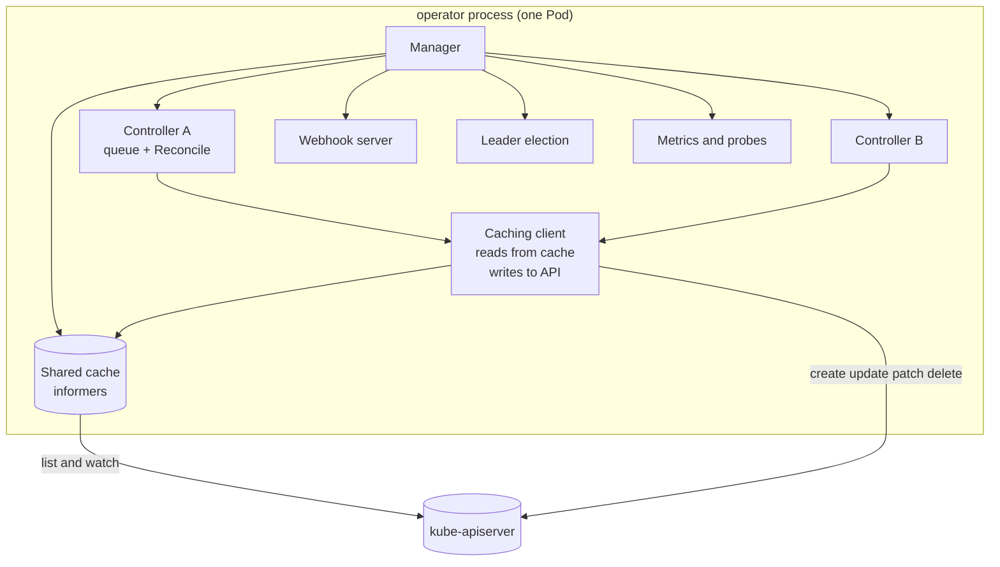

# 5.31 Operators in Go: controller-runtime and kubebuilder

| | |
|---|---|
| Level | Advanced |
| Priority tier | 2 |
| Lab venue | Go 1.22+, `controller-gen`, `setup-envtest`; a real cluster only for the final deploy step |
| Part | Part 5: Kubernetes |
| Status | Drafted. The code patterns below were compiled and exercised under envtest (see 5.32); cluster deployment steps are **untested** |

## Why this matters for AI infrastructure

A GPU node goes bad late at night. Its error counts climb, and a job that was running fine starts failing in strange ways. Something has to notice the bad node, stop new work from landing on it and report the fault to a person who can act. In a modern GPU cluster, that something is very often an operator. An operator is a small program that runs inside the cluster, watches certain objects and keeps the real world matching what those objects describe. The NVIDIA GPU Operator, the Network Operator, Kueue, the Slurm and Ray operators, and node-remediation controllers all work this way.

That is why being able to write a small operator, and to read the large ones in 5.33, separates a platform engineer from someone who only applies YAML. Applying YAML tells the cluster what you want once. An operator keeps asking, all day and all night, whether the thing you asked for still exists and still works.

This chapter teaches controller-runtime, the library underneath kubebuilder and Operator SDK. Think of controller-runtime as the engine and kubebuilder as the car built around it. You can drive the engine directly, and you will learn more about the car by understanding the engine first. The chapter also covers the design rules that keep an operator safe on an expensive, shared fleet, where one careless loop can flood the API server or restart the wrong node. Chapter 5.32 then applies these ideas to a concrete project, so decide early which operators your own cluster depends on.

## Prerequisites and outcomes

Suppose you are asked to build a controller that cordons unhealthy GPU nodes. Cordoning a node means marking it so that new Pods are not scheduled there, while the Pods already running stay where they are. The chapters before this one give you the foundation for that work. You should have covered the API and etcd in 5.5, controllers in 5.6, CRDs and operator concepts in 5.29, and Go with client-go in 5.30. By the end of this chapter, you will be able to:

- Explain what controller-runtime provides over raw client-go: the manager, shared cache, caching client, controllers, builder, webhooks, leader election and metrics.
- Define an API type with kubebuilder markers, generate the CRD and deepcopy code, and add validation through an OpenAPI schema, defaulting and CEL rules.
- Write an idempotent, level-triggered `Reconcile` with correct error, requeue and status handling.
- Choose watches, predicates, owner references, field indexes and finalizers for each case.
- Test with a pure-function core plus envtest, and know what envtest cannot prove.
- Package RBAC, health probes, leader election and metrics for production.

If any of those earlier chapters is unfamiliar, read it before you go on. Each of the terms above gets a plain explanation in the sections that follow, but the earlier chapters give you the picture that makes those explanations stick.

## 1. Where controller-runtime sits

Picture an operator as a single Pod that watches the API server and reacts to what it sees. The Pod is one process, but inside that process several parts cooperate. Each part has one job, and the diagram shows how they connect. Read it as a team: the manager is the foreman, the cache is the shared notebook, and the controllers are the workers who use the notebook to decide what to do.



Read the diagram from the bottom up. The layers work like this:

- client-go informers list and watch resources and keep an in-memory store. You met them in 5.30. An informer is the part that asks the API server for everything of one type once, then keeps a copy up to date by listening for changes.
- The controller-runtime cache wraps those informers. It starts each type lazily, the first time something uses that type, and everything in the manager shares it. Sharing matters because several controllers that each open their own watch on Pods would ask the API server for the same data again and again.
- The client reads with `Get` and `List` from the cache by default, and it writes straight to the API server. A read can lag the latest write by a few milliseconds, so reconcilers must be idempotent and tolerate conflicts. Idempotent means that running the same work twice leaves the same result as running it once.
- A controller keeps a work queue of `reconcile.Request` values. Each request holds only a namespace and name key, never the object itself. N workers take requests from the queue and call your `Reconcile`. Because the request holds only a key, the reconciler always fetches the freshest copy of the object when it runs, not the copy that existed when the event happened.
- The manager owns the cache, clients, controllers, webhooks, health endpoints and leader election. It starts all of them in order, and it stops them together when the process receives a shutdown signal.

Here is a small example of why the lag matters. You change a GPU node's label. Your reconciler starts a moment later and reads the node from the cache. The cache has not heard about your change yet, so it still shows the old label. The reconciler makes a decision based on stale data. The next event then brings the cache up to date, and the reconciler runs again and corrects the decision. A design that assumes the first run is always right will break in this gap. A design that expects to run again and again will not.

Kubebuilder is a scaffolding CLI built around this library. It generates the project layout, the Makefile, the markers and the `config/` kustomize bases. Operator SDK builds on kubebuilder and adds OLM bundle tooling. You can write all of it by hand, because scaffolding is a convenience and not magic. The shape that matters stays the same across all three.

### Tooling for building operators

If you have a real use case for a custom operator, community projects can speed you up. An experienced Go programmer who knows client-go could write an operator from scratch. Still, every operator shares common parts, and experts generate that boilerplate with tools to save time. SDKs and frameworks help when their assumptions fit your project. They become a nuisance when they assume things that do not match your needs.

These tools suit projects that define configuration with custom resources and implement behavior with custom controllers. A custom resource is an object whose type you invent, such as a `GpuNodeHealthPolicy`, and a custom controller is the loop that acts on those objects. The sections below cover a few projects, then walk through design and implementation with code snippets.

### Kubebuilder as an SDK for APIs

Kubebuilder is an SDK for building Kubernetes APIs. The name fits, but the tool works differently from what you might expect. You start with the Kubebuilder command-line tool, which generates boilerplate. It creates the source code, a Dockerfile, a Makefile and sample Kubernetes manifests. Those are the files every project needs, and generating them saves a lot of time at the start. Without the generator, you would type the same skeleton by hand and probably forget one file.

Kubebuilder also uses controller-runtime, a related library. The generated source already includes the imports and common implementations. The library handles the routine work of running a controller and talking to the API server. It sets up shared caches and clients for efficient API access. The cache lets your controller list and get objects without a new API request for each query. That eases load on the API server and speeds up reconciliation. A reconcile that needs to know about many Pods can read them from memory in a moment, instead of making one round trip to the server for each Pod.

Controller-runtime also triggers reconcile requests on events such as resource changes. It does this for the parent custom resource by default. You usually want triggers when the controller's child resources change too, and helper functions exist for that. A child resource is an object your operator creates on behalf of the parent, such as a Deployment created for a custom resource. If a child changes and nobody tells the controller, the controller never fixes it. In high-availability mode, controller-runtime can enable leader election, so only one controller is active at a time. Leader election means several copies of the operator run, but only the one holding a lock acts, so two copies never fight over the same node. It includes a package for webhooks, which are often used for admission control. Admission control is the gate that checks or changes an object before the API server saves it. The package also provides structured logging and Prometheus metrics for observability.

Kubebuilder is a great choice if you are a Go programmer with Kubernetes experience. It is also a good choice if you are an experienced developer new to Go. It is for Go only, though, and it does not cater to other languages.

**Tip:** If you will build tools for Kubernetes, consider learning Go. You can use other languages, since Kubernetes offers a REST API. Official client libraries exist for Python, Java, C#, JavaScript and Haskell, along with many community libraries. Kubernetes itself is written in Go, though, and its Go ecosystem is rich and well supported. A REST API is a set of web addresses you call with plain HTTP requests, so any language can talk to Kubernetes. The Go libraries are simply the ones where the operator tools are most mature.

Writing a CRD manifest by hand is hard. The OpenAPI v3 specification behind it is detailed and involved. The Kubebuilder CLI generates the files in which you define the fields of your API types. You add the fields to struct definitions and tag them with markers, such as default values. Then a make target generates the CRD manifests. That is very handy. A marker is a special comment, starting with `+kubebuilder:`, that the generator reads. You write the Go struct once, and the marker tells the generator what the YAML should say.

Other make targets generate the RBAC and sample custom resource manifests. They install custom resources in your development cluster. They build and publish images for your operator. They can also run your controller locally against a cluster during development. These conveniences save tedious time, especially early in a project. For these reasons, Kubebuilder is the tool we recommend for building operators. Many projects have used it with success.

### Metacontroller: write only the logic

If you want to stay with a language other than Go, Metacontroller is another option. It takes a different approach from Kubebuilder. Metacontroller is a cluster add-on that hides the Kubernetes API from you. Your job is to write the controller webhook that holds your controller's logic. Metacontroller calls this a lambda controller, and it decides what to do with the resources it cares about.

Metacontroller watches the resources under its management. When a change needs a decision, it makes an HTTP call to your lambda controller. It uses its own custom resources to record your webhook's URL and the resources it manages. Once Metacontroller runs in your cluster, adding a controller takes two steps. You deploy your lambda controller webhook, and then you add a Metacontroller custom resource, called a composite controller resource. Your endpoint accepts requests from Metacontroller, parses the JSON payload that holds the Kubernetes resource object, and returns any changes to send to the API.

In practice, the flow looks like this. Metacontroller notices that a parent object changed. It sends the parent to your endpoint as JSON. Your code answers with a list of child objects it wants to exist. Metacontroller makes those changes for you. You never open a watch or write a client call, but you also give up fine control over how the work is queued and cached.

Consider Metacontroller when you want to use several languages and expect to deploy many in-house operators. Engineers sometimes prototype with it and then build the final project with Kubebuilder once the design is settled. Its strength is speed after the add-on is installed. It does not help with creating CRDs, though, so you must write those yourself. This is where Kubebuilder has a significant advantage.

### Operator Framework

The Operator Framework is a collection of open source tools that started at Red Hat. It is now an incubating project under the CNCF. The CNCF is the Cloud Native Computing Foundation, the body that hosts Kubernetes and many related projects. It makes operators easier to build. Its Operator SDK offers much of what Kubebuilder offers for Go, including a CLI that generates boilerplate. It also uses controller-runtime to integrate with the Kubernetes API. Beyond Go, the Operator SDK lets you build operators with Helm or Ansible.

The framework also includes the Operator Lifecycle Manager, which is an operator for your operators. It gives you abstractions for installing and upgrading them. An operator hub lets users discover operators for the software they use. In the field, platform teams have rarely used these tools. Because Red Hat maintains them, they are more common among OpenShift users. OpenShift is Red Hat's Kubernetes-based offering. If your cluster is not OpenShift, the parts you are most likely to need are the SDK's scaffolding and the controller-runtime library underneath it.

If you are a Go programmer, Kubebuilder is the tool to start with.

## 2. Defining the API

Start with a question you would ask on your first day with a new operator. What does a user type into a file to ask for the behavior, and what does the operator promise to do with it? The answer is the API. An API type is a Go struct with JSON tags and markers. The struct describes the shape of the object a user writes in YAML, and the markers add rules about that shape. Markers are comments that begin with `+kubebuilder:`, and `controller-gen` reads them. The example below shows a type with its markers.

```go
// +kubebuilder:object:root=true
// +kubebuilder:subresource:status
// +kubebuilder:resource:scope=Cluster,shortName=ghp
// +kubebuilder:printcolumn:name="Action",type=string,JSONPath=`.spec.action`
type GPUHealthPolicy struct {
	metav1.TypeMeta   `json:",inline"`
	metav1.ObjectMeta `json:"metadata,omitempty"`
	Spec   GPUHealthPolicySpec   `json:"spec,omitempty"`
	Status GPUHealthPolicyStatus `json:"status,omitempty"`
}
```

Read the example one line at a time. The first marker, `object:root=true`, tells the generator that this struct is a top-level object that Kubernetes stores on its own. The `subresource:status` marker gives the object a separate `/status` endpoint. The `resource` marker says the object is cluster-wide and gives it a short name, `ghp`, so `kubectl get ghp` works. The `printcolumn` marker adds an extra column to the output of `kubectl get`, here showing the `action` field. Then comes the struct itself. It embeds the standard type and metadata fields, and it has two parts, `Spec` and `Status`. Those two parts are the heart of every Kubernetes object, and the next paragraphs explain why they are split.

Field-level markers give you validation and defaults, and the API server enforces them, not your code. That detail matters. Your operator does not have to check every field before it runs, because the API server refuses a bad object before it is ever saved. If a user types `action: Reboot`, the request fails at the door, and your reconciler never sees the bad value.

```go
// +kubebuilder:validation:Enum=Ignore;Cordon;CordonAndDrain
// +kubebuilder:default=Cordon
Action Action `json:"action,omitempty"`

// +kubebuilder:default="2m"
UnhealthyFor metav1.Duration `json:"unhealthyFor,omitempty"`
```

The `Enum` marker lists the only three values the field accepts. The `default` marker fills in a value when the user leaves the field out. So a policy with no `action` behaves as `Cordon`, and a policy with no `unhealthyFor` waits two minutes before it acts. Defaults are a kindness to the user, and they also keep your code simple, because the reconciler can assume the field is always set.

Cross-field rules use CEL (`x-kubernetes-validations`). In most cases, CEL removes the need for a validating webhook. CEL stands for Common Expression Language, a small expression language that the API server can evaluate itself. A rule about one field is easy to write as a marker. A rule that compares two fields needs CEL, and CEL runs inside the API server, so you do not have to run a separate webhook server just to check a combination of fields.

```go
// +kubebuilder:validation:XValidation:rule="self.action != 'CordonAndDrain' || has(self.maxUnavailableNodes)",message="maxUnavailableNodes is required when action is CordonAndDrain"
type GPUHealthPolicySpec struct { /* ... */ }
```

Read the rule as a sentence. `self` means the object being checked. The rule says: the action is not `CordonAndDrain`, or the field `maxUnavailableNodes` exists. The `||` means "or", and `has(...)` checks that a field is present. If the action is `CordonAndDrain` and the user forgot `maxUnavailableNodes`, the rule fails, and the message tells the user exactly what to add.

Generate the code and manifests with these commands. The first line installs the generator, and the other three lines run it in three different modes. Each mode writes a different kind of file.

```bash
go install sigs.k8s.io/controller-tools/cmd/controller-gen@v0.16.5
controller-gen object paths=./api/...                         # zz_generated.deepcopy.go
controller-gen crd paths=./api/... output:crd:dir=config/crd   # CRD YAML
controller-gen rbac:roleName=manager-role paths=./... output:rbac:dir=config/rbac
```

The `object` mode writes the deepcopy file. Deepcopy code is the function that makes a full, independent copy of an object. Your controller must copy an object before it changes it, because objects in the shared cache must never be edited in place. The `crd` mode writes the CRD YAML that the API server reads to learn your new type. The `rbac` mode writes the permissions your operator needs, based on the markers you put on the reconciler. You rarely write these files by hand. You write the Go types and markers, and the generator keeps the YAML in step with them.

The API design rules below are the ones that bite later, so read them before you write the first type. Each rule is a mistake that is cheap to avoid on day one and expensive to fix once users depend on the API.

- Spec is desired state, and status is observed state. Enable the `status` subresource, so users cannot overwrite status and controllers cannot bump `metadata.generation` by writing status. The `metadata.generation` counter goes up each time the spec changes, so a status update should not look like a new request to change something.
- Use `metav1.Condition` lists, with `Ready` plus problem-specific types, and record `observedGeneration`. Tooling such as `kubectl wait --for=condition=Ready` and GitOps health checks understand them. `observedGeneration` records which version of the spec the status describes, so a reader can tell whether the status is current.
- Make every field optional, with a safe default or a hard enum. Adding a required field breaks existing objects. Every object already stored in etcd would suddenly be invalid the next time it is written.
- Use `IntOrString` for budgets, so a value can be `2` or `25%`, as PodDisruptionBudget does. `IntOrString` is a type that holds either a whole number or a percentage, so the user can pick whichever reads better.
- Version from the start with `v1alpha1`, keep a storage version, and plan conversion before you need it, as covered in 5.29. The storage version is the one Kubernetes writes to etcd. Conversion is how the API server translates between versions, and it is much easier to plan than to retrofit.
- Do not put large or secret data in a CR. Everything is stored in etcd and sent to every watcher. A watcher is any client that subscribes to changes, and a large object gets copied to each one of them. Secrets belong in Secret objects, with their own access rules.

In *Kubernetes Programming with Go*, chapters 9 and 13, Philippe Martin compares two workflows. The first is the classic `k8s.io/code-generator` workflow. It uses the markers `// +k8s:deepcopy-gen=package`, `// +k8s:deepcopy-gen:interfaces=k8s.io/apimachinery/pkg/runtime.Object` and `// +genclient`, along with `deepcopy-gen` and `client-gen`. The second is the modern Kubebuilder workflow, built on controller-runtime and controller-gen. The Kubebuilder steps that follow come from that book. Both workflows produce the same kind of output, a deepcopy file and typed clients, so you can read either one once you know the other. The Kubebuilder workflow is the one most new projects use.

1. Scaffolding a Kubebuilder project and API, from *Kubernetes Programming with Go*, chapter 13:
   ```bash
   kubebuilder init --domain myid.dev --repo github.com/myid/myresource
   kubebuilder create api --group mygroup --version v1alpha1 --kind MyResource
   make manifests   # runs controller-gen to generate CRD & RBAC YAML in config/
   make run         # runs the Manager locally against your current kubeconfig
   make deploy IMG=quay.io/myid/myresource:v1alpha1-1
   ```
2. Implementing hub-and-spoke multi-version conversion in Go, from *Kubernetes Programming with Go*, chapter 13. When you introduce a second API version, run `kubebuilder create api --group mygroup --version v1beta1 --kind MyResource`. Suppose you rename `spec.memory` in `v1alpha1` to `spec.memoryRequest` in `v1beta1`. One version is then marked as the Hub by implementing `conversion.Hub`:
   ```go
   // api/v1alpha1/myresource_conversion.go
   func (*MyResource) Hub() {}
   ```
   Every Spoke version, here `v1beta1`, implements `conversion.Convertible`. The methods are `ConvertTo(dstRaw conversion.Hub) error` and `ConvertFrom(srcRaw conversion.Hub) error`. You wire the conversion into the Manager with `kubebuilder create webhook --group mygroup --version v1alpha1 --kind MyResource --conversion`. The sample `convert_myresource_spoke_to_hub_and_back()` in `code/part05/controller_runtime_reconciler_sim.py` models this step.
3. Applying child resources with Server-Side Apply in controller-runtime, from *Kubernetes Programming with Go*, chapters 10 and 11. Fragile `Get -> Update` loops on child `Deployment`s are easy to get wrong. Instead, construct the desired child `appsv1.Deployment`, set `TypeMeta` `APIVersion` and `Kind`, and set `ownerReferences` with `ctrl.SetControllerReference`. Then apply the object in one idempotent call:
   `err := r.Client.Patch(ctx, deploy, client.Apply, client.FieldOwner("myresource-controller"), client.ForceOwnership)`

Those three steps build on one another. The first creates the project. The second adds a new version and explains how the API server translates between the two. The third is how the controller writes the child objects it owns. Notice that step 3 uses a `Patch` call with `client.Apply`, not a `Get` followed by an `Update`. That choice is what makes the call safe to repeat. A `Get -> Update` loop reads the object, changes it in memory and writes it back, and it can fail if someone else wrote in between. Server-Side Apply sends only the fields you own, and the server merges them. Running the same apply twice gives the same result, which is exactly the idempotence the reconciler needs.

### Choosing the data model for a Namespace operator

Designing an operator starts with the data model, just as designing a web application starts with its database schema. The data model is the list of fields a user fills in and the meaning of each one. You often know what the spec needs before you write any code. As soon as you spot a problem to solve or a gap to fill, the desired-state fields begin to take shape.

Take the Namespace operator from earlier. It could create a Namespace with a LimitRange, a ResourceQuota, Roles and NetworkPolicies for a new app team. A LimitRange sets default and maximum resource sizes for Pods in the Namespace, and a ResourceQuota caps the total the Namespace may use. You might also bind a team lead to the `namespace-admin` Role right away, then hand off management of the Namespace to that person. That suggests an `adminUsername` field in the spec. The next manifest shows the result.

```yaml
apiVersion: tenancy.acme.com/v1alpha1
kind: AcmeNamespace
metadata:
  name: team-x
spec:
  namespaceName: app-y
  adminUsername: sam
```

The name `team-x` is arbitrary. It is only the name of this request object, so it can be anything that is unique in its own place. The `app-y` Namespace hosts a workload. The username `sam` comes from the company's identity provider, usually an Active Directory system or something similar. The operator does not invent users. It takes the name it is given and binds that name to a role.

Submitting that manifest results in `sam` being added to the subjects of a RoleBinding to the `namespace-admin` Role. A RoleBinding is the object that says who holds a Role in a given Namespace. The manifest after it shows what the controller creates.

```yaml
apiVersion: rbac.authorization.k8s.io/v1
kind: Role
metadata:
  name: namespace-admin
  namespace: app-y
rules:
- apiGroups:
  - "*"
  resources:
  - "*"
  verbs:
  - "*"
---
apiVersion: rbac.authorization.k8s.io/v1
kind: RoleBinding
metadata:
  name: namespace-admin
  namespace: app-y
roleRef:
  apiGroup: rbac.authorization.k8s.io
  kind: Role
  name: namespace-admin
subjects:
- kind: User
  name: sam
  namespace: app-y
```

The two objects work as a pair. The Role lists what may be done, and the RoleBinding lists who may do it. The Role here allows every verb on every resource, which is broad, so you would normally narrow it for a real team. The `adminUsername` from the AcmeNamespace manifest goes into the RoleBinding, bound to the `namespace-admin` Role.

Start from the behavior you want. Sam should be bound to the `namespace-admin` Role. The data you need is Sam's username and the Namespace name. Put those obvious pieces into your CRD spec first. The Go type for the spec follows. Notice that each field has a short comment. The comment is what appears in the generated documentation, so write it for the person who will read it later.

```go
// api/v1alpha1/acmenamespace_types.go
...
// AcmeNamespaceSpec defines the desired state of AcmeNamespace
type AcmeNamespaceSpec struct {
	// The name of the namespace
	NamespaceName string `json:"namespaceName"`
	// The username for the namespace admin
	AdminUsername string `json:"adminUsername"`
	...
}
```

Kubebuilder generates your CRD manifest and a sample AcmeNamespace manifest from this source. Your first data model will probably prove too thin once you write the controller. This is normal. Writing the reconciler is where you discover what it needs to know, and then you add those fields. Expect to add them, and expect that each addition is a small change to the Go type followed by a regenerate.

Suppose you add a `deploymentTier` field. A manifest that uses it follows.

```yaml
apiVersion: tenancy.acme.com/v1alpha1
kind: AcmeNamespace
metadata:
  name: team-x
spec:
  namespaceName: app-y
  adminUsername: sam
  deploymentTier: dev
```

That field prompts the controller to create a ResourceQuota. The quota for the `dev` tier follows. A quota is the cap that stops one team from using the whole cluster, so the value you choose for each tier is a policy decision, not a technical one.

```yaml
apiVersion: v1
kind: ResourceQuota
metadata:
  name: dev
spec:
  hard:
    cpu: "5"
    memory: 10Gi
    pods: "10"
```

A `prod` tier gets a much larger default quota. It follows.

```yaml
apiVersion: v1
kind: ResourceQuota
metadata:
  name: prod
spec:
  hard:
    cpu: "500"
    memory: 200Gi
    pods: "100"
```

One value now drives several defaults, so users state a single field. A team that writes `deploymentTier: dev` gets a whole set of sensible limits without knowing the numbers. That is the payoff of a good data model. When you design a spec, look for values like this one, so that users state one field instead of many.

## 3. The manager

Suppose your operator starts and then fails at the first read with a "no kind is registered" error. The message sounds like the API server is confused, but the cause is almost always on your side. The operator never told its client library what your types look like. The cause is usually in the manager setup, which wires the whole process together. The manager is the single object that creates the cache, the clients, the controllers and the servers, and it hands each one the settings it needs. The example below shows the setup that most operators start from.

```go
mgr, err := ctrl.NewManager(ctrl.GetConfigOrDie(), ctrl.Options{
	Scheme:                 scheme,
	Metrics:                metricsserver.Options{BindAddress: ":8080"},
	HealthProbeBindAddress: ":8081",
	LeaderElection:         leaderElect,
	LeaderElectionID:       "gpuhealth.platform.example.com",
})
```

Read the call from top to bottom. `ctrl.GetConfigOrDie()` finds the connection settings, either from inside the cluster or from your local kubeconfig. The `Scheme` is the address book of types. The metrics and health probe addresses are the ports where Prometheus and the kubelet knock. The leader election fields decide which replica is allowed to act. Each option below explains one of those fields in more depth.

- Scheme: register the client-go types and your own types with `AddToScheme`. A missing registration produces a "no kind is registered" error at first use. The scheme is how the client turns the name of a type into the Go struct that holds it. If your custom type is not in the scheme, the client does not know it exists, so the first read fails.
- Leader election uses a Lease object. It lets you run 2 to 3 replicas for availability while only the leader reconciles. Without it, two replicas fight each other. Informer caches run on all replicas, and only the controllers wait for leadership. A Lease is a small object that one replica holds at a time, and it must renew the lease regularly. If the leader stops renewing, another replica takes over. Caches stay warm on every replica, so a takeover is quick, because the new leader already has the data.
- Cache scope: by default you get a cluster-wide cache of every type you read. In large clusters, restrict it with `cache.Options`, using namespaces or label and field selectors per type. Consider `client.Options.Cache.DisableFor` for types you read only once. Caching all Pods or Secrets in a 5,000-node cluster can cost gigabytes. A cache that holds data you never read is memory you pay for every day.
- Metrics and probes: controller-runtime exports reconcile counts, durations, queue depth and errors on the metrics endpoint, with no code from you. Add `healthz` and `readyz` checks for the Deployment probes. The probes let Kubernetes know whether the process is alive and whether it is ready to do work, so a stuck operator can be restarted.
- Graceful shutdown: `ctrl.SetupSignalHandler()` cancels the context on SIGTERM, and the runnables drain. SIGTERM is the polite stop signal the kubelet sends before it kills a container. Draining means in-flight reconciles finish before the process exits, so a half-finished cordon is less likely to be left behind.

Check the scheme and leader election first, since most failures in this list start there. A scheme mistake shows up on the first call, and a leader election mistake shows up as an operator that runs but never acts. Those two symptoms point you to the right line quickly.

## 4. The reconcile function

A GPU node goes unhealthy, and your reconciler wakes up holding only a name. It has to work out what to do from the current state of the cluster. This is the moment that the whole operator exists for, so the function signature matters. The reconciler receives a request, and the request carries no details about the problem.

```go
func (r *R) Reconcile(ctx context.Context, req ctrl.Request) (ctrl.Result, error)
```

Each part of the signature has a plain meaning. The `ctx` is the context, which carries cancellation and deadlines, so a shutdown can stop a call that is taking too long. The `req` holds the namespace and name of the object that changed. The `ctrl.Result` tells the queue what to do next, and the `error` tells it whether the attempt failed.

The request contains only a name, so you re-read the world each time. This is the level-triggered design from 5.6. You are told that something relevant changed, not what changed. One code path therefore handles creation, updates, a resync after a crash and missed events. Think of it like a nurse who checks a patient's chart each time the bell rings, rather than trusting a note about what the doctor said last hour. The chart is the truth, and the bell only says "look again."

A reliable structure is observe, decide, act and report. The sketch below follows that order. Each step has one job, and the steps run in a fixed sequence every time.

```go
// Observe
var policy v1alpha1.GPUHealthPolicy
if err := r.Get(ctx, req.NamespacedName, &policy); err != nil {
	return ctrl.Result{}, client.IgnoreNotFound(err) // deleted: nothing to do
}
// ... list nodes, judge each with a pure function ...
// Decide
act, blocked := Plan(verdicts, budget)
// Act
for _, name := range act { r.cordon(ctx, &policy, byName[name]) }
// Report
r.updateStatus(ctx, &policy, ...)
```

In the observe step, the reconciler reads the policy and the nodes. The `client.IgnoreNotFound` call handles the case where someone deleted the policy. A deleted object is not an error to retry, so the function returns quietly. In the decide step, a pure function looks at what it saw and returns a plan. A pure function is one that gives the same answer for the same input and touches nothing outside itself, which makes it easy to test. In the act step, the reconciler performs the changes, one node at a time. In the report step, it writes what it saw and did into the status, so a person can read the result without digging through logs.

The return value tells the controller what happens next, so choose it deliberately. The table below lists the four options.

| Return | Meaning |
|---|---|
| `Result{}, nil` | Done. Wait for the next event. |
| `Result{}, err` | Failure. The request is re-queued with exponential backoff (rate-limited). Log once; do not also return a requeue. |
| `Result{RequeueAfter: d}, nil` | Look again after `d` with no error. Use for time-based decisions ("unhealthy for 2 minutes") and for polling something that emits no event. |
| `Result{Requeue: true}, nil` | Immediate re-queue (rate limited). Rarely the right tool; prefer `RequeueAfter` with a reason. |

Exponential backoff means each retry waits longer than the one before, so a failing object does not hammer the API server. The `RequeueAfter` option is for waiting on time. If a node has been unhealthy for two minutes, no event will arrive at the exact moment it crosses that line, so the reconciler asks to be woken up then. Choosing `Result{}, err` when you meant to wait is a common mistake. It turns a simple wait into a noisy retry loop that fills the logs.

Seven rules prevent most operator incidents. Each one takes a common mistake and turns it into a habit you can check in review. Read them as a checklist for your own pull requests.

1. Make the function idempotent. Running Reconcile twice must give the same result as running it once. Check before you create, or use `CreateOrUpdate` or `CreateOrPatch` helpers, or server-side apply. The reason is simple: the queue may run your function again at any time, after a crash or a retry, so a second run must not do double work.
2. Keep no hidden state. Do not remember "I cordoned that node last time" in a Go map. Derive it from the cluster, through an annotation or a status field. A restarted or newly elected replica must reach the same decisions. This is the same lesson as "the broker is the source of truth" in any control system. A Go map lives only in one process's memory, so it is gone the moment that process restarts.
3. Separate the decision from the I/O. A pure function such as `Judge(policy, node, now)` is testable in microseconds with an injected clock. Only a thin wrapper touches the API. An injected clock means the test passes in a fake "now," so the test can check a two-minute rule without waiting two minutes.
4. Treat conflicts as normal. `apierrors.IsConflict` means your cached copy was stale. Return the error so the request re-queues, or re-read and retry. Prefer patches (`client.MergeFrom`) over full updates, so unrelated concurrent edits survive. A full update writes the whole object back, which can erase a change someone else made a moment earlier. A patch sends only the fields you changed.
5. Do not requeue on `NotFound` of the primary object. It was deleted, so there is nothing left to do.
6. Bound the blast radius. Anything destructive, such as cordon, drain, delete or reboot, needs a budget, a dry-run mode and a kill switch. Otherwise a bug or a bad signal will fire fleet-wide. 5.32 implements all three. The blast radius is how much damage one mistake can do. A budget caps how many nodes change at once, a dry-run mode logs the plan without acting, and a kill switch lets a person stop the whole operator quickly.
7. Return errors instead of swallowing them, so backoff and metrics work. If several actions fail, collect the errors and return one wrapped error, while still performing the independent actions. If you hide an error, the queue never retries and your dashboards show nothing wrong. Performing the independent actions matters too, because one failed cordon should not stop the other cordons.

### Status updates

Write status through the status subresource. Compute it from observation each time, and skip the write if nothing changed. Otherwise every reconcile modifies the object, produces a watch event and triggers another reconcile. A watch event is the notice the API server sends to everyone who is listening, so a write that changes nothing still creates noise and a loop. The snippet below shows the guard.

```go
orig := p.DeepCopy()
p.Status.ObservedGeneration = p.Generation
meta.SetStatusCondition(&p.Status.Conditions, ready) // only changes LastTransitionTime when status flips
if equalStatus(orig.Status, p.Status) { return nil }
return r.Status().Patch(ctx, p, client.MergeFrom(orig))
```

The first line keeps a copy of the object as it was, so the function can compare the old and new versions. The second line records which spec generation this status describes. The third line sets the Ready condition. The fourth line stops early if nothing changed, which is the guard against the loop. The last line sends only the difference as a patch to the status subresource.

`meta.SetStatusCondition` keeps `lastTransitionTime` stable unless the status value changes. Hand-rolled condition code that stamps `now` on each pass causes endless churn. The `lastTransitionTime` should answer "when did this condition last flip?" If you stamp it on every pass, the answer is always "just now," the object looks different every time, and the loop never settles.

### Gathering existing and desired state

A controller follows three steps. It gathers an accurate picture of the existing state. It examines the desired state. Then it takes actions to reconcile the existing state with the desired state. This is the same loop you saw in 5.6, applied to your own custom type.

It can gather existing state from three places. The first is the `status` of your custom resource. The second is other related resources in the cluster. The third is conditions outside the cluster, or in other systems. The `status` records observed state, and Kubernetes already does this for you. The `status.phase` field on Pods shows whether they are `Running`, and on Namespaces whether they are `Active`.

Back to the Namespace operator. The controller gets notified about an AcmeNamespace and its spec. It cannot assume the resource is new, because it may have just been updated. Creating the children again would return an error from the API. If you add a `phase` field to the status, the controller can check it. An empty phase means a new resource, so the controller creates every child. Once all children exist, it sets the phase to `Created`. Later changes then show that the children already exist.

That approach has one flaw, though. It assumes the controller never fails. Suppose the controller creates the Namespace, then crashes before it creates the Role. On restart, the phase is still empty, so it tries to create the Namespace again and fails. The fix is to set `CreationInProgress` as the very first step. On restart, that phase tells the controller that the status alone cannot show the true state. It must then look at related resources.

Walk through the crash in order to see why the fix works. Step one: the controller writes `CreationInProgress` to the status. Step two: it creates the Namespace. Step three: it crashes before the Role exists. On restart, the status says `CreationInProgress`, not empty, so the controller knows it stopped partway. It cannot trust the phase alone, so it asks the cluster what really exists.

When the status is not enough, query the API server, or preferably the local cache. Look for the child resources you expect. In the failure case, the Namespace exists, so the controller moves on. The Role does not exist, so it creates the Role. Build the controller to tolerate failure, and always assume failure will happen.

Some state lives outside the cluster. Cloud infrastructure controllers must query cloud provider APIs for the status of infrastructure. What counts as existing state depends on the purpose of the operator. A Namespace operator can read everything it needs from the cluster. A GPU operator that manages cloud machines may have to ask the cloud provider whether a machine still exists, because the cluster alone cannot tell it.

The desired state lives in the `spec`. In the Namespace operator, `namespaceName` sets the `metadata.name` of the Namespace, and `adminUsername` sets the name in the RoleBinding's subject. These are direct mappings. Often the mapping is less direct. The `deploymentTier` field works that way, because one value chooses many defaults in the controller logic.

The code below shows the controller creating the Role and RoleBinding after the Namespace. Read it as two blocks that do the same thing for two objects. Each block builds an object in memory, creates it in the cluster, and returns if the create fails.

```go
// controllers/acmenamespace_controller.go
...
role := &rbacv1.Role{
	ObjectMeta: metav1.ObjectMeta{
		Name:      "namespace-admin",
		Namespace: nsName,
	},
	Rules: []rbacv1.PolicyRule{
		{
			APIGroups: []string{"*"},
			Resources: []string{"*"},
			Verbs:     []string{"*"},
		},
	},
}
if err := r.Create(ctx, role); err != nil {
	log.Error(err, "unable to create namespace-admin role")
	return ctrl.Result{}, err
}
binding := &rbacv1.RoleBinding{
	ObjectMeta: metav1.ObjectMeta{
		Name:      "namespace-admin",
		Namespace: nsName,
	},
	RoleRef: rbacv1.RoleRef{
		APIGroup: "rbac.authorization.k8s.io",
		Kind:     "Role",
		Name:     "namespace-admin",
	},
	Subjects: []rbacv1.Subject{
		{
			Kind:      "User",
			Name:      adminUsername,
			Namespace: nsName,
		},
	},
}
if err := r.Create(ctx, binding); err != nil {
	log.Error(err, "unable to create namespace-admin role binding")
	return ctrl.Result{}, err
}
return ctrl.Result{}, nil
// ...
```

Notice that both `Create` calls use the plain create verb, not an apply or a patch. That is why the code works only once. The second time the same reconcile runs, the Role already exists, `Create` returns an "already exists" error, and the function gives up. That is the lesson the next paragraph draws out.

This code works the first time you create an AcmeNamespace. It breaks on any later reconcile, including a controller restart, unless you add the status logic above. The `phase` field tells the controller what already exists. Add that status logic before you rely on this code in production. Treat this block as a teaching sketch, not finished code. The finished version checks before it creates, or uses an apply call, as rule 1 above asks.

## 5. Watches, predicates and mapping

A policy controller that watches only its own resource will never hear about the Nodes it cares about. Picture a policy that says "cordon any GPU node that stays unhealthy." If the controller only watches the policy, it wakes up when someone edits the policy, and it sleeps through every change to a node. Watches tell the reconciler which events matter, and predicates filter out the rest. `For(&Policy{})` watches the primary resource. Secondary resources need a way to name the primary, because the reconciler needs to know which policy to wake up when a node changes.

- `Owns(&Child{})` is for objects the controller creates and sets an owner reference on. Events map to the owner automatically. If the controller created a child Deployment, a change to that Deployment wakes up the controller that owns it. You do not write any mapping code.
- `Watches(&Node{}, handler.EnqueueRequestsFromMapFunc(fn))` is for objects you do not own. The function `fn` receives the object and returns the requests to enqueue. In 5.32, a Node event maps to every policy whose selector matches the node, or that previously cordoned it. A mapping function is the translator. A Node is not yours, so the operator has to work out, from the Node alone, which policies should look again.
- Predicates filter events before they reach the queue. `GenerationChangedPredicate` skips status-only updates of the primary, which stops the self-trigger loop described earlier. A custom predicate can ignore Node heartbeat updates. A predicate is a small yes-or-no question asked about each event before it costs anything. If the answer is no, the event is dropped and no reconcile runs.

Node objects update their `status` every few seconds with heartbeat timestamps. A heartbeat is the regular "I am still alive" message a node sends to the control plane. Lease-based heartbeats reduce that churn but do not eliminate it. A policy controller that reconciles on every Node update does pointless work at scale. The 5.32 predicate therefore compares only what can change a decision: `spec.unschedulable`, labels, annotations, and condition type, status, reason and transition time. If a heartbeat timestamp moves forward and nothing else changes, the decision is the same as before, so the predicate lets the event go by.

### Field indexes

A `List` from the cache is a scan, unless you register an index first. A scan means the cache walks through every object of that type and checks each one. An index is a lookup table built ahead of time, so the cache can jump straight to the matching objects. Think of the index at the back of a textbook. You could read every page to find the word "cordon," or you could check the index and go to the page directly. The snippet below registers one on the Pod field `spec.nodeName`, then queries it.

```go
mgr.GetFieldIndexer().IndexField(ctx, &corev1.Pod{}, "spec.nodeName",
	func(o client.Object) []string { return []string{o.(*corev1.Pod).Spec.NodeName} })
// later
r.List(ctx, &pods, client.MatchingFields{"spec.nodeName": node})
```

The first call tells the cache to build an index on Pods, keyed by the node each Pod runs on. The function at the end of that call extracts the key for each Pod. The later `List` asks for every Pod on one node, and the cache answers from the index without scanning. This matters when a drain needs to know which Pods sit on a single node. It also matters because the cache is memory on your operator's Pod, and a full scan on every reconcile would be slow.

Cache indexes must be registered before the manager starts. `MatchingFields` against the cache only works for registered fields. The API server supports few field selectors, so the cache is where this is practical. Register an index for every field your reconciler lists on, before you start the manager. If you forget, the list call fails with an error that names the missing index, which is an easy fix once you know to look for it.

## 6. Owner references and finalizers

Suppose you delete a policy and the nodes it cordoned stay cordoned. Those nodes now take no new work, and nobody remembers why. Owner references and finalizers are the two tools for that kind of cleanup, and they solve different parts of the problem. The first handles objects that can simply be removed with their owner. The second handles cleanup that has to happen in the outside world before the owner can disappear.

Owner references give you garbage collection. When the owner is deleted, the GC controller deletes the dependents that carry `ownerReferences`. Garbage collection is the background process that cleans up objects whose owner no longer exists. Set them with `controllerutil.SetControllerReference(owner, child, scheme)`. Owners and dependents must be in the same namespace, or the owner must be cluster-scoped. A cluster-scoped object cannot be owned by a namespaced one. The rule keeps the ownership chain simple, because a namespaced child cannot outlive a cluster-wide owner in a way the GC can follow.

Finalizers handle the cleanup that the GC cannot do. That covers external resources, and changes made to objects you do not own. A finalizer is a name written into an object's metadata. While the name is present, the API server refuses to finish the deletion. The object gets a deletion timestamp, but it stays visible until your controller removes the finalizer. That gives your controller a chance to undo its work first. The pattern below shows the flow.

```go
if !policy.DeletionTimestamp.IsZero() {
	if controllerutil.ContainsFinalizer(&policy, FinalizerName) {
		if err := r.releaseAll(ctx, &policy); err != nil { return ctrl.Result{}, err } // retry until clean
		controllerutil.RemoveFinalizer(&policy, FinalizerName)
		if err := r.Update(ctx, &policy); err != nil { return ctrl.Result{}, err }
	}
	return ctrl.Result{}, nil
}
if controllerutil.AddFinalizer(&policy, FinalizerName) { _ = r.Update(ctx, &policy) }
```

Read the block in two halves. The first half handles deletion. When the deletion timestamp is set, the controller releases every node the policy cordoned. If that release fails, the function returns the error, and the queue retries. Only after a clean release does it remove the finalizer, and then the API server finally deletes the object. The second half handles normal life. Each time the controller sees a live policy, it makes sure the finalizer is present, so the cleanup is armed before any side effect happens.

Three rules keep finalizers safe. Add the finalizer before creating any side effect. Make cleanup idempotent and retryable. Never leave a finalizer that nothing will ever remove. If an uninstalled operator leaves one behind, it wedges deletion of every CR forever, which is a common upgrade failure. A wedged object is one that cannot be deleted, because the controller that would clear its finalizer no longer runs. Document the manual `kubectl patch ... finalizers=null` escape hatch so that operators can use it. In 5.32, the finalizer ensures that deleting a policy uncordons only the nodes that policy cordoned. A test verifies this, and it also checks that a human's manual cordon survives.

## 7. Ownership of foreign objects: annotate, do not assume

Suppose an engineer cordons a GPU node for maintenance, and then the GPU condition recovers. Your operator must not undo that engineer's cordon. An operator that modifies a shared object, such as a Node or a Deployment that someone else owns, must tell its own changes apart from everyone else's. The operator cannot assume that every cordon on a node came from it, because people cordon nodes all the time.

Record provenance on the object with `platform.example.com/cordoned-by: policy-name`. Provenance means a record of where a change came from. The annotation is that record. Then act only on objects that carry your mark. When the policy later wants to uncordon the node, it checks the annotation first. If the mark matches its own policy, it is free to undo the change. If the mark is missing, the cordon belongs to someone else, and the operator leaves it alone. This is the same discipline as refusing to bulk-cancel orders you cannot prove you placed. Make the mark the first thing your operator checks before it touches a shared object.

## 8. Events, logging and metrics

When a policy refuses to cordon a node, someone will ask why. Events, logs and metrics answer that question, and each one answers it for a different reader. An event is a short note attached to an object, a log is a stream of lines from the process, and a metric is a number tracked over time. Use all three, because each one fails in a different way.

- Events (`Recorder.Eventf`) appear in `kubectl describe`, and they are how the operator explains "why did you do that". Emit one for every state-changing action and every refusal, such as an exhausted budget or an eviction that a PodDisruptionBudget blocked. Events are rate-limited and best effort, so they are not an audit log. An audit log is a complete, durable record. Events may be dropped under load, so do not rely on them for proof.
- Logging uses the context logger, `log.FromContext(ctx)`, with structured key and value pairs. Structured means each line has named fields, such as the node name and the reason, so a person or a tool can search them. Avoid per-reconcile INFO spam, and log at error level only for conditions that need attention. A line that prints on every pass buries the one line that matters.
- Metrics are custom Prometheus collectors registered with `metrics.Registry`, for example `gpuhealth_cordoned_nodes` and `gpuhealth_budget_blocked_total`. Alert on them. See 5.19 for the Prometheus side. A metric tells you the trend. A gauge such as `gpuhealth_cordoned_nodes` shows how many nodes are cordoned right now, and a counter such as `gpuhealth_budget_blocked_total` only goes up, so you can see how often the budget stopped the operator.

Make sure an on-call engineer can read the events and metrics first. Events tell the story of one object, and metrics tell you whether there is a pattern across the fleet. When a page arrives at night, you usually need the pattern before the story.

## 9. RBAC

An operator that can do anything in the cluster is one bad release away from a serious incident. RBAC is how you limit that risk. RBAC is the role-based access control system that decides who may do which verb on which resource. Your operator is one more identity in that system, so it needs its own list of permissions. RBAC markers on the reconciler are turned into a `ClusterRole`:

```go
// +kubebuilder:rbac:groups="",resources=nodes,verbs=get;list;watch;patch
// +kubebuilder:rbac:groups="",resources=pods/eviction,verbs=create
```

Each marker names a group, a resource and the verbs allowed on it. The first line lets the operator read and patch Nodes, but not delete them. The second line lets it create evictions, which is the polite way to remove a Pod during a drain, because an eviction respects the PodDisruptionBudget. A plain delete of a Pod would skip that check.

Grant the least that works. The 5.32 operator can patch nodes but not delete them. It can create evictions but not delete pods directly, and it never reads Secrets. Review the generated role. An operator with `*` on `*` is a cluster takeover waiting for a CVE. A CVE is a publicly catalogued security flaw, and an operator with broad rights turns one flaw into full control of the cluster. See 5.21 for that risk.

## 10. Webhooks (brief)

Suppose the webhook that approves every write to a resource goes down. Then nothing of that type can be written until it recovers. Keep that risk in mind as you read this section, because a webhook sits in the path of every write, and a broken one blocks the whole cluster for that type.

Admission webhooks handle defaulting, validation and conversion. The same manager serves them, through `ctrl.NewWebhookManagedBy`. They need TLS certificates, normally from cert-manager. TLS certificates are what let the API server trust the webhook, and cert-manager is the tool that issues and renews them. You also choose a `failurePolicy`. `Fail` protects correctness, but a down webhook blocks all writes of that type. `Ignore` does the opposite. It lets writes through unchecked when the webhook is down, which keeps the cluster moving but skips the check. For simple checks, prefer CEL validation rules and `ValidatingAdmissionPolicy`, so the operator is not on the admission path. Never run a webhook for a resource that the webhook's own Pod depends on. If the webhook needs its own Pod to exist, and the Pod cannot be created because the webhook is down, the cluster deadlocks.

When you write a custom mutating or validating webhook with `controller-runtime`, your webhook struct implements the `admission.Handler` interface, which is `Handle(ctx context.Context, req admission.Request) admission.Response`. A mutating webhook changes the object, and a validating webhook only accepts or rejects it. It uses `admission.PatchResponseFromRaw` to compute the JSONPatch diff automatically. A JSONPatch diff is the list of small edits that turns the original object into the changed one. That diff sits between the incoming raw object (`req.Object.Raw`) and the mutated Go struct marshaled to JSON. *Production Kubernetes*, chapter 8, shows this in its Cluster API `VSphereMachine` Infoblox IPAM webhook example. Infoblox is an IP address management system, and the example shows a webhook that asks it for an address. The same pattern applies when you mutate a `Pod` into `marshaledPod`. You should short-circuit immediately with `admission.Allowed(...)` if the target annotation is absent. Short-circuiting means returning early, so objects that do not need the work pay almost nothing. Always check `req.DryRun` before you mutate external state, so that `kubectl --dry-run=server` requests stay side-effect free. A dry run asks the server to show what would happen without saving anything, so your webhook must not reserve an IP address during one:

```go
// +kubebuilder:webhook:path=/infoblox-ipam,mutating=true,failurePolicy=fail,groups="infrastructure.cluster.x-k8s.io",resources=vspheremachines,verbs=create,versions=v1alpha3,name=mutating.infoblox.ipam.vspheremachines.infrastructure.cluster.x-k8s.io

func (w *Webhook) Handle(
	ctx context.Context,
	req admission.Request) admission.Response {
	vm := &v1alpha3.VSphereMachine{}
	err := w.decoder.DecodeRaw(req.Object, vm)
	if err != nil {
		return admission.Errored(http.StatusBadRequest, err)
	}
	if _, ok := vm.Annotations["infoblox"]; !ok {
		return admission.Allowed("Nothing to do")
	}
	// If mutating external state (e.g., allocating an IP in Infoblox),
	// check req.DryRun first so dry-run requests do not cause side effects.
	if req.DryRun != nil && *req.DryRun {
		return admission.Allowed("dry run")
	}
	vm.Spec.VirtualMachineCloneSpec.Network.Devices[0].IPAddrs[0] = ipFromInfoblox
	marshaledVM, err := json.Marshal(vm)
	if err != nil {
		return admission.Errored(http.StatusInternalServerError, err)
	}
	return admission.PatchResponseFromRaw(req.Object.Raw, marshaledVM)
}
```

Walk through the handler in order. It decodes the raw object into a typed struct. If decoding fails, it returns a bad request. If the annotation is missing, it allows the object with no change, which is the fast path most objects take. If the request is a dry run, it allows the object without touching the external system. Only then does it change the IP address and send back the diff. Each early return protects the cluster from doing work that is not needed.

### Defaulting and validation with admission webhooks

Sometimes the OpenAPI schema in your CRD cannot express the defaults or checks you need. Then turn to validating and mutating admission webhooks. The Kubebuilder CLI has a `create webhook` command that generates the boilerplate, so you start faster.

Here is a validation example. The Namespace operator could check `adminUsername` against your identity provider. The webhook confirms the username is valid before the object is stored. That prevents mistakes that would otherwise need a person to correct. A typo in a username would otherwise produce a RoleBinding that grants nothing to anyone, and nobody would notice until a team asked for access.

Here is a defaulting example. You set `deploymentTier` to `dev` when it is missing. `dev` is the most common and least expensive choice. Defaulting also keeps old manifests working. When you add a new field, the default fills the gap for resources that never set it. Old manifests keep working because they never mention the new field, and the default fills it in for them.

Admission webhooks rarely appear in a prototype or a pre-alpha operator. They matter more when you refine the user experience for a stable release. Admission control is covered in 5.21.

### Plain HTTPS handler or controller-runtime

A webhook is just an HTTPS server that speaks the `AdmissionReview` protocol. The `AdmissionReview` is the request and response format the API server uses when it asks a webhook for a decision. You can write one from scratch in any language with TLS and JSON support. That gives you the most flexibility, and it fits whatever stack your team already runs. The cost is that you lose the high-level helpers. You build the patches, the responses, the error handling and the graceful shutdown yourself. Mature Kubernetes client libraries can take some of that work off your hands.

A worked example of the manual approach is the AWS IAM Roles for Service Accounts webhook. It injects a projected volume into Pods. That volume holds a service account token that can authenticate to AWS services. A service account token is the credential a Pod uses to prove its identity to the API server or to a cloud provider. The security side of that design is covered in 5.21. The core of the patch looks like this:

```go
type patchOperation struct {
	Op    string      `json:"op"`
	Path  string      `json:"path"`
	Value interface{} `json:"value,omitempty"`
}
volume := corev1.Volume{
	Name: m.volName,
	VolumeSource: corev1.VolumeSource{
		Projected: &corev1.ProjectedVolumeSource{
			Sources: []corev1.VolumeProjection{
				{
					ServiceAccountToken: &corev1.ServiceAccountTokenProjection{
						Audience:          audience,
						ExpirationSeconds: &m.Expiration,
						Path:              m.tokenName,
					},
				},
			},
		},
	},
}
patch := []patchOperation{
	{
		Op:    "add",
		Path:  "/spec/volumes/0",
		Value: volume,
	},
}
if pod.Spec.Volumes == nil {
	patch = []patchOperation{
		{
			Op:    "add",
			Path:  "/spec/volumes",
			Value: []corev1.Volume{
				volume,
			},
		},
	}
}
patchBytes, err := json.Marshal(patch)
```

The code defines a `patchOperation` struct that marshals to JSON. A marshal turns a Go value into JSON text, so the API server can read it. The `patchOperation` holds one edit: an operation name such as `add`, the path where the edit goes, and the value to add. Next, the code builds the `Volume` with the service account token details. Then it wraps the volume in a patch. The path `/spec/volumes/0` means "insert at the first slot of the volume list." If the Pod has no volumes yet, that slot does not exist, so the code adds the whole `/spec/volumes` key instead. The full webhook also adds environment variables to the patch. This sketch leaves that part out to keep the focus on the volume.

The handler then returns an `AdmissionResponse` with the patch, a `Patch` field and a JSON patch type. That is a lot of manual work, even with the Go libraries. You build every piece by hand, and every piece is a place where a typo can break admission for every Pod in the namespace. The trade-off is clear. Maximum flexibility costs more domain knowledge, and more code to maintain.

`controller-runtime` removes much of that work. The Kubebuilder project builds on it and adds generators and helpers. For a webhook on a built-in type, such as a Pod or Deployment, the upstream examples are a good start. For a custom resource (CRD), Kubebuilder is usually the better base. A marker comment above the handler, such as `+kubebuilder:webhook`, generates the matching webhook manifest for you. The marker lists the path, the mutating flag, the failure policy, the group, the resource, the verbs and the versions. You describe the webhook once in the comment, and the generator writes the registration that tells the API server to call it.

The Infoblox example from *Production Kubernetes*, chapter 8, is a controller-runtime mutating webhook for Cluster API `VSphereMachine` objects. It watches for these objects. When a configurable field is set, it asks Infoblox, an external IP address management system, for an address. It writes that address into the static IP field, then lets the request continue to the API server. The example has three reasons to use a custom webhook. The IP must exist before the object reaches the API server, because the machine needs it on creation. The call goes to an external system with its own Go library. And the code stays small enough for newer developers to extend.

The same example also mentions a companion controller that runs in the cluster. That controller keeps the external state reconciled, so the system does not depend only on the state seen at admission time. If your webhook changes or depends on external state, plan for that controller too. It adds complexity, but it protects you from drift. Drift is the gap that opens when the real world changes and nobody updates the record.

Two details from the handler matter for real code. First, `DecodeRaw` turns the raw request object into your typed Go struct. If decoding fails, return `admission.Errored` with a 400 status. Second, check the annotation early. If the webhook has nothing to do, return `admission.Allowed` at once, because the webhook is on the critical path. After you change the object, `admission.PatchResponseFromRaw` computes the JSON patch between the original and the changed object for you. Notice that you never write the patch yourself in that final step. You hand over the before and after, and the helper works out the edits.

Deletes need care too. Some teams want a webhook to intercept `DELETE` requests, to clean up external state tied to a resource. That is possible. Think first about whether you fail open or closed, and about the risk of leaving external state out of step if the webhook is skipped. A finalizer with a custom controller is safer, because it guarantees the cleanup runs. Section 6 covers finalizers.

`controller-runtime` gives you a strong base, and it lets you focus on the logic. The trade-off is that the admission logic hides inside controller code. End users may see surprising results that they cannot trace easily, so document the webhook's behavior for them. If your rules do not need a full program, a policy engine such as Gatekeeper may fit better. See 5.21.

## 11. Testing strategy

You need three layers of tests, and each one catches a different kind of bug. Start with the cheapest layer and move outward only when a question needs a real API or a real cluster. Cheap tests run in milliseconds on your laptop. Expensive tests take minutes and need infrastructure, so save them for the questions that only infrastructure can answer.

1. Pure functions. Table tests cover `Judge`, `Budget` and `Plan`. These take values and an injected time, and they need no cluster. This layer is the right place for edge cases. For example, an invalid budget fails safe to zero, an absent condition is treated as healthy, and Unknown is neither healthy nor unhealthy. A table test lists many input rows and the expected output for each, so one test function checks every edge at once.
2. envtest. This layer starts real kube-apiserver and etcd binaries. It runs no kubelet, no scheduler, no controllers such as Deployment or GC, and no Docker. You install the CRDs, run your manager in the test process, create objects, and poll with an `eventually` helper. The layer verifies real API behavior: CRD defaulting and CEL validation, patch semantics, the finalizer flow, and watches and mapping. Because the real API server runs, a bad CEL rule shows up here, not in production.
3. A real cluster, such as kind or GKE, for integration. This layer checks the image, RBAC, leader election, webhook TLS and behavior on real nodes. Kind is a Kubernetes cluster that runs inside Docker, and GKE is Google's managed Kubernetes service.

The commands below set up envtest and run the suite with the race detector on. The race detector is a Go option that catches two goroutines touching the same memory at the same time, which is a common bug in controllers.

```bash
go install sigs.k8s.io/controller-runtime/tools/setup-envtest@release-0.19
export KUBEBUILDER_ASSETS="$(setup-envtest use 1.31.0 -p path)"
go test -race -count=1 ./...
```

The first line installs the tool that downloads the API server and etcd binaries. The second line downloads them and stores the folder path in `KUBEBUILDER_ASSETS`, so the test code knows where to look. The third line runs every test with the race detector on and without the test cache, so the results are fresh.

envtest cannot tell you everything. It cannot prove that pods actually reschedule, that PDBs are evaluated against real disruption controllers, or how the kubelet and device plugins behave. It also cannot show timing under load. Because there is no node controller, your tests must set Node conditions themselves. The 5.32 suite does this with back-dated transition times, so it avoids sleeps for the "unhealthy for two minutes" rule. A back-dated transition time is a timestamp set in the past, so the test looks as if the node has been unhealthy for the full time without waiting. Say so in the chapter or README of any operator. Tests prove the decision and API logic, not the cluster outcome.

Practical test hygiene matters too. Use unique object names per test, because envtest state is shared. If two tests create a policy with the same name, one can see the other's leftovers. Prefer `eventually` polling over fixed sleeps. A fixed sleep is either too short and flaky, or too long and slow. When you assert absence with a bounded wait, such as "must not cordon", name the bound. And run the suite with `-race`.

## 12. Production hardening checklist

Before an operator runs on a shared fleet, check each row of this table against your design. If you skip a row, the gap often shows up later as an outage. You can treat the table as a final review before release. Work down the rows in order. Each row covers one area that can fail on its own, so a design that looks solid in one area can still break in another.

| Area | Practice |
|---|---|
| Availability | 2 or 3 replicas, leader election, PodDisruptionBudget, anti-affinity, PriorityClass above workloads |
| Safety | Dry-run mode, rate and count budgets, per-object ownership marks, a documented kill switch (scale to zero, or `action: Ignore`) |
| Resources | Requests/limits; restrict cache scope; watch memory on large clusters |
| Security | Non-root, read-only root filesystem, dropped capabilities, least-privilege RBAC, signed image (5.22) |
| Observability | Metrics, events, conditions, structured logs, an alert if the reconcile error rate or queue depth rises |
| Upgrades | CRD upgrade path (CRDs are not upgraded by Helm `crds/` on `helm upgrade`), conversion webhooks if versions change, finalizer removal path on uninstall |
| Failure modes | Behavior when the API server is slow, when the cache is not yet synced, when the signal source is wrong (a bad health exporter that marks every node unhealthy should hit the budget, not drain the fleet) |

Read the Failure modes row twice. A bad signal is the most common way a healthy fleet gets drained, so the budget has to stop it before it spreads. A signal is the input that tells the operator a node is unhealthy, such as an exporter reading. If that input lies, every decision built on it is wrong, and the budget is the only brake left. Ask yourself, for each row, what the worst case looks like on a bad day, and whether a person could stop it in time.

## 13. Common mistakes

An operator can run for weeks and still fail the first time it hits a restart or an upgrade. The mistakes below cause most of those failures, so scan your code for each one. Each bullet names the mistake, and the sentence after it explains why it bites.

- Reading state from a Go field instead of the cluster. After a restart, the field and the cluster diverge. The field is memory that the restart wiped out, while the cluster still holds the truth.
- Updating the whole object instead of patching it. That overwrites changes made concurrently by someone else. A patch touches only the fields you name.
- Writing status that always changes something, such as a timestamp. That causes hot reconcile loops. Each write creates an event, the event triggers a reconcile, and the reconcile writes again.
- Reconciling on every Node heartbeat because you did not add predicates. The heartbeat arrives constantly, so the reconciler runs constantly for no reason.
- Returning both an error and `RequeueAfter`. The result is ignored when err is non-nil. The error wins, so the wait you asked for never happens.
- Leaving out the finalizer cleanup path, or adding the finalizer after side effects have already happened. If a crash lands between the side effect and the finalizer, the cleanup is never armed.
- Treating a `Get` from the cache as authoritative right after a write. Read-your-writes is not guaranteed, so use the returned object or `APIReader` when you must. Read-your-writes means that a read right after your own write sees that write. The cache may not have caught up yet.
- Letting one failure abort the others. Continue with the independent actions and aggregate the errors.
- Missing RBAC for a subresource, such as `pods/eviction`, `status` or `finalizers`. You only find it in the cluster, because envtest runs as admin and will not reveal it. Test RBAC separately, with kind or with `kubectl auth can-i --as=system:serviceaccount:...`. A subresource is a sub-path of an object, so it needs its own permission line.

## 14. Lab

Start with the self-checking Python lab. You can run it locally with the command below. It prints whether each check passes, so you can see the behavior without a cluster. It verifies three behaviors. The first is the `controller-runtime` `GenerationChangedPredicate` and the custom Node heartbeat predicate filter, which is `evaluate_watch_predicates` in Kubernetes Programming with Go, chapter 10. The second is the `meta.SetStatusCondition` transition-time preservation and the no-op status write guard, `set_status_condition_and_check_noop` from chapter 11 of the same book. The third is the Kubebuilder hub-and-spoke `ConvertTo` and `ConvertFrom` multi-version converter, `convert_myresource_spoke_to_hub_and_back`, from chapter 13.

```bash
python3 code/part05/controller_runtime_reconciler_sim_lab.py
```

Next, work through the exercises below with `controller-gen`, `setup-envtest` and a kind cluster. The cluster steps were not run on live hardware. You will need to run them yourself.

1. Scaffold the 5.32 project or copy it. Run `controller-gen`. Run the envtest suite with `-race`.
2. Break the operator on purpose. Remove the node-event predicate. Observe the reconcile counts through the metrics endpoint. Remove the status no-op check. Observe the hot loop.
3. Add a custom Prometheus counter for budget-blocked decisions. Expose it on the metrics endpoint.
4. Add an `Owns` relationship by having the policy create a ConfigMap report. Then verify garbage collection in a kind cluster. GC does not run under envtest.
5. Deploy to kind with `kubectl apply -k config/`. Check `kubectl auth can-i` for each verb. Then kill the leader Pod and watch the other replica take over.

Each lab step changes one thing and then looks at what moved. Write down what you expected before each step, then compare it with what you saw. The gap between the two is where the lesson sits.

## 15. Interview angles

Interviewers use the questions below to see whether you understand how a reconciler behaves, not just what the API looks like. Practice answering each one out loud. A good answer names the mechanism first, then the trade-off, then one failure you would watch for.

- Walk me through one reconcile. Why does Reconcile receive only a name?
- Why are reads from the manager's client possibly stale, and how does your design cope?
- When do you use RequeueAfter, a returned error, or neither?
- How do you stop a status update from triggering another reconcile?
- What goes wrong if two replicas run without leader election?
- How do finalizers work, and how can they wedge an uninstall?
- How would you make a destructive remediation controller safe on a 1,000-node GPU cluster?
- What can envtest verify and what can it not?
- Operator versus Helm chart versus Argo CD app: when is the operator justified?

## Exercises

Each exercise starts from a situation you might meet on the job, then asks you to trace the code or diagram and explain the behavior. Work through them in order, because later exercises build on the vocabulary of earlier ones.

1. A teammate says a read returned an old value. Trace the architecture diagram from section 1 for controller-runtime. Name the Manager, the shared cache, the caching client, the Controller, the Webhook Server and leader election. Identify which `client.Client` operations read from the local Informer cache. Identify which write directly to `kube-apiserver`. Explain why a read can be slightly stale. Say when `mgr.GetAPIReader()` or `client.DisableFor` is needed. Then explain how `LeaderElection` coordinates 2–3 HA operator replicas. This exercise draws on Kubernetes Programming with Go, chapter 10.
2. Your team needs a `GPUHealthPolicy` type. Define it with these `controller-gen` markers: `+kubebuilder:object:root=true`, `+kubebuilder:subresource:status`, `+kubebuilder:validation:Enum`, `+kubebuilder:default` and `+kubebuilder:validation:XValidation`. Implement `Hub()` on `v1alpha1`. Implement `ConvertTo` and `ConvertFrom` on `v1beta1`. Use `convert_myresource_spoke_to_hub_and_back()` in `code/part05/controller_runtime_reconciler_sim.py` as your reference. This exercise draws on Kubernetes Programming with Go, chapters 9 and 13.
3. A reconciler keeps re-running on its own status writes. Write an idempotent, level-triggered `Reconcile` loop that avoids `/status` self-trigger hot loops. Use `set_status_condition_and_check_noop()` in `code/part05/controller_runtime_reconciler_sim.py` as the guard. Trace the Observe, Decide, Act and Report structure of `Reconcile(ctx, req)`. Compare the four return patterns: `Result{}, nil`, `Result{}, err`, `Result{RequeueAfter: d}, nil` and `Result{Requeue: true}, nil`. Explain how `meta.SetStatusCondition` and `r.Status().Patch(ctx, p, client.MergeFrom(orig))` prevent infinite status-update loops. This exercise draws on Kubernetes Programming with Go, chapters 10 and 11.
4. Your controller reacts to too many events. Use `evaluate_watch_predicates()` in `code/part05/controller_runtime_reconciler_sim.py` to compare `For(&Policy{})`, `Owns(&Child{})` and `Watches(&corev1.Node{}, handler.EnqueueRequestsFromMapFunc(fn))`. Explain how `GenerationChangedPredicate` filters out status noise. Explain how a custom Node predicate filters out heartbeat noise. Then show how `mgr.GetFieldIndexer().IndexField` enables indexed `client.MatchingFields{"spec.nodeName": node}` queries. This exercise draws on Kubernetes Programming with Go, chapter 10.
5. A shared Node was cordoned, and nobody knows by whom. Trace the `controllerutil.AddFinalizer` and `RemoveFinalizer` pattern from section 6. Explain why an operator that modifies shared `Node` objects must stamp `platform.example.com/cordoned-by: <policy>` before it acts. Then trace the `VSphereMachine` mutating webhook in section 10. Follow `Handle`, `req.DryRun` and `admission.PatchResponseFromRaw`. The webhook material draws on Production Kubernetes, chapter 8, and Kubernetes Programming with Go, chapter 13.
6. A release is about to ship, and someone asks what the tests really prove. Contrast what pure-function unit tests, envtest and live end-to-end tests on Kind/GKE each verify. Consider what you would need to check on a real cluster. For envtest, run `setup-envtest use 1.31.0`, which starts a real kube-apiserver and etcd without a kubelet, controllers or GC. Then explain why destructive remediation operators need budgets, dry-run mode and kill switches. This exercise draws on Kubernetes Programming with Go, chapter 12.

## Checkpoint questions (20)

<details>
<summary>1. In `controller-runtime`, which operations on `mgr.GetClient()` hit the local in-memory Informer cache, and which hit `kube-apiserver` over the network? See Kubernetes Programming with Go, chapter 10.</summary>

Reads (`Get` and `List`) hit the local in-memory Informer cache. They make no network round-trips, which keeps them fast and scalable. The cache can still lag a few milliseconds behind the latest write in `etcd`.

Writes (`Create`, `Update`, `Patch`, `Delete`, `DeleteAllOf`, and `Status().Update` or `Patch`) go directly to `kube-apiserver` over HTTPS.

*A rare startup or migration task may need a strongly consistent read that skips the cache. For that, use `mgr.GetAPIReader()`, or configure `Client: client.Options{Cache: &client.CacheOptions{DisableFor: []client.Object{...}}}`.*
</details>

<details>
<summary>2. Why does `Reconcile(ctx context.Context, req ctrl.Request)` receive only a `NamespacedName`, a `namespace/name` string pair, rather than the event payload or diff?</summary>

Kubernetes controllers are level-triggered, not edge-triggered. That means the reconciler looks at the current state, not at the change that happened.

1. Several rapid events for the same `NamespacedName`, such as `Create`, three `Update`s and a child `Pod` status change, are coalesced into one `req` in the WorkQueue.
2. By the time a worker pops `req` from the queue, an edge payload captured 200ms earlier would already be stale.
3. Re-reading the current state from the local cache with `r.Get(ctx, req.NamespacedName, &obj)` lets one code path handle `Create`, `Update`, controller restarts and missed events in the same way.
</details>

<details>
<summary>3. Why should the top of `Reconcile` return `ctrl.Result{}, client.IgnoreNotFound(err)` when `r.Get(ctx, req.NamespacedName, &policy)` fails?</summary>

When a user deletes a custom resource that has no remaining finalizers, `kube-apiserver` removes it from `etcd` and emits a `DELETED` watch event. That event enqueues `req.NamespacedName` one last time. When `Reconcile` runs for it, `r.Get(...)` returns a `404 NotFound`, so `apierrors.IsNotFound(err) == true`.

If you returned that NotFound error raw, the WorkQueue would treat it as a failure and re-queue the deleted object forever with exponential backoff. `client.IgnoreNotFound(err)` returns `nil` for a NotFound, which stops reconciliation cleanly. It still passes through any real error, such as a cache or RBAC failure.
</details>

<details>
<summary>4. Compare the four return signatures of `Reconcile` (`Result{}, nil`, `Result{}, err`, `Result{RequeueAfter: d}, nil`, and `Result{Requeue: true}, nil`), and explain why you should never return both `RequeueAfter` and a non-nil `err`.</summary>

1. `ctrl.Result{}, nil` means the reconcile succeeded. `Forget(req)` resets the rate-limit backoff, and the controller waits for the next watch event.
2. `ctrl.Result{}, err` means the reconcile failed. `controller-runtime` logs the error, increments `controller_runtime_reconcile_errors_total`, and re-queues `req` with the WorkQueue's exponential backoff rate limiter.
3. `ctrl.Result{RequeueAfter: 2 * time.Minute}, nil` means the reconcile succeeded for now and schedules a timer-based re-check in exactly 2 minutes. You might use it while waiting for an `unhealthyFor: 2m` grace window to elapse.
4. `ctrl.Result{Requeue: true}, nil` re-queues `req` immediately through the rate limiter, without recording an error metric.

Never return both `RequeueAfter` and `err`. When `err` is not nil, `controller-runtime` ignores the `Result` and applies exponential error backoff instead.
</details>

<details>
<summary>5. What three mistakes cause a controller's `/status` update to trigger an infinite self-reconcile hot loop, and how do you prevent all three?</summary>

1. Writing `.status` through `r.Update(ctx, obj)` instead of `r.Status().Patch(ctx, obj, ...)`, or forgetting `+kubebuilder:subresource:status` on the CRD. Either way, every status write increments `metadata.generation`.
2. Stamping `LastTransitionTime: metav1.Now()` on every reconcile pass, even when the condition's `Status` (`True`, `False` or `Unknown`) did not change. Use `meta.SetStatusCondition(&p.Status.Conditions, cond)` instead, because it updates `LastTransitionTime` only when `.Status` actually flips. Also skip the `/status` write entirely when `orig.Status` equals the newly computed `p.Status`.
3. Not filtering status-only updates on the primary resource watch. Attach `builder.WithPredicates(predicate.GenerationChangedPredicate{})` to `For(&v1alpha1.GPUHealthPolicy{})`. A change to `.status` increments `resourceVersion` but not `generation`, so with the predicate it no longer re-enqueues the primary resource.
</details>

<details>
<summary>6. In `controller-runtime`'s `builder.ControllerManagedBy(mgr)`, what is the difference between `For(...)`, `Owns(...)` and `Watches(...)`? See Kubernetes Programming with Go, chapter 10.</summary>

- `For(&v1alpha1.MyResource{})` declares the primary resource that this controller reconciles. It uses `handler.EnqueueRequestForObject`, so an event on `MyResource/ns/foo` enqueues `Request{NamespacedName: "ns/foo"}`.
- `Owns(&appsv1.Deployment{})` declares a secondary child resource that this controller creates with an `ownerReference`, where `controller: true` is set through `ctrl.SetControllerReference`. It uses `handler.EnqueueRequestForOwner`, so an event on the child `Deployment/ns/foo-deploy` looks up its `ownerReferences` and enqueues the parent `Request{NamespacedName: "ns/foo"}`.
- `Watches(&corev1.Node{}, handler.EnqueueRequestsFromMapFunc(mapFn), builder.WithPredicates(nodePred))` declares an unowned or cross-scope secondary resource. Your custom `mapFn(ctx, obj) []reconcile.Request` translates an event on `Node/gpu-01` into the list of `GPUHealthPolicy` requests that care about that node.
</details>

<details>
<summary>7. Why is a custom `predicate.Predicate` mandatory when watching `corev1.Node` objects in a large cluster?</summary>

Every `kubelet` sends periodic status heartbeats and capacity updates on its `Node` object. In a 1,000-node cluster, watching `corev1.Node` without a predicate triggers hundreds of meaningless `UpdateEvent`s per minute. That happens even when no node health condition, label, taint or `spec.unschedulable` flag has changed.

A custom `predicate.Funcs{ UpdateFunc: func(e event.UpdateEvent) bool { ... } }` fixes this. It compares only `spec.unschedulable`, `labels`, `annotations` and `status.conditions` (`Type`, `Status`, `Reason` and `LastTransitionTime`). That drops 99% or more of the heartbeat noise before it reaches the WorkQueue.
</details>

<details>
<summary>8. How does `mgr.GetFieldIndexer().IndexField(...)` speed up `r.List(...)` queries, and when must it be registered?</summary>

By default, the local Informer cache indexes objects only by `namespace` and `namespace/name`. If your reconciler needs to list all `Pod`s on `nodeName == "gpu-01"`, an unindexed `r.List` has to scan every cached Pod in the cluster. That is `O(N)` work.

Register a field index before `mgr.Start(ctx)` is called:

```go
mgr.GetFieldIndexer().IndexField(ctx, &corev1.Pod{}, "spec.nodeName", func(o client.Object) []string {
    return []string{o.(*corev1.Pod).Spec.NodeName}
})
```

The index builds an in-memory hash index inside the cache. After that, `r.List(ctx, &pods, client.MatchingFields{"spec.nodeName": nodeName})` runs in `O(1)` lookup time.
</details>

<details>
<summary>9. Why must an operator never store operational state, such as `alreadyCordonedNodes map[string]bool`, solely in an in-memory Go variable?</summary>

If the operator Pod restarts, crashes, upgrades or loses leadership to another replica, any state held only in a Go struct or map disappears. It gets worse if a human cordons or uncordons a node while the operator is restarting. The in-memory map then diverges from the cluster.

The rule is that the Kubernetes API, backed by `etcd`, is the single source of truth. Persist operational state as annotations or labels on the target object, such as `platform.example.com/cordoned-by: policy-a`, or as fields in the CR's `.status`. Then rebuild every decision from cluster state on each `Reconcile`.
</details>

<details>
<summary>10. Why must a remediation controller stamp a provenance annotation (`platform.example.com/cordoned-by: <policy>`) on shared `Node` objects before cordoning or uncordoning them?</summary>

In a production GPU cluster, several actors can cordon a node. A human SRE might run `kubectl cordon gpu-07` for rack maintenance. The NVIDIA GPU Operator might cordon it while upgrading a driver. Your `GPUHealthPolicy` operator might cordon it in reaction to an XID error.

If the operator uncordons any cordoned node as soon as its GPU health condition reports `Healthy`, it can uncordon `gpu-07` while a technician is replacing a power supply on it. Stamping `platform.example.com/cordoned-by: <policy-name>` when the operator cordons a node prevents this. The operator then refuses to auto-uncordon or release on finalizer cleanup any node that lacks that exact annotation. It never clobbers a human's or a third party's cordon.
</details>

<details>
<summary>11. Why must you add a Finalizer (`controllerutil.AddFinalizer`) and update the CR *before* performing any external or foreign-object side effects?</summary>

Suppose your reconciler cordons four nodes, or provisions an external cloud resource, and only then tries to call `AddFinalizer` and `r.Update(ctx, &policy)`. If the process crashes or the `Update` fails right after the side effect, the CR in `etcd` has no finalizer. If a user deletes the CR, `kube-apiserver` removes it immediately, without calling your cleanup logic. The cordoned nodes or cloud resources leak forever.

Adding and persisting the finalizer first guarantees that `kube-apiserver` cannot remove the CR until your cleanup code has run and removed the finalizer.
</details>

<details>
<summary>12. In *Kubernetes Programming with Go*, chapters 10 and 11, how do you apply a child `Deployment` using Server-Side Apply (`client.Apply`) in `controller-runtime`?</summary>

Construct the desired `appsv1.Deployment`. Set `APIVersion: "apps/v1"` and `Kind: "Deployment"` explicitly on `TypeMeta`, and add `ctrl.SetControllerReference(owner, deploy, r.Scheme)`. Then call `r.Patch` with `client.Apply` and `client.FieldOwner`:

```go
deploy.SetGroupVersionKind(appsv1.SchemeGroupVersion.WithKind("Deployment"))
err := r.Client.Patch(ctx, deploy, client.Apply, client.FieldOwner("myresource-controller"), client.ForceOwnership)
```

This one idempotent call creates the `Deployment` if it does not exist. If it does exist, the call patches only the fields owned by `"myresource-controller"`.
</details>

<details>
<summary>13. In Kubernetes Programming with Go, chapter 10, how do you emit a Kubernetes `Event` from inside `Reconcile`, and what are the four parameters to `Recorder.Event` or `Eventf`?</summary>

Get an `record.EventRecorder` from the Manager at setup time with `mgr.GetEventRecorderFor("gpuhealth-controller")`. Then call it like this:

```go
r.Recorder.Eventf(&policy, corev1.EventTypeWarning, "BudgetExhausted",
    "Refused to cordon node %s: maxUnavailableNodes (%d) reached", node.Name, budget)
```

The four arguments are these.

1. `object` (`runtime.Object`) is the CR or Node that the event attaches to. It appears at the bottom of `kubectl describe`.
2. `eventtype` (`string`) is either `corev1.EventTypeNormal` (`"Normal"`) or `corev1.EventTypeWarning` (`"Warning"`).
3. `reason` (`string`) is a short, machine-readable `UpperCamelCase` token, such as `"NodeCordoned"` or `"BudgetExhausted"`.
4. `messageFmt` and `args` form the human-readable explanation.
</details>

<details>
<summary>14. In Kubernetes Programming with Go, chapter 13, how do `Hub()` and `ConvertTo` and `ConvertFrom` implement multi-version CRD conversion in Kubebuilder?</summary>

Suppose a CRD has two versions. `v1alpha1` has `spec.memory`, and `v1beta1` has `spec.memoryRequest`.

1. Pick one version, usually the current storage version, as the Hub. Add a one-line marker method in `api/v1beta1/myresource_conversion.go`: `func (*MyResource) Hub() {}`.
2. Every other version, the Spoke, here `v1alpha1`, implements the `conversion.Convertible` interface in `api/v1alpha1/myresource_conversion.go`.
   - `func (src *MyResource) ConvertTo(dstRaw conversion.Hub) error` copies `src.Spec.Memory` into `dst.(*v1beta1.MyResource).Spec.MemoryRequest`, along with `ObjectMeta` and `Status`.
   - `func (dst *MyResource) ConvertFrom(srcRaw conversion.Hub) error` copies `src.(*v1beta1.MyResource).Spec.MemoryRequest` back into `dst.Spec.Memory`.
3. Register the webhook on the Manager with `(&mygroupv1beta1.MyResource{}).SetupWebhookWithManager(mgr)`.
</details>

<details>
<summary>15. In *Production Kubernetes* chapter 8 and section 10, why must a mutating or validating webhook check `req.DryRun` before calling an external API, such as allocating an IP in Infoblox?</summary>

When a user or a GitOps pipeline runs `kubectl apply --dry-run=server`, or `kubectl diff`, or an HPA or admission dry-run evaluation, `kube-apiserver` calls every mutating and validating webhook with `*req.DryRun == true`. That is the `sideEffects: NoneOnDryRun` contract.

If your webhook allocates a real IP address in Infoblox, or provisions an external cloud resource, without checking `if req.DryRun != nil && *req.DryRun`, every dry run leaks real external IP addresses and changes production state.
</details>

<details>
<summary>16. What are the three layers of operator testing in section 11, and what does envtest (Kubernetes Programming with Go, chapter 12) run and not run?</summary>

- Layer 1, pure-function unit tests with `go test`, tests the decision logic (`Judge`, `Budget` and `Plan`) in microseconds, with injected clocks and no Kubernetes processes.
- Layer 2, envtest integration tests from `sigs.k8s.io/controller-runtime/pkg/envtest`, starts real local `kube-apiserver` and `etcd` binaries, installed with `setup-envtest use 1.31.0`.
  - envtest does test real CRD installation, OpenAPI and CEL validation (`+kubebuilder:validation:XValidation`), schema defaulting, `/status` subresource isolation, optimistic concurrency `resourceVersion` conflicts, watches and informers, field indexes, and finalizers.
  - envtest does not run a `kubelet`, a `kube-scheduler` or a `kube-controller-manager`. Deployments therefore do not create ReplicaSets or Pods, `ownerReferences` garbage collection does not run, and Node conditions change only if your test sets them. There is no container runtime either.
- Layer 3, real cluster end-to-end tests on `kind` or GKE, checks container packaging, least-privilege ServiceAccount RBAC, leader election failover, garbage collection, PDB eviction against live pods, and webhook TLS through `cert-manager`.
</details>

<details>
<summary>17. Why will envtest never catch a missing `+kubebuilder:rbac` marker in your operator, and how do you test RBAC before production?</summary>

By default, the `rest.Config` returned by `testEnv.Start()` in envtest authenticates as a cluster-admin user, with unrestricted permissions on every resource and subresource. So if you forgot `// +kubebuilder:rbac:groups="",resources=pods/eviction,verbs=create` or `resources=gpuhealthpolicies/status,verbs=get;update;patch`, envtest passes 100%. The operator then fails with `403 Forbidden` the moment it runs in a real cluster.

To test RBAC, either create a restricted envtest user bound only to the generated `ClusterRole` in `config/rbac/role.yaml`, or deploy to `kind` and run `kubectl auth can-i --as=system:serviceaccount:<ns>:<sa> create pods/eviction`.
</details>

<details>
<summary>18. Why does unrestricted cluster-wide caching in `controller-runtime` cause out-of-memory kills on 5,000-node clusters, and how do you restrict `cache.Options`?</summary>

The first time your reconciler calls `r.Get` or `r.List` on a type, such as `&corev1.Pod{}` or `&corev1.Secret{}`, the shared `Cache` starts a cluster-wide Informer for that kind. That Informer watches and caches every object of that kind across all namespaces. In a 5,000-node cluster with 150,000 Pods and 50,000 Secrets, that cache can easily consume 4–10+ GiB of RAM.

You can bound cache memory in `ctrl.Options` in two ways.

1. `cache.Options{ByObject: map[client.Object]cache.ByObject{...}}` restricts the watch for `Pod`s or `Secret`s to specific namespaces or to label or field selectors. You can also attach a `Transform` function, such as `cache.TransformStripManagedFields()`, to drop bulky fields before they are cached.
2. `client.Options{Cache: &client.CacheOptions{DisableFor: []client.Object{&corev1.Secret{}}}}` bypasses the Informer cache entirely for large types that you read only occasionally.
</details>

<details>
<summary>19. Why is read-your-own-writes not guaranteed immediately after calling `r.Create` or `r.Patch` on `mgr.GetClient()`?</summary>

When your reconciler calls `r.Patch(ctx, node, ...)`, the write goes directly to `kube-apiserver` and succeeds in `etcd` at once. The watch event, however, takes a few milliseconds to travel back through the `Reflector` and the `DeltaFIFO` into your local Informer cache.

If the next line in the same `Reconcile` pass calls `r.Get(ctx, key, &node)` or `r.List(ctx, &nodeList)` from the cache, the cache may still return the pre-patch state. Instead of re-reading from the cache right after a write, use the object that `r.Patch(ctx, node, ...)` updated in place. Or return and let the watch event trigger the next pass.
</details>

<details>
<summary>20. What three safety mechanisms are mandatory in any operator that performs destructive fleet actions, such as cordoning, draining or rebooting GPU nodes?</summary>

1. A disruption budget, such as `maxUnavailableNodes: "5%"` or `2`, sets a hard ceiling on how many nodes in a pool can be cordoned or draining at once. If a buggy health exporter or a bad driver update suddenly marks all 500 GPU nodes as `Unhealthy`, the operator cordons at most `maxUnavailableNodes`. It emits a `BudgetExhausted` Warning event and a Prometheus metric, and it refuses to take down the rest of the fleet.
2. A dry-run or audit mode, set with `action: Ignore` or `dryRun: true`, computes the verdicts and updates `.status`. It emits events and metrics that show what would have been cordoned, without touching any node. Use it during the initial rollout.
3. Provenance ownership marks and a kill switch. The operator modifies only nodes that carry `platform.example.com/cordoned-by: <policy>`. It stops immediately if the policy is switched to `Ignore`, or if the operator Deployment is scaled to `0`.
</details>

## Sources and review notes

- **Sources read in full:**
  - `kubernetes-programming-with-go-programming-kubernetes-clients-and-operators-using-go-and-the-kuberne` — Philippe Martin / Stefan Schimanski & Michael Hausenblas, *Kubernetes Programming with Go* / *Programming Kubernetes*, **Chapter 9: Working with Custom Resources** (`unstructured.Unstructured`, `DefaultUnstructuredConverter`, `+k8s:deepcopy-gen`, `+genclient`), **Chapter 10: Writing Operators with the Controller-Runtime Library** (`Manager`, caching `Client`, `Patch` with `client.Apply` & `client.FieldOwner`, `ControllerManagedBy` `For`/`Owns`/`Watches`, `predicate.Funcs` & `GenerationChangedPredicate`, `log.FromContext`, and `EventRecorder`), **Chapter 11: Writing the Reconcile Loop** (`Reconcile`, `applyDeployment` with Server-Side Apply, `computeStatus`), **Chapter 12: Testing the Reconcile Loop** (`setup-envtest`, `envtest.Environment`, Ginkgo/Gomega `Eventually`), and **Chapter 13: Creating an Operator with Kubebuilder** (`kubebuilder init`, `kubebuilder create api`, `+kubebuilder:rbac`, multi-version conversion `Hub()` & `ConvertTo`/`ConvertFrom`, and `kubebuilder create webhook --conversion`).
  - `production-kubernetes` — Josh Rosso, Rich Lander, Alexander Brand & John Harris, *Production Kubernetes*, **Chapter 8: Admission Control** (read in full: `controller-runtime` mutating webhook `Handle`, `req.DryRun`, and `admission.PatchResponseFromRaw`) and **Chapter 11: Building Platform Services** (Kubebuilder `AcmeNamespace` operator).
- **Run here:** `python3 code/part05/controller_runtime_reconciler_sim_lab.py` (3 passed, 0 failed); Go controller patterns compiled and tested under `envtest` (`controller-runtime v0.19`, `k8s 0.31`, `controller-gen 0.16.5`) with `-race` (see Chapter 5.32).
- **Explicitly labelled inferences:** The `evaluate_watch_predicates`, `set_status_condition_and_check_noop`, and `convert_myresource_spoke_to_hub_and_back` models in `code/part05/controller_runtime_reconciler_sim.py` and the `GPUHealthPolicy` reconciler snippets are the author's constructions synthesizing *Kubernetes Programming with Go* Chapters 9–13 and *Production Kubernetes* Chapters 8 & 11 (plus original study items 21, 22, 23, 24, 25, 26, 27, 28, 29, and 30).
- **Not verified on live hardware:** Live cluster deployments (`controller-gen v0.16.5`, `setup-envtest 1.31.0`, `release-0.19`, `:8080` metrics / `:8081` health probes, `unhealthyFor: 2m`, `5,000`-node cache sizing) are marked (`untested here`) where not executed by `controller_runtime_reconciler_sim_lab.py` or `envtest`.
