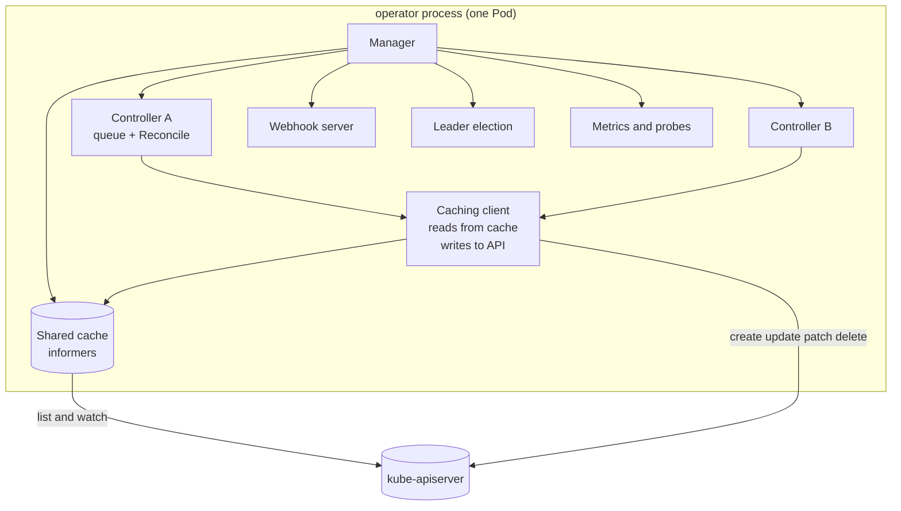

# 5.31 Operators in Go: controller-runtime and kubebuilder

| | |
|---|---|
| Level | Advanced |
| Priority tier | 2 |
| Lab venue | Go 1.22+, `controller-gen`, `setup-envtest`; a real cluster only for the final deploy step |
| Part | Part 5: Kubernetes |
| Status | Drafted. The code patterns below were compiled and exercised under envtest (see 5.32); cluster deployment steps are **untested** |

## Why this matters for AI infrastructure

GPU clusters are run by operators: the NVIDIA GPU Operator, Network Operator, Kueue, the Slurm and Ray operators, node-remediation controllers. Being able to write a small one, and to read the big ones (5.33), is what separates a platform engineer from someone who only applies YAML. This chapter teaches controller-runtime, the library underneath kubebuilder and Operator SDK, with the design rules that keep an operator safe on an expensive, shared fleet. 5.32 applies it to a concrete project.

## Prerequisites and outcomes

Needs 5.5 (API and etcd), 5.6 (controllers), 5.29 (CRDs and operators concepts) and 5.30 (Go and client-go). After this chapter you can:

- Explain what controller-runtime provides over raw client-go: manager, shared cache, caching client, controllers, builder, webhooks, leader election, metrics.
- Define an API type with kubebuilder markers, generate the CRD and deepcopy code, and add validation (OpenAPI schema, defaulting, CEL rules).
- Write an idempotent, level-triggered `Reconcile` with correct error, requeue and status handling.
- Choose watches, predicates, owner references, field indexes and finalizers appropriately.
- Test with a pure-function core plus envtest, and know what envtest cannot prove.
- Package RBAC, health probes, leader election and metrics for production.

## 1. Where controller-runtime sits



Layers, bottom to top:

- **client-go informers** list and watch resources and keep an in-memory store (5.30).
- **controller-runtime cache** wraps informers, started lazily per type when first used, shared by everything in the manager.
- **Client**: reads (`Get`, `List`) go to the cache by default; writes go straight to the API server. Reads can therefore be stale by a few milliseconds, which is why reconcilers must be idempotent and tolerate conflicts.
- **Controller**: a work queue of `reconcile.Request` (namespace/name keys only, never objects) plus N workers calling your `Reconcile`.
- **Manager**: owns the cache, clients, controllers, webhooks, health endpoints and leader election, and starts them in order.

Kubebuilder is a scaffolding CLI around this library (project layout, Makefile, markers, `config/` kustomize bases). Operator SDK builds on kubebuilder and adds OLM bundle tooling. You can write all of it by hand; scaffolding is convenience, not magic. The shape that matters is the same in all three.

## 2. Defining the API

An API type is a Go struct with JSON tags and **markers** (comments beginning with `+kubebuilder:`) read by `controller-gen`.

```go
// +kubebuilder:object:root=true
// +kubebuilder:subresource:status
// +kubebuilder:resource:scope=Cluster,shortName=ghp
// +kubebuilder:printcolumn:name="Action",type=string,JSONPath=`.spec.action`
type GPUHealthPolicy struct {
	metav1.TypeMeta   `json:",inline"`
	metav1.ObjectMeta `json:"metadata,omitempty"`
	Spec   GPUHealthPolicySpec   `json:"spec,omitempty"`
	Status GPUHealthPolicyStatus `json:"status,omitempty"`
}
```

Field-level markers give validation and defaults enforced by the API server, not by your code:

```go
// +kubebuilder:validation:Enum=Ignore;Cordon;CordonAndDrain
// +kubebuilder:default=Cordon
Action Action `json:"action,omitempty"`

// +kubebuilder:default="2m"
UnhealthyFor metav1.Duration `json:"unhealthyFor,omitempty"`
```

Cross-field rules use CEL (`x-kubernetes-validations`), which removes the need for a validating webhook in most cases:

```go
// +kubebuilder:validation:XValidation:rule="self.action != 'CordonAndDrain' || has(self.maxUnavailableNodes)",message="maxUnavailableNodes is required when action is CordonAndDrain"
type GPUHealthPolicySpec struct { /* ... */ }
```

Generate code and manifests:

```bash
go install sigs.k8s.io/controller-tools/cmd/controller-gen@v0.16.5
controller-gen object paths=./api/...                         # zz_generated.deepcopy.go
controller-gen crd paths=./api/... output:crd:dir=config/crd   # CRD YAML
controller-gen rbac:roleName=manager-role paths=./... output:rbac:dir=config/rbac
```

Design rules for the API (these are the ones that bite later):

- **Spec is desired state, status is observed state.** Enable the `status` subresource so users cannot overwrite status and controllers cannot bump `metadata.generation` by writing status.
- **Use `metav1.Condition` lists** (`Ready`, plus problem-specific types) with `observedGeneration`. Tooling such as `kubectl wait --for=condition=Ready` and GitOps health checks understand them.
- **Make every field optional with a safe default or a hard enum.** Adding required fields breaks existing objects.
- **Use `IntOrString` for budgets** (`2` or `25%`), as PodDisruptionBudget does.
- **Version from the start** (`v1alpha1`), keep a storage version, and plan conversion before you need it (5.29).
- **Do not put large or secret data in a CR.** Everything is stored in etcd and sent to every watcher.

## 3. The manager

```go
mgr, err := ctrl.NewManager(ctrl.GetConfigOrDie(), ctrl.Options{
	Scheme:                 scheme,
	Metrics:                metricsserver.Options{BindAddress: ":8080"},
	HealthProbeBindAddress: ":8081",
	LeaderElection:         leaderElect,
	LeaderElectionID:       "gpuhealth.platform.example.com",
})
```

- **Scheme**: register client-go types and your own (`AddToScheme`). A missing registration produces a "no kind is registered" error at first use.
- **Leader election** (a Lease object) lets you run 2 to 3 replicas for availability while only the leader reconciles. Without it, two replicas fight. Informer caches run on all replicas; only controllers wait for leadership.
- **Cache scope**: by default a cluster-wide cache of every type you read. In large clusters restrict with `cache.Options` (namespaces, label or field selectors per type) and consider `client.Options.Cache.DisableFor` for types you read once. Caching all Pods or Secrets in a 5,000-node cluster can cost gigabytes.
- **Metrics and probes**: controller-runtime exports reconcile counts, durations, queue depth and errors on the metrics endpoint with no code from you; add `healthz`/`readyz` checks for the Deployment probes.
- **Graceful shutdown**: `ctrl.SetupSignalHandler()` cancels the context on SIGTERM; runnables drain.

## 4. The reconcile function

```go
func (r *R) Reconcile(ctx context.Context, req ctrl.Request) (ctrl.Result, error)
```

The request contains only a name. You re-read the world each time. This is the level-triggered design from 5.6: you are told *something relevant changed*, not *what changed*, so one code path handles creation, update, resync after a crash and missed events.

A reliable structure, observe, decide, act, report:

```go
// Observe
var policy v1alpha1.GPUHealthPolicy
if err := r.Get(ctx, req.NamespacedName, &policy); err != nil {
	return ctrl.Result{}, client.IgnoreNotFound(err) // deleted: nothing to do
}
// ... list nodes, judge each with a pure function ...
// Decide
act, blocked := Plan(verdicts, budget)
// Act
for _, name := range act { r.cordon(ctx, &policy, byName[name]) }
// Report
r.updateStatus(ctx, &policy, ...)
```

Return values:

| Return | Meaning |
|---|---|
| `Result{}, nil` | Done. Wait for the next event. |
| `Result{}, err` | Failure. The request is re-queued with exponential backoff (rate-limited). Log once; do not also return a requeue. |
| `Result{RequeueAfter: d}, nil` | Look again after `d` with no error. Use for time-based decisions ("unhealthy for 2 minutes") and for polling something that emits no event. |
| `Result{Requeue: true}, nil` | Immediate re-queue (rate limited). Rarely the right tool; prefer `RequeueAfter` with a reason. |

Rules that prevent most operator incidents:

1. **Idempotent.** Running Reconcile twice must equal running it once. Check before creating; use `CreateOrUpdate`/`CreateOrPatch` helpers or server-side apply.
2. **No hidden state.** Do not remember "I cordoned that node last time" in a Go map; derive it from the cluster (an annotation, a status field). A restarted or newly elected replica must reach the same decisions. This is the same lesson as "the broker is the source of truth" in any control system.
3. **Separate the decision from the I/O.** A pure function `Judge(policy, node, now)` is testable in microseconds with an injected clock. Only a thin wrapper touches the API.
4. **Handle conflicts as normal.** `apierrors.IsConflict` means your cached copy was stale; return the error (it re-queues) or re-read and retry. Prefer **patches** (`client.MergeFrom`) over full updates so unrelated concurrent edits survive.
5. **Do not requeue on `NotFound` of the primary object.** It was deleted.
6. **Bound the blast radius.** Anything destructive (cordon, drain, delete, reboot) needs a budget, a dry-run mode, and a kill switch, because a bug or a bad signal will otherwise fire fleet-wide. 5.32 implements all three.
7. **Return errors, do not swallow them**, so backoff and metrics work. Collect several action errors and return one wrapped error, still performing the independent actions.

### Status updates

Write status through the status subresource, compute it from observation each time, and skip the write if nothing changed. Otherwise every reconcile modifies the object, produces a watch event, and triggers another reconcile.

```go
orig := p.DeepCopy()
p.Status.ObservedGeneration = p.Generation
meta.SetStatusCondition(&p.Status.Conditions, ready) // only changes LastTransitionTime when status flips
if equalStatus(orig.Status, p.Status) { return nil }
return r.Status().Patch(ctx, p, client.MergeFrom(orig))
```

`meta.SetStatusCondition` keeps `lastTransitionTime` stable unless the status value changes; hand-rolled condition code that stamps `now` on each pass causes endless churn.

## 5. Watches, predicates and mapping

`For(&Policy{})` watches the primary resource. Secondary resources need a way to name the primary:

- **`Owns(&Child{})`**: for objects the controller creates and sets an owner reference on; events map to the owner automatically.
- **`Watches(&Node{}, handler.EnqueueRequestsFromMapFunc(fn))`**: for objects you do not own. `fn` receives the object and returns the requests to enqueue. In 5.32 a Node event maps to every policy whose selector matches the node (or that previously cordoned it).
- **Predicates** filter events before they reach the queue: `GenerationChangedPredicate` skips status-only updates of the primary (stops the self-trigger loop above); a custom predicate can ignore Node heartbeat updates.

Node objects update their `status` every few seconds with heartbeat timestamps (lease-based heartbeats reduce but do not eliminate churn). A policy controller that reconciles on every Node update does pointless work at scale. The 5.32 predicate compares only what can change a decision: `spec.unschedulable`, labels, annotations and condition type/status/reason/transition time.

### Field indexes

`List` from the cache is a scan unless you register an index:

```go
mgr.GetFieldIndexer().IndexField(ctx, &corev1.Pod{}, "spec.nodeName",
	func(o client.Object) []string { return []string{o.(*corev1.Pod).Spec.NodeName} })
// later
r.List(ctx, &pods, client.MatchingFields{"spec.nodeName": node})
```

Cache indexes must be registered before the manager starts, and `MatchingFields` against the cache only works for registered fields (the API server supports few field selectors, so the cache is where this is practical).

## 6. Owner references and finalizers

**Owner references** give you garbage collection: when the owner is deleted, dependents with `ownerReferences` are deleted by the GC controller. Set them with `controllerutil.SetControllerReference(owner, child, scheme)`. Owners and dependents must be in the same namespace, or the owner cluster-scoped; a cluster-scoped object cannot be owned by a namespaced one.

**Finalizers** are for cleanup the GC cannot do: external resources, or changes made to objects you do not own. Pattern:

```go
if !policy.DeletionTimestamp.IsZero() {
	if controllerutil.ContainsFinalizer(&policy, FinalizerName) {
		if err := r.releaseAll(ctx, &policy); err != nil { return ctrl.Result{}, err } // retry until clean
		controllerutil.RemoveFinalizer(&policy, FinalizerName)
		if err := r.Update(ctx, &policy); err != nil { return ctrl.Result{}, err }
	}
	return ctrl.Result{}, nil
}
if controllerutil.AddFinalizer(&policy, FinalizerName) { _ = r.Update(ctx, &policy) }
```

Rules: add the finalizer **before** creating any side effect; make cleanup idempotent and retryable; never leave a finalizer that nothing will ever remove (an uninstalled operator then wedges deletion of every CR forever, a common upgrade failure; document the manual `kubectl patch ... finalizers=null` escape hatch). In 5.32 the finalizer ensures deleting a policy uncordons only the nodes that policy cordoned, verified by a test that also checks a human's manual cordon survives.

## 7. Ownership of foreign objects: annotate, do not assume

An operator that modifies a shared object (a Node, a Deployment someone else owns) must be able to tell *its* changes from everyone else's. A cordon placed by an engineer during maintenance must not be undone because a GPU condition recovered. Record provenance on the object (`platform.example.com/cordoned-by: policy-name`) and act only on objects carrying your mark. This is the same discipline as refusing to bulk-cancel orders you cannot prove you placed.

## 8. Events, logging and metrics

- **Events** (`Recorder.Eventf`) appear in `kubectl describe` and are the operator's user interface for "why did you do that". Emit one for every state-changing action and every refusal (budget exhausted, PDB blocked eviction). Events are rate-limited and best effort, not an audit log.
- **Logging**: use the context logger (`log.FromContext(ctx)`), structured key/value pairs, no per-reconcile INFO spam. Log at error level only for conditions needing attention.
- **Metrics**: register custom Prometheus collectors with `metrics.Registry` (for example `gpuhealth_cordoned_nodes`, `gpuhealth_budget_blocked_total`) and alert on them; see 5.19 for the Prometheus side.

## 9. RBAC

RBAC markers on the reconciler are turned into a `ClusterRole`:

```go
// +kubebuilder:rbac:groups="",resources=nodes,verbs=get;list;watch;patch
// +kubebuilder:rbac:groups="",resources=pods/eviction,verbs=create
```

Grant the least that works. The 5.32 operator can patch nodes but not delete them, create evictions but not delete pods directly, and never reads Secrets. Review the generated role: an operator with `*` on `*` is a cluster takeover waiting for a CVE (5.21).

## 10. Webhooks (brief)

Admission webhooks (defaulting, validating, conversion) are served by the same manager (`ctrl.NewWebhookManagedBy`). They need TLS certificates, normally from cert-manager, and a `failurePolicy` decision: `Fail` protects correctness but a down webhook blocks all writes of that type; `Ignore` does the opposite. Prefer **CEL validation rules and `ValidatingAdmissionPolicy`** for simple checks so the operator is not on the admission path. Never run a webhook for a resource that the webhook's own Pod depends on.

When you do write a custom mutating or validating webhook with `controller-runtime`, your webhook struct implements the `admission.Handler` interface (`Handle(ctx context.Context, req admission.Request) admission.Response`) and uses `admission.PatchResponseFromRaw` to compute the JSONPatch diff automatically between the incoming raw object (`req.Object.Raw`) and the mutated Go struct marshaled to JSON. As *Production Kubernetes* (Chapter 8) illustrates in its Cluster API `VSphereMachine` Infoblox IPAM webhook example (and the same pattern applies when mutating a `Pod` into `marshaledPod`), you should short-circuit immediately with `admission.Allowed(...)` if the target annotation is absent, and always check `req.DryRun` before mutating external state so `kubectl --dry-run=server` requests remain side-effect free (untested here):

```go
// +kubebuilder:webhook:path=/infoblox-ipam,mutating=true,failurePolicy=fail,groups="infrastructure.cluster.x-k8s.io",resources=vspheremachines,verbs=create,versions=v1alpha3,name=mutating.infoblox.ipam.vspheremachines.infrastructure.cluster.x-k8s.io

func (w *Webhook) Handle(
	ctx context.Context,
	req admission.Request) admission.Response {
	vm := &v1alpha3.VSphereMachine{}
	err := w.decoder.DecodeRaw(req.Object, vm)
	if err != nil {
		return admission.Errored(http.StatusBadRequest, err)
	}
	if _, ok := vm.Annotations["infoblox"]; !ok {
		return admission.Allowed("Nothing to do")
	}
	// If mutating external state (e.g., allocating an IP in Infoblox),
	// check req.DryRun first so dry-run requests do not cause side effects.
	if req.DryRun != nil && *req.DryRun {
		return admission.Allowed("dry run")
	}
	vm.Spec.VirtualMachineCloneSpec.Network.Devices[0].IPAddrs[0] = ipFromInfoblox
	marshaledVM, err := json.Marshal(vm)
	if err != nil {
		return admission.Errored(http.StatusInternalServerError, err)
	}
	return admission.PatchResponseFromRaw(req.Object.Raw, marshaledVM)
}
```

## 11. Testing strategy

Test at three layers:

1. **Pure functions** (table tests): `Judge`, `Budget`, `Plan` take values and an injected time. No cluster. Fast and the place to put edge cases (invalid budget fails safe to zero, absent condition is treated as healthy, Unknown is neither healthy nor unhealthy).
2. **envtest**: starts a real kube-apiserver and etcd binaries (no kubelet, no scheduler, no controllers like Deployment or GC, no Docker). Install CRDs, run your manager in the test process, create objects, poll with an `eventually` helper. This verifies real API behaviour: CRD defaulting and CEL validation, patch semantics, finalizer flow, watches and mapping.
3. **A real cluster** (kind, or GKE) for integration: image, RBAC, leader election, webhook TLS, behaviour on real nodes.

```bash
go install sigs.k8s.io/controller-runtime/tools/setup-envtest@release-0.19
export KUBEBUILDER_ASSETS="$(setup-envtest use 1.31.0 -p path)"
go test -race -count=1 ./...
```

What envtest **cannot** tell you: that pods actually reschedule, that PDBs are evaluated against real disruption controllers, kubelet behaviour, device plugin behaviour, or timing under load. Because there is no node controller, tests must set Node conditions themselves (the 5.32 suite does this with back-dated transition times, avoiding sleeps for the "unhealthy for two minutes" rule). Say so in the chapter or README of any operator: tests prove the decision and API logic, not the cluster outcome.

Practical test hygiene: use unique object names per test (envtest state is shared), prefer `eventually` polling over fixed sleeps, assert absence with a bounded wait ("must not cordon") and name the bound, and run with `-race`.

## 12. Production hardening checklist

| Area | Practice |
|---|---|
| Availability | 2 or 3 replicas, leader election, PodDisruptionBudget, anti-affinity, PriorityClass above workloads |
| Safety | Dry-run mode, rate and count budgets, per-object ownership marks, a documented kill switch (scale to zero, or `action: Ignore`) |
| Resources | Requests/limits; restrict cache scope; watch memory on large clusters |
| Security | Non-root, read-only root filesystem, dropped capabilities, least-privilege RBAC, signed image (5.22) |
| Observability | Metrics, events, conditions, structured logs, an alert if the reconcile error rate or queue depth rises |
| Upgrades | CRD upgrade path (CRDs are not upgraded by Helm `crds/` on `helm upgrade`), conversion webhooks if versions change, finalizer removal path on uninstall |
| Failure modes | Behaviour when the API server is slow, when the cache is not yet synced, when the signal source is wrong (a bad health exporter that marks every node unhealthy should hit the budget, not drain the fleet) |

## 13. Common mistakes

- Reading state from a Go field instead of the cluster, then diverging after a restart.
- Updating the whole object instead of patching, overwriting concurrent changes.
- Status writes that always change something (timestamps), causing hot reconcile loops.
- Reconciling on every Node heartbeat; missing predicates.
- Returning both an error and `RequeueAfter` (the result is ignored when err is non-nil).
- No finalizer cleanup path, or a finalizer added after side effects.
- Treating `Get` from the cache as authoritative right after a write (read-your-writes is not guaranteed; use the returned object or `APIReader` when you must).
- Letting one failure abort the others: continue independent actions and aggregate errors.
- Missing RBAC for a subresource (`pods/eviction`, `status`, `finalizers`), found only in-cluster; envtest runs as admin and will not reveal it. Test RBAC separately (kind, or `kubectl auth can-i --as=system:serviceaccount:...`).

## 14. Lab (untested against a cluster)

1. Scaffold or copy the 5.32 project, run `controller-gen`, run the envtest suite with `-race`.
2. Break it on purpose: remove the node-event predicate and observe reconcile counts via the metrics endpoint; remove the status no-op check and observe the hot loop.
3. Add a custom Prometheus counter for budget-blocked decisions and expose it.
4. Add an `Owns` relationship by having the policy create a ConfigMap report, and verify garbage collection in a kind cluster (GC does not run under envtest).
5. Deploy to kind with `kubectl apply -k config/`, check `kubectl auth can-i` for each verb, then kill the leader Pod and watch the other take over.

## 15. Interview angles

- Walk me through one reconcile. Why does Reconcile receive only a name?
- Why are reads from the manager's client possibly stale, and how does your design cope?
- When do you use RequeueAfter, a returned error, or neither?
- How do you stop a status update from triggering another reconcile?
- What goes wrong if two replicas run without leader election?
- How do finalizers work, and how can they wedge an uninstall?
- How would you make a destructive remediation controller safe on a 1,000-node GPU cluster?
- What can envtest verify and what can it not?
- Operator versus Helm chart versus Argo CD app: when is the operator justified?

## 16. Checkpoint questions (30)

1. What are the layers between the API server and your Reconcile function?
2. Which calls hit the cache and which hit the API server?
3. Why do workers receive keys rather than objects?
4. What does `client.IgnoreNotFound` buy you at the top of Reconcile?
5. Name three ways to make Reconcile idempotent.
6. Why is storing "already handled" in a Go map unsafe?
7. When does returning an error vs `RequeueAfter` matter?
8. What does `GenerationChangedPredicate` filter and why?
9. Why use a status subresource?
10. What does `meta.SetStatusCondition` do with `lastTransitionTime`?
11. Why must a status update skip when nothing changed?
12. What is the difference between `Owns` and `Watches`?
13. How does a map function route a Node event to policies?
14. Why register a field index, and when must it be registered?
15. Which objects can own which (namespace rules)?
16. When do you need a finalizer rather than an owner reference?
17. Why add the finalizer before side effects?
18. How can a finalizer wedge uninstallation?
19. Why annotate objects you modify but do not own?
20. What is a CEL validation rule and when does it replace a webhook?
21. What does `failurePolicy: Fail` risk, what `controller-runtime` helper builds a JSONPatch response from `req.Object.Raw` and a marshaled object, and what request field must a webhook check before causing external side effects? **A:** `Fail` risks blocking all writes of that resource if the webhook is down; `admission.PatchResponseFromRaw(req.Object.Raw, marshaledObj)` computes the JSONPatch; check `req.DryRun`.
22. What is leader election for, and what object implements it?
23. Why can cluster-wide caching be dangerous at scale?
24. What do the three test layers each prove?
25. What does envtest not provide?
26. Why set Node conditions manually in envtest?
27. Why prefer patch over update?
28. How do you test RBAC given envtest runs as admin?
29. What guard stops a bad signal from cordoning the whole fleet?
30. How do you handle a conflict error?

## 17. Sources and review notes

- Hausenblas and Schimanski, *Programming Kubernetes* (O'Reilly): controllers, informers, CRDs, operators (concepts and structure used here, written in my own words).
- Josh Rosso, Rich Lander, Alex Brand and John Harris, *Production Kubernetes* (`production-kubernetes`, Chapter 8: `8. Admission Control` — read in full for the `controller-runtime` mutating webhook `Handle(ctx, req)` implementation, `admission.PatchResponseFromRaw`, and `req.DryRun` side-effect handling).
- The Kubebuilder book and controller-runtime documentation (public): markers, manager, testing with envtest. Version-specific details (controller-runtime v0.19, k8s 0.31, controller-gen 0.16.5) are those used for the verified code; check the current releases before copying.
- Verified here: the reconcile, predicate, index, finalizer and status patterns compiled and ran under envtest with `-race` (see 5.32 for exactly what was exercised).
- Not verified: image build, deployment, RBAC in a real cluster, webhook TLS, drain behaviour against a real PDB and kubelet.
