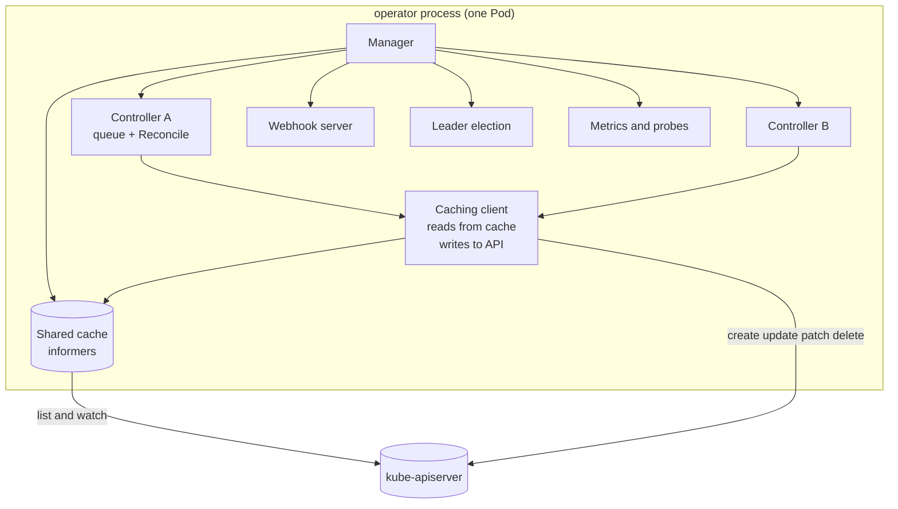

# 5.31 Operators in Go: controller-runtime and kubebuilder

| | |
|---|---|
| Level | Advanced |
| Priority tier | 2 |
| Lab venue | Go 1.22+, `controller-gen`, `setup-envtest`; a real cluster only for the final deploy step |
| Part | Part 5: Kubernetes |
| Status | Drafted. The code patterns below were compiled and exercised under envtest (see 5.32); cluster deployment steps are **untested** |

## Why this matters for AI infrastructure

A GPU node goes bad late at night, and something has to notice it, stop new work from landing on it and report the fault. Very often that something is an operator. GPU clusters are run by operators: the NVIDIA GPU Operator, Network Operator, Kueue, the Slurm and Ray operators, and node-remediation controllers. Being able to write a small operator, and to read the large ones in 5.33, is what separates a platform engineer from someone who only applies YAML. This chapter teaches controller-runtime, the library underneath kubebuilder and Operator SDK. It also covers the design rules that keep an operator safe on an expensive, shared fleet. 5.32 then applies these ideas to a concrete project, so decide early which operators your own cluster depends on.

## Prerequisites and outcomes

Suppose you are asked to build a controller that cordons unhealthy GPU nodes. The chapters before this one give you the foundation for that work. You should have covered the API and etcd in 5.5, controllers in 5.6, CRDs and operator concepts in 5.29, and Go with client-go in 5.30. By the end of this chapter, you will be able to:

- Explain what controller-runtime provides over raw client-go: the manager, shared cache, caching client, controllers, builder, webhooks, leader election and metrics.
- Define an API type with kubebuilder markers, generate the CRD and deepcopy code, and add validation through an OpenAPI schema, defaulting and CEL rules.
- Write an idempotent, level-triggered `Reconcile` with correct error, requeue and status handling.
- Choose watches, predicates, owner references, field indexes and finalizers for each case.
- Test with a pure-function core plus envtest, and know what envtest cannot prove.
- Package RBAC, health probes, leader election and metrics for production.

If any of those earlier chapters is unfamiliar, read it before you go on.

## 1. Where controller-runtime sits

Picture an operator as a single Pod that watches the API server and reacts to what it sees. Inside that one process, several parts cooperate. The diagram shows how they connect.



Read the diagram from the bottom up. The layers work like this:

- client-go informers list and watch resources and keep an in-memory store. You met them in 5.30.
- The controller-runtime cache wraps those informers. It starts each type lazily, the first time something uses that type, and everything in the manager shares it.
- The client reads with `Get` and `List` from the cache by default, and it writes straight to the API server. A read can lag the latest write by a few milliseconds, so reconcilers must be idempotent and tolerate conflicts.
- A controller keeps a work queue of `reconcile.Request` values. Each request holds only a namespace and name key, never the object itself. N workers take requests from the queue and call your `Reconcile`.
- The manager owns the cache, clients, controllers, webhooks, health endpoints and leader election. It starts all of them in order.

Kubebuilder is a scaffolding CLI built around this library. It generates the project layout, the Makefile, the markers and the `config/` kustomize bases. Operator SDK builds on kubebuilder and adds OLM bundle tooling. You can write all of it by hand, because scaffolding is a convenience and not magic. The shape that matters stays the same across all three.

### Tooling for building operators

If you have a real use case for a custom operator, community projects can speed you up. An experienced Go programmer who knows client-go could write an operator from scratch. Still, every operator shares common parts, and experts generate that boilerplate with tools to save time. SDKs and frameworks help when their assumptions fit your project. They become a nuisance when they assume things that do not match your needs. These tools suit projects that define configuration with custom resources and implement behavior with custom controllers. The sections below cover a few projects, then walk through design and implementation with code snippets.

### Kubebuilder as an SDK for APIs

Kubebuilder is an SDK for building Kubernetes APIs. The name fits, but the tool works differently from what you might expect. You start with the Kubebuilder command-line tool, which generates boilerplate. It creates the source code, a Dockerfile, a Makefile and sample Kubernetes manifests. Those are the files every project needs, and generating them saves a lot of time at the start.

Kubebuilder also uses controller-runtime, a related library. The generated source already includes the imports and common implementations. The library handles the routine work of running a controller and talking to the API server. It sets up shared caches and clients for efficient API access. The cache lets your controller list and get objects without a new API request for each query. That eases load on the API server and speeds up reconciliation.

Controller-runtime also triggers reconcile requests on events such as resource changes. It does this for the parent custom resource by default. You usually want triggers when the controller's child resources change too, and helper functions exist for that. In high-availability mode, controller-runtime can enable leader election, so only one controller is active at a time. It includes a package for webhooks, which are often used for admission control. It also provides structured logging and Prometheus metrics for observability.

Kubebuilder is a great choice if you are a Go programmer with Kubernetes experience. It is also a good choice if you are an experienced developer new to Go. It is for Go only, though, and it does not cater to other languages.

**Tip:** If you will build tools for Kubernetes, consider learning Go. You can use other languages, since Kubernetes offers a REST API. Official client libraries exist for Python, Java, C#, JavaScript and Haskell, along with many community libraries. Kubernetes itself is written in Go, though, and its Go ecosystem is rich and well supported.

Writing a CRD manifest by hand is hard. The OpenAPI v3 specification behind it is detailed and involved. The Kubebuilder CLI generates the files in which you define the fields of your API types. You add the fields to struct definitions and tag them with markers, such as default values. Then a make target generates the CRD manifests. That is very handy.

Other make targets generate the RBAC and sample custom resource manifests. They install custom resources in your development cluster. They build and publish images for your operator. They can also run your controller locally against a cluster during development. These conveniences save tedious time, especially early in a project. For these reasons, Kubebuilder is the tool we recommend for building operators. Many projects have used it with success.

### Metacontroller: write only the logic

If you want to stay with a language other than Go, Metacontroller is another option. It takes a different approach from Kubebuilder. Metacontroller is a cluster add-on that hides the Kubernetes API from you. Your job is to write the controller webhook that holds your controller's logic. Metacontroller calls this a lambda controller, and it decides what to do with the resources it cares about.

Metacontroller watches the resources under its management. When a change needs a decision, it makes an HTTP call to your lambda controller. It uses its own custom resources to record your webhook's URL and the resources it manages. Once Metacontroller runs in your cluster, adding a controller takes two steps. You deploy your lambda controller webhook, and then you add a Metacontroller custom resource, called a composite controller resource. Your endpoint accepts requests from Metacontroller, parses the JSON payload that holds the Kubernetes resource object, and returns any changes to send to the API.

Consider Metacontroller when you want to use several languages and expect to deploy many in-house operators. Engineers sometimes prototype with it and then build the final project with Kubebuilder once the design is settled. Its strength is speed after the add-on is installed. It does not help with creating CRDs, though, so you must write those yourself. This is where Kubebuilder has a significant advantage.

### Operator Framework

The Operator Framework is a collection of open source tools that started at Red Hat. It is now an incubating project under the CNCF. It makes operators easier to build. Its Operator SDK offers much of what Kubebuilder offers for Go, including a CLI that generates boilerplate. It also uses controller-runtime to integrate with the Kubernetes API. Beyond Go, the Operator SDK lets you build operators with Helm or Ansible.

The framework also includes the Operator Lifecycle Manager, which is an operator for your operators. It gives you abstractions for installing and upgrading them. An operator hub lets users discover operators for the software they use. In the field, platform teams have rarely used these tools. Because Red Hat maintains them, they are more common among OpenShift users. OpenShift is Red Hat's Kubernetes-based offering.

If you are a Go programmer, Kubebuilder is the tool to start with.

## 2. Defining the API

An API type is a Go struct with JSON tags and markers. Markers are comments that begin with `+kubebuilder:`, and `controller-gen` reads them. The example below shows a type with its markers.

```go
// +kubebuilder:object:root=true
// +kubebuilder:subresource:status
// +kubebuilder:resource:scope=Cluster,shortName=ghp
// +kubebuilder:printcolumn:name="Action",type=string,JSONPath=`.spec.action`
type GPUHealthPolicy struct {
	metav1.TypeMeta   `json:",inline"`
	metav1.ObjectMeta `json:"metadata,omitempty"`
	Spec   GPUHealthPolicySpec   `json:"spec,omitempty"`
	Status GPUHealthPolicyStatus `json:"status,omitempty"`
}
```

Field-level markers give you validation and defaults, and the API server enforces them, not your code.

```go
// +kubebuilder:validation:Enum=Ignore;Cordon;CordonAndDrain
// +kubebuilder:default=Cordon
Action Action `json:"action,omitempty"`

// +kubebuilder:default="2m"
UnhealthyFor metav1.Duration `json:"unhealthyFor,omitempty"`
```

Cross-field rules use CEL (`x-kubernetes-validations`). In most cases, CEL removes the need for a validating webhook.

```go
// +kubebuilder:validation:XValidation:rule="self.action != 'CordonAndDrain' || has(self.maxUnavailableNodes)",message="maxUnavailableNodes is required when action is CordonAndDrain"
type GPUHealthPolicySpec struct { /* ... */ }
```

Generate the code and manifests with these commands.

```bash
go install sigs.k8s.io/controller-tools/cmd/controller-gen@v0.16.5
controller-gen object paths=./api/...                         # zz_generated.deepcopy.go
controller-gen crd paths=./api/... output:crd:dir=config/crd   # CRD YAML
controller-gen rbac:roleName=manager-role paths=./... output:rbac:dir=config/rbac
```

The API design rules below are the ones that bite later, so read them before you write the first type.

- Spec is desired state, and status is observed state. Enable the `status` subresource, so users cannot overwrite status and controllers cannot bump `metadata.generation` by writing status.
- Use `metav1.Condition` lists, with `Ready` plus problem-specific types, and record `observedGeneration`. Tooling such as `kubectl wait --for=condition=Ready` and GitOps health checks understand them.
- Make every field optional, with a safe default or a hard enum. Adding a required field breaks existing objects.
- Use `IntOrString` for budgets, so a value can be `2` or `25%`, as PodDisruptionBudget does.
- Version from the start with `v1alpha1`, keep a storage version, and plan conversion before you need it, as covered in 5.29.
- Do not put large or secret data in a CR. Everything is stored in etcd and sent to every watcher.

In *Kubernetes Programming with Go*, chapters 9 and 13, Philippe Martin compares two workflows. The first is the classic `k8s.io/code-generator` workflow. It uses the markers `// +k8s:deepcopy-gen=package`, `// +k8s:deepcopy-gen:interfaces=k8s.io/apimachinery/pkg/runtime.Object` and `// +genclient`, along with `deepcopy-gen` and `client-gen`. The second is the modern Kubebuilder workflow, built on controller-runtime and controller-gen. The book's Kubebuilder steps follow.

1. Scaffolding a Kubebuilder project and API, from *Kubernetes Programming with Go*, chapter 13:
   ```bash
   kubebuilder init --domain myid.dev --repo github.com/myid/myresource
   kubebuilder create api --group mygroup --version v1alpha1 --kind MyResource
   make manifests   # runs controller-gen to generate CRD & RBAC YAML in config/
   make run         # runs the Manager locally against your current kubeconfig
   make deploy IMG=quay.io/myid/myresource:v1alpha1-1
   ```
2. Implementing hub-and-spoke multi-version conversion in Go, from *Kubernetes Programming with Go*, chapter 13. When you introduce a second API version, run `kubebuilder create api --group mygroup --version v1beta1 --kind MyResource`. Suppose you rename `spec.memory` in `v1alpha1` to `spec.memoryRequest` in `v1beta1`. One version is then marked as the Hub by implementing `conversion.Hub`:
   ```go
   // api/v1alpha1/myresource_conversion.go
   func (*MyResource) Hub() {}
   ```
   Every Spoke version, here `v1beta1`, implements `conversion.Convertible`. The methods are `ConvertTo(dstRaw conversion.Hub) error` and `ConvertFrom(srcRaw conversion.Hub) error`. You wire the conversion into the Manager with `kubebuilder create webhook --group mygroup --version v1alpha1 --kind MyResource --conversion`. The sample `convert_myresource_spoke_to_hub_and_back()` in `code/part05/controller_runtime_reconciler_sim.py` models this step.
3. Applying child resources with Server-Side Apply in controller-runtime, from *Kubernetes Programming with Go*, chapters 10 and 11. Fragile `Get -> Update` loops on child `Deployment`s are easy to get wrong. Instead, construct the desired child `appsv1.Deployment`, sets `TypeMeta` `APIVersion` and `Kind`, and sets `ownerReferences` with `ctrl.SetControllerReference`. Then apply the object in one idempotent call:
   `err := r.Client.Patch(ctx, deploy, client.Apply, client.FieldOwner("myresource-controller"), client.ForceOwnership)`

### Choosing the data model for a Namespace operator

Designing an operator starts with the data model, just as designing a web application starts with its database schema. You often know what the spec needs before you write any code. As soon as you spot a problem to solve or a gap to fill, the desired-state fields begin to take shape.

Take the Namespace operator from earlier. It could create a Namespace with a LimitRange, a ResourceQuota, Roles and NetworkPolicies for a new app team. You might also bind a team lead to the `namespace-admin` Role right away, then hand off management of the Namespace to that person. That suggests an `adminUsername` field in the spec. The next manifest shows the result.

```yaml
apiVersion: tenancy.acme.com/v1alpha1
kind: AcmeNamespace
metadata:
  name: team-x
spec:
  namespaceName: app-y
  adminUsername: sam
```

The name `team-x` is arbitrary. The `app-y` Namespace hosts a workload. The username `sam` comes from the company's identity provider, usually an Active Directory system or something similar.

Submitting that manifest results in `sam` being added to the subjects of a RoleBinding to the `namespace-admin` Role. The manifest after it shows what the controller creates.

```yaml
apiVersion: rbac.authorization.k8s.io/v1
kind: Role
metadata:
  name: namespace-admin
  namespace: app-y
rules:
- apiGroups:
  - "*"
  resources:
  - "*"
  verbs:
  - "*"
---
apiVersion: rbac.authorization.k8s.io/v1
kind: RoleBinding
metadata:
  name: namespace-admin
  namespace: app-y
roleRef:
  apiGroup: rbac.authorization.k8s.io
  kind: Role
  name: namespace-admin
subjects:
- kind: User
  name: sam
  namespace: app-y
```

The `adminUsername` from the AcmeNamespace manifest goes into the RoleBinding, bound to the `namespace-admin` Role.

Start from the behavior you want. Sam should be bound to the `namespace-admin` Role. The data you need is Sam's username and the Namespace name. Put those obvious pieces into your CRD spec first. The Go type for the spec follows.

```go
// api/v1alpha1/acmenamespace_types.go
...
// AcmeNamespaceSpec defines the desired state of AcmeNamespace
type AcmeNamespaceSpec struct {
	// The name of the namespace
	NamespaceName string `json:"namespaceName"`
	// The username for the namespace admin
	AdminUsername string `json:"adminUsername"`
	...
}
```

Kubebuilder generates your CRD manifest and a sample AcmeNamespace manifest from this source. Your first data model will probably prove too thin once you write the controller. You will then find fields you need, so expect to add them.

Suppose you add a `deploymentTier` field. A manifest that uses it follows.

```yaml
apiVersion: tenancy.acme.com/v1alpha1
kind: AcmeNamespace
metadata:
  name: team-x
spec:
  namespaceName: app-y
  adminUsername: sam
  deploymentTier: dev
```

That field prompts the controller to create a ResourceQuota. The quota for the `dev` tier follows.

```yaml
apiVersion: v1
kind: ResourceQuota
metadata:
  name: dev
spec:
  hard:
    cpu: "5"
    memory: 10Gi
    pods: "10"
```

A `prod` tier gets a much larger default quota. It follows.

```yaml
apiVersion: v1
kind: ResourceQuota
metadata:
  name: prod
spec:
  hard:
    cpu: "500"
    memory: 200Gi
    pods: "100"
```

One value now drives several defaults, so users state a single field. When you design a spec, look for values like this one, so that users state one field instead of many.

## 3. The manager

Suppose your operator starts and then fails at the first read with a "no kind is registered" error. The cause is usually in the manager setup, which wires the whole process together. The example below shows the setup that most operators start from.

```go
mgr, err := ctrl.NewManager(ctrl.GetConfigOrDie(), ctrl.Options{
	Scheme:                 scheme,
	Metrics:                metricsserver.Options{BindAddress: ":8080"},
	HealthProbeBindAddress: ":8081",
	LeaderElection:         leaderElect,
	LeaderElectionID:       "gpuhealth.platform.example.com",
})
```

- **Scheme**: register the client-go types and your own types with `AddToScheme`. A missing registration produces a "no kind is registered" error at first use.
- **Leader election** uses a Lease object. It lets you run 2 to 3 replicas for availability while only the leader reconciles. Without it, two replicas fight each other. Informer caches run on all replicas, and only the controllers wait for leadership.
- **Cache scope**: by default you get a cluster-wide cache of every type you read. In large clusters, restrict it with `cache.Options`, using namespaces or label and field selectors per type. Consider `client.Options.Cache.DisableFor` for types you read only once. Caching all Pods or Secrets in a 5,000-node cluster can cost gigabytes.
- **Metrics and probes**: controller-runtime exports reconcile counts, durations, queue depth and errors on the metrics endpoint, with no code from you. Add `healthz` and `readyz` checks for the Deployment probes.
- **Graceful shutdown**: `ctrl.SetupSignalHandler()` cancels the context on SIGTERM, and the runnables drain.

Check the scheme and leader election first, since most failures in this list start there.

## 4. The reconcile function

A GPU node goes unhealthy, and your reconciler wakes up holding only a name. It has to work out what to do from the current state of the cluster.

```go
func (r *R) Reconcile(ctx context.Context, req ctrl.Request) (ctrl.Result, error)
```

The request contains only a name, so you re-read the world each time. This is the level-triggered design from 5.6. You are told that something relevant changed, not what changed. One code path therefore handles creation, updates, a resync after a crash and missed events.

A reliable structure is observe, decide, act and report. The sketch below follows that order.

```go
// Observe
var policy v1alpha1.GPUHealthPolicy
if err := r.Get(ctx, req.NamespacedName, &policy); err != nil {
	return ctrl.Result{}, client.IgnoreNotFound(err) // deleted: nothing to do
}
// ... list nodes, judge each with a pure function ...
// Decide
act, blocked := Plan(verdicts, budget)
// Act
for _, name := range act { r.cordon(ctx, &policy, byName[name]) }
// Report
r.updateStatus(ctx, &policy, ...)
```

The return value tells the controller what happens next, so choose it deliberately. The table below lists the four options.

| Return | Meaning |
|---|---|
| `Result{}, nil` | Done. Wait for the next event. |
| `Result{}, err` | Failure. The request is re-queued with exponential backoff (rate-limited). Log once; do not also return a requeue. |
| `Result{RequeueAfter: d}, nil` | Look again after `d` with no error. Use for time-based decisions ("unhealthy for 2 minutes") and for polling something that emits no event. |
| `Result{Requeue: true}, nil` | Immediate re-queue (rate limited). Rarely the right tool; prefer `RequeueAfter` with a reason. |

Seven rules prevent most operator incidents. Each one takes a common mistake and turns it into a habit you can check in review.

1. Make the function idempotent. Running Reconcile twice must give the same result as running it once. Check before you create, or use `CreateOrUpdate` or `CreateOrPatch` helpers, or server-side apply.
2. Keep no hidden state. Do not remember "I cordoned that node last time" in a Go map. Derive it from the cluster, through an annotation or a status field. A restarted or newly elected replica must reach the same decisions. This is the same lesson as "the broker is the source of truth" in any control system.
3. Separate the decision from the I/O. A pure function such as `Judge(policy, node, now)` is testable in microseconds with an injected clock. Only a thin wrapper touches the API.
4. Treat conflicts as normal. `apierrors.IsConflict` means your cached copy was stale. Return the error so the request re-queues, or re-read and retry. Prefer patches (`client.MergeFrom`) over full updates, so unrelated concurrent edits survive.
5. Do not requeue on `NotFound` of the primary object. It was deleted, so there is nothing left to do.
6. Bound the blast radius. Anything destructive, such as cordon, drain, delete or reboot, needs a budget, a dry-run mode and a kill switch. Otherwise a bug or a bad signal will fire fleet-wide. 5.32 implements all three.
7. Return errors instead of swallowing them, so backoff and metrics work. If several actions fail, collect the errors and return one wrapped error, while still performing the independent actions.

### Status updates

Write status through the status subresource. Compute it from observation each time, and skip the write if nothing changed. Otherwise every reconcile modifies the object, produces a watch event and triggers another reconcile. The snippet below shows the guard.

```go
orig := p.DeepCopy()
p.Status.ObservedGeneration = p.Generation
meta.SetStatusCondition(&p.Status.Conditions, ready) // only changes LastTransitionTime when status flips
if equalStatus(orig.Status, p.Status) { return nil }
return r.Status().Patch(ctx, p, client.MergeFrom(orig))
```

`meta.SetStatusCondition` keeps `lastTransitionTime` stable unless the status value changes. Hand-rolled condition code that stamps `now` on each pass causes endless churn.

### Gathering existing and desired state

A controller follows three steps. It gathers an accurate picture of the existing state. It examines the desired state. Then it takes actions to reconcile the existing state with the desired state.

It can gather existing state from three places. The first is the `status` of your custom resource. The second is other related resources in the cluster. The third is conditions outside the cluster, or in other systems. The `status` records observed state, and Kubernetes already does this for you. The `status.phase` field on Pods shows whether they are `Running`, and on Namespaces whether they are `Active`.

Back to the Namespace operator. The controller gets notified about an AcmeNamespace and its spec. It cannot assume the resource is new, because it may have just been updated. Creating the children again would return an error from the API. If you add a `phase` field to the status, the controller can check it. An empty phase means a new resource, so the controller creates every child. Once all children exist, it sets the phase to `Created`. Later changes then show that the children already exist.

That approach has one flaw, though. It assumes the controller never fails. Suppose the controller creates the Namespace, then crashes before it creates the Role. On restart, the phase is still empty, so it tries to create the Namespace again and fails. The fix is to set `CreationInProgress` as the very first step. On restart, that phase tells the controller that the status alone cannot show the true state. It must then look at related resources.

When the status is not enough, query the API server, or preferably the local cache. Look for the child resources you expect. In the failure case, the Namespace exists, so the controller moves on. The Role does not exist, so it creates the Role. Build the controller to tolerate failure, and always assume failure will happen.

Some state lives outside the cluster. Cloud infrastructure controllers must query cloud provider APIs for the status of infrastructure. What counts as existing state depends on the purpose of the operator.

The desired state lives in the `spec`. In the Namespace operator, `namespaceName` sets the `metadata.name` of the Namespace, and `adminUsername` sets the name in the RoleBinding's subject. These are direct mappings. Often the mapping is less direct. The `deploymentTier` field works that way, because one value chooses many defaults in the controller logic.

The code below shows the controller creating the Role and RoleBinding after the Namespace.

```go
// controllers/acmenamespace_controller.go
...
role := &rbacv1.Role{
	ObjectMeta: metav1.ObjectMeta{
		Name:      "namespace-admin",
		Namespace: nsName,
	},
	Rules: []rbacv1.PolicyRule{
		{
			APIGroups: []string{"*"},
			Resources: []string{"*"},
			Verbs:     []string{"*"},
		},
	},
}
if err := r.Create(ctx, role); err != nil {
	log.Error(err, "unable to create namespace-admin role")
	return ctrl.Result{}, err
}
binding := &rbacv1.RoleBinding{
	ObjectMeta: metav1.ObjectMeta{
		Name:      "namespace-admin",
		Namespace: nsName,
	},
	RoleRef: rbacv1.RoleRef{
		APIGroup: "rbac.authorization.k8s.io",
		Kind:     "Role",
		Name:     "namespace-admin",
	},
	Subjects: []rbacv1.Subject{
		{
			Kind:      "User",
			Name:      adminUsername,
			Namespace: nsName,
		},
	},
}
if err := r.Create(ctx, binding); err != nil {
	log.Error(err, "unable to create namespace-admin role binding")
	return ctrl.Result{}, err
}
return ctrl.Result{}, nil
// ...
```

This code works the first time you create an AcmeNamespace. It breaks on any later reconcile, including a controller restart, unless you add the status logic above. The `phase` field tells the controller what already exists. Add that status logic before you rely on this code in production.

## 5. Watches, predicates and mapping

A policy controller that watches only its own resource will never hear about the Nodes it cares about. Watches tell the reconciler which events matter, and predicates filter out the rest. `For(&Policy{})` watches the primary resource. Secondary resources need a way to name the primary:

- `Owns(&Child{})` is for objects the controller creates and sets an owner reference on. Events map to the owner automatically.
- `Watches(&Node{}, handler.EnqueueRequestsFromMapFunc(fn))` is for objects you do not own. The function `fn` receives the object and returns the requests to enqueue. In 5.32, a Node event maps to every policy whose selector matches the node, or that previously cordoned it.
- Predicates filter events before they reach the queue. `GenerationChangedPredicate` skips status-only updates of the primary, which stops the self-trigger loop described earlier. A custom predicate can ignore Node heartbeat updates.

Node objects update their `status` every few seconds with heartbeat timestamps. Lease-based heartbeats reduce that churn but do not eliminate it. A policy controller that reconciles on every Node update does pointless work at scale. The 5.32 predicate therefore compares only what can change a decision: `spec.unschedulable`, labels, annotations, and condition type, status, reason and transition time.

### Field indexes

A `List` from the cache is a scan, unless you register an index first. The snippet below registers one on the Pod field `spec.nodeName`, then queries it.

```go
mgr.GetFieldIndexer().IndexField(ctx, &corev1.Pod{}, "spec.nodeName",
	func(o client.Object) []string { return []string{o.(*corev1.Pod).Spec.NodeName} })
// later
r.List(ctx, &pods, client.MatchingFields{"spec.nodeName": node})
```

Cache indexes must be registered before the manager starts. `MatchingFields` against the cache only works for registered fields. The API server supports few field selectors, so the cache is where this is practical. Register an index for every field your reconciler lists on, before you start the manager.

## 6. Owner references and finalizers

Suppose you delete a policy and the nodes it cordoned stay cordoned. Owner references and finalizers are the two tools for that kind of cleanup, and they solve different parts of the problem.

Owner references give you garbage collection. When the owner is deleted, the GC controller deletes the dependents that carry `ownerReferences`. Set them with `controllerutil.SetControllerReference(owner, child, scheme)`. Owners and dependents must be in the same namespace, or the owner must be cluster-scoped. A cluster-scoped object cannot be owned by a namespaced one.

Finalizers handle the cleanup that the GC cannot do. That covers external resources, and changes made to objects you do not own. The pattern below shows the flow.

```go
if !policy.DeletionTimestamp.IsZero() {
	if controllerutil.ContainsFinalizer(&policy, FinalizerName) {
		if err := r.releaseAll(ctx, &policy); err != nil { return ctrl.Result{}, err } // retry until clean
		controllerutil.RemoveFinalizer(&policy, FinalizerName)
		if err := r.Update(ctx, &policy); err != nil { return ctrl.Result{}, err }
	}
	return ctrl.Result{}, nil
}
if controllerutil.AddFinalizer(&policy, FinalizerName) { _ = r.Update(ctx, &policy) }
```

Three rules keep finalizers safe. Add the finalizer **before** creating any side effect. Make cleanup idempotent and retryable. Never leave a finalizer that nothing will ever remove. If an uninstalled operator leaves one behind, it wedges deletion of every CR forever, which is a common upgrade failure. Document the manual `kubectl patch ... finalizers=null` escape hatch so that operators can use it. In 5.32, the finalizer ensures that deleting a policy uncordons only the nodes that policy cordoned. A test verifies this, and it also checks that a human's manual cordon survives.

## 7. Ownership of foreign objects: annotate, do not assume

Suppose an engineer cordons a GPU node for maintenance, and then the GPU condition recovers. Your operator must not undo that engineer's cordon. An operator that modifies a shared object, such as a Node or a Deployment that someone else owns, must tell its own changes apart from everyone else's. Record provenance on the object with `platform.example.com/cordoned-by: policy-name`. Then act only on objects that carry your mark. This is the same discipline as refusing to bulk-cancel orders you cannot prove you placed. Make the mark the first thing your operator checks before it touches a shared object.

## 8. Events, logging and metrics

When a policy refuses to cordon a node, someone will ask why. Events, logs and metrics answer that question.

- Events (`Recorder.Eventf`) appear in `kubectl describe`, and they are how the operator explains "why did you do that". Emit one for every state-changing action and every refusal, such as an exhausted budget or an eviction that a PodDisruptionBudget blocked. Events are rate-limited and best effort, so they are not an audit log.
- Logging uses the context logger, `log.FromContext(ctx)`, with structured key and value pairs. Avoid per-reconcile INFO spam, and log at error level only for conditions that need attention.
- Metrics are custom Prometheus collectors registered with `metrics.Registry`, for example `gpuhealth_cordoned_nodes` and `gpuhealth_budget_blocked_total`. Alert on them. See 5.19 for the Prometheus side.

Make sure an on-call engineer can read the events and metrics first.

## 9. RBAC

An operator that can do anything in the cluster is one bad release away from a serious incident. RBAC is how you limit that risk. RBAC markers on the reconciler are turned into a `ClusterRole`:

```go
// +kubebuilder:rbac:groups="",resources=nodes,verbs=get;list;watch;patch
// +kubebuilder:rbac:groups="",resources=pods/eviction,verbs=create
```

Grant the least that works. The 5.32 operator can patch nodes but not delete them. It can create evictions but not delete pods directly, and it never reads Secrets. Review the generated role. An operator with `*` on `*` is a cluster takeover waiting for a CVE. See 5.21 for that risk.

## 10. Webhooks (brief)

Suppose the webhook that approves every write to a resource goes down. Then nothing of that type can be written until it recovers. Keep that risk in mind as you read this section.

Admission webhooks handle defaulting, validation and conversion. The same manager serves them, through `ctrl.NewWebhookManagedBy`. They need TLS certificates, normally from cert-manager. You also choose a `failurePolicy`. `Fail` protects correctness, but a down webhook blocks all writes of that type. `Ignore` does the opposite. For simple checks, prefer CEL validation rules and `ValidatingAdmissionPolicy`, so the operator is not on the admission path. Never run a webhook for a resource that the webhook's own Pod depends on.

When you write a custom mutating or validating webhook with `controller-runtime`, your webhook struct implements the `admission.Handler` interface, which is `Handle(ctx context.Context, req admission.Request) admission.Response`. It uses `admission.PatchResponseFromRaw` to compute the JSONPatch diff automatically. That diff sits between the incoming raw object (`req.Object.Raw`) and the mutated Go struct marshaled to JSON. *Production Kubernetes*, chapter 8, shows this in its Cluster API `VSphereMachine` Infoblox IPAM webhook example. The same pattern applies when you mutate a `Pod` into `marshaledPod`. You should short-circuit immediately with `admission.Allowed(...)` if the target annotation is absent. Always check `req.DryRun` before you mutate external state, so that `kubectl --dry-run=server` requests stay side-effect free:

```go
// +kubebuilder:webhook:path=/infoblox-ipam,mutating=true,failurePolicy=fail,groups="infrastructure.cluster.x-k8s.io",resources=vspheremachines,verbs=create,versions=v1alpha3,name=mutating.infoblox.ipam.vspheremachines.infrastructure.cluster.x-k8s.io

func (w *Webhook) Handle(
	ctx context.Context,
	req admission.Request) admission.Response {
	vm := &v1alpha3.VSphereMachine{}
	err := w.decoder.DecodeRaw(req.Object, vm)
	if err != nil {
		return admission.Errored(http.StatusBadRequest, err)
	}
	if _, ok := vm.Annotations["infoblox"]; !ok {
		return admission.Allowed("Nothing to do")
	}
	// If mutating external state (e.g., allocating an IP in Infoblox),
	// check req.DryRun first so dry-run requests do not cause side effects.
	if req.DryRun != nil && *req.DryRun {
		return admission.Allowed("dry run")
	}
	vm.Spec.VirtualMachineCloneSpec.Network.Devices[0].IPAddrs[0] = ipFromInfoblox
	marshaledVM, err := json.Marshal(vm)
	if err != nil {
		return admission.Errored(http.StatusInternalServerError, err)
	}
	return admission.PatchResponseFromRaw(req.Object.Raw, marshaledVM)
}
```

### Defaulting and validation with admission webhooks

Sometimes the OpenAPI schema in your CRD cannot express the defaults or checks you need. Then turn to validating and mutating admission webhooks. The Kubebuilder CLI has a `create webhook` command that generates the boilerplate, so you start faster.

Here is a validation example. The Namespace operator could check `adminUsername` against your identity provider. The webhook confirms the username is valid before the object is stored. That prevents mistakes that would otherwise need a person to correct.

Here is a defaulting example. You set `deploymentTier` to `dev` when it is missing. `dev` is the most common and least expensive choice. Defaulting also keeps old manifests working. When you add a new field, the default fills the gap for resources that never set it.

Admission webhooks rarely appear in a prototype or a pre-alpha operator. They matter more when you refine the user experience for a stable release. Admission control is covered in 5.21.

### Plain HTTPS handler or controller-runtime

A webhook is just an HTTPS server that speaks the `AdmissionReview` protocol. You can write one from scratch in any language with TLS and JSON support. That gives you the most flexibility, and it fits whatever stack your team already runs. The cost is that you lose the high-level helpers. You build the patches, the responses, the error handling and the graceful shutdown yourself. Mature Kubernetes client libraries can take some of that work off your hands.

The book shows the manual approach with the AWS IAM Roles for Service Accounts webhook. It injects a projected volume into Pods. That volume holds a service account token that can authenticate to AWS services. The security side of that design is covered in 5.21. The core of the patch looks like this:

```go
type patchOperation struct {
	Op    string      `json:"op"`
	Path  string      `json:"path"`
	Value interface{} `json:"value,omitempty"`
}
volume := corev1.Volume{
	Name: m.volName,
	VolumeSource: corev1.VolumeSource{
		Projected: &corev1.ProjectedVolumeSource{
			Sources: []corev1.VolumeProjection{
				{
					ServiceAccountToken: &corev1.ServiceAccountTokenProjection{
						Audience:          audience,
						ExpirationSeconds: &m.Expiration,
						Path:              m.tokenName,
					},
				},
			},
		},
	},
}
patch := []patchOperation{
	{
		Op:    "add",
		Path:  "/spec/volumes/0",
		Value: volume,
	},
}
if pod.Spec.Volumes == nil {
	patch = []patchOperation{
		{
			Op:    "add",
			Path:  "/spec/volumes",
			Value: []corev1.Volume{
				volume,
			},
		},
	}
}
patchBytes, err := json.Marshal(patch)
```

The code defines a `patchOperation` struct that marshals to JSON. It builds the `Volume` with the service account token details, then wraps the volume in a patch. If the Pod has no volumes yet, it adds the whole `/spec/volumes` key instead. The real webhook also adds environment variables to the patch. The book leaves that out for brevity.

The handler then returns an `AdmissionResponse` with the patch, a `Patch` field and a JSON patch type. That is a lot of manual work, even with the Go libraries. The trade-off is clear. Maximum flexibility costs more domain knowledge, and more code to maintain.

`controller-runtime` removes much of that work. The Kubebuilder project builds on it and adds generators and helpers. For a webhook on a built-in type, such as a Pod or Deployment, the upstream examples are a good start. For a custom resource (CRD), Kubebuilder is usually the better base. A marker comment above the handler, such as `+kubebuilder:webhook`, generates the matching webhook manifest for you. The marker lists the path, the mutating flag, the failure policy, the group, the resource, the verbs and the versions.

The book's example is a controller-runtime mutating webhook for Cluster API `VSphereMachine` objects. It watches for these objects. When a configurable field is set, it asks Infoblox, an external IP address management system, for an address. It writes that address into the static IP field, then lets the request continue to the API server. The example has three reasons to use a custom webhook. The IP must exist before the object reaches the API server. The call goes to an external system with its own Go library. And the code stays small enough for newer developers to extend.

The book also notes a companion controller that runs in the cluster. That controller keeps the external state reconciled, so the system does not depend only on the state seen at admission time. If your webhook changes or depends on external state, plan for that controller too. It adds complexity, but it protects you from drift.

Two details from the handler matter for real code. First, `DecodeRaw` turns the raw request object into your typed Go struct. If decoding fails, return `admission.Errored` with a 400 status. Second, check the annotation early. If the webhook has nothing to do, return `admission.Allowed` at once, because the webhook is on the critical path. After you change the object, `admission.PatchResponseFromRaw` computes the JSON patch between the original and the changed object for you.

Deletes need care too. Some teams want a webhook to intercept `DELETE` requests, to clean up external state tied to a resource. That is possible. Think first about whether you fail open or closed, and about the risk of leaving external state out of step if the webhook is skipped. A finalizer with a custom controller is safer, because it guarantees the cleanup runs. Section 6 covers finalizers.

`controller-runtime` gives you a strong base, and it lets you focus on the logic. The trade-off is that the admission logic hides inside controller code. End users may see surprising results that they cannot trace easily, so document the webhook's behavior for them. If your rules do not need a full program, a policy engine such as Gatekeeper may fit better. See 5.21.

## 11. Testing strategy

You need three layers of tests, and each one catches a different kind of bug. Start with the cheapest layer and move outward only when a question needs a real API or a real cluster.

1. Pure functions. Table tests cover `Judge`, `Budget` and `Plan`. These take values and an injected time, and they need no cluster. This layer is the right place for edge cases. For example, an invalid budget fails safe to zero, an absent condition is treated as healthy, and Unknown is neither healthy nor unhealthy.
2. envtest. This layer starts real kube-apiserver and etcd binaries. It runs no kubelet, no scheduler, no controllers such as Deployment or GC, and no Docker. You install the CRDs, run your manager in the test process, create objects, and poll with an `eventually` helper. The layer verifies real API behavior: CRD defaulting and CEL validation, patch semantics, the finalizer flow, and watches and mapping.
3. A real cluster, such as kind or GKE, for integration. This layer checks the image, RBAC, leader election, webhook TLS and behavior on real nodes.

The commands below set up envtest and run the suite with the race detector on.

```bash
go install sigs.k8s.io/controller-runtime/tools/setup-envtest@release-0.19
export KUBEBUILDER_ASSETS="$(setup-envtest use 1.31.0 -p path)"
go test -race -count=1 ./...
```

envtest cannot tell you everything. It cannot prove that pods actually reschedule, that PDBs are evaluated against real disruption controllers, or how the kubelet and device plugins behave. It also cannot show timing under load. Because there is no node controller, your tests must set Node conditions themselves. The 5.32 suite does this with back-dated transition times, so it avoids sleeps for the "unhealthy for two minutes" rule. Say so in the chapter or README of any operator. Tests prove the decision and API logic, not the cluster outcome.

Practical test hygiene matters too. Use unique object names per test, because envtest state is shared. Prefer `eventually` polling over fixed sleeps. When you assert absence with a bounded wait, such as "must not cordon", name the bound. And run the suite with `-race`.

## 12. Production hardening checklist

Before an operator runs on a shared fleet, check each row of this table against your design. If you skip a row, the gap often shows up later as an outage. You can treat the table as a final review before release.

| Area | Practice |
|---|---|
| Availability | 2 or 3 replicas, leader election, PodDisruptionBudget, anti-affinity, PriorityClass above workloads |
| Safety | Dry-run mode, rate and count budgets, per-object ownership marks, a documented kill switch (scale to zero, or `action: Ignore`) |
| Resources | Requests/limits; restrict cache scope; watch memory on large clusters |
| Security | Non-root, read-only root filesystem, dropped capabilities, least-privilege RBAC, signed image (5.22) |
| Observability | Metrics, events, conditions, structured logs, an alert if the reconcile error rate or queue depth rises |
| Upgrades | CRD upgrade path (CRDs are not upgraded by Helm `crds/` on `helm upgrade`), conversion webhooks if versions change, finalizer removal path on uninstall |
| Failure modes | Behavior when the API server is slow, when the cache is not yet synced, when the signal source is wrong (a bad health exporter that marks every node unhealthy should hit the budget, not drain the fleet) |

Read the Failure modes row twice. A bad signal is the most common way a healthy fleet gets drained, so the budget has to stop it before it spreads.

## 13. Common mistakes

An operator can run for weeks and still fail the first time it hits a restart or an upgrade. The mistakes below cause most of those failures, so scan your code for each one.

- Reading state from a Go field instead of the cluster. After a restart, the field and the cluster diverge.
- Updating the whole object instead of patching it. That overwrites changes made concurrently by someone else.
- Writing status that always changes something, such as a timestamp. That causes hot reconcile loops.
- Reconciling on every Node heartbeat because you did not add predicates.
- Returning both an error and `RequeueAfter`. The result is ignored when err is non-nil.
- Leaving out the finalizer cleanup path, or adding the finalizer after side effects have already happened.
- Treating a `Get` from the cache as authoritative right after a write. Read-your-writes is not guaranteed, so use the returned object or `APIReader` when you must.
- Letting one failure abort the others. Continue with the independent actions and aggregate the errors.
- Missing RBAC for a subresource, such as `pods/eviction`, `status` or `finalizers`. You only find it in the cluster, because envtest runs as admin and will not reveal it. Test RBAC separately, with kind or with `kubectl auth can-i --as=system:serviceaccount:...`.

## 14. Lab

Start with the self-checking Python lab. You can run it locally with the command below, and it will tell you whether each check passes. It verifies three behaviors. The first is the `controller-runtime` `GenerationChangedPredicate` and the custom Node heartbeat predicate filter, which is `evaluate_watch_predicates` in Kubernetes Programming with Go, chapter 10. The second is the `meta.SetStatusCondition` transition-time preservation and the no-op status write guard, `set_status_condition_and_check_noop` from chapter 11 of the same book. The third is the Kubebuilder hub-and-spoke `ConvertTo` and `ConvertFrom` multi-version converter, `convert_myresource_spoke_to_hub_and_back`, from chapter 13.

```bash
python3 code/part05/controller_runtime_reconciler_sim_lab.py
```

Next, work through the exercises below with `controller-gen`, `setup-envtest` and a kind cluster. The cluster deployment steps were not run on live hardware, so you will need to run them yourself.

1. Scaffold or copy the 5.32 project, run `controller-gen`, and run the envtest suite with `-race`.
2. Break the operator on purpose. Remove the node-event predicate, then observe the reconcile counts through the metrics endpoint. Remove the status no-op check, then observe the hot loop.
3. Add a custom Prometheus counter for budget-blocked decisions, and expose it.
4. Add an `Owns` relationship by having the policy create a ConfigMap report. Then verify garbage collection in a kind cluster, because GC does not run under envtest.
5. Deploy to kind with `kubectl apply -k config/`, and check `kubectl auth can-i` for each verb. Then kill the leader Pod and watch the other replica take over.

## 15. Interview angles

Interviewers use the questions below to see whether you understand how a reconciler behaves, not just what the API looks like. Practice answering each one out loud.

- Walk me through one reconcile. Why does Reconcile receive only a name?
- Why are reads from the manager's client possibly stale, and how does your design cope?
- When do you use RequeueAfter, a returned error, or neither?
- How do you stop a status update from triggering another reconcile?
- What goes wrong if two replicas run without leader election?
- How do finalizers work, and how can they wedge an uninstall?
- How would you make a destructive remediation controller safe on a 1,000-node GPU cluster?
- What can envtest verify and what can it not?
- Operator versus Helm chart versus Argo CD app: when is the operator justified?

## Exercises

Each exercise asks you to trace something in the code or the diagrams, then explain why it behaves that way. Work through them in order, because later exercises build on the vocabulary of earlier ones.

1. Trace the architecture diagram from section 1 for controller-runtime, which covers the Manager, the shared cache, the caching client, the Controller, the Webhook Server and leader election. Explain which `client.Client` operations read from the local Informer cache and which write directly to `kube-apiserver`. Explain why reads can be slightly stale, and when `mgr.GetAPIReader()` or `client.DisableFor` is needed. Then explain how `LeaderElection` coordinates 2–3 HA operator replicas. This exercise draws on Kubernetes Programming with Go, chapter 10.
2. Define the API for `GPUHealthPolicy` with these `controller-gen` markers: `+kubebuilder:object:root=true`, `+kubebuilder:subresource:status`, `+kubebuilder:validation:Enum`, `+kubebuilder:default` and `+kubebuilder:validation:XValidation`. Then implement `Hub()` on `v1alpha1`, plus `ConvertTo` and `ConvertFrom` on `v1beta1`. Use `convert_myresource_spoke_to_hub_and_back()` in `code/part05/controller_runtime_reconciler_sim.py` as your reference. This exercise draws on Kubernetes Programming with Go, chapters 9 and 13.
3. Write an idempotent, level-triggered `Reconcile` loop that avoids `/status` self-trigger hot loops. Use `set_status_condition_and_check_noop()` in `code/part05/controller_runtime_reconciler_sim.py`. Trace the Observe, Decide, Act and Report structure of `Reconcile(ctx, req)`. Then compare the four return patterns, `Result{}, nil`, `Result{}, err`, `Result{RequeueAfter: d}, nil` and `Result{Requeue: true}, nil`. Finally, explain how `meta.SetStatusCondition` together with `r.Status().Patch(ctx, p, client.MergeFrom(orig))` prevents infinite status-update loops. This exercise draws on Kubernetes Programming with Go, chapters 10 and 11.
4. Use `evaluate_watch_predicates()` in `code/part05/controller_runtime_reconciler_sim.py` to compare `For(&Policy{})`, `Owns(&Child{})` and `Watches(&corev1.Node{}, handler.EnqueueRequestsFromMapFunc(fn))`. Explain how `GenerationChangedPredicate` and a custom Node predicate filter out status and heartbeat noise. Then show how `mgr.GetFieldIndexer().IndexField` enables indexed `client.MatchingFields{"spec.nodeName": node}` queries. This exercise draws on Kubernetes Programming with Go, chapter 10.
5. Trace the `controllerutil.AddFinalizer` and `RemoveFinalizer` pattern from section 6. Explain why an operator that modifies shared `Node` objects must stamp `platform.example.com/cordoned-by: <policy>` before it acts. Then trace the `VSphereMachine` mutating webhook in section 10, following `Handle`, `req.DryRun` and `admission.PatchResponseFromRaw`. The webhook material draws on Production Kubernetes, chapter 8, and Kubernetes Programming with Go, chapter 13.
6. Contrast what pure-function unit tests, envtest and live end-to-end tests on Kind/GKE each verify. Consider what you would need to check on a real cluster. For envtest, run `setup-envtest use 1.31.0`, which starts a real kube-apiserver and etcd without a kubelet, controllers or GC. Then explain why destructive remediation operators need budgets, dry-run mode and kill switches. This exercise draws on Kubernetes Programming with Go, chapter 12.

## Checkpoint questions (20)

<details>
<summary>1. In `controller-runtime`, which operations on `mgr.GetClient()` hit the local in-memory Informer cache, and which hit `kube-apiserver` over the network? See Kubernetes Programming with Go, chapter 10.</summary>

Reads (`Get` and `List`) hit the local in-memory Informer cache. They make no network round-trips, which keeps them fast and scalable. The cache can still lag a few milliseconds behind the latest write in `etcd`.

Writes (`Create`, `Update`, `Patch`, `Delete`, `DeleteAllOf`, and `Status().Update` or `Patch`) go directly to `kube-apiserver` over HTTPS.

*A rare startup or migration task may need a strongly consistent read that skips the cache. For that, use `mgr.GetAPIReader()`, or configure `Client: client.Options{Cache: &client.CacheOptions{DisableFor: []client.Object{...}}}`.*
</details>

<details>
<summary>2. Why does `Reconcile(ctx context.Context, req ctrl.Request)` receive only a `NamespacedName`, a `namespace/name` string pair, rather than the event payload or diff?</summary>

Kubernetes controllers are level-triggered, not edge-triggered. That means the reconciler looks at the current state, not at the change that happened.

1. Several rapid events for the same `NamespacedName`, such as `Create`, three `Update`s and a child `Pod` status change, are coalesced into one `req` in the WorkQueue.
2. By the time a worker pops `req` from the queue, an edge payload captured 200ms earlier would already be stale.
3. Re-reading the current state from the local cache with `r.Get(ctx, req.NamespacedName, &obj)` lets one code path handle `Create`, `Update`, controller restarts and missed events in the same way.
</details>

<details>
<summary>3. Why should the top of `Reconcile` return `ctrl.Result{}, client.IgnoreNotFound(err)` when `r.Get(ctx, req.NamespacedName, &policy)` fails?</summary>

When a user deletes a custom resource that has no remaining finalizers, `kube-apiserver` removes it from `etcd` and emits a `DELETED` watch event. That event enqueues `req.NamespacedName` one last time. When `Reconcile` runs for it, `r.Get(...)` returns a `404 NotFound`, so `apierrors.IsNotFound(err) == true`.

If you returned that NotFound error raw, the WorkQueue would treat it as a failure and re-queue the deleted object forever with exponential backoff. `client.IgnoreNotFound(err)` returns `nil` for a NotFound, which stops reconciliation cleanly. It still passes through any real error, such as a cache or RBAC failure.
</details>

<details>
<summary>4. Compare the four return signatures of `Reconcile` (`Result{}, nil`, `Result{}, err`, `Result{RequeueAfter: d}, nil`, and `Result{Requeue: true}, nil`), and explain why you should never return both `RequeueAfter` and a non-nil `err`.</summary>

1. `ctrl.Result{}, nil` means the reconcile succeeded. `Forget(req)` resets the rate-limit backoff, and the controller waits for the next watch event.
2. `ctrl.Result{}, err` means the reconcile failed. `controller-runtime` logs the error, increments `controller_runtime_reconcile_errors_total`, and re-queues `req` with the WorkQueue's exponential backoff rate limiter.
3. `ctrl.Result{RequeueAfter: 2 * time.Minute}, nil` means the reconcile succeeded for now and schedules a timer-based re-check in exactly 2 minutes. You might use it while waiting for an `unhealthyFor: 2m` grace window to elapse.
4. `ctrl.Result{Requeue: true}, nil` re-queues `req` immediately through the rate limiter, without recording an error metric.

Never return both `RequeueAfter` and `err`. When `err` is not nil, `controller-runtime` ignores the `Result` and applies exponential error backoff instead.
</details>

<details>
<summary>5. What three mistakes cause a controller's `/status` update to trigger an infinite self-reconcile hot loop, and how do you prevent all three?</summary>

1. Writing `.status` through `r.Update(ctx, obj)` instead of `r.Status().Patch(ctx, obj, ...)`, or forgetting `+kubebuilder:subresource:status` on the CRD. Either way, every status write increments `metadata.generation`.
2. Stamping `LastTransitionTime: metav1.Now()` on every reconcile pass, even when the condition's `Status` (`True`, `False` or `Unknown`) did not change. Use `meta.SetStatusCondition(&p.Status.Conditions, cond)` instead, because it updates `LastTransitionTime` only when `.Status` actually flips. Also skip the `/status` write entirely when `orig.Status` equals the newly computed `p.Status`.
3. Not filtering status-only updates on the primary resource watch. Attach `builder.WithPredicates(predicate.GenerationChangedPredicate{})` to `For(&v1alpha1.GPUHealthPolicy{})`. A change to `.status` increments `resourceVersion` but not `generation`, so with the predicate it no longer re-enqueues the primary resource.
</details>

<details>
<summary>6. In `controller-runtime`'s `builder.ControllerManagedBy(mgr)`, what is the difference between `For(...)`, `Owns(...)` and `Watches(...)`? See Kubernetes Programming with Go, chapter 10.</summary>

- `For(&v1alpha1.MyResource{})` declares the primary resource that this controller reconciles. It uses `handler.EnqueueRequestForObject`, so an event on `MyResource/ns/foo` enqueues `Request{NamespacedName: "ns/foo"}`.
- `Owns(&appsv1.Deployment{})` declares a secondary child resource that this controller creates with an `ownerReference`, where `controller: true` is set through `ctrl.SetControllerReference`. It uses `handler.EnqueueRequestForOwner`, so an event on the child `Deployment/ns/foo-deploy` looks up its `ownerReferences` and enqueues the parent `Request{NamespacedName: "ns/foo"}`.
- `Watches(&corev1.Node{}, handler.EnqueueRequestsFromMapFunc(mapFn), builder.WithPredicates(nodePred))` declares an unowned or cross-scope secondary resource. Your custom `mapFn(ctx, obj) []reconcile.Request` translates an event on `Node/gpu-01` into the list of `GPUHealthPolicy` requests that care about that node.
</details>

<details>
<summary>7. Why is a custom `predicate.Predicate` mandatory when watching `corev1.Node` objects in a large cluster?</summary>

Every `kubelet` sends periodic status heartbeats and capacity updates on its `Node` object. In a 1,000-node cluster, watching `corev1.Node` without a predicate triggers hundreds of meaningless `UpdateEvent`s per minute. That happens even when no node health condition, label, taint or `spec.unschedulable` flag has changed.

A custom `predicate.Funcs{ UpdateFunc: func(e event.UpdateEvent) bool { ... } }` fixes this. It compares only `spec.unschedulable`, `labels`, `annotations` and `status.conditions` (`Type`, `Status`, `Reason` and `LastTransitionTime`). That drops 99% or more of the heartbeat noise before it reaches the WorkQueue.
</details>

<details>
<summary>8. How does `mgr.GetFieldIndexer().IndexField(...)` speed up `r.List(...)` queries, and when must it be registered?</summary>

By default, the local Informer cache indexes objects only by `namespace` and `namespace/name`. If your reconciler needs to list all `Pod`s on `nodeName == "gpu-01"`, an unindexed `r.List` has to scan every cached Pod in the cluster. That is `O(N)` work.

Register a field index before `mgr.Start(ctx)` is called:

```go
mgr.GetFieldIndexer().IndexField(ctx, &corev1.Pod{}, "spec.nodeName", func(o client.Object) []string {
    return []string{o.(*corev1.Pod).Spec.NodeName}
})
```

The index builds an in-memory hash index inside the cache. After that, `r.List(ctx, &pods, client.MatchingFields{"spec.nodeName": nodeName})` runs in `O(1)` lookup time.
</details>

<details>
<summary>9. Why must an operator never store operational state, such as `alreadyCordonedNodes map[string]bool`, solely in an in-memory Go variable?</summary>

If the operator Pod restarts, crashes, upgrades or loses leadership to another replica, any state held only in a Go struct or map disappears. It gets worse if a human cordons or uncordons a node while the operator is restarting. The in-memory map then diverges from the cluster.

The rule is that the Kubernetes API, backed by `etcd`, is the single source of truth. Persist operational state as annotations or labels on the target object, such as `platform.example.com/cordoned-by: policy-a`, or as fields in the CR's `.status`. Then rebuild every decision from cluster state on each `Reconcile`.
</details>

<details>
<summary>10. Why must a remediation controller stamp a provenance annotation (`platform.example.com/cordoned-by: <policy>`) on shared `Node` objects before cordoning or uncordoning them?</summary>

In a production GPU cluster, several actors can cordon a node. A human SRE might run `kubectl cordon gpu-07` for rack maintenance. The NVIDIA GPU Operator might cordon it while upgrading a driver. Your `GPUHealthPolicy` operator might cordon it in reaction to an XID error.

If the operator uncordons any cordoned node as soon as its GPU health condition reports `Healthy`, it can uncordon `gpu-07` while a technician is replacing a power supply on it. Stamping `platform.example.com/cordoned-by: <policy-name>` when the operator cordons a node prevents this. The operator then refuses to auto-uncordon or release on finalizer cleanup any node that lacks that exact annotation. It never clobbers a human's or a third party's cordon.
</details>

<details>
<summary>11. Why must you add a Finalizer (`controllerutil.AddFinalizer`) and update the CR *before* performing any external or foreign-object side effects?</summary>

Suppose your reconciler cordons four nodes, or provisions an external cloud resource, and only then tries to call `AddFinalizer` and `r.Update(ctx, &policy)`. If the process crashes or the `Update` fails right after the side effect, the CR in `etcd` has no finalizer. If a user deletes the CR, `kube-apiserver` removes it immediately, without calling your cleanup logic. The cordoned nodes or cloud resources leak forever.

Adding and persisting the finalizer first guarantees that `kube-apiserver` cannot remove the CR until your cleanup code has run and removed the finalizer.
</details>

<details>
<summary>12. In *Kubernetes Programming with Go*, chapters 10 and 11, how do you apply a child `Deployment` using Server-Side Apply (`client.Apply`) in `controller-runtime`?</summary>

Construct the desired `appsv1.Deployment`. Set `APIVersion: "apps/v1"` and `Kind: "Deployment"` explicitly on `TypeMeta`, and add `ctrl.SetControllerReference(owner, deploy, r.Scheme)`. Then call `r.Patch` with `client.Apply` and `client.FieldOwner`:

```go
deploy.SetGroupVersionKind(appsv1.SchemeGroupVersion.WithKind("Deployment"))
err := r.Client.Patch(ctx, deploy, client.Apply, client.FieldOwner("myresource-controller"), client.ForceOwnership)
```

This one idempotent call creates the `Deployment` if it does not exist. If it does exist, the call patches only the fields owned by `"myresource-controller"`.
</details>

<details>
<summary>13. In Kubernetes Programming with Go, chapter 10, how do you emit a Kubernetes `Event` from inside `Reconcile`, and what are the four parameters to `Recorder.Event` or `Eventf`?</summary>

Get an `record.EventRecorder` from the Manager at setup time with `mgr.GetEventRecorderFor("gpuhealth-controller")`. Then call it like this:

```go
r.Recorder.Eventf(&policy, corev1.EventTypeWarning, "BudgetExhausted",
    "Refused to cordon node %s: maxUnavailableNodes (%d) reached", node.Name, budget)
```

The four arguments are these.

1. `object` (`runtime.Object`) is the CR or Node that the event attaches to. It appears at the bottom of `kubectl describe`.
2. `eventtype` (`string`) is either `corev1.EventTypeNormal` (`"Normal"`) or `corev1.EventTypeWarning` (`"Warning"`).
3. `reason` (`string`) is a short, machine-readable `UpperCamelCase` token, such as `"NodeCordoned"` or `"BudgetExhausted"`.
4. `messageFmt` and `args` form the human-readable explanation.
</details>

<details>
<summary>14. In Kubernetes Programming with Go, chapter 13, how do `Hub()` and `ConvertTo` and `ConvertFrom` implement multi-version CRD conversion in Kubebuilder?</summary>

Suppose a CRD has two versions. `v1alpha1` has `spec.memory`, and `v1beta1` has `spec.memoryRequest`.

1. Pick one version, usually the current storage version, as the Hub. Add a one-line marker method in `api/v1beta1/myresource_conversion.go`: `func (*MyResource) Hub() {}`.
2. Every other version, the Spoke, here `v1alpha1`, implements the `conversion.Convertible` interface in `api/v1alpha1/myresource_conversion.go`.
   - `func (src *MyResource) ConvertTo(dstRaw conversion.Hub) error` copies `src.Spec.Memory` into `dst.(*v1beta1.MyResource).Spec.MemoryRequest`, along with `ObjectMeta` and `Status`.
   - `func (dst *MyResource) ConvertFrom(srcRaw conversion.Hub) error` copies `src.(*v1beta1.MyResource).Spec.MemoryRequest` back into `dst.Spec.Memory`.
3. Register the webhook on the Manager with `(&mygroupv1beta1.MyResource{}).SetupWebhookWithManager(mgr)`.
</details>

<details>
<summary>15. In *Production Kubernetes* chapter 8 and section 10, why must a mutating or validating webhook check `req.DryRun` before calling an external API, such as allocating an IP in Infoblox?</summary>

When a user or a GitOps pipeline runs `kubectl apply --dry-run=server`, or `kubectl diff`, or an HPA or admission dry-run evaluation, `kube-apiserver` calls every mutating and validating webhook with `*req.DryRun == true`. That is the `sideEffects: NoneOnDryRun` contract.

If your webhook allocates a real IP address in Infoblox, or provisions an external cloud resource, without checking `if req.DryRun != nil && *req.DryRun`, every dry run leaks real external IP addresses and changes production state.
</details>

<details>
<summary>16. What are the three layers of operator testing in section 11, and what does envtest (Kubernetes Programming with Go, chapter 12) run and not run?</summary>

- Layer 1, pure-function unit tests with `go test`, tests the decision logic (`Judge`, `Budget` and `Plan`) in microseconds, with injected clocks and no Kubernetes processes.
- Layer 2, envtest integration tests from `sigs.k8s.io/controller-runtime/pkg/envtest`, starts real local `kube-apiserver` and `etcd` binaries, installed with `setup-envtest use 1.31.0`.
  - envtest does test real CRD installation, OpenAPI and CEL validation (`+kubebuilder:validation:XValidation`), schema defaulting, `/status` subresource isolation, optimistic concurrency `resourceVersion` conflicts, watches and informers, field indexes, and finalizers.
  - envtest does not run a `kubelet`, a `kube-scheduler` or a `kube-controller-manager`. Deployments therefore do not create ReplicaSets or Pods, `ownerReferences` garbage collection does not run, and Node conditions change only if your test sets them. There is no container runtime either.
- Layer 3, real cluster end-to-end tests on `kind` or GKE, checks container packaging, least-privilege ServiceAccount RBAC, leader election failover, garbage collection, PDB eviction against live pods, and webhook TLS through `cert-manager`.
</details>

<details>
<summary>17. Why will envtest never catch a missing `+kubebuilder:rbac` marker in your operator, and how do you test RBAC before production?</summary>

By default, the `rest.Config` returned by `testEnv.Start()` in envtest authenticates as a cluster-admin user, with unrestricted permissions on every resource and subresource. So if you forgot `// +kubebuilder:rbac:groups="",resources=pods/eviction,verbs=create` or `resources=gpuhealthpolicies/status,verbs=get;update;patch`, envtest passes 100%. The operator then fails with `403 Forbidden` the moment it runs in a real cluster.

To test RBAC, either create a restricted envtest user bound only to the generated `ClusterRole` in `config/rbac/role.yaml`, or deploy to `kind` and run `kubectl auth can-i --as=system:serviceaccount:<ns>:<sa> create pods/eviction`.
</details>

<details>
<summary>18. Why does unrestricted cluster-wide caching in `controller-runtime` cause out-of-memory kills on 5,000-node clusters, and how do you restrict `cache.Options`?</summary>

The first time your reconciler calls `r.Get` or `r.List` on a type, such as `&corev1.Pod{}` or `&corev1.Secret{}`, the shared `Cache` starts a cluster-wide Informer for that kind. That Informer watches and caches every object of that kind across all namespaces. In a 5,000-node cluster with 150,000 Pods and 50,000 Secrets, that cache can easily consume 4–10+ GiB of RAM.

You can bound cache memory in `ctrl.Options` in two ways.

1. `cache.Options{ByObject: map[client.Object]cache.ByObject{...}}` restricts the watch for `Pod`s or `Secret`s to specific namespaces or to label or field selectors. You can also attach a `Transform` function, such as `cache.TransformStripManagedFields()`, to drop bulky fields before they are cached.
2. `client.Options{Cache: &client.CacheOptions{DisableFor: []client.Object{&corev1.Secret{}}}}` bypasses the Informer cache entirely for large types that you read only occasionally.
</details>

<details>
<summary>19. Why is read-your-own-writes not guaranteed immediately after calling `r.Create` or `r.Patch` on `mgr.GetClient()`?</summary>

When your reconciler calls `r.Patch(ctx, node, ...)`, the write goes directly to `kube-apiserver` and succeeds in `etcd` at once. The watch event, however, takes a few milliseconds to travel back through the `Reflector` and the `DeltaFIFO` into your local Informer cache.

If the next line in the same `Reconcile` pass calls `r.Get(ctx, key, &node)` or `r.List(ctx, &nodeList)` from the cache, the cache may still return the pre-patch state. Instead of re-reading from the cache right after a write, use the object that `r.Patch(ctx, node, ...)` updated in place. Or return and let the watch event trigger the next pass.
</details>

<details>
<summary>20. What three safety mechanisms are mandatory in any operator that performs destructive fleet actions, such as cordoning, draining or rebooting GPU nodes?</summary>

1. A disruption budget, such as `maxUnavailableNodes: "5%"` or `2`, sets a hard ceiling on how many nodes in a pool can be cordoned or draining at once. If a buggy health exporter or a bad driver update suddenly marks all 500 GPU nodes as `Unhealthy`, the operator cordons at most `maxUnavailableNodes`. It emits a `BudgetExhausted` Warning event and a Prometheus metric, and it refuses to take down the rest of the fleet.
2. A dry-run or audit mode, set with `action: Ignore` or `dryRun: true`, computes the verdicts and updates `.status`. It emits events and metrics that show what would have been cordoned, without touching any node. Use it during the initial rollout.
3. Provenance ownership marks and a kill switch. The operator modifies only nodes that carry `platform.example.com/cordoned-by: <policy>`. It stops immediately if the policy is switched to `Ignore`, or if the operator Deployment is scaled to `0`.
</details>

## Sources and review notes

- **Sources read in full:**
  - `kubernetes-programming-with-go-programming-kubernetes-clients-and-operators-using-go-and-the-kuberne` — Philippe Martin / Stefan Schimanski & Michael Hausenblas, *Kubernetes Programming with Go* / *Programming Kubernetes*, **Chapter 9: Working with Custom Resources** (`unstructured.Unstructured`, `DefaultUnstructuredConverter`, `+k8s:deepcopy-gen`, `+genclient`), **Chapter 10: Writing Operators with the Controller-Runtime Library** (`Manager`, caching `Client`, `Patch` with `client.Apply` & `client.FieldOwner`, `ControllerManagedBy` `For`/`Owns`/`Watches`, `predicate.Funcs` & `GenerationChangedPredicate`, `log.FromContext`, and `EventRecorder`), **Chapter 11: Writing the Reconcile Loop** (`Reconcile`, `applyDeployment` with Server-Side Apply, `computeStatus`), **Chapter 12: Testing the Reconcile Loop** (`setup-envtest`, `envtest.Environment`, Ginkgo/Gomega `Eventually`), and **Chapter 13: Creating an Operator with Kubebuilder** (`kubebuilder init`, `kubebuilder create api`, `+kubebuilder:rbac`, multi-version conversion `Hub()` & `ConvertTo`/`ConvertFrom`, and `kubebuilder create webhook --conversion`).
  - `production-kubernetes` — Josh Rosso, Rich Lander, Alexander Brand & John Harris, *Production Kubernetes*, **Chapter 8: Admission Control** (read in full: `controller-runtime` mutating webhook `Handle`, `req.DryRun`, and `admission.PatchResponseFromRaw`) and **Chapter 11: Building Platform Services** (Kubebuilder `AcmeNamespace` operator).
- **Run here:** `python3 code/part05/controller_runtime_reconciler_sim_lab.py` (3 passed, 0 failed); Go controller patterns compiled and tested under `envtest` (`controller-runtime v0.19`, `k8s 0.31`, `controller-gen 0.16.5`) with `-race` (see Chapter 5.32).
- **Explicitly labelled inferences:** The `evaluate_watch_predicates`, `set_status_condition_and_check_noop`, and `convert_myresource_spoke_to_hub_and_back` models in `code/part05/controller_runtime_reconciler_sim.py` and the `GPUHealthPolicy` reconciler snippets are the author's constructions synthesizing *Kubernetes Programming with Go* Chapters 9–13 and *Production Kubernetes* Chapters 8 & 11 (plus original study items 21, 22, 23, 24, 25, 26, 27, 28, 29, and 30).
- **Not verified on live hardware:** Live cluster deployments (`controller-gen v0.16.5`, `setup-envtest 1.31.0`, `release-0.19`, `:8080` metrics / `:8081` health probes, `unhealthyFor: 2m`, `5,000`-node cache sizing) are marked (`untested here`) where not executed by `controller_runtime_reconciler_sim_lab.py` or `envtest`.
