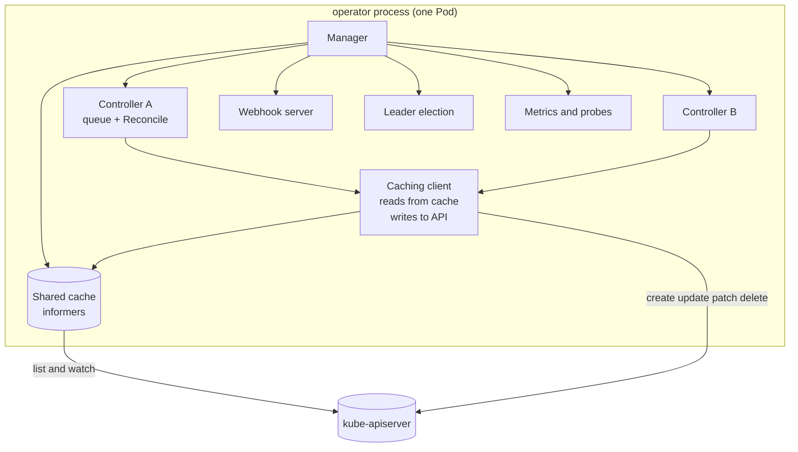

# 5.31 Operators in Go: controller-runtime and kubebuilder

| | |
|---|---|
| Level | Advanced |
| Priority tier | 2 |
| Lab venue | Go 1.22+, `controller-gen`, `setup-envtest`; a real cluster only for the final deploy step |
| Part | Part 5: Kubernetes |
| Status | Drafted. The code patterns below were compiled and exercised under envtest (see 5.32); cluster deployment steps are **untested** |

## Why this matters for AI infrastructure

GPU clusters are run by operators: the NVIDIA GPU Operator, Network Operator, Kueue, the Slurm and Ray operators, node-remediation controllers. Being able to write a small one, and to read the big ones (5.33), is what separates a platform engineer from someone who only applies YAML. This chapter teaches controller-runtime, the library underneath kubebuilder and Operator SDK, with the design rules that keep an operator safe on an expensive, shared fleet. 5.32 applies it to a concrete project.

## Prerequisites and outcomes

Needs 5.5 (API and etcd), 5.6 (controllers), 5.29 (CRDs and operators concepts) and 5.30 (Go and client-go). After this chapter you can:

- Explain what controller-runtime provides over raw client-go: manager, shared cache, caching client, controllers, builder, webhooks, leader election, metrics.
- Define an API type with kubebuilder markers, generate the CRD and deepcopy code, and add validation (OpenAPI schema, defaulting, CEL rules).
- Write an idempotent, level-triggered `Reconcile` with correct error, requeue and status handling.
- Choose watches, predicates, owner references, field indexes and finalizers appropriately.
- Test with a pure-function core plus envtest, and know what envtest cannot prove.
- Package RBAC, health probes, leader election and metrics for production.

## 1. Where controller-runtime sits



Layers, bottom to top:

- **client-go informers** list and watch resources and keep an in-memory store (5.30).
- **controller-runtime cache** wraps informers, started lazily per type when first used, shared by everything in the manager.
- **Client**: reads (`Get`, `List`) go to the cache by default; writes go straight to the API server. Reads can therefore be stale by a few milliseconds, which is why reconcilers must be idempotent and tolerate conflicts.
- **Controller**: a work queue of `reconcile.Request` (namespace/name keys only, never objects) plus N workers calling your `Reconcile`.
- **Manager**: owns the cache, clients, controllers, webhooks, health endpoints and leader election, and starts them in order.

Kubebuilder is a scaffolding CLI around this library (project layout, Makefile, markers, `config/` kustomize bases). Operator SDK builds on kubebuilder and adds OLM bundle tooling. You can write all of it by hand; scaffolding is convenience, not magic. The shape that matters is the same in all three.

### Tooling for building operators

If you have a real use case for a custom operator, community projects can speed you up. An experienced Go programmer who knows client-go can write an operator from scratch. Even so, every operator shares common parts, and experts generate that boilerplate with tools to save time. SDKs and frameworks help when their assumptions fit your project. They become a nuisance when they assume things that do not match your needs. These tools suit projects that define configuration with custom resources and implement behavior with custom controllers. The sections below cover a few projects, then walk through design and implementation with code snippets.

### Kubebuilder as an SDK for APIs

Kubebuilder is an SDK for building Kubernetes APIs. The name fits, but it works differently from what you might expect. You start with the Kubebuilder command-line tool, which generates boilerplate. It creates the source code, a Dockerfile, a Makefile and sample Kubernetes manifests, which are the files every project needs. That saves a lot of time at the start.

Kubebuilder also uses controller-runtime, a related library. The generated source already includes the imports and common implementations. The library handles the routine work of running a controller and talking to the API server. It sets up shared caches and clients for efficient API access. The cache lets your controller list and get objects without a new API request for each query. That eases load on the API server and speeds up reconciliation. Controller-runtime also triggers reconcile requests on events such as resource changes. It does this for the parent custom resource by default. You usually want triggers when the controller's child resources change too, and helper functions exist for that. In high-availability mode, controller-runtime can enable leader election, so only one controller is active at a time. It includes a package for webhooks, which are often used for admission control. It also provides structured logging and Prometheus metrics for observability.

Kubebuilder is a great choice if you are a Go programmer with Kubernetes experience. It is also a good choice if you are an experienced developer new to Go. It is for Go only, though, and it does not cater to other languages.

**Tip:** If you will build tools for Kubernetes, consider learning Go. You can use other languages, since Kubernetes offers a REST API. Official client libraries exist for Python, Java, C#, JavaScript and Haskell, along with many community libraries. Kubernetes itself is written in Go, though, and its Go ecosystem is rich and well supported.

Writing a CRD manifest by hand is hard. The OpenAPI v3 specification behind it is detailed and involved. The Kubebuilder CLI generates the files where you define the fields of your API types. You add the fields to struct definitions and tag them with markers, such as default values. Then a make target generates the CRD manifests. That is very handy.

Other make targets generate the RBAC and sample custom resource manifests. They install custom resources in your development cluster. They build and publish images for your operator. They can also run your controller locally against a cluster during development. These conveniences save tedious time, especially early in a project. For these reasons, Kubebuilder is the tool we recommend for building operators. Many projects have used it with success.

### Metacontroller: write only the logic

If you want to stay with a language other than Go, Metacontroller is another option. It takes a different approach from Kubebuilder. Metacontroller is a cluster add-on that abstracts away the Kubernetes API. Your job is to write the controller webhook that holds your controller's logic. Metacontroller calls this a lambda controller. The lambda controller decides what to do with the resources it cares about.

Metacontroller watches the resources under its management. When a change needs a decision, it makes an HTTP call to your lambda controller. Metacontroller uses its own custom resources to record your webhook's URL and the resources it manages. Once Metacontroller runs in your cluster, adding a controller takes two steps. You deploy your lambda controller webhook, and you add a Metacontroller custom resource, called a composite controller resource. Your endpoint accepts requests from Metacontroller. It parses the JSON payload, which holds the Kubernetes resource object, and returns any changes to send to the API.

Consider Metacontroller when you want to use several languages and expect to deploy many in-house operators. Engineers sometimes prototype with it and then build the final project with Kubebuilder once the design is settled. Its strength is speed after the add-on is installed. It does not help with creating CRDs, though. You must write those yourself. This is where Kubebuilder has a significant advantage.

### Operator Framework

The Operator Framework is a collection of open source tools that started at Red Hat. It is now an incubating project under the CNCF. It makes operators easier to build. Its Operator SDK offers much of what Kubebuilder offers for Go, including a CLI that generates boilerplate. It also uses controller-runtime to integrate with the Kubernetes API. Beyond Go, the Operator SDK lets you build operators with Helm or Ansible.

The framework also includes the Operator Lifecycle Manager, which is an operator for your operators. It gives you abstractions for installing and upgrading them. An operator hub lets users discover operators for the software they use. In the field, platform teams have rarely used these tools. Because Red Hat maintains them, they are more common among OpenShift users. OpenShift is Red Hat's Kubernetes-based offering.

## 2. Defining the API

An API type is a Go struct with JSON tags and **markers** (comments beginning with `+kubebuilder:`) read by `controller-gen`.

```go
// +kubebuilder:object:root=true
// +kubebuilder:subresource:status
// +kubebuilder:resource:scope=Cluster,shortName=ghp
// +kubebuilder:printcolumn:name="Action",type=string,JSONPath=`.spec.action`
type GPUHealthPolicy struct {
	metav1.TypeMeta   `json:",inline"`
	metav1.ObjectMeta `json:"metadata,omitempty"`
	Spec   GPUHealthPolicySpec   `json:"spec,omitempty"`
	Status GPUHealthPolicyStatus `json:"status,omitempty"`
}
```

Field-level markers give validation and defaults enforced by the API server, not by your code:

```go
// +kubebuilder:validation:Enum=Ignore;Cordon;CordonAndDrain
// +kubebuilder:default=Cordon
Action Action `json:"action,omitempty"`

// +kubebuilder:default="2m"
UnhealthyFor metav1.Duration `json:"unhealthyFor,omitempty"`
```

Cross-field rules use CEL (`x-kubernetes-validations`), which removes the need for a validating webhook in most cases:

```go
// +kubebuilder:validation:XValidation:rule="self.action != 'CordonAndDrain' || has(self.maxUnavailableNodes)",message="maxUnavailableNodes is required when action is CordonAndDrain"
type GPUHealthPolicySpec struct { /* ... */ }
```

Generate code and manifests:

```bash
go install sigs.k8s.io/controller-tools/cmd/controller-gen@v0.16.5
controller-gen object paths=./api/...                         # zz_generated.deepcopy.go
controller-gen crd paths=./api/... output:crd:dir=config/crd   # CRD YAML
controller-gen rbac:roleName=manager-role paths=./... output:rbac:dir=config/rbac
```

Design rules for the API (these are the ones that bite later):

- **Spec is desired state, status is observed state.** Enable the `status` subresource so users cannot overwrite status and controllers cannot bump `metadata.generation` by writing status.
- **Use `metav1.Condition` lists** (`Ready`, plus problem-specific types) with `observedGeneration`. Tooling such as `kubectl wait --for=condition=Ready` and GitOps health checks understand them.
- **Make every field optional with a safe default or a hard enum.** Adding required fields breaks existing objects.
- **Use `IntOrString` for budgets** (`2` or `25%`), as PodDisruptionBudget does.
- **Version from the start** (`v1alpha1`), keep a storage version, and plan conversion before you need it (5.29).
- **Do not put large or secret data in a CR.** Everything is stored in etcd and sent to every watcher.

In *Kubernetes Programming with Go* (`KPG`) Chapters 9 and 13, Philippe Martin contrasts the classic `k8s.io/code-generator` workflow (`// +k8s:deepcopy-gen=package`, `// +k8s:deepcopy-gen:interfaces=k8s.io/apimachinery/pkg/runtime.Object`, and `// +genclient` with `deepcopy-gen` and `client-gen`) against the modern **Kubebuilder** (`controller-runtime` + `controller-gen`) workflow:
1. **Scaffolding a Kubebuilder Project and API (`KPG` Chapter 13):**
   ```bash
   kubebuilder init --domain myid.dev --repo github.com/myid/myresource
   kubebuilder create api --group mygroup --version v1alpha1 --kind MyResource
   make manifests   # runs controller-gen to generate CRD & RBAC YAML in config/
   make run         # runs the Manager locally against your current kubeconfig
   make deploy IMG=quay.io/myid/myresource:v1alpha1-1
   ```
2. **Implementing Hub-and-Spoke Multi-Version Conversion in Go (`KPG` Chapter 13):** When introducing a second API version (`kubebuilder create api --group mygroup --version v1beta1 --kind MyResource`, e.g., renaming `spec.memory` in `v1alpha1` to `spec.memoryRequest` in `v1beta1`), one version is marked as the **Hub** by implementing `conversion.Hub`:
   ```go
   // api/v1alpha1/myresource_conversion.go
   func (*MyResource) Hub() {}
   ```
   and every **Spoke** version (`v1beta1`) implements `conversion.Convertible` (`ConvertTo(dstRaw conversion.Hub) error` and `ConvertFrom(srcRaw conversion.Hub) error`), wired into the Manager via `kubebuilder create webhook --group mygroup --version v1alpha1 --kind MyResource --conversion` (modeled in `convert_myresource_spoke_to_hub_and_back()` in `code/part05/controller_runtime_reconciler_sim.py`).
3. **Applying Child Resources with Server-Side Apply in `controller-runtime` (`KPG` Chapters 10 & 11):** Rather than fragile `Get -> Update` loops on child `Deployment`s, `KPG` Chapter 11 constructs the desired child `appsv1.Deployment` (setting `TypeMeta` `APIVersion`/`Kind` and `ownerReferences` via `ctrl.SetControllerReference`) and applies it in a single idempotent call:
   `err := r.Client.Patch(ctx, deploy, client.Apply, client.FieldOwner("myresource-controller"), client.ForceOwnership)`

### Choosing the data model for a Namespace operator

Designing an operator starts with the data model, much like designing a web application starts with its database schema. You often know what the spec needs before you write any code. As soon as you spot a problem to solve or a gap to fill, the desired-state fields begin to take shape.

Take the Namespace operator from earlier. It could create a Namespace with a LimitRange, a ResourceQuota, Roles and NetworkPolicies for a new app team. You might also bind a team lead to the `namespace-admin` Role right away, then hand off management of the Namespace to that person. That suggests an `adminUsername` field in the spec. Example 11-3 shows the resulting manifest.

```yaml
apiVersion: tenancy.acme.com/v1alpha1
kind: AcmeNamespace
metadata:
  name: team-x
spec:
  namespaceName: app-y
  adminUsername: sam
```

The name `team-x` is arbitrary. The `app-y` Namespace hosts a workload. The username `sam` comes from the company's identity provider, usually an Active Directory system or something similar.

Submitting Example 11-3 results in `sam` being added to the subjects of a RoleBinding to the `namespace-admin` Role. Example 11-4 shows what the controller creates.

```yaml
apiVersion: rbac.authorization.k8s.io/v1
kind: Role
metadata:
  name: namespace-admin
  namespace: app-y
rules:
- apiGroups:
  - "*"
  resources:
  - "*"
  verbs:
  - "*"
---
apiVersion: rbac.authorization.k8s.io/v1
kind: RoleBinding
metadata:
  name: namespace-admin
  namespace: app-y
roleRef:
  apiGroup: rbac.authorization.k8s.io
  kind: Role
  name: namespace-admin
subjects:
- kind: User
  name: sam
  namespace: app-y
```

The `adminUsername` from the AcmeNamespace manifest goes into the RoleBinding, bound to the `namespace-admin` Role.

Start from the behavior you want. Sam should be bound to the `namespace-admin` Role. The data you need is Sam's username and the Namespace name. Put those obvious pieces into your CRD spec first. Example 11-5 shows the Go type for the spec.

```go
// api/v1alpha1/acmenamespace_types.go
...
// AcmeNamespaceSpec defines the desired state of AcmeNamespace
type AcmeNamespaceSpec struct {
	// The name of the namespace
	NamespaceName string `json:"namespaceName"`
	// The username for the namespace admin
	AdminUsername string `json:"adminUsername"`
	...
}
```

Kubebuilder generates your CRD manifest and a sample AcmeNamespace manifest from this source. Your first data model will probably prove too thin once you write the controller. You will then find fields you need, so expect to add them.

Suppose you add a `deploymentTier` field. Example 11-6 shows a manifest that uses it.

```yaml
apiVersion: tenancy.acme.com/v1alpha1
kind: AcmeNamespace
metadata:
  name: team-x
spec:
  namespaceName: app-y
  adminUsername: sam
  deploymentTier: dev
```

That field prompts the controller to create a ResourceQuota. Example 11-7 shows the quota for the `dev` tier.

```yaml
apiVersion: v1
kind: ResourceQuota
metadata:
  name: dev
spec:
  hard:
    cpu: "5"
    memory: 10Gi
    pods: "10"
```

A `prod` tier gets a much larger default quota. Example 11-8 shows it.

```yaml
apiVersion: v1
kind: ResourceQuota
metadata:
  name: prod
spec:
  hard:
    cpu: "500"
    memory: 200Gi
    pods: "100"
```

One value now drives several defaults, so users state a single field.

## 3. The manager

```go
mgr, err := ctrl.NewManager(ctrl.GetConfigOrDie(), ctrl.Options{
	Scheme:                 scheme,
	Metrics:                metricsserver.Options{BindAddress: ":8080"},
	HealthProbeBindAddress: ":8081",
	LeaderElection:         leaderElect,
	LeaderElectionID:       "gpuhealth.platform.example.com",
})
```

- **Scheme**: register client-go types and your own (`AddToScheme`). A missing registration produces a "no kind is registered" error at first use.
- **Leader election** (a Lease object) lets you run 2 to 3 replicas for availability while only the leader reconciles. Without it, two replicas fight. Informer caches run on all replicas; only controllers wait for leadership.
- **Cache scope**: by default a cluster-wide cache of every type you read. In large clusters restrict with `cache.Options` (namespaces, label or field selectors per type) and consider `client.Options.Cache.DisableFor` for types you read once. Caching all Pods or Secrets in a 5,000-node cluster can cost gigabytes.
- **Metrics and probes**: controller-runtime exports reconcile counts, durations, queue depth and errors on the metrics endpoint with no code from you; add `healthz`/`readyz` checks for the Deployment probes.
- **Graceful shutdown**: `ctrl.SetupSignalHandler()` cancels the context on SIGTERM; runnables drain.

## 4. The reconcile function

```go
func (r *R) Reconcile(ctx context.Context, req ctrl.Request) (ctrl.Result, error)
```

The request contains only a name. You re-read the world each time. This is the level-triggered design from 5.6: you are told *something relevant changed*, not *what changed*, so one code path handles creation, update, resync after a crash and missed events.

A reliable structure, observe, decide, act, report:

```go
// Observe
var policy v1alpha1.GPUHealthPolicy
if err := r.Get(ctx, req.NamespacedName, &policy); err != nil {
	return ctrl.Result{}, client.IgnoreNotFound(err) // deleted: nothing to do
}
// ... list nodes, judge each with a pure function ...
// Decide
act, blocked := Plan(verdicts, budget)
// Act
for _, name := range act { r.cordon(ctx, &policy, byName[name]) }
// Report
r.updateStatus(ctx, &policy, ...)
```

Return values:

| Return | Meaning |
|---|---|
| `Result{}, nil` | Done. Wait for the next event. |
| `Result{}, err` | Failure. The request is re-queued with exponential backoff (rate-limited). Log once; do not also return a requeue. |
| `Result{RequeueAfter: d}, nil` | Look again after `d` with no error. Use for time-based decisions ("unhealthy for 2 minutes") and for polling something that emits no event. |
| `Result{Requeue: true}, nil` | Immediate re-queue (rate limited). Rarely the right tool; prefer `RequeueAfter` with a reason. |

Rules that prevent most operator incidents:

1. **Idempotent.** Running Reconcile twice must equal running it once. Check before creating; use `CreateOrUpdate`/`CreateOrPatch` helpers or server-side apply.
2. **No hidden state.** Do not remember "I cordoned that node last time" in a Go map; derive it from the cluster (an annotation, a status field). A restarted or newly elected replica must reach the same decisions. This is the same lesson as "the broker is the source of truth" in any control system.
3. **Separate the decision from the I/O.** A pure function `Judge(policy, node, now)` is testable in microseconds with an injected clock. Only a thin wrapper touches the API.
4. **Handle conflicts as normal.** `apierrors.IsConflict` means your cached copy was stale; return the error (it re-queues) or re-read and retry. Prefer **patches** (`client.MergeFrom`) over full updates so unrelated concurrent edits survive.
5. **Do not requeue on `NotFound` of the primary object.** It was deleted.
6. **Bound the blast radius.** Anything destructive (cordon, drain, delete, reboot) needs a budget, a dry-run mode, and a kill switch, because a bug or a bad signal will otherwise fire fleet-wide. 5.32 implements all three.
7. **Return errors, do not swallow them**, so backoff and metrics work. Collect several action errors and return one wrapped error, still performing the independent actions.

### Status updates

Write status through the status subresource, compute it from observation each time, and skip the write if nothing changed. Otherwise every reconcile modifies the object, produces a watch event, and triggers another reconcile.

```go
orig := p.DeepCopy()
p.Status.ObservedGeneration = p.Generation
meta.SetStatusCondition(&p.Status.Conditions, ready) // only changes LastTransitionTime when status flips
if equalStatus(orig.Status, p.Status) { return nil }
return r.Status().Patch(ctx, p, client.MergeFrom(orig))
```

`meta.SetStatusCondition` keeps `lastTransitionTime` stable unless the status value changes; hand-rolled condition code that stamps `now` on each pass causes endless churn.

### Gathering existing and desired state

A controller follows three steps. It gathers an accurate picture of the existing state. It examines the desired state. Then it takes actions to reconcile the existing state with the desired state.

It can gather existing state from three places. The first is the `status` of your custom resource. The second is other related resources in the cluster. The third is conditions outside the cluster, or in other systems. The `status` records observed state. Kubernetes already does this. The `status.phase` field on Pods shows whether they are `Running`, and on Namespaces whether they are `Active`.

Back to the Namespace operator. The controller gets notified about an AcmeNamespace and its spec. It cannot assume the resource is new, because it may have just been updated. Creating the children again would return an error from the API. If you add a `phase` field to the status, the controller can check it. An empty phase means a new resource, so the controller creates every child. Once all children exist, it sets the phase to `Created`. Later changes then show that the children already exist.

That approach has one flaw. It assumes the controller never fails. Suppose the controller creates the Namespace, then crashes before it creates the Role. On restart, the phase is still empty, so it tries to create the Namespace again and fails. The fix is to set `CreationInProgress` as the very first step. On restart, that phase tells the controller that the status alone cannot show the true state. It must then look at related resources.

When the status is not enough, query the API server, or preferably the local cache. Look for the child resources you expect. In the failure case, the Namespace exists, so the controller moves on. The Role does not exist, so it creates the Role. Build the controller to tolerate failure, and always assume failure will happen.

Some state lives outside the cluster. Cloud infrastructure controllers must query cloud provider APIs for the status of infrastructure. What counts as existing state depends on the purpose of the operator.

The desired state lives in the `spec`. In the Namespace operator, `namespaceName` sets the `metadata.name` of the Namespace. `adminUsername` sets the name in the RoleBinding's subject. These are direct mappings. Often the mapping is less direct. The `deploymentTier` field works that way. One value chooses many defaults in the controller logic.

Example 11-10 shows the controller creating the Role and RoleBinding after the Namespace.

```go
// controllers/acmenamespace_controller.go
...
role := &rbacv1.Role{
	ObjectMeta: metav1.ObjectMeta{
		Name:      "namespace-admin",
		Namespace: nsName,
	},
	Rules: []rbacv1.PolicyRule{
		{
			APIGroups: []string{"*"},
			Resources: []string{"*"},
			Verbs:     []string{"*"},
		},
	},
}
if err := r.Create(ctx, role); err != nil {
	log.Error(err, "unable to create namespace-admin role")
	return ctrl.Result{}, err
}
binding := &rbacv1.RoleBinding{
	ObjectMeta: metav1.ObjectMeta{
		Name:      "namespace-admin",
		Namespace: nsName,
	},
	RoleRef: rbacv1.RoleRef{
		APIGroup: "rbac.authorization.k8s.io",
		Kind:     "Role",
		Name:     "namespace-admin",
	},
	Subjects: []rbacv1.Subject{
		{
			Kind:      "User",
			Name:      adminUsername,
			Namespace: nsName,
		},
	},
}
if err := r.Create(ctx, binding); err != nil {
	log.Error(err, "unable to create namespace-admin role binding")
	return ctrl.Result{}, err
}
return ctrl.Result{}, nil
// ...
```

This code works the first time you create an AcmeNamespace. It breaks on any later reconcile, including a controller restart, unless you add the status logic above. The `phase` field tells the controller what already exists. Use it before you rely on the code in production.

## 5. Watches, predicates and mapping

`For(&Policy{})` watches the primary resource. Secondary resources need a way to name the primary:

- **`Owns(&Child{})`**: for objects the controller creates and sets an owner reference on; events map to the owner automatically.
- **`Watches(&Node{}, handler.EnqueueRequestsFromMapFunc(fn))`**: for objects you do not own. `fn` receives the object and returns the requests to enqueue. In 5.32 a Node event maps to every policy whose selector matches the node (or that previously cordoned it).
- **Predicates** filter events before they reach the queue: `GenerationChangedPredicate` skips status-only updates of the primary (stops the self-trigger loop above); a custom predicate can ignore Node heartbeat updates.

Node objects update their `status` every few seconds with heartbeat timestamps (lease-based heartbeats reduce but do not eliminate churn). A policy controller that reconciles on every Node update does pointless work at scale. The 5.32 predicate compares only what can change a decision: `spec.unschedulable`, labels, annotations and condition type/status/reason/transition time.

### Field indexes

`List` from the cache is a scan unless you register an index:

```go
mgr.GetFieldIndexer().IndexField(ctx, &corev1.Pod{}, "spec.nodeName",
	func(o client.Object) []string { return []string{o.(*corev1.Pod).Spec.NodeName} })
// later
r.List(ctx, &pods, client.MatchingFields{"spec.nodeName": node})
```

Cache indexes must be registered before the manager starts, and `MatchingFields` against the cache only works for registered fields (the API server supports few field selectors, so the cache is where this is practical).

## 6. Owner references and finalizers

**Owner references** give you garbage collection: when the owner is deleted, dependents with `ownerReferences` are deleted by the GC controller. Set them with `controllerutil.SetControllerReference(owner, child, scheme)`. Owners and dependents must be in the same namespace, or the owner cluster-scoped; a cluster-scoped object cannot be owned by a namespaced one.

**Finalizers** are for cleanup the GC cannot do: external resources, or changes made to objects you do not own. Pattern:

```go
if !policy.DeletionTimestamp.IsZero() {
	if controllerutil.ContainsFinalizer(&policy, FinalizerName) {
		if err := r.releaseAll(ctx, &policy); err != nil { return ctrl.Result{}, err } // retry until clean
		controllerutil.RemoveFinalizer(&policy, FinalizerName)
		if err := r.Update(ctx, &policy); err != nil { return ctrl.Result{}, err }
	}
	return ctrl.Result{}, nil
}
if controllerutil.AddFinalizer(&policy, FinalizerName) { _ = r.Update(ctx, &policy) }
```

Rules: add the finalizer **before** creating any side effect; make cleanup idempotent and retryable; never leave a finalizer that nothing will ever remove (an uninstalled operator then wedges deletion of every CR forever, a common upgrade failure; document the manual `kubectl patch ... finalizers=null` escape hatch). In 5.32 the finalizer ensures deleting a policy uncordons only the nodes that policy cordoned, verified by a test that also checks a human's manual cordon survives.

## 7. Ownership of foreign objects: annotate, do not assume

An operator that modifies a shared object (a Node, a Deployment someone else owns) must be able to tell *its* changes from everyone else's. A cordon placed by an engineer during maintenance must not be undone because a GPU condition recovered. Record provenance on the object (`platform.example.com/cordoned-by: policy-name`) and act only on objects carrying your mark. This is the same discipline as refusing to bulk-cancel orders you cannot prove you placed.

## 8. Events, logging and metrics

- **Events** (`Recorder.Eventf`) appear in `kubectl describe` and are the operator's user interface for "why did you do that". Emit one for every state-changing action and every refusal (budget exhausted, PDB blocked eviction). Events are rate-limited and best effort, not an audit log.
- **Logging**: use the context logger (`log.FromContext(ctx)`), structured key/value pairs, no per-reconcile INFO spam. Log at error level only for conditions needing attention.
- **Metrics**: register custom Prometheus collectors with `metrics.Registry` (for example `gpuhealth_cordoned_nodes`, `gpuhealth_budget_blocked_total`) and alert on them; see 5.19 for the Prometheus side.

## 9. RBAC

RBAC markers on the reconciler are turned into a `ClusterRole`:

```go
// +kubebuilder:rbac:groups="",resources=nodes,verbs=get;list;watch;patch
// +kubebuilder:rbac:groups="",resources=pods/eviction,verbs=create
```

Grant the least that works. The 5.32 operator can patch nodes but not delete them, create evictions but not delete pods directly, and never reads Secrets. Review the generated role: an operator with `*` on `*` is a cluster takeover waiting for a CVE (5.21).

## 10. Webhooks (brief)

Admission webhooks (defaulting, validating, conversion) are served by the same manager (`ctrl.NewWebhookManagedBy`). They need TLS certificates, normally from cert-manager, and a `failurePolicy` decision: `Fail` protects correctness but a down webhook blocks all writes of that type; `Ignore` does the opposite. Prefer **CEL validation rules and `ValidatingAdmissionPolicy`** for simple checks so the operator is not on the admission path. Never run a webhook for a resource that the webhook's own Pod depends on.

When you do write a custom mutating or validating webhook with `controller-runtime`, your webhook struct implements the `admission.Handler` interface (`Handle(ctx context.Context, req admission.Request) admission.Response`) and uses `admission.PatchResponseFromRaw` to compute the JSONPatch diff automatically between the incoming raw object (`req.Object.Raw`) and the mutated Go struct marshaled to JSON. As *Production Kubernetes* (Chapter 8) illustrates in its Cluster API `VSphereMachine` Infoblox IPAM webhook example (and the same pattern applies when mutating a `Pod` into `marshaledPod`), you should short-circuit immediately with `admission.Allowed(...)` if the target annotation is absent, and always check `req.DryRun` before mutating external state so `kubectl --dry-run=server` requests remain side-effect free (untested here):

```go
// +kubebuilder:webhook:path=/infoblox-ipam,mutating=true,failurePolicy=fail,groups="infrastructure.cluster.x-k8s.io",resources=vspheremachines,verbs=create,versions=v1alpha3,name=mutating.infoblox.ipam.vspheremachines.infrastructure.cluster.x-k8s.io

func (w *Webhook) Handle(
	ctx context.Context,
	req admission.Request) admission.Response {
	vm := &v1alpha3.VSphereMachine{}
	err := w.decoder.DecodeRaw(req.Object, vm)
	if err != nil {
		return admission.Errored(http.StatusBadRequest, err)
	}
	if _, ok := vm.Annotations["infoblox"]; !ok {
		return admission.Allowed("Nothing to do")
	}
	// If mutating external state (e.g., allocating an IP in Infoblox),
	// check req.DryRun first so dry-run requests do not cause side effects.
	if req.DryRun != nil && *req.DryRun {
		return admission.Allowed("dry run")
	}
	vm.Spec.VirtualMachineCloneSpec.Network.Devices[0].IPAddrs[0] = ipFromInfoblox
	marshaledVM, err := json.Marshal(vm)
	if err != nil {
		return admission.Errored(http.StatusInternalServerError, err)
	}
	return admission.PatchResponseFromRaw(req.Object.Raw, marshaledVM)
}
```

### Defaulting and validation with admission webhooks

Sometimes the OpenAPI schema in your CRD cannot express the defaults or checks you need. Then turn to validating and mutating admission webhooks. The Kubebuilder CLI has a `create webhook` command that generates the boilerplate, so you start faster.

A validation example: the Namespace operator could check `adminUsername` against your identity provider. The webhook confirms the username is valid before the object is stored. That prevents mistakes that would otherwise need a person to correct.

A defaulting example: set `deploymentTier` to `dev` when it is missing. `dev` is the most common and least expensive choice. Defaulting also keeps old manifests working. When you add a new field, the default fills the gap for resources that never set it.

Admission webhooks rarely appear in a prototype or a pre-alpha operator. They matter more when you refine the user experience for a stable release. Admission control is covered in 5.21.

### Plain HTTPS handler or controller-runtime

A webhook is just an HTTPS server that speaks the `AdmissionReview` protocol. You can write one from scratch in any language with TLS and JSON support. That gives you the most flexibility, and it fits whatever stack your team already runs. The cost is that you lose the high-level helpers. You build the patches, the responses, the error handling and the graceful shutdown yourself. Mature Kubernetes client libraries can take some of that work off your hands.

The book shows the manual approach with the AWS IAM Roles for Service Accounts webhook. It injects a projected volume into Pods. That volume holds a service account token that can authenticate to AWS services. The security side of that design is covered in 5.21. The core of the patch looks like this:

```go
type patchOperation struct {
	Op    string      `json:"op"`
	Path  string      `json:"path"`
	Value interface{} `json:"value,omitempty"`
}
volume := corev1.Volume{
	Name: m.volName,
	VolumeSource: corev1.VolumeSource{
		Projected: &corev1.ProjectedVolumeSource{
			Sources: []corev1.VolumeProjection{
				{
					ServiceAccountToken: &corev1.ServiceAccountTokenProjection{
						Audience:          audience,
						ExpirationSeconds: &m.Expiration,
						Path:              m.tokenName,
					},
				},
			},
		},
	},
}
patch := []patchOperation{
	{
		Op:    "add",
		Path:  "/spec/volumes/0",
		Value: volume,
	},
}
if pod.Spec.Volumes == nil {
	patch = []patchOperation{
		{
			Op:    "add",
			Path:  "/spec/volumes",
			Value: []corev1.Volume{
				volume,
			},
		},
	}
}
patchBytes, err := json.Marshal(patch)
```

The code defines a `patchOperation` struct that marshals to JSON. It builds the `Volume` with the service account token details. Then it wraps the volume in a patch. If the Pod has no volumes yet, it adds the whole `/spec/volumes` key instead. The real webhook also adds environment variables to the patch. The book leaves that out for brevity.

The handler then returns an `AdmissionResponse` with the patch, a `Patch` field and a JSON patch type. That is a lot of manual work, even with the Go libraries. The trade-off is clear. Maximum flexibility costs more domain knowledge, and more code to maintain.

`controller-runtime` removes much of that work. The Kubebuilder project builds on it and adds generators and helpers. For a webhook on a built-in type, such as a Pod or Deployment, the upstream examples are a good start. For a custom resource (CRD), Kubebuilder is usually the better base. A marker comment above the handler, such as `+kubebuilder:webhook`, generates the matching webhook manifest for you. The marker lists the path, the mutating flag, the failure policy, the group, the resource, the verbs and the versions.

The book's example is a controller-runtime mutating webhook for Cluster API `VSphereMachine` objects. It watches for these objects. When a configurable field is set, it asks Infoblox, an external IP address management system, for an address. It writes that address into the static IP field. Then it lets the request continue to the API server. The example has three reasons to use a custom webhook. The IP must exist before the object reaches the API server, the call goes to an external system with its own Go library, and the code stays small enough for newer developers to extend.

The book also notes a companion controller that runs in the cluster. That controller keeps the external state reconciled, so the system does not depend only on the state seen at admission time. If your webhook changes or depends on external state, plan for that controller too. It adds complexity, but it protects you from drift.

Two details from the handler matter for real code. First, `DecodeRaw` turns the raw request object into your typed Go struct. If decoding fails, return `admission.Errored` with a 400 status. Second, check the annotation early. If the webhook has nothing to do, return `admission.Allowed` at once, because the webhook is on the critical path. After you change the object, `admission.PatchResponseFromRaw` computes the JSON patch between the original and the changed object for you.

Deletes need care too. Some teams want a webhook to intercept `DELETE` requests, to clean up external state tied to a resource. That is possible. Think first about whether you fail open or closed, and about the risk of leaving external state out of step if the webhook is skipped. A finalizer with a custom controller is safer, because it guarantees the cleanup runs. Section 6 covers finalizers.

`controller-runtime` gives you a strong base, and it lets you focus on the logic. The trade-off is that the admission logic hides inside controller code. End users may see surprising results that they cannot trace easily. Document the webhook's behavior for them. If your rules do not need a full program, a policy engine such as Gatekeeper (5.21) may fit better.

## 11. Testing strategy

Test at three layers:

1. **Pure functions** (table tests): `Judge`, `Budget`, `Plan` take values and an injected time. No cluster. Fast and the place to put edge cases (invalid budget fails safe to zero, absent condition is treated as healthy, Unknown is neither healthy nor unhealthy).
2. **envtest**: starts a real kube-apiserver and etcd binaries (no kubelet, no scheduler, no controllers like Deployment or GC, no Docker). Install CRDs, run your manager in the test process, create objects, poll with an `eventually` helper. This verifies real API behaviour: CRD defaulting and CEL validation, patch semantics, finalizer flow, watches and mapping.
3. **A real cluster** (kind, or GKE) for integration: image, RBAC, leader election, webhook TLS, behaviour on real nodes.

```bash
go install sigs.k8s.io/controller-runtime/tools/setup-envtest@release-0.19
export KUBEBUILDER_ASSETS="$(setup-envtest use 1.31.0 -p path)"
go test -race -count=1 ./...
```

What envtest **cannot** tell you: that pods actually reschedule, that PDBs are evaluated against real disruption controllers, kubelet behaviour, device plugin behaviour, or timing under load. Because there is no node controller, tests must set Node conditions themselves (the 5.32 suite does this with back-dated transition times, avoiding sleeps for the "unhealthy for two minutes" rule). Say so in the chapter or README of any operator: tests prove the decision and API logic, not the cluster outcome.

Practical test hygiene: use unique object names per test (envtest state is shared), prefer `eventually` polling over fixed sleeps, assert absence with a bounded wait ("must not cordon") and name the bound, and run with `-race`.

## 12. Production hardening checklist

| Area | Practice |
|---|---|
| Availability | 2 or 3 replicas, leader election, PodDisruptionBudget, anti-affinity, PriorityClass above workloads |
| Safety | Dry-run mode, rate and count budgets, per-object ownership marks, a documented kill switch (scale to zero, or `action: Ignore`) |
| Resources | Requests/limits; restrict cache scope; watch memory on large clusters |
| Security | Non-root, read-only root filesystem, dropped capabilities, least-privilege RBAC, signed image (5.22) |
| Observability | Metrics, events, conditions, structured logs, an alert if the reconcile error rate or queue depth rises |
| Upgrades | CRD upgrade path (CRDs are not upgraded by Helm `crds/` on `helm upgrade`), conversion webhooks if versions change, finalizer removal path on uninstall |
| Failure modes | Behaviour when the API server is slow, when the cache is not yet synced, when the signal source is wrong (a bad health exporter that marks every node unhealthy should hit the budget, not drain the fleet) |

## 13. Common mistakes

- Reading state from a Go field instead of the cluster, then diverging after a restart.
- Updating the whole object instead of patching, overwriting concurrent changes.
- Status writes that always change something (timestamps), causing hot reconcile loops.
- Reconciling on every Node heartbeat; missing predicates.
- Returning both an error and `RequeueAfter` (the result is ignored when err is non-nil).
- No finalizer cleanup path, or a finalizer added after side effects.
- Treating `Get` from the cache as authoritative right after a write (read-your-writes is not guaranteed; use the returned object or `APIReader` when you must).
- Letting one failure abort the others: continue independent actions and aggregate errors.
- Missing RBAC for a subresource (`pods/eviction`, `status`, `finalizers`), found only in-cluster; envtest runs as admin and will not reveal it. Test RBAC separately (kind, or `kubectl auth can-i --as=system:serviceaccount:...`).

## 14. Lab

First, run the self-checking Python lab (`code/part05/controller_runtime_reconciler_sim_lab.py`) locally. It verifies the `controller-runtime` `GenerationChangedPredicate` and custom Node heartbeat predicate filter (`evaluate_watch_predicates`, `KPG` Ch. 10), the `meta.SetStatusCondition` transition-time preservation and no-op status write guard (`set_status_condition_and_check_noop`, `KPG` Ch. 11), and the Kubebuilder Hub-and-Spoke `ConvertTo`/`ConvertFrom` multi-version converter (`convert_myresource_spoke_to_hub_and_back`, `KPG` Ch. 13).

```bash
python3 code/part05/controller_runtime_reconciler_sim_lab.py
```

Next, with `controller-gen`, `setup-envtest`, and a `kind` cluster (the cluster deployment steps below are `untested here`), work through these exercises:

1. Scaffold or copy the 5.32 project, run `controller-gen`, run the envtest suite with `-race`.
2. Break it on purpose: remove the node-event predicate and observe reconcile counts via the metrics endpoint; remove the status no-op check and observe the hot loop.
3. Add a custom Prometheus counter for budget-blocked decisions and expose it.
4. Add an `Owns` relationship by having the policy create a ConfigMap report, and verify garbage collection in a kind cluster (GC does not run under envtest).
5. Deploy to kind with `kubectl apply -k config/`, check `kubectl auth can-i` for each verb, then kill the leader Pod and watch the other take over.

## 15. Interview angles

- Walk me through one reconcile. Why does Reconcile receive only a name?
- Why are reads from the manager's client possibly stale, and how does your design cope?
- When do you use RequeueAfter, a returned error, or neither?
- How do you stop a status update from triggering another reconcile?
- What goes wrong if two replicas run without leader election?
- How do finalizers work, and how can they wedge an uninstall?
- How would you make a destructive remediation controller safe on a 1,000-node GPU cluster?
- What can envtest verify and what can it not?
- Operator versus Helm chart versus Argo CD app: when is the operator justified?

## Exercises

1. **`controller-runtime` Architecture (`Manager`, Shared Cache, Caching `Client`, `Controller`, `Webhook Server`, and Leader Election, `KPG` Chapter 10):** Trace the Section 1 architecture diagram, explaining which `client.Client` operations read from the local Informer cache vs write directly to `kube-apiserver`, why reads can be slightly stale (and when `mgr.GetAPIReader()` or `client.DisableFor` is needed), and how `LeaderElection` coordinates 2–3 HA operator replicas.
2. **Defining APIs with `kubebuilder` / `controller-gen` Markers and Hub-and-Spoke Multi-Version Conversion (`KPG` Chapters 9 & 13):** Using `convert_myresource_spoke_to_hub_and_back()` in `code/part05/controller_runtime_reconciler_sim.py`, write the `+kubebuilder:object:root=true`, `+kubebuilder:subresource:status`, `+kubebuilder:validation:Enum`, `+kubebuilder:default`, and `+kubebuilder:validation:XValidation` markers for `GPUHealthPolicy`, and implement `Hub()` on `v1alpha1` plus `ConvertTo`/`ConvertFrom` on `v1beta1`.
3. **Writing an Idempotent, Level-Triggered `Reconcile` Loop and Avoiding `/status` Self-Trigger Hot Loops (`KPG` Chapters 10 & 11):** Using `set_status_condition_and_check_noop()` in `code/part05/controller_runtime_reconciler_sim.py`, trace the `Observe -> Decide -> Act -> Report` structure of `Reconcile(ctx, req)`, compare the four return patterns (`Result{}, nil`, `Result{}, err`, `Result{RequeueAfter: d}, nil`, and `Result{Requeue: true}, nil`), and explain how `meta.SetStatusCondition` + `r.Status().Patch(ctx, p, client.MergeFrom(orig))` prevents infinite status-update loops.
4. **Controller Builder Watches (`For`, `Owns`, `Watches`), `Predicates`, and Cache `FieldIndexer` (`KPG` Chapter 10):** Using `evaluate_watch_predicates()` in `code/part05/controller_runtime_reconciler_sim.py`, compare `For(&Policy{})`, `Owns(&Child{})`, and `Watches(&corev1.Node{}, handler.EnqueueRequestsFromMapFunc(fn))`, explain how `GenerationChangedPredicate` and a custom Node predicate filter out status/heartbeat noise, and show how `mgr.GetFieldIndexer().IndexField` enables indexed `client.MatchingFields{"spec.nodeName": node}` queries.
5. **Finalizers, Foreign-Object Provenance Annotations (`cordoned-by`), RBAC Markers, and Mutating/Validating Webhooks (`PK` Chapter 8 & `KPG` Chapter 13):** Trace the `controllerutil.AddFinalizer` / `RemoveFinalizer` pattern in Section 6, explain why an operator modifying shared `Node` objects must stamp `platform.example.com/cordoned-by: <policy>` before acting, and trace the `VSphereMachine` mutating webhook (`Handle`, `req.DryRun`, `admission.PatchResponseFromRaw`) in Section 10.
6. **Three-Layer Operator Testing (`Pure Functions` -> `envtest` -> `Kind/GKE`) and Production Hardening (`KPG` Chapter 12):** Contrast what pure-function unit tests, `envtest` (`setup-envtest use 1.31.0`, real `kube-apiserver` + `etcd` without `kubelet`/controllers/GC), and live `kind` e2e tests each verify, and explain why destructive remediation operators require budgets, dry-run mode, and kill switches.

## Checkpoint questions (20)

<details>
<summary>1. In `controller-runtime`, which operations on `mgr.GetClient()` hit the local in-memory Informer cache, and which operations hit `kube-apiserver` over the network (`KPG` Chapter 10)?</summary>

- **Reads (`Get`, `List`):** Hit the **local in-memory Informer cache** (zero network round-trips, fast and scalable, though potentially a few milliseconds behind the latest write in `etcd`).
- **Writes (`Create`, `Update`, `Patch`, `Delete`, `DeleteAllOf`, and `Status().Update`/`Patch`):** Go **directly to `kube-apiserver`** over HTTPS.
*(If a rare startup or migration task requires a strongly consistent direct read bypassing the cache, use `mgr.GetAPIReader()` or configure `Client: client.Options{Cache: &client.CacheOptions{DisableFor: []client.Object{...}}}`.)*
</details>

<details>
<summary>2. Why does `Reconcile(ctx context.Context, req ctrl.Request)` receive only a `NamespacedName` (`namespace/name` string pair) rather than the event payload or diff?</summary>

Because Kubernetes controllers are **level-triggered, not edge-triggered**:
1. Multiple rapid events (`Create`, three `Update`s, and a child `Pod` status change) for the same `NamespacedName` are **coalesced (deduplicated)** in the WorkQueue into a single `req`.
2. By the time a worker pops `req` from the queue, an edge event payload captured 200ms earlier would already be stale.
3. Re-reading current state from the local cache (`r.Get(ctx, req.NamespacedName, &obj)`) and reconciling desired vs actual state guarantees that **one single code path** handles `Create`, `Update`, controller restarts, and missed events identically.
</details>

<details>
<summary>3. Why should the top of `Reconcile` return `ctrl.Result{}, client.IgnoreNotFound(err)` when `r.Get(ctx, req.NamespacedName, &policy)` fails?</summary>

When a user deletes a Custom Resource (that has no remaining finalizers), `kube-apiserver` removes it from `etcd` and emits a `DELETED` watch event, which enqueues `req.NamespacedName` one final time.
When `Reconcile` runs for that deletion event, `r.Get(...)` returns a **`404 NotFound` (`apierrors.IsNotFound(err) == true`)**:
- If you returned that `NotFound` error raw, the WorkQueue would treat it as a failure and **re-queue the deleted object forever with exponential backoff**.
- **`client.IgnoreNotFound(err)`** returns `nil` if `err` is `NotFound` (stopping reconciliation cleanly) while passing through any real error (like a cache or RBAC failure).
</details>

<details>
<summary>4. Compare the four return signatures of `Reconcile` (`Result{}, nil`, `Result{}, err`, `Result{RequeueAfter: d}, nil`, and `Result{Requeue: true}, nil`), and explain why you should never return both `RequeueAfter` and a non-nil `err`.</summary>

1. **`ctrl.Result{}, nil`:** Reconcile succeeded; `Forget(req)` resets rate-limit backoff and waits for the next watch event.
2. **`ctrl.Result{}, err`:** Reconcile failed; `controller-runtime` logs the error, increments `controller_runtime_reconcile_errors_total`, and re-queues `req` using the WorkQueue's **exponential backoff rate limiter**.
3. **`ctrl.Result{RequeueAfter: 2 * time.Minute}, nil`:** Reconcile succeeded for now, and schedules a timer-based re-check in exactly 2 minutes (e.g., waiting for an `unhealthyFor: 2m` grace window to elapse).
4. **`ctrl.Result{Requeue: true}, nil`:** Re-queues `req` immediately through the rate limiter without recording an error metric.
*(Note: In `controller-runtime`, whenever `err != nil`, the `Result` struct is ignored in favor of exponential error backoff—so never return both `RequeueAfter` and `err`.)*
</details>

<details>
<summary>5. What three mistakes cause a controller's `/status` update to trigger an infinite self-reconcile hot loop, and how do you prevent all three?</summary>

1. **Writing `.status` through `r.Update(ctx, obj)` instead of `r.Status().Patch(ctx, obj, ...)`** (or forgetting `+kubebuilder:subresource:status` on the CRD), which increments `metadata.generation` on every status write.
2. **Stamping `LastTransitionTime: metav1.Now()` unconditionally on every reconcile pass** even when the condition's `Status` (`True`/`False`/`Unknown`) did not change. Always use **`meta.SetStatusCondition(&p.Status.Conditions, cond)`** (which only updates `LastTransitionTime` when `.Status` actually flips) and **skip the `/status` write completely if `orig.Status` equals the newly computed `p.Status`**.
3. **Not filtering status-only updates on the primary resource watch:** Attach **`builder.WithPredicates(predicate.GenerationChangedPredicate{})`** to `For(&v1alpha1.GPUHealthPolicy{})` so changes to `.status` (which increment `resourceVersion` but NOT `generation`) do not re-enqueue the primary resource.
</details>

<details>
<summary>6. In `controller-runtime`'s `builder.ControllerManagedBy(mgr)`, what is the difference between `For(...)`, `Owns(...)`, and `Watches(...)` (`KPG` Chapter 10)?</summary>

- **`For(&v1alpha1.MyResource{})`:** Declares the **primary resource** reconciled by this controller; uses `handler.EnqueueRequestForObject` so an event on `MyResource/ns/foo` enqueues `Request{NamespacedName: "ns/foo"}`.
- **`Owns(&appsv1.Deployment{})`:** Declares a **secondary child resource** created by this controller with an `ownerReference` (`controller: true` set via `ctrl.SetControllerReference`); uses `handler.EnqueueRequestForOwner` so an event on child `Deployment/ns/foo-deploy` automatically looks up its `ownerReferences` and enqueues the parent `Request{NamespacedName: "ns/foo"}`.
- **`Watches(&corev1.Node{}, handler.EnqueueRequestsFromMapFunc(mapFn), builder.WithPredicates(nodePred))`:** Declares an **unowned or cross-scope secondary resource**; invokes your custom `mapFn(ctx, obj) []reconcile.Request` to translate an event on `Node/gpu-01` into the list of `GPUHealthPolicy` requests that care about that node.
</details>

<details>
<summary>7. Why is a custom `predicate.Predicate` mandatory when watching `corev1.Node` objects in a large cluster?</summary>

Every `kubelet` sends periodic status heartbeats and resource capacity updates on its `Node` object. In a 1,000-node cluster, watching `corev1.Node` without a predicate triggers hundreds of meaningless `UpdateEvent`s per minute even when no node health condition, label, taint, or `spec.unschedulable` flag changed.
Writing a custom `predicate.Funcs{ UpdateFunc: func(e event.UpdateEvent) bool { ... } }` that compares **only** `spec.unschedulable`, `labels`, `annotations`, and `status.conditions` `(Type, Status, Reason, LastTransitionTime)` drops 99%+ of heartbeat noise before it ever touches the WorkQueue.
</details>

<details>
<summary>8. How does `mgr.GetFieldIndexer().IndexField(...)` speed up `r.List(...)` queries, and when must it be registered?</summary>

By default, the local Informer cache only indexes objects by `namespace` and `namespace/name`. If your reconciler needs to list all `Pod`s scheduled on `nodeName == "gpu-01"`, an unindexed `r.List` would have to scan every cached Pod in the cluster (`O(N)`).
Registering a **Field Index** **before `mgr.Start(ctx)` is called**:
```go
mgr.GetFieldIndexer().IndexField(ctx, &corev1.Pod{}, "spec.nodeName", func(o client.Object) []string {
    return []string{o.(*corev1.Pod).Spec.NodeName}
})
```
builds an in-memory hash index inside the cache so `r.List(ctx, &pods, client.MatchingFields{"spec.nodeName": nodeName})` executes in **`O(1)` lookup time**.
</details>

<details>
<summary>9. Why must an operator NEVER store operational state (such as `alreadyCordonedNodes map[string]bool`) solely in an in-memory Go variable?</summary>

If the operator Pod restarts, crashes, upgrades, or loses leadership to another replica, any state stored only in a Go struct/map vanishes. Worse, if a human uncordons/cordons a node while the operator is restarting, an in-memory map diverges from cluster reality.
**Rule:** The Kubernetes API (`etcd`) is the single source of truth—always persist operational state as **annotations/labels on the target object (`platform.example.com/cordoned-by: policy-a`) or fields in the CR's `.status`**, and reconstruct all decisions from cluster state on every `Reconcile`.
</details>

<details>
<summary>10. Why must a remediation controller stamp a provenance annotation (`platform.example.com/cordoned-by: <policy>`) on shared `Node` objects before cordoning or uncordoning them?</summary>

In a production GPU cluster, nodes can be cordoned by multiple actors: a human SRE performing rack maintenance (`kubectl cordon gpu-07`), the NVIDIA GPU Operator upgrading a driver, or your `GPUHealthPolicy` operator reacting to an XID error.
If your operator uncordons **any** cordoned node as soon as its GPU health condition reports `Healthy`, your operator will **accidentally uncordon `gpu-07` while a human technician is replacing a power supply on it**.
By stamping `platform.example.com/cordoned-by: <policy-name>` when it cordons a node—and refusing to auto-uncordon or release on finalizer cleanup any node that lacks that exact annotation—the operator guarantees it never clobbers human or third-party cordons.
</details>

<details>
<summary>11. Why must you add a Finalizer (`controllerutil.AddFinalizer`) and update the CR *before* performing any external or foreign-object side effects?</summary>

Suppose your reconciler first cordons 4 nodes (or provisions an external cloud resource) and *then* tries to call `AddFinalizer` + `r.Update(ctx, &policy)`. If the process crashes or the `Update` call fails right after the side effect, the CR in `etcd` has **no finalizer**—so if a user deletes the CR, `kube-apiserver` deletes it immediately from `etcd` without ever calling your cleanup logic, leaking the cordoned nodes or cloud resources forever.
Adding and persisting the finalizer **first** guarantees that `kube-apiserver` cannot remove the CR until your cleanup code has run and removed the finalizer.
</details>

<details>
<summary>12. In *Kubernetes Programming with Go* Chapters 10 & 11, how do you apply a child `Deployment` using Server-Side Apply (`client.Apply`) in `controller-runtime`?</summary>

Construct the desired `appsv1.Deployment` struct (making sure **`APIVersion: "apps/v1"` and `Kind: "Deployment"` are explicitly set on `TypeMeta`**, along with `ctrl.SetControllerReference(owner, deploy, r.Scheme)`), and call **`r.Patch`** with `client.Apply` and `client.FieldOwner`:
```go
deploy.SetGroupVersionKind(appsv1.SchemeGroupVersion.WithKind("Deployment"))
err := r.Client.Patch(ctx, deploy, client.Apply, client.FieldOwner("myresource-controller"), client.ForceOwnership)
```
This single idempotent call creates the `Deployment` if it doesn't exist, or patches only the fields owned by `"myresource-controller"` if it already exists.
</details>

<details>
<summary>13. In `KPG` Chapter 10, how do you emit a Kubernetes `Event` from inside `Reconcile`, and what are the four parameters to `Recorder.Event` / `Eventf`?</summary>

Obtain an `record.EventRecorder` from the Manager at setup time (`mgr.GetEventRecorderFor("gpuhealth-controller")`) and call:
```go
r.Recorder.Eventf(&policy, corev1.EventTypeWarning, "BudgetExhausted",
    "Refused to cordon node %s: maxUnavailableNodes (%d) reached", node.Name, budget)
```
The four arguments are:
1. **`object` (`runtime.Object`):** The CR or Node the event is attached to (appears at the bottom of `kubectl describe`).
2. **`eventtype` (`string`):** Either **`corev1.EventTypeNormal`** (`"Normal"`) or **`corev1.EventTypeWarning`** (`"Warning"`).
3. **`reason` (`string`):** Short machine-readable `UpperCamelCase` token (`"NodeCordoned"`, `"BudgetExhausted"`).
4. **`messageFmt` + `args`:** Human-readable explanation.
</details>

<details>
<summary>14. In `KPG` Chapter 13, how do `Hub()` and `ConvertTo` / `ConvertFrom` implement multi-version CRD conversion in Kubebuilder?</summary>

When a CRD has multiple versions (e.g., `v1alpha1` with `spec.memory` and `v1beta1` with `spec.memoryRequest`):
1. Designate **one** version (typically the current storage version) as the **Hub** by adding a one-line marker method in `api/v1beta1/myresource_conversion.go`:
   `func (*MyResource) Hub() {}`
2. Every other version (**Spoke**, here `v1alpha1`) implements the `conversion.Convertible` interface in `api/v1alpha1/myresource_conversion.go`:
   - **`func (src *MyResource) ConvertTo(dstRaw conversion.Hub) error`:** Copies `src.Spec.Memory` into `dst.(*v1beta1.MyResource).Spec.MemoryRequest` (plus `ObjectMeta` and `Status`).
   - **`func (dst *MyResource) ConvertFrom(srcRaw conversion.Hub) error`:** Copies `src.(*v1beta1.MyResource).Spec.MemoryRequest` back into `dst.Spec.Memory`.
3. Register the webhook on the Manager via `(&mygroupv1beta1.MyResource{}).SetupWebhookWithManager(mgr)`.
</details>

<details>
<summary>15. In *Production Kubernetes* Chapter 8 and Section 10, why must a mutating or validating webhook check `req.DryRun` before calling an external API (like allocating an IP in Infoblox)?</summary>

When a user or GitOps pipeline runs `kubectl apply --dry-run=server` (or `kubectl diff`, or HPA/admission dry-run evaluation), `kube-apiserver` invokes all mutating and validating webhooks with **`*req.DryRun == true`** (`sideEffects: NoneOnDryRun`).
If your webhook allocates a real IP address in Infoblox or provisions an external cloud resource without checking `if req.DryRun != nil && *req.DryRun`, every `kubectl diff` or server-side dry-run will leak real external IP addresses and mutate production state.
</details>

<details>
<summary>16. What are the three layers of Operator Testing in Section 11, and what does `envtest` (`KPG` Chapter 12) run vs. NOT run?</summary>

- **Layer 1 — Pure-Function Unit Tests (`go test`):** Test decision logic (`Judge`, `Budget`, `Plan`) in microseconds with injected clocks and zero Kubernetes processes.
- **Layer 2 — `envtest` Integration Tests (`sigs.k8s.io/controller-runtime/pkg/envtest`):** Spawns **real local `kube-apiserver` and `etcd` binaries** (`setup-envtest use 1.31.0`).
  - **What `envtest` DOES test:** Real CRD installation, OpenAPI & CEL validation (`+kubebuilder:validation:XValidation`), schema defaulting, `/status` subresource isolation, optimistic concurrency `resourceVersion` conflicts, watches/informers, field indexes, and finalizers.
  - **What `envtest` DOES NOT run:** There is **no `kubelet`**, **no `kube-scheduler`**, **no `kube-controller-manager`** (so Deployments don't create ReplicaSets/Pods, `ownerReferences` Garbage Collection does not run, and Node conditions are not updated unless your test sets them), and **no container runtime**.
- **Layer 3 — Real Cluster E2E (`kind` / GKE):** Tests container packaging, least-privilege ServiceAccount RBAC, leader election failover, garbage collection, PDB eviction against live pods, and webhook TLS (`cert-manager`).
</details>

<details>
<summary>17. Why will `envtest` NEVER catch a missing `+kubebuilder:rbac` marker in your operator, and how do you test RBAC before production?</summary>

By default, the `rest.Config` returned by `testEnv.Start()` in `envtest` authenticates as a **cluster-admin user** with unrestricted permissions on every resource and subresource. Therefore, if you forgot to add `// +kubebuilder:rbac:groups="",resources=pods/eviction,verbs=create` or `resources=gpuhealthpolicies/status,verbs=get;update;patch`, `envtest` passes 100% while the operator fails with `403 Forbidden` the moment it deploys in a cluster.
**How to test RBAC:** Either create a restricted `envtest` user bound only to the generated `config/rbac/role.yaml` `ClusterRole`, or deploy to `kind` and run `kubectl auth can-i --as=system:serviceaccount:<ns>:<sa> create pods/eviction`.
</details>

<details>
<summary>18. Why does unrestricted cluster-wide caching in `controller-runtime` cause OOM kills on 5,000-node clusters, and how do you restrict `cache.Options`?</summary>

In `controller-runtime`, the first time your reconciler calls `r.Get` or `r.List` on a type (e.g., `&corev1.Pod{}` or `&corev1.Secret{}`), the shared `Cache` automatically starts a **cluster-wide Informer** watching and caching **every object of that kind across all namespaces**. In a 5,000-node cluster with 150,000 Pods and 50,000 Secrets, that cache easily consumes **4–10+ GiB of RAM**.
**Three ways to bound cache memory in `ctrl.Options`:**
1. **`cache.Options{ByObject: map[client.Object]cache.ByObject{...}}`:** Restrict the watch for `Pod`s or `Secret`s to specific namespaces or label/field selectors, or attach a `Transform` function (`cache.TransformStripManagedFields()`) to drop bulky fields before caching.
2. **`client.Options{Cache: &client.CacheOptions{DisableFor: []client.Object{&corev1.Secret{}}}}`:** Bypass the Informer cache completely for large types that are only read occasionally.
</details>

<details>
<summary>19. Why is "Read-Your-Own-Writes" NOT guaranteed immediately after calling `r.Create` or `r.Patch` on `mgr.GetClient()`?</summary>

When your reconciler calls `r.Patch(ctx, node, ...)` (which writes directly to `kube-apiserver`), the write succeeds in `etcd` immediately, **but the watch event from `kube-apiserver` takes a few milliseconds to travel back through the `Reflector` and `DeltaFIFO` into your local Informer cache**.
If the very next line of code in the same `Reconcile` pass calls `r.Get(ctx, key, &node)` or `r.List(ctx, &nodeList)` from the cache, the cache may still return the **pre-patch state**. Instead of re-reading from the cache immediately after a write within the same pass, use the updated struct populated in-place by `r.Patch(ctx, node, ...)` or return and let the watch event trigger the next pass.
</details>

<details>
<summary>20. What three safety mechanisms are mandatory in any Operator that performs destructive fleet actions (such as cordoning, draining, or rebooting GPU nodes)?</summary>

1. **Disruption Budget (`maxUnavailableNodes: "5%"` or `2`):** Hard ceiling on how many nodes in the pool may be cordoned/draining simultaneously. If a buggy health exporter or bad driver update suddenly marks all 500 GPU nodes as `Unhealthy` at once, the operator cordons at most `maxUnavailableNodes`, emits a `BudgetExhausted` Warning event + Prometheus metric, and **refuses to take down the rest of the fleet**.
2. **Dry-Run / Audit Mode (`action: Ignore` or `dryRun: true`):** Computes verdicts, updates `.status`, and emits Events/metrics showing what *would* have been cordoned without touching any node during initial rollout.
3. **Provenance Ownership Marks & Kill Switch:** Only modifies nodes carrying `platform.example.com/cordoned-by: <policy>`, and stops immediately if the policy is switched to `Ignore` or the operator Deployment is scaled to `0`.
</details>

## Sources and review notes

- **Sources read in full:**
  - `kubernetes-programming-with-go-programming-kubernetes-clients-and-operators-using-go-and-the-kuberne` — Philippe Martin / Stefan Schimanski & Michael Hausenblas, *Kubernetes Programming with Go* / *Programming Kubernetes*, **Chapter 9: Working with Custom Resources** (`unstructured.Unstructured`, `DefaultUnstructuredConverter`, `+k8s:deepcopy-gen`, `+genclient`), **Chapter 10: Writing Operators with the Controller-Runtime Library** (`Manager`, caching `Client`, `Patch` with `client.Apply` & `client.FieldOwner`, `ControllerManagedBy` `For`/`Owns`/`Watches`, `predicate.Funcs` & `GenerationChangedPredicate`, `log.FromContext`, and `EventRecorder`), **Chapter 11: Writing the Reconcile Loop** (`Reconcile`, `applyDeployment` with Server-Side Apply, `computeStatus`), **Chapter 12: Testing the Reconcile Loop** (`setup-envtest`, `envtest.Environment`, Ginkgo/Gomega `Eventually`), and **Chapter 13: Creating an Operator with Kubebuilder** (`kubebuilder init`, `kubebuilder create api`, `+kubebuilder:rbac`, multi-version conversion `Hub()` & `ConvertTo`/`ConvertFrom`, and `kubebuilder create webhook --conversion`).
  - `production-kubernetes` — Josh Rosso, Rich Lander, Alexander Brand & John Harris, *Production Kubernetes*, **Chapter 8: Admission Control** (read in full: `controller-runtime` mutating webhook `Handle`, `req.DryRun`, and `admission.PatchResponseFromRaw`) and **Chapter 11: Building Platform Services** (Kubebuilder `AcmeNamespace` operator).
- **Run here:** `python3 code/part05/controller_runtime_reconciler_sim_lab.py` (3 passed, 0 failed); Go controller patterns compiled and tested under `envtest` (`controller-runtime v0.19`, `k8s 0.31`, `controller-gen 0.16.5`) with `-race` (see Chapter 5.32).
- **Explicitly labelled inferences:** The `evaluate_watch_predicates`, `set_status_condition_and_check_noop`, and `convert_myresource_spoke_to_hub_and_back` models in `code/part05/controller_runtime_reconciler_sim.py` and the `GPUHealthPolicy` reconciler snippets are the author's constructions synthesizing `KPG` Chapters 9–13 and `PK` Chapters 8 & 11 (plus original study items 21, 22, 23, 24, 25, 26, 27, 28, 29, and 30).
- **Not verified on live hardware:** Live cluster deployments (`controller-gen v0.16.5`, `setup-envtest 1.31.0`, `release-0.19`, `:8080` metrics / `:8081` health probes, `unhealthyFor: 2m`, `5,000`-node cache sizing) are marked (`untested here`) where not executed by `controller_runtime_reconciler_sim_lab.py` or `envtest`.
