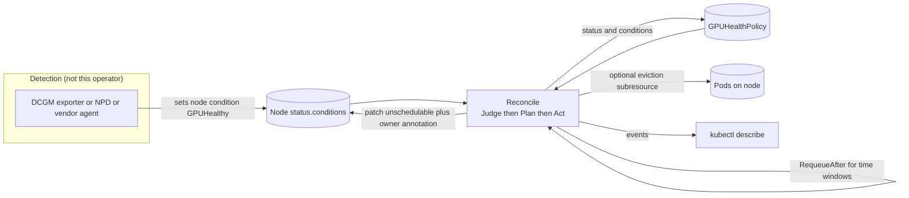

# 5.32 Project A: GPU node health operator

| | |
|---|---|
| Level | Advanced |
| Priority tier | 2 |
| Lab venue | Local Go + envtest for the verified parts; a real GPU cluster for the end-to-end step |
| Part | Part 5: Kubernetes |
| Status | Drafted. The code in `code/gpuhealth/` compiled, passed `go vet`, and its 2 unit-test groups plus 5 envtest scenarios passed with `-race`. Eviction/drain, image build and in-cluster deployment are **not** tested |

## Why this matters for AI infrastructure

A failing GPU (Xid errors, ECC, NVLink faults, thermal throttling) that stays schedulable silently ruins training jobs: a multi-hundred-GPU job restarts, or worse, slows down because one rank is degraded. Large operators automate remediation, and the dangerous failure is the remediator itself: a bad signal that marks every node unhealthy and drains the fleet. This project builds the small, safe version of that controller and keeps its design honest: decisions are pure and tested, destructive actions are budgeted, the operator only undoes what it did itself, and every refusal is visible.

## Requirements

1. Something else (DCGM exporter plus a small agent, node-problem-detector, a vendor health agent) publishes a **node condition** such as `GPUHealthy=False`. This operator does not detect faults; it reacts to a condition. Keeping detection and remediation separate lets you swap either.
2. A cluster-scoped `GPUHealthPolicy` selects nodes by label and says what to do.
3. A node must be unhealthy for a **stabilisation window** (default 2m) before action, and healthy for a **recovery window** (default 5m) before being returned, so a flapping condition does not thrash.
4. **Budget**: never take more than `maxUnavailableNodes` (integer or percent) of the matching nodes out of service.
5. **Modes**: `Ignore` (observe, report), `Cordon` (default), `CordonAndDrain` (needs a budget, enforced by a CEL rule), plus `dryRun`.
6. **Ownership**: only uncordon nodes this policy cordoned. Never touch a human's cordon.
7. **Clean uninstall**: deleting the policy releases its cordons.
8. **Visibility**: events for every action and refusal; status counters and conditions.

## Architecture



Layout of `code/gpuhealth/`:

```text
api/v1alpha1/                  types, markers, generated deepcopy
config/crd/                    generated CRD (with CEL rule and defaults)
config/rbac/role.yaml          generated least-privilege ClusterRole
internal/controller/evaluate.go        pure Judge / Budget / Plan
internal/controller/evaluate_test.go   table tests
internal/controller/gpuhealthpolicy_controller.go   Reconcile and wiring
internal/controller/suite_test.go      envtest scenarios
cmd/main.go                    manager, flags, health probes
```

## The API

```yaml
apiVersion: platform.example.com/v1alpha1
kind: GPUHealthPolicy
metadata:
  name: h100-pool
spec:
  nodeSelector:
    nvidia.com/gpu.present: "true"
  conditionType: GPUHealthy
  unhealthyFor: 2m
  healthyFor: 5m
  action: Cordon              # Ignore | Cordon | CordonAndDrain
  maxUnavailableNodes: 10%    # integer or percentage of matched nodes
  dryRun: false
```

Defaults (`conditionType`, durations, `action`) and the enum are enforced by the API server from markers. The rule "CordonAndDrain requires maxUnavailableNodes" is a CEL expression in the schema, so an invalid policy is rejected at admission with a clear message and no webhook is needed. Status carries `observedGeneration`, `matchedNodes`, `unhealthyNodes`, `cordonedNodes` and two conditions: `Ready` and `BudgetExhausted`.

Here is the complete Go API type definition from `code/gpuhealth/api/v1alpha1/gpuhealthpolicy_types.go`, showing how `controller-gen` markers encode the enum, defaults, CEL cross-field validation (`XValidation`), status subresource, cluster scope (`shortName=ghp`), and `kubectl get ghp` printer columns:

```go
package v1alpha1

import (
	metav1 "k8s.io/apimachinery/pkg/apis/meta/v1"
	"k8s.io/apimachinery/pkg/util/intstr"
)

// +kubebuilder:validation:Enum=Ignore;Cordon;CordonAndDrain
type Action string

const (
	ActionIgnore         Action = "Ignore"
	ActionCordon         Action = "Cordon"
	ActionCordonAndDrain Action = "CordonAndDrain"
)

// +kubebuilder:validation:XValidation:rule="self.action != 'CordonAndDrain' || has(self.maxUnavailableNodes)",message="maxUnavailableNodes is required when action is CordonAndDrain"
type GPUHealthPolicySpec struct {
	NodeSelector map[string]string `json:"nodeSelector,omitempty"`
	// +kubebuilder:default=GPUHealthy
	ConditionType string `json:"conditionType,omitempty"`
	// +kubebuilder:default="2m"
	UnhealthyFor metav1.Duration `json:"unhealthyFor,omitempty"`
	// +kubebuilder:default="5m"
	HealthyFor metav1.Duration `json:"healthyFor,omitempty"`
	// +kubebuilder:default=Cordon
	Action              Action              `json:"action,omitempty"`
	MaxUnavailableNodes *intstr.IntOrString `json:"maxUnavailableNodes,omitempty"`
	DryRun              bool                `json:"dryRun,omitempty"`
}

type GPUHealthPolicyStatus struct {
	ObservedGeneration int64    `json:"observedGeneration,omitempty"`
	MatchedNodes       int32    `json:"matchedNodes,omitempty"`
	UnhealthyNodes     int32    `json:"unhealthyNodes,omitempty"`
	CordonedNodes      []string `json:"cordonedNodes,omitempty"`
	// +listType=map
	// +listMapKey=type
	Conditions []metav1.Condition `json:"conditions,omitempty"`
}

// +kubebuilder:object:root=true
// +kubebuilder:subresource:status
// +kubebuilder:resource:scope=Cluster,shortName=ghp,categories=platform
// +kubebuilder:printcolumn:name="Action",type=string,JSONPath=`.spec.action`
// +kubebuilder:printcolumn:name="Matched",type=integer,JSONPath=`.status.matchedNodes`
// +kubebuilder:printcolumn:name="Unhealthy",type=integer,JSONPath=`.status.unhealthyNodes`
// +kubebuilder:printcolumn:name="Ready",type=string,JSONPath=`.status.conditions[?(@.type=="Ready")].status`
// +kubebuilder:printcolumn:name="Age",type=date,JSONPath=`.metadata.creationTimestamp`
type GPUHealthPolicy struct {
	metav1.TypeMeta   `json:",inline"`
	metav1.ObjectMeta `json:"metadata,omitempty"`
	Spec              GPUHealthPolicySpec   `json:"spec,omitempty"`
	Status            GPUHealthPolicyStatus `json:"status,omitempty"`
}
```

## The decision core (pure)

Three functions with no I/O, all tested without a cluster:

```go
// Judge classifies one node at time now.
func Judge(p *GPUHealthPolicy, n *corev1.Node, now time.Time) NodeVerdict

// Budget converts IntOrString to a node count; invalid values fail safe to 0.
func Budget(max *intstr.IntOrString, matched int) int

// Plan picks nodes to act on within the budget, deterministically (sorted by name).
func Plan(verdicts []NodeVerdict, budget int) (act, blocked []string)
```

Semantics worth stating explicitly, because they are where remediators go wrong:

| Situation | Decision | Why |
|---|---|---|
| Condition False for at least `unhealthyFor` | Unhealthy, eligible | Stabilised |
| Condition False for less than that | Pending, with `WaitFor` duration | Do not act on a blip; schedule a re-check |
| Condition True for at least `healthyFor` | Healthy | Recovered |
| Condition True, but recently | Not yet healthy; report `HealthyWaitFor` | Avoid flapping |
| Condition absent | Healthy | No signal is not evidence of a fault. A detector outage should not cordon the fleet |
| Condition Unknown | Neither healthy nor unhealthy | Not proof either way: do not act, do not release |
| Budget missing | No limit | Explicit opt-in to unlimited; CordonAndDrain forbids it |
| Budget invalid (negative, unparsable) | 0 | Fail safe: do nothing |

`Plan` counts nodes **already unschedulable** (for any reason, including a human's maintenance cordon) against the budget, because they are already unavailable capacity. Candidates beyond the remaining room are returned as `blocked` and surface as the `BudgetExhausted` condition and a Warning event.

Using an injected `now` instead of `time.Now()` makes the windows testable. The reconciler passes a `clock.Clock`, and the envtest scenarios back-date `lastTransitionTime` rather than sleeping.

Here is the full pure-function implementation from `code/gpuhealth/internal/controller/evaluate.go` (mirrored in `code/part05/gpu_health_operator_sim.py`):

```go
const (
	AnnotationOwner  = "platform.example.com/cordoned-by"
	AnnotationReason = "platform.example.com/cordon-reason"
	AnnotationSince  = "platform.example.com/cordoned-at"
	FinalizerName    = "platform.example.com/release-cordons"
)

type NodeVerdict struct {
	Name           string
	Unhealthy      bool
	Pending        bool
	WaitFor        time.Duration
	Healthy        bool
	HealthyWaitFor time.Duration
	OwnedByPolicy  bool
	Unschedulable  bool
}

func Judge(p *v1alpha1.GPUHealthPolicy, n *corev1.Node, now time.Time) NodeVerdict {
	v := NodeVerdict{
		Name:          n.Name,
		Unschedulable: n.Spec.Unschedulable,
		OwnedByPolicy: n.Annotations[AnnotationOwner] == p.Name,
	}
	condType := corev1.NodeConditionType(p.Spec.ConditionType)
	var cond *corev1.NodeCondition
	for i := range n.Status.Conditions {
		if n.Status.Conditions[i].Type == condType {
			cond = &n.Status.Conditions[i]
			break
		}
	}
	unhealthyFor := p.Spec.UnhealthyFor.Duration
	healthyFor := p.Spec.HealthyFor.Duration

	if cond != nil && cond.Status == corev1.ConditionFalse {
		age := now.Sub(cond.LastTransitionTime.Time)
		if age >= unhealthyFor {
			v.Unhealthy = true
		} else {
			v.Pending = true
			v.WaitFor = unhealthyFor - age
		}
		return v
	}
	if cond == nil {
		v.Healthy = true
		return v
	}
	if cond.Status == corev1.ConditionTrue {
		age := now.Sub(cond.LastTransitionTime.Time)
		if age >= healthyFor {
			v.Healthy = true
		} else {
			v.HealthyWaitFor = healthyFor - age
		}
	}
	return v
}

func Budget(maxUnavailable *intstr.IntOrString, matched int) int {
	if maxUnavailable == nil {
		return matched
	}
	v, err := intstr.GetScaledValueFromIntOrPercent(maxUnavailable, matched, true)
	if err != nil || v < 0 {
		return 0 // fail safe: invalid budget means do nothing
	}
	if v > matched {
		return matched
	}
	return v
}

func Plan(verdicts []NodeVerdict, budget int) (act []string, blocked []string) {
	unavailable := 0
	for _, v := range verdicts {
		if v.Unschedulable {
			unavailable++
		}
	}
	var candidates []string
	for _, v := range verdicts {
		if v.Unhealthy && !v.Unschedulable {
			candidates = append(candidates, v.Name)
		}
	}
	sort.Strings(candidates)
	room := budget - unavailable
	for _, name := range candidates {
		if room > 0 {
			act = append(act, name)
			room--
		} else {
			blocked = append(blocked, name)
		}
	}
	return act, blocked
}
```

## The reconciler

Reading order for `Reconcile` (observe, decide, act, report):

1. **Get** the policy; not found means deleted, return.
2. **Deletion path**: if `DeletionTimestamp` is set and our finalizer is present, uncordon every node whose owner annotation equals this policy's name, remove the finalizer, update. Retry on error.
3. **Ensure finalizer** before any action.
4. **List** nodes with the policy's label selector (from the cache).
5. **Judge** each; track the smallest time-to-next-transition across nodes for `RequeueAfter`.
6. **Budget and Plan**.
7. **Act** unless the action is `Ignore`:
   - In `dryRun`, emit a `DryRunCordon` event only.
   - Cordon with a **merge patch** that sets `spec.unschedulable=true` and three annotations: `cordoned-by` (policy name), `cordon-reason`, `cordoned-at`.
   - For `CordonAndDrain`, evict evictable pods through the `eviction` subresource, which honours PodDisruptionBudgets. A `429 TooManyRequests` is an expected, retried condition (reported as an `EvictionBlocked` event), not an error. DaemonSet pods, mirror pods and finished pods are skipped.
   - **Uncordon** only nodes that are healthy long enough **and** carry our owner annotation.
8. **Emit BudgetExhausted events** for blocked nodes.
9. **Update status** with a patch, skipped when equal to the previous status.
10. If any action failed, **return an aggregated error** (after attempting the others) so backoff and metrics see it; otherwise return `RequeueAfter` with a one-second margin if a window is pending.

Key snippets (from the verified code):

```go
func (r *GPUHealthPolicyReconciler) cordon(ctx context.Context, p *v1alpha1.GPUHealthPolicy, n *corev1.Node) error {
	patch := client.MergeFrom(n.DeepCopy())
	n.Spec.Unschedulable = true
	if n.Annotations == nil {
		n.Annotations = map[string]string{}
	}
	n.Annotations[AnnotationOwner] = p.Name
	n.Annotations[AnnotationReason] = fmt.Sprintf("%s=False", p.Spec.ConditionType)
	n.Annotations[AnnotationSince] = r.Clock.Now().UTC().Format(time.RFC3339)
	if err := r.Patch(ctx, n, patch); err != nil {
		return err
	}
	r.Recorder.Eventf(p, corev1.EventTypeWarning, "Cordoned", "cordoned node %s (%s=False)", n.Name, p.Spec.ConditionType)
	return nil
}
```

```go
// SetupWithManager wires watches and the pod index.
return ctrl.NewControllerManagedBy(mgr).
	Named("gpuhealthpolicy").
	For(&v1alpha1.GPUHealthPolicy{}, builder.WithPredicates(predicate.GenerationChangedPredicate{})).
	Watches(&corev1.Node{}, handler.EnqueueRequestsFromMapFunc(r.policiesForNode), builder.WithPredicates(nodeChanged())).
	Complete(r)
```

`policiesForNode` returns every policy whose selector matches the node's labels, **or** that owns a cordon on it (so a node that lost the label is still released). `nodeChanged` ignores Node updates unless `unschedulable`, labels, annotations or a condition's type/status/reason/transition time changed, because kubelets update heartbeat fields constantly.

Here are the `drain`, `evictable`, and `releaseAll` implementations from `code/gpuhealth/internal/controller/gpuhealthpolicy_controller.go`:

```go
func (r *GPUHealthPolicyReconciler) releaseAll(ctx context.Context, p *v1alpha1.GPUHealthPolicy) error {
	var nodes corev1.NodeList
	if err := r.List(ctx, &nodes); err != nil {
		return err
	}
	for i := range nodes.Items {
		n := &nodes.Items[i]
		if n.Annotations[AnnotationOwner] == p.Name {
			if err := r.uncordon(ctx, p, n); err != nil {
				return err
			}
		}
	}
	return nil
}

func (r *GPUHealthPolicyReconciler) drain(ctx context.Context, p *v1alpha1.GPUHealthPolicy, node string) (int, error) {
	var pods corev1.PodList
	if err := r.List(ctx, &pods, client.MatchingFields{podNodeNameIndex: node}); err != nil {
		return 0, err
	}
	remaining := 0
	var firstErr error
	for i := range pods.Items {
		pod := &pods.Items[i]
		if !evictable(pod) {
			continue
		}
		remaining++
		if !pod.DeletionTimestamp.IsZero() {
			continue // already terminating
		}
		ev := &policyv1.Eviction{ObjectMeta: metav1.ObjectMeta{Name: pod.Name, Namespace: pod.Namespace}}
		err := r.SubResource("eviction").Create(ctx, pod, ev)
		switch {
		case err == nil || apierrors.IsNotFound(err):
		case apierrors.IsTooManyRequests(err): // PDB disallows right now: expected, retry later
			r.Recorder.Eventf(p, corev1.EventTypeNormal, "EvictionBlocked",
				"eviction of %s/%s blocked by a PodDisruptionBudget", pod.Namespace, pod.Name)
		default:
			if firstErr == nil {
				firstErr = err
			}
		}
	}
	return remaining, firstErr
}

func evictable(pod *corev1.Pod) bool {
	if pod.Status.Phase == corev1.PodSucceeded || pod.Status.Phase == corev1.PodFailed {
		return false
	}
	if _, mirror := pod.Annotations[corev1.MirrorPodAnnotationKey]; mirror {
		return false
	}
	for _, o := range pod.OwnerReferences {
		if o.Kind == "DaemonSet" && o.Controller != nil && *o.Controller {
			return false
		}
	}
	return true
}
```

### How this operator fits into the full GPU platform layer (`volume-10`)

In the `nvidia-devops` GPU platform architecture (`nvidia-zero-to-hero/volume-10/chapter-01-why-kubernetes-needs-a-gpu-platform-layer.md` through `chapter-12-volume-10-summary.md` and `labs/lab-01`..`lab-04`), responsibilities are cleanly separated across four layers:
1. **Hardware Discovery & Lifecycle (`chapter-02-gpu-software-lifecycle-in-kubernetes.md`, `chapter-05-node-and-gpu-feature-discovery.md`, `chapter-06-gpu-operator-architecture.md`, `chapter-07-driver-containers-and-node-operands.md`, `labs/lab-01-inspect-a-kubernetes-gpu-node.md`, `labs/lab-02-install-and-validate-gpu-operator.md`):** NFD and GFD label PCIe `10de` hardware (`nvidia.com/gpu.present=true`, `nvidia.com/gpu.product`), and the GPU Operator reconciles the driver container, Container Toolkit (`chapter-03-container-toolkit-runtimeclass-and-cdi.md`), and Device Plugin (`chapter-04-device-plugin-and-kubernetes-resource-model.md`, `labs/lab-03-diagnose-a-missing-allocatable-gpu.md`).
2. **Scheduling & Topology (`chapter-08-gpu-scheduling-and-topology.md`):** Kubelet Topology Manager and scheduler plugins place multi-GPU workloads on healthy, schedulable nodes.
3. **Telemetry & Fault Detection (`chapter-09-gpu-observability-with-dcgm.md`):** `dcgm-exporter` + Node Problem Detector (or a health agent) monitors XID faults (`Xid 79`, `48`, `63`, `74`), ECC double-bit errors, and NVLink failures and writes the `GPUHealthy=False` node condition.
4. **Automated, Budgeted Remediation (`GPUHealthPolicy` in this chapter + `chapter-10-production-installation-and-configuration.md`, `chapter-11-upgrades-and-production-troubleshooting.md`, `labs/lab-04-perform-a-controlled-gpu-platform-upgrade.md`):** Our `gpuhealth` operator watches `GPUHealthy` conditions on `nvidia.com/gpu.present=true` nodes, cordons/drains within `maxUnavailableNodes`, and preserves manual maintenance cordons during upgrades.

## Design decisions and why

- **React to a condition, do not detect.** Detection logic (which Xid codes are fatal, which ECC counters matter, thermal thresholds) changes with hardware generation and belongs in the detector (see Part 10 and 11 for DCGM and the GPU Operator's health pieces). The operator stays small and swap-friendly.
- **No in-memory memory.** Everything the controller needs after a restart lives on the objects: the owner annotation on the Node, the policy status. A new leader makes the same decisions.
- **Provenance over assumption.** The owner annotation prevents the classic bug where an automation un-does a person's deliberate cordon.
- **Budget counts all unavailable nodes**, not just ours, so an ongoing maintenance window reduces what automation may take.
- **Dry-run and `Ignore` are first-class**, so you can roll out on a production pool in observe-only mode, check events and status against reality, then enable `Cordon`.
- **Cordon first, drain optional.** Cordon is cheap and reversible. Drain kills running work (potentially an expensive training job) and should be a deliberate opt-in per pool, with checkpointing and PodDisruptionBudgets in place (Parts 14 and 17).
- **Conservative defaults on uncertain input**: absent or Unknown condition never triggers action; invalid budget means zero.

## What the tests prove

The envtest suite runs the real manager against a real kube-apiserver and etcd (no kubelet, no node controller):

| Scenario | Result |
|---|---|
| Unhealthy node cordoned, healthy node left alone; after recovery window the node is uncordoned and the owner annotation removed | Passed |
| `maxUnavailableNodes: 1` with 3 unhealthy nodes: exactly one cordoned, others blocked, `BudgetExhausted=True` set in status | Passed |
| `dryRun: true`: status reports the unhealthy node, nothing is cordoned | Passed |
| Node just turned unhealthy: not cordoned immediately; cordoned after the window with no further node event (proves `RequeueAfter`) | Passed |
| Deleting the policy: its own cordon released, a human-applied cordon on another node left in place, policy actually disappears (finalizer removed) | Passed |

Plus table tests for `Judge` (six cases) and `Budget`/`Plan`. All ran with `-race`, `-count=1`, and `go vet` was clean.

## What the tests do not prove

- **Eviction and drain are untested.** envtest has no kubelet or disruption controller; this path was reviewed but not exercised. Before enabling `CordonAndDrain`, test on a kind cluster with a PodDisruptionBudget, a DaemonSet pod, a bare pod without an owner (note: evicting it deletes it permanently) and a pod stuck terminating.
- **RBAC.** envtest runs as admin. The generated ClusterRole was not checked against a real ServiceAccount. Run `kubectl auth can-i --as=system:serviceaccount:NS:SA` for each verb.
- **Scale and timing.** No test of 1,000 nodes, of API server throttling, or of cache memory.
- **Leader election, image build, deployment manifests** are not exercised.
- **Detection.** The condition source is assumed.

State these limits in the project README. Tests that sound broader than they are produce misplaced confidence.

## Failure modes to rehearse

| Failure | Expected behaviour |
|---|---|
| Detector marks every node unhealthy | Budget caps cordons; `BudgetExhausted` condition and events alert a human |
| Detector crashes (condition disappears) | Absent condition counts as healthy; no new actions; existing cordons stay until recovery rules say otherwise (decide whether you want a safeguard timeout) |
| Operator restarts mid-reconcile | Re-derives state from Node annotations; idempotent patches |
| Two operator replicas without election | Both patch the same nodes; patches are idempotent, but turn leader election on |
| Node deleted | Not found on patch is a no-op on later passes; status shrinks |
| Human cordons a node for maintenance | Counts against budget; operator never uncordons it (no owner annotation) |
| Policy edited to `Ignore` | No new actions; existing cordons remain until you delete the policy or the nodes recover. Decide and document whether `Ignore` should release |
| Eviction blocked by PDB | `EvictionBlocked` event, requeue every 15 seconds, no error storm |

## Extension ideas

1. Add Prometheus metrics (`gpuhealth_cordoned_nodes`, `gpuhealth_blocked_total`).
2. Add a **taint** option (`NoSchedule` or `NoExecute`) in place of cordon, with tolerations for diagnostics.
3. Add a per-node cooldown to stop a flapping node cycling cordon/uncordon (store the last-action time as an annotation).
4. Add a node **reboot or reset** action through a separate, more strictly budgeted controller (Part 7/17).
5. Add a global **circuit breaker**: if more than X percent of matched nodes turn unhealthy within Y minutes, stop acting and page, on the theory that the signal is broken.
6. Integrate with Slurm or Run:ai-style schedulers so draining coordinates with job checkpoints.
7. Package with Helm or kustomize, sign the image and attach an SBOM (5.22).

## Lab

First, run the self-checking Python lab (`code/part05/gpu_health_operator_sim_lab.py`) locally. It verifies the pure `judge_node` state machine across all 6 condition states, `compute_budget` + `plan_remediation` (counting human maintenance cordons against `maxUnavailableNodes`), and `is_pod_evictable` (skipping `DaemonSet`, mirror, and terminal pods).

```bash
python3 code/part05/gpu_health_operator_sim_lab.py
```

Next, run the Go unit and `envtest` test suites inside `code/gpuhealth/` (verified here):

```bash
cd code/gpuhealth
go install sigs.k8s.io/controller-tools/cmd/controller-gen@v0.16.5
go install sigs.k8s.io/controller-runtime/tools/setup-envtest@release-0.19
controller-gen object paths=./api/...
controller-gen crd paths=./api/... output:crd:dir=config/crd
export KUBEBUILDER_ASSETS="$(setup-envtest use 1.31.0 -p path)"
go vet ./... && go test -race -count=1 -v ./internal/controller/
```

Cluster step (`kind` or GKE, `untested here`):

1. `kubectl apply -f config/crd/` then run the manager locally against your kubeconfig: `go run ./cmd --leader-elect=false`.
2. Create a policy with `dryRun: true`. Simulate a fault: `kubectl proxy` and PATCH the node's status subresource to add `GPUHealthy=False` with an old `lastTransitionTime` (a kubelet will overwrite conditions it owns, so use a custom condition type that only you set).
3. Confirm events, status and that nothing is cordoned. Turn `dryRun` off, observe the cordon and the annotations, restore the condition and watch the uncordon after the window.
4. Build and push the image, apply RBAC, deploy with 2 replicas and `--leader-elect`, kill the leader.

## Interview angles

- Design a node-remediation controller for a GPU cluster. What are the safety properties you insist on?
- How do you prevent it from draining an entire fleet on a bad signal?
- Why avoid acting when the condition is absent or Unknown?
- How does the operator know a cordon is its own?
- What do you test with a pure function, what with envtest, what only on a real cluster?
- How does a time-based rule ("unhealthy for 2 minutes") work in a level-triggered controller?
- What is the cost of a drain on a running training job, and how do you mitigate it?
- Why report counts and conditions in status instead of only emitting events?

## Exercises

1. **Separating Fault Detection (`DCGM` / `NPD`) from Budgeted Remediation (`GPUHealthPolicy`) across the GPU Platform Layer (`volume-10`):** Explain why `GPUHealthPolicy` reacts to a `NodeCondition` (`GPUHealthy=False`) rather than polling `nvidia-smi` or DCGM directly inside the operator, and trace how NFD/GFD (`nvidia.com/gpu.present: "true"`), DCGM exporter/NPD, and `GPUHealthPolicy` interact.
2. **Designing the Pure Decision Core (`Judge`, `Budget`, and `Plan` in `code/gpuhealth/internal/controller/evaluate.go`):** Using `judge_node()`, `compute_budget()`, and `plan_remediation()` in `code/part05/gpu_health_operator_sim.py`, trace all 8 rows of the decision table (False $\ge$ `unhealthyFor`, False $<$ `unhealthyFor`, True $\ge$ `healthyFor`, True $<$ `healthyFor`, absent, `Unknown`, missing budget, and invalid budget) and explain why `Plan` counts already-unschedulable nodes (including human cordons) against `budget`.
3. **Time-Window Stabilization (`unhealthyFor: 2m`, `healthyFor: 5m`) in a Stateless Level-Triggered Controller:** Trace how `Reconcile` implements `unhealthyFor` and `healthyFor` without spawning background `time.Sleep` goroutines by computing `WaitFor = unhealthyFor - age` and `HealthyWaitFor = healthyFor - age` in `Judge` and returning `ctrl.Result{RequeueAfter: minWait + time.Second}`.
4. **Provenance Annotations (`platform.example.com/cordoned-by`), Finalizer Release (`releaseAll`), and Human Maintenance Safety:** Trace what happens when: (a) a human SRE runs `kubectl cordon gpu-01`, (b) `gpu-02` turns unhealthy and is cordoned by `GPUHealthPolicy/h100-pool`, and (c) an admin runs `kubectl delete gpuhealthpolicy h100-pool`. Prove from `releaseAll` and `uncordon` why `gpu-02` is uncordoned while `gpu-01` remains cordoned.
5. **Safe Node Draining (`drain` & `evictable`) with `FieldIndexer` and `PodDisruptionBudget` Backoff:** Using `is_pod_evictable()` in `code/part05/gpu_health_operator_sim.py` and `drain()` in `gpuhealthpolicy_controller.go`, explain which Pods are skipped (`Succeeded`/`Failed`, mirror pods, `DaemonSet` pods), how `r.SubResource("eviction").Create(ctx, pod, ev)` interacts with `PodDisruptionBudget`s (`429 TooManyRequests`), and why `setMin(15 * time.Second)` re-polls until all pods terminate.
6. **Analyzing the 5 `envtest` Scenarios (`suite_test.go`), What `envtest` Proves vs. Cannot Prove, and Designing a Global Circuit Breaker:** Walk through the 5 `envtest` scenarios verified in `code/gpuhealth/`, explain why `drain()` and RBAC require a real `kind`/GKE cluster test, and design an extension that trips a fleet-wide circuit breaker if $> 25\%$ of nodes turn `GPUHealthy=False` within 3 minutes.

## Checkpoint questions (20)

<details>
<summary>1. Why does this project separate **Fault Detection** (`DCGM` / `Node Problem Detector` setting `GPUHealthy=False`) from **Remediation** (`GPUHealthPolicy` cordoning/draining nodes)?</summary>

1. **Hardware and detector independence:** What constitutes a fatal hardware fault changes across GPU generations (A100 vs H100 vs B200 XID codes, NVLink versions, thermal thresholds, or cloud-provider maintenance events). Keeping detection in node-local agents (`dcgm-exporter`, `node-problem-detector`, or a cloud host-maintenance daemon) that publish a standard Kubernetes `NodeCondition` (`GPUHealthy=False`) lets you swap or upgrade detectors without touching the remediation controller.
2. **Cluster-wide blast-radius coordination:** A node-local agent on `gpu-04` only sees `gpu-04`—it does not know that 10 other nodes in the pool are already cordoned. A central Kubernetes operator watching all nodes can enforce a cluster-wide **`maxUnavailableNodes` disruption budget** before cordoning or draining.
</details>

<details>
<summary>2. Why does `GPUHealthPolicy` require BOTH an `unhealthyFor` stabilization window (default `2m`) AND a `healthyFor` recovery window (default `5m`)?</summary>

- **`unhealthyFor: 2m` (Debounce before Cordon/Drain):** Prevents a transient 5-second sensor glitch, agent restart, or brief thermal spike from immediately cordoning a node or evicting a multi-node training job.
- **`healthyFor: 5m` (Hysteresis before Uncordon):** Prevents a **flapping GPU** (whose condition oscillates `False -> True -> False` every 60 seconds) from repeatedly uncordoning itself, attracting newly scheduled training Pods, crashing them 60 seconds later, and cordoning again (**"blackhole node" syndrome**).
</details>

<details>
<summary>3. In `Judge()`, why is an **absent** `GPUHealthy` condition treated as `Healthy: true`, whereas `Status: Unknown` is treated as **neither `Healthy` nor `Unhealthy`**?</summary>

- **Absent condition (`cond == nil` $\rightarrow$ `Healthy: true`):** When a new node joins or if the health-detector DaemonSet has not yet written the custom `GPUHealthy` condition, the absence of a condition is **not evidence of a hardware fault**—cordoning nodes that lack the condition would cordon the entire cluster before the detector DaemonSet even starts.
- **`Status: Unknown` (`Healthy: false, Unhealthy: false`):** Indicates the detector lost communication with the GPU/driver or `kubelet` lost contact with the node. Because we cannot prove the GPU is broken, we **do not cordon healthy-running nodes**; and because we cannot prove a previously broken GPU has recovered, we **do not uncordon already-cordoned nodes**.
</details>

<details>
<summary>4. How does `Judge()` and `Reconcile()` implement the `2m` stabilization window and `5m` recovery window without running per-node `time.AfterFunc` timers or `time.Sleep` inside `Reconcile`?</summary>

In a level-triggered controller, sleeping inside `Reconcile` blocks the worker thread and loses state on restart. Instead:
1. When `cond.Status == False` and `age := now.Sub(cond.LastTransitionTime.Time)` is less than `unhealthyFor` (e.g., `age = 50s`, `unhealthyFor = 120s`), `Judge()` returns **`Pending: true, WaitFor: 70s`**.
2. Similarly, when a cordoned node flips to `cond.Status == True` with `age = 60s < healthyFor (300s)`, `Judge()` returns **`HealthyWaitFor: 240s`**.
3. `Reconcile()` tracks the **minimum positive wait duration (`requeue`) across all matched nodes** and returns **`ctrl.Result{RequeueAfter: requeue + time.Second}, nil`**—asking the controller-runtime WorkQueue to re-invoke `Reconcile` right after the earliest window expires.
</details>

<details>
<summary>5. How does `Budget(maxUnavailable, matched)` handle (a) `nil`, (b) a percentage like `"10%"`, and (c) an invalid or negative value?</summary>

1. **`maxUnavailable == nil`:** Returns `matched` (no limit; allowed for `Cordon` mode, forbidden for `CordonAndDrain` by the CRD's CEL rule).
2. **Percentage (`"10%"`) or Integer (`2`):** Calls `intstr.GetScaledValueFromIntOrPercent(maxUnavailable, matched, true)` (rounding up via `ceil`, capped at `matched`).
3. **Invalid string or negative number (`err != nil || v < 0`):** **Fails safe by returning `0`**—ensuring a misconfigured budget never cordons or drains any node.
</details>

<details>
<summary>6. Why does `Plan(verdicts, budget)` count **all** currently unschedulable nodes (`if v.Unschedulable { unavailable++ }`) against the budget—even nodes that were cordoned manually by a human engineer?</summary>

The purpose of `maxUnavailableNodes` is to guarantee that the GPU pool retains at least **`matched - budget` schedulable nodes** for workloads.
If a pool has 10 nodes and `maxUnavailableNodes: 2`, and a human SRE has already manually cordoned 2 nodes (`gpu-01`, `gpu-02`) for rack cabling maintenance, the pool **already has 2 unavailable nodes (`room = 2 - 2 = 0`)**. Counting all unschedulable nodes against `budget` ensures the operator will not take a 3rd node offline during the maintenance window, and instead reports the 3rd node in `blocked` (`BudgetExhausted=True`).
</details>

<details>
<summary>7. Why does `Plan(verdicts, budget)` sort `candidates` alphabetically (`sort.Strings(candidates)`) before slicing up to `room`?</summary>

Map iteration order in Go (and Informer cache list order) is **non-deterministic**. If 3 nodes (`gpu-03`, `gpu-01`, `gpu-02`) become unhealthy simultaneously with `room = 1`, sorting `candidates` by node name guarantees that `Plan()` **deterministically picks `["gpu-01"]` to act on and `["gpu-02", "gpu-03"]` as `blocked`** on every reconcile pass and in every unit test—preventing status message flapping (`not acting on [gpu-02 gpu-03]` vs `[gpu-03 gpu-02]`).
</details>

<details>
<summary>8. What three annotations does `cordon()` write onto a `Node`, and why does it use `r.Patch(ctx, n, client.MergeFrom(n.DeepCopy()))` instead of `r.Update(ctx, n)`?</summary>

- **Three annotations written alongside `n.Spec.Unschedulable = true`:**
  1. **`platform.example.com/cordoned-by: <policy.Name>`** (`AnnotationOwner`)
  2. **`platform.example.com/cordon-reason: GPUHealthy=False`** (`AnnotationReason`)
  3. **`platform.example.com/cordoned-at: <RFC3339-UTC-timestamp>`** (`AnnotationSince`)
- **Why `r.Patch(..., client.MergeFrom(n.DeepCopy()))` instead of `r.Update(ctx, n)`:** `kubelet` updates the `Node` object continuously (heartbeats, allocatable resources, attached volumes). A full `r.Update(ctx, n)` frequently fails with `409 Conflict` when `resourceVersion` changes, whereas a JSON Merge Patch sends only the delta (`spec.unschedulable` and the 3 annotations) and succeeds cleanly without clobbering concurrent `kubelet` edits.
</details>

<details>
<summary>9. Under what exact three conditions will `Reconcile()` uncordon a node during normal operation?</summary>

In line 143 of `gpuhealthpolicy_controller.go`:
```go
if v.OwnedByPolicy && v.Healthy && v.Unschedulable {
    r.uncordon(ctx, &policy, byName[v.Name])
}
```
All three conditions must hold simultaneously:
1. **`v.Unschedulable == true`:** The node is currently cordoned.
2. **`v.Healthy == true`:** The node's `GPUHealthy` condition has been `True` continuously for at least `spec.healthyFor` (default `5m`, or the condition is absent).
3. **`v.OwnedByPolicy == true` (`n.Annotations["platform.example.com/cordoned-by"] == policy.Name`):** This specific `GPUHealthPolicy` placed the cordon (guaranteeing it never uncordons a node cordoned by a human or another controller).
</details>

<details>
<summary>10. What happens when a `GPUHealthPolicy` is deleted (`!policy.DeletionTimestamp.IsZero()`), and why does `releaseAll` list all nodes in the cluster rather than only nodes matching `policy.Spec.NodeSelector`?</summary>

When the policy is deleted:
1. `Reconcile` sees `!policy.DeletionTimestamp.IsZero()` and `controllerutil.ContainsFinalizer(&policy, "platform.example.com/release-cordons")`.
2. It calls **`r.releaseAll(ctx, &policy)`**, which iterates over **all `Node`s** and calls `r.uncordon(ctx, p, n)` on every node where **`n.Annotations["platform.example.com/cordoned-by"] == p.Name`**.
3. Once all owned cordons are released without error, it removes the finalizer (`controllerutil.RemoveFinalizer`) and calls `r.Update(ctx, &policy)` so `kube-apiserver` can delete the policy from `etcd`.
**Why `releaseAll` lists all nodes without filtering by `policy.Spec.NodeSelector`:** If an administrator edited `policy.Spec.NodeSelector` (or removed a label from a node) *after* the policy had already cordoned that node, filtering by the current `NodeSelector` would orphan the cordoned node forever. Checking `n.Annotations[AnnotationOwner] == p.Name` across all nodes guarantees 100% of cordons placed by this policy are cleaned up.
</details>

<details>
<summary>11. For the same reason, why does `policiesForNode` (the `Watches(&corev1.Node{}, ...)` mapper) enqueue a policy if EITHER `sel.Matches(labels.Set(node.Labels))` OR `node.Annotations[AnnotationOwner] == p.Name`?</summary>

Suppose `GPUHealthPolicy/h100-pool` cordons `gpu-04`. Later, someone changes `gpu-04`'s labels so it no longer matches `h100-pool`'s `nodeSelector`. Because `policiesForNode` checks:
`if sel.Matches(labels.Set(node.Labels)) || node.Annotations[AnnotationOwner] == p.Name`
events on `gpu-04` still route to `h100-pool` so the policy can still track and release its cordon.
</details>

<details>
<summary>12. In `drain()` and `evictable()`, which three categories of Pods are skipped and never evicted?</summary>

`evictable(pod)` returns `false` for:
1. **Terminal Pods (`pod.Status.Phase == PodSucceeded || PodFailed`):** Already finished; no running processes to drain.
2. **Static / Mirror Pods (`pod.Annotations[corev1.MirrorPodAnnotationKey]` exists, i.e., `kubernetes.io/config.mirror`):** Managed directly by `kubelet` from `/etc/kubernetes/manifests` (`kube-apiserver`, `etcd`); the API server cannot reschedule them, and `kubelet` would immediately recreate the mirror pod anyway.
3. **DaemonSet Pods (`OwnerReference` with `Kind == "DaemonSet"` and `*Controller == true`):** Per-node system agents (`cilium`, `node-exporter`, `dcgm-exporter`, `nvidia-driver-daemonset`) that are supposed to run on every node, including cordoned nodes.
</details>

<details>
<summary>13. How does `drain()` handle a Pod that is already terminating (`!pod.DeletionTimestamp.IsZero()`) vs. a Pod whose eviction returns `429 TooManyRequests` (`apierrors.IsTooManyRequests(err)`)?</summary>

- **Already terminating (`!pod.DeletionTimestamp.IsZero()`):** Increments `remaining++` (because the pod is still on the node) and skips calling `Eviction` a second time; because `remaining > 0`, `Reconcile` calls `setMin(15 * time.Second)` to check again in 15 seconds.
- **`429 TooManyRequests` (`apierrors.IsTooManyRequests(err)`):** Means a **`PodDisruptionBudget` (`PDB`)** currently has `disruptionsAllowed == 0`. Rather than failing the reconcile with an error (which would trigger exponential backoff and error alerts), `drain()` treats `429` as a normal expected condition: it emits a `Normal` `EvictionBlocked` Event, counts the pod in `remaining`, and re-polls cleanly in **15 seconds** (`setMin(15 * time.Second)`).
</details>

<details>
<summary>14. Why does `Reconcile` register a field index on `Pod`s (`mgr.GetFieldIndexer().IndexField(..., &corev1.Pod{}, "spec.nodeName", ...)` in `SetupWithManager`)?</summary>

When `action: CordonAndDrain` is enabled, `r.drain(ctx, &policy, nodeName)` needs to list all Pods running on `nodeName`:
`r.List(ctx, &pods, client.MatchingFields{"spec.nodeName": node})`
Because `r.List` reads from `controller-runtime`'s local Informer cache, `client.MatchingFields{"spec.nodeName": node}` requires `"spec.nodeName"` to be registered with `mgr.GetFieldIndexer().IndexField` before the Manager starts—turning a cluster-wide Pod scan into an instant `O(1)` lookup per drained node.
</details>

<details>
<summary>15. Why does `Reconcile` collect action errors into `var actErrs []error` and update `.status` *before* returning the aggregated error?</summary>

Suppose 2 nodes (`gpu-01`, `gpu-02`) are selected to be cordoned, and patching `gpu-01` fails due to a transient conflict:
1. By appending the error to `actErrs` and continuing the loop, the operator still cordons `gpu-02` on this pass instead of aborting halfway.
2. By calling `r.updateStatus(ctx, &policy, ..., actErrs)` **before** returning `actErrs[0]`, the policy's `.status.conditions` (`Ready=False, Reason=ActionFailed, Message=...`) is persisted to `etcd` so operators running `kubectl get ghp` immediately see why the reconcile is failing while the WorkQueue retries with exponential backoff.
</details>

<details>
<summary>16. How does `equalStatus(orig.Status, p.Status)` prevent infinite reconcile loops in `updateStatus()`?</summary>

Before patching `/status`, `updateStatus()` takes `orig := p.DeepCopy()`, computes the new `ObservedGeneration`, `MatchedNodes`, `UnhealthyNodes`, sorted `CordonedNodes`, and updates `Conditions` via `meta.SetStatusCondition`.
`equalStatus(orig.Status, p.Status)` then compares every field and condition (`Type`, `Status`, `Reason`, `Message`, `ObservedGeneration`). If nothing changed since the previous reconcile pass, `updateStatus()` **returns `nil` without calling `r.Status().Patch`**, avoiding an unnecessary `etcd` write and watch event.
</details>

<details>
<summary>17. In `suite_test.go`, how do the `envtest` scenarios test the `2m` `unhealthyFor` and `5m` `healthyFor` windows in milliseconds without sleeping for 7 minutes?</summary>

Two techniques work together:
1. **Back-dating `LastTransitionTime` on the Node condition:** To test a node that has already been unhealthy for `> 2m`, the test sets `LastTransitionTime: metav1.NewTime(time.Now().Add(-3 * time.Minute))` when patching `Node.Status.Conditions`, so `Judge()` immediately sees `age = 3m >= 2m`.
2. **Using short policy durations (`unhealthyFor: 1s`) when testing `RequeueAfter`:** To test that a newly unhealthy node (`age = 0s`) is *not* cordoned immediately and *is* cordoned automatically by `RequeueAfter` without any further Node event, the test sets `unhealthyFor: 1s` on the test policy and polls with `eventually`.
</details>

<details>
<summary>18. Look at the `+kubebuilder:rbac` markers in `gpuhealthpolicy_controller.go`. Why does the operator request `verbs=get;list;watch;patch` on `nodes` and `verbs=create` on `pods/eviction`, instead of `*` on `nodes` and `delete` on `pods`?</summary>

**Least-Privilege RBAC (Blast-Radius Containment):**
- The operator never needs to `create` or `delete` `Node` objects—only `get`, `list`, `watch`, and `patch` (`spec.unschedulable` and annotations).
- The operator never needs to `delete` `Pod`s directly (which would bypass `PodDisruptionBudget`s)—granting only `verbs=create` on the **`pods/eviction`** subresource ensures that even at the Kubernetes RBAC layer, the operator is physically incapable of force-deleting a Pod without going through the API server's PDB eviction check.
- The operator has **zero permissions on `secrets`**.
</details>

<details>
<summary>19. When testing this operator on a live `kind` or GKE cluster by manually patching a Node's `status.conditions`, why must you use a custom condition type (`GPUHealthy`) rather than setting `Ready=False`?</summary>

The node's `kubelet` owns the built-in `Ready`, `MemoryPressure`, `DiskPressure`, and `PIDPressure` conditions and re-reports them every `nodeStatusUpdateFrequency` (default `10s`). If you manually patch `Ready=False` via `kubectl proxy`, `kubelet` will overwrite it back to `Ready=True` within 10 seconds. Using a dedicated condition type (`GPUHealthy`) that `kubelet` does not manage allows external health agents (or your manual test patch) to control the condition cleanly.
</details>

<details>
<summary>20. How would you add a **Global Fleet Circuit Breaker** to `GPUHealthPolicy` to protect against a buggy detector config that marks 80% of the cluster `GPUHealthy=False` simultaneously?</summary>

Add an optional `circuitBreakerTripPercent` field (e.g., `25%`) to `GPUHealthPolicySpec`:
- In `Reconcile()`, after running `Judge()` across all `len(nodes.Items)` matched nodes, compute the total unhealthy ratio: `unhealthyRatio = float64(unhealthy) / float64(len(nodes.Items))`.
- If `unhealthyRatio >= 0.25` (e.g., $\ge 25\%$ of the entire GPU pool is simultaneously reporting `GPUHealthy=False`), **trip the circuit breaker**: perform **zero** new cordons or drains (even if `maxUnavailableNodes` still had 1–2 slots of room), set condition `CircuitBreakerTripped=True` (`Reason: MassUnhealthySignal`), emit a `Warning` event, and increment a page-worthy Prometheus gauge so an engineer verifies whether the detector agent itself is broken.
</details>

## Sources and review notes

- **Sources read in full:**
  - `code/gpuhealth/` (`api/v1alpha1/gpuhealthpolicy_types.go`, `internal/controller/evaluate.go`, `internal/controller/evaluate_test.go`, `internal/controller/gpuhealthpolicy_controller.go`, `internal/controller/suite_test.go`, `cmd/main.go`): complete worked Go operator compiled and tested with `go vet` and `go test -race` against `controller-runtime v0.19.4` and Kubernetes `1.31.0` `envtest` assets.
  - `kubernetes-programming-with-go-programming-kubernetes-clients-and-operators-using-go-and-the-kuberne` — Philippe Martin / Stefan Schimanski & Michael Hausenblas, *Kubernetes Programming with Go* / *Programming Kubernetes* (CRDs, `controller-runtime`, `Reconcile`, `envtest`, and Kubebuilder patterns).
  - `nvidia-devops` (`nvidia-zero-to-hero/volume-10/chapter-01-why-kubernetes-needs-a-gpu-platform-layer.md`, `nvidia-zero-to-hero/volume-10/chapter-02-gpu-software-lifecycle-in-kubernetes.md`, `nvidia-zero-to-hero/volume-10/chapter-03-container-toolkit-runtimeclass-and-cdi.md`, `nvidia-zero-to-hero/volume-10/chapter-04-device-plugin-and-kubernetes-resource-model.md`, `nvidia-zero-to-hero/volume-10/chapter-05-node-and-gpu-feature-discovery.md`, `nvidia-zero-to-hero/volume-10/chapter-06-gpu-operator-architecture.md`, `nvidia-zero-to-hero/volume-10/chapter-07-driver-containers-and-node-operands.md`, `nvidia-zero-to-hero/volume-10/chapter-08-gpu-scheduling-and-topology.md`, `nvidia-zero-to-hero/volume-10/chapter-09-gpu-observability-with-dcgm.md`, `nvidia-zero-to-hero/volume-10/chapter-10-production-installation-and-configuration.md`, `nvidia-zero-to-hero/volume-10/chapter-11-upgrades-and-production-troubleshooting.md`, `nvidia-zero-to-hero/volume-10/chapter-12-volume-10-summary.md`, `nvidia-zero-to-hero/volume-10/index.md`, `nvidia-zero-to-hero/volume-10/labs/lab-01-inspect-a-kubernetes-gpu-node.md`, `nvidia-zero-to-hero/volume-10/labs/lab-02-install-and-validate-gpu-operator.md`, `nvidia-zero-to-hero/volume-10/labs/lab-03-diagnose-a-missing-allocatable-gpu.md`, and `nvidia-zero-to-hero/volume-10/labs/lab-04-perform-a-controlled-gpu-platform-upgrade.md`).
- **Run here:** `python3 code/part05/gpu_health_operator_sim_lab.py` (3 passed, 0 failed) and `go test -race ./internal/controller/` in `code/gpuhealth/` (2 unit-test groups + 5 `envtest` scenarios passed).
- **Explicitly labelled inferences:** The `judge_node`, `compute_budget`, `plan_remediation`, and `is_pod_evictable` Python models in `code/part05/gpu_health_operator_sim.py` and the Go operator in `code/gpuhealth/` are the author's constructions synthesizing `KPG` and `volume-10` (plus original study items 21, 22, 23, 24, and 25).
- **Not verified on live hardware:** Live cluster drain/eviction execution, RBAC against a live ServiceAccount, and 1,000-node scale testing (`unhealthyFor: 2m`, `healthyFor: 5m`, `maxUnavailableNodes: 10%` / `1`, `15` seconds drain retry, `controller-gen v0.16.5`, `setup-envtest release-0.19` / `1.31.0`, `controller-runtime v0.19.4`, `v0.31.4`) are marked (`untested here`) where not executed by `gpu_health_operator_sim_lab.py` or `envtest`.
