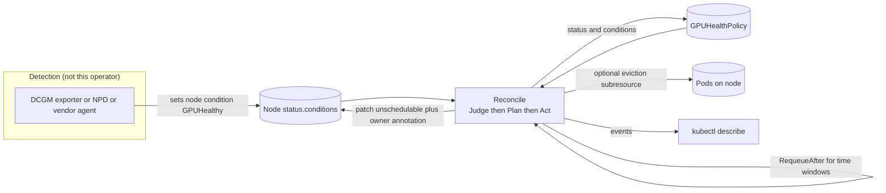

# 5.32 Project A: GPU node health operator

| | |
|---|---|
| Level | Advanced |
| Priority tier | 2 |
| Lab venue | Local Go + envtest for the verified parts; a real GPU cluster for the end-to-end step |
| Part | Part 5: Kubernetes |
| Status | Drafted. The code in `code/gpuhealth/` compiled, passed `go vet`, and its 2 unit-test groups plus 5 envtest scenarios passed with `-race`. Eviction/drain, image build and in-cluster deployment are **not** tested |

## Why this matters for AI infrastructure

A failing GPU (Xid errors, ECC, NVLink faults, thermal throttling) that stays schedulable silently ruins training jobs: a multi-hundred-GPU job restarts, or worse, slows down because one rank is degraded. Large operators automate remediation, and the dangerous failure is the remediator itself: a bad signal that marks every node unhealthy and drains the fleet. This project builds the small, safe version of that controller and keeps its design honest: decisions are pure and tested, destructive actions are budgeted, the operator only undoes what it did itself, and every refusal is visible.

## Requirements

1. Something else (DCGM exporter plus a small agent, node-problem-detector, a vendor health agent) publishes a **node condition** such as `GPUHealthy=False`. This operator does not detect faults; it reacts to a condition. Keeping detection and remediation separate lets you swap either.
2. A cluster-scoped `GPUHealthPolicy` selects nodes by label and says what to do.
3. A node must be unhealthy for a **stabilisation window** (default 2m) before action, and healthy for a **recovery window** (default 5m) before being returned, so a flapping condition does not thrash.
4. **Budget**: never take more than `maxUnavailableNodes` (integer or percent) of the matching nodes out of service.
5. **Modes**: `Ignore` (observe, report), `Cordon` (default), `CordonAndDrain` (needs a budget, enforced by a CEL rule), plus `dryRun`.
6. **Ownership**: only uncordon nodes this policy cordoned. Never touch a human's cordon.
7. **Clean uninstall**: deleting the policy releases its cordons.
8. **Visibility**: events for every action and refusal; status counters and conditions.

## Architecture



Layout of `code/gpuhealth/`:

```text
api/v1alpha1/                  types, markers, generated deepcopy
config/crd/                    generated CRD (with CEL rule and defaults)
config/rbac/role.yaml          generated least-privilege ClusterRole
internal/controller/evaluate.go        pure Judge / Budget / Plan
internal/controller/evaluate_test.go   table tests
internal/controller/gpuhealthpolicy_controller.go   Reconcile and wiring
internal/controller/suite_test.go      envtest scenarios
cmd/main.go                    manager, flags, health probes
```

## The API

```yaml
apiVersion: platform.example.com/v1alpha1
kind: GPUHealthPolicy
metadata:
  name: h100-pool
spec:
  nodeSelector:
    nvidia.com/gpu.present: "true"
  conditionType: GPUHealthy
  unhealthyFor: 2m
  healthyFor: 5m
  action: Cordon              # Ignore | Cordon | CordonAndDrain
  maxUnavailableNodes: 10%    # integer or percentage of matched nodes
  dryRun: false
```

Defaults (`conditionType`, durations, `action`) and the enum are enforced by the API server from markers. The rule "CordonAndDrain requires maxUnavailableNodes" is a CEL expression in the schema, so an invalid policy is rejected at admission with a clear message and no webhook is needed. Status carries `observedGeneration`, `matchedNodes`, `unhealthyNodes`, `cordonedNodes` and two conditions: `Ready` and `BudgetExhausted`.

## The decision core (pure)

Three functions with no I/O, all tested without a cluster:

```go
// Judge classifies one node at time now.
func Judge(p *GPUHealthPolicy, n *corev1.Node, now time.Time) NodeVerdict

// Budget converts IntOrString to a node count; invalid values fail safe to 0.
func Budget(max *intstr.IntOrString, matched int) int

// Plan picks nodes to act on within the budget, deterministically (sorted by name).
func Plan(verdicts []NodeVerdict, budget int) (act, blocked []string)
```

Semantics worth stating explicitly, because they are where remediators go wrong:

| Situation | Decision | Why |
|---|---|---|
| Condition False for at least `unhealthyFor` | Unhealthy, eligible | Stabilised |
| Condition False for less than that | Pending, with `WaitFor` duration | Do not act on a blip; schedule a re-check |
| Condition True for at least `healthyFor` | Healthy | Recovered |
| Condition True, but recently | Not yet healthy; report `HealthyWaitFor` | Avoid flapping |
| Condition absent | Healthy | No signal is not evidence of a fault. A detector outage should not cordon the fleet |
| Condition Unknown | Neither healthy nor unhealthy | Not proof either way: do not act, do not release |
| Budget missing | No limit | Explicit opt-in to unlimited; CordonAndDrain forbids it |
| Budget invalid (negative, unparsable) | 0 | Fail safe: do nothing |

`Plan` counts nodes **already unschedulable** (for any reason, including a human's maintenance cordon) against the budget, because they are already unavailable capacity. Candidates beyond the remaining room are returned as `blocked` and surface as the `BudgetExhausted` condition and a Warning event.

Using an injected `now` instead of `time.Now()` makes the windows testable. The reconciler passes a `clock.Clock`, and the envtest scenarios back-date `lastTransitionTime` rather than sleeping.

## The reconciler

Reading order for `Reconcile` (observe, decide, act, report):

1. **Get** the policy; not found means deleted, return.
2. **Deletion path**: if `DeletionTimestamp` is set and our finalizer is present, uncordon every node whose owner annotation equals this policy's name, remove the finalizer, update. Retry on error.
3. **Ensure finalizer** before any action.
4. **List** nodes with the policy's label selector (from the cache).
5. **Judge** each; track the smallest time-to-next-transition across nodes for `RequeueAfter`.
6. **Budget and Plan**.
7. **Act** unless the action is `Ignore`:
   - In `dryRun`, emit a `DryRunCordon` event only.
   - Cordon with a **merge patch** that sets `spec.unschedulable=true` and three annotations: `cordoned-by` (policy name), `cordon-reason`, `cordoned-at`.
   - For `CordonAndDrain`, evict evictable pods through the `eviction` subresource, which honours PodDisruptionBudgets. A `429 TooManyRequests` is an expected, retried condition (reported as an `EvictionBlocked` event), not an error. DaemonSet pods, mirror pods and finished pods are skipped.
   - **Uncordon** only nodes that are healthy long enough **and** carry our owner annotation.
8. **Emit BudgetExhausted events** for blocked nodes.
9. **Update status** with a patch, skipped when equal to the previous status.
10. If any action failed, **return an aggregated error** (after attempting the others) so backoff and metrics see it; otherwise return `RequeueAfter` with a one-second margin if a window is pending.

Key snippets (from the verified code):

```go
func (r *GPUHealthPolicyReconciler) cordon(ctx context.Context, p *v1alpha1.GPUHealthPolicy, n *corev1.Node) error {
	patch := client.MergeFrom(n.DeepCopy())
	n.Spec.Unschedulable = true
	if n.Annotations == nil {
		n.Annotations = map[string]string{}
	}
	n.Annotations[AnnotationOwner] = p.Name
	n.Annotations[AnnotationReason] = fmt.Sprintf("%s=False", p.Spec.ConditionType)
	n.Annotations[AnnotationSince] = r.Clock.Now().UTC().Format(time.RFC3339)
	if err := r.Patch(ctx, n, patch); err != nil {
		return err
	}
	r.Recorder.Eventf(p, corev1.EventTypeWarning, "Cordoned", "cordoned node %s (%s=False)", n.Name, p.Spec.ConditionType)
	return nil
}
```

```go
// SetupWithManager wires watches and the pod index.
return ctrl.NewControllerManagedBy(mgr).
	Named("gpuhealthpolicy").
	For(&v1alpha1.GPUHealthPolicy{}, builder.WithPredicates(predicate.GenerationChangedPredicate{})).
	Watches(&corev1.Node{}, handler.EnqueueRequestsFromMapFunc(r.policiesForNode), builder.WithPredicates(nodeChanged())).
	Complete(r)
```

`policiesForNode` returns every policy whose selector matches the node's labels, **or** that owns a cordon on it (so a node that lost the label is still released). `nodeChanged` ignores Node updates unless `unschedulable`, labels, annotations or a condition's type/status/reason/transition time changed, because kubelets update heartbeat fields constantly.

## Design decisions and why

- **React to a condition, do not detect.** Detection logic (which Xid codes are fatal, which ECC counters matter, thermal thresholds) changes with hardware generation and belongs in the detector (see Part 10 and 11 for DCGM and the GPU Operator's health pieces). The operator stays small and swap-friendly.
- **No in-memory memory.** Everything the controller needs after a restart lives on the objects: the owner annotation on the Node, the policy status. A new leader makes the same decisions.
- **Provenance over assumption.** The owner annotation prevents the classic bug where an automation un-does a person's deliberate cordon.
- **Budget counts all unavailable nodes**, not just ours, so an ongoing maintenance window reduces what automation may take.
- **Dry-run and `Ignore` are first-class**, so you can roll out on a production pool in observe-only mode, check events and status against reality, then enable `Cordon`.
- **Cordon first, drain optional.** Cordon is cheap and reversible. Drain kills running work (potentially an expensive training job) and should be a deliberate opt-in per pool, with checkpointing and PodDisruptionBudgets in place (Parts 14 and 17).
- **Conservative defaults on uncertain input**: absent or Unknown condition never triggers action; invalid budget means zero.

## What the tests prove

The envtest suite runs the real manager against a real kube-apiserver and etcd (no kubelet, no node controller):

| Scenario | Result |
|---|---|
| Unhealthy node cordoned, healthy node left alone; after recovery window the node is uncordoned and the owner annotation removed | Passed |
| `maxUnavailableNodes: 1` with 3 unhealthy nodes: exactly one cordoned, others blocked, `BudgetExhausted=True` set in status | Passed |
| `dryRun: true`: status reports the unhealthy node, nothing is cordoned | Passed |
| Node just turned unhealthy: not cordoned immediately; cordoned after the window with no further node event (proves `RequeueAfter`) | Passed |
| Deleting the policy: its own cordon released, a human-applied cordon on another node left in place, policy actually disappears (finalizer removed) | Passed |

Plus table tests for `Judge` (six cases) and `Budget`/`Plan`. All ran with `-race`, `-count=1`, and `go vet` was clean.

## What the tests do not prove

- **Eviction and drain are untested.** envtest has no kubelet or disruption controller; this path was reviewed but not exercised. Before enabling `CordonAndDrain`, test on a kind cluster with a PodDisruptionBudget, a DaemonSet pod, a bare pod without an owner (note: evicting it deletes it permanently) and a pod stuck terminating.
- **RBAC.** envtest runs as admin. The generated ClusterRole was not checked against a real ServiceAccount. Run `kubectl auth can-i --as=system:serviceaccount:NS:SA` for each verb.
- **Scale and timing.** No test of 1,000 nodes, of API server throttling, or of cache memory.
- **Leader election, image build, deployment manifests** are not exercised.
- **Detection.** The condition source is assumed.

State these limits in the project README. Tests that sound broader than they are produce misplaced confidence.

## Failure modes to rehearse

| Failure | Expected behaviour |
|---|---|
| Detector marks every node unhealthy | Budget caps cordons; `BudgetExhausted` condition and events alert a human |
| Detector crashes (condition disappears) | Absent condition counts as healthy; no new actions; existing cordons stay until recovery rules say otherwise (decide whether you want a safeguard timeout) |
| Operator restarts mid-reconcile | Re-derives state from Node annotations; idempotent patches |
| Two operator replicas without election | Both patch the same nodes; patches are idempotent, but turn leader election on |
| Node deleted | Not found on patch is a no-op on later passes; status shrinks |
| Human cordons a node for maintenance | Counts against budget; operator never uncordons it (no owner annotation) |
| Policy edited to `Ignore` | No new actions; existing cordons remain until you delete the policy or the nodes recover. Decide and document whether `Ignore` should release |
| Eviction blocked by PDB | `EvictionBlocked` event, requeue every 15 seconds, no error storm |

## Extension ideas

1. Add Prometheus metrics (`gpuhealth_cordoned_nodes`, `gpuhealth_blocked_total`).
2. Add a **taint** option (`NoSchedule` or `NoExecute`) in place of cordon, with tolerations for diagnostics.
3. Add a per-node cooldown to stop a flapping node cycling cordon/uncordon (store the last-action time as an annotation).
4. Add a node **reboot or reset** action through a separate, more strictly budgeted controller (Part 7/17).
5. Add a global **circuit breaker**: if more than X percent of matched nodes turn unhealthy within Y minutes, stop acting and page, on the theory that the signal is broken.
6. Integrate with Slurm or Run:ai-style schedulers so draining coordinates with job checkpoints.
7. Package with Helm or kustomize, sign the image and attach an SBOM (5.22).

## Lab (envtest part tested; cluster part untested)

```bash
cd code/gpuhealth
go install sigs.k8s.io/controller-tools/cmd/controller-gen@v0.16.5
go install sigs.k8s.io/controller-runtime/tools/setup-envtest@release-0.19
controller-gen object paths=./api/...
controller-gen crd paths=./api/... output:crd:dir=config/crd
export KUBEBUILDER_ASSETS="$(setup-envtest use 1.31.0 -p path)"
go vet ./... && go test -race -count=1 -v ./internal/controller/
```

Cluster step (kind or GKE), **untested**:

1. `kubectl apply -f config/crd/` then run the manager locally against your kubeconfig: `go run ./cmd --leader-elect=false`.
2. Create a policy with `dryRun: true`. Simulate a fault: `kubectl proxy` and PATCH the node's status subresource to add `GPUHealthy=False` with an old `lastTransitionTime` (a kubelet will overwrite conditions it owns, so use a custom condition type that only you set).
3. Confirm events, status and that nothing is cordoned. Turn `dryRun` off, observe the cordon and the annotations, restore the condition and watch the uncordon after the window.
4. Build and push the image, apply RBAC, deploy with 2 replicas and `--leader-elect`, kill the leader.

## Interview angles

- Design a node-remediation controller for a GPU cluster. What are the safety properties you insist on?
- How do you prevent it from draining an entire fleet on a bad signal?
- Why avoid acting when the condition is absent or Unknown?
- How does the operator know a cordon is its own?
- What do you test with a pure function, what with envtest, what only on a real cluster?
- How does a time-based rule ("unhealthy for 2 minutes") work in a level-triggered controller?
- What is the cost of a drain on a running training job, and how do you mitigate it?
- Why report counts and conditions in status instead of only emitting events?

## Checkpoint questions (25)

1. What separates detection from remediation here, and why?
2. What is the stabilisation window for?
3. What is the recovery window for?
4. Why does an absent condition count as healthy?
5. Why is Unknown neither healthy nor unhealthy?
6. How does `Budget` treat invalid input and why?
7. What counts against the budget?
8. Why sort candidates by name in `Plan`?
9. How is the time rule implemented without a timer per node?
10. What does the owner annotation protect against?
11. Why must the finalizer be added before acting?
12. What happens to a human's cordon when the policy is deleted?
13. Why patch rather than update a Node?
14. Why filter Node update events?
15. Why does the Node map function also match nodes that carry our annotation?
16. Why skip a status write when status is unchanged?
17. What does a 429 from the eviction subresource mean here?
18. Which pods are never evicted, and why?
19. Why does CordonAndDrain require a budget, and how is that enforced?
20. What are three things envtest cannot show about this operator?
21. Why back-date condition timestamps in tests?
22. What should happen if the detector marks all nodes unhealthy?
23. What should happen when the policy is switched to Ignore?
24. How would you add a circuit breaker?
25. Which part of the code would you test first on kind before enabling drain?

## Sources and review notes

- Pattern sources: *Programming Kubernetes* (Hausenblas, Schimanski), the Kubebuilder book, and controller-runtime documentation; designed and written for this handbook.
- Concepts of cordon, drain and PodDisruptionBudget follow the Kubernetes documentation on safely draining nodes and the Eviction API.
- Code in `code/gpuhealth/` built against controller-runtime v0.19.4 and Kubernetes libraries v0.31.4, tested with envtest assets for Kubernetes 1.31.0 on macOS arm64. Behaviour on other versions is untested.
- Unverified: drain path, real-cluster RBAC, performance at scale.
