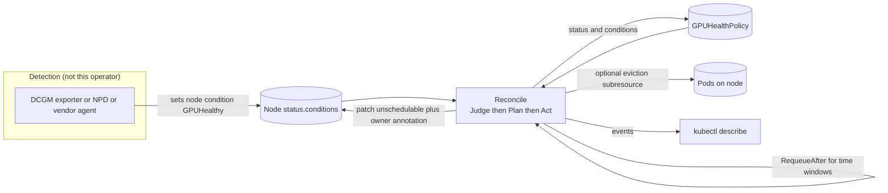

# 5.32 Project A: GPU node health operator

| | |
|---|---|
| Level | Advanced |
| Priority tier | 2 |
| Lab venue | Local Go + envtest for the verified parts; a real GPU cluster for the end-to-end step |
| Part | Part 5: Kubernetes |
| Status | Drafted. The code in `code/gpuhealth/` compiled, passed `go vet`, and its 2 unit-test groups plus 5 envtest scenarios passed with `-race`. Eviction/drain, image build and in-cluster deployment are **not** tested |

## Why this matters for AI infrastructure

Picture a GPU that starts throwing errors while its node stays schedulable. The scheduler keeps sending work to that node, and nothing announces the problem. Xid errors, ECC faults, NVLink faults and thermal throttling can all look like this. A failing GPU that stays in the pool silently ruins training jobs. A multi-hundred-GPU job may restart, or worse, slow down because one rank is degraded.

Large operators automate remediation to deal with this. The dangerous failure then becomes the remediator itself. A bad signal can mark every node unhealthy and drain the fleet. This project builds the small, safe version of that controller. Its decisions are pure and tested. Its destructive actions are budgeted. It only undoes what it did itself, and every refusal is visible.

As you read the requirements below, keep the remediator's own failures in mind.

## Requirements

Start with the boundary between detection and remediation. This project draws that line on purpose, and the operator does not detect faults itself.

1. Something else publishes a **node condition** such as `GPUHealthy=False`, for example a DCGM exporter with a small agent, node-problem-detector, or a vendor health agent. The operator only reacts to that condition, so either side can be swapped.
2. A cluster-scoped `GPUHealthPolicy` selects nodes by label and says what to do with them.
3. A node must stay unhealthy for a **stabilisation window** (default `2m`) before any action, and healthy for a **recovery window** (default `5m`) before it returns to service. That stops a flapping condition from thrashing the node.
4. The **budget** caps the damage. The operator never takes more than `maxUnavailableNodes`, an integer or a percentage, of the matching nodes out of service.
5. Modes control how far the operator goes. `Ignore` observes and reports, `Cordon` is the default, and `CordonAndDrain` needs a budget, enforced by a CEL rule. A `dryRun` setting sits on top of these modes.
6. The operator only uncordons nodes that this policy cordoned. It never touches a human's cordon.
7. Deleting the policy releases its cordons.
8. Every action and refusal produces an event, and status counters and conditions show the current state.

Decide how long your windows should be before you enable any action, because they set how quickly the operator reacts.

## Architecture

Before you read the code, look at how the pieces talk to each other. The diagram shows that detection sits outside this operator. It also shows that the reconcile loop does all the work.



The layout of `code/gpuhealth/` below maps each part of the diagram to a file. Use it to find the file behind each step in the rest of this chapter.

```text
api/v1alpha1/                  types, markers, generated deepcopy
config/crd/                    generated CRD (with CEL rule and defaults)
config/rbac/role.yaml          generated least-privilege ClusterRole
internal/controller/evaluate.go        pure Judge / Budget / Plan
internal/controller/evaluate_test.go   table tests
internal/controller/gpuhealthpolicy_controller.go   Reconcile and wiring
internal/controller/suite_test.go      envtest scenarios
cmd/main.go                    manager, flags, health probes
```

## The API

A policy is a small object that you apply to the cluster, and the API server checks it before saving it. Here is a complete example.

```yaml
apiVersion: platform.example.com/v1alpha1
kind: GPUHealthPolicy
metadata:
  name: h100-pool
spec:
  nodeSelector:
    nvidia.com/gpu.present: "true"
  conditionType: GPUHealthy
  unhealthyFor: 2m
  healthyFor: 5m
  action: Cordon              # Ignore | Cordon | CordonAndDrain
  maxUnavailableNodes: 10%    # integer or percentage of matched nodes
  dryRun: false
```

Each field maps to a rule from the requirements. `nodeSelector` picks the nodes, `unhealthyFor` and `healthyFor` set the two windows, and `maxUnavailableNodes` sets the budget. The comment after `action` lists the three modes.

Some rules are enforced by the API server itself, so they need no webhook. Defaults for `conditionType`, the durations and `action` come from markers, and the enum on `action` is enforced the same way. The rule that `CordonAndDrain` requires `maxUnavailableNodes` is a CEL expression in the schema. An invalid policy is therefore rejected at admission with a clear message. Status carries `observedGeneration`, `matchedNodes`, `unhealthyNodes` and `cordonedNodes`, plus two conditions, `Ready` and `BudgetExhausted`.

Here is the complete Go API type definition from `code/gpuhealth/api/v1alpha1/gpuhealthpolicy_types.go`. The `controller-gen` markers in it encode the enum, the defaults, CEL cross-field validation (`XValidation`), the status subresource, cluster scope (`shortName=ghp`), and the `kubectl get ghp` printer columns.

```go
package v1alpha1

import (
	metav1 "k8s.io/apimachinery/pkg/apis/meta/v1"
	"k8s.io/apimachinery/pkg/util/intstr"
)

// +kubebuilder:validation:Enum=Ignore;Cordon;CordonAndDrain
type Action string

const (
	ActionIgnore         Action = "Ignore"
	ActionCordon         Action = "Cordon"
	ActionCordonAndDrain Action = "CordonAndDrain"
)

// +kubebuilder:validation:XValidation:rule="self.action != 'CordonAndDrain' || has(self.maxUnavailableNodes)",message="maxUnavailableNodes is required when action is CordonAndDrain"
type GPUHealthPolicySpec struct {
	NodeSelector map[string]string `json:"nodeSelector,omitempty"`
	// +kubebuilder:default=GPUHealthy
	ConditionType string `json:"conditionType,omitempty"`
	// +kubebuilder:default="2m"
	UnhealthyFor metav1.Duration `json:"unhealthyFor,omitempty"`
	// +kubebuilder:default="5m"
	HealthyFor metav1.Duration `json:"healthyFor,omitempty"`
	// +kubebuilder:default=Cordon
	Action              Action              `json:"action,omitempty"`
	MaxUnavailableNodes *intstr.IntOrString `json:"maxUnavailableNodes,omitempty"`
	DryRun              bool                `json:"dryRun,omitempty"`
}

type GPUHealthPolicyStatus struct {
	ObservedGeneration int64    `json:"observedGeneration,omitempty"`
	MatchedNodes       int32    `json:"matchedNodes,omitempty"`
	UnhealthyNodes     int32    `json:"unhealthyNodes,omitempty"`
	CordonedNodes      []string `json:"cordonedNodes,omitempty"`
	// +listType=map
	// +listMapKey=type
	Conditions []metav1.Condition `json:"conditions,omitempty"`
}

// +kubebuilder:object:root=true
// +kubebuilder:subresource:status
// +kubebuilder:resource:scope=Cluster,shortName=ghp,categories=platform
// +kubebuilder:printcolumn:name="Action",type=string,JSONPath=`.spec.action`
// +kubebuilder:printcolumn:name="Matched",type=integer,JSONPath=`.status.matchedNodes`
// +kubebuilder:printcolumn:name="Unhealthy",type=integer,JSONPath=`.status.unhealthyNodes`
// +kubebuilder:printcolumn:name="Ready",type=string,JSONPath=`.status.conditions[?(@.type=="Ready")].status`
// +kubebuilder:printcolumn:name="Age",type=date,JSONPath=`.metadata.creationTimestamp`
type GPUHealthPolicy struct {
	metav1.TypeMeta   `json:",inline"`
	metav1.ObjectMeta `json:"metadata,omitempty"`
	Spec              GPUHealthPolicySpec   `json:"spec,omitempty"`
	Status            GPUHealthPolicyStatus `json:"status,omitempty"`
}
```

Before you write a policy for a pool, decide which mode it should run in. The schema rejects a `CordonAndDrain` policy that has no budget.

## The decision core (pure)

The decisions are where remediators go wrong, so this project keeps them in three pure functions. Each one takes data in and returns an answer, with no I/O. `Judge` classifies one node, `Budget` turns the budget into a node count, and `Plan` picks the nodes to act on. Because none of them touches the cluster, you can test them with ordinary table tests.

```go
// Judge classifies one node at time now.
func Judge(p *GPUHealthPolicy, n *corev1.Node, now time.Time) NodeVerdict

// Budget converts IntOrString to a node count; invalid values fail safe to 0.
func Budget(max *intstr.IntOrString, matched int) int

// Plan picks nodes to act on within the budget, deterministically (sorted by name).
func Plan(verdicts []NodeVerdict, budget int) (act, blocked []string)
```

The table below lists the cases that matter most. The Why column carries the reasoning, and that is the part you are most likely to forget.

| Situation | Decision | Why |
|---|---|---|
| Condition False for at least `unhealthyFor` | Unhealthy, eligible | Stabilised |
| Condition False for less than that | Pending, with `WaitFor` duration | Do not act on a blip; schedule a re-check |
| Condition True for at least `healthyFor` | Healthy | Recovered |
| Condition True, but recently | Not yet healthy; report `HealthyWaitFor` | Avoid flapping |
| Condition absent | Neither healthy nor unhealthy | No signal is not evidence of a fault, and not evidence of recovery either. Do not act, do not release |
| Condition Unknown | Neither healthy nor unhealthy | The detector reports it cannot tell. Same handling as absent |
| Budget missing | No limit | Explicit opt-in to unlimited; CordonAndDrain forbids it |
| Budget invalid (negative, unparsable) | 0 | Fail safe: do nothing |

The absent condition deserves a closer look. It is handled exactly like Unknown: no action and no release. A detector outage removes the condition from every node at once. If an absent condition counted as healthy, the next reconcile would uncordon every node the policy had cordoned, just when the signal is gone. If it counted as unhealthy, the same outage would cordon the fleet. Treating it as no evidence either way keeps both mistakes out. The cost is that a node cordoned by the policy stays cordoned if the detector never returns. A human must then remove it, or delete the policy, which releases the policy's own cordons.

`Plan` counts nodes that are already unschedulable against the budget, whatever the reason. A human's maintenance cordon is capacity that is already gone, so it uses up part of the budget. Candidates beyond the remaining room go into `blocked`. Those surface as the `BudgetExhausted` condition and a Warning event.

Passing `now` in, instead of calling `time.Now()`, makes the windows testable. The reconciler passes a `clock.Clock`, and the envtest scenarios back-date `lastTransitionTime` rather than sleeping.

Work one case through. A node whose condition has just turned False has an age of zero. With `unhealthyFor: 2m`, `Judge` returns Pending with a `WaitFor` of 2m, which is `unhealthyFor` minus the zero age. The same node, after 2m of False, is Unhealthy and eligible for action.

Here is the full pure-function implementation from `code/gpuhealth/internal/controller/evaluate.go` (mirrored in `code/part05/gpu_health_operator_sim.py`):

```go
const (
	AnnotationOwner  = "platform.example.com/cordoned-by"
	AnnotationReason = "platform.example.com/cordon-reason"
	AnnotationSince  = "platform.example.com/cordoned-at"
	FinalizerName    = "platform.example.com/release-cordons"
)

type NodeVerdict struct {
	Name           string
	Unhealthy      bool
	Pending        bool
	WaitFor        time.Duration
	Healthy        bool
	HealthyWaitFor time.Duration
	OwnedByPolicy  bool
	Unschedulable  bool
}

func Judge(p *v1alpha1.GPUHealthPolicy, n *corev1.Node, now time.Time) NodeVerdict {
	v := NodeVerdict{
		Name:          n.Name,
		Unschedulable: n.Spec.Unschedulable,
		OwnedByPolicy: n.Annotations[AnnotationOwner] == p.Name,
	}
	condType := corev1.NodeConditionType(p.Spec.ConditionType)
	var cond *corev1.NodeCondition
	for i := range n.Status.Conditions {
		if n.Status.Conditions[i].Type == condType {
			cond = &n.Status.Conditions[i]
			break
		}
	}
	unhealthyFor := p.Spec.UnhealthyFor.Duration
	healthyFor := p.Spec.HealthyFor.Duration

	if cond != nil && cond.Status == corev1.ConditionFalse {
		age := now.Sub(cond.LastTransitionTime.Time)
		if age >= unhealthyFor {
			v.Unhealthy = true
		} else {
			v.Pending = true
			v.WaitFor = unhealthyFor - age
		}
		return v
	}
	if cond == nil {
		return v // absent: no evidence either way, same as Unknown
	}
	if cond.Status == corev1.ConditionTrue {
		age := now.Sub(cond.LastTransitionTime.Time)
		if age >= healthyFor {
			v.Healthy = true
		} else {
			v.HealthyWaitFor = healthyFor - age
		}
	}
	return v
}

func Budget(maxUnavailable *intstr.IntOrString, matched int) int {
	if maxUnavailable == nil {
		return matched
	}
	v, err := intstr.GetScaledValueFromIntOrPercent(maxUnavailable, matched, true)
	if err != nil || v < 0 {
		return 0 // fail safe: invalid budget means do nothing
	}
	if v > matched {
		return matched
	}
	return v
}

func Plan(verdicts []NodeVerdict, budget int) (act []string, blocked []string) {
	unavailable := 0
	for _, v := range verdicts {
		if v.Unschedulable {
			unavailable++
		}
	}
	var candidates []string
	for _, v := range verdicts {
		if v.Unhealthy && !v.Unschedulable {
			candidates = append(candidates, v.Name)
		}
	}
	sort.Strings(candidates)
	room := budget - unavailable
	for _, name := range candidates {
		if room > 0 {
			act = append(act, name)
			room--
		} else {
			blocked = append(blocked, name)
		}
	}
	return act, blocked
}
```

Before you change a pool's budget, check which nodes are already unschedulable. They count against the budget before the operator acts.

## The reconciler

When a node's condition flips, the reconciler has to decide what to do without anyone asking it. It runs the same steps every time. When you read it, follow the same order the code does: observe, decide, act, then report. The reading order for `Reconcile` is below.

1. **Get** the policy. If it is not found, it was deleted, so return.
2. **Deletion path:** if `DeletionTimestamp` is set and our finalizer is present, uncordon every node whose owner annotation equals this policy's name, remove the finalizer, and update. Retry on error.
3. **Ensure finalizer** before any action.
4. **List** nodes with the policy's label selector, from the cache.
5. **Judge** each node, and track the smallest time-to-next-transition across nodes for `RequeueAfter`.
6. **Budget and Plan.**
7. **Act** unless the action is `Ignore`:
   - In `dryRun`, emit a `DryRunCordon` event only.
   - Cordon with a **merge patch** that sets `spec.unschedulable=true` and three annotations: `cordoned-by` (policy name), `cordon-reason`, `cordoned-at`.
   - For `CordonAndDrain`, evict evictable pods through the `eviction` subresource, which honours PodDisruptionBudgets. A `429 TooManyRequests` is an expected, retried condition (reported as an `EvictionBlocked` event), not an error. DaemonSet pods, mirror pods and finished pods are skipped.
   - **Uncordon** only nodes that are healthy long enough **and** carry our owner annotation.
8. **Emit BudgetExhausted events** for blocked nodes.
9. **Update status** with a patch, skipped when equal to the previous status.
10. If any action failed, **return an aggregated error** after attempting the others, so backoff and metrics see it. Otherwise return `RequeueAfter` with a one-second margin if a window is pending.

The sequence matters because each step depends on the one before it. If you follow one node through these steps, you will see it cordoned, held, and then released, in that order. The key snippets below come from the verified code.

```go
func (r *GPUHealthPolicyReconciler) cordon(ctx context.Context, p *v1alpha1.GPUHealthPolicy, n *corev1.Node) error {
	patch := client.MergeFrom(n.DeepCopy())
	n.Spec.Unschedulable = true
	if n.Annotations == nil {
		n.Annotations = map[string]string{}
	}
	n.Annotations[AnnotationOwner] = p.Name
	n.Annotations[AnnotationReason] = fmt.Sprintf("%s=False", p.Spec.ConditionType)
	n.Annotations[AnnotationSince] = r.Clock.Now().UTC().Format(time.RFC3339)
	if err := r.Patch(ctx, n, patch); err != nil {
		return err
	}
	r.Recorder.Eventf(p, corev1.EventTypeWarning, "Cordoned", "cordoned node %s (%s=False)", n.Name, p.Spec.ConditionType)
	return nil
}
```

The `cordon` function sets the unschedulable flag and the three annotations in one patch, then records a Warning event. Next, the controller's watches decide when a node change should trigger a reconcile at all. `policiesForNode` returns every policy whose selector matches the node's labels, **or** that owns a cordon on it, so a node that lost its label is still released. When you read `policiesForNode`, notice its second condition. It is what keeps a released node tracked. `nodeChanged` ignores Node updates unless `unschedulable`, labels, annotations or a condition's type, status, reason or transition time changed, because kubelets update heartbeat fields constantly.

```go
// SetupWithManager wires watches and the pod index.
return ctrl.NewControllerManagedBy(mgr).
	Named("gpuhealthpolicy").
	For(&v1alpha1.GPUHealthPolicy{}, builder.WithPredicates(predicate.GenerationChangedPredicate{})).
	Watches(&corev1.Node{}, handler.EnqueueRequestsFromMapFunc(r.policiesForNode), builder.WithPredicates(nodeChanged())).
	Complete(r)
```

The drain path needs three helpers from `code/gpuhealth/internal/controller/gpuhealthpolicy_controller.go`. `releaseAll` walks every node and uncordons the ones this policy owns. `drain` lists the pods on one node and asks the eviction subresource to remove each evictable one. A pod that is already terminating is counted but not evicted again. `evictable` decides which pods are eligible in the first place.

```go
func (r *GPUHealthPolicyReconciler) releaseAll(ctx context.Context, p *v1alpha1.GPUHealthPolicy) error {
	var nodes corev1.NodeList
	if err := r.List(ctx, &nodes); err != nil {
		return err
	}
	for i := range nodes.Items {
		n := &nodes.Items[i]
		if n.Annotations[AnnotationOwner] == p.Name {
			if err := r.uncordon(ctx, p, n); err != nil {
				return err
			}
		}
	}
	return nil
}

func (r *GPUHealthPolicyReconciler) drain(ctx context.Context, p *v1alpha1.GPUHealthPolicy, node string) (int, error) {
	var pods corev1.PodList
	if err := r.List(ctx, &pods, client.MatchingFields{podNodeNameIndex: node}); err != nil {
		return 0, err
	}
	remaining := 0
	var firstErr error
	for i := range pods.Items {
		pod := &pods.Items[i]
		if !evictable(pod) {
			continue
		}
		remaining++
		if !pod.DeletionTimestamp.IsZero() {
			continue // already terminating
		}
		ev := &policyv1.Eviction{ObjectMeta: metav1.ObjectMeta{Name: pod.Name, Namespace: pod.Namespace}}
		err := r.SubResource("eviction").Create(ctx, pod, ev)
		switch {
		case err == nil || apierrors.IsNotFound(err):
		case apierrors.IsTooManyRequests(err): // PDB disallows right now: expected, retry later
			r.Recorder.Eventf(p, corev1.EventTypeNormal, "EvictionBlocked",
				"eviction of %s/%s blocked by a PodDisruptionBudget", pod.Namespace, pod.Name)
		default:
			if firstErr == nil {
				firstErr = err
			}
		}
	}
	return remaining, firstErr
}

func evictable(pod *corev1.Pod) bool {
	if pod.Status.Phase == corev1.PodSucceeded || pod.Status.Phase == corev1.PodFailed {
		return false
	}
	if _, mirror := pod.Annotations[corev1.MirrorPodAnnotationKey]; mirror {
		return false
	}
	for _, o := range pod.OwnerReferences {
		if o.Kind == "DaemonSet" && o.Controller != nil && *o.Controller {
			return false
		}
	}
	return true
}
```

### Where this operator fits

Three layers sit around the operator. Detection runs on each node: a DCGM exporter with a small agent, or node-problem-detector, watches for Xid faults, ECC errors and NVLink failures and writes the `GPUHealthy` node condition. Part 10 and Part 11 cover that tooling, along with the GPU Operator that installs drivers and the device plugin. Scheduling places multi-GPU workloads on schedulable nodes, which Part 11 also covers. Remediation, the cordon and drain this chapter builds, is the last step, and the operations part of the handbook covers running such remediation across a fleet.

The operator's job is narrow. It acts on the condition that the detection layer writes, and on nothing else.

## Design decisions and why

Each rule in this design answers a specific way that a remediator can do harm. You can read them as answers to one question: what should the operator do when it is unsure?

The operator reacts to a condition, and it does not detect faults. Detection logic changes with each hardware generation, so it belongs in the detector. See Part 10 and 11 for DCGM and the GPU Operator's health pieces. This keeps the operator small and easy to swap.

The controller keeps no in-memory state that it needs after a restart. Everything it needs lives on the objects: the owner annotation on the Node and the policy status. A new leader therefore makes the same decisions.

Provenance matters more than assumption. The owner annotation prevents the classic bug in which automation undoes a person's deliberate cordon.

The budget counts all unavailable nodes, not only the ones this operator cordoned. An ongoing maintenance window therefore reduces what automation may take.

Dry-run and `Ignore` are first-class modes. You can roll out on a production pool in observe-only mode, check events and status against reality, and then enable `Cordon`.

Cordon comes first, and drain is optional. Cordon is cheap and reversible. Drain kills running work, which can be an expensive training job, so it should be a deliberate opt-in per pool. Checkpointing and PodDisruptionBudgets should be in place first. See Parts 14 and 17.

Uncertain input gets conservative handling. An absent or Unknown condition neither triggers action nor releases a cordon, and an invalid budget means zero.

Before you enable `Cordon` on a pool, run it in `dryRun` or `Ignore` first, and compare its events and status with what is really happening.

## What the tests prove

The envtest suite runs the real manager against a real kube-apiserver and etcd. There is no kubelet and no node controller in that setup. The table below lists what the suite exercised and whether each scenario passed.

| Scenario | Result |
|---|---|
| Unhealthy node cordoned, healthy node left alone; after recovery window the node is uncordoned and the owner annotation removed | Passed |
| `maxUnavailableNodes: 1` with 3 unhealthy nodes: exactly one cordoned, others blocked, `BudgetExhausted=True` set in status | Passed |
| `dryRun: true`: status reports the unhealthy node, nothing is cordoned | Passed |
| Node just turned unhealthy: not cordoned immediately; cordoned after the window with no further node event (proves `RequeueAfter`) | Passed |
| Deleting the policy: its own cordon released, a human-applied cordon on another node left in place, policy actually disappears (finalizer removed) | Passed |

If you read the budget row closely, you can see the arithmetic at work. With `maxUnavailableNodes: 1`, the budget leaves room for one cordon. Three nodes are unhealthy, so one is cordoned and the other two are blocked, and `BudgetExhausted=True` appears in status.

Two groups of unit tests sit alongside these scenarios. Table tests cover `Judge` with the six node rows of the decision table, and separate tests cover the two budget rows and `Plan`. All of them ran with `-race` and `-count=1`, and `go vet` was clean.

Anything outside this table stays untested.

## What the tests do not prove

The passing tests cover a lot, but several paths were never exercised. These are the gaps you should know about.

Eviction and drain are untested. envtest has no kubelet or disruption controller, so this path was reviewed but never run. Before you enable `CordonAndDrain`, test on a kind cluster. Include a PodDisruptionBudget, a DaemonSet pod, a bare pod without an owner, and a pod stuck terminating. Evicting the bare pod deletes it permanently.

RBAC is also unchecked. envtest runs as admin, so the generated ClusterRole was never tested against a real ServiceAccount. Run `kubectl auth can-i --as=system:serviceaccount:NS:SA` for each verb to check it yourself.

Scale and timing are not covered either. The suite does not test 1,000 nodes, API server throttling, or cache memory. Leader election, the image build and the deployment manifests are not exercised.

Finally, the suite assumes the condition source. It does not test detection, so the operator's behaviour on real faults is still an open question.

State these limits in the project README. Tests that sound broader than they are produce misplaced confidence.

## Failure modes to rehearse

Rehearse these failures before you rely on the operator. Each row says what the operator should do when that failure happens.

| Failure | Expected behaviour |
|---|---|
| Detector marks every node unhealthy | Budget caps cordons; `BudgetExhausted` condition and events alert a human |
| Detector crashes (condition disappears) | Absent condition is neither healthy nor unhealthy: no new actions, and existing cordons stay in place. A node stays cordoned until the detector returns or a human acts, so decide whether you want an alert or a timeout for long outages |
| Operator restarts mid-reconcile | Re-derives state from Node annotations; idempotent patches |
| Two operator replicas without election | Both patch the same nodes; patches are idempotent, but turn leader election on |
| Node deleted | Not found on patch is a no-op on later passes; status shrinks |
| Human cordons a node for maintenance | Counts against budget; operator never uncordons it (no owner annotation) |
| Policy edited to `Ignore` | No new actions; existing cordons remain until you delete the policy or the nodes recover. Decide and document whether `Ignore` should release |
| Eviction blocked by PDB | `EvictionBlocked` event, requeue every 15 seconds, no error storm |

Two rows ask you to make a decision. The detector crash row leaves open whether you want a safeguard timeout. The `Ignore` row asks whether that mode should release cordons. Decide both questions and write down the answers.

## Extension ideas

The operator as built is deliberately small. These are directions you could take it next. None of them is built in this chapter.

1. Add Prometheus metrics, such as `gpuhealth_cordoned_nodes` and `gpuhealth_blocked_total`, so the cordon count and the blocked count can be graphed.
2. Add a **taint** option, `NoSchedule` or `NoExecute`, in place of cordon, with tolerations for diagnostics.
3. Add a per-node cooldown to stop a flapping node from cycling between cordon and uncordon. You would store the last-action time as an annotation.
4. Add a node **reboot or reset** action through a separate, more strictly budgeted controller (Part 7/17).
5. Add a global **circuit breaker**. If more than X percent of matched nodes turn unhealthy within Y minutes, the operator stops acting and pages someone, on the theory that the signal is broken.
6. Integrate with Slurm or Run:ai-style schedulers, so that draining coordinates with job checkpoints.
7. Package the operator with Helm or kustomize, sign the image, and attach an SBOM (5.27).

If you extend the operator only once, start with the circuit breaker. It guards against the failure this chapter began with.

## Lab

Start with the self-checking Python lab. Run it locally to confirm the pure logic before you touch a cluster. It checks the `judge_node` state machine across all 6 condition states, `compute_budget` with `plan_remediation` (which counts human maintenance cordons against `maxUnavailableNodes`), and `is_pod_evictable`, which skips `DaemonSet`, mirror and terminal pods.

```bash
python3 code/part05/gpu_health_operator_sim_lab.py
```

Next, run the Go unit and `envtest` suites in `code/gpuhealth/`. These commands were verified here, and they install the two tools they need first.

```bash
cd code/gpuhealth
go install sigs.k8s.io/controller-tools/cmd/controller-gen@v0.16.5
go install sigs.k8s.io/controller-runtime/tools/setup-envtest@release-0.19
controller-gen object paths=./api/...
controller-gen crd paths=./api/... output:crd:dir=config/crd
export KUBEBUILDER_ASSETS="$(setup-envtest use 1.31.0 -p path)"
go vet ./... && go test -race -count=1 -v ./internal/controller/
```

The cluster step was not run on a live cluster, on kind or GKE. When you run it on your own cluster, follow these steps in order.

1. Apply the CRD with `kubectl apply -f config/crd/`, then run the manager locally against your kubeconfig with `go run ./cmd --leader-elect=false`.
2. Create a policy with `dryRun: true`. To simulate a fault, run `kubectl proxy` and PATCH the node's status subresource to add `GPUHealthy=False` with an old `lastTransitionTime`. A kubelet overwrites the conditions it owns, so use a custom condition type that only you set.
3. Check the events and status, and confirm that nothing is cordoned. Then turn `dryRun` off and watch the cordon and its annotations. Restore the condition and watch the uncordon after the window.
4. Build and push the image, apply RBAC, and deploy with 2 replicas and `--leader-elect`. Then kill the leader.

## Interview angles

You can use these questions to check that you can explain the reasoning behind this project, not only its code.

- Design a node-remediation controller for a GPU cluster. What are the safety properties you insist on?
- How do you prevent it from draining an entire fleet on a bad signal?
- Why avoid acting when the condition is absent or Unknown?
- How does the operator know a cordon is its own?
- What do you test with a pure function, what with envtest, what only on a real cluster?
- How does a time-based rule ("unhealthy for 2 minutes") work in a level-triggered controller?
- What is the cost of a drain on a running training job, and how do you mitigate it?
- Why report counts and conditions in status instead of only emitting events?

## Exercises

Keep the code open while you work through these, because each exercise names the files and functions you will need.

1. Start with the boundary between fault detection (`DCGM` / `NPD`) and budgeted remediation (`GPUHealthPolicy`) across the GPU platform layers. Explain why `GPUHealthPolicy` reacts to a `NodeCondition` (`GPUHealthy=False`) instead of polling `nvidia-smi` or DCGM directly inside the operator. Then trace how NFD/GFD (`nvidia.com/gpu.present: "true"`), DCGM exporter/NPD, and `GPUHealthPolicy` interact.
2. Work with `Judge`, `Budget` and `Plan` in `code/gpuhealth/internal/controller/evaluate.go`. Using `judge_node()`, `compute_budget()` and `plan_remediation()` in `code/part05/gpu_health_operator_sim.py`, trace all 8 rows of the decision table: False `>=` `unhealthyFor`, False `<` `unhealthyFor`, True `>=` `healthyFor`, True `<` `healthyFor`, absent, `Unknown`, missing budget, and invalid budget. Then explain why `Plan` counts already-unschedulable nodes, including human cordons, against `budget`.
3. Trace how `Reconcile` implements `unhealthyFor: 2m` and `healthyFor: 5m` in a stateless, level-triggered controller. Do it without spawning background `time.Sleep` goroutines. Show how `Judge` computes `WaitFor = unhealthyFor - age` and `HealthyWaitFor = healthyFor - age`, and how the reconciler returns `ctrl.Result{RequeueAfter: minWait + time.Second}`.
4. Work through provenance annotations (`platform.example.com/cordoned-by`), finalizer release (`releaseAll`), and human maintenance safety. Trace what happens when (a) a human SRE runs `kubectl cordon gpu-01`, (b) `gpu-02` turns unhealthy and is cordoned by `GPUHealthPolicy/h100-pool`, and (c) an admin runs `kubectl delete gpuhealthpolicy h100-pool`. Then prove from `releaseAll` and `uncordon` why `gpu-02` is uncordoned while `gpu-01` remains cordoned.
5. Trace safe node draining through `drain` and `evictable`, and through the `FieldIndexer` lookup and the PodDisruptionBudget backoff. Using `is_pod_evictable()` in `code/part05/gpu_health_operator_sim.py` and `drain()` in `gpuhealthpolicy_controller.go`, explain which Pods are skipped (`Succeeded`/`Failed`, mirror pods, `DaemonSet` pods). Explain how `r.SubResource("eviction").Create(ctx, pod, ev)` interacts with `PodDisruptionBudget`s (`429 TooManyRequests`), and why `setMin(15 * time.Second)` re-polls until all pods terminate.
6. Walk through the 5 `envtest` scenarios in `suite_test.go`, verified in `code/gpuhealth/`. Explain why `drain()` and RBAC require a real `kind`/GKE cluster test. Then design an extension that trips a fleet-wide circuit breaker if more than 25 percent of nodes turn `GPUHealthy=False` within 3 minutes.

## Checkpoint questions (20)

<details>
<summary>1. Why does this project separate **Fault Detection** (`DCGM` / `Node Problem Detector` setting `GPUHealthy=False`) from **Remediation** (`GPUHealthPolicy` cordoning/draining nodes)?</summary>

1. **Hardware and detector independence:** Fatal hardware faults change across GPU generations, such as A100, H100 and B200 XID codes, NVLink versions, thermal thresholds, or cloud-provider maintenance events. A detector that runs on each node, in `dcgm-exporter`, `node-problem-detector`, or a cloud host-maintenance daemon, publishes a standard Kubernetes `NodeCondition`, `GPUHealthy=False`. Because that condition is standard, you can swap or upgrade the detector without touching the remediation controller.
2. **Cluster-wide blast-radius coordination:** A node-local agent on `gpu-04` only sees `gpu-04`. It does not know that 10 other nodes in the pool are already cordoned. A central Kubernetes operator that watches all nodes can enforce a cluster-wide **`maxUnavailableNodes` disruption budget** before it cordons or drains anything.
</details>

<details>
<summary>2. Why does `GPUHealthPolicy` require BOTH an `unhealthyFor` stabilization window (default `2m`) AND a `healthyFor` recovery window (default `5m`)?</summary>

- **`unhealthyFor: 2m` (debounce before cordon and drain):** This window stops a transient 5-second sensor glitch, an agent restart, or a brief thermal spike from cordoning a node straight away. It also stops that brief spike from evicting a multi-node training job.
- **`healthyFor: 5m` (hysteresis before uncordon):** This prevents a **flapping GPU** from repeatedly uncordoning itself. Its condition oscillates `False -> True -> False` every 60 seconds. Each time it comes back, newly scheduled training Pods land on it, crash 60 seconds later, and the node is cordoned again. This cycle is known as **"blackhole node" syndrome**.
</details>

<details>
<summary>3. In `Judge()`, why are an **absent** `GPUHealthy` condition and `Status: Unknown` both treated as **neither `Healthy` nor `Unhealthy`**, and what does each case protect against?</summary>

- **Absent condition (`cond == nil`, both flags false):** A new node may join before the health-detector DaemonSet has written the `GPUHealthy` condition, and a detector outage can remove the condition from every node. A missing condition is not evidence of a hardware fault, so the operator does not cordon. It is not evidence of recovery either. If it counted as healthy, a detector outage would uncordon every node the policy owns on the next reconcile.
- **`Status: Unknown` (`Healthy: false, Unhealthy: false`):** Unknown means either the detector lost contact with the GPU/driver, or `kubelet` lost contact with the node. The operator cannot prove the GPU is broken, so it does not cordon healthy, running nodes. It also cannot prove that a broken GPU has recovered, so it does not uncordon nodes that are already cordoned.
</details>

<details>
<summary>4. How does `Judge()` and `Reconcile()` implement the `2m` stabilization window and `5m` recovery window without running per-node `time.AfterFunc` timers or `time.Sleep` inside `Reconcile`?</summary>

A level-triggered controller that sleeps inside `Reconcile` blocks its worker thread, and it loses state on restart. So the controller does not sleep. If you trace the code, you will see it works like this instead.
1. When `cond.Status == False` and `age := now.Sub(cond.LastTransitionTime.Time)` is less than `unhealthyFor`, for example `age = 50s` against `unhealthyFor = 120s`, `Judge()` returns **`Pending: true, WaitFor: 70s`**.
2. Similarly, a cordoned node that flips to `cond.Status == True` with `age = 60s` is below `healthyFor = 300s`. `Judge()` returns **`HealthyWaitFor: 240s`** for it.
3. `Reconcile()` tracks the **minimum positive wait duration (`requeue`) across all matched nodes**. It returns **`ctrl.Result{RequeueAfter: requeue + time.Second}, nil`**, which asks the controller-runtime WorkQueue to call `Reconcile` again right after the earliest window expires.
</details>

<details>
<summary>5. How does `Budget(maxUnavailable, matched)` handle (a) `nil`, (b) a percentage like `"10%"`, and (c) an invalid or negative value?</summary>

1. **`maxUnavailable == nil`:** `Budget` returns `matched`, which means no limit. That is allowed for `Cordon` mode, and the CRD's CEL rule forbids it for `CordonAndDrain`.
2. **Percentage (`"10%"`) or integer (`2`):** `Budget` calls `intstr.GetScaledValueFromIntOrPercent(maxUnavailable, matched, true)`. This rounds up with `ceil`, and the result is capped at `matched`.
3. **Invalid string or negative number (`err != nil || v < 0`):** `Budget` fails safe by returning `0`. A misconfigured budget therefore never cordons or drains any node.
</details>

<details>
<summary>6. Why does `Plan(verdicts, budget)` count **all** currently unschedulable nodes (`if v.Unschedulable { unavailable++ }`) against the budget, even nodes that were cordoned manually by a human engineer?</summary>

The purpose of `maxUnavailableNodes` is to guarantee that the GPU pool keeps at least **`matched - budget` schedulable nodes** for workloads. Take a pool of 10 nodes with `maxUnavailableNodes: 2`. A human SRE has already cordoned `gpu-01` and `gpu-02` for rack cabling maintenance. The pool therefore already has 2 unavailable nodes, so `room = 2 - 2 = 0`. Counting every unschedulable node against `budget` means the operator will not take a 3rd node offline during that maintenance window. It reports the 3rd node in `blocked` with `BudgetExhausted=True` instead.
</details>

<details>
<summary>7. Why does `Plan(verdicts, budget)` sort `candidates` alphabetically (`sort.Strings(candidates)`) before slicing up to `room`?</summary>

Go map iteration order and Informer cache list order are both **non-deterministic**. Suppose `gpu-03`, `gpu-01` and `gpu-02` all become unhealthy at once, with `room = 1`. Sorting `candidates` by node name makes `Plan()` pick `["gpu-01"]` to act on and return `["gpu-02", "gpu-03"]` as `blocked`. It does this on every reconcile pass and in every unit test. The status message stays stable, instead of flapping between `not acting on [gpu-02 gpu-03]` and `[gpu-03 gpu-02]`.
</details>

<details>
<summary>8. What three annotations does `cordon()` write onto a `Node`, and why does it use `r.Patch(ctx, n, client.MergeFrom(n.DeepCopy()))` instead of `r.Update(ctx, n)`?</summary>

`cordon()` writes three annotations alongside `n.Spec.Unschedulable = true`:
  1. **`platform.example.com/cordoned-by: <policy.Name>`** (`AnnotationOwner`)
  2. **`platform.example.com/cordon-reason: GPUHealthy=False`** (`AnnotationReason`)
  3. **`platform.example.com/cordoned-at: <RFC3339-UTC-timestamp>`** (`AnnotationSince`)

It uses `r.Patch(ctx, n, client.MergeFrom(n.DeepCopy()))` instead of `r.Update(ctx, n)` because `kubelet` keeps updating the `Node` object with heartbeats, allocatable resources and attached volumes. A full `r.Update(ctx, n)` often fails with `409 Conflict` when `resourceVersion` changes. A JSON Merge Patch sends only the change, namely `spec.unschedulable` and the 3 annotations. It therefore succeeds without overwriting the `kubelet`'s concurrent edits.
</details>

<details>
<summary>9. Under what exact three conditions will `Reconcile()` uncordon a node during normal operation?</summary>

The uncordon check is on line 143 of `gpuhealthpolicy_controller.go`. You can find it there:
```go
if v.OwnedByPolicy && v.Healthy && v.Unschedulable {
    r.uncordon(ctx, &policy, byName[v.Name])
}
```
All three conditions must hold at the same time:
1. **`v.Unschedulable == true`:** The node is cordoned right now.
2. **`v.Healthy == true`:** The `GPUHealthy` condition has been `True` continuously for at least `spec.healthyFor`, which defaults to `5m`. An absent condition does not count as healthy.
3. **`v.OwnedByPolicy == true`:** The check is `n.Annotations["platform.example.com/cordoned-by"] == policy.Name`. This means this specific `GPUHealthPolicy` placed the cordon, so the operator never uncordons a node that a human or another controller cordoned.
</details>

<details>
<summary>10. What happens when a `GPUHealthPolicy` is deleted (`!policy.DeletionTimestamp.IsZero()`), and why does `releaseAll` list all nodes in the cluster rather than only nodes matching `policy.Spec.NodeSelector`?</summary>

When the policy is deleted, `!policy.DeletionTimestamp.IsZero()` is true, and the finalizer `platform.example.com/release-cordons` is still present. `Reconcile` then calls **`r.releaseAll(ctx, &policy)`**. That function walks over **all `Node`s** and calls `r.uncordon(ctx, p, n)` on every node whose **`platform.example.com/cordoned-by`** annotation matches the policy name. When every owned cordon is released without error, `Reconcile` removes the finalizer with `controllerutil.RemoveFinalizer` and calls `r.Update(ctx, &policy)`. That lets `kube-apiserver` delete the policy from `etcd`.

`releaseAll` lists all nodes without filtering by `policy.Spec.NodeSelector` for a specific reason. An administrator may edit the selector after the policy has cordoned a node, or remove a label from that node. Filtering by the current selector would leave the cordoned node orphaned forever. Checking the owner annotation across all nodes guarantees that every cordon this policy placed gets cleaned up.
</details>

<details>
<summary>11. For the same reason, why does `policiesForNode` (the `Watches(&corev1.Node{}, ...)` mapper) enqueue a policy if EITHER `sel.Matches(labels.Set(node.Labels))` OR `node.Annotations[AnnotationOwner] == p.Name`?</summary>

Suppose `GPUHealthPolicy/h100-pool` cordons `gpu-04`. Later, someone changes the labels on `gpu-04`, so it no longer matches the `nodeSelector` of `h100-pool`. The `policiesForNode` check is `if sel.Matches(labels.Set(node.Labels)) || node.Annotations[AnnotationOwner] == p.Name`. The second half of that check still matches. So events on `gpu-04` keep routing to `h100-pool`, and the policy can still track its cordon and release it.
</details>

<details>
<summary>12. In `drain()` and `evictable()`, which three categories of Pods are skipped and never evicted?</summary>

`evictable(pod)` returns `false` for three kinds of Pods.
1. **Terminal Pods (`pod.Status.Phase == PodSucceeded || PodFailed`):** These have already finished, so there are no running processes to drain.
2. **Static / Mirror Pods (`pod.Annotations[corev1.MirrorPodAnnotationKey]` is present, meaning `kubernetes.io/config.mirror`):** The `kubelet` manages these directly from `/etc/kubernetes/manifests`, for example `kube-apiserver` and `etcd`. The API server cannot reschedule them, and the `kubelet` would recreate the mirror pod straight away anyway.
3. **DaemonSet Pods (`OwnerReference` with `Kind == "DaemonSet"` and `*Controller == true`):** These are per-node system agents, such as `cilium`, `node-exporter`, `dcgm-exporter` and `nvidia-driver-daemonset`. They are meant to run on every node, including cordoned ones.
</details>

<details>
<summary>13. How does `drain()` handle a Pod that is already terminating (`!pod.DeletionTimestamp.IsZero()`) vs. a Pod whose eviction returns `429 TooManyRequests` (`apierrors.IsTooManyRequests(err)`)?</summary>

- **Already terminating (`!pod.DeletionTimestamp.IsZero()`):** `drain()` increments `remaining++`, because the pod is still on the node. It then skips a second eviction call. Since `remaining > 0`, `Reconcile` calls `setMin(15 * time.Second)` to check again in 15 seconds.
- **`429 TooManyRequests` (`apierrors.IsTooManyRequests(err)`):** This means a **`PodDisruptionBudget` (`PDB`)** currently has `disruptionsAllowed == 0`. Failing the reconcile with an error would trigger exponential backoff and error alerts. So `drain()` treats the 429 as a normal, expected condition. It emits a `Normal` `EvictionBlocked` event, counts the pod in `remaining`, and polls again in **15 seconds** (`setMin(15 * time.Second)`).
</details>

<details>
<summary>14. Why does `Reconcile` register a field index on `Pod`s (`mgr.GetFieldIndexer().IndexField(..., &corev1.Pod{}, "spec.nodeName", ...)` in `SetupWithManager`)?</summary>

When `action: CordonAndDrain` is enabled, `r.drain(ctx, &policy, nodeName)` must list every Pod running on `nodeName`. It does this with `r.List(ctx, &pods, client.MatchingFields{"spec.nodeName": node})`. `r.List` reads from the local Informer cache of controller-runtime. So `"spec.nodeName"` has to be registered with `mgr.GetFieldIndexer().IndexField` before the Manager starts. Once it is registered, a cluster-wide Pod scan becomes an instant `O(1)` lookup per drained node.
</details>

<details>
<summary>15. Why does `Reconcile` collect action errors into `var actErrs []error` and update `.status` *before* returning the aggregated error?</summary>

Suppose two nodes, `gpu-01` and `gpu-02`, are selected for cordon, and the patch to `gpu-01` fails on a transient conflict.
1. By appending the error to `actErrs` and continuing the loop, the operator still cordons `gpu-02` on this pass, instead of stopping halfway.
2. By calling `r.updateStatus(ctx, &policy, ..., actErrs)` before it returns `actErrs[0]`, the policy's `.status.conditions`, with `Ready=False, Reason=ActionFailed, Message=...`, is persisted to `etcd`. Operators running `kubectl get ghp` can see straight away why the reconcile is failing, while the WorkQueue retries with exponential backoff.
</details>

<details>
<summary>16. How does `equalStatus(orig.Status, p.Status)` prevent infinite reconcile loops in `updateStatus()`?</summary>

Before it patches `/status`, `updateStatus()` takes `orig := p.DeepCopy()`. It then computes the new `ObservedGeneration`, `MatchedNodes`, `UnhealthyNodes` and sorted `CordonedNodes`, and it updates `Conditions` with `meta.SetStatusCondition`. `equalStatus(orig.Status, p.Status)` compares every field and condition, including `Type`, `Status`, `Reason`, `Message` and `ObservedGeneration`. If nothing has changed since the last pass, you get `nil` back from `updateStatus()`, which returns without calling `r.Status().Patch`. That avoids an unnecessary write to `etcd` and an extra watch event.
</details>

<details>
<summary>17. In `suite_test.go`, how do the `envtest` scenarios test the `2m` `unhealthyFor` and `5m` `healthyFor` windows in milliseconds without sleeping for 7 minutes?</summary>

Two techniques work together.
1. **Back-dating `LastTransitionTime` on the Node condition:** To test a node that has already been unhealthy for `> 2m`, the test sets `LastTransitionTime: metav1.NewTime(time.Now().Add(-3 * time.Minute))` when it patches `Node.Status.Conditions`. `Judge()` then sees `age = 3m`, which is `>= 2m`, straight away.
2. **Short policy durations (`unhealthyFor: 1s`) when testing `RequeueAfter`:** To check that a newly unhealthy node (`age = 0s`) is not cordoned at once, but is cordoned by `RequeueAfter` with no further Node event, the test sets `unhealthyFor: 1s` on the test policy and polls with `eventually`.
</details>

<details>
<summary>18. Look at the `+kubebuilder:rbac` markers in `gpuhealthpolicy_controller.go`. Why does the operator request `verbs=get;list;watch;patch` on `nodes` and `verbs=create` on `pods/eviction`, instead of `*` on `nodes` and `delete` on `pods`?</summary>

The answer is least-privilege RBAC, which contains the blast radius.
- The operator never needs to `create` or `delete` `Node` objects. It needs only `get`, `list`, `watch` and `patch`, to change `spec.unschedulable` and the annotations.
- The operator never needs to `delete` `Pod`s directly, because that would bypass `PodDisruptionBudget`s. Granting only `verbs=create` on the **`pods/eviction`** subresource means the operator cannot force-delete a Pod. Every removal has to pass through the API server's PDB eviction check, even at the RBAC layer.
- The operator has **zero permissions on `secrets`**.
</details>

<details>
<summary>19. When testing this operator on a live `kind` or GKE cluster by manually patching a Node's `status.conditions`, why must you use a custom condition type (`GPUHealthy`) rather than setting `Ready=False`?</summary>

`kubelet` owns the built-in `Ready`, `MemoryPressure`, `DiskPressure` and `PIDPressure` conditions, so if you try to override them, it will win. It re-reports them every `nodeStatusUpdateFrequency`, which defaults to `10s`. If you patch `Ready=False` by hand through `kubectl proxy`, the `kubelet` overwrites it back to `Ready=True` within 10 seconds. A dedicated condition type such as `GPUHealthy` is not managed by `kubelet`. That lets an external health agent, or your manual test patch, control the condition cleanly.
</details>

<details>
<summary>20. How would you add a **Global Fleet Circuit Breaker** to `GPUHealthPolicy` to protect against a buggy detector config that marks 80% of the cluster `GPUHealthy=False` simultaneously?</summary>

Add an optional `circuitBreakerTripPercent` field, for example `25%`, to `GPUHealthPolicySpec`. You would then check it inside `Reconcile()`. In `Reconcile()`, run `Judge()` across all `len(nodes.Items)` matched nodes. Then compute the unhealthy ratio: `unhealthyRatio = float64(unhealthy) / float64(len(nodes.Items))`. If `unhealthyRatio >= 0.25`, which is at least 25 percent of the entire GPU pool reporting `GPUHealthy=False` at once, the breaker trips. When it trips, the operator performs zero new cordons or drains, even if `maxUnavailableNodes` still has 1–2 slots of room. It sets the condition `CircuitBreakerTripped=True` with `Reason: MassUnhealthySignal`, emits a `Warning` event, and increments a page-worthy Prometheus gauge, so an engineer can check whether the detector agent itself is broken.
</details>

## Sources and review notes

- **Sources read in full:**
  - `code/gpuhealth/` (`api/v1alpha1/gpuhealthpolicy_types.go`, `internal/controller/evaluate.go`, `internal/controller/evaluate_test.go`, `internal/controller/gpuhealthpolicy_controller.go`, `internal/controller/suite_test.go`, `cmd/main.go`): complete worked Go operator compiled and tested with `go vet` and `go test -race` against `controller-runtime v0.19.4` and Kubernetes `1.31.0` `envtest` assets.
  - `kubernetes-programming-with-go-programming-kubernetes-clients-and-operators-using-go-and-the-kuberne` — Philippe Martin / Stefan Schimanski & Michael Hausenblas, *Kubernetes Programming with Go* / *Programming Kubernetes* (CRDs, `controller-runtime`, `Reconcile`, `envtest`, and Kubebuilder patterns).
  - `nvidia-devops` (`nvidia-zero-to-hero/volume-10/chapter-01-why-kubernetes-needs-a-gpu-platform-layer.md`, `nvidia-zero-to-hero/volume-10/chapter-02-gpu-software-lifecycle-in-kubernetes.md`, `nvidia-zero-to-hero/volume-10/chapter-03-container-toolkit-runtimeclass-and-cdi.md`, `nvidia-zero-to-hero/volume-10/chapter-04-device-plugin-and-kubernetes-resource-model.md`, `nvidia-zero-to-hero/volume-10/chapter-05-node-and-gpu-feature-discovery.md`, `nvidia-zero-to-hero/volume-10/chapter-06-gpu-operator-architecture.md`, `nvidia-zero-to-hero/volume-10/chapter-07-driver-containers-and-node-operands.md`, `nvidia-zero-to-hero/volume-10/chapter-08-gpu-scheduling-and-topology.md`, `nvidia-zero-to-hero/volume-10/chapter-09-gpu-observability-with-dcgm.md`, `nvidia-zero-to-hero/volume-10/chapter-10-production-installation-and-configuration.md`, `nvidia-zero-to-hero/volume-10/chapter-11-upgrades-and-production-troubleshooting.md`, `nvidia-zero-to-hero/volume-10/chapter-12-volume-10-summary.md`, `nvidia-zero-to-hero/volume-10/index.md`, `nvidia-zero-to-hero/volume-10/labs/lab-01-inspect-a-kubernetes-gpu-node.md`, `nvidia-zero-to-hero/volume-10/labs/lab-02-install-and-validate-gpu-operator.md`, `nvidia-zero-to-hero/volume-10/labs/lab-03-diagnose-a-missing-allocatable-gpu.md`, and `nvidia-zero-to-hero/volume-10/labs/lab-04-perform-a-controlled-gpu-platform-upgrade.md`).
- **Run here:** `python3 code/part05/gpu_health_operator_sim_lab.py` (3 passed, 0 failed) and `go test -race ./internal/controller/` in `code/gpuhealth/` (2 unit-test groups + 5 `envtest` scenarios passed).
- **Correction in the rework:** An absent condition used to count as healthy, which would have released every owned cordon during a detector outage. It is now treated like Unknown in the Go code, the Python simulation, the unit test, the decision table, the failure table and the interview answers. The Go unit test was edited but not re-run in this pass.
- **Explicitly labelled inferences:** The `judge_node`, `compute_budget`, `plan_remediation`, and `is_pod_evictable` Python models in `code/part05/gpu_health_operator_sim.py` and the Go operator in `code/gpuhealth/` are the author's constructions synthesizing Kubernetes Programming with Go and `volume-10` (plus original study items 21, 22, 23, 24, and 25).
- **Not verified on live hardware:** Live cluster drain/eviction execution, RBAC against a live ServiceAccount, and 1,000-node scale testing (`unhealthyFor: 2m`, `healthyFor: 5m`, `maxUnavailableNodes: 10%` / `1`, `15` seconds drain retry, `controller-gen v0.16.5`, `setup-envtest release-0.19` / `1.31.0`, `controller-runtime v0.19.4`, `v0.31.4`) were not run live, apart from what is executed by `gpu_health_operator_sim_lab.py` or `envtest`.
