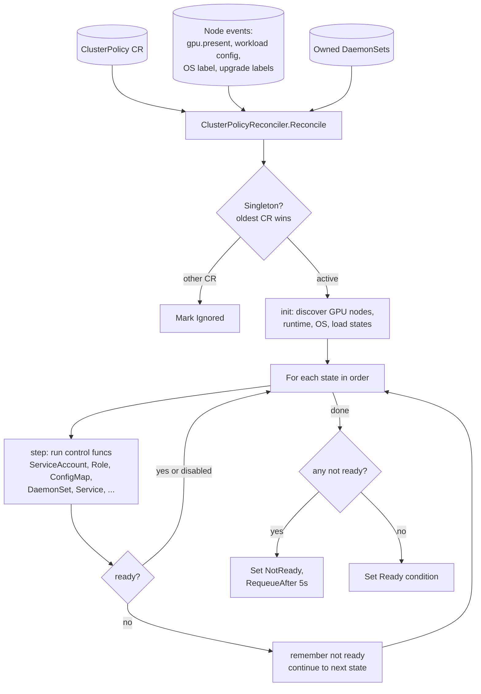
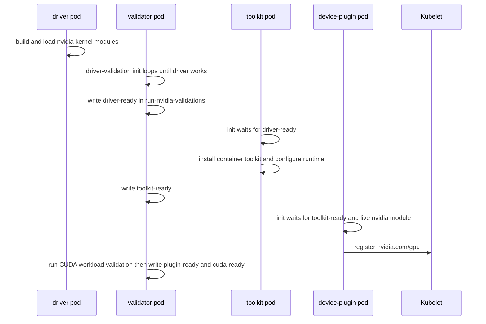
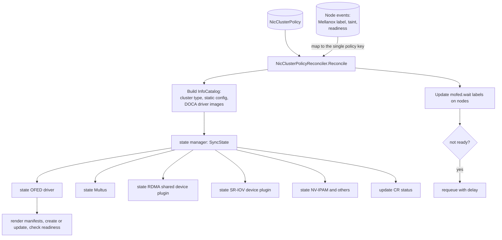

# 5.33 Reading the GPU Operator and Network Operator source

| | |
|---|---|
| Level | Advanced |
| Priority tier | 2 |
| Lab venue | `git clone` of `NVIDIA/gpu-operator` and `Mellanox/network-operator`; optional GPU cluster |
| Part | Part 5: Kubernetes |
| Status | Drafted. File and function names were read from shallow clones taken on 2026-10-24 (gpu-operator commit `0fbefd5`, network-operator commit `041bd87`). Line numbers drift; search by name. Cluster exercises are **untested** |

## Why this matters for AI infrastructure

When a GPU node does not become schedulable, the answer is almost always in how the GPU Operator sequences its operands (driver, container toolkit, device plugin, validator, DCGM exporter, GFD, MIG manager). When RDMA fails to appear on a Pod, it is the Network Operator's OFED, device-plugin and secondary-network states. Documentation tells you what to configure; the source tells you what the controller will actually do, in what order, gated by which label, and what "ready" means. An engineer who can read these repos can diagnose stuck rollouts, understand upgrade behaviour, answer interview questions about design, and write comparable controllers (5.31, 5.32). This chapter is a map and a method, not a line-by-line commentary: the code changes every release.

## Prerequisites and outcomes

Needs 5.5 to 5.8, 5.29, 5.30 and 5.31. After this chapter you can:

- Navigate both repositories and find the reconciler, the state or operand list, the manifests, and the node labels that gate each operand.
- Explain how the GPU Operator turns one ClusterPolicy into about a dozen DaemonSets deployed in order, and how readiness gates the next step.
- Explain the validator pattern (status files under `/run/nvidia/validations` consumed by init containers) that sequences operands on each node.
- Explain the Network Operator's State interface, the NicClusterPolicy, the OFED wait-label mechanism, and how secondary networks (Multus, macvlan, host-device, IPoIB) are modelled.
- Use a repeatable method to trace an operator problem from a symptom to the responsible code.

## 1. Method for reading an operator

Operators share a skeleton, so read them in this order:

1. **API types** (`api/...`): the CRD is the product surface. Field names tell you every supported feature. Read the top-level spec struct first.
2. **`SetupWithManager`**: what triggers a reconcile (primary resource, nodes, owned DaemonSets, other CRs) and with which predicates. This answers "why did it (not) react to my change".
3. **`Reconcile`**: the high-level flow and every early return (singleton checks, missing prerequisites, not-ready requeues).
4. **The state or operand layer**: how desired objects are produced (templates in `assets/` or `manifests/`) and how they are applied.
5. **Readiness**: what "ready" means for each kind of object (DaemonSet rollout, pod phase, a file on the host).
6. **Node-level gating**: labels, taints, nodeSelectors. These decide where each operand runs.
7. **Tests** (`*_test.go`, `testdata/`): the best examples of intended behaviour, and often a clue to past bugs.

Tooling: `git clone --depth 1`, then `rg` or `grep -rn` for kind names, label keys and condition strings; `go doc`; `git log -S"some string" -- path` to see why a line exists (needs a full clone). Read logs and CR status first to form a hypothesis, then confirm in code.

## 2. GPU Operator repository map

Repository `github.com/NVIDIA/gpu-operator` (Apache 2.0). Directories that matter:

| Path | Contents |
|---|---|
| `api/nvidia/v1` | `ClusterPolicy` types: the main CRD |
| `api/nvidia/v1alpha1` | Newer CRDs, including `NVIDIADriver` (per-node-pool driver config) and `GPUCluster` |
| `controllers/` | Reconcilers and operand logic |
| `assets/` | Static YAML templates for each operand (`state-driver`, `state-container-toolkit`, `state-device-plugin`, `state-dcgm-exporter`, `gpu-feature-discovery`, `state-mig-manager`, `state-operator-validation`, `state-node-status-exporter`, vGPU, VFIO, Kata, confidential computing, and others) |
| `cmd/gpu-operator` | The operator binary entry point |
| `cmd/nvidia-validator` | The validator binary run in operand init containers and the validator DaemonSet |
| `internal/` | `render` (template rendering), `state`, `conditions`, `nodeinfo`, `validator`, `consts`, and other helpers |
| `deployments/gpu-operator` | The Helm chart most users install |
| `bundle/`, `manifests/` | OLM bundle for OpenShift/OperatorHub |
| `tests/` | End-to-end test scaffolding |

Controllers in `controllers/` (the repo has several, not one):

| File | Reconciler | Job |
|---|---|---|
| `clusterpolicy_controller.go` | `ClusterPolicyReconciler` | Main loop: deploy and check all operand states |
| `state_manager.go` | `ClusterPolicyController` helper | The ordered list of states, node discovery, label management, which states are enabled |
| `object_controls.go` | control functions | Create/update/check each object kind; per-operand `Transform*` functions customise the template from the spec |
| `resource_manager.go` | loader | Reads the asset YAML, classifies each manifest by kind, builds the control list |
| `nodelabeling_controller.go` | `NodeLabelingReconciler` | Applies `nvidia.com/gpu.present` and the per-operand `nvidia.com/gpu.deploy.*` labels to nodes |
| `nvidiadriver_controller.go` | `NVIDIADriverReconciler` | Per-pool driver DaemonSets from the `NVIDIADriver` CR |
| `upgrade_controller.go` | `UpgradeReconciler` | Rolling driver upgrade state machine (built on NVIDIA's `k8s-operator-libs`) |
| `gpucluster_controller.go` | GPUCluster reconciler | The newer DRA-oriented stack (mutually exclusive with ClusterPolicy at the time of reading) |
| `operator_metrics.go` | metrics | Reconcile status, failure counts, NFD-labels present |

## 3. The ClusterPolicy flow



Reading notes, each traceable in the code:

- **Singleton rule.** `Reconcile` lists all ClusterPolicy objects and treats the one with the oldest creation timestamp (name as tiebreaker) as the active one; others are marked Ignored. It is derived from cluster state, so it is stable across restarts, the same property recommended in 5.31.
- **`init`** (`state_manager.go`, `ClusterPolicyController.init`): discovers GPU nodes by labels, reads OS and kernel information from NFD labels, detects the container runtime from node info, sets Pod Security labels on the operator namespace, and registers states with `addState` in a fixed order: pre-requisites, operator metrics, driver, container toolkit, operator validation, device plugin, MPS control daemon, DCGM, DCGM exporter, GPU feature discovery, MIG manager, node status exporter, then the vGPU/sandbox/VFIO/Kata/confidential-computing states.
- **`step`** runs the control functions for the current state, then advances the index. Which functions exist for a state is decided once, in `resource_manager.go`, by reading the kind of each YAML file in the asset directory (ServiceAccount, Role, RoleBinding, ClusterRole, ClusterRoleBinding, ConfigMap, DaemonSet, Deployment, Service, ServiceMonitor, SecurityContextConstraints, RuntimeClass, PrometheusRule).
- **`isStateEnabled`**: a switch on state name mapping to `spec.<component>.enabled`. A disabled state deletes its DaemonSet and reports Disabled.
- **Not-ready handling.** A state returning NotReady does not stop the loop: the reconciler continues deploying later states, records which were not ready, and requeues in 5 seconds if any were. The ordering at node level is therefore enforced by init containers, not by the controller waiting (section 5).
- **No NFD labels.** If no node carries `feature.node.kubernetes.io/*` labels the operator logs a warning, sets Ready with a "no NFD labels" reason, and polls every 45 seconds. NFD (or the operator's bundled NFD subchart) is a hard dependency for GPU discovery by PCI vendor.
- **No GPU nodes.** DaemonSets are not created (the OS and kernel are unknown). A Node watch triggers reconciliation when a GPU node joins.

## 4. How a state is applied

`DaemonSet(n ClusterPolicyController)` in `object_controls.go` is the best single function to read. In order:

1. Deep-copy the template DaemonSet from the loaded asset.
2. If the state is disabled, delete it and return Disabled.
3. If there are no GPU nodes, return Ready without creating anything.
4. Driver-specific branches: clean up unused driver DaemonSets; for precompiled drivers create one DaemonSet per kernel version; on OpenShift with the Driver Toolkit create one per RHCOS version.
5. `preProcessDaemonSet` runs the right `Transform*` function (for example `TransformDriver`, `TransformToolkit`, `TransformDevicePlugin`, `TransformDCGMExporter`) to inject images, env, mounts, resource requests, runtime class, host paths and spec-driven options. Common metadata and update strategy are applied.
6. Set the ClusterPolicy as **controller owner** (`SetControllerReference`) so deleting the policy garbage-collects the DaemonSets and owned-DaemonSet events requeue the policy.
7. Get the existing DaemonSet. If absent: store a **hash of the desired object in an annotation** and create it. If present: compare the hash (`isDaemonsetSpecChanged`); update only if different.
8. Return the readiness of the DaemonSet.

Two patterns worth copying into your own operators: the **hash annotation** (avoids spurious updates caused by server-side defaulting making a deep-equal comparison always differ) and the **per-operand transform functions** (a pure-ish function from spec plus template to object, easy to unit test; see `transforms_test.go`).

**Readiness** (`isDaemonSetReady`): the DaemonSet controller must have observed the latest generation; zero desired pods counts as ready (no matching nodes); any unavailable pods mean not ready; for RollingUpdate, ready means the rollout is complete; for OnDelete strategy (used for drivers so the operator controls restarts), the code compares each Pod's controller-revision-hash to the DaemonSet's current revision and requires every container to be ready. Read this function to understand why a rollout can sit "not ready": an OnDelete pod running an old revision is not ready by design.

## 5. Node gating and the validator chain

Operand placement is controlled by **node labels** such as `nvidia.com/gpu.deploy.driver`, `nvidia.com/gpu.deploy.container-toolkit`, `nvidia.com/gpu.deploy.device-plugin`, `nvidia.com/gpu.deploy.dcgm-exporter`, `nvidia.com/gpu.deploy.operator-validator`, matching each DaemonSet's `nodeSelector`. A node with the common label `nvidia.com/gpu.present=true` is a GPU node; `nvidia.com/gpu.deploy.operands=false` disables all operands on it. The mapping from a node's **workload configuration** (`nvidia.com/gpu.workload.config` = `container`, `vm-passthrough` or `vm-vgpu`) to the set of deploy labels is a table in `state_manager.go` (`gpuStateLabels`): container nodes get driver, toolkit, device plugin, DCGM, GFD, validator labels; VM-passthrough nodes get the VFIO and sandbox plugin labels instead.

`NodeLabelingReconciler` applies these labels from the NFD facts, which is why GPU nodes appearing after NFD runs causes the operands to appear. Practical consequences:

- To **keep an operand off a node**, set the specific `nvidia.com/gpu.deploy.<x>=false` label; to keep everything off, `nvidia.com/gpu.deploy.operands=false`.
- A node that has a GPU but no NFD PCI labels gets nothing. Check NFD first.
- Changing a node's workload config relabels it, which makes the old operands terminate and the new ones start.

**Per-node sequencing.** Look at `assets/state-device-plugin/0500_daemonset.yaml` and `state-container-toolkit`: each DaemonSet has **init containers** named like `toolkit-validation` or `driver-validation` that loop until a file exists, for example `toolkit-ready`, under `/run/nvidia/validations` (a hostPath shared with the validator), and also check that the kernel module reports live. The files are produced by the **validator** (`cmd/nvidia-validator/main.go`, constants such as `driver-ready`, `toolkit-ready`, `plugin-ready`, `cuda-ready`, `nvidia-fs-ready`, `nvidia-peermem-ready`, `mofed-ready`). So the real order on a node is:



This is why "nvidia.com/gpu is 0 on the node" debugging proceeds down the chain: driver pod logs, validator init container logs, toolkit pod, device plugin init container ("waiting for nvidia container stack to be setup" is a message you will see), then the plugin's registration with the kubelet (5.8, Part 11).

## 6. Drivers: DaemonSet vs NVIDIADriver CRD, and upgrades

Two ways to run the driver:

1. **Legacy**: `spec.driver` in ClusterPolicy produces one `nvidia-driver-daemonset` (or one per kernel for precompiled drivers). All GPU nodes share the config.
2. **NVIDIADriver CRD** (`api/nvidia/v1alpha1`, `nvidiadriver_controller.go`): multiple driver configurations for different node pools (versions, OS, precompiled vs compiled). When it is enabled, `step()` in the ClusterPolicy controller **skips and cleans up** its own driver states, deleting those DaemonSets with orphan propagation so running driver pods stay alive while the new controller rolls its own replacements. Read that block and its TODO comment: the authors describe ownership overlap as known debt.

**Upgrades.** Replacing a kernel driver on a node requires stopping all GPU users. `upgrade_controller.go` implements a per-node state machine (labels on nodes record the state: upgrade-required, cordon-required, wait-for-jobs, pod-deletion, drain, pod-restart, validation, uncordon, done or failed) using the shared `k8s-operator-libs` upgrade manager, with limits such as maximum parallel upgrades and an unavailability budget. The ClusterPolicy stays NotReady while any NVIDIADriver-owned node is pending, in progress or failed, and node label watches (not polling) drive it forward. Compare this to the 5.32 design: same ingredients (labels as persisted state, a budget, cordon/drain), at production depth. The driver DaemonSet template is declared with the OnDelete update strategy, and `applyUpdateStrategyConfig` refuses to apply a RollingUpdate `maxUnavailable` override to the driver, so the upgrade controller, not the DaemonSet controller, decides when each node restarts.

## 7. SetupWithManager: how it stays efficient

In `clusterpolicy_controller.go`:

- Watches `ClusterPolicy` with a generation-changed predicate (ignores status writes).
- Watches **Node** objects with a custom predicate that fires only on: creation of a GPU-labelled node, `gpu.present` added, the operands-disabled label flipping, a workload-config change, an OS-tree label change, driver-upgrade label changes, and deletion of an RHCOS GPU node (to remove stale per-version DaemonSets). Everything else, including heartbeats, is ignored. Compare with the predicate in 5.32.
- Watches owned **DaemonSets** (`OnlyControllerOwner`) so a pod rollout completing triggers re-evaluation.
- Watches `GPUCluster` to react to the alternative stack.
- Registers a **field index** on DaemonSets by owner name for fast lookup.
- Uses `MaxConcurrentReconciles: 1` and an exponential-failure rate limiter: this controller is a singleton reconciler of cluster-wide state, so serial processing removes a class of races.

## 8. Network Operator repository map

Repository `github.com/Mellanox/network-operator` (NVIDIA Network Operator).

| Path | Contents |
|---|---|
| `api/v1alpha1` | `NicClusterPolicy` (cluster-wide config), `NicNodePolicy` (per-node-group), and the secondary-network CRDs `HostDeviceNetwork`, `MacvlanNetwork`, `IPoIBNetwork` |
| `controllers/` | `nicclusterpolicy_controller.go`, `nicnodepolicy_controller.go`, secondary-network controllers, `drain_controller.go`, `upgrade_controller.go`, `mofed_wait_labels.go`, `predicate.go` |
| `pkg/state/` | The **State** abstraction: `state.go` (interface), `manager.go`, `state_skel.go` (shared create/update/delete logic), and one file per component (`state_ofed.go`, `state_multus_cni.go`, `state_rdma_shared_device_plugin.go`, `state_sriov_dp.go`, `state_nv_ipam_cni.go`, `state_nic_feature_discovery.go`, `state_nic_configuration_operator.go`, `state_spectrumx.go`, `state_doca_telemetry_service.go`, and the secondary network states) |
| `manifests/` | Go-template YAML per state (`state-ofed-driver`, `state-multus-cni`, `state-rdma-shared-device-plugin`, `state-sriov-device-plugin`, `state-nv-ipam-cni`, `state-nic-feature-discovery`, and others) |
| `pkg/render` | Template renderer (Go templates with sprig-style helpers) |
| `pkg/nodeinfo` | Node attribute and label helpers; node pools grouped by OS and kernel |
| `pkg/drain`, `pkg/policyoverlap` | Drain helper; detection of two policies claiming the same node |
| `deployment/` | Helm chart |

`NicClusterPolicy` top-level fields (from `nicclusterpolicy_types.go`): `ofedDriver`, `rdmaSharedDevicePlugin`, `sriovDevicePlugin`, `ibKubernetes`, `secondaryNetwork` (Multus, container networking plugins, CNI plugins, IPoIB CNI, IPAM), `nvIpam`, `nicFeatureDiscovery`, `docaTelemetryService`, `nicConfigurationOperator`, `spectrumXOperator`, plus node affinity and tolerations. Compare with the GPU Operator: same shape (one big policy, optional components), different mechanics.

## 9. The Network Operator reconcile and State interface

The design is more abstract than the GPU Operator's. A `State` has `Name`, `Description`, `Sync(ctx, customResource, infoCatalog)` returning a `SyncState` (`ready`, `notReady`, `ignore`, `reset`, `error`) and `GetWatchSources()`. The state manager loops over registered states in order, calls `Sync` on each, collects results, and reports overall Ready only if none are notReady or error; states may also provide a `RequeueAfter` duration and the smallest is used.



Details to look for in `Reconcile`:

- It first waits on a **migration channel** before doing anything, so a one-time data migration finishes before reconciliation begins.
- A policy not named with the expected singleton name is rejected (`handleUnsupportedInstance`).
- **Not-found path** does cleanup: it clears the `mofed.wait` and NIC-configuration wait labels from nodes, because the primary object is gone and nothing else would remove them. This replaces a finalizer for node-label cleanup.
- Every Node event maps to the **same static request key** for the policy (an `UpdateFunc` that always enqueues one fixed name), so bursts collapse into one reconcile. Node predicates (`predicate.go`) fire only on Mellanox-label changes, taint changes and readiness changes. Node create events are filtered to nodes with the Mellanox NIC label (`feature.node.kubernetes.io/pci-15b3.present=true`).
- States declare watch sources via `GetWatchSources`, and `watchStateSources` wires them into the builder, so each state's owned kinds trigger the policy.

### Wait labels: dependency ordering without the controller waiting

Many DaemonSets in `manifests/` carry the node selector `network.nvidia.com/operator.mofed.wait: "false"` next to the Mellanox NIC label. The reconciler sets `mofed.wait` to `true` on nodes while the OFED driver pod is not yet ready and flips it to `false` when it is (`mofed_wait_labels.go`, patching labels with a strategic merge patch). The consequence: the RDMA and SR-IOV device plugins do not schedule onto a node until the driver stack is up on that node, and a policy without an OFED section clears the wait labels so those plugins can run against an inbox driver. This is the Network Operator's analogue of the GPU Operator's validator files: two different mechanisms for the same per-node dependency ordering.

### Shared state logic and stale objects

`state_skel.go` implements what every state needs: render templates, set owner and state labels, create or update objects, detect **stale objects** that a previous render created but the current one no longer produces (for example when a component is removed from the policy) and delete them, and label DaemonSets with an owner value so multiple policies can be told apart (`dsOwnerValue`). The OFED DaemonSet uses an OnDelete update strategy (the code comments mention this explicitly) because replacing a kernel driver must be orchestrated: `upgrade_controller.go` and `drain_controller.go` perform a per-node, budgeted, drain-aware upgrade when `ofedDriver.upgradePolicy.autoUpgrade` is enabled, with fields like `maxParallelUpgrades`, `waitForCompletion` and `drain`.

### Secondary networks

`MacvlanNetwork`, `HostDeviceNetwork` and `IPoIBNetwork` are small controllers that render a Multus `NetworkAttachmentDefinition` from a higher-level CR (master interface, mode, IPAM settings, resource name). Pods then request them with the Multus annotation plus `rdma/...` or `nvidia.com/...` extended resources (see 5.14 on CNI and Part 12 on RDMA in Kubernetes).

## 10. Comparing the two operators

| Aspect | GPU Operator | Network Operator |
|---|---|---|
| Entry CR | `ClusterPolicy` (plus `NVIDIADriver`, `GPUCluster`) | `NicClusterPolicy` (plus `NicNodePolicy`, secondary-network CRs) |
| Component abstraction | Ordered state names, YAML assets, per-kind control functions | `State` interface per component with a shared skeleton |
| Templates | Static YAML mutated in Go by `Transform*` | Go templates rendered with spec data |
| Per-node dependency | Validator status files + init containers | `mofed.wait` labels + node selectors |
| Node gating | `nvidia.com/gpu.deploy.*` labels from NFD facts | Mellanox PCI label plus wait labels |
| Update strategy for drivers | OnDelete, upgrade controller with node labels | OnDelete, upgrade and drain controllers |
| Idempotent updates | Hash annotation compare | Skeleton create/update with stale-object cleanup |
| Reconcile concurrency | Single worker | Single fixed key for node events |

Shared lessons: one policy object as the product surface; label-based placement; DaemonSets as the unit of per-node software; OnDelete plus an upgrade state machine for kernel-level software; Node predicates to avoid heartbeat noise; owner references for GC; readiness defined per kind.

## 11. Debugging from source: worked recipes

| Symptom | Where to look |
|---|---|
| ClusterPolicy stays NotReady | `kubectl get clusterpolicy -o yaml` conditions and `state`; operator logs "ClusterPolicy step completed ... status" per state name; find the state in `step()`; then its DaemonSet in `isDaemonSetReady` for the failing criterion |
| No operands on a new node | Does the node have `feature.node.kubernetes.io/pci-10de.present` (NFD)? Does `NodeLabelingReconciler` add `nvidia.com/gpu.present`? Are `gpu.deploy.*` labels set or forced false? |
| Device plugin pod stuck in Init | Init container named `toolkit-validation`: check `/run/nvidia/validations` on the host for `toolkit-ready` and whether the validator DaemonSet pod logs an error |
| Driver pod keeps restarting | The driver container logs; kernel headers or repo config (`repoConfig`, `certConfig` ConfigMaps); precompiled kernel mismatch (one DaemonSet per kernel) |
| Driver upgrade stuck | Node labels for upgrade state; operator logs from the upgrade controller; PDBs blocking drain; jobs holding GPUs when `waitForCompletion` is set |
| RDMA device plugin pods not scheduling | `network.nvidia.com/operator.mofed.wait` label on the node; OFED pod readiness; `feature.node.kubernetes.io/pci-15b3.present` |
| Changes to the policy not applied | Predicates: ClusterPolicy uses a generation-changed filter, so only spec changes trigger; check the hash-annotation compare for a DaemonSet that did not update |
| Policy ignored | Singleton rules: oldest ClusterPolicy wins; NicClusterPolicy must have the expected name |

## 12. Lab

First, run the self-checking Python lab (`code/part05/gpu_net_operator_source_sim_lab.py`) locally. It verifies the GPU Operator `gpuStateLabels` workload-config label resolver (`compute_gpu_node_deploy_labels`), the `isDaemonSetReady` evaluator across `RollingUpdate` and `OnDelete` (`is_daemonset_ready`), and the `/run/nvidia/validations` vs `network.nvidia.com/operator.mofed.wait` per-node dependency gate and `state_skel.go` stale-object cleanup detector (`evaluate_node_operand_gating_and_stale_objects`).

```bash
python3 code/part05/gpu_net_operator_source_sim_lab.py
```

Next, with shallow clones of `NVIDIA/gpu-operator` and `Mellanox/network-operator` (all cluster steps below are `untested here`), work through these exercises:

1. Clone both repos (`--depth 1`). In the GPU Operator, list the `addState` calls in `state_manager.go` and map each to an `assets/` directory and a `Transform*` function in `object_controls.go`.
2. Trace `DaemonSet()` for the device plugin: write down which of the numbered steps in section 4 each code block performs, and where the hash annotation is written.
3. In `assets/state-device-plugin/0500_daemonset.yaml` identify the init containers and the exact condition each waits on. Find where `toolkit-ready` is written in `cmd/nvidia-validator/main.go`.
4. In `gpuStateLabels`, list the labels for `container` vs `vm-passthrough`. Predict which DaemonSets run on a node labelled `vm-passthrough`.
5. In the Network Operator, read `pkg/state/manager.go` `SyncState` and `state_skel.go` `createOrUpdateObjs`; list what happens to an object that disappears from the rendered output.
6. Write a 10-line summary comparing the wait mechanisms. Then (cluster step, untested) install both operators on a lab cluster, label a node `nvidia.com/gpu.deploy.operands=false`, and watch the pods leave.
7. Stretch: read `upgrade_controller.go` and draw the node state machine from the labels it writes.

## 13. Interview angles

- How does the GPU Operator order driver, toolkit and device plugin on a node? (Validator files and init containers, not controller waiting.)
- What decides which nodes get which operands? (NFD facts, `gpu.present`, `gpu.deploy.*` labels, workload config.)
- Why is the driver DaemonSet OnDelete? How are driver upgrades made safe?
- How do you disable DCGM exporter on one node pool only?
- How does the Network Operator prevent the RDMA plugin from running before OFED is ready?
- What problem does the hash annotation solve when updating DaemonSets?
- Why watch Nodes with predicates, and what would happen without them in a 2,000-node cluster?
- NVIDIADriver CRD vs driver in ClusterPolicy: why was it introduced?
- Describe how you would debug "nvidia.com/gpu: 0" on one node of an otherwise healthy cluster.

## Exercises

1. **The 7-Step Method for Reading Any Kubernetes Operator Source Repository (`API -> SetupWithManager -> Reconcile -> State/Operands -> Readiness -> Node Gating -> Tests`):** Apply Section 1's reading order to map the directory structure and controller files of both `NVIDIA/gpu-operator` (Section 2) and `Mellanox/network-operator` (Section 8).
2. **Tracing `ClusterPolicyReconciler.Reconcile`, `ClusterPolicyController.init`, and `step()` (`state_manager.go` & `resource_manager.go`):** Trace the Section 3 flowchart, explaining how the GPU Operator enforces the `ClusterPolicy` singleton rule, what happens when no nodes have `feature.node.kubernetes.io/*` NFD labels vs no GPU nodes, and why `step()` continues deploying later states even when an earlier state returns `NotReady`.
3. **Inside `DaemonSet(n ClusterPolicyController)` (`object_controls.go`), `Transform*` Functions, Hash Annotations, and `isDaemonSetReady`:** Using `is_daemonset_ready()` in `code/part05/gpu_net_operator_source_sim.py`, walk through the 8 steps of `DaemonSet()` in Section 4, explaining why a hash annotation (`isDaemonsetSpecChanged`) prevents spurious API server update loops and how `isDaemonSetReady` differs between `RollingUpdate` and `OnDelete` DaemonSets.
4. **Node Gating (`NodeLabelingReconciler`, `gpuStateLabels`) and the Per-Node `/run/nvidia/validations` Init-Container Chain (`cmd/nvidia-validator`):** Using `compute_gpu_node_deploy_labels()` and `evaluate_node_operand_gating_and_stale_objects()` in `code/part05/gpu_net_operator_source_sim.py`, explain how `nvidia.com/gpu.workload.config` (`container`, `vm-passthrough`, `vm-vgpu`) and `nvidia.com/gpu.deploy.<operand>=false` control operand placement, and trace the exact sequence of marker files written under `/run/nvidia/validations` (`driver-ready` $\rightarrow$ `toolkit-ready` $\rightarrow$ `plugin-ready` / `cuda-ready`).
5. **Driver Lifecycle: `ClusterPolicy.spec.driver` vs. `NVIDIADriver` CRD, `OnDelete` Strategy, and `UpgradeReconciler` (`upgrade_controller.go`):** Explain why `NVIDIADriver` was introduced for heterogeneous multi-pool GPU clusters, why `ClusterPolicy` deletes its legacy driver DaemonSets with orphan propagation when `NVIDIADriver` is enabled, and how `UpgradeReconciler` drives rolling kernel-driver upgrades via node state labels.
6. **Comparing `Mellanox/network-operator` (`NicClusterPolicy`, `pkg/state/state_skel.go`, `mofed.wait` Labels, and Secondary Network CRDs) with `NVIDIA/gpu-operator`:** Compare how the Network Operator's `State` interface (`Sync`, `GetWatchSources`), Go-template rendering, `state_skel.go` stale-object deletion, and `network.nvidia.com/operator.mofed.wait: "false"` node-selector gating differ from the GPU Operator's design, and walk through the 8 debugging recipes in Section 11.

## Checkpoint questions (20)

<details>
<summary>1. In `NVIDIA/gpu-operator`, which directories contain (a) the `ClusterPolicy` and `NVIDIADriver` CRD Go types, (b) the static YAML operand templates, (c) the reconcilers, and (d) the validator binary?</summary>

- **`api/nvidia/v1` and `api/nvidia/v1alpha1`:** `ClusterPolicy` (`v1`) and `NVIDIADriver` / `GPUCluster` (`v1alpha1`) CRD Go structs.
- **`assets/`:** Static YAML manifests for each operand state (`state-driver`, `state-container-toolkit`, `state-device-plugin`, `state-dcgm-exporter`, `gpu-feature-discovery`, `state-mig-manager`, `state-operator-validation`, etc.).
- **`controllers/`:** `clusterpolicy_controller.go`, `state_manager.go`, `object_controls.go`, `resource_manager.go`, `nodelabeling_controller.go`, `nvidiadriver_controller.go`, `upgrade_controller.go`.
- **`cmd/nvidia-validator`:** The validator binary executed inside operand init containers and the `nvidia-operator-validator` DaemonSet.
</details>

<details>
<summary>2. What happens if an administrator accidentally creates two `ClusterPolicy` objects in the same cluster, and how does the GPU Operator decide which one wins?</summary>

`ClusterPolicy` is a **singleton** cluster-scoped configuration. In `ClusterPolicyReconciler.Reconcile`, the controller lists all `ClusterPolicy` objects in the cluster and selects the one with the **oldest `metadata.creationTimestamp`** (using alphabetical `metadata.name` as a tiebreaker) as the single active policy. Any newer `ClusterPolicy` instance has its status set to **`Ignored`** and performs no actions. Because this rule is derived purely from cluster metadata, it is deterministic across operator restarts.
</details>

<details>
<summary>3. Does `ClusterPolicyReconciler` wait for the `state-driver` DaemonSet to become 100% Ready on all nodes before creating the `state-container-toolkit` and `state-device-plugin` DaemonSets?</summary>

**No.** In `ClusterPolicyReconciler.Reconcile`, `step()` iterates through all registered states in order and creates/updates all enabled DaemonSets in a single pass—if an earlier state (like `state-driver`) returns `NotReady`, the reconciler records that the overall policy is not yet ready (and schedules `RequeueAfter: 5s`), **but continues the loop to create the downstream DaemonSets immediately**.
Why doesn't that start the Device Plugin before the driver is ready on a node? Because **per-node dependency ordering is enforced on each individual node by Init Containers waiting on `/run/nvidia/validations/<component>-ready` files**. That way, Node A (whose driver finished loading in 30s) can immediately start its Toolkit and Device Plugin without waiting for Node B (which is still compiling a driver).
</details>

<details>
<summary>4. What happens in `ClusterPolicyController.init()` when (a) NO node in the cluster has `feature.node.kubernetes.io/*` NFD labels vs. (b) NFD labels exist, but NO node has an NVIDIA GPU (`pci-10de.present`)?</summary>

- **Case (a) — No NFD labels on any node:** The operator logs a warning, marks `ClusterPolicy` condition `Ready` with reason `NoNFDLabels`, creates **zero** operand DaemonSets, and polls every **45 seconds** waiting for Node Feature Discovery (`NFD`) to label the nodes.
- **Case (b) — NFD labels present, but zero GPU nodes:** `hasGPUNodes` is false (so the target OS/kernel versions of GPU nodes are not yet known). Operand `DaemonSet()` control functions return `Ready` without creating DaemonSets until a GPU node joins and triggers the `Node` watch.
</details>

<details>
<summary>5. In `controllers/object_controls.go`, what is the purpose of the `Transform*` functions (`TransformDriver`, `TransformToolkit`, `TransformDevicePlugin`, `TransformDCGMExporter`) and the hash annotation (`nvidia.com/last-applied-hash`)?</summary>

- **`Transform*` functions:** `resource_manager.go` loads a static baseline YAML file from `assets/state-<name>/` into a Go `appsv1.DaemonSet` struct; `preProcessDaemonSet` then calls the state's `Transform*` function to mutate that struct in memory according to `ClusterPolicy.spec` (setting image repository/tag/digest, env vars, `RuntimeClass`, volume mounts, tolerations, and security contexts). Because `Transform*` is a pure in-memory struct transformation (`(DaemonSet, ClusterPolicySpec) -> DaemonSet`), it can be unit-tested in `transforms_test.go` without a cluster.
- **Hash annotation (`isDaemonsetSpecChanged`):** When you `Create` a DaemonSet, `kube-apiserver` fills in dozens of server-side default fields on the stored object. If the controller compared its freshly rendered `DaemonSet` struct against the live `DaemonSet` from the cache with `reflect.DeepEqual`, they would *always* differ and trigger an `Update` on every single reconcile. Instead, the GPU Operator computes a hash of the desired `DaemonSetSpec` *before* sending it to the API server, stores that hash in an annotation on the DaemonSet, and only calls `r.Update` when the newly computed hash differs from the stored annotation.
</details>

<details>
<summary>6. In `isDaemonSetReady()` (`object_controls.go`), how does readiness checking differ between a `RollingUpdate` DaemonSet (like `dcgm-exporter`) and an `OnDelete` DaemonSet (like `nvidia-driver-daemonset`)?</summary>

First, both strategies require `ds.Status.ObservedGeneration == ds.Generation` and `ds.Status.NumberUnavailable == 0` (with `DesiredNumberScheduled == 0` treated as trivially Ready). Then:
- **`RollingUpdate` DaemonSet:** Ready when `ds.Status.UpdatedNumberScheduled == ds.Status.DesiredNumberScheduled`.
- **`OnDelete` DaemonSet (used for GPU and OFED drivers):** Kubernetes's DaemonSet controller does *not* automatically replace pods when the DaemonSet template changes under `OnDelete`. Therefore, `isDaemonSetReady` lists every Pod belonging to the DaemonSet, verifies that **`len(pods) == DesiredNumberScheduled`**, checks that every Pod's **`controller-revision-hash` label matches the DaemonSet's current revision hash**, and checks that every container in every Pod has `Ready == true`. Until the upgrade controller restarts an old-revision driver pod, `isDaemonSetReady` accurately reports `NotReady`.
</details>

<details>
<summary>7. How do `NodeLabelingReconciler`, `nvidia.com/gpu.workload.config`, and `nvidia.com/gpu.deploy.<operand>` control which DaemonSet pods run on each GPU node?</summary>

1. `NodeLabelingReconciler` watches NFD PCI labels (`feature.node.kubernetes.io/pci-10de.present=true` or `pci-0302_10de.present=true`) and labels the node with `nvidia.com/gpu.present=true`.
2. It reads the node's **`nvidia.com/gpu.workload.config`** label (defaulting to **`container`**, or `vm-passthrough` / `vm-vgpu`) and looks up the corresponding label map in `gpuStateLabels` (`state_manager.go`):
   - `container` $\rightarrow$ sets `nvidia.com/gpu.deploy.{driver,container-toolkit,device-plugin,dcgm,dcgm-exporter,gpu-feature-discovery,operator-validator}=true`.
   - `vm-passthrough` $\rightarrow$ sets `nvidia.com/gpu.deploy.{sandbox-validator,vfio-manager,sandbox-device-plugin}=true` (and sets container operand labels to `false`).
3. Every operand DaemonSet's `spec.template.spec.nodeSelector` matches its specific `nvidia.com/gpu.deploy.<operand>: "true"` label.
4. Setting **`nvidia.com/gpu.deploy.dcgm-exporter=false`** on one node disables only `dcgm-exporter` on that node; setting **`nvidia.com/gpu.deploy.operands=false`** removes all GPU Operator pods from that node.
</details>

<details>
<summary>8. Walk through the `/run/nvidia/validations` file sequence on a GPU worker node (`cmd/nvidia-validator/main.go`), and explain how it helps you debug a Device Plugin Pod stuck in `Init:0/1`.</summary>

On each GPU worker node, the `nvidia-operator-validator` DaemonSet and operand init containers share the host directory **`/run/nvidia/validations`** (`hostPath`):
1. **`nvidia-driver-daemonset`** compiles/loads `nvidia.ko`, `nvidia-uvm.ko`, and `nvidia-modeset.ko`.
2. **`driver-validation`** init container (in the validator / toolkit) runs `nvidia-validator` for component `driver`; once `nvidia-smi` / NVML succeeds, it writes **`/run/nvidia/validations/driver-ready`**.
3. **`nvidia-container-toolkit-daemonset`**'s init container (`driver-validation`) unblocks once `driver-ready` exists, configures `/etc/containerd/config.toml` with the `nvidia` runtime handler, and **`toolkit-validation`** writes **`/run/nvidia/validations/toolkit-ready`**.
4. **`nvidia-device-plugin-daemonset`**'s init container (`toolkit-validation`) waits until **`toolkit-ready`** exists and `/proc/driver/nvidia/version` is live, then starts the main device-plugin container to register `nvidia.com/gpu` with `kubelet`.
5. Finally, the validator runs a test CUDA vector-add pod (`cuda-validation`) and plugin check, writing **`cuda-ready`** and **`plugin-ready`**.
**Debugging tip:** If `nvidia-device-plugin-daemonset-xyz` is stuck in `Init:0/1` logging `waiting for nvidia container stack to be setup`, check `ls -la /run/nvidia/validations/` on the node and inspect the logs of the `nvidia-operator-validator` and `nvidia-container-toolkit` pods on that node.
</details>

<details>
<summary>9. Why did the GPU Operator introduce the `NVIDIADriver` CRD (`api/nvidia/v1alpha1`) alongside `ClusterPolicy.spec.driver`, and how does `ClusterPolicy` avoid fighting `NVIDIADriver`?</summary>

- **Why `NVIDIADriver` was introduced:** `ClusterPolicy.spec.driver` only allows **one single cluster-wide driver version and configuration**. In large production clusters with mixed hardware pools (e.g., an A100 node pool needing driver `535.x` and a new B200/H200 node pool needing driver `560.x` or OpenRM/Confidential Computing), administrators need multiple **`NVIDIADriver` CRs** each targeting its own `nodeSelector`.
- **Avoiding controller conflict:** When `NVIDIADriver` CRs are used, `ClusterPolicyController.step()` skips `state-driver` and deletes any legacy ClusterPolicy-owned driver DaemonSets using **`metav1.DeletePropagationOrphan` (`Orphan` propagation)**—so the old DaemonSet object is removed while existing running driver pods on nodes stay alive until `NVIDIADriverReconciler` adopts/rolls them cleanly.
</details>

<details>
<summary>10. Why do both the GPU Operator's driver DaemonSet and the Network Operator's OFED driver DaemonSet use `updateStrategy.type: OnDelete` instead of `RollingUpdate`?</summary>

Unloading and reloading a kernel module (`nvidia.ko` or `mlx5_core`/`ib_core`) fails with `Module is in use` if any GPU or RDMA pod is running on the node—and forcibly killing the driver container crashes every running training job on that node.
With Kubernetes's built-in `RollingUpdate` strategy, the DaemonSet controller in `kube-controller-manager` would blindly kill and restart driver pods without cordoning the node, without draining GPU/RDMA workloads, and without unloading dependent device-plugin pods first.
Setting **`updateStrategy.type: OnDelete`** prevents `kube-controller-manager` from restarting driver pods automatically, handing 100% of restart timing over to the operator's **`UpgradeReconciler` (`upgrade_controller.go`)**, which cordons the node, waits for or drains GPU jobs, stops device plugins, deletes the old driver pod (`OnDelete` then creates the new revision pod), validates readiness, and uncordons the node.
</details>

<details>
<summary>11. What node labels does `UpgradeReconciler` (`upgrade_controller.go` / `k8s-operator-libs`) write on a node as it progresses through a rolling GPU driver upgrade?</summary>

`UpgradeReconciler` stores the per-node upgrade state machine in label **`nvidia.com/gpu-driver-upgrade-state`** on each `Node` object:
1. `upgrade-required` (driver pod revision hash differs from target DaemonSet revision)
2. `cordon-required` $\rightarrow$ cordons node
3. `wait-for-jobs` (waits for running GPU jobs up to timeout)
4. `pod-deletion` / `drain` (evicts remaining GPU pods and stops operator operand pods holding `/dev/nvidia*`)
5. `pod-restart` (deletes the `OnDelete` driver pod so the new driver pod starts)
6. `validation` (waits for validator pod to pass on the new driver)
7. `uncordon-required` $\rightarrow$ `upgrade-done` (or `upgrade-failed` if validation fails).
</details>

<details>
<summary>12. Look at `ClusterPolicyReconciler.SetupWithManager` (Section 7). What seven specific Node transitions does its custom `Node` predicate allow through, while dropping all other Node updates?</summary>

The custom `Node` predicate in `clusterpolicy_controller.go` only triggers a reconcile when:
1. A new Node already carrying the GPU label is created.
2. `nvidia.com/gpu.present` is added or removed on a Node.
3. `nvidia.com/gpu.deploy.operands` flips between `"true"` and `"false"`.
4. `nvidia.com/gpu.workload.config` changes (`container` $\leftrightarrow$ `vm-passthrough` $\leftrightarrow$ `vm-vgpu`).
5. An OS/kernel NFD label (`feature.node.kubernetes.io/system-os_release.*` or `ostree`) changes.
6. `nvidia.com/gpu-driver-upgrade-state` changes.
7. An RHCOS/precompiled-driver GPU Node is deleted (so unused per-kernel driver DaemonSets can be garbage-collected).
All other Node updates (`kubelet` heartbeats, image list changes, allocatable tweaks) are ignored at the predicate boundary.
</details>

<details>
<summary>13. Why does `ClusterPolicyReconciler` configure `MaxConcurrentReconciles: 1`?</summary>

Because `ClusterPolicy` is a **singleton** resource (`1` active instance per cluster), running multiple concurrent workers for `ClusterPolicy` would not reconcile different objects in parallel—and because `ClusterPolicyController` mutates shared package/controller state slices (`state_manager.go`) across `init()` and `step()`, serializing reconciliation through a single worker (`MaxConcurrentReconciles: 1`) eliminates internal data races while coalescing bursts of Node/DaemonSet events in the WorkQueue.
</details>

<details>
<summary>14. In `Mellanox/network-operator`, what are the top-level component fields of `NicClusterPolicySpec` (`api/v1alpha1/nicclusterpolicy_types.go`)?</summary>

`NicClusterPolicy.spec` configures:
- **`ofedDriver`:** DOCA / Mellanox OFED kernel driver container (`mlx5_core`, `ib_core`).
- **`rdmaSharedDevicePlugin`:** Exposes `rdma/rdma_shared_device_a` (shared HCA mode).
- **`sriovDevicePlugin`:** Exposes SR-IOV Virtual Function RDMA/netdev resources (`nvidia.com/mlx5_sriov`).
- **`ibKubernetes`:** InfiniBand PKey / GUID UFM integration daemon.
- **`secondaryNetwork`:** Deploys **Multus CNI**, container-networking CNI plugins (`macvlan`, `ipvlan`, `host-device`), **IPoIB CNI**, and `whereabouts` IPAM.
- **`nvIpam`:** NVIDIA's fast per-node CIDR block IPAM plugin (`nv-ipam`).
- **`nicFeatureDiscovery`**, **`nicConfigurationOperator`**, **`docaTelemetryService` (`DTS`)**, and **`spectrumXOperator`**.
</details>

<details>
<summary>15. In the Network Operator's `pkg/state/` package, what methods does the `State` interface define, and what does `state_skel.go` handle for every state?</summary>

- **`State` interface (`pkg/state/state.go`):**
  - `Name() string` and `Description() string`
  - **`Sync(ctx context.Context, customResource interface{}, infoCatalog InfoCatalog) (SyncState, error)`** (returning `SyncStateReady`, `SyncStateNotReady`, `SyncStateIgnore`, `SyncStateReset`, or `SyncStateError`)
  - **`GetWatchSources() map[string]*source.Kind`** (declaring which Kubernetes object kinds owned by this state should be watched by the controller).
- **`state_skel.go` (shared skeleton):** Renders the state's Go-template YAML files from `manifests/state-<name>/`, injects owner references and state labels, creates or updates each unstructured object, **detects and deletes stale objects** that were created by a previous render of that state but are no longer in the rendered manifest list, and checks DaemonSet/Deployment rollout readiness.
</details>

<details>
<summary>16. How does the Network Operator's `network.nvidia.com/operator.mofed.wait` node label (`mofed_wait_labels.go`) prevent RDMA and SR-IOV device plugins from starting before the OFED driver is ready on a node?</summary>

1. While the `mofed` driver pod on a Mellanox node (`feature.node.kubernetes.io/pci-15b3.present=true`) is starting or not yet ready, the Network Operator patches the node label **`network.nvidia.com/operator.mofed.wait: "true"`**.
2. Once the `mofed` pod on that node becomes `Ready`, `mofed_wait_labels.go` patches the node label to **`network.nvidia.com/operator.mofed.wait: "false"`** (and also sets `"false"` if `NicClusterPolicy.spec.ofedDriver` is omitted, meaning inbox OS drivers are used).
3. The DaemonSet manifests for `rdma-shared-device-plugin`, `sriov-device-plugin`, and `nv-ipam` include **`nodeSelector: { "network.nvidia.com/operator.mofed.wait": "false" }`**—so Kubernetes's scheduler does not even place the device-plugin pods onto a node until its OFED driver pod is Ready.
</details>

<details>
<summary>17. Compare the per-node dependency mechanism of the **GPU Operator** (`/run/nvidia/validations/*` files + Init Containers) against the **Network Operator** (`network.nvidia.com/operator.mofed.wait` label + `nodeSelector`).</summary>

| Dimension | GPU Operator (`/run/nvidia/validations`) | Network Operator (`mofed.wait` Node Label) |
|---|---|---|
| **When downstream DaemonSet Pods are scheduled** | Scheduled **immediately** onto the node; held in **`Init:0/1` (`PodInitializing`)** by `driver-validation` / `toolkit-validation` init containers polling `/run/nvidia/validations/` | **Not scheduled at all** until `NicClusterPolicyReconciler` sees the OFED pod Ready and flips `network.nvidia.com/operator.mofed.wait` from `"true"` to `"false"` |
| **Control-plane involvement** | Zero control-plane round-trips required to advance from driver $\rightarrow$ toolkit $\rightarrow$ device plugin on a node | Requires the central operator to watch the OFED Pod status and PATCH the `Node` label |
| **How it looks in `kubectl get pods`** | Downstream pods appear immediately in `Init:0/1` on the node | Downstream pods do not appear on the node until `mofed.wait=false` |
</details>

<details>
<summary>18. In `NicClusterPolicyReconciler.Reconcile`, why does the `NotFound` branch (when `NicClusterPolicy` is deleted) actively clear `mofed.wait` labels on nodes instead of returning immediately?</summary>

While `NicClusterPolicy` was active, the controller wrote `network.nvidia.com/operator.mofed.wait` (and NIC-configuration wait labels) onto `Node` objects—and `Node` objects are not garbage-collected when `NicClusterPolicy` is deleted. By clearing those wait labels inside the `apierrors.IsNotFound(err)` branch when `NicClusterPolicy` is deleted, the Network Operator ensures nodes are not left with stale wait labels.
</details>

<details>
<summary>19. What do the Network Operator's secondary-network CRDs (`MacvlanNetwork`, `HostDeviceNetwork`, `IPoIBNetwork`) reconcile?</summary>

Each secondary-network controller watches its high-level CRD (`MacvlanNetwork`, `HostDeviceNetwork`, or `IPoIBNetwork`) and renders + reconciles a corresponding **`k8s.cni.cncf.io/v1` `NetworkAttachmentDefinition` (`NAD`)** CR for **Multus CNI**—automatically populating the CNI JSON config (`cniVersion`, `type: "macvlan"` / `"host-device"` / `"ipoib"`, `master` interface, `mtu`, `ipam` settings for `nv-ipam` or `whereabouts`, and the `k8s.v1.cni.cncf.io/resourceName` annotation linking the network to the RDMA/SR-IOV device plugin).
</details>

<details>
<summary>20. A new GPU worker node joins your cluster, `kubectl get nodes` shows `Ready`, but `kubectl describe node` shows `nvidia.com/gpu: 0` (no GPUs in `Allocatable`). Trace the exact 5-step diagnostic checklist from the GPU Operator source.</summary>

1. **Check NFD PCI label on the node:** Does `kubectl get node <n> --show-labels` include **`feature.node.kubernetes.io/pci-10de.present=true`** (or `pci-0302_10de.present=true`)? If not, check the `node-feature-discovery-worker` pod on that node (`lspci -nn | grep -i 10de`).
2. **Check GPU Operator deploy labels (`NodeLabelingReconciler`):** Does the node have **`nvidia.com/gpu.present=true`** and **`nvidia.com/gpu.deploy.driver=true`**, `container-toolkit=true`, `device-plugin=true` (and NOT `nvidia.com/gpu.deploy.operands=false`)?
3. **Check `nvidia-driver-daemonset` pod on that node:** Is the driver pod `Running` (`1/1`)? If CrashLooping, inspect `kubectl logs -n gpu-operator nvidia-driver-daemonset-<id>` for missing kernel headers, repo mirror failure, or Secure Boot key rejection.
4. **Check `/run/nvidia/validations` & `nvidia-operator-validator` / `nvidia-container-toolkit` pods:** Are `driver-ready` and `toolkit-ready` present under `/run/nvidia/validations` on the host? Check `kubectl logs -n gpu-operator nvidia-operator-validator-<id> -c driver-validation`.
5. **Check `nvidia-device-plugin-daemonset` pod on that node:** Is it stuck in `Init:0/1` (`toolkit-validation` waiting on `toolkit-ready`) or running and failing to register over `/var/lib/kubelet/device-plugins/kubelet.sock`?
</details>

## Sources and review notes

- **Sources read in full:**
  - `NVIDIA/gpu-operator` (shallow clone at commit `0fbefd5`, Apache 2.0): `api/nvidia/v1`, `api/nvidia/v1alpha1`, `controllers/clusterpolicy_controller.go`, `controllers/state_manager.go`, `controllers/object_controls.go`, `controllers/resource_manager.go`, `controllers/nodelabeling_controller.go`, `controllers/nvidiadriver_controller.go`, `controllers/upgrade_controller.go`, `cmd/nvidia-validator/main.go`, and `assets/`.
  - `Mellanox/network-operator` (shallow clone at commit `041bd87`, Apache 2.0): `api/v1alpha1`, `controllers/nicclusterpolicy_controller.go`, `controllers/mofed_wait_labels.go`, `controllers/predicate.go`, `pkg/state/state.go`, `pkg/state/manager.go`, `pkg/state/state_skel.go`, and `manifests/`.
  - `kubernetes-programming-with-go-programming-kubernetes-clients-and-operators-using-go-and-the-kuberne` — Philippe Martin / Stefan Schimanski & Michael Hausenblas, *Kubernetes Programming with Go* / *Programming Kubernetes* (controller and operator patterns).
- **Run here:** `python3 code/part05/gpu_net_operator_source_sim_lab.py` (3 passed, 0 failed).
- **Explicitly labelled inferences:** The `compute_gpu_node_deploy_labels`, `is_daemonset_ready`, and `evaluate_node_operand_gating_and_stale_objects` models in `code/part05/gpu_net_operator_source_sim.py` and the architectural diagrams and comparison tables are the author's constructions synthesizing the `NVIDIA/gpu-operator` (`0fbefd5`) and `Mellanox/network-operator` (`041bd87`) source trees and `KPG` (plus original study items 21, 22, 23, 24, 25, 26, 27, 28, 29, and 30).
- **Not verified on live hardware:** Live cluster installations of the GPU Operator and Network Operator (`5s` not-ready requeue, `45s` no-NFD poll, `0500_daemonset.yaml`, `pci-10de.present`, `pci-15b3.present`, `2,000`-node predicate scaling) are marked (`untested here`) where not executed by `gpu_net_operator_source_sim_lab.py`.
