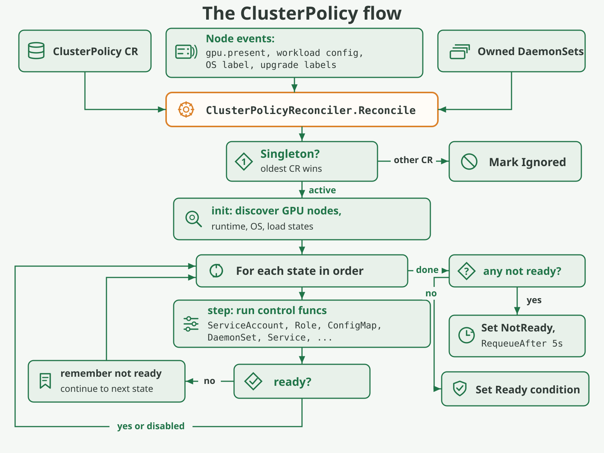
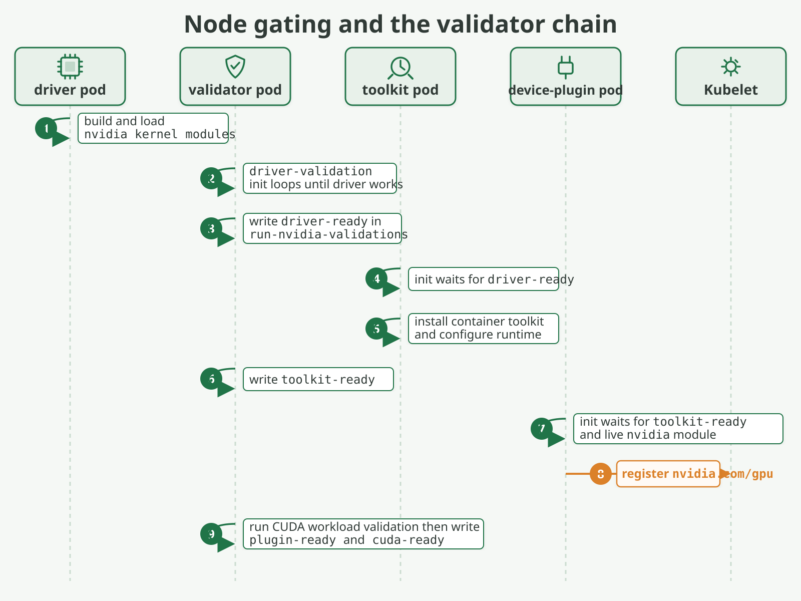
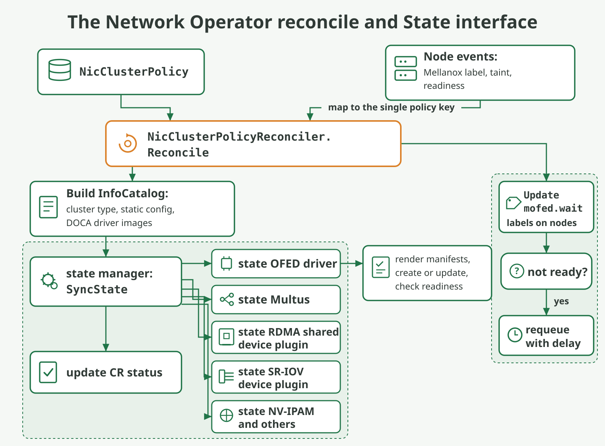

# 5.33 Reading the GPU Operator and Network Operator source

| | |
|---|---|
| Level | Advanced |
| Priority tier | 2 |
| Lab venue | `git clone` of `NVIDIA/gpu-operator` and `Mellanox/network-operator`; optional GPU cluster |
| Part | Part 5: Kubernetes |
| Status | Drafted. File and function names were read from shallow clones taken on 2026-10-24 (gpu-operator commit `0fbefd5`, network-operator commit `041bd87`). Line numbers drift; search by name. Cluster exercises are **untested** |

## Why this matters for AI infrastructure

Suppose a new GPU node joins the cluster and never becomes schedulable. Your first instinct might be to read the GPU's documentation. In practice, the answer is almost always in how the GPU Operator sequences its operands. An operand is one component the operator installs on each node, such as the driver, the container toolkit, the device plugin, the validator, the DCGM exporter, GFD and the MIG manager. GFD is GPU Feature Discovery, which labels the node with what its GPUs can do. MIG is Multi-Instance GPU, which splits one physical GPU into smaller pieces. When each operand is installed in the wrong order, or waits for something that never comes, the node stays stuck. When RDMA fails to appear on a Pod, look at the Network Operator's OFED, device-plugin and secondary-network states. RDMA is direct memory access between machines over the network, and OFED is the software stack that makes the network cards work with it.

Documentation tells you what to configure. The source tells you what the controller will actually do: in what order, gated by which label, and what "ready" means. An engineer who can read these repos can diagnose stuck rollouts, understand upgrade behaviour, answer interview questions about design, and write comparable controllers, as in 5.31 and 5.32. This chapter is a map and a method, not a line-by-line commentary. The code changes every release. So the goal is to teach you how to find your way, not to memorize today's file names.

## Prerequisites and outcomes

Before you start, work through 5.5 to 5.8, 5.29, 5.30 and 5.31. Those chapters give you the API, the reconcile loop, the CRDs and the Go controller pattern that the source code assumes you already know. When you finish this chapter, you should be able to:

- Move around both repositories and find the reconciler, the state or operand list, the manifests, and the node labels that gate each operand.
- Explain how one `ClusterPolicy` becomes about a dozen DaemonSets, deployed in order, with readiness deciding when the next step begins.
- Explain the validator pattern. Status files under `/run/nvidia/validations` are read by init containers, and they put the operands on each node in sequence.
- Explain the Network Operator's State interface, the `NicClusterPolicy`, the OFED wait-label mechanism, and how secondary networks (Multus, macvlan, host-device, IPoIB) are modelled. A secondary network is an extra network interface a Pod can use, alongside the cluster's main one. Multus is the tool that attaches those extra interfaces, and IPoIB is IP over InfiniBand.
- Follow a repeatable method that traces an operator problem from a symptom back to the code responsible for it.

## 1. Method for reading an operator

Operators share a common skeleton, so you can read them in the same order every time. Think of it as reading a building from the front door inward. You start with the blueprint, then the wiring, then the rooms, then the inspection reports.

1. Start with the API types in `api/...`. The CRD is the product surface, and its field names tell you every supported feature. Read the top-level spec struct first.
2. Read `SetupWithManager` to see what triggers a reconcile: the primary resource, nodes, owned DaemonSets and other CRs, and which predicates filter them. This answers the question "why did it (not) react to my change".
3. Read `Reconcile` for the high-level flow and every early return: singleton checks, missing prerequisites and not-ready requeues.
4. Read the state or operand layer. It shows how desired objects are produced from templates in `assets/` or `manifests/`, and how they are applied.
5. Check readiness next. Ready means something different for each kind of object: a DaemonSet rollout, a pod phase, or a file on the host.
6. Look at node-level gating. Labels, taints and nodeSelectors decide where each operand runs.
7. Finish with the tests in `*_test.go` and `testdata/`. They are the best examples of intended behaviour, and they often hint at past bugs.

The tooling supports each step. Use `git clone --depth 1`, then `rg` or `grep -rn` to search for kind names, label keys and condition strings. Use `go doc` as well, and run `git log -S"some string" -- path` to see why a line exists; that last command needs a full clone. A shallow clone has only the latest history, so the history search fails on it. Start with logs and CR status so you can form a hypothesis, then confirm it in the code. A hypothesis is a guess you can test, and reading the code is how you test it.

## 2. GPU Operator repository map

The GPU Operator lives in the repository `github.com/NVIDIA/gpu-operator`, which is licensed under Apache 2.0. Before you open any file, know where each kind of code sits. The table below lists the directories that matter most. If you are looking for the Helm chart, you want `deployments/gpu-operator`. Helm is the package manager that installs a chart, which is a bundle of templated YAML.

| Path | Contents |
|---|---|
| `api/nvidia/v1` | `ClusterPolicy` types: the main CRD |
| `api/nvidia/v1alpha1` | Newer CRDs, including `NVIDIADriver` (per-node-pool driver config) and `GPUCluster` |
| `controllers/` | Reconcilers and operand logic |
| `assets/` | Static YAML templates for each operand (`state-driver`, `state-container-toolkit`, `state-device-plugin`, `state-dcgm-exporter`, `gpu-feature-discovery`, `state-mig-manager`, `state-operator-validation`, `state-node-status-exporter`, vGPU, VFIO, Kata, confidential computing, and others) |
| `cmd/gpu-operator` | The operator binary entry point |
| `cmd/nvidia-validator` | The validator binary run in operand init containers and the validator DaemonSet |
| `internal/` | `render` (template rendering), `state`, `conditions`, `nodeinfo`, `validator`, `consts`, and other helpers |
| `deployments/gpu-operator` | The Helm chart most users install |
| `bundle/`, `manifests/` | OLM bundle for OpenShift/OperatorHub |
| `tests/` | End-to-end test scaffolding |

Read the table as a set of drawers. The `api/` folder is the front of the cabinet, where the user-facing types live. The `assets/` folder holds the raw templates. The `controllers/` folder holds the logic that fills in those templates and applies them. Knowing which drawer holds what saves you from searching the whole repository for a single line.

The `controllers/` directory holds several reconcilers, not one. The table below shows what each file does. Each reconciler watches its own kind of object, so a question about a node label leads you to a different file than a question about a driver upgrade.

| File | Reconciler | Job |
|---|---|---|
| `clusterpolicy_controller.go` | `ClusterPolicyReconciler` | Main loop: deploy and check all operand states |
| `state_manager.go` | `ClusterPolicyController` helper | The ordered list of states, node discovery, label management, which states are enabled |
| `object_controls.go` | control functions | Create/update/check each object kind; per-operand `Transform*` functions customise the template from the spec |
| `resource_manager.go` | loader | Reads the asset YAML, classifies each manifest by kind, builds the control list |
| `nodelabeling_controller.go` | `NodeLabelingReconciler` | Applies `nvidia.com/gpu.present` and the per-operand `nvidia.com/gpu.deploy.*` labels to nodes |
| `nvidiadriver_controller.go` | `NVIDIADriverReconciler` | Per-pool driver DaemonSets from the `NVIDIADriver` CR |
| `upgrade_controller.go` | `UpgradeReconciler` | Rolling driver upgrade state machine (built on NVIDIA's `k8s-operator-libs`) |
| `gpucluster_controller.go` | GPUCluster reconciler | The newer DRA-oriented stack (mutually exclusive with ClusterPolicy at the time of reading) |
| `operator_metrics.go` | metrics | Reconcile status, failure counts, NFD-labels present |

When you need the main loop, start with `clusterpolicy_controller.go`, which deploys and checks all operand states. The other files are helpers that the main loop calls. If you follow the calls from the main loop outward, you will reach each of them naturally.

## 3. The ClusterPolicy flow

The `ClusterPolicy` reconciler is the loop that deploys every operand, so it helps to see the whole loop in one picture before you read the code. The diagram shows what wakes the loop and what it does with each state. Start at the top left with the ClusterPolicy and follow the arrows. Notice that a state marked not ready leads back into the loop, not out of it.



*Figure 5.33.1. The ClusterPolicy flow, as a diagram.*

As you read the diagram, you will see that a state which is not ready does not stop the loop. The reconciler records the problem and keeps going. That choice is deliberate. If a slow driver blocked every later state, the device plugin and the monitoring would never start, and you would have no visibility into why. Here is what each part of the flow does, as the code shows it.

The reconciler lists all `ClusterPolicy` objects and treats the one with the oldest creation timestamp as the active one. The name is the tiebreaker, and every other policy is marked Ignored. The rule comes from cluster state, not from anything the operator remembers, so it stays stable across restarts. That is the same property recommended in 5.31. Think of it as "first come, first served." If someone creates a second ClusterPolicy by mistake, the second one sits idle and says so in its status, while the first keeps working.

`init` (`state_manager.go`, `ClusterPolicyController.init`) does the setup before any state runs. It discovers GPU nodes by labels and reads OS and kernel information from labels set by Node Feature Discovery (NFD), a separate tool that labels nodes with their hardware. It detects the container runtime from node info and sets Pod Security labels on the operator namespace. Then it registers the states with `addState` in a fixed order: pre-requisites, operator metrics, driver, container toolkit, operator validation, device plugin, MPS control daemon, DCGM, DCGM exporter, GPU feature discovery, MIG manager and node status exporter. The vGPU, sandbox, VFIO, Kata and confidential-computing states come after those. The order is a list in code, so you can read the sequence straight off the file.

`step` runs the control functions for the current state, then advances the index. Which functions a state uses is decided once, in `resource_manager.go`. That file reads the kind of each YAML file in the asset directory: ServiceAccount, Role, RoleBinding, ClusterRole, ClusterRoleBinding, ConfigMap, DaemonSet, Deployment, Service, ServiceMonitor, SecurityContextConstraints, RuntimeClass and PrometheusRule. A control function is the small piece of code that creates or checks one kind of object. The loader chooses the right control function for each file by looking at its kind.

`isStateEnabled` is a switch on the state name that maps each state to `spec.<component>.enabled`. When a state is disabled, its DaemonSet is deleted and the state reports Disabled. So turning a component off in the spec is not a silent pause. It removes the component from the nodes.

A state that returns NotReady does not stop the loop. The reconciler keeps deploying later states, records which ones were not ready, and requeues in 5 seconds if any were. The ordering on each node is therefore enforced by init containers, not by the controller waiting, which section 5 covers. An init container is a container that runs to completion before the main container of the same Pod starts. The controller does not need to hold back, because each node's own init containers hold back the operand that should wait.

If no node carries `feature.node.kubernetes.io/*` labels, the operator logs a warning, sets Ready with a "no NFD labels" reason, and polls every 45 seconds. Node Feature Discovery (NFD), or the operator's bundled NFD subchart, is a hard dependency for GPU discovery by PCI vendor. A PCI vendor is the company that made a piece of hardware, and the PCI bus is how the computer lists its parts. NFD reads those IDs and turns them into node labels, so the operator can find the GPUs.

If there are no GPU nodes, no DaemonSets are created, because the OS and kernel are unknown. A Node watch triggers reconciliation when a GPU node joins. The operator does not guess an OS for a node it cannot see. It waits until the labels arrive.

When the policy stays NotReady, find the state that reports it, then check that state's DaemonSet. The status names the state, so you know where to look. From there, the DaemonSet tells you which pods are unhappy.

## 4. How a state is applied

The function `DaemonSet(n ClusterPolicyController)` in `object_controls.go` is the best single function to read, because it applies a state from start to finish. It runs these steps in order. Read them as a recipe: each step prepares the object for the next, and the last steps decide whether the state counts as ready.

1. Deep-copy the template DaemonSet from the loaded asset. A deep copy means you get a fresh object, so changing it cannot damage the template you will reuse for the next node.
2. If the state is disabled, delete the DaemonSet and return Disabled.
3. If there are no GPU nodes, return Ready without creating anything.
4. Take the driver-specific branches. Clean up unused driver DaemonSets. For precompiled drivers, create one DaemonSet per kernel version. On OpenShift with the Driver Toolkit, create one per RHCOS version. A precompiled driver is one built ahead of time for a specific kernel, so the node does not compile it on boot. RHCOS is Red Hat's CoreOS operating system for nodes.
5. `preProcessDaemonSet` runs the matching `Transform*` function, for example `TransformDriver`, `TransformToolkit`, `TransformDevicePlugin` or `TransformDCGMExporter`. That function injects images, env, mounts, resource requests, runtime class, host paths and spec-driven options. Common metadata and the update strategy are applied as well. This is where the spec you wrote becomes concrete fields on the DaemonSet.
6. Make the ClusterPolicy the controller owner with `SetControllerReference`. Deleting the policy then garbage-collects the DaemonSets, and events from owned DaemonSets requeue the policy. Garbage collection here means the cluster removes the DaemonSets once their owner is gone, the same mechanism from 5.31.
7. Get the existing DaemonSet. If it is absent, store a hash of the desired object in an annotation and create it. If it is present, compare the hash with `isDaemonsetSpecChanged`, and update only when the two differ. A hash is a short fingerprint of the object, so two objects with the same content produce the same fingerprint.
8. Return the readiness of the DaemonSet.

Two patterns in this function are worth copying into your own operators. The first is the hash annotation. It avoids spurious updates, because server-side defaulting makes a deep-equal comparison always differ. Server-side defaulting means the API server fills in fields you did not set, so the object in the cluster never looks exactly like the one you built. Comparing the stored hash avoids that false difference. The second is the per-operand transform function. It is a pure-ish function from spec plus template to object, which makes it easy for you to unit test; see `transforms_test.go`. A pure-ish function is close to pure: it takes inputs and returns an object without touching the cluster.

Readiness is decided by `isDaemonSetReady`, which follows several rules. The DaemonSet controller must have observed the latest generation. Zero desired pods counts as ready, because there are no matching nodes. Any unavailable pods mean not ready. For RollingUpdate, ready means the rollout is complete. For OnDelete, the strategy drivers use so the operator controls restarts, the code compares each Pod's controller-revision-hash with the DaemonSet's current revision. It also requires every container to be ready. An OnDelete pod that runs an old revision is therefore not ready by design, and that explains a rollout that sits "not ready". The OnDelete strategy means the cluster does not restart a Pod when the DaemonSet changes. A person or the operator must delete the old Pod first. When you see a rollout sit in "not ready", read `isDaemonSetReady` first to see which criterion fails.

## 5. Node gating and the validator chain

Node labels decide where each operand runs. Labels such as `nvidia.com/gpu.deploy.driver`, `nvidia.com/gpu.deploy.container-toolkit`, `nvidia.com/gpu.deploy.device-plugin`, `nvidia.com/gpu.deploy.dcgm-exporter` and `nvidia.com/gpu.deploy.operator-validator` match each DaemonSet's `nodeSelector`. A nodeSelector is the rule that says which nodes a DaemonSet may run on. A node with the common label `nvidia.com/gpu.present=true` is a GPU node. Setting `nvidia.com/gpu.deploy.operands=false` disables all operands on that node. Think of the labels as name tags on doors. A DaemonSet only walks through the door whose tag matches.

The workload configuration of a node sets which deploy labels it gets. That setting is `nvidia.com/gpu.workload.config`, and its value is `container`, `vm-passthrough` or `vm-vgpu`. The mapping from each value to a set of labels is a table named `gpuStateLabels` in `state_manager.go`. Container nodes get the driver, toolkit, device plugin, DCGM, GFD and validator labels. VM-passthrough nodes get the VFIO and sandbox plugin labels instead. Passthrough means a whole GPU is handed to one virtual machine, so the container software is not needed on that node.

`NodeLabelingReconciler` applies these labels from the NFD facts. That is why a GPU node that appears after NFD has run causes the operands to appear. The labeler reads what NFD found, decides which deploy labels fit, and writes them onto the node. Three things follow from this. To keep one operand off a node, set its `nvidia.com/gpu.deploy.<x>=false` label. To keep every operand off, set `nvidia.com/gpu.deploy.operands=false`. A node with a GPU but no NFD PCI labels gets no operands at all, so check NFD first. Changing a node's workload config relabels it. The old operands then terminate and the new ones start. Be careful with this change on a busy node, because the terminating operands can interrupt the work running there.

If you want to see the order on one node, open `assets/state-device-plugin/0500_daemonset.yaml` and the `state-container-toolkit` assets. Each DaemonSet there has init containers, named like `toolkit-validation` or `driver-validation`. Each one loops until a file such as `toolkit-ready` exists under `/run/nvidia/validations`. That path is a hostPath shared with the validator, and the init container also checks that the kernel module reports live. A hostPath is a folder on the node itself, mounted into the Pod, so two Pods on the same node can share files through it. Here the files are the handshake between operands.

The validator writes those files. You can find its code in `cmd/nvidia-validator/main.go`, and its constants include `driver-ready`, `toolkit-ready`, `plugin-ready`, `cuda-ready`, `nvidia-fs-ready`, `nvidia-peermem-ready` and `mofed-ready`. Each name is a marker that says one step is finished. The real order on a node is shown below. Read it from top to bottom, and notice that every step begins by waiting for the marker written by the step before it.



*Figure 5.33.2. Node gating and the validator chain, as a diagram.*

Read the diagram as a chain, where each step waits for the file the step before it writes. The chain is the reason the device plugin does not advertise GPUs too early. If the plugin registered before the driver and the container toolkit were ready, Pods would be scheduled onto a GPU that cannot yet run them. This is the path to follow when `nvidia.com/gpu` is 0 on a node. Start with the driver pod logs, then the validator init container logs, the toolkit pod, and the device plugin init container. The message "waiting for nvidia container stack to be setup" is one you will see at that last stop. It means the plugin is still in its init loop, waiting for the stack below it. The chain ends with the plugin's registration with the kubelet, covered in 5.8 and Part 11.

When a node shows `nvidia.com/gpu` as 0, start at the driver pod and work down the chain until one step fails. The first step that fails is the one to fix. The steps after it are only waiting, so their logs usually say nothing useful.

## 6. Drivers: DaemonSet vs NVIDIADriver CRD, and upgrades

There are two ways to run the driver, and you need to know which one a cluster uses. Checking this first saves a lot of confusion, because the two paths create different objects with similar names.

1. Legacy. `spec.driver` in `ClusterPolicy` produces one `nvidia-driver-daemonset`, or one per kernel for precompiled drivers. Every GPU node shares that one config.
2. NVIDIADriver CRD (`api/nvidia/v1alpha1`, `nvidiadriver_controller.go`). It supports several driver configurations for different node pools, varying by version, OS, and whether the driver is precompiled or compiled. When it is enabled, `step()` in the ClusterPolicy controller skips its own driver states and cleans them up. It deletes those DaemonSets with orphan propagation, so running driver pods stay alive while the new controller rolls out its own replacements. Orphan propagation means the DaemonSet object is removed but its Pods are left running. Read that block and its TODO comment, because the authors describe the ownership overlap as known debt.

The first option gives one configuration to every node. The second lets you say "these nodes get this driver, and those nodes get that one." If your cluster mixes operating systems or driver versions, the second option is the one that fits.

Upgrades need care, because replacing a kernel driver on a node requires stopping every GPU user on that node first. A GPU user is any Pod that holds the GPU, such as a training job or an inference server. `upgrade_controller.go` handles this with a per-node state machine. A state machine here means a fixed set of steps, where each node moves forward one step at a time. Labels on each node record the current state: upgrade-required, cordon-required, wait-for-jobs, pod-deletion, drain, pod-restart, validation, uncordon, done or failed. Reading those labels on a node tells you exactly where an upgrade is stuck. The controller uses the shared `k8s-operator-libs` upgrade manager, with limits such as a maximum number of parallel upgrades and an unavailability budget. The unavailability budget is the same brake idea from 5.32, applied to driver upgrades.

The ClusterPolicy stays NotReady while any NVIDIADriver-owned node is pending, in progress or failed. Node label watches, not polling, move it forward. When a label changes, the watch wakes the controller, and the controller moves the node to its next state. Compare this with the design in 5.32. It uses the same ingredients: labels as persisted state, a budget, and cordon and drain. This version adds production depth, such as parallel limits and wait-for-jobs, which a teaching operator can leave out.

The driver DaemonSet template declares the OnDelete update strategy. The function `applyUpdateStrategyConfig` refuses to apply a RollingUpdate `maxUnavailable` override to the driver. As a result, the upgrade controller, not the DaemonSet controller, decides when each node restarts. This is the core idea of the whole upgrade design. You do not want the DaemonSet controller to restart drivers on every node at once, so the operator takes the decision away from it. When a driver upgrade stalls, the label on the node tells you which state it is stuck in.

## 7. SetupWithManager: how it stays efficient

In `clusterpolicy_controller.go`, you will find `SetupWithManager`, which decides what wakes the reconciler. It keeps those wake-ups to the ones that matter. Every watch is a filter, and every filter saves the reconciler from running for nothing.

It watches `ClusterPolicy` with a generation-changed predicate, which ignores status writes. That is the same guard you saw in 5.31, so the operator does not loop on its own status.

It watches Node objects with a custom predicate. The predicate fires only when a GPU-labelled node is created, when `gpu.present` is added, or when the operands-disabled label flips. It also fires when the workload config changes, when the OS-tree label changes, or when driver-upgrade labels change. The last case is an RHCOS GPU node being deleted, which removes stale per-version DaemonSets. Everything else, including heartbeats, is ignored. Compare this with the predicate in 5.32. Both filter out heartbeats, but this one lists more reasons to wake up, because it manages more kinds of node change.

It watches owned DaemonSets with `OnlyControllerOwner`, so a pod rollout that completes triggers re-evaluation. `OnlyControllerOwner` means only the DaemonSets this ClusterPolicy controls can wake it. Other DaemonSets in the cluster are ignored.

It watches `GPUCluster` to react to the alternative stack.

It registers a field index on DaemonSets by owner name for fast lookup. This is the same idea as the index in 5.31, applied to DaemonSets.

It sets `MaxConcurrentReconciles: 1` and uses an exponential-failure rate limiter. This controller is a singleton reconciler of cluster-wide state, so serial processing removes a class of races. A race here would be two reconciles changing the same cluster-wide objects at the same time. Running one reconcile at a time removes that risk, at the cost of speed.

When a node change seems to be ignored, you can check whether it matches one of the predicate's cases. If it does not match, the predicate is working as designed, and the change you care about may belong to a different watch.

## 8. Network Operator repository map

The NVIDIA Network Operator is in the repository `github.com/Mellanox/network-operator`. Its main directories are listed below. The table works the same way as the GPU Operator map. Find the folder that matches your question, and go straight there.

| Path | Contents |
|---|---|
| `api/v1alpha1` | `NicClusterPolicy` (cluster-wide config), `NicNodePolicy` (per-node-group), and the secondary-network CRDs `HostDeviceNetwork`, `MacvlanNetwork`, `IPoIBNetwork` |
| `controllers/` | `nicclusterpolicy_controller.go`, `nicnodepolicy_controller.go`, secondary-network controllers, `drain_controller.go`, `upgrade_controller.go`, `mofed_wait_labels.go`, `predicate.go` |
| `pkg/state/` | The **State** abstraction: `state.go` (interface), `manager.go`, `state_skel.go` (shared create/update/delete logic), and one file per component (`state_ofed.go`, `state_multus_cni.go`, `state_rdma_shared_device_plugin.go`, `state_sriov_dp.go`, `state_nv_ipam_cni.go`, `state_nic_feature_discovery.go`, `state_nic_configuration_operator.go`, `state_spectrumx.go`, `state_doca_telemetry_service.go`, and the secondary network states) |
| `manifests/` | Go-template YAML per state (`state-ofed-driver`, `state-multus-cni`, `state-rdma-shared-device-plugin`, `state-sriov-device-plugin`, `state-nv-ipam-cni`, `state-nic-feature-discovery`, and others) |
| `pkg/render` | Template renderer (Go templates with sprig-style helpers) |
| `pkg/nodeinfo` | Node attribute and label helpers; node pools grouped by OS and kernel |
| `pkg/drain`, `pkg/policyoverlap` | Drain helper; detection of two policies claiming the same node |
| `deployment/` | Helm chart |

The top-level fields of `NicClusterPolicy` are defined in `nicclusterpolicy_types.go`. They are `ofedDriver`, `rdmaSharedDevicePlugin`, `sriovDevicePlugin`, `ibKubernetes`, `secondaryNetwork` (Multus, container networking plugins, CNI plugins, IPoIB CNI, IPAM), `nvIpam`, `nicFeatureDiscovery`, `docaTelemetryService`, `nicConfigurationOperator`, `spectrumXOperator`, plus node affinity and tolerations. If you compare it with the GPU Operator's policy, you will see the same shape: one big policy with optional components. The mechanics are different. The GPU Operator leans on an ordered list of states, while the Network Operator leans on a State interface that each component implements.

When you need a component, look for its field in `nicclusterpolicy_types.go` first. The field tells you the name the spec uses, and the matching `state_*.go` file tells you how it is built.

## 9. The Network Operator reconcile and State interface

The design is more abstract here. A `State` has a `Name`, a `Description`, a `Sync` method and a `GetWatchSources` method. `Sync(ctx, customResource, infoCatalog)` returns a `SyncState`, which is one of `ready`, `notReady`, `ignore`, `reset` or `error`. The state manager calls `Sync` on each registered state in order and collects the results. It reports overall Ready only when no state is notReady or error. A state can also give a `RequeueAfter` duration, and the smallest of those durations is used. Notice how this differs from the GPU Operator. Here every state reports its own answer, and the manager combines them into one overall verdict.

The diagram below shows how a policy change moves through the reconciler, so you can follow it state by state. Start at the NicClusterPolicy on the left. The InfoCatalog is the bag of facts about the cluster that every state receives, and the state manager then runs each state against it.



*Figure 5.33.3. The Network Operator reconcile and State interface, as a diagram.*

As you read `Reconcile`, pay attention to these details. It first waits on a migration channel before doing anything, so a one-time data migration finishes before reconciliation begins. A channel here is Go's way of making one part of the program wait for a signal from another. A policy that is not named with the expected singleton name is rejected by `handleUnsupportedInstance`. Both checks run before any real work, so a bad start does no harm.

The not-found path does cleanup. When the policy is deleted, the primary object is gone and nothing else would remove the `mofed.wait` and NIC-configuration wait labels from the nodes. The controller therefore clears them. This replaces a finalizer for node-label cleanup. A finalizer would keep the policy around until the cleanup finished, but here the controller cleans up after the object is already gone, so it does the work in the not-found branch instead.

Every Node event maps to the same static request key for the policy. The `UpdateFunc` always enqueues one fixed name, so bursts of events collapse into one reconcile. A burst is many events arriving close together, and collapsing them means one pass handles all of them. Node predicates in `predicate.go` fire only on Mellanox-label changes, taint changes and readiness changes. Node create events are filtered to nodes with the Mellanox NIC label, `feature.node.kubernetes.io/pci-15b3.present=true`. The `pci-15b3` part is the PCI vendor ID for Mellanox, which NFD reports as a label.

States declare watch sources with `GetWatchSources`, and `watchStateSources` wires them into the builder. As a result, each state's owned kinds can trigger the policy. In plain words, a state tells the controller which objects it cares about, and the controller then listens for changes to those objects.

### Wait labels: dependency ordering without the controller waiting

Many DaemonSets in `manifests/` carry the node selector `network.nvidia.com/operator.mofed.wait: "false"`, placed next to the Mellanox NIC label. The reconciler sets `mofed.wait` to `true` while the OFED driver pod on a node is not yet ready. It flips the label to `false` once that pod is ready. `mofed_wait_labels.go` does the patching, using a strategic merge patch. A strategic merge patch is a patch format that knows how to merge lists and maps in Kubernetes objects, so only the label you name changes.

The result is that the RDMA and SR-IOV device plugins do not schedule onto a node until the driver stack is up on that node. A policy without an OFED section clears the wait labels, so those plugins can run against an inbox driver. An inbox driver is the one that ships with the operating system, rather than one installed by the operator. This is the Network Operator's analogue of the GPU Operator's validator files. Both solve the same per-node dependency problem, but they use different mechanisms. One uses marker files written by a validator, and the other uses a label that the controller flips.

### Shared state logic and stale objects

`state_skel.go` implements what every state needs. It renders templates, sets owner and state labels, and creates or updates objects. It labels DaemonSets with an owner value, so several policies can be told apart (`dsOwnerValue`). It also detects stale objects, which are objects that a previous render created but the current render no longer produces, such as a component removed from the policy. It deletes those. Without this step, removing a component from the spec would leave its DaemonSet running forever.

The OFED DaemonSet uses an OnDelete update strategy, and the code comments mention this explicitly. Replacing a kernel driver must be orchestrated. When `ofedDriver.upgradePolicy.autoUpgrade` is enabled, `upgrade_controller.go` and `drain_controller.go` perform a per-node, budgeted, drain-aware upgrade. Fields such as `maxParallelUpgrades`, `waitForCompletion` and `drain` control that upgrade. Read them as the knobs a cluster admin turns to decide how fast and how gently the upgrade runs.

### Secondary networks

Secondary networks are modelled with three small controllers: `MacvlanNetwork`, `HostDeviceNetwork` and `IPoIBNetwork`. Each one takes a higher-level CR with its master interface, mode, IPAM settings and resource name. It then renders a Multus `NetworkAttachmentDefinition` from that CR. A NetworkAttachmentDefinition is the object that describes one extra network a Pod can attach to. When your Pod requests one of these networks, it uses the Multus annotation, plus an `rdma/...` or `nvidia.com/...` extended resource. An extended resource is a countable resource that a device plugin advertises, such as a number of RDMA devices. For the background, see 5.14 on CNI and Part 12 on RDMA in Kubernetes. CNI is the plugin interface that wires a Pod's network, and Part 12 covers the RDMA side in depth.

When a Pod cannot get a secondary network, you should check the rendered `NetworkAttachmentDefinition` and the resource the Pod asks for. Those two objects must agree. If the Pod asks for a resource name the device plugin does not advertise, or the attachment names a network that was never rendered, the Pod waits and never starts.

## 10. Comparing the two operators

The table below puts the two operators side by side. As you read down each row, you will see where the designs match and where they part ways. Pick one row at a time and ask yourself why the two projects chose differently. Often the answer is the kind of hardware each one manages.

| Aspect | GPU Operator | Network Operator |
|---|---|---|
| Entry CR | `ClusterPolicy` (plus `NVIDIADriver`, `GPUCluster`) | `NicClusterPolicy` (plus `NicNodePolicy`, secondary-network CRs) |
| Component abstraction | Ordered state names, YAML assets, per-kind control functions | `State` interface per component with a shared skeleton |
| Templates | Static YAML mutated in Go by `Transform*` | Go templates rendered with spec data |
| Per-node dependency | Validator status files + init containers | `mofed.wait` labels + node selectors |
| Node gating | `nvidia.com/gpu.deploy.*` labels from NFD facts | Mellanox PCI label plus wait labels |
| Update strategy for drivers | OnDelete, upgrade controller with node labels | OnDelete, upgrade and drain controllers |
| Idempotent updates | Hash annotation compare | Skeleton create/update with stale-object cleanup |
| Reconcile concurrency | Single worker | Single fixed key for node events |

You will notice that both operators share several lessons. Use one policy object as the product surface. Let labels decide placement. Treat DaemonSets as the unit of per-node software. For kernel-level software, combine OnDelete with an upgrade state machine. Use Node predicates to avoid heartbeat noise, owner references for garbage collection, and a readiness definition for each kind of object. Each of these lessons appeared in 5.31 or 5.32, which is a good sign that they are general, not specific to NVIDIA.

When you design an operator of your own, start from these shared lessons and check each one against the table. If your design differs from both columns, ask why. A difference is fine when you can name the reason, and it is a warning sign when you cannot.

## 11. Debugging from source: worked recipes

The table pairs each symptom with the place to look first. If you already have a symptom, find its row and start there. Use the table as a starting point, then follow the code. Each row names a file, a label, a log line or a function, so you can move from the symptom to the code in a few steps.

| Symptom | Where to look |
|---|---|
| ClusterPolicy stays NotReady | `kubectl get clusterpolicy -o yaml` conditions and `state`; operator logs "ClusterPolicy step completed ... status" per state name; find the state in `step()`; then its DaemonSet in `isDaemonSetReady` for the failing criterion |
| No operands on a new node | Does the node have `feature.node.kubernetes.io/pci-10de.present` (NFD)? Does `NodeLabelingReconciler` add `nvidia.com/gpu.present`? Are `gpu.deploy.*` labels set or forced false? |
| Device plugin pod stuck in Init | Init container named `toolkit-validation`: check `/run/nvidia/validations` on the host for `toolkit-ready` and whether the validator DaemonSet pod logs an error |
| Driver pod keeps restarting | The driver container logs; kernel headers or repo config (`repoConfig`, `certConfig` ConfigMaps); precompiled kernel mismatch (one DaemonSet per kernel) |
| Driver upgrade stuck | Node labels for upgrade state; operator logs from the upgrade controller; PDBs blocking drain; jobs holding GPUs when `waitForCompletion` is set |
| RDMA device plugin pods not scheduling | `network.nvidia.com/operator.mofed.wait` label on the node; OFED pod readiness; `feature.node.kubernetes.io/pci-15b3.present` |
| Changes to the policy not applied | Predicates: ClusterPolicy uses a generation-changed filter, so only spec changes trigger; check the hash-annotation compare for a DaemonSet that did not update |
| Policy ignored | Singleton rules: oldest ClusterPolicy wins; NicClusterPolicy must have the expected name |

Try one row end to end to see how the method works. Take "Device plugin pod stuck in Init." First, you check the host folder for `toolkit-ready`. If it is missing, the toolkit step has not finished, so you look at the toolkit pod. If the file is there, the problem is further along, and you look at the device plugin's own logs. Each answer narrows the search, and no single step needs the whole picture.

When your symptom is not in the table, go back to the reading method in section 1 and start from the API types.

## 12. Lab

Start with the self-checking Python lab, and run it on your own machine. It checks three things. The first is the `gpuStateLabels` workload-config label resolver in the GPU Operator (`compute_gpu_node_deploy_labels`). The second is the `isDaemonSetReady` evaluator, which covers both `RollingUpdate` and `OnDelete` (`is_daemonset_ready`). The third is the per-node dependency gate, which compares `/run/nvidia/validations` with `network.nvidia.com/operator.mofed.wait`, together with the stale-object cleanup detector in `state_skel.go` (`evaluate_node_operand_gating_and_stale_objects`). Each check mirrors one part of the source you have just read, so a passing check means your reading matches the simulator.

```bash
python3 code/part05/gpu_net_operator_source_sim_lab.py
```

Next, make shallow clones of `NVIDIA/gpu-operator` and `Mellanox/network-operator`. The cluster steps below have not been run against live hardware. You should work through these exercises:

1. Clone both repositories with `--depth 1`. Open `state_manager.go` and list the `addState` calls. For each call, find the matching `assets/` directory. Then find the matching `Transform*` function in `object_controls.go`.
2. Trace `DaemonSet()` for the device plugin. Write down which numbered step from section 4 each code block performs. Then note where the hash annotation is written.
3. Open `assets/state-device-plugin/0500_daemonset.yaml` and find the init containers. For each one, note the exact condition it waits on. Then find where `toolkit-ready` is written in `cmd/nvidia-validator/main.go`.
4. In `gpuStateLabels`, list the labels for `container` and for `vm-passthrough`. Then predict which DaemonSets run on a node labelled `vm-passthrough`.
5. In the Network Operator, read `SyncState` in `pkg/state/manager.go` and `createOrUpdateObjs` in `state_skel.go`. List what happens to an object that disappears from the rendered output.
6. Write a 10-line summary that compares the wait mechanisms. Then install both operators on a lab cluster. That cluster step has not been run here. Label a node `nvidia.com/gpu.deploy.operands=false`. Watch the pods leave.
7. For a stretch task, read `upgrade_controller.go` and draw the node state machine from the labels it writes.

Only step 6 needs a live cluster, so you can do steps 1 to 5 first. Keep a notebook for the reading steps. Write the file name and the function name next to each finding, because the source changes every release, and the names are what will still help you later.

## 13. Interview angles

Use these questions to test yourself. Each one points back to a mechanism from this chapter. Try to answer out loud before you check the chapter.

- How does the GPU Operator order driver, toolkit and device plugin on a node? (Validator files and init containers, not controller waiting.)
- What decides which nodes get which operands? (NFD facts, `gpu.present`, `gpu.deploy.*` labels, workload config.)
- Why is the driver DaemonSet OnDelete? How are driver upgrades made safe?
- How do you disable DCGM exporter on one node pool only?
- How does the Network Operator prevent the RDMA plugin from running before OFED is ready?
- What problem does the hash annotation solve when updating DaemonSets?
- Why watch Nodes with predicates, and what would happen without them in a 2,000-node cluster?
- NVIDIADriver CRD vs driver in ClusterPolicy: why was it introduced?
- Describe how you would debug "nvidia.com/gpu: 0" on one node of an otherwise healthy cluster.

The last question brings together the node gating and debugging sections, so answer it with the validator chain from section 5 in mind. Start at the driver and move down the chain, one file at a time, until you find the first step that never finished.

## Exercises

Each exercise asks you to read code and explain it in your own words. Each one starts from a question a teammate might ask you. The simulators live in `code/part05/gpu_net_operator_source_sim.py`.

1. A new teammate has to learn two operators in one sprint. Apply the seven-step reading method from Section 1 to `NVIDIA/gpu-operator`. Then apply the same method to `Mellanox/network-operator`. The steps run from the API through `SetupWithManager`, `Reconcile`, state and operands, readiness and node gating, to tests.
2. A reviewer asks how the singleton rule is enforced. Trace `ClusterPolicyReconciler.Reconcile` and `step()` with the flowchart in Section 3. Say how the singleton rule is enforced. Then explain why `step()` keeps deploying later states when an earlier one is `NotReady`.
3. A GPU node joins, but nothing is deployed to it. Say what happens when no node has NFD labels. Then say how that differs from having no GPU nodes.
4. A DaemonSet keeps updating for no visible reason. Run `is_daemonset_ready()`. Walk through the eight steps of `DaemonSet()` in Section 4. Explain why a hash annotation prevents update loops against the API server. Then explain how readiness differs for `RollingUpdate` and `OnDelete` DaemonSets.
5. A node needs a different operand set for a passthrough workload. Run `compute_gpu_node_deploy_labels()` to see how `nvidia.com/gpu.workload.config` and `nvidia.com/gpu.deploy.<operand>=false` decide operand placement. The workload config can be `container`, `vm-passthrough` or `vm-vgpu`.
6. A node is stuck waiting on its validator. Trace the marker files the validator writes under `/run/nvidia/validations`, in order from `driver-ready` to `toolkit-ready` to the plugin and CUDA checks. Run `evaluate_node_operand_gating_and_stale_objects()` alongside.
7. Your cluster has GPU pools with different drivers. Explain why `NVIDIADriver` was added for clusters with different GPU pools. Say what `ClusterPolicy` does to its own driver DaemonSets when `NVIDIADriver` is on. Then say how `UpgradeReconciler` drives rolling driver upgrades through node labels.
8. Someone asks how the Network Operator differs from the GPU Operator in design. Compare the Network Operator's `State` interface, template rendering and stale-object deletion with the GPU Operator's design. Then explain the `network.nvidia.com/operator.mofed.wait: "false"` gating. Finally, walk through the eight recipes in Section 11.

## Checkpoint questions (20)

<details>
<summary>1. In `NVIDIA/gpu-operator`, which directories contain (a) the `ClusterPolicy` and `NVIDIADriver` CRD Go types, (b) the static YAML operand templates, (c) the reconcilers, and (d) the validator binary?</summary>

- `api/nvidia/v1` and `api/nvidia/v1alpha1` hold the CRD Go structs. `v1` has `ClusterPolicy`, and `v1alpha1` has `NVIDIADriver` and `GPUCluster`.
- `assets/` holds the static YAML manifests for each operand state, such as `state-driver`, `state-container-toolkit`, `state-device-plugin`, `state-dcgm-exporter`, `gpu-feature-discovery`, `state-mig-manager` and `state-operator-validation`.
- `controllers/` holds `clusterpolicy_controller.go`, `state_manager.go`, `object_controls.go`, `resource_manager.go`, `nodelabeling_controller.go`, `nvidiadriver_controller.go` and `upgrade_controller.go`.
- `cmd/nvidia-validator` is the validator binary. It runs inside the operand init containers and in the `nvidia-operator-validator` DaemonSet.
</details>

<details>
<summary>2. What happens if an administrator accidentally creates two `ClusterPolicy` objects in the same cluster, and how does the GPU Operator decide which one wins?</summary>

`ClusterPolicy` is a singleton, cluster-scoped configuration. The reconciler lists every `ClusterPolicy` in the cluster and picks the one with the oldest `metadata.creationTimestamp` as the single active policy. When two share a timestamp, the alphabetical order of `metadata.name` breaks the tie. Every newer `ClusterPolicy` is set to `Ignored` and takes no action. Because the rule depends only on cluster metadata, the same policy wins after every operator restart.
</details>

<details>
<summary>3. Does `ClusterPolicyReconciler` wait for the `state-driver` DaemonSet to become 100% Ready on all nodes before creating the `state-container-toolkit` and `state-device-plugin` DaemonSets?</summary>

No. `step()` goes through the states in order and creates or updates every enabled DaemonSet in one pass. If an earlier state such as `state-driver` returns `NotReady`, the reconciler notes that the policy is not yet ready and schedules `RequeueAfter: 5s`. It still keeps going, so the downstream DaemonSets are created straight away.

The device plugin does not start on a node before that node's driver is ready, though. Each node enforces that order itself. Init containers wait for files under `/run/nvidia/validations/<component>-ready`. Node A, whose driver finished loading in 30s, can start its toolkit and device plugin without waiting for Node B, which is still compiling a driver.
</details>

<details>
<summary>4. What happens in `ClusterPolicyController.init()` when (a) NO node in the cluster has `feature.node.kubernetes.io/*` NFD labels vs. (b) NFD labels exist, but NO node has an NVIDIA GPU (`pci-10de.present`)?</summary>

- **Case (a), no NFD labels on any node:** The operator logs a warning and marks the `ClusterPolicy` condition `Ready` with the reason `NoNFDLabels`. It creates zero operand DaemonSets and polls every 45 seconds until Node Feature Discovery (NFD) labels the nodes.
- **Case (b), NFD labels present but zero GPU nodes:** `hasGPUNodes` is false, so the target OS and kernel versions of GPU nodes are not yet known. The operand `DaemonSet()` control functions return `Ready` without creating DaemonSets. They wait until a GPU node joins and triggers the `Node` watch.
</details>

<details>
<summary>5. In `controllers/object_controls.go`, what is the purpose of the `Transform*` functions (`TransformDriver`, `TransformToolkit`, `TransformDevicePlugin`, `TransformDCGMExporter`) and the hash annotation (`nvidia.com/last-applied-hash`)?</summary>

- **`Transform*` functions:** `resource_manager.go` loads a static baseline YAML file from `assets/state-<name>/` into a Go `appsv1.DaemonSet` struct. `preProcessDaemonSet` then calls the state's `Transform*` function to change that struct in memory, based on `ClusterPolicy.spec`. The changes cover the image repository, tag and digest, env vars, `RuntimeClass`, volume mounts, tolerations and security contexts. Each transform is a pure in-memory change of the form `(DaemonSet, ClusterPolicySpec) -> DaemonSet`, so you can unit-test it in `transforms_test.go` without a cluster.
- **Hash annotation (`isDaemonsetSpecChanged`):** When you create a DaemonSet, `kube-apiserver` fills in dozens of server-side default fields. If the controller compared its rendered `DaemonSet` struct with the live `DaemonSet` using `reflect.DeepEqual`, the two would always differ, and every reconcile would trigger an `Update`. So the GPU Operator hashes the desired `DaemonSetSpec` before sending it, and stores that hash in the annotation `nvidia.com/last-applied-hash`. It calls `r.Update` only when the new hash differs from the stored one.
</details>

<details>
<summary>6. In `isDaemonSetReady()` (`object_controls.go`), how does readiness checking differ between a `RollingUpdate` DaemonSet (like `dcgm-exporter`) and an `OnDelete` DaemonSet (like `nvidia-driver-daemonset`)?</summary>

Both strategies first require `ds.Status.ObservedGeneration == ds.Generation` and `ds.Status.NumberUnavailable == 0`. A DaemonSet with `DesiredNumberScheduled == 0` counts as Ready. After that, the two strategies differ.

- **`RollingUpdate` DaemonSet:** Ready when `ds.Status.UpdatedNumberScheduled == ds.Status.DesiredNumberScheduled`.
- **`OnDelete` DaemonSet (used for GPU and OFED drivers):** Under `OnDelete`, the DaemonSet controller does not replace pods when the template changes. So `isDaemonSetReady` lists every Pod of the DaemonSet. It checks that `len(pods) == DesiredNumberScheduled`, that each Pod's `controller-revision-hash` label matches the DaemonSet's current revision hash, and that every container in every Pod has `Ready == true`. Until the upgrade controller restarts an old-revision driver pod, `isDaemonSetReady` correctly reports `NotReady`.
</details>

<details>
<summary>7. How do `NodeLabelingReconciler`, `nvidia.com/gpu.workload.config`, and `nvidia.com/gpu.deploy.<operand>` control which DaemonSet pods run on each GPU node?</summary>

1. `NodeLabelingReconciler` watches NFD PCI labels (`feature.node.kubernetes.io/pci-10de.present=true` or `pci-0302_10de.present=true`) and labels the node `nvidia.com/gpu.present=true`.
2. It reads the node's `nvidia.com/gpu.workload.config` label. The default is `container`, and the other values are `vm-passthrough` and `vm-vgpu`. It then looks up the matching label map in `gpuStateLabels` in `state_manager.go`.
   - `container` sets `nvidia.com/gpu.deploy.{driver,container-toolkit,device-plugin,dcgm,dcgm-exporter,gpu-feature-discovery,operator-validator}=true`.
   - `vm-passthrough` sets `nvidia.com/gpu.deploy.{sandbox-validator,vfio-manager,sandbox-device-plugin}=true`, and it sets the container operand labels to `false`.
3. Each operand DaemonSet's `spec.template.spec.nodeSelector` matches its own `nvidia.com/gpu.deploy.<operand>: "true"` label.
4. Setting `nvidia.com/gpu.deploy.dcgm-exporter=false` on one node disables only `dcgm-exporter` there. Setting `nvidia.com/gpu.deploy.operands=false` removes all GPU Operator pods from that node.
</details>

<details>
<summary>8. Walk through the `/run/nvidia/validations` file sequence on a GPU worker node (`cmd/nvidia-validator/main.go`), and explain how it helps you debug a Device Plugin Pod stuck in `Init:0/1`.</summary>

On each GPU worker node, the `nvidia-operator-validator` DaemonSet and the operand init containers share the host directory `/run/nvidia/validations` through a `hostPath`.
1. `nvidia-driver-daemonset` compiles or loads `nvidia.ko`, `nvidia-uvm.ko` and `nvidia-modeset.ko`.
2. The `driver-validation` init container runs `nvidia-validator` for the `driver` component. Once `nvidia-smi` or NVML succeeds, it writes `/run/nvidia/validations/driver-ready`.
3. The `nvidia-container-toolkit-daemonset` init container, named `driver-validation`, waits until `driver-ready` exists. It then configures `/etc/containerd/config.toml` with the `nvidia` runtime handler, and `toolkit-validation` writes `/run/nvidia/validations/toolkit-ready`.
4. The `nvidia-device-plugin-daemonset` init container, named `toolkit-validation`, waits until `toolkit-ready` exists and `/proc/driver/nvidia/version` is live. Then the main device-plugin container starts and registers `nvidia.com/gpu` with `kubelet`.
5. Last, the validator runs a test CUDA vector-add pod (`cuda-validation`) and a plugin check. It writes `cuda-ready` and `plugin-ready`.

**Debugging tip:** If `nvidia-device-plugin-daemonset-xyz` is stuck in `Init:0/1` and logs `waiting for nvidia container stack to be setup`, run `ls -la /run/nvidia/validations/` on the node. Then read the logs of the `nvidia-operator-validator` and `nvidia-container-toolkit` pods on that node.
</details>

<details>
<summary>9. Why did the GPU Operator introduce the `NVIDIADriver` CRD (`api/nvidia/v1alpha1`) alongside `ClusterPolicy.spec.driver`, and how does `ClusterPolicy` avoid fighting `NVIDIADriver`?</summary>

- **Why `NVIDIADriver` was introduced:** `ClusterPolicy.spec.driver` allows only one cluster-wide driver version and configuration. Large production clusters often have mixed hardware pools. For example, an A100 pool may need driver `535.x`, while a new B200 or H200 pool needs `560.x`, or OpenRM or Confidential Computing. Administrators then create several `NVIDIADriver` CRs, each with its own `nodeSelector`.
- **Avoiding controller conflict:** When `NVIDIADriver` CRs are in use, `ClusterPolicyController.step()` skips `state-driver`. It deletes any legacy driver DaemonSets that `ClusterPolicy` owns, using `metav1.DeletePropagationOrphan` (`Orphan` propagation). The old DaemonSet object is removed, but the driver pods already running on nodes stay alive until `NVIDIADriverReconciler` adopts or rolls them cleanly.
</details>

<details>
<summary>10. Why do both the GPU Operator's driver DaemonSet and the Network Operator's OFED driver DaemonSet use `updateStrategy.type: OnDelete` instead of `RollingUpdate`?</summary>

Unloading and reloading a kernel module (`nvidia.ko`, or `mlx5_core` and `ib_core`) fails with `Module is in use` while any GPU or RDMA pod runs on the node. Forcibly killing the driver container crashes every running training job on that node.
With the built-in `RollingUpdate` strategy, the DaemonSet controller in `kube-controller-manager` would kill and restart driver pods without cordoning the node, draining GPU or RDMA workloads, or unloading dependent device-plugin pods first.
Setting `updateStrategy.type: OnDelete` stops `kube-controller-manager` from restarting driver pods automatically. The restart timing moves to the operator's `UpgradeReconciler` in `upgrade_controller.go`. That controller cordons the node, waits for or drains GPU jobs, stops device plugins, and deletes the old driver pod, so `OnDelete` creates the new revision pod. Finally, it validates readiness and uncordons the node.
</details>

<details>
<summary>11. What node labels does `UpgradeReconciler` (`upgrade_controller.go` / `k8s-operator-libs`) write on a node as it progresses through a rolling GPU driver upgrade?</summary>

`UpgradeReconciler` records the per-node upgrade state machine in the label `nvidia.com/gpu-driver-upgrade-state` on each `Node` object. A node moves through these values in order:
1. `upgrade-required`: the driver pod's revision hash differs from the target DaemonSet revision.
2. `cordon-required`: the node is cordoned.
3. `wait-for-jobs`: the controller waits for running GPU jobs, up to a timeout.
4. `pod-deletion` or `drain`: remaining GPU pods are evicted, and operator operand pods that hold `/dev/nvidia*` are stopped.
5. `pod-restart`: the `OnDelete` driver pod is deleted, so the new driver pod starts.
6. `validation`: the validator pod must pass on the new driver.
7. `uncordon-required` → `upgrade-done` (or `upgrade-failed` if validation fails).
</details>

<details>
<summary>12. Look at `ClusterPolicyReconciler.SetupWithManager` (Section 7). What seven specific Node transitions does its custom `Node` predicate allow through, while dropping all other Node updates?</summary>

The custom `Node` predicate in `clusterpolicy_controller.go` triggers a reconcile in only these seven cases:
1. A new Node that already carries the GPU label is created.
2. `nvidia.com/gpu.present` is added or removed.
3. `nvidia.com/gpu.deploy.operands` flips between `"true"` and `"false"`.
4. `nvidia.com/gpu.workload.config` changes (`container` ↔ `vm-passthrough` ↔ `vm-vgpu`).
5. An OS or kernel NFD label (`feature.node.kubernetes.io/system-os_release.*` or `ostree`) changes.
6. `nvidia.com/gpu-driver-upgrade-state` changes.
7. An RHCOS or precompiled-driver GPU node is deleted, so that unused per-kernel driver DaemonSets can be garbage-collected.
Every other Node update is dropped at the predicate. That includes kubelet heartbeats, image list changes and allocatable tweaks.
</details>

<details>
<summary>13. Why does `ClusterPolicyReconciler` configure `MaxConcurrentReconciles: 1`?</summary>

`ClusterPolicy` is a singleton, so only one instance is active per cluster. Running several workers would not let them reconcile different objects in parallel. `ClusterPolicyController` also changes shared package and controller state (`state_manager.go`) across `init()` and `step()`. A single worker (`MaxConcurrentReconciles: 1`) removes internal data races, and it coalesces bursts of Node and DaemonSet events in the WorkQueue.
</details>

<details>
<summary>14. In `Mellanox/network-operator`, what are the top-level component fields of `NicClusterPolicySpec` (`api/v1alpha1/nicclusterpolicy_types.go`)?</summary>

`NicClusterPolicy.spec` configures these components:
- `ofedDriver`: the DOCA or Mellanox OFED kernel driver container (`mlx5_core`, `ib_core`).
- `rdmaSharedDevicePlugin`: exposes `rdma/rdma_shared_device_a` for shared HCA mode.
- `sriovDevicePlugin`: exposes SR-IOV Virtual Function RDMA and netdev resources (`nvidia.com/mlx5_sriov`).
- `ibKubernetes`: the InfiniBand PKey and GUID UFM integration daemon.
- `secondaryNetwork`: deploys Multus CNI, container-networking CNI plugins (`macvlan`, `ipvlan`, `host-device`), IPoIB CNI and `whereabouts` IPAM.
- `nvIpam`: NVIDIA's fast per-node CIDR block IPAM plugin (`nv-ipam`).
- `nicFeatureDiscovery`, `nicConfigurationOperator`, `docaTelemetryService` (`DTS`) and `spectrumXOperator`.
</details>

<details>
<summary>15. In the Network Operator's `pkg/state/` package, what methods does the `State` interface define, and what does `state_skel.go` handle for every state?</summary>

The `State` interface in `pkg/state/state.go` defines three things:
- `Name() string` and `Description() string`.
- `Sync(ctx context.Context, customResource interface{}, infoCatalog InfoCatalog) (SyncState, error)`, which returns `SyncStateReady`, `SyncStateNotReady`, `SyncStateIgnore`, `SyncStateReset` or `SyncStateError`.
- `GetWatchSources() map[string]*source.Kind`, which declares the kinds owned by this state that the controller should watch.

`state_skel.go` is the shared skeleton for every state. It renders the Go-template YAML from `manifests/state-<name>/`, injects owner references and state labels, and creates or updates each unstructured object. It detects and deletes stale objects, which are objects that an earlier render created but the current manifest list no longer includes. It also checks DaemonSet and Deployment rollout readiness.
</details>

<details>
<summary>16. How does the Network Operator's `network.nvidia.com/operator.mofed.wait` node label (`mofed_wait_labels.go`) prevent RDMA and SR-IOV device plugins from starting before the OFED driver is ready on a node?</summary>

1. While the `mofed` driver pod on a Mellanox node (`feature.node.kubernetes.io/pci-15b3.present=true`) is starting or not yet ready, the Network Operator sets the node label `network.nvidia.com/operator.mofed.wait: "true"`.
2. When the `mofed` pod on that node becomes `Ready`, `mofed_wait_labels.go` patches the label to `network.nvidia.com/operator.mofed.wait: "false"`. The label is also set to `"false"` when `NicClusterPolicy.spec.ofedDriver` is omitted, which means inbox OS drivers are used.
3. The DaemonSet manifests for `rdma-shared-device-plugin`, `sriov-device-plugin` and `nv-ipam` include `nodeSelector: { "network.nvidia.com/operator.mofed.wait": "false" }`. So the scheduler does not place those pods on a node until its OFED driver pod is Ready.
</details>

<details>
<summary>17. Compare the per-node dependency mechanism of the **GPU Operator** (`/run/nvidia/validations/*` files + Init Containers) against the **Network Operator** (`network.nvidia.com/operator.mofed.wait` label + `nodeSelector`).</summary>

Both mechanisms make a downstream component wait for its driver on the same node, and you can compare them side by side. They differ in when the downstream Pods are scheduled and in who does the waiting. You can read the table row by row.

| Dimension | GPU Operator (`/run/nvidia/validations`) | Network Operator (`mofed.wait` Node Label) |
|---|---|---|
| **When downstream DaemonSet Pods are scheduled** | Scheduled **immediately** onto the node; held in **`Init:0/1` (`PodInitializing`)** by `driver-validation` / `toolkit-validation` init containers polling `/run/nvidia/validations/` | **Not scheduled at all** until `NicClusterPolicyReconciler` sees the OFED pod Ready and flips `network.nvidia.com/operator.mofed.wait` from `"true"` to `"false"` |
| **Control-plane involvement** | Zero control-plane round-trips required to advance from driver → toolkit → device plugin on a node | Requires the central operator to watch the OFED Pod status and PATCH the `Node` label |
| **How it looks in `kubectl get pods`** | Downstream pods appear immediately in `Init:0/1` on the node | Downstream pods do not appear on the node until `mofed.wait=false` |

The biggest difference is where the waiting happens. The GPU Operator waits inside the node, so its Pods show up early in `Init:0/1`. The Network Operator waits at the scheduler, so its Pods do not appear on the node until the label flips.
</details>

<details>
<summary>18. In `NicClusterPolicyReconciler.Reconcile`, why does the `NotFound` branch (when `NicClusterPolicy` is deleted) actively clear `mofed.wait` labels on nodes instead of returning immediately?</summary>

While `NicClusterPolicy` was active, the controller wrote `network.nvidia.com/operator.mofed.wait` and the NIC-configuration wait labels onto `Node` objects. Nodes are not garbage-collected when `NicClusterPolicy` is deleted, so those labels would stay behind. Rather than returning straight away, the `apierrors.IsNotFound(err)` branch clears them. That way the nodes are not left with stale wait labels.
</details>

<details>
<summary>19. What do the Network Operator's secondary-network CRDs (`MacvlanNetwork`, `HostDeviceNetwork`, `IPoIBNetwork`) reconcile?</summary>

Each secondary-network controller watches its own high-level CRD (`MacvlanNetwork`, `HostDeviceNetwork` or `IPoIBNetwork`). It then renders and reconciles a matching **`k8s.cni.cncf.io/v1` `NetworkAttachmentDefinition` (`NAD`)** for **Multus CNI**. The controller fills in the CNI JSON config for you. That covers `cniVersion`, `type: "macvlan"`, `"host-device"` or `"ipoib"`, the `master` interface, `mtu`, and `ipam` settings for `nv-ipam` or `whereabouts`. It also sets the `k8s.v1.cni.cncf.io/resourceName` annotation, which links the network to the RDMA or SR-IOV device plugin.
</details>

<details>
<summary>20. A new GPU worker node joins your cluster, `kubectl get nodes` shows `Ready`, but `kubectl describe node` shows `nvidia.com/gpu: 0` (no GPUs in `Allocatable`). Trace the exact 5-step diagnostic checklist from the GPU Operator source.</summary>

Work through the five checks in order. Each one narrows the problem to a single layer.

1. **Check the NFD PCI label on the node.** Does `kubectl get node <n> --show-labels` include `feature.node.kubernetes.io/pci-10de.present=true` (or `pci-0302_10de.present=true`)? If not, check the `node-feature-discovery-worker` pod on that node, and run `lspci -nn | grep -i 10de` on the node.
2. **Check the GPU Operator deploy labels from `NodeLabelingReconciler`.** Does the node have `nvidia.com/gpu.present=true`, `nvidia.com/gpu.deploy.driver=true`, `container-toolkit=true` and `device-plugin=true`? It must not have `nvidia.com/gpu.deploy.operands=false`.
3. **Check the `nvidia-driver-daemonset` pod on that node.** Is it `Running` with `1/1`? If it is CrashLooping, run `kubectl logs -n gpu-operator nvidia-driver-daemonset-<id>` and look for missing kernel headers, a repo mirror failure, or a Secure Boot key rejection.
4. **Check `/run/nvidia/validations` and the `nvidia-operator-validator` and `nvidia-container-toolkit` pods.** Are `driver-ready` and `toolkit-ready` present under `/run/nvidia/validations` on the host? Then run `kubectl logs -n gpu-operator nvidia-operator-validator-<id> -c driver-validation`.
5. **Check the `nvidia-device-plugin-daemonset` pod on that node.** Is it stuck in `Init:0/1`, with `toolkit-validation` waiting on `toolkit-ready`? Or is it running and failing to register over `/var/lib/kubelet/device-plugins/kubelet.sock`?
</details>

## Sources and review notes

- **Sources read in full:**
  - `NVIDIA/gpu-operator` (shallow clone at commit `0fbefd5`, Apache 2.0): `api/nvidia/v1`, `api/nvidia/v1alpha1`, `controllers/clusterpolicy_controller.go`, `controllers/state_manager.go`, `controllers/object_controls.go`, `controllers/resource_manager.go`, `controllers/nodelabeling_controller.go`, `controllers/nvidiadriver_controller.go`, `controllers/upgrade_controller.go`, `cmd/nvidia-validator/main.go`, and `assets/`.
  - `Mellanox/network-operator` (shallow clone at commit `041bd87`, Apache 2.0): `api/v1alpha1`, `controllers/nicclusterpolicy_controller.go`, `controllers/mofed_wait_labels.go`, `controllers/predicate.go`, `pkg/state/state.go`, `pkg/state/manager.go`, `pkg/state/state_skel.go`, and `manifests/`.
  - `kubernetes-programming-with-go-programming-kubernetes-clients-and-operators-using-go-and-the-kuberne` — Philippe Martin / Stefan Schimanski & Michael Hausenblas, *Kubernetes Programming with Go* / *Programming Kubernetes* (controller and operator patterns).
- **Run here:** `python3 code/part05/gpu_net_operator_source_sim_lab.py` (3 passed, 0 failed).
- **Explicitly labelled inferences:** The `compute_gpu_node_deploy_labels`, `is_daemonset_ready`, and `evaluate_node_operand_gating_and_stale_objects` models in `code/part05/gpu_net_operator_source_sim.py` and the architectural diagrams and comparison tables are the author's constructions synthesizing the `NVIDIA/gpu-operator` (`0fbefd5`) and `Mellanox/network-operator` (`041bd87`) source trees and *Kubernetes Programming with Go* (plus original study items 21, 22, 23, 24, 25, 26, 27, 28, 29, and 30).
- **Not verified on live hardware:** Live cluster installations of the GPU Operator and Network Operator (`5s` not-ready requeue, `45s` no-NFD poll, `0500_daemonset.yaml`, `pci-10de.present`, `pci-15b3.present`, `2,000`-node predicate scaling) are marked (not run against live hardware here) where not executed by `gpu_net_operator_source_sim_lab.py`.
