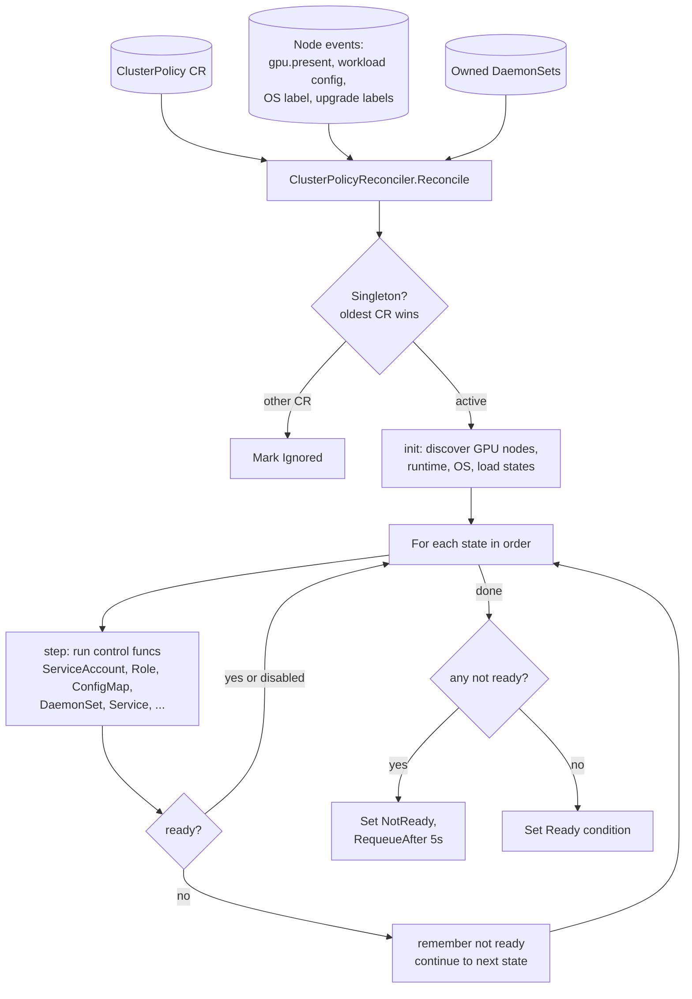
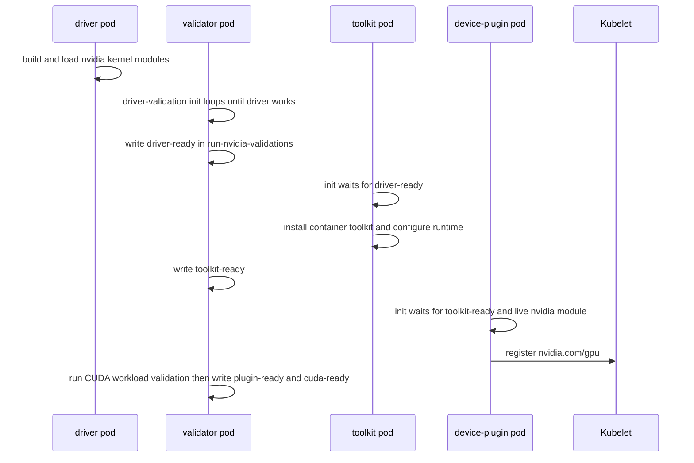
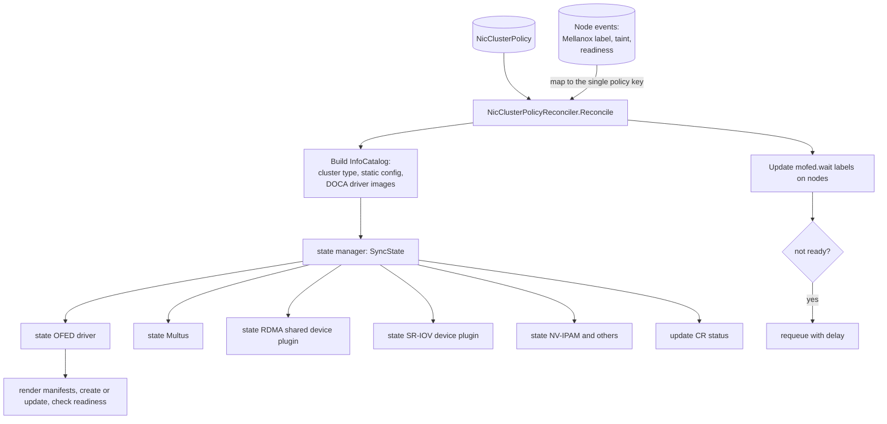

# 5.33 Reading the GPU Operator and Network Operator source

| | |
|---|---|
| Level | Advanced |
| Priority tier | 2 |
| Lab venue | `git clone` of `NVIDIA/gpu-operator` and `Mellanox/network-operator`; optional GPU cluster |
| Part | Part 5: Kubernetes |
| Status | Drafted. File and function names were read from shallow clones taken on 2026-10-24 (gpu-operator commit `0fbefd5`, network-operator commit `041bd87`). Line numbers drift; search by name. Cluster exercises are **untested** |

## Why this matters for AI infrastructure

When a GPU node does not become schedulable, the answer is almost always in how the GPU Operator sequences its operands (driver, container toolkit, device plugin, validator, DCGM exporter, GFD, MIG manager). When RDMA fails to appear on a Pod, it is the Network Operator's OFED, device-plugin and secondary-network states. Documentation tells you what to configure; the source tells you what the controller will actually do, in what order, gated by which label, and what "ready" means. An engineer who can read these repos can diagnose stuck rollouts, understand upgrade behaviour, answer interview questions about design, and write comparable controllers (5.31, 5.32). This chapter is a map and a method, not a line-by-line commentary: the code changes every release.

## Prerequisites and outcomes

Needs 5.5 to 5.8, 5.29, 5.30 and 5.31. After this chapter you can:

- Navigate both repositories and find the reconciler, the state or operand list, the manifests, and the node labels that gate each operand.
- Explain how the GPU Operator turns one ClusterPolicy into about a dozen DaemonSets deployed in order, and how readiness gates the next step.
- Explain the validator pattern (status files under `/run/nvidia/validations` consumed by init containers) that sequences operands on each node.
- Explain the Network Operator's State interface, the NicClusterPolicy, the OFED wait-label mechanism, and how secondary networks (Multus, macvlan, host-device, IPoIB) are modelled.
- Use a repeatable method to trace an operator problem from a symptom to the responsible code.

## 1. Method for reading an operator

Operators share a skeleton, so read them in this order:

1. **API types** (`api/...`): the CRD is the product surface. Field names tell you every supported feature. Read the top-level spec struct first.
2. **`SetupWithManager`**: what triggers a reconcile (primary resource, nodes, owned DaemonSets, other CRs) and with which predicates. This answers "why did it (not) react to my change".
3. **`Reconcile`**: the high-level flow and every early return (singleton checks, missing prerequisites, not-ready requeues).
4. **The state or operand layer**: how desired objects are produced (templates in `assets/` or `manifests/`) and how they are applied.
5. **Readiness**: what "ready" means for each kind of object (DaemonSet rollout, pod phase, a file on the host).
6. **Node-level gating**: labels, taints, nodeSelectors. These decide where each operand runs.
7. **Tests** (`*_test.go`, `testdata/`): the best examples of intended behaviour, and often a clue to past bugs.

Tooling: `git clone --depth 1`, then `rg` or `grep -rn` for kind names, label keys and condition strings; `go doc`; `git log -S"some string" -- path` to see why a line exists (needs a full clone). Read logs and CR status first to form a hypothesis, then confirm in code.

## 2. GPU Operator repository map

Repository `github.com/NVIDIA/gpu-operator` (Apache 2.0). Directories that matter:

| Path | Contents |
|---|---|
| `api/nvidia/v1` | `ClusterPolicy` types: the main CRD |
| `api/nvidia/v1alpha1` | Newer CRDs, including `NVIDIADriver` (per-node-pool driver config) and `GPUCluster` |
| `controllers/` | Reconcilers and operand logic |
| `assets/` | Static YAML templates for each operand (`state-driver`, `state-container-toolkit`, `state-device-plugin`, `state-dcgm-exporter`, `gpu-feature-discovery`, `state-mig-manager`, `state-operator-validation`, `state-node-status-exporter`, vGPU, VFIO, Kata, confidential computing, and others) |
| `cmd/gpu-operator` | The operator binary entry point |
| `cmd/nvidia-validator` | The validator binary run in operand init containers and the validator DaemonSet |
| `internal/` | `render` (template rendering), `state`, `conditions`, `nodeinfo`, `validator`, `consts`, and other helpers |
| `deployments/gpu-operator` | The Helm chart most users install |
| `bundle/`, `manifests/` | OLM bundle for OpenShift/OperatorHub |
| `tests/` | End-to-end test scaffolding |

Controllers in `controllers/` (the repo has several, not one):

| File | Reconciler | Job |
|---|---|---|
| `clusterpolicy_controller.go` | `ClusterPolicyReconciler` | Main loop: deploy and check all operand states |
| `state_manager.go` | `ClusterPolicyController` helper | The ordered list of states, node discovery, label management, which states are enabled |
| `object_controls.go` | control functions | Create/update/check each object kind; per-operand `Transform*` functions customise the template from the spec |
| `resource_manager.go` | loader | Reads the asset YAML, classifies each manifest by kind, builds the control list |
| `nodelabeling_controller.go` | `NodeLabelingReconciler` | Applies `nvidia.com/gpu.present` and the per-operand `nvidia.com/gpu.deploy.*` labels to nodes |
| `nvidiadriver_controller.go` | `NVIDIADriverReconciler` | Per-pool driver DaemonSets from the `NVIDIADriver` CR |
| `upgrade_controller.go` | `UpgradeReconciler` | Rolling driver upgrade state machine (built on NVIDIA's `k8s-operator-libs`) |
| `gpucluster_controller.go` | GPUCluster reconciler | The newer DRA-oriented stack (mutually exclusive with ClusterPolicy at the time of reading) |
| `operator_metrics.go` | metrics | Reconcile status, failure counts, NFD-labels present |

## 3. The ClusterPolicy flow

Reading notes, each traceable in the code:

- **Singleton rule.** `Reconcile` lists all ClusterPolicy objects and treats the one with the oldest creation timestamp (name as tiebreaker) as the active one; others are marked Ignored. It is derived from cluster state, so it is stable across restarts, the same property recommended in 5.31.
- **`init`** (`state_manager.go`, `ClusterPolicyController.init`): discovers GPU nodes by labels, reads OS and kernel information from NFD labels, detects the container runtime from node info, sets Pod Security labels on the operator namespace, and registers states with `addState` in a fixed order: pre-requisites, operator metrics, driver, container toolkit, operator validation, device plugin, MPS control daemon, DCGM, DCGM exporter, GPU feature discovery, MIG manager, node status exporter, then the vGPU/sandbox/VFIO/Kata/confidential-computing states.
- **`step`** runs the control functions for the current state, then advances the index. Which functions exist for a state is decided once, in `resource_manager.go`, by reading the kind of each YAML file in the asset directory (ServiceAccount, Role, RoleBinding, ClusterRole, ClusterRoleBinding, ConfigMap, DaemonSet, Deployment, Service, ServiceMonitor, SecurityContextConstraints, RuntimeClass, PrometheusRule).
- **`isStateEnabled`**: a switch on state name mapping to `spec.<component>.enabled`. A disabled state deletes its DaemonSet and reports Disabled.
- **Not-ready handling.** A state returning NotReady does not stop the loop: the reconciler continues deploying later states, records which were not ready, and requeues in 5 seconds if any were. The ordering at node level is therefore enforced by init containers, not by the controller waiting (section 5).
- **No NFD labels.** If no node carries `feature.node.kubernetes.io/*` labels the operator logs a warning, sets Ready with a "no NFD labels" reason, and polls every 45 seconds. NFD (or the operator's bundled NFD subchart) is a hard dependency for GPU discovery by PCI vendor.
- **No GPU nodes.** DaemonSets are not created (the OS and kernel are unknown). A Node watch triggers reconciliation when a GPU node joins.

## 4. How a state is applied

`DaemonSet(n ClusterPolicyController)` in `object_controls.go` is the best single function to read. In order:

1. Deep-copy the template DaemonSet from the loaded asset.
2. If the state is disabled, delete it and return Disabled.
3. If there are no GPU nodes, return Ready without creating anything.
4. Driver-specific branches: clean up unused driver DaemonSets; for precompiled drivers create one DaemonSet per kernel version; on OpenShift with the Driver Toolkit create one per RHCOS version.
5. `preProcessDaemonSet` runs the right `Transform*` function (for example `TransformDriver`, `TransformToolkit`, `TransformDevicePlugin`, `TransformDCGMExporter`) to inject images, env, mounts, resource requests, runtime class, host paths and spec-driven options. Common metadata and update strategy are applied.
6. Set the ClusterPolicy as **controller owner** (`SetControllerReference`) so deleting the policy garbage-collects the DaemonSets and owned-DaemonSet events requeue the policy.
7. Get the existing DaemonSet. If absent: store a **hash of the desired object in an annotation** and create it. If present: compare the hash (`isDaemonsetSpecChanged`); update only if different.
8. Return the readiness of the DaemonSet.

Two patterns worth copying into your own operators: the **hash annotation** (avoids spurious updates caused by server-side defaulting making a deep-equal comparison always differ) and the **per-operand transform functions** (a pure-ish function from spec plus template to object, easy to unit test; see `transforms_test.go`).

**Readiness** (`isDaemonSetReady`): the DaemonSet controller must have observed the latest generation; zero desired pods counts as ready (no matching nodes); any unavailable pods mean not ready; for RollingUpdate, ready means the rollout is complete; for OnDelete strategy (used for drivers so the operator controls restarts), the code compares each Pod's controller-revision-hash to the DaemonSet's current revision and requires every container to be ready. Read this function to understand why a rollout can sit "not ready": an OnDelete pod running an old revision is not ready by design.

## 5. Node gating and the validator chain

Operand placement is controlled by **node labels** such as `nvidia.com/gpu.deploy.driver`, `nvidia.com/gpu.deploy.container-toolkit`, `nvidia.com/gpu.deploy.device-plugin`, `nvidia.com/gpu.deploy.dcgm-exporter`, `nvidia.com/gpu.deploy.operator-validator`, matching each DaemonSet's `nodeSelector`. A node with the common label `nvidia.com/gpu.present=true` is a GPU node; `nvidia.com/gpu.deploy.operands=false` disables all operands on it. The mapping from a node's **workload configuration** (`nvidia.com/gpu.workload.config` = `container`, `vm-passthrough` or `vm-vgpu`) to the set of deploy labels is a table in `state_manager.go` (`gpuStateLabels`): container nodes get driver, toolkit, device plugin, DCGM, GFD, validator labels; VM-passthrough nodes get the VFIO and sandbox plugin labels instead.

`NodeLabelingReconciler` applies these labels from the NFD facts, which is why GPU nodes appearing after NFD runs causes the operands to appear. Practical consequences:

- To **keep an operand off a node**, set the specific `nvidia.com/gpu.deploy.<x>=false` label; to keep everything off, `nvidia.com/gpu.deploy.operands=false`.
- A node that has a GPU but no NFD PCI labels gets nothing. Check NFD first.
- Changing a node's workload config relabels it, which makes the old operands terminate and the new ones start.

**Per-node sequencing.** Look at `assets/state-device-plugin/0500_daemonset.yaml` and `state-container-toolkit`: each DaemonSet has **init containers** named like `toolkit-validation` or `driver-validation` that loop until a file exists, for example `toolkit-ready`, under `/run/nvidia/validations` (a hostPath shared with the validator), and also check that the kernel module reports live. The files are produced by the **validator** (`cmd/nvidia-validator/main.go`, constants such as `driver-ready`, `toolkit-ready`, `plugin-ready`, `cuda-ready`, `nvidia-fs-ready`, `nvidia-peermem-ready`, `mofed-ready`). So the real order on a node is:

This is why "nvidia.com/gpu is 0 on the node" debugging proceeds down the chain: driver pod logs, validator init container logs, toolkit pod, device plugin init container ("waiting for nvidia container stack to be setup" is a message you will see), then the plugin's registration with the kubelet (5.8, Part 11).

## 6. Drivers: DaemonSet vs NVIDIADriver CRD, and upgrades

Two ways to run the driver:

1. **Legacy**: `spec.driver` in ClusterPolicy produces one `nvidia-driver-daemonset` (or one per kernel for precompiled drivers). All GPU nodes share the config.
2. **NVIDIADriver CRD** (`api/nvidia/v1alpha1`, `nvidiadriver_controller.go`): multiple driver configurations for different node pools (versions, OS, precompiled vs compiled). When it is enabled, `step()` in the ClusterPolicy controller **skips and cleans up** its own driver states, deleting those DaemonSets with orphan propagation so running driver pods stay alive while the new controller rolls its own replacements. Read that block and its TODO comment: the authors describe ownership overlap as known debt.

**Upgrades.** Replacing a kernel driver on a node requires stopping all GPU users. `upgrade_controller.go` implements a per-node state machine (labels on nodes record the state: upgrade-required, cordon-required, wait-for-jobs, pod-deletion, drain, pod-restart, validation, uncordon, done or failed) using the shared `k8s-operator-libs` upgrade manager, with limits such as maximum parallel upgrades and an unavailability budget. The ClusterPolicy stays NotReady while any NVIDIADriver-owned node is pending, in progress or failed, and node label watches (not polling) drive it forward. Compare this to the 5.32 design: same ingredients (labels as persisted state, a budget, cordon/drain), at production depth. The driver DaemonSet template is declared with the OnDelete update strategy, and `applyUpdateStrategyConfig` refuses to apply a RollingUpdate `maxUnavailable` override to the driver, so the upgrade controller, not the DaemonSet controller, decides when each node restarts.

## 7. SetupWithManager: how it stays efficient

In `clusterpolicy_controller.go`:

- Watches `ClusterPolicy` with a generation-changed predicate (ignores status writes).
- Watches **Node** objects with a custom predicate that fires only on: creation of a GPU-labelled node, `gpu.present` added, the operands-disabled label flipping, a workload-config change, an OS-tree label change, driver-upgrade label changes, and deletion of an RHCOS GPU node (to remove stale per-version DaemonSets). Everything else, including heartbeats, is ignored. Compare with the predicate in 5.32.
- Watches owned **DaemonSets** (`OnlyControllerOwner`) so a pod rollout completing triggers re-evaluation.
- Watches `GPUCluster` to react to the alternative stack.
- Registers a **field index** on DaemonSets by owner name for fast lookup.
- Uses `MaxConcurrentReconciles: 1` and an exponential-failure rate limiter: this controller is a singleton reconciler of cluster-wide state, so serial processing removes a class of races.

## 8. Network Operator repository map

Repository `github.com/Mellanox/network-operator` (NVIDIA Network Operator).

| Path | Contents |
|---|---|
| `api/v1alpha1` | `NicClusterPolicy` (cluster-wide config), `NicNodePolicy` (per-node-group), and the secondary-network CRDs `HostDeviceNetwork`, `MacvlanNetwork`, `IPoIBNetwork` |
| `controllers/` | `nicclusterpolicy_controller.go`, `nicnodepolicy_controller.go`, secondary-network controllers, `drain_controller.go`, `upgrade_controller.go`, `mofed_wait_labels.go`, `predicate.go` |
| `pkg/state/` | The **State** abstraction: `state.go` (interface), `manager.go`, `state_skel.go` (shared create/update/delete logic), and one file per component (`state_ofed.go`, `state_multus_cni.go`, `state_rdma_shared_device_plugin.go`, `state_sriov_dp.go`, `state_nv_ipam_cni.go`, `state_nic_feature_discovery.go`, `state_nic_configuration_operator.go`, `state_spectrumx.go`, `state_doca_telemetry_service.go`, and the secondary network states) |
| `manifests/` | Go-template YAML per state (`state-ofed-driver`, `state-multus-cni`, `state-rdma-shared-device-plugin`, `state-sriov-device-plugin`, `state-nv-ipam-cni`, `state-nic-feature-discovery`, and others) |
| `pkg/render` | Template renderer (Go templates with sprig-style helpers) |
| `pkg/nodeinfo` | Node attribute and label helpers; node pools grouped by OS and kernel |
| `pkg/drain`, `pkg/policyoverlap` | Drain helper; detection of two policies claiming the same node |
| `deployment/` | Helm chart |

`NicClusterPolicy` top-level fields (from `nicclusterpolicy_types.go`): `ofedDriver`, `rdmaSharedDevicePlugin`, `sriovDevicePlugin`, `ibKubernetes`, `secondaryNetwork` (Multus, container networking plugins, CNI plugins, IPoIB CNI, IPAM), `nvIpam`, `nicFeatureDiscovery`, `docaTelemetryService`, `nicConfigurationOperator`, `spectrumXOperator`, plus node affinity and tolerations. Compare with the GPU Operator: same shape (one big policy, optional components), different mechanics.

## 9. The Network Operator reconcile and State interface

The design is more abstract than the GPU Operator's. A `State` has `Name`, `Description`, `Sync(ctx, customResource, infoCatalog)` returning a `SyncState` (`ready`, `notReady`, `ignore`, `reset`, `error`) and `GetWatchSources()`. The state manager loops over registered states in order, calls `Sync` on each, collects results, and reports overall Ready only if none are notReady or error; states may also provide a `RequeueAfter` duration and the smallest is used.

Details to look for in `Reconcile`:

- It first waits on a **migration channel** before doing anything, so a one-time data migration finishes before reconciliation begins.
- A policy not named with the expected singleton name is rejected (`handleUnsupportedInstance`).
- **Not-found path** does cleanup: it clears the `mofed.wait` and NIC-configuration wait labels from nodes, because the primary object is gone and nothing else would remove them. This replaces a finalizer for node-label cleanup.
- Every Node event maps to the **same static request key** for the policy (an `UpdateFunc` that always enqueues one fixed name), so bursts collapse into one reconcile. Node predicates (`predicate.go`) fire only on Mellanox-label changes, taint changes and readiness changes. Node create events are filtered to nodes with the Mellanox NIC label (`feature.node.kubernetes.io/pci-15b3.present=true`).
- States declare watch sources via `GetWatchSources`, and `watchStateSources` wires them into the builder, so each state's owned kinds trigger the policy.

### Wait labels: dependency ordering without the controller waiting

Many DaemonSets in `manifests/` carry the node selector `network.nvidia.com/operator.mofed.wait: "false"` next to the Mellanox NIC label. The reconciler sets `mofed.wait` to `true` on nodes while the OFED driver pod is not yet ready and flips it to `false` when it is (`mofed_wait_labels.go`, patching labels with a strategic merge patch). The consequence: the RDMA and SR-IOV device plugins do not schedule onto a node until the driver stack is up on that node, and a policy without an OFED section clears the wait labels so those plugins can run against an inbox driver. This is the Network Operator's analogue of the GPU Operator's validator files: two different mechanisms for the same per-node dependency ordering.

### Shared state logic and stale objects

`state_skel.go` implements what every state needs: render templates, set owner and state labels, create or update objects, detect **stale objects** that a previous render created but the current one no longer produces (for example when a component is removed from the policy) and delete them, and label DaemonSets with an owner value so multiple policies can be told apart (`dsOwnerValue`). The OFED DaemonSet uses an OnDelete update strategy (the code comments mention this explicitly) because replacing a kernel driver must be orchestrated: `upgrade_controller.go` and `drain_controller.go` perform a per-node, budgeted, drain-aware upgrade when `ofedDriver.upgradePolicy.autoUpgrade` is enabled, with fields like `maxParallelUpgrades`, `waitForCompletion` and `drain`.

### Secondary networks

`MacvlanNetwork`, `HostDeviceNetwork` and `IPoIBNetwork` are small controllers that render a Multus `NetworkAttachmentDefinition` from a higher-level CR (master interface, mode, IPAM settings, resource name). Pods then request them with the Multus annotation plus `rdma/...` or `nvidia.com/...` extended resources (see 5.14 on CNI and Part 12 on RDMA in Kubernetes).

## 10. Comparing the two operators

| Aspect | GPU Operator | Network Operator |
|---|---|---|
| Entry CR | `ClusterPolicy` (plus `NVIDIADriver`, `GPUCluster`) | `NicClusterPolicy` (plus `NicNodePolicy`, secondary-network CRs) |
| Component abstraction | Ordered state names, YAML assets, per-kind control functions | `State` interface per component with a shared skeleton |
| Templates | Static YAML mutated in Go by `Transform*` | Go templates rendered with spec data |
| Per-node dependency | Validator status files + init containers | `mofed.wait` labels + node selectors |
| Node gating | `nvidia.com/gpu.deploy.*` labels from NFD facts | Mellanox PCI label plus wait labels |
| Update strategy for drivers | OnDelete, upgrade controller with node labels | OnDelete, upgrade and drain controllers |
| Idempotent updates | Hash annotation compare | Skeleton create/update with stale-object cleanup |
| Reconcile concurrency | Single worker | Single fixed key for node events |

Shared lessons: one policy object as the product surface; label-based placement; DaemonSets as the unit of per-node software; OnDelete plus an upgrade state machine for kernel-level software; Node predicates to avoid heartbeat noise; owner references for GC; readiness defined per kind.

## 11. Debugging from source: worked recipes

| Symptom | Where to look |
|---|---|
| ClusterPolicy stays NotReady | `kubectl get clusterpolicy -o yaml` conditions and `state`; operator logs "ClusterPolicy step completed ... status" per state name; find the state in `step()`; then its DaemonSet in `isDaemonSetReady` for the failing criterion |
| No operands on a new node | Does the node have `feature.node.kubernetes.io/pci-10de.present` (NFD)? Does `NodeLabelingReconciler` add `nvidia.com/gpu.present`? Are `gpu.deploy.*` labels set or forced false? |
| Device plugin pod stuck in Init | Init container named `toolkit-validation`: check `/run/nvidia/validations` on the host for `toolkit-ready` and whether the validator DaemonSet pod logs an error |
| Driver pod keeps restarting | The driver container logs; kernel headers or repo config (`repoConfig`, `certConfig` ConfigMaps); precompiled kernel mismatch (one DaemonSet per kernel) |
| Driver upgrade stuck | Node labels for upgrade state; operator logs from the upgrade controller; PDBs blocking drain; jobs holding GPUs when `waitForCompletion` is set |
| RDMA device plugin pods not scheduling | `network.nvidia.com/operator.mofed.wait` label on the node; OFED pod readiness; `feature.node.kubernetes.io/pci-15b3.present` |
| Changes to the policy not applied | Predicates: ClusterPolicy uses a generation-changed filter, so only spec changes trigger; check the hash-annotation compare for a DaemonSet that did not update |
| Policy ignored | Singleton rules: oldest ClusterPolicy wins; NicClusterPolicy must have the expected name |

## 12. Lab (untested; read-only parts need only the clones)

1. Clone both repos (`--depth 1`). In the GPU Operator, list the `addState` calls in `state_manager.go` and map each to an `assets/` directory and a `Transform*` function in `object_controls.go`.
2. Trace `DaemonSet()` for the device plugin: write down which of the numbered steps in section 4 each code block performs, and where the hash annotation is written.
3. In `assets/state-device-plugin/0500_daemonset.yaml` identify the init containers and the exact condition each waits on. Find where `toolkit-ready` is written in `cmd/nvidia-validator/main.go`.
4. In `gpuStateLabels`, list the labels for `container` vs `vm-passthrough`. Predict which DaemonSets run on a node labelled `vm-passthrough`.
5. In the Network Operator, read `pkg/state/manager.go` `SyncState` and `state_skel.go` `createOrUpdateObjs`; list what happens to an object that disappears from the rendered output.
6. Write a 10-line summary comparing the wait mechanisms. Then (cluster step, untested) install both operators on a lab cluster, label a node `nvidia.com/gpu.deploy.operands=false`, and watch the pods leave.
7. Stretch: read `upgrade_controller.go` and draw the node state machine from the labels it writes.

## 13. Interview angles

- How does the GPU Operator order driver, toolkit and device plugin on a node? (Validator files and init containers, not controller waiting.)
- What decides which nodes get which operands? (NFD facts, `gpu.present`, `gpu.deploy.*` labels, workload config.)
- Why is the driver DaemonSet OnDelete? How are driver upgrades made safe?
- How do you disable DCGM exporter on one node pool only?
- How does the Network Operator prevent the RDMA plugin from running before OFED is ready?
- What problem does the hash annotation solve when updating DaemonSets?
- Why watch Nodes with predicates, and what would happen without them in a 2,000-node cluster?
- NVIDIADriver CRD vs driver in ClusterPolicy: why was it introduced?
- Describe how you would debug "nvidia.com/gpu: 0" on one node of an otherwise healthy cluster.

## 14. Checkpoint questions (30)

1. Which directories hold the GPU Operator's API types, reconcilers and operand templates?
2. What decides which ClusterPolicy is active when several exist?
3. In what order are states deployed, and does the controller wait for each to be ready?
4. What makes a state "Disabled", and what happens to its DaemonSet?
5. How does the reconciler behave when no node has NFD labels? When there are no GPU nodes?
6. What is a `Transform*` function, and why is it easy to unit test?
7. How does the operator avoid constantly updating DaemonSets that it already created?
8. What does `SetControllerReference` give you here?
9. What are the readiness criteria for a RollingUpdate vs an OnDelete DaemonSet?
10. What is `nvidia.com/gpu.deploy.operands` for?
11. What does `nvidia.com/gpu.workload.config` change?
12. Where do the `gpu.deploy.*` labels come from?
13. What is the role of the validator, and where do its status files live?
14. Why does the device plugin pod have a `toolkit-validation` init container?
15. Name the status files the validator writes.
16. Why does a driver DaemonSet use OnDelete?
17. What does the upgrade controller record on nodes, and why?
18. What happens to the legacy driver DaemonSets when the NVIDIADriver CRD is enabled?
19. Which Node events does the ClusterPolicy controller react to?
20. Why does it use a single concurrent worker?
21. What are the top-level fields of NicClusterPolicy?
22. What methods does the Network Operator `State` interface define?
23. How are overall readiness and requeue timing derived from the states?
24. Why does every Node event map to one fixed request key?
25. What does the not-found path of the NicClusterPolicy reconcile do, and why?
26. What is `network.nvidia.com/operator.mofed.wait` and who sets it?
27. How does the state skeleton deal with objects no longer rendered?
28. What do the secondary-network CRs produce?
29. Compare the two operators' mechanisms for per-node dependency ordering.
30. Give a debugging path for a policy stuck NotReady in each operator.

## 15. Sources and review notes

- Primary sources: the `NVIDIA/gpu-operator` and `Mellanox/network-operator` repositories (Apache 2.0), read from shallow clones on 2026-10-24 at the commits named above. I describe their behaviour in my own words and quote no substantial code.
- Concept sources: *Programming Kubernetes* (Hausenblas, Schimanski) for controller and operator patterns; the Kubernetes documentation for DaemonSet update strategies.
- Caveats: these projects change quickly (new CRDs, the DRA-oriented stack, state renames). Function names and file layout are as of the commits above; re-verify with `grep` before relying on a name. I did not run either operator, so runtime behaviour statements (messages, label flows) are from reading the code and manifests, not from observation.
- Cross-references: 5.31 and 5.32 (writing operators), 5.8 (device plugins), 5.14 (CNI), Part 10 and 11 (GPU, CUDA, GPU on Kubernetes), Part 12 (RDMA networking).
