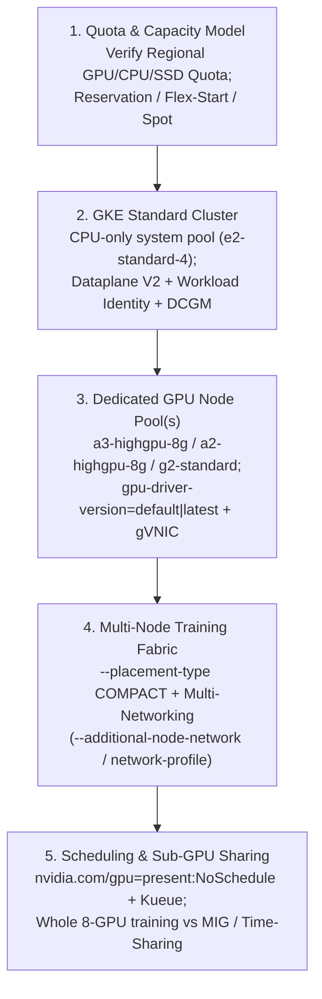

# 5.34 GKE for GPU workloads: setup, node pools and quotas

| | |
|---|---|
| Level | Advanced |
| Priority tier | 2 |
| Lab venue | GCP project with GPU quota or a reservation; `gcloud` and `kubectl`. GPU nodes are expensive: set budgets and delete pools after each lab |
| Part | Part 5: Kubernetes |
| Status | Drafted. `gcloud` flag names and values below were checked against the local `gcloud` 584.0.0 `--help` output (offline). Machine-type and accelerator-type names, quotas, and every behaviour claim are from documentation knowledge and are **unverified** against your project. Labs are **untested** |

## Why this matters for AI infrastructure

Google Cloud is one of the three clouds this role touches (alongside CoreWeave and Nebius), and GKE is the managed Kubernetes most teams meet first. Its GPU story combines managed control plane, managed drivers, several consumption models (on-demand, reservations, Spot, flex-start), and specialised networking for large training. The Kubernetes concepts are the same as on bare metal (5.8 device plugins, 5.9 scheduling, Part 11 GPU on Kubernetes), but the operational levers are different: quota is the usual first blocker, node pools are the unit of hardware, and the managed driver and networking stack replace parts of what the GPU Operator and Network Operator do elsewhere (5.33). Interviewers ask how you would stand up GPU capacity on GKE and what can go wrong.

## Prerequisites and outcomes

Needs 5.8 to 5.10, 5.14 (CNI), Part 2 (cloud networking basics) and 4.x (Terraform) for the IaC section. After this chapter you can:

- Choose between GKE Standard and Autopilot for GPU work, and between consumption models.
- Create a GPU node pool with the right machine type, accelerator, driver version, location, taints and labels.
- Request and verify GPU quota, understand reservations and why quota errors differ from stockout errors.
- Schedule Pods onto GPUs correctly, and share GPUs with time-sharing, MPS or MIG when appropriate.
- Set up compact placement and high-performance networking for multi-node training.
- Enable GPU monitoring and set cost guardrails; express it in Terraform.

## 1. Standard vs Autopilot

| | Standard | Autopilot |
|---|---|---|
| Node management | You create and size node pools | Google provisions nodes from Pod requests |
| GPU choice | Any supported machine/accelerator you can get | Limited set; requested through Pod nodeSelectors |
| Customisation (host settings, DaemonSets, privileged Pods, custom drivers, special networking) | Wide | Restricted |
| Billing | Per node (VM plus GPU) | Per Pod resource request |
| Best for | Large training, special networking, reservations, control | Simpler inference and bursty workloads |

Serious multi-node training with RDMA-class networking, reservations and compact placement uses **Standard**. Use Autopilot for smaller or intermittent GPU inference where you do not want to manage nodes. Check the current docs for which GPUs Autopilot offers.



## 2. GPU machine families and accelerators

GPUs on GCE come in two forms:

1. **Accelerator-optimized machine types** where the GPUs are part of the shape. Families include A2 (A100), A3 (H100), A3 Ultra (H200), A4 (B200) and G2 (L4) (names as I recall; verify the current list, new generations appear often). The accelerator count is fixed by the machine type (for example an 8-GPU shape).
2. **General-purpose machine types with attached GPUs** for some older GPU models (T4, V100, P100), where you pick `--accelerator type=...,count=...`.

In `gcloud`, both forms use the same `--accelerator` flag on node pools. Useful discovery commands (these call the API, so they need credentials):

```bash
gcloud compute accelerator-types list --filter="zone:us-central1-a"
gcloud compute machine-types list --filter="name~^a3 AND zone:us-central1-a"
```

Details to verify per generation: GPU memory, NVLink/NVSwitch topology, NIC count and bandwidth, local SSD, supported OS images (Container-Optimized OS vs Ubuntu), minimum GKE version, and which zones carry it.

## 3. Creating a cluster for GPUs

Start with a regional or zonal **Standard** cluster that has a small CPU-only default pool for system components, and add GPU pools separately. A cluster-per-concern approach (CPU system, GPU training) keeps failure domains and costs clear.

```bash
export PROJECT=my-project REGION=us-central1 ZONE=us-central1-a CLUSTER=gpu-lab

gcloud container clusters create "$CLUSTER" \
  --project "$PROJECT" --zone "$ZONE" \
  --release-channel regular \
  --num-nodes 1 --machine-type e2-standard-4 \
  --workload-pool "${PROJECT}.svc.id.goog" \
  --enable-dataplane-v2 \
  --enable-ip-alias \
  --enable-managed-prometheus \
  --monitoring SYSTEM,DCGM
```

Flags verified present in `gcloud container clusters create --help` (584.0.0): `--release-channel`, `--workload-pool` (Workload Identity), `--enable-dataplane-v2` (Cilium-based dataplane, 5.14/5.15), `--enable-ip-alias`, `--enable-managed-prometheus`, and `--monitoring` whose component list includes `DCGM` and `JOBSET` (the help states DCGM requires Google Managed Prometheus). Add `--enable-multi-networking` if you will attach additional NICs to Pods (section 8), `--enable-private-nodes` for private clusters, and review `--enable-shielded-nodes` defaults.

Use Workload Identity rather than node service account keys for any Pod that talks to GCS, Artifact Registry or other Google APIs (5.21 on security).

## 4. Creating a GPU node pool

```bash
gcloud container node-pools create h100-pool \
  --cluster "$CLUSTER" --zone "$ZONE" \
  --machine-type a3-highgpu-8g \
  --accelerator type=nvidia-h100-80gb,count=8,gpu-driver-version=latest \
  --num-nodes 2 \
  --node-locations "$ZONE" \
  --node-labels workload=training \
  --enable-gvnic \
  --placement-type COMPACT \
  --reservation-affinity specific --reservation my-h100-reservation
```

Verified in help: `--accelerator` takes `type`, `count`, `gpu-driver-version` (`default`, `latest`, `disabled`; `latest` only on Container-Optimized OS), `gpu-partition-size`, `gpu-sharing-strategy`, `max-shared-clients-per-gpu`. Also verified: `--placement-type` (`UNSPECIFIED` or `COMPACT`), `--placement-policy` (a named resource policy), `--reservation-affinity` (`any`, `none`, `specific`, `any-reservation-then-fail`) with `--reservation`, `--spot`, `--flex-start`, `--max-run-duration`, `--additional-node-network` (repeatable up to 7 times), `--accelerator-network-profile=auto`, `--enable-gvnic`, `--enable-image-streaming`, `--node-taints`, `--node-labels`, `--node-locations`, `--local-nvme-ssd-block`. The machine and accelerator type strings in the example (`a3-highgpu-8g`, `nvidia-h100-80gb`) are from memory: confirm them with the listing commands.

What happens after creation (documented behaviour, unverified here):

- GKE installs a **GPU driver DaemonSet** automatically when `gpu-driver-version` is not `disabled`; the node then advertises `nvidia.com/gpu` through the GKE device plugin. The help text says that for GKE 1.30.1 and later the default is to install the default driver version, and for earlier versions the default was `disabled`.
- Nodes get labels such as `cloud.google.com/gke-accelerator=<type>`; check `kubectl get node -L cloud.google.com/gke-accelerator`.
- GKE normally **taints GPU nodes** so only Pods that request GPUs land there (`nvidia.com/gpu=present:NoSchedule`) and a built-in admission step adds the matching toleration to Pods that request `nvidia.com/gpu`. Confirm on your cluster with `kubectl describe node`. If you add your own taints (for example to isolate a team) you must add tolerations explicitly.
- GPU nodes cannot live-migrate; host maintenance terminates them. Plan for it (checkpointing, Part 14).

If you prefer the GPU Operator (5.33) on GKE, set `gpu-driver-version=disabled` and let the operator install the driver, or let GKE manage drivers and run the operator without its driver component. Do not let both install a driver on the same node.

### Verify

```bash
gcloud container clusters get-credentials "$CLUSTER" --zone "$ZONE"
kubectl get nodes -L cloud.google.com/gke-accelerator
kubectl describe node NODE | grep -A8 -i "taints\|nvidia.com/gpu"
kubectl apply -f - <<'YAML'
apiVersion: v1
kind: Pod
metadata:
  name: nvidia-smi
spec:
  restartPolicy: Never
  containers:
  - name: c
    image: nvidia/cuda:12.4.1-base-ubuntu22.04
    command: ["nvidia-smi"]
    resources:
      limits:
        nvidia.com/gpu: 1
YAML
kubectl logs nvidia-smi
```

The image tag is an example; use a CUDA base image compatible with the node driver (Part 10 on driver/CUDA compatibility).

## 5. Quotas, reservations and consumption models

Capacity problems come in three flavours. Learn to tell them apart because the fixes differ:

| Symptom | Meaning | Fix |
|---|---|---|
| `QUOTA_EXCEEDED` / "Quota 'NVIDIA_H100_GPUS' exceeded" (name varies) | Your project's quota is too low | Request a quota increase for that GPU model in that region; also the global GPU quotas and CPU/RAM/SSD quotas used by the machine type |
| `ZONE_RESOURCE_POOL_EXHAUSTED` (stockout) | Quota is fine; Google has no free hardware in that zone | Try other zones, another machine type, a reservation, flex-start, or wait |
| Node pool stuck creating / Pods Pending with scale-up not triggered | Autoscaler constraints (max nodes, location policy, resource limits) or a placement constraint | Read the cluster autoscaler events and node pool status |

Quota check commands (API calls):

```bash
gcloud compute regions describe us-central1 --format="yaml(quotas)" | grep -B1 -A1 -i gpu
gcloud quotas info list --project "$PROJECT" --service compute.googleapis.com | grep -i gpu   # if the quotas CLI is installed
```

Consumption models, in rough order of cost and certainty:

1. **Reservation** (specific or any, shared across projects if configured): guaranteed capacity at a committed price. Use `--reservation-affinity specific --reservation NAME`. Large training clusters normally use reservations. Reserved capacity of a very large shape usually comes with a compact placement policy created for it.
2. **Committed use discounts**: price commitments, not capacity guarantees on their own.
3. **On-demand**: pay as you go, subject to stockouts.
4. **Spot**: deeply discounted, preemptible at any time with short notice. For fault-tolerant jobs with checkpoints and for batch inference. Use `--spot` and tolerate the Spot taint behaviour; expect 25 to 30 second preemption notice (verify) which is shorter than most checkpoints take.
5. **Flex-start (Dynamic Workload Scheduler)**: you ask for capacity for a bounded run and GKE provisions it when available, then removes it. Use `--flex-start` with `--max-run-duration`; it integrates with queued provisioning (ProvisioningRequest) and Kueue. Good for short finetunes and evaluation when you lack a reservation. Verified flags exist (`--flex-start`, `--max-run-duration`); verify supported machine types and node pool sizing rules in current docs.

Reservations and quota interact: a reservation does not increase quota, and consuming reservation capacity still needs quota in some configurations. Check the current documentation for your reservation type.

## 6. Scheduling Pods onto GPUs

The basic Pod requests `nvidia.com/gpu`. Typical additions:

```yaml
spec:
  nodeSelector:
    cloud.google.com/gke-accelerator: nvidia-h100-80gb
  tolerations:
  - key: nvidia.com/gpu
    operator: Exists
    effect: NoSchedule
  containers:
  - name: train
    resources:
      limits:
        nvidia.com/gpu: 8
```

Practical rules:

- Request the **whole node's** GPUs for multi-GPU jobs so NVLink-connected GPUs are used together; a Pod asking for 4 of 8 GPUs can leave an awkward remainder.
- Use **Kueue** (queueing, quotas, fair share, preemption) for shared GPU capacity, and JobSet / Kubeflow Trainer or similar for multi-node jobs (Part 14). The help for `--monitoring` lists a `JOBSET` metrics component, which hints at first-party JobSet observability.
- Set `priorityClassName` so critical inference can preempt batch work (5.9).
- Use `topologySpreadConstraints` or node affinity for zone spread of inference replicas; training jobs usually want the opposite (one tight placement group).
- Pull large images quickly: Artifact Registry in the same region, image streaming (`--enable-image-streaming`), and/or pre-pulled images via a DaemonSet or a secondary boot disk with a pre-loaded image.

## 7. Sharing a GPU: time-sharing, MPS, MIG

The `--accelerator` flag includes `gpu-sharing-strategy` and `max-shared-clients-per-gpu`, and `gpu-partition-size` for MIG.

| Technique | How it works | Isolation | When to use |
|---|---|---|---|
| Time-sharing | GPU context-switched between containers; each sees one GPU | Weak (shared memory space is not isolated; no fault isolation) | Many small, bursty inference/dev workloads |
| MPS | Concurrent kernels from multiple processes share SMs | Weak to medium | Throughput for several small processes on one GPU |
| MIG | Hardware partitions with dedicated memory and SMs (A100/H100 class) | Strong | Multi-tenant inference with predictable latency |

Example (MIG, partition name from documentation, verify for your GPU):

```bash
gcloud container node-pools create mig-pool --cluster "$CLUSTER" --zone "$ZONE" \
  --machine-type a2-highgpu-1g \
  --accelerator type=nvidia-tesla-a100,count=1,gpu-partition-size=1g.5gb,gpu-driver-version=default
```

With time-sharing, a Pod's `nvidia.com/gpu: 1` limit consumes one *slice*; nothing stops a slice holder from using all GPU memory. Never use it for tenants you do not trust. Compare with NVIDIA-side options (time-slicing and MPS in the device plugin, MIG manager) in Part 11.

In *Generative AI on Kubernetes* (`GAK`) Chapter 3 (*Kubernetes and GPUs*), Roland Huss et al. highlight four nuances of GPU discovery labels, MIG strategies, time-slicing, and **Dynamic Resource Allocation (`DRA`)**:
1. **Decimal `GB` vs. Binary `GiB` and GPU Feature Discovery (`GFD`) Labels (`GAK` Chapter 3):** GPU vendors advertise HBM capacity in decimal gigabytes (`40 GB` $\approx$ `37.25 GiB`, `80 GB` $\approx$ `74.5 GiB`). GFD exports rich node labels for fine-grained `nodeAffinity` placement: `nvidia.com/gpu.product` (`A100-SXM4-40GB`, or with a `-SHARED` suffix in time-slicing mode), `nvidia.com/gpu.memory` (in MiB, e.g., `40536` or `81920`—enabling `Gt: "40000"` nodeAffinity expressions to select 80 GB GPUs), `nvidia.com/gpu.compute.major` (`8` for Ampere, `9` for Hopper), `nvidia.com/gpu.machine` (`dgx-a100`), and `nvidia.com/mig.capable` (`true`).
2. **MIG `single` vs. `mixed` Strategy (`GAK` Chapter 3):**
   - **`nvidia.com/mig.strategy=single`:** Every GPU on the node is partitioned identically (for example, 2 A100 GPUs each split into seven `1g.5gb` slices $\rightarrow$ the node advertises **`nvidia.com/gpu: 14`**).
   - **`nvidia.com/mig.strategy=mixed`:** Different MIG slice sizes coexist on the same node and are advertised under distinct extended resource names: **`nvidia.com/mig-1g.5gb`**, **`nvidia.com/mig-2g.10gb`**, and **`nvidia.com/mig-3g.20gb`**.
3. **Time-Slicing with `renameByDefault: true` (`GAK` Chapter 3 `Example 3-12`):** In the GPU Operator's `gpu-sharing-config` ConfigMap, setting `renameByDefault: true` with `replicas: 8` advertises time-sliced slots as **`nvidia.com/gpu.shared: 8`** (appending `-SHARED` to `nvidia.com/gpu.product`) so Pods explicitly opt into shared time-sliced GPUs rather than accidentally landing on them when requesting a whole `nvidia.com/gpu`.
4. **Kubernetes Dynamic Resource Allocation (`DRA`, `resource.k8s.io/v1beta1`, `GAK` Chapter 3 `Examples 3-8 & 3-9`):** Traditional Kubernetes Device Plugins only expose integer counts (`nvidia.com/gpu: 1`) with no native way to express minimum VRAM (`memory >= 40Gi`), compute capability, or fractional sharing inside the resource request itself. Kubernetes **DRA** replaces static integer counters with `DeviceClass`, **`ResourceClaimTemplate`**, and `ResourceClaim` (referenced in `Pod.spec.resourceClaims` and `Container.resources.claims`), allowing a Pod to declaratively request a `DeviceClass` (`gpu.nvidia.com`) filtered by CEL attributes.

## 8. Networking for multi-node training

For a single-node job, the default VPC networking is enough. For multi-node training, inter-node bandwidth and latency dominate (Part 12). On GKE this involves several pieces; the details depend on the machine family and change between generations, so treat the following as a map and read the current guide for your shape:

- **gVNIC** (`--enable-gvnic`) is required or recommended on high-end accelerator machine types.
- **Multiple VPC networks / NICs**: accelerator-optimized shapes have several NICs dedicated to GPU traffic. GKE exposes them to Pods through **multi-networking** (cluster flag `--enable-multi-networking`, node pool flag `--additional-node-network network=NAME,subnetwork=SUBNET`, repeatable up to 7 times, plus Network and GKENetworkParamSet resources in the cluster). The help also lists `--accelerator-network-profile=auto`, which creates a profile for compatible accelerator machine types; check which machine types it covers.
- **NCCL network plugins**: older A3 shapes use a GPUDirect-TCPX/TCPXO approach with a sidecar and a NCCL plugin; newer shapes use RDMA over RoCE with NCCL's native IB verbs path. Pod specs need the right annotations, the right NCCL environment variables, and sometimes an installer DaemonSet. (From documentation; version-specific.)
- **Compact placement** (`--placement-type COMPACT` or a named `--placement-policy`) keeps nodes in a tight physical cluster to cut hops; it limits maximum pool size and can cause stockouts.
- Validate with **NCCL tests** (`all_reduce_perf`) and compare against expected bus bandwidth for the shape before running real jobs (Part 12/14).

## 9. Autoscaling and upgrades

- **Cluster autoscaler** per node pool: `--enable-autoscaling --min-nodes --max-nodes` (or `--total-min-nodes/--total-max-nodes` with `--location-policy`, both listed in the help). `--location-policy=ANY` favours zones with capacity; `BALANCED` spreads. Scale GPU pools to zero when idle (`min-nodes 0`) if start latency is acceptable.
- **Node auto-provisioning** can create GPU pools on demand within resource limits you configure. Useful for variety, less so for tightly controlled training clusters.
- **Upgrades**: GPU node pools should use surge settings carefully. With no spare GPUs available, `max-surge-upgrade` above 0 may fail for lack of capacity; use `max-unavailable-upgrade` instead and drain with checkpointing. Control windows and exclusions (`--add-maintenance-exclusion-until-end-of-support` exists in node pool help). Use a release channel and test GPU driver changes on a canary pool first, because a driver bump changes the CUDA compatibility story (Part 10).
- Auto-repair of GPU nodes can restart long jobs. Decide deliberately whether to enable it for training pools, and pair with your own health logic (5.32).

## 10. Observability and cost

- `--monitoring SYSTEM,DCGM` with Google Managed Prometheus exports DCGM GPU metrics (utilisation, memory, power, temperature, Xid and ECC where available) into Cloud Monitoring. Or deploy `dcgm-exporter` yourself and scrape with your own Prometheus (5.19, Part 11).
- Alert on: GPU utilisation low for long periods on expensive nodes, Xid errors, ECC errors, Pending Pods that request GPUs, node pool at max, preemptions, autoscaler failures.
- **Cost controls**: budgets and alerts on the project; labels on node pools and Pods for attribution; scale idle pools to zero; use Spot or flex-start for interruptible work; use right-sized shapes; delete lab clusters. Idle reserved GPUs are the biggest silent cost: track reservation utilisation.
- Cloud Logging for nodes and GPU driver install DaemonSet logs; check them first when `nvidia.com/gpu` is missing.

## 11. Terraform sketch (untested)

```hcl
resource "google_container_cluster" "gpu" {
  name     = "gpu-lab"
  location = var.zone

  remove_default_node_pool = true
  initial_node_count       = 1

  release_channel { channel = "REGULAR" }
  workload_identity_config { workload_pool = "${var.project}.svc.id.goog" }
  datapath_provider = "ADVANCED_DATAPATH"
}

resource "google_container_node_pool" "h100" {
  name       = "h100-pool"
  cluster    = google_container_cluster.gpu.id
  location   = var.zone
  node_count = 2

  node_config {
    machine_type = "a3-highgpu-8g"
    guest_accelerator {
      type  = "nvidia-h100-80gb"
      count = 8
      gpu_driver_installation_config { gpu_driver_version = "LATEST" }
    }
    labels = { workload = "training" }
  }

  placement_policy { type = "COMPACT" }
}
```

Argument names are from the Google provider as I remember it and **must be validated** with `terraform validate` against your provider version. Prefer a module pinned to a version, manage the cluster and the GPU pools in separate states or at least separate modules, and set `lifecycle.prevent_destroy` on anything holding state. See Part 4 on Terraform structure.

## 12. Failure modes and troubleshooting

| Symptom | Likely cause | Check |
|---|---|---|
| Node pool creation fails with quota error | GPU/CPU/SSD/IP quota | Quota page; error text names the metric |
| Creation fails with resource exhausted | Zone stockout | Another zone, shape or consumption model |
| Nodes up but `nvidia.com/gpu` is 0 | Driver install failed or disabled | Driver installer DaemonSet logs in `kube-system`; `gpu-driver-version`; OS image |
| Pod Pending "Insufficient nvidia.com/gpu" | No node with free GPU, taint/toleration mismatch, wrong selector | `kubectl describe pod`; node taints; autoscaler events |
| Pod runs but cannot see GPU | Missing resource limit; wrong runtime or image | `nvidia-smi` in a minimal Pod |
| Slow multi-node training | No compact placement, wrong NICs or NCCL env, cross-zone nodes | NCCL test, topology, placement policy |
| Job dies randomly | Spot preemption, host maintenance, auto-repair, Xid | Node events, Cloud Logging, DCGM |
| Upgrade stuck | No surge capacity, PDB blocking drain | Upgrade settings, PDBs |
| Unexpected bill | Idle pools, unused reservations, egress | Billing export, labels, utilisation |

## 13. Lab

First, run the self-checking Python lab (`code/part05/gke_gpu_pool_planner_lab.py`) locally. It verifies the GKE GPU node-pool configuration and `GAK` Chapter 3 MIG/time-sharing resource calculator (`evaluate_gke_gpu_node_pool_config`), the GKE GPU capacity error classifier (`classify_gke_gpu_capacity_error`: distinguishing `QUOTA_EXCEEDED` vs `ZONE_RESOURCE_POOL_EXHAUSTED` stockouts), and the GPU node-pool upgrade surge validator (`validate_gpu_pool_upgrade_surge`).

```bash
python3 code/part05/gke_gpu_pool_planner_lab.py
```

Next, in a GCP lab project with a budget alert configured (all live cloud steps below are `untested here` and incur GPU billing), work through these exercises:

1. Create a project budget alert first.
2. Create a small Standard cluster (`e2-standard-4`, 1 node), then a single-GPU pool with a cheap GPU (for example L4 or T4, whichever your quota allows). Record the exact commands and errors.
3. Run the `nvidia-smi` Pod, then a CUDA sample or PyTorch `torch.cuda.is_available()` Pod.
4. Break it deliberately: remove the toleration, request 2 GPUs on a 1-GPU node, request a GPU type with no quota. Capture each failure message and map it to the table in section 12.
5. Add a time-sharing pool and run 4 Pods against one GPU; observe interference with `nvidia-smi`.
6. Enable `DCGM` monitoring and view GPU utilisation in Cloud Monitoring.
7. Try `--spot` and `--flex-start` pools; note how they differ in scale-up behaviour.
8. Express the cluster and pool in Terraform; run `terraform validate` and `plan`.
9. Delete everything. Verify with `gcloud container clusters list` and billing.

## 14. Interview angles

- Walk me through standing up a GPU node pool on GKE. What do you check first when it fails?
- Quota exceeded vs stockout: how do you tell, and what do you do about each?
- Reservation vs Spot vs flex-start: which for a 3-day 64-GPU training run? A nightly evaluation? Production inference?
- How do GPU drivers get onto GKE nodes, and when would you disable that?
- Time-sharing vs MPS vs MIG: isolation and use cases.
- Why compact placement, and what are its downsides?
- How would you upgrade a GPU node pool when there is no spare capacity?
- How do you make multi-node training network performance predictable on GKE?
- How would you attribute GPU cost to teams?

## Exercises

1. **GKE `Standard` vs. `Autopilot` and Designing a Multi-Pool GPU Cluster Architecture:** Explain why multi-node distributed training with compact placement, reservations, and multi-NIC RDMA/TCPXO uses GKE `Standard` with a small CPU-only default system pool (`e2-standard-4`) and separate GPU node pools (`a3-highgpu-8g`, `g2-standard`), and trace the `gcloud container clusters create` flags in Section 3 (`--workload-pool`, `--enable-dataplane-v2`, `--enable-managed-prometheus`, `--monitoring SYSTEM,DCGM`).
2. **Creating a GPU Node Pool (`--accelerator`), Driver Management (`gpu-driver-version`), and Taints/Tolerations:** Using `evaluate_gke_gpu_node_pool_config()` in `code/part05/gke_gpu_pool_planner.py`, explain the three values of `gpu-driver-version` (`default`, `latest`, `disabled`), why `latest` requires Container-Optimized OS (`COS`), why you must set `gpu-driver-version=disabled` if the NVIDIA GPU Operator manages drivers, and how GKE's `nvidia.com/gpu=present:NoSchedule` taint and automatic toleration injection work.
3. **Triaging GKE Capacity Errors (`QUOTA_EXCEEDED` vs. `ZONE_RESOURCE_POOL_EXHAUSTED`) and Choosing a Consumption Model:** Using `classify_gke_gpu_capacity_error()` in `code/part05/gke_gpu_pool_planner.py`, contrast `QUOTA_EXCEEDED` (project quota) with `ZONE_RESOURCE_POOL_EXHAUSTED` (physical zone stockout), and select the right GKE consumption model (`Reservation`, `CUD`, `On-Demand`, `Spot`, or `Flex-start` / Dynamic Workload Scheduler `--flex-start --max-run-duration`) for (a) a 14-day 256-GPU pre-training run, (b) a 4-hour fine-tuning job without a reservation, and (c) stateless batch scoring.
4. **Sub-GPU Sharing (`Time-Sharing` vs. `MPS` vs. `MIG` `single`/`mixed`) and Dynamic Resource Allocation (`DRA`, `GAK` Chapter 3):** Compare `--accelerator` `gpu-sharing-strategy=time-sharing` (`max-shared-clients-per-gpu`), `MPS`, and `gpu-partition-size=1g.5gb` (`MIG`), contrast `nvidia.com/mig.strategy` `single` vs `mixed` (`GAK` Ch. 3), and explain how Kubernetes `DRA` (`ResourceClaimTemplate` in `resource.k8s.io/v1beta1`) overcomes the limitations of integer Device Plugin requests.
5. **High-Performance Multi-Node GPU Networking on GKE (`gVNIC`, Multi-Networking, `TCPX`/`TCPXO` vs. `RoCE` RDMA, and `COMPACT` Placement):** Explain the role of `--enable-gvnic`, `--enable-multi-networking` + `--additional-node-network` (up to 7 additional NICs) / `--accelerator-network-profile=auto`, and `--placement-type COMPACT`, and explain how to verify multi-node fabric throughput with `nccl-tests` (`all_reduce_perf`) before launching training.
6. **Zero-Spare-Capacity GPU Node Pool Upgrades (`max-surge-upgrade` vs. `max-unavailable-upgrade`) and Terraform IaC Structure:** Using `validate_gpu_pool_upgrade_surge()` in `code/part05/gke_gpu_pool_planner.py`, explain why default `max-surge-upgrade=1` stalls on a GPU node pool backed by a fully utilized reservation or exact quota, how to configure `max-surge-upgrade=0, max-unavailable-upgrade=1` with maintenance exclusions, and why Terraform should decouple `google_container_cluster` (`remove_default_node_pool = true`) from `google_container_node_pool` resources.

## Checkpoint questions (20)

<details>
<summary>1. When should you choose GKE `Standard` vs. GKE `Autopilot` for GPU workloads?</summary>

- **Choose GKE `Standard` when:** You run multi-node distributed GPU training or low-latency serving that requires **explicit node-pool topology control (`--placement-type COMPACT`)**, **multi-NIC GPU networking (`--enable-multi-networking`, `--additional-node-network`, GPUDirect-TCPXO / RoCE RDMA)**, **specific capacity reservations (`--reservation-affinity=specific`)**, custom privileged DaemonSets, or custom kernel/driver configurations.
- **Choose GKE `Autopilot` when:** You run simpler single-node or bursty GPU inference/batch workloads where you want Google to provision nodes automatically from Pod `nodeSelector` / resource requests and bill per Pod rather than managing node pools.
</details>

<details>
<summary>2. What is the difference between GCE's two GPU attachment models (Accelerator-Optimized machine families vs. General-Purpose N1 machines with attached GPUs)?</summary>

1. **Accelerator-Optimized Machine Families (`A2` = A100, `A3` = H100, `A3 Ultra` = H200, `A4` = B200, `G2` = L4):** The GPU model and count (e.g., `a3-highgpu-8g` has 8 H100 GPUs connected via NVLink/NVSwitch plus dedicated high-speed GPU NICs and local NVMe SSDs) are **fixed parts of the machine shape** (though you still pass `--accelerator type=...,count=...` in `gcloud container node-pools create`).
2. **General-Purpose Machine Types (`N1`) with Attached GPUs (`T4`, `V100`, `P100`):** You attach 1, 2, 4, or 8 PCIe GPUs onto a standard VM shape.
</details>

<details>
<summary>3. Why should a GKE Standard cluster always be created with a small CPU-only default pool (`e2-standard-4`) and `remove_default_node_pool = true` in Terraform, adding GPU pools as separate `google_container_node_pool` resources?</summary>

1. **Cost & System Pod Isolation:** Cluster-critical system Pods (`kube-dns`/`coredns`, `metrics-server`, `gmp-operator`, `kueue-controller-manager`) do not need $30–$100/hour GPU VMs. Running them on a small CPU-only system pool allows GPU node pools to **scale down to `0` nodes when idle** without evicting cluster control/monitoring pods.
2. **Independent Node-Pool Lifecycle in Terraform:** If a node pool is defined inline inside `google_container_cluster`, changing a node-pool setting (machine type, disk size, taint, or reservation) forces Terraform to **destroy and recreate the entire GKE cluster**. Setting `remove_default_node_pool = true` and managing each `google_container_node_pool` as a separate resource lets you add, resize, or replace GPU pools with zero impact on the control plane.
</details>

<details>
<summary>4. What are the three accepted values for `gpu-driver-version` in `--accelerator` on GKE (`gcloud` 584.0.0), what is the default in GKE 1.30.1+, and what OS restriction applies to `latest`?</summary>

- **Three accepted values:** **`default`** (GKE's default tested driver for that GKE release), **`latest`** (the newest driver branch available on GKE for that OS), and **`disabled`** (do not install any GKE-managed GPU driver DaemonSet).
- **Default in GKE 1.30.1+:** GKE automatically installs the **`default`** GPU driver DaemonSet (whereas in versions prior to 1.30.1 the default was `disabled`).
- **OS restriction on `latest`:** `gpu-driver-version=latest` is **only supported on nodes running Container-Optimized OS (`COS`)**, not Ubuntu.
- **When to use `disabled`:** Whenever you install the **NVIDIA GPU Operator** with `driver.enabled=true` to manage drivers yourself (never allow both GKE's driver installer and the GPU Operator's driver DaemonSet to install drivers on the same node).
</details>

<details>
<summary>5. How does GKE prevent CPU-only Pods from accidentally scheduling onto expensive GPU nodes, and how do GPU Pods bypass that block?</summary>

1. When GKE creates a GPU node pool, it automatically applies the taint **`nvidia.com/gpu=present:NoSchedule`** to every node in that pool. Any CPU-only Pod (which lacks `resources.limits["nvidia.com/gpu"]` and lacks a matching toleration) is rejected by `TaintToleration` filtering.
2. When a Pod is submitted with **`resources.limits["nvidia.com/gpu"] > 0`**, GKE's built-in **`ExtendedResourceToleration` admission controller** automatically mutates the Pod spec to inject the toleration for `nvidia.com/gpu:NoSchedule`. (If you add your *own* custom taint like `team=research:NoSchedule` to a GPU node pool, Pods must explicitly include a toleration for `team=research:NoSchedule`.)
</details>

<details>
<summary>6. What is the exact difference between a `QUOTA_EXCEEDED` error and a `ZONE_RESOURCE_POOL_EXHAUSTED` error when creating or scaling a GKE GPU node pool, and how do you fix each?</summary>

- **`QUOTA_EXCEEDED` (e.g., `Quota 'NVIDIA_H100_GPUS' exceeded` or `PREEMPTIBLE_NVIDIA_A100_GPUS`):** An **account/project billing & IAM policy limit** in your GCP project is lower than what you requested.
  - *Fix:* Request a quota increase in IAM & Admin $\rightarrow$ Quotas for that specific GPU family in that region, **plus** the global GPU quota (`GPUS_ALL_REGIONS`), **plus** the vCPU (`N2_CPUS` / `A3_CPUS`), memory, and local SSD quotas consumed by that machine type.
- **`ZONE_RESOURCE_POOL_EXHAUSTED` (Stockout):** Your project has plenty of quota, **but Google's physical data center in `us-central1-a` currently has no free physical GPU servers of that shape available on-demand**.
  - *Fix:* Use multi-zone node pools with **`--location-policy=ANY`**, use **Flex-start (`--flex-start` / Dynamic Workload Scheduler)** to queue the capacity request until hardware frees up, or purchase a **Specific Capacity Reservation**.
</details>

<details>
<summary>7. Compare GKE's five GPU capacity consumption models: (a) **Specific Reservation**, (b) **Committed Use Discount (`CUD`)**, (c) **On-Demand**, (d) **Flex-Start (`DWS`)**, and (e) **Spot VMs**.</summary>

| Model | Capacity Guarantee? | Preemptible? | Best Workload Fit |
|---|---|---|---|
| **1. Specific Reservation (`--reservation-affinity=specific --reservation=NAME`)** | **Yes** (hardware physically held for you) | No | Large multi-node training & baseline 24/7 production inference |
| **2. Resource CUD (1y/3y)** | **No** without an attached reservation (billing discount only) | No | Steady baseline spend (always pair with a reservation for scarce GPUs) |
| **3. On-Demand** | No (subject to zone stockouts) | No | Elastic burst serving when on-demand capacity exists |
| **4. Flex-Start (`--flex-start --max-run-duration`, DWS)** | Queues request and provisions all nodes atomically for a bounded duration (up to 7 days) | Terminates at `max-run-duration` | Multi-node fine-tuning, evaluation, and batch jobs when you lack a reservation |
| **5. Spot (`--spot`)** | No | **Yes (~25–30s notice)** | Stateless batch inference, data embedding, and checkpoint-tolerant jobs |
</details>

<details>
<summary>8. Does having a GCP Capacity Reservation automatically grant your project the GCP Quota required to use those GPUs?</summary>

**No.** In GCP, **Reservations and Quotas are tracked separately**: creating or consuming a reservation for 64 H100 GPUs still requires your GCP project to hold **at least 64 H100 GPUs of regional quota** (plus the corresponding vCPU and local SSD quotas). Always request and verify the regional GPU/CPU/SSD quota *before* attempting to create a reservation or node pool.
</details>

<details>
<summary>9. Why is Spot preemption (`--spot`) particularly challenging for large LLM training jobs on GKE, and what must a workload do if it runs on Spot GPUs?</summary>

When GCE reclaims a Spot GPU VM, it sends an ACPI preemption signal (`SIGTERM` to Pods via `kubelet`) with only a **25 to 30 second grace period** before the VM is hard-terminated.
Writing a 500 GB distributed checkpoint to GCS over the network takes much longer than 30 seconds. Therefore, workloads running on Spot GPUs must either:
1. Be **stateless/idempotent** (batch offline scoring, Ray data preprocessing, or multi-replica inference behind a load balancer with on-demand fallback), OR
2. Use **frequent asynchronous in-memory / local-NVMe / peer-rank checkpointing** (so at most a few minutes of steps are lost when a node vanishes without finishing a shutdown checkpoint) paired with elastic `torchrun` / `JobSet` restart.
</details>

<details>
<summary>10. How does GKE Flex-Start (`--flex-start` with `--max-run-duration`) integrate with `Kueue` and `ProvisioningRequest` (Dynamic Workload Scheduler)?</summary>

Instead of trying to grab 16 GPU nodes one by one (and paying for 10 idle nodes while 6 are stuck in stockout), you create a Flex-Start GPU node pool (`min-nodes=0`, `--flex-start`, `--enable-queued-provisioning`).
When a user submits a `JobSet` or `RayJob` managed by **Kueue** with a **`ProvisioningRequest` AdmissionCheck**:
1. Kueue creates a `ProvisioningRequest` CR asking GKE's **Dynamic Workload Scheduler (`DWS`)** for all 16 GPU nodes atomically for e.g. `maxRunDuration: 12h`.
2. DWS queues the request in Google Cloud's capacity scheduler (costing $0 while queued).
3. Once all 16 nodes can be allocated together (including compact placement if requested), GKE provisions all 16 nodes simultaneously and Kueue unsuspends the training job.
</details>

<details>
<summary>11. Why should a multi-GPU training Pod on an 8-GPU node (`a3-highgpu-8g` or `a2-highgpu-8g`) request all 8 GPUs (`nvidia.com/gpu: 8`), or else request `1`, `2`, or `4` GPUs aligned to NVLink/PCIe topology?</summary>

On an 8-GPU HGX/A2/A3 node, all 8 GPUs are connected inside a high-speed intra-node **NVSwitch** fabric (600–900 GB/s bidirectional) and paired with specific NUMA sockets and NICs:
- If a Pod requests an odd number like `nvidia.com/gpu: 5` or `6`, the remaining `3` or `2` GPUs on that node become **stranded fragments** that no 4-GPU or 8-GPU job can use.
- For multi-node training, always request the **entire node (`nvidia.com/gpu: 8`, plus matching CPU/memory/NICs)** as 1 Pod per node (with `torchrun --nproc_per_node=8`) so each node is dedicated to a single training rank group with zero cross-job NVSwitch or NIC contention.
</details>

<details>
<summary>12. Compare GKE's three GPU sharing mechanisms (`Time-Sharing`, `MPS`, and `MIG`), and explain the difference between `nvidia.com/mig.strategy=single` and `mixed` (`GAK` Chapter 3).</summary>

- **Time-Sharing (`gpu-sharing-strategy=time-sharing,max-shared-clients-per-gpu=4`):** Context-switches processes in time; **zero memory or fault isolation** (one container OOM or XID kills all 4 containers).
- **MPS (`Multi-Process Service`):** Runs kernels from multiple processes concurrently on the same GPU context; higher SM utilization than time-sharing, **but still shares fault fate**.
- **MIG (`gpu-partition-size=1g.5gb` / `1g.10gb` / `2g.20gb`):** **Hardware-isolated partitions** with dedicated SMs, dedicated HBM memory, and isolated page tables/fault domains.
- **`single` vs. `mixed` MIG (`GAK` Chapter 3):**
  - **`single`:** Every GPU on the node is partitioned into the exact same slice size (e.g., 2 A100 GPUs $\times 7$ slices = **`nvidia.com/gpu: 14`**).
  - **`mixed`:** Different slice profiles coexist on the node and are exposed as separate resource names (`nvidia.com/mig-1g.5gb`, `nvidia.com/mig-3g.20gb`).
</details>

<details>
<summary>13. In *Generative AI on Kubernetes* Chapter 3, why is there a difference between an advertised `80 GB` GPU and ~`74.5 GiB` in Kubernetes, and how do you select GPUs with `> 40 GB` of VRAM using GFD labels?</summary>

- **Decimal `GB` vs. Binary `GiB`:** Hardware vendors market GPU HBM in base-10 gigabytes (`80 * 10^9 bytes = 80 GB`), whereas Kubernetes memory quantities (`Gi`) use base-2 gibibytes (`80 * 10^9 / 2^30 ≈ 74.5 GiB`, and `40 GB ≈ 37.25 GiB`).
- **Selecting GPUs by VRAM via GFD labels (`GAK` Chapter 3 `Example 3-4`):** GPU Feature Discovery (`GFD`) labels each node with `nvidia.com/gpu.memory` in MiB (e.g., `40536` or `81920`). You can require `> 40 GB` VRAM using a `nodeAffinity` `matchExpressions` rule:
  ```yaml
  key: nvidia.com/gpu.memory
  operator: Gt
  values: ["40000"]
  ```
</details>

<details>
<summary>14. What is Kubernetes **Dynamic Resource Allocation (`DRA`, `resource.k8s.io/v1beta1`)** (`GAK` Chapter 3), and what limitations of traditional Device Plugins does it solve?</summary>

Traditional Kubernetes Device Plugins (`kubelet` gRPC API) only allow a container to request an **integer count of an opaque resource name** (`nvidia.com/gpu: 2`). They cannot pass parameters (such as *"I need 1 GPU with at least 40 GiB of VRAM and compute capability $\ge 9.0$"*, *"share 1 GPU across 2 containers inside the same Pod"*, or *"dynamically carve a MIG slice at Pod schedule time"*).
**DRA (`resource.k8s.io`)** introduces **`DeviceClass`**, **`ResourceClaimTemplate`**, and **`ResourceClaim`**, allowing Pods to request structured device attributes (evaluated via CEL by the scheduler) and share a claimed device across multiple containers in the same Pod.
</details>

<details>
<summary>15. What are the four networking components required for full-bandwidth multi-node GPU training on GKE (`A3` / `A3 Ultra` / `A4` shapes)?</summary>

1. **`gVNIC` (`--enable-gvnic`):** Google Virtual NIC driver required for high-bandwidth VM networking.
2. **GKE Multi-Networking (`--enable-multi-networking` on the cluster + `--additional-node-network` or `--accelerator-network-profile=auto` on the node pool):** Attaches the dedicated GPU backend NICs (4 to 8 additional NICs per VM) into the training Pod's network namespace via `Network` and `GKENetworkParamSet` CRs.
3. **GPUDirect-TCPX / TCPXO or GPUDirect-RDMA (`RoCE`) NCCL Plugin:** Allows NCCL collectives to DMA tensor payloads directly between GPU HBM and the dedicated GPU NICs without copying through host CPU memory.
4. **Compact Placement (`--placement-type COMPACT`):** Co-locates all VMs in the node pool within the same physical cluster/fabric spine to minimize switch hops and tail latency.
</details>

<details>
<summary>16. What is the trade-off of setting `--placement-type COMPACT` on a GKE GPU node pool?</summary>

- **Benefit:** Guarantees all nodes in the pool are physically placed close together in the data center network topology, minimizing inter-node RTT and maximizing `AllReduce` bus bandwidth for synchronous multi-node training.
- **Downsides:**
  1. **Caps the maximum number of nodes** allowed in the pool (to the size of a physical placement block).
  2. **Increases the likelihood of `ZONE_RESOURCE_POOL_EXHAUSTED` stockouts** on on-demand pools, because Google must find N contiguous physical hosts in the same rack/spine block rather than scattered across the zone.
</details>

<details>
<summary>17. Why does a GKE GPU node pool upgrade often get stuck when using the default Surge Upgrade settings (`max-surge-upgrade=1, max-unavailable-upgrade=0`), and how do you fix it?</summary>

By default, GKE upgrades a node pool using a **Surge Upgrade (`max-surge-upgrade=1, max-unavailable-upgrade=0`)**: it tries to create **1 extra new GPU VM (`N + 1` total)** before draining the first old VM.
However, on a GPU node pool:
- Your **Specific Reservation** or **Project GPU Quota** is almost always sized to **exact `N` nodes** (`0` spare GPUs available), OR the zone is out of spare on-demand GPUs.
- Therefore, creating the `N + 1` surge VM fails immediately with `QUOTA_EXCEEDED` or `ZONE_RESOURCE_POOL_EXHAUSTED`, stalling the upgrade.
**Fix:** Configure GPU node pools with **`--max-surge-upgrade=0 --max-unavailable-upgrade=1`** (or a percentage matching your maintenance batch size) so GKE cordons, drains, upgrades, and reboots 1 existing node in place without needing extra GPU quota.
</details>

<details>
<summary>18. How does GKE Image Streaming (`--enable-image-streaming`) reduce GPU cold-start waste?</summary>

AI/ML container images (PyTorch + CUDA + cuDNN + vLLM + dependencies) frequently weigh **15 to 30 GB**. Without Image Streaming, a newly scaled GPU node sits 100% idle for **3 to 8 minutes** downloading and decompressing the entire 25 GB tarball before the container's entrypoint can even start.
Enabling **`--enable-image-streaming` (Artifact Registry in the same region)** mounts container image layers over a network block/filesystem backing store and streams only the specific file chunks the process actually reads at startup—cutting container start time from minutes to **a few seconds** while streaming remaining pages in the background.
</details>

<details>
<summary>19. What happens to a GKE GPU VM during Google Cloud **Host Maintenance Events**, and why is it different from standard CPU VMs?</summary>

Standard CPU VMs (`e2`, `n2`, `c3`) support **Live Migration**: Google transparently migrates the running VM to another physical host without rebooting the guest OS or interrupting containers.
**GPU VMs CANNOT be live-migrated** (because physical GPU HBM state, NVSwitch fabric context, and VFIO PCIe passthrough state cannot be live-copied across hosts). Instead, GPU VMs have `onHostMaintenance: TERMINATE`: when Google performs host hardware maintenance, the VM is **terminated** (emitting a maintenance notification event beforehand in Node metadata / Node Problem Detector) and restarted on another host. Always monitor upcoming maintenance events (`scheduled-event` metadata) to trigger an emergency checkpoint and drain before termination.
</details>

<details>
<summary>20. How do you enable managed `DCGM` GPU telemetry on GKE, and what prerequisite flag does it require (`gcloud` 584.0.0)?</summary>

Pass **`--enable-managed-prometheus`** AND **`--monitoring=SYSTEM,DCGM`** (optionally adding `,JOBSET` and `,KUBE state` components) on `gcloud container clusters create` or `update`.
As verified in `gcloud container clusters create --help`, the `DCGM` monitoring component **requires Google Managed Prometheus (`--enable-managed-prometheus`)** to be enabled on the cluster; GKE then automatically deploys and scrapes the managed DCGM exporter on GPU nodes and ships GPU utilization, memory, temperature, power, XID, and ECC metrics into Cloud Monitoring.
</details>

## Sources and review notes

- **Sources read in full / verified locally:**
  - Google Cloud SDK `584.0.0` (`gcloud container clusters create --help` and `gcloud container node-pools create --help`): verified offline for flag names and accepted values (`--release-channel`, `--workload-pool`, `--enable-dataplane-v2`, `--enable-ip-alias`, `--enable-managed-prometheus`, `--monitoring SYSTEM,DCGM,JOBSET`, `--accelerator` `gpu-driver-version=default|latest|disabled`, `gpu-partition-size`, `gpu-sharing-strategy`, `max-shared-clients-per-gpu`, `--placement-type COMPACT`, `--reservation-affinity`, `--spot`, `--flex-start`, `--max-run-duration`, `--additional-node-network`, `--accelerator-network-profile=auto`, `--enable-gvnic`, `--enable-image-streaming`).
  - `generative-ai-on-kubernetes` — Roland Huss, Courtney Pacheco & Bryanoster, *Generative AI on Kubernetes* (`GAK`), **Chapter 3: Kubernetes and GPUs** (read in full: decimal `40 GB`/`80 GB` vs binary `37.25 GiB`/`74.5 GiB`, NFD and GFD labels `nvidia.com/gpu.product`, `nvidia.com/gpu.memory`, `nvidia.com/gpu.compute.major`, `nvidia.com/mig.strategy` `single` vs `mixed` exposing `14` slices on 2x A100, time-slicing `renameByDefault: true`, and Dynamic Resource Allocation `DRA` `ResourceClaimTemplate` `Examples 3-8 & 3-9`).
  - `scalable-kubernetes-infrastructure-for-ai-platforms` (`SKI`) & `kubernetes-for-generative-ai-solutions` (`K8GS`): cloud GPU node pool and scaling patterns.
- **Run here:** `python3 code/part05/gke_gpu_pool_planner_lab.py` (3 passed, 0 failed).
- **Explicitly labelled inferences:** The `evaluate_gke_gpu_node_pool_config`, `classify_gke_gpu_capacity_error`, and `validate_gpu_pool_upgrade_surge` models in `code/part05/gke_gpu_pool_planner.py` and the `gcloud` and Terraform examples are the author's constructions synthesizing `gcloud` 584.0.0 CLI help, `GAK` Chapter 3, `SKI`, and `K8GS` (plus original study items 21, 22, 23, 24, 25, 26, 27, 28, 29, and 30).
- **Not verified on live hardware:** Live GKE cluster creation, GPU node pool provisioning, and Terraform apply (`gcloud 584.0.0`, `e2-standard-4`, `a3-highgpu-8g`, `nvidia-h100-80gb`, `a2-highgpu-1g`, `nvidia-tesla-a100`, `1g.5gb`, `cuda:12.4.1-base-ubuntu22.04`, `1.30.1`, `25 to 30` second Spot preemption notice, `up to 7` additional networks, `40 GB ~ 37.25 GiB` / `80 GB ~ 74.5 GiB`, `14` MIG slices) are marked (`untested here`) where not executed by `gke_gpu_pool_planner_lab.py`.
