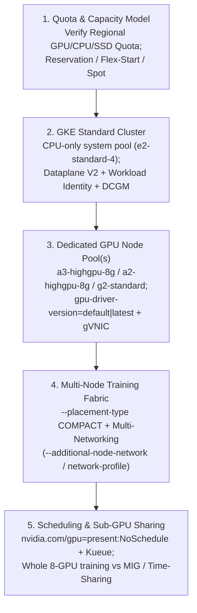

# 5.34 GKE for GPU workloads: setup, node pools and quotas

| | |
|---|---|
| Level | Advanced |
| Priority tier | 2 |
| Lab venue | GCP project with GPU quota or a reservation; `gcloud` and `kubectl`. GPU nodes are expensive: set budgets and delete pools after each lab |
| Part | Part 5: Kubernetes |
| Status | Drafted. `gcloud` flag names and values below were checked against the local `gcloud` 584.0.0 `--help` output (offline). Machine-type and accelerator-type names, quotas, and every behaviour claim are from documentation knowledge and are **unverified** against your project. Labs are **untested** |

## Why this matters for AI infrastructure

Suppose someone asks you to stand up GPU capacity on GKE. You will need to know how the platform fits together before you touch a single setting. Google Cloud is one of the three clouds this role touches, alongside CoreWeave and Nebius. GKE is the managed Kubernetes service most teams meet first.

Its GPU support combines a managed control plane, managed drivers, several ways to consume capacity (on-demand, reservations, Spot, and flex-start), and specialised networking for large training. The Kubernetes concepts are the same as on bare metal. Device plugins are covered in 5.8, scheduling in 5.9, and GPU on Kubernetes in Part 11. The operational levers are different, though. Quota is usually the first blocker, and node pools are the unit of hardware. The managed driver and networking stack take over parts of what the GPU Operator and Network Operator do elsewhere, as covered in 5.33.

Interviewers ask how you would stand up GPU capacity on GKE and what can go wrong. The rest of this chapter walks through that path in the order you would actually build it.

## Prerequisites and outcomes

Before you start, you need the Kubernetes material from 5.8 to 5.10, the chapter on CNI in 5.14, and the cloud networking basics in Part 2. The infrastructure-as-code section also assumes the Terraform work in 4.x. Once you have those in place, this chapter should leave you able to:

- Choose between GKE Standard and Autopilot for GPU work, and between consumption models.
- Create a GPU node pool with the right machine type, accelerator, driver version, location, taints and labels.
- Request and verify GPU quota, and understand reservations and why quota errors differ from stockout errors.
- Schedule Pods onto GPUs correctly, and share GPUs with time-sharing, MPS or MIG when that fits the workload.
- Set up compact placement and high-performance networking for multi-node training.
- Enable GPU monitoring and set cost guardrails, and express them in Terraform.

## 1. Standard vs Autopilot

The first decision is who manages the nodes. In Standard, you create and size the node pools yourself, and you get wide control over host settings. In Autopilot, Google provisions nodes from the resource requests in your Pods, and the customisation you can do is restricted. The table below compares the two.

| | Standard | Autopilot |
|---|---|---|
| Node management | You create and size node pools | Google provisions nodes from Pod requests |
| GPU choice | Any supported machine/accelerator you can get | Limited set; requested through Pod nodeSelectors |
| Customisation (host settings, DaemonSets, privileged Pods, custom drivers, special networking) | Wide | Restricted |
| Billing | Per node (VM plus GPU) | Per Pod resource request |
| Best for | Large training, special networking, reservations, control | Simpler inference and bursty workloads |

Serious multi-node training with RDMA-class networking, reservations and compact placement belongs on Standard. If you run smaller or intermittent GPU inference and do not want to manage nodes, Autopilot is the simpler choice. Check the current docs for which GPUs Autopilot offers.



## 2. GPU machine families and accelerators

The GPU you want decides the machine family, and the family decides how the GPU is attached. On GCE you will meet two forms. In the first, the GPUs are part of the machine shape. The families include A2 (A100), A3 (H100), A3 Ultra (H200), A4 (B200) and G2 (L4). These names come from memory, so verify the current list, because new generations appear often. The machine type fixes the GPU count, so an 8-GPU shape always carries eight GPUs.

In the second form, a general-purpose machine type gets GPUs attached. This covers some older models, including T4, V100 and P100. Here you choose the count yourself with `--accelerator type=...,count=...`.

In `gcloud`, both forms use the same `--accelerator` flag on node pools. The discovery commands below call the API, so they need credentials.

```bash
gcloud compute accelerator-types list --filter="zone:us-central1-a"
gcloud compute machine-types list --filter="name~^a3 AND zone:us-central1-a"
```

The first command lists accelerator types in a zone, and the second lists machine types whose names start with `a3`. Before you commit to a generation, verify GPU memory, NVLink/NVSwitch topology, NIC count and bandwidth, local SSD, supported OS images (Container-Optimized OS vs Ubuntu), minimum GKE version, and which zones carry it. Pick the generation only after those details check out for your project.

## 3. Creating a cluster for GPUs

Start with a regional or zonal **Standard** cluster. Give it a small CPU-only default pool for system components, and add the GPU pools separately. Keeping one cluster per concern, such as a CPU system cluster and a GPU training cluster, keeps failure domains and costs clear.

```bash
export PROJECT=my-project REGION=us-central1 ZONE=us-central1-a CLUSTER=gpu-lab

gcloud container clusters create "$CLUSTER" \
  --project "$PROJECT" --zone "$ZONE" \
  --release-channel regular \
  --num-nodes 1 --machine-type e2-standard-4 \
  --workload-pool "${PROJECT}.svc.id.goog" \
  --enable-dataplane-v2 \
  --enable-ip-alias \
  --enable-managed-prometheus \
  --monitoring SYSTEM,DCGM
```

The help output for `gcloud container clusters create` (584.0.0) confirms these flags. `--release-channel` sets the upgrade channel. `--workload-pool` turns on Workload Identity. `--enable-dataplane-v2` selects the Cilium-based dataplane, covered in 5.14 and 5.15. `--enable-ip-alias` and `--enable-managed-prometheus` are also present. The `--monitoring` flag accepts a component list that includes `DCGM` and `JOBSET`, and the help states that DCGM requires Google Managed Prometheus. Add `--enable-multi-networking` if you will attach additional NICs to Pods, as described in section 8. Add `--enable-private-nodes` for private clusters, and review the defaults for `--enable-shielded-nodes`.

### The minimal GKE path from the book

Before you add GPUs, start with the plain version. Google Kubernetes Engine (GKE) is Google's hosted Kubernetes service. You need a Google Cloud Platform account with billing enabled and the `gcloud` tool installed. Set a default zone first, so that later commands know where to go:

```
$ gcloud config set compute/zone us-west1-a
```

Then create a cluster with three nodes. The book notes that this takes a few minutes. Once the cluster is ready, fetch the credentials that `kubectl` uses to reach it:

```
$ gcloud container clusters create kuar-cluster --num-nodes=3
$ gcloud container clusters get-credentials kuar-cluster
```

If something goes wrong, the Google Cloud Platform documentation has the complete steps. The GPU node pools in the sections below build on a cluster like this one. For any Pod that talks to GCS, Artifact Registry or other Google APIs, use Workload Identity rather than node service account keys, as covered in 5.21 on security.

## 4. Creating a GPU node pool

The node pool is the unit of GPU hardware in GKE, so most of the important choices live in this one command. The command below creates two nodes, each with eight GPUs. It places them in a compact placement policy and ties them to a reservation.

```bash
gcloud container node-pools create h100-pool \
  --cluster "$CLUSTER" --zone "$ZONE" \
  --machine-type a3-highgpu-8g \
  --accelerator type=nvidia-h100-80gb,count=8,gpu-driver-version=latest \
  --num-nodes 2 \
  --node-locations "$ZONE" \
  --node-labels workload=training \
  --enable-gvnic \
  --placement-type COMPACT \
  --reservation-affinity specific --reservation my-h100-reservation
```

The help output confirms the flags in this command. `--accelerator` takes `type`, `count`, `gpu-driver-version` (`default`, `latest`, `disabled`; `latest` only on Container-Optimized OS), `gpu-partition-size`, `gpu-sharing-strategy` and `max-shared-clients-per-gpu`. `--placement-type` accepts `UNSPECIFIED` or `COMPACT`, and `--placement-policy` takes a named resource policy. `--reservation-affinity` accepts `any`, `none`, `specific` and `any-reservation-then-fail`, and it works with `--reservation`. The help also lists `--spot`, `--flex-start`, `--max-run-duration`, and `--additional-node-network`, which can repeat up to 7 times. Further flags are `--accelerator-network-profile=auto`, `--enable-gvnic`, `--enable-image-streaming`, `--node-taints`, `--node-labels`, `--node-locations` and `--local-nvme-ssd-block`. The machine and accelerator type strings in the example, `a3-highgpu-8g` and `nvidia-h100-80gb`, come from memory. Confirm them with the listing commands in section 2.

What happens after creation is documented behaviour, but I have not verified it here. GKE installs a GPU driver DaemonSet automatically when `gpu-driver-version` is not `disabled`. The node then advertises `nvidia.com/gpu` through the GKE device plugin. The help text says that for GKE 1.30.1 and later the default is to install the default driver version, and for earlier versions the default was `disabled`.

Nodes also get labels such as `cloud.google.com/gke-accelerator=<type>`. Run `kubectl get node -L cloud.google.com/gke-accelerator` to see them. GKE normally taints GPU nodes so that only Pods requesting GPUs land there, using `nvidia.com/gpu=present:NoSchedule`. A built-in admission step adds the matching toleration to Pods that request `nvidia.com/gpu`. Confirm this on your cluster with `kubectl describe node`. If you add your own taints, for example to isolate a team, you must add tolerations explicitly.

GPU nodes cannot live-migrate, so host maintenance terminates them. Plan for that with checkpointing, covered in Part 14.

If you prefer the GPU Operator (5.33) on GKE, set `gpu-driver-version=disabled` and let the operator install the driver. You can also let GKE manage the drivers and run the operator without its driver component. Do not let both install a driver on the same node.

### Verify

Run these commands once the pool is ready. They fetch credentials, check the accelerator labels and taints, and start a Pod that runs `nvidia-smi`.

```bash
gcloud container clusters get-credentials "$CLUSTER" --zone "$ZONE"
kubectl get nodes -L cloud.google.com/gke-accelerator
kubectl describe node NODE | grep -A8 -i "taints\|nvidia.com/gpu"
kubectl apply -f - <<'YAML'
apiVersion: v1
kind: Pod
metadata:
  name: nvidia-smi
spec:
  restartPolicy: Never
  containers:
  - name: c
    image: nvidia/cuda:12.4.1-base-ubuntu22.04
    command: ["nvidia-smi"]
    resources:
      limits:
        nvidia.com/gpu: 1
YAML
kubectl logs nvidia-smi
```

The image tag is only an example. Choose a CUDA base image that is compatible with the node driver, as covered in Part 10 on driver and CUDA compatibility.

## 5. Quotas, reservations and consumption models

Capacity failures come in three kinds, and the fix depends on which one you hit. The table maps each symptom to its meaning and its fix.

| Symptom | Meaning | Fix |
|---|---|---|
| `QUOTA_EXCEEDED` / "Quota 'NVIDIA_H100_GPUS' exceeded" (name varies) | Your project's quota is too low | Request a quota increase for that GPU model in that region; also the global GPU quotas and CPU/RAM/SSD quotas used by the machine type |
| `ZONE_RESOURCE_POOL_EXHAUSTED` (stockout) | Quota is fine; Google has no free hardware in that zone | Try other zones, another machine type, a reservation, flex-start, or wait |
| Node pool stuck creating / Pods Pending with scale-up not triggered | Autoscaler constraints (max nodes, location policy, resource limits) or a placement constraint | Read the cluster autoscaler events and node pool status |

The first two rows need different fixes, so read the message before you act. A quota error means your project has asked for more than its allowance. A stockout means the allowance is there and the hardware is not. The commands below check quota through the API.

```bash
gcloud compute regions describe us-central1 --format="yaml(quotas)" | grep -B1 -A1 -i gpu
gcloud quotas info list --project "$PROJECT" --service compute.googleapis.com | grep -i gpu   # if the quotas CLI is installed
```

The consumption models come in rough order of cost and certainty, starting with the most certain.

1. **Reservation** (specific or any, shared across projects if configured) gives you guaranteed capacity at a committed price. Use `--reservation-affinity specific --reservation NAME`. Large training clusters normally use reservations, and reserved capacity of a very large shape usually comes with a compact placement policy created for it.
2. **Committed use discounts** are price commitments, not capacity guarantees on their own.
3. **On-demand** is pay as you go, and it is subject to stockouts.
4. **Spot** is deeply discounted, but it can be preempted at any time with short notice. It suits fault-tolerant jobs with checkpoints and batch inference. Use `--spot`, and tolerate the Spot taint behaviour. Expect a 25 to 30 second preemption notice (verify), which is shorter than most checkpoints take.
5. **Flex-start**, which is the Dynamic Workload Scheduler, lets you ask for capacity for a bounded run. GKE provisions that capacity when it is available, then removes it. Use `--flex-start` with `--max-run-duration`. It integrates with queued provisioning (ProvisioningRequest) and Kueue. It is a good fit for short finetunes and evaluation when you lack a reservation. The flags `--flex-start` and `--max-run-duration` exist, but verify the supported machine types and node pool sizing rules in the current docs.

Reservations and quota interact in a way that catches people out. A reservation does not increase quota, and consuming reservation capacity still needs quota in some configurations. Check the current documentation for your reservation type before you rely on it.

## 6. Scheduling Pods onto GPUs

A basic Pod only needs to request `nvidia.com/gpu`. When you schedule a GPU Pod, you usually add a few more fields, as the example below shows. The `nodeSelector` picks the accelerator type, and the toleration matches the GPU taint described in section 4.

```yaml
spec:
  nodeSelector:
    cloud.google.com/gke-accelerator: nvidia-h100-80gb
  tolerations:
  - key: nvidia.com/gpu
    operator: Exists
    effect: NoSchedule
  containers:
  - name: train
    resources:
      limits:
        nvidia.com/gpu: 8
```

The rules below decide whether your jobs share the hardware well. Request the **whole node's** GPUs for multi-GPU jobs, so that NVLink-connected GPUs are used together. A Pod that asks for 4 of 8 GPUs can leave an awkward remainder that no other job can use well.

For shared GPU capacity, use **Kueue**, which handles queueing, quotas, fair share and preemption. For multi-node jobs, use JobSet, Kubeflow Trainer or a similar tool, as covered in Part 14. The help for `--monitoring` lists a `JOBSET` metrics component, which hints at first-party JobSet observability.

Set `priorityClassName` so that critical inference can preempt batch work, as described in 5.9. For zone spread of inference replicas, use `topologySpreadConstraints` or node affinity. Training jobs usually want the opposite, one tight placement group.

Large images are slow to pull, so speed that up. Use Artifact Registry in the same region, turn on image streaming with `--enable-image-streaming`, or pre-pull images with a DaemonSet or a secondary boot disk that already holds the image.

Decide per workload whether it should spread out or pack tightly, because inference and training want opposite placements.

## 7. Sharing a GPU: time-sharing, MPS, MIG

Sometimes one GPU is too large for a single small workload. The `--accelerator` flag takes `gpu-sharing-strategy` and `max-shared-clients-per-gpu` to split it, and `gpu-partition-size` is the setting for MIG. The table compares the three sharing techniques. They differ mainly in how well they isolate one workload from another, so pick by how much you trust the tenants.

| Technique | How it works | Isolation | When to use |
|---|---|---|---|
| Time-sharing | GPU context-switched between containers; each sees one GPU | Weak (shared memory space is not isolated; no fault isolation) | Many small, bursty inference/dev workloads |
| MPS | Concurrent kernels from multiple processes share SMs | Weak to medium | Throughput for several small processes on one GPU |
| MIG | Hardware partitions with dedicated memory and SMs (A100/H100 class) | Strong | Multi-tenant inference with predictable latency |

The MIG example below uses a partition name taken from the documentation, so verify it for your GPU.

```bash
gcloud container node-pools create mig-pool --cluster "$CLUSTER" --zone "$ZONE" \
  --machine-type a2-highgpu-1g \
  --accelerator type=nvidia-tesla-a100,count=1,gpu-partition-size=1g.5gb,gpu-driver-version=default
```

With time-sharing, a Pod's `nvidia.com/gpu: 1` limit consumes one *slice*. Nothing stops the slice holder from using all of the GPU memory, so never use time-sharing for tenants you do not trust. For the NVIDIA-side options, compare time-slicing and MPS in the device plugin with the MIG manager, covered in Part 11.

The book *Generative AI on Kubernetes*, Chapter 3 (*Kubernetes and GPUs*), by Roland Huss and colleagues, highlights four nuances. They cover GPU discovery labels, MIG strategies, time-slicing, and **Dynamic Resource Allocation (DRA)**.

1. **Decimal GB vs. binary GiB, and GPU Feature Discovery (GFD) labels.** GPU vendors advertise HBM capacity in decimal gigabytes. So `40 GB` $\approx$ `37.25 GiB`, and `80 GB` $\approx$ `74.5 GiB`. GFD exports rich node labels for fine-grained `nodeAffinity` placement. These include `nvidia.com/gpu.product` (`A100-SXM4-40GB`, or with a `-SHARED` suffix in time-slicing mode). They also include `nvidia.com/gpu.memory`, which is reported in MiB, such as `40536` or `81920`. That lets a `Gt: "40000"` nodeAffinity expression select 80 GB GPUs. The remaining labels are `nvidia.com/gpu.compute.major` (`8` for Ampere, `9` for Hopper), `nvidia.com/gpu.machine` (`dgx-a100`), and `nvidia.com/mig.capable` (`true`).
2. **MIG `single` vs. `mixed` strategy.** The strategy decides how partitions are advertised.
   - **`nvidia.com/mig.strategy=single`:** Every GPU on the node is partitioned the same way. For example, two A100 GPUs each split into seven `1g.5gb` slices, so the node advertises **`nvidia.com/gpu: 14`**.
   - **`nvidia.com/mig.strategy=mixed`:** Different MIG slice sizes coexist on the same node. Each size gets its own extended resource name: **`nvidia.com/mig-1g.5gb`**, **`nvidia.com/mig-2g.10gb`**, and **`nvidia.com/mig-3g.20gb`**.
3. **Time-slicing with `renameByDefault: true`** (Chapter 3, Example 3-12). In the GPU Operator's `gpu-sharing-config` ConfigMap, setting `renameByDefault: true` with `replicas: 8` advertises time-sliced slots as **`nvidia.com/gpu.shared: 8`**. It also appends `-SHARED` to `nvidia.com/gpu.product`. Pods therefore have to opt into shared GPUs. Otherwise a Pod that requests a whole `nvidia.com/gpu` could land on them by accident.
4. **Kubernetes Dynamic Resource Allocation (DRA)** (`resource.k8s.io/v1beta1`, Chapter 3, Examples 3-8 and 3-9). Traditional device plugins expose only integer counts, such as `nvidia.com/gpu: 1`. They have no native way to express a minimum VRAM such as `memory >= 40Gi`, a compute capability, or fractional sharing inside the request itself. DRA replaces those static counters with `DeviceClass`, **`ResourceClaimTemplate`**, and `ResourceClaim`, which you reference in `Pod.spec.resourceClaims` and `Container.resources.claims`. A Pod can then request a `DeviceClass` such as `gpu.nvidia.com`, filtered by CEL attributes.

Choose the sharing method by how strictly its tenants must be isolated. Then verify the MIG profile names for your GPU before you write the node pool.

## 8. Networking for multi-node training

A single-node job runs fine on the default VPC networking. Multi-node training is different, because inter-node bandwidth and latency dominate the run, as covered in Part 12. On GKE several pieces are involved. The details depend on the machine family and change between generations, so treat the list below as a map and read the current guide for your machine shape.

gVNIC (`--enable-gvnic`) is required or recommended on high-end accelerator machine types.

Accelerator-optimized shapes have several NICs dedicated to GPU traffic. GKE exposes them to Pods through multi-networking. That uses the cluster flag `--enable-multi-networking`, the node pool flag `--additional-node-network network=NAME,subnetwork=SUBNET` (repeatable up to 7 times), and Network and GKENetworkParamSet resources in the cluster. The help also lists `--accelerator-network-profile=auto`, which creates a profile for compatible accelerator machine types. Check which machine types it covers.

NCCL network plugins depend on the generation. Older A3 shapes use a GPUDirect-TCPX/TCPXO approach with a sidecar and an NCCL plugin. Newer shapes use RDMA over RoCE with NCCL's native IB verbs path. Pod specs need the right annotations, the right NCCL environment variables, and sometimes an installer DaemonSet. This comes from documentation and is version-specific.

Compact placement, set with `--placement-type COMPACT` or a named `--placement-policy`, keeps nodes in a tight physical cluster to cut hops. The trade-off is that it limits the maximum pool size, and it can cause stockouts.

Before you run real jobs, validate the network with NCCL tests (`all_reduce_perf`). Compare the result against the expected bus bandwidth for your shape, as covered in Parts 12 and 14.

## 9. Autoscaling and upgrades

Autoscaling and upgrades change how many GPU nodes exist and when they restart. Both need settings that match how scarce your GPUs are.

Each node pool has its own cluster autoscaler, set with `--enable-autoscaling --min-nodes --max-nodes`. The help also lists `--total-min-nodes/--total-max-nodes`, which work with `--location-policy`. `--location-policy=ANY` favours zones that have capacity, and `BALANCED` spreads nodes across zones. If the start latency is acceptable, scale idle GPU pools to zero with `min-nodes 0`.

Node auto-provisioning can create GPU pools on demand, within the resource limits you configure. That is useful for variety, and less useful for tightly controlled training clusters.

GPU node pools need careful surge settings during upgrades. With no spare GPUs available, `max-surge-upgrade` above 0 may fail for lack of capacity. Use `max-unavailable-upgrade` instead, and drain with checkpointing. Control windows and exclusions are available, and `--add-maintenance-exclusion-until-end-of-support` appears in the node pool help. Use a release channel, and test GPU driver changes on a canary pool first. A driver bump changes the CUDA compatibility story covered in Part 10.

Auto-repair of GPU nodes can restart long jobs. Decide deliberately whether to enable it for training pools, and pair it with your own health logic from 5.32.

Decide the autoscaler limits and the surge settings before you upgrade a training pool.

## 10. Observability and cost

GPU spend is easy to lose track of, because a GPU node keeps billing whether or not it does useful work. Watch the metrics, and set the cost guardrails before the first big run.

Running `--monitoring SYSTEM,DCGM` with Google Managed Prometheus exports DCGM GPU metrics into Cloud Monitoring. Those metrics cover utilisation, memory, power, temperature, and Xid and ECC errors where available. Alternatively, deploy `dcgm-exporter` yourself and scrape it with your own Prometheus, as covered in 5.19 and Part 11.

Alert on low GPU utilisation for long periods on expensive nodes. Also alert on Xid errors, ECC errors, Pending Pods that request GPUs, node pools at max, preemptions and autoscaler failures.

Cost controls include budgets and alerts on the project, and labels on node pools and Pods for attribution. Scale idle pools to zero, and use Spot or flex-start for interruptible work. Use right-sized shapes, and delete lab clusters when you finish. Idle reserved GPUs are the biggest silent cost, so track reservation utilisation.

Cloud Logging holds the node logs and the GPU driver install DaemonSet logs. Check those logs first when `nvidia.com/gpu` is missing.

Set the budget and the alerts before you start a lab, not after the bill arrives.

## 11. Terraform sketch (untested)

The sketch below declares the same cluster and the H100 pool from the earlier sections in Terraform. It has not been tested.

```hcl
resource "google_container_cluster" "gpu" {
  name     = "gpu-lab"
  location = var.zone

  remove_default_node_pool = true
  initial_node_count       = 1

  release_channel { channel = "REGULAR" }
  workload_identity_config { workload_pool = "${var.project}.svc.id.goog" }
  datapath_provider = "ADVANCED_DATAPATH"
}

resource "google_container_node_pool" "h100" {
  name       = "h100-pool"
  cluster    = google_container_cluster.gpu.id
  location   = var.zone
  node_count = 2

  node_config {
    machine_type = "a3-highgpu-8g"
    guest_accelerator {
      type  = "nvidia-h100-80gb"
      count = 8
      gpu_driver_installation_config { gpu_driver_version = "LATEST" }
    }
    labels = { workload = "training" }
  }

  placement_policy { type = "COMPACT" }
}
```

The argument names come from the Google provider as I remember it, so validate them with `terraform validate` against your provider version. Pin your module to a version. Manage the cluster and the GPU pools in separate states, or at least in separate modules. Set `lifecycle.prevent_destroy` on anything that holds state. Part 4 covers Terraform structure.

## 12. Failure modes and troubleshooting

A GPU node pool that fails rarely says why in plain words. The table below matches each symptom with its likely cause and the first thing to check. Start with the row that matches what you see.

| Symptom | Likely cause | Check |
|---|---|---|
| Node pool creation fails with quota error | GPU/CPU/SSD/IP quota | Quota page; error text names the metric |
| Creation fails with resource exhausted | Zone stockout | Another zone, shape or consumption model |
| Nodes up but `nvidia.com/gpu` is 0 | Driver install failed or disabled | Driver installer DaemonSet logs in `kube-system`; `gpu-driver-version`; OS image |
| Pod Pending "Insufficient nvidia.com/gpu" | No node with free GPU, taint/toleration mismatch, wrong selector | `kubectl describe pod`; node taints; autoscaler events |
| Pod runs but cannot see GPU | Missing resource limit; wrong runtime or image | `nvidia-smi` in a minimal Pod |
| Slow multi-node training | No compact placement, wrong NICs or NCCL env, cross-zone nodes | NCCL test, topology, placement policy |
| Job dies randomly | Spot preemption, host maintenance, auto-repair, Xid | Node events, Cloud Logging, DCGM |
| Upgrade stuck | No surge capacity, PDB blocking drain | Upgrade settings, PDBs |
| Unexpected bill | Idle pools, unused reservations, egress | Billing export, labels, utilisation |

The last column tells you what to check first. The first two rows, quota and stockout, are the ones you met in section 5.

## 13. Lab

Run the self-checking Python lab locally before you touch any cloud project. It checks the GKE GPU node pool configuration and the MIG and time-sharing resource calculator, which is based on *Generative AI on Kubernetes*, Chapter 3 (`evaluate_gke_gpu_node_pool_config`). It also classifies GKE GPU capacity errors, telling `QUOTA_EXCEEDED` apart from `ZONE_RESOURCE_POOL_EXHAUSTED` stockouts (`classify_gke_gpu_capacity_error`). Finally, it validates the GPU node pool upgrade surge settings (`validate_gpu_pool_upgrade_surge`).

```bash
python3 code/part05/gke_gpu_pool_planner_lab.py
```

Next, move to a GCP lab project with a budget alert configured. Every live cloud step below is `untested here`, and each one incurs GPU billing. Work through these exercises in order.

1. Create a project budget alert first.
2. Create a small Standard cluster (`e2-standard-4`, 1 node), then a single-GPU pool with a cheap GPU, such as L4 or T4, whichever your quota allows. Record the exact commands and errors.
3. Run the `nvidia-smi` Pod, then a CUDA sample or a PyTorch `torch.cuda.is_available()` Pod.
4. Break it on purpose. Remove the toleration, request 2 GPUs on a 1-GPU node, and request a GPU type with no quota. Capture each failure message, and map it to the table in section 12.
5. Add a time-sharing pool and run 4 Pods against one GPU. Watch the interference with `nvidia-smi`.
6. Enable `DCGM` monitoring and view GPU utilisation in Cloud Monitoring.
7. Try `--spot` and `--flex-start` pools, and note how they differ in scale-up behaviour.
8. Express the cluster and pool in Terraform, then run `terraform validate` and `plan`.
9. Delete everything, and verify with `gcloud container clusters list` and billing.

## 14. Interview angles

Each question below ties back to a decision made earlier in this chapter.

- Walk me through standing up a GPU node pool on GKE. What do you check first when it fails?
- Quota exceeded vs stockout: how do you tell them apart, and what do you do about each?
- Reservation vs Spot vs flex-start: which one for a 3-day 64-GPU training run? For a nightly evaluation? For production inference?
- How do GPU drivers get onto GKE nodes, and when would you disable that?
- Time-sharing vs MPS vs MIG: what are the isolation levels and the use cases?
- Why use compact placement, and what are its downsides?
- How would you upgrade a GPU node pool when there is no spare capacity?
- How do you make multi-node training network performance predictable on GKE?
- How would you attribute GPU cost to teams?

## Exercises

Each exercise asks you to explain a decision from the earlier sections. Use the helper functions and flags named in each one.

1. Explain why a multi-node distributed training job that needs compact placement, reservations and multi-NIC RDMA or TCPXO runs on GKE Standard. Describe the small CPU-only default system pool (`e2-standard-4`) and the separate GPU node pools (`a3-highgpu-8g`, `g2-standard`). Then trace the `gcloud container clusters create` flags in Section 3 (`--workload-pool`, `--enable-dataplane-v2`, `--enable-managed-prometheus`, `--monitoring SYSTEM,DCGM`).
2. Using `evaluate_gke_gpu_node_pool_config()` in `code/part05/gke_gpu_pool_planner.py`, explain the three values of `gpu-driver-version` (`default`, `latest`, `disabled`). Explain why `latest` requires Container-Optimized OS (`COS`), and why you must set `gpu-driver-version=disabled` if the NVIDIA GPU Operator manages drivers. Then explain how the GKE `nvidia.com/gpu=present:NoSchedule` taint and automatic toleration injection work.
3. Using `classify_gke_gpu_capacity_error()` in `code/part05/gke_gpu_pool_planner.py`, contrast `QUOTA_EXCEEDED` (project quota) with `ZONE_RESOURCE_POOL_EXHAUSTED` (physical zone stockout). Then choose the right GKE consumption model for each case from the following: a reservation, committed use discounts (CUD), on-demand, Spot, or flex-start with Dynamic Workload Scheduler (`--flex-start --max-run-duration`). The cases are (a) a 14-day 256-GPU pre-training run, (b) a 4-hour fine-tuning job without a reservation, and (c) stateless batch scoring.
4. Compare `--accelerator` with `gpu-sharing-strategy=time-sharing` (`max-shared-clients-per-gpu`), MPS, and `gpu-partition-size=1g.5gb` (MIG). Contrast the `nvidia.com/mig.strategy` values `single` and `mixed`, using *Generative AI on Kubernetes*, Chapter 3. Then explain how Kubernetes Dynamic Resource Allocation (DRA, `ResourceClaimTemplate` in `resource.k8s.io/v1beta1`) overcomes the limits of integer device plugin requests.
5. Explain the networking choices for multi-node GPU traffic on GKE, including TCPX/TCPXO vs. RoCE RDMA and COMPACT placement. Start with the role of `--enable-gvnic`, of `--enable-multi-networking` with `--additional-node-network` (up to 7 additional NICs), and of `--accelerator-network-profile=auto`. Explain `--placement-type COMPACT` too. Then explain how to verify multi-node fabric throughput with `nccl-tests` (`all_reduce_perf`) before you launch training.
6. Using `validate_gpu_pool_upgrade_surge()` in `code/part05/gke_gpu_pool_planner.py`, explain why the default `max-surge-upgrade=1` stalls on a GPU node pool backed by a fully utilized reservation or exact quota. Then show how to configure `max-surge-upgrade=0, max-unavailable-upgrade=1` with maintenance exclusions. Finally, explain why Terraform should decouple `google_container_cluster` (`remove_default_node_pool = true`) from `google_container_node_pool` resources.

## Checkpoint questions (20)

<details>
<summary>1. When should you choose GKE `Standard` vs. GKE `Autopilot` for GPU workloads?</summary>

- **Choose GKE `Standard` when:** You run multi-node distributed GPU training or low-latency serving that needs **explicit node-pool topology control (`--placement-type COMPACT`)**, **multi-NIC GPU networking (`--enable-multi-networking`, `--additional-node-network`, GPUDirect-TCPXO / RoCE RDMA)**, **specific capacity reservations (`--reservation-affinity=specific`)**, custom privileged DaemonSets, or custom kernel or driver configurations.
- **Choose GKE `Autopilot` when:** You run simpler single-node or bursty GPU inference or batch work. Google provisions the nodes automatically from the Pod `nodeSelector` and resource requests, and you pay per Pod instead of managing node pools.
</details>

<details>
<summary>2. What is the difference between GCE's two GPU attachment models (Accelerator-Optimized machine families vs. General-Purpose N1 machines with attached GPUs)?</summary>

1. **Accelerator-Optimized Machine Families (`A2` = A100, `A3` = H100, `A3 Ultra` = H200, `A4` = B200, `G2` = L4):** The GPU model and count are fixed parts of the machine shape. For example, `a3-highgpu-8g` has 8 H100 GPUs connected through NVLink and NVSwitch, plus dedicated high-speed GPU NICs and local NVMe SSDs. You still pass `--accelerator type=...,count=...` in `gcloud container node-pools create`.
2. **General-Purpose Machine Types (`N1`) with Attached GPUs (`T4`, `V100`, `P100`):** You attach 1, 2, 4 or 8 PCIe GPUs to a standard VM shape.
</details>

<details>
<summary>3. Why should a GKE Standard cluster always be created with a small CPU-only default pool (`e2-standard-4`) and `remove_default_node_pool = true` in Terraform, adding GPU pools as separate `google_container_node_pool` resources?</summary>

1. **Cost and system Pod isolation:** Cluster-critical system Pods, such as `kube-dns`/`coredns`, `metrics-server`, `gmp-operator` and `kueue-controller-manager`, do not need $30–$100/hour GPU VMs. Running them on a small CPU-only system pool lets GPU node pools scale down to `0` nodes when idle, without evicting the cluster control or monitoring Pods.
2. **Independent node-pool lifecycle in Terraform:** If you define a node pool inline inside `google_container_cluster`, changing a node-pool setting such as machine type, disk size, taint or reservation forces Terraform to destroy and recreate the entire GKE cluster. Setting `remove_default_node_pool = true` and managing each `google_container_node_pool` as a separate resource lets you add, resize or replace GPU pools with zero impact on the control plane.
</details>

<details>
<summary>4. What are the three accepted values for `gpu-driver-version` in `--accelerator` on GKE (`gcloud` 584.0.0), what is the default in GKE 1.30.1+, and what OS restriction applies to `latest`?</summary>

- **Three accepted values:** **`default`** (GKE's default tested driver for that GKE release), **`latest`** (the newest driver branch available on GKE for that OS), and **`disabled`** (do not install any GKE-managed GPU driver DaemonSet).
- **Default in GKE 1.30.1+:** GKE automatically installs the **`default`** GPU driver DaemonSet. Versions before 1.30.1 defaulted to `disabled`.
- **OS restriction on `latest`:** `gpu-driver-version=latest` works only on nodes running Container-Optimized OS (`COS`), not Ubuntu.
- **When to use `disabled`:** Use it when you install the NVIDIA GPU Operator with `driver.enabled=true` to manage drivers yourself. Never let both GKE's driver installer and the GPU Operator's driver DaemonSet install drivers on the same node.
</details>

<details>
<summary>5. How does GKE prevent CPU-only Pods from accidentally scheduling onto expensive GPU nodes, and how do GPU Pods bypass that block?</summary>

1. When GKE creates a GPU node pool, it applies the taint **`nvidia.com/gpu=present:NoSchedule`** to every node in that pool. A CPU-only Pod, one that lacks `resources.limits["nvidia.com/gpu"]` and lacks a matching toleration, is rejected by `TaintToleration` filtering.
2. When a Pod is submitted with **`resources.limits["nvidia.com/gpu"] > 0`**, GKE's built-in **`ExtendedResourceToleration` admission controller** mutates the Pod spec and injects the toleration for `nvidia.com/gpu:NoSchedule`. If you add your own custom taint, such as `team=research:NoSchedule`, to a GPU node pool, Pods must include a toleration for `team=research:NoSchedule` explicitly.
</details>

<details>
<summary>6. What is the exact difference between a `QUOTA_EXCEEDED` error and a `ZONE_RESOURCE_POOL_EXHAUSTED` error when creating or scaling a GKE GPU node pool, and how do you fix each?</summary>

- **`QUOTA_EXCEEDED` (for example, `Quota 'NVIDIA_H100_GPUS' exceeded` or `PREEMPTIBLE_NVIDIA_A100_GPUS`):** The account or project billing and IAM policy limit in your GCP project is lower than what you requested.
  - *Fix:* Request a quota increase in IAM & Admin $\rightarrow$ Quotas for that GPU family in that region. Also request the global GPU quota (`GPUS_ALL_REGIONS`), plus the vCPU (`N2_CPUS` / `A3_CPUS`), memory and local SSD quotas that the machine type consumes.
- **`ZONE_RESOURCE_POOL_EXHAUSTED` (stockout):** Your project has plenty of quota, but Google's physical data center in `us-central1-a` currently has no free physical GPU servers of that shape available on demand.
  - *Fix:* Use multi-zone node pools with `--location-policy=ANY`. Use flex-start (`--flex-start`, Dynamic Workload Scheduler) to queue the capacity request until hardware frees up. Or purchase a **Specific Capacity Reservation**.
</details>

<details>
<summary>7. Compare GKE's five GPU capacity consumption models: (a) **Specific Reservation**, (b) **Committed Use Discount (`CUD`)**, (c) **On-Demand**, (d) **Flex-Start (`DWS`)**, and (e) **Spot VMs**.</summary>

The five models trade capacity certainty against price. The table lists the guarantee, the preemption risk, and the workloads each one suits.

| Model | Capacity Guarantee? | Preemptible? | Best Workload Fit |
|---|---|---|---|
| **1. Specific Reservation (`--reservation-affinity=specific --reservation=NAME`)** | **Yes** (hardware physically held for you) | No | Large multi-node training & baseline 24/7 production inference |
| **2. Resource CUD (1y/3y)** | **No** without an attached reservation (billing discount only) | No | Steady baseline spend (always pair with a reservation for scarce GPUs) |
| **3. On-Demand** | No (subject to zone stockouts) | No | Elastic burst serving when on-demand capacity exists |
| **4. Flex-Start (`--flex-start --max-run-duration`, DWS)** | Queues request and provisions all nodes atomically for a bounded duration (up to 7 days) | Terminates at `max-run-duration` | Multi-node fine-tuning, evaluation, and batch jobs when you lack a reservation |
| **5. Spot (`--spot`)** | No | **Yes (~25–30s notice)** | Stateless batch inference, data embedding, and checkpoint-tolerant jobs |
</details>

<details>
<summary>8. Does having a GCP Capacity Reservation automatically grant your project the GCP Quota required to use those GPUs?</summary>

**No.** Reservations and quotas are tracked separately. Creating or consuming a reservation for 64 H100 GPUs still requires your project to hold **at least 64 H100 GPUs of regional quota**, plus the matching vCPU and local SSD quotas. Request and verify the regional GPU, CPU and SSD quota *before* you try to create a reservation or node pool.
</details>

<details>
<summary>9. Why is Spot preemption (`--spot`) particularly challenging for large LLM training jobs on GKE, and what must a workload do if it runs on Spot GPUs?</summary>

When GCE reclaims a Spot GPU VM, it sends an ACPI preemption signal. The signal reaches Pods as `SIGTERM` through `kubelet`, and the VM is hard-terminated after only a **25 to 30 second grace period**. Writing a 500 GB distributed checkpoint to GCS over the network takes much longer than 30 seconds. So a workload on Spot GPUs must do one of two things:

1. Be **stateless or idempotent**, such as batch offline scoring, Ray data preprocessing, or multi-replica inference behind a load balancer with on-demand fallback, or
2. Use **frequent asynchronous in-memory, local-NVMe or peer-rank checkpointing**, so that at most a few minutes of steps are lost when a node disappears before a shutdown checkpoint finishes. Pair it with elastic `torchrun` or `JobSet` restart.
</details>

<details>
<summary>10. How does GKE Flex-Start (`--flex-start` with `--max-run-duration`) integrate with `Kueue` and `ProvisioningRequest` (Dynamic Workload Scheduler)?</summary>

Instead of grabbing 16 GPU nodes one at a time, and paying for 10 idle nodes while 6 are stuck in stockout, you create a flex-start GPU node pool. Set `min-nodes=0`, `--flex-start` and `--enable-queued-provisioning`.

Suppose a user submits a `JobSet` or `RayJob` managed by **Kueue**, with a **`ProvisioningRequest` AdmissionCheck**. Then the following happens:

1. Kueue creates a `ProvisioningRequest` custom resource that asks GKE's **Dynamic Workload Scheduler (`DWS`)** for all 16 GPU nodes at once, for example with `maxRunDuration: 12h`.
2. DWS queues the request in Google Cloud's capacity scheduler, which costs $0 while the request is queued.
3. When all 16 nodes can be allocated together, including compact placement if you requested it, GKE provisions all 16 nodes at the same time. Kueue then unsuspends the training job.
</details>

<details>
<summary>11. Why should a multi-GPU training Pod on an 8-GPU node (`a3-highgpu-8g` or `a2-highgpu-8g`) request all 8 GPUs (`nvidia.com/gpu: 8`), or else request `1`, `2`, or `4` GPUs aligned to NVLink/PCIe topology?</summary>

On an 8-GPU HGX, A2 or A3 node, all 8 GPUs connect inside a high-speed intra-node **NVSwitch** fabric, at 600–900 GB/s bidirectional. Each GPU is also paired with specific NUMA sockets and NICs. If a Pod requests an odd number such as `nvidia.com/gpu: 5` or `6`, the remaining `3` or `2` GPUs on that node become **stranded fragments**. No 4-GPU or 8-GPU job can use them.

For multi-node training, request the entire node, `nvidia.com/gpu: 8` plus matching CPU, memory and NICs, as one Pod per node with `torchrun --nproc_per_node=8`. Each node then serves a single training rank group, with zero cross-job NVSwitch or NIC contention.
</details>

<details>
<summary>12. Compare GKE's three GPU sharing mechanisms (`Time-Sharing`, `MPS`, and `MIG`), and explain the difference between `nvidia.com/mig.strategy=single` and `mixed` (Generative AI on Kubernetes, Chapter 3).</summary>

- **Time-Sharing (`gpu-sharing-strategy=time-sharing,max-shared-clients-per-gpu=4`):** It switches between processes in time. It has **zero memory or fault isolation**, so one container that runs out of memory or hits an XID error takes down all 4 containers.
- **MPS (`Multi-Process Service`):** It runs kernels from multiple processes concurrently on the same GPU context. It reaches higher SM utilization than time-sharing, **but it still shares fault fate**.
- **MIG (`gpu-partition-size=1g.5gb` / `1g.10gb` / `2g.20gb`):** These are **hardware-isolated partitions**, with dedicated SMs, dedicated HBM memory, and isolated page tables and fault domains.
- **`single` vs. `mixed` MIG (Generative AI on Kubernetes, Chapter 3):**
  - **`single`:** Every GPU on the node is partitioned into the same slice size. For example, 2 A100 GPUs times 7 slices gives **`nvidia.com/gpu: 14`**.
  - **`mixed`:** Different slice profiles coexist on the node, and each is exposed as its own resource name, such as `nvidia.com/mig-1g.5gb` or `nvidia.com/mig-3g.20gb`.
</details>

<details>
<summary>13. In *Generative AI on Kubernetes* Chapter 3, why is there a difference between an advertised `80 GB` GPU and ~`74.5 GiB` in Kubernetes, and how do you select GPUs with `> 40 GB` of VRAM using GFD labels?</summary>

- **Decimal `GB` vs. binary `GiB`:** Hardware vendors market GPU HBM in base-10 gigabytes, so 80 × 10^9 bytes is 80 GB. Kubernetes memory quantities use base-2 gibibytes, so the same memory is `80 * 10^9 / 2^30 ≈ 74.5 GiB`, and `40 GB ≈ 37.25 GiB`.
- **Selecting GPUs by VRAM with GFD labels (Generative AI on Kubernetes, Chapter 3, Example 3-4):** GPU Feature Discovery (GFD) labels each node with `nvidia.com/gpu.memory` in MiB, such as `40536` or `81920`. To require more than 40 GB of VRAM, use a `nodeAffinity` `matchExpressions` rule:
  ```yaml
  key: nvidia.com/gpu.memory
  operator: Gt
  values: ["40000"]
  ```
</details>

<details>
<summary>14. What is Kubernetes **Dynamic Resource Allocation (`DRA`, `resource.k8s.io/v1beta1`)** (Generative AI on Kubernetes, Chapter 3), and what limitations of traditional Device Plugins does it solve?</summary>

Traditional device plugins, which use the `kubelet` gRPC API, let a container request only an **integer count of an opaque resource name**, such as `nvidia.com/gpu: 2`. They cannot pass parameters. A request such as "I need 1 GPU with at least 40 GiB of VRAM and compute capability $\ge 9.0$", "share 1 GPU across 2 containers inside the same Pod", or "dynamically carve a MIG slice at Pod schedule time" is not expressible that way.
DRA (`resource.k8s.io`) introduces **`DeviceClass`**, **`ResourceClaimTemplate`**, and `ResourceClaim`. These let Pods request structured device attributes, which the scheduler evaluates with CEL. They also let a claimed device be shared across multiple containers in the same Pod.
</details>

<details>
<summary>15. What are the four networking components required for full-bandwidth multi-node GPU training on GKE (`A3` / `A3 Ultra` / `A4` shapes)?</summary>

1. **`gVNIC` (`--enable-gvnic`):** The Google Virtual NIC driver. It is required for high-bandwidth VM networking.
2. **GKE Multi-Networking (`--enable-multi-networking` on the cluster, plus `--additional-node-network` or `--accelerator-network-profile=auto` on the node pool):** It attaches the dedicated GPU backend NICs, 4 to 8 additional NICs per VM, into the training Pod's network namespace through `Network` and `GKENetworkParamSet` custom resources.
3. **GPUDirect-TCPX / TCPXO or GPUDirect-RDMA (`RoCE`) NCCL plugin:** It lets NCCL collectives move tensor data directly between GPU HBM and the dedicated GPU NICs, without copying through host CPU memory.
4. **Compact placement (`--placement-type COMPACT`):** It places all VMs in the node pool inside the same physical cluster and fabric spine, which cuts switch hops and tail latency.
</details>

<details>
<summary>16. What is the trade-off of setting `--placement-type COMPACT` on a GKE GPU node pool?</summary>

- **Benefit:** Nodes in the pool are placed physically close together in the data center network. That reduces inter-node round-trip time and maximizes `AllReduce` bus bandwidth for synchronous multi-node training.
- **Downsides:**
  1. It caps the maximum number of nodes the pool can hold, to the size of a physical placement block.
  2. It raises the chance of `ZONE_RESOURCE_POOL_EXHAUSTED` stockouts on on-demand pools. Google must find N contiguous physical hosts in the same rack or spine block, rather than hosts scattered across the zone.
</details>

<details>
<summary>17. Why does a GKE GPU node pool upgrade often get stuck when using the default Surge Upgrade settings (`max-surge-upgrade=1, max-unavailable-upgrade=0`), and how do you fix it?</summary>

By default, GKE upgrades a node pool with a **surge upgrade (`max-surge-upgrade=1, max-unavailable-upgrade=0`)**. It first creates **1 extra new GPU VM**, which makes `N + 1` in total, before it drains the first old VM.

On a GPU node pool, that extra VM often fails:

- Your **specific reservation** or **project GPU quota** is almost always sized to exactly `N` nodes, so `0` spare GPUs are available. Or the zone is out of spare on-demand GPUs.
- So creating the surge VM fails right away with `QUOTA_EXCEEDED` or `ZONE_RESOURCE_POOL_EXHAUSTED`, and the upgrade stalls.

**Fix:** Configure GPU node pools with **`--max-surge-upgrade=0 --max-unavailable-upgrade=1`**, or a percentage that matches your maintenance batch size. GKE then cordons, drains, upgrades and reboots one existing node in place, with no extra GPU quota needed.
</details>

<details>
<summary>18. How does GKE Image Streaming (`--enable-image-streaming`) reduce GPU cold-start waste?</summary>

AI and ML container images, which hold PyTorch, CUDA, cuDNN, vLLM and their dependencies, often weigh **15 to 30 GB**. Without image streaming, a newly scaled GPU node sits 100% idle for **3 to 8 minutes**. During that time it downloads and decompresses the whole 25 GB tarball before the container's entrypoint can start.

With **`--enable-image-streaming`**, and with Artifact Registry in the same region, GKE mounts the image layers over a network-backed filesystem. It streams only the file chunks the process reads at startup. That cuts container start time from minutes to **a few seconds**, and the remaining pages stream in the background.
</details>

<details>
<summary>19. What happens to a GKE GPU VM during Google Cloud **Host Maintenance Events**, and why is it different from standard CPU VMs?</summary>

Standard CPU VMs, such as `e2`, `n2` and `c3`, support **Live Migration**. Google moves the running VM to another physical host without rebooting the guest OS or interrupting containers.

GPU VMs **cannot be live-migrated**, because the physical GPU HBM state, the NVSwitch fabric context and the VFIO PCIe passthrough state cannot be copied live across hosts. Instead, GPU VMs have `onHostMaintenance: TERMINATE`. When Google performs host hardware maintenance, the VM is **terminated** and restarted on another host. A maintenance notification event is emitted beforehand in Node metadata or Node Problem Detector. Watch the upcoming maintenance events in the `scheduled-event` metadata, so you can trigger an emergency checkpoint and drain the node before termination.
</details>

<details>
<summary>20. How do you enable managed `DCGM` GPU telemetry on GKE, and what prerequisite flag does it require (`gcloud` 584.0.0)?</summary>

Pass **`--enable-managed-prometheus`** and **`--monitoring=SYSTEM,DCGM`** on `gcloud container clusters create` or `update`. You can also add `,JOBSET` and `,KUBE state` components.

As verified in `gcloud container clusters create --help`, the `DCGM` monitoring component **requires Google Managed Prometheus (`--enable-managed-prometheus`)** on the cluster. GKE then deploys and scrapes the managed DCGM exporter on GPU nodes automatically. It ships GPU utilization, memory, temperature, power, XID and ECC metrics into Cloud Monitoring.
</details>

## Sources and review notes

- **Sources read in full / verified locally:**
  - `kubernetes-up-and-running-3rd-edition` — Brendan Burns, Joe Beda, Kelsey Hightower & Lachlan Evenson, *Kubernetes: Up and Running*, 3rd ed., **Chapter 3: Deploying a Kubernetes Cluster** (GKE default zone, cluster create and get-credentials commands).
  - Google Cloud SDK `584.0.0` (`gcloud container clusters create --help` and `gcloud container node-pools create --help`): verified offline for flag names and accepted values (`--release-channel`, `--workload-pool`, `--enable-dataplane-v2`, `--enable-ip-alias`, `--enable-managed-prometheus`, `--monitoring SYSTEM,DCGM,JOBSET`, `--accelerator` `gpu-driver-version=default|latest|disabled`, `gpu-partition-size`, `gpu-sharing-strategy`, `max-shared-clients-per-gpu`, `--placement-type COMPACT`, `--reservation-affinity`, `--spot`, `--flex-start`, `--max-run-duration`, `--additional-node-network`, `--accelerator-network-profile=auto`, `--enable-gvnic`, `--enable-image-streaming`).
  - `generative-ai-on-kubernetes` — Roland Huss, Courtney Pacheco & Bryanoster, *Generative AI on Kubernetes* (`GAK`), **Chapter 3: Kubernetes and GPUs** (read in full: decimal `40 GB`/`80 GB` vs binary `37.25 GiB`/`74.5 GiB`, NFD and GFD labels `nvidia.com/gpu.product`, `nvidia.com/gpu.memory`, `nvidia.com/gpu.compute.major`, `nvidia.com/mig.strategy` `single` vs `mixed` exposing `14` slices on 2x A100, time-slicing `renameByDefault: true`, and Dynamic Resource Allocation `DRA` `ResourceClaimTemplate` `Examples 3-8 & 3-9`).
  - `scalable-kubernetes-infrastructure-for-ai-platforms` (`SKI`) & `kubernetes-for-generative-ai-solutions` (`K8GS`): cloud GPU node pool and scaling patterns.
- **Run here:** `python3 code/part05/gke_gpu_pool_planner_lab.py` (3 passed, 0 failed).
- **Explicitly labelled inferences:** The `evaluate_gke_gpu_node_pool_config`, `classify_gke_gpu_capacity_error`, and `validate_gpu_pool_upgrade_surge` models in `code/part05/gke_gpu_pool_planner.py` and the `gcloud` and Terraform examples are the author's constructions synthesizing `gcloud` 584.0.0 CLI help, `GAK` Chapter 3, `SKI`, and `K8GS` (plus original study items 21, 22, 23, 24, 25, 26, 27, 28, 29, and 30).
- **Not verified on live hardware:** Live GKE cluster creation, GPU node pool provisioning, and Terraform apply (`gcloud 584.0.0`, `e2-standard-4`, `a3-highgpu-8g`, `nvidia-h100-80gb`, `a2-highgpu-1g`, `nvidia-tesla-a100`, `1g.5gb`, `cuda:12.4.1-base-ubuntu22.04`, `1.30.1`, `25 to 30` second Spot preemption notice, `up to 7` additional networks, `40 GB ~ 37.25 GiB` / `80 GB ~ 74.5 GiB`, `14` MIG slices) are marked (`untested here`) where not executed by `gke_gpu_pool_planner_lab.py`.
