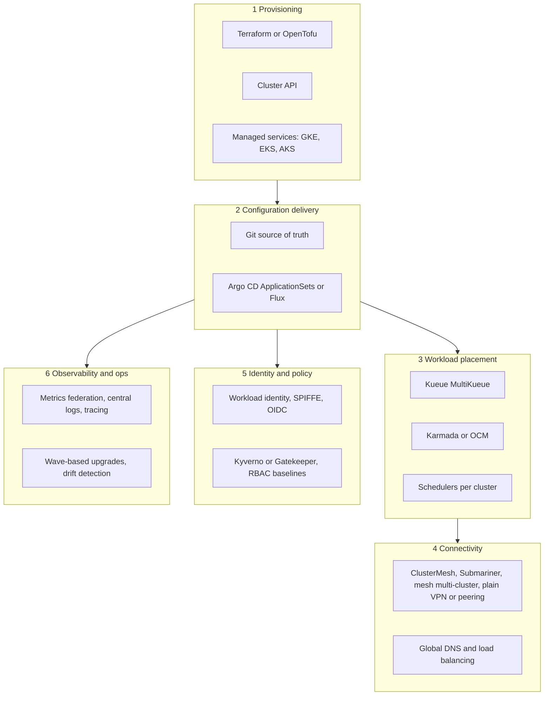
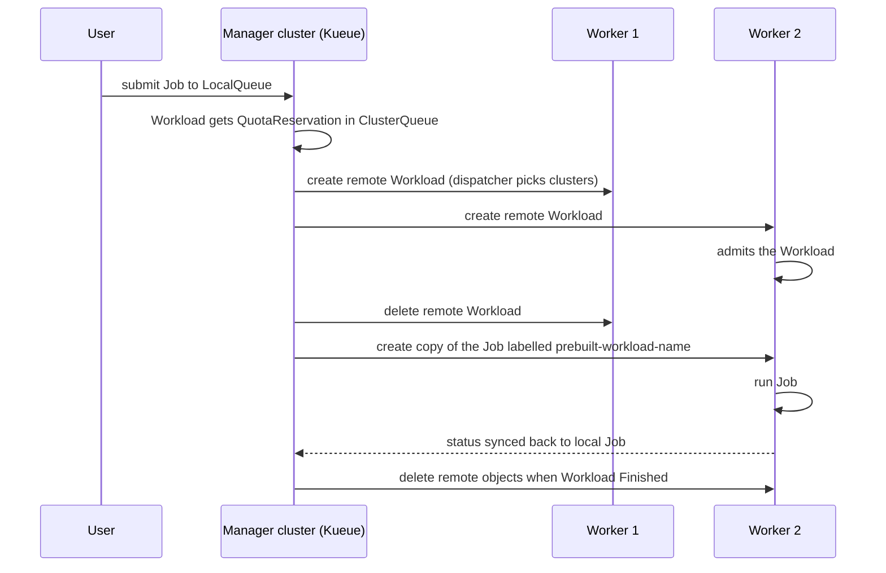

# 5.35 Multicluster and fleet management

| | |
|---|---|
| Level | Advanced |
| Priority tier | 2 |
| Lab venue | Two or three `kind` clusters are enough to practise GitOps fan-out and MultiKueue mechanics |
| Part | Part 5: Kubernetes |
| Status | Drafted. MultiKueue facts were read from the Kueue repository (shallow clone, commit `1ec0d28`, 2026-10-23, docs and API types). Everything else is from documentation knowledge, **unverified**; labs are **untested** |

## Why this matters for AI infrastructure

AI platforms rarely stay on one cluster. Capacity is spread across regions and providers (reservations in one place, Spot in another, an on-premises DGX pool, a neocloud like CoreWeave or Nebius), data sits in different places, teams need isolation, and a single huge cluster is a single blast radius. At the same time every extra cluster multiplies the operational work: upgrades, policy, secrets, observability, networking. This chapter covers when to split, how to keep a fleet consistent, how work is placed across clusters, and what breaks.

## Prerequisites and outcomes

Needs 5.5, 5.14 to 5.16 (networking), 5.21 and 5.22 (security), 5.28 (service mesh), 5.29 and 5.31 (operators), 5.34 and Part 4 (Terraform, GitOps). After this chapter you can:

- Decide between one large cluster, a few big clusters, and many small ones for a given requirement.
- Describe the layers of fleet management: provisioning, configuration delivery, workload placement, networking, identity, policy, observability.
- Design GitOps fan-out with Argo CD ApplicationSets and cluster generators, with promotion waves.
- Explain how Kueue MultiKueue dispatches jobs across clusters, its limits, and its security model.
- Compare Karmada, Open Cluster Management, Cluster API and cloud fleet products at the level of what problem each solves.
- Plan fleet-wide upgrades, certificate and credential rotation, and failure-domain design.

## 1. Why more than one cluster

| Driver | Explanation |
|---|---|
| Capacity location | GPUs come from several regions/providers/reservations; one control plane cannot span them well |
| Blast radius | A bad upgrade, a controller bug or an etcd problem should not stop all training and inference |
| Isolation | Regulated data, tenant separation, production vs research, different compliance regimes |
| Latency and data gravity | Inference near users; training near data |
| Scale limits | Control plane limits (nodes, objects, watch load) push very large estates into several clusters |
| Hardware or version differences | Different GPU generations, drivers, OS images, Kubernetes versions |
| Organisational | Different owners and change cadences |

Costs of splitting: duplicate platform components in each cluster (CNI, ingress, observability, GPU stack), cross-cluster networking and identity, harder scheduling (no global view), more upgrade work, and fragmented capacity (idle GPUs in cluster A while cluster B queues).

A decision heuristic: **start with one cluster per environment per region per hardware domain**, and split further only for a concrete driver from the table. Treat clusters as cattle, not pets: reproducible from code, replaceable.

Also decide how large a cluster should be. Training clusters are often a single tightly-coupled fabric (one InfiniBand/RoCE domain) so the cluster boundary follows the network boundary; a job cannot span clusters without a network that connects the GPUs. In general, **one training job runs inside one cluster**. Multicluster is for placing *jobs*, replicating *services* and managing *platforms*, not for stretching a single NCCL job across clusters.

In *Kubernetes: Up and Running* (`KUR`) Chapter 21 (*Multicluster Application Deployments*), Brendan Burns, Joe Beda, Kelsey Hightower, and Lachlan Evenson highlight four foundational lessons before expanding from one cluster to a multi-cluster fleet:
1. **\"Fixing foundational problems in your infrastructure is 10 times harder when you have 10 clusters\" (`KUR` Chapter 21):** Any manual deployment step, missing CI/CD pipeline, unautomated certificate rotation, or observability gap you tolerate in a single cluster is multiplied by $N$ across $N$ clusters. Automate 100% of single-cluster deployment, testing, and monitoring *before* going multicluster.
2. **North-South Global Load Balancing: `GeoDNS` vs. `Anycast` Cloud Load Balancers (`KUR` Chapter 21):**
   - **Why `GeoDNS` has drawbacks:** (a) Recursive DNS resolvers across the internet often ignore short DNS TTLs and cache records for minutes or hours, so removing a failed cluster's IP from DNS does not immediately stop user traffic; (b) DNS resolves based on the user's *DNS resolver* location rather than the user's actual IP; and (c) **uneven ISP distribution**—if 2 ISPs resolve all of their millions of subscribers through 2 DNS caches, round-robin DNS across 3 cluster IPs sends 100% of those users to only 2 of the 3 clusters, leaving the 3rd cluster idle.
   - **Global Anycast HTTP(S) Load Balancing (Cloud Load Balancers / Cloudflare):** Advertises a single global Anycast VIP via BGP, terminates TCP/HTTP at the nearest edge PoP, health-checks backend cluster ingresses continuously, and routes **every individual HTTP request** (including path-based routing like `/video` vs `/api`) to the closest healthy cluster with available capacity.
3. **The \"Replicated Silo\" Pattern and Minimum-Replica Overhead (`KUR` Chapter 21):** Deploying an identical, independent copy of your application stack into $R$ regional clusters is the simplest multicluster architecture (zero cross-cluster runtime coupling). However, if your application requires a minimum of `3` replicas for High Availability in every cluster, deploying across `8` regional clusters forces a floor of $8 \times 3 = \mathbf{24}$ replicas—even if global traffic only needs `10` replicas (`14` overprovisioned GPU/CPU replicas sitting mostly idle in low-traffic regions, modeled in `audit_fleet_cidrs_and_silo_overhead()` in `code/part05/multicluster_fleet_dispatcher.py`).
4. **Multicluster Data & State Consistency Models (`KUR` Chapter 21):**
   - **Regional Data Silos / Sharding:** Each user's data is homed strictly in one regional cluster (e.g., EU users in `eu-west`, US users in `us-east`), satisfying GDPR data-residency laws and avoiding cross-region write locks.
   - **Primary-Secondary with Read Replicas (Eventual Consistency):** Writes go to a primary region while regional inference/serving clusters read from local read-only replicas (or replicated object storage buckets for model weights).
   - **Globally Distributed Strongly Consistent Databases (`Google Cloud Spanner` / `CockroachDB`):** Provide global external consistency across regions (allowing clients to opt into bounded stale reads for lower latency).

## 2. Layers of fleet management



Each layer can use different tools; there is no single product that does all of it well. Keep the interfaces clean: provisioning produces a cluster plus a record in a **cluster inventory**; configuration delivery reads that inventory to decide which clusters get what.

## 3. Provisioning and lifecycle

- **Terraform/OpenTofu** (Part 4) for clusters and node pools in each cloud. One module per cluster type, parameterised; one state per cluster (never one giant state for the fleet). Outputs feed the inventory.
- **Cluster API (CAPI)**: Kubernetes-style declarative cluster lifecycle. A management cluster holds `Cluster`, `MachineDeployment`, `MachinePool` resources and provider-specific infrastructure resources; controllers create and upgrade workload clusters. Good for on-premises and bare metal (with providers such as vSphere, Metal3, Tinkerbell) and for uniform upgrade handling; needs a dependable management cluster (back it up, run it highly available, avoid it being a fleet-wide single point of failure).
- **Managed services** (GKE, EKS, AKS, and GPU clouds' managed Kubernetes): the control plane is the provider's problem; you still manage node pools, add-ons and configuration.
- **Cluster inventory/identity**: a registry listing every cluster with labels (`env`, `region`, `gpu-type`, `tier`, `owner`) used for targeting. In Argo CD this is cluster Secrets with labels; in Kubernetes SIGs there is a ClusterProfile API for describing clusters, which the Kueue docs reference for credential discovery.
- **Day-2**: version skew policy, certificate rotation, add-on versions, node image updates, drift detection (Terraform plan in CI; GitOps controllers for in-cluster drift).

## 4. Configuration delivery with GitOps

Pattern: one Git repository (or a structured set) describes a **base platform** (CNI, ingress, cert-manager, GPU stack, observability agents, policy) and **overlays** per environment, region or hardware type. A GitOps controller in or near each cluster applies it (5.27 on GitOps).

Argo CD options:

1. **One central Argo CD** with registered remote clusters (push model): simple and visible; the central instance holds credentials to every cluster, so it is a high-value target and a single point of failure.
2. **Argo CD per cluster** (pull model): each cluster reconciles itself; no central credentials, good for isolated or air-gapped clusters; harder to see everything in one place. A common hybrid is a central Argo CD managing only the Argo CD instances (app of apps).

**ApplicationSet** generates many Applications from a template. Generators: `list`, `clusters` (every registered cluster, filterable by label), `git` (directories or files in a repo), `matrix` and `merge` (combine generators), `scmProvider`, `pullRequest`, plugin generators. A typical use:

```yaml
apiVersion: argoproj.io/v1alpha1
kind: ApplicationSet
metadata:
  name: gpu-stack
spec:
  generators:
  - clusters:
      selector:
        matchLabels:
          gpu: "true"
  template:
    metadata:
      name: "gpu-stack-{{name}}"
    spec:
      project: platform
      source:
        repoURL: https://git.example.com/platform/fleet.git
        targetRevision: main
        path: "clusters/{{metadata.labels.env}}/gpu-stack"
      destination:
        server: "{{server}}"
        namespace: gpu-system
      syncPolicy:
        automated: { prune: true, selfHeal: true }
```

(Template field names reflect the documented ApplicationSet syntax as I recall it; validate against your Argo CD version.)

Rollout across a fleet should be **progressive**: ApplicationSet supports progressive syncs (rolling-sync steps by label, e.g. canary clusters first, then dev, then prod). Without it, you can emulate waves by pointing different cluster groups at different Git branches or tags and promoting by merging. Always have a canary cluster that mirrors production hardware.

Flux alternative: one `Kustomization`/`HelmRelease` set per cluster, shared repo with per-cluster paths, or a management cluster using Flux's remote cluster kubeconfig support.

Design rules:

- **Do not template secrets into Git.** Use External Secrets/Secrets Store CSI or SOPS/sealed secrets (5.21).
- Keep per-cluster differences in **small overlays** (values files), not forks.
- Treat **CRD installation order** carefully (CRDs before their custom resources; sync waves in Argo CD).
- Pin versions (chart, image digest) and promote through environments.
- Fleet-wide changes need a **kill switch**: pause the ApplicationSet or revert the Git change; practise it.

## 5. Placing workloads across clusters

### Kueue MultiKueue (read from the Kueue docs and API types)

MultiKueue lets one **manager cluster** dispatch Kueue-managed jobs to **worker clusters**. It is documented as beta (since Kueue v0.9) and enabled by default via the `MultiKueue` feature gate.

Roles and objects:

- **Manager cluster**: runs Kueue plus the MultiKueue admission-check controller. Users submit jobs here to a ClusterQueue that has a MultiKueue **AdmissionCheck**. The ClusterQueue's quota decides how many jobs are eligible at a time; the docs recommend manager quota roughly equal to the total worker quota (too low leaves workers idle; too high dispatches jobs that workers cannot admit).
- **Worker cluster**: a normal standalone Kueue cluster.
- **`MultiKueueCluster`**: one per worker. Its spec has a `clusterSource` and either `kubeConfig` (with `location` and `locationType`) or `clusterProfileRef`.
- **`MultiKueueConfig`**: lists the worker clusters (`spec.clusters`).

Flow, as documented:



Dispatchers (since Kueue v0.13): **AllAtOnce** (default; copy the Workload to all workers as soon as quota is reserved, fastest admission, but several workers may briefly reserve resources), **Incremental** (nominate clusters in rounds, by default batches of up to 3, adding the next batch after a fixed interval of 5 minutes if none admits; since Kueue v0.19 the order of `MultiKueueConfig.spec.clusters` is respected, which allows "cheap on-premises first, spill over to cloud" policies) and **External** (custom). Configuration of the dispatcher name and the incremental step size is in the Kueue configuration file (`multiKueue.dispatcherName`, `multiKueue.incrementalDispatcherConfig`), the latter behind a feature gate. The workload's `status.nominatedClusterNames` lists considered clusters and `status.clusterName` records the admitted one, immutable once set.

Supported job types in the docs include batch Job, JobSet, Kubeflow jobs, KubeRay workloads, MPIJob, AppWrapper, plain Pods, Deployment, StatefulSet and LeaderWorkerSet, plus external frameworks.

**Security**: the manager holds credentials to workers. Credentials can come from a `ClusterProfile`, a `Secret` or a file `Path`; the docs mark `Path` as development only and describe a validation gate restricting paths to a fixed prefix (`/etc/multikueue/kubeconfigs/`), because untrusted kubeconfig files can execute code or read sensitive files. Create a **least-privilege** service account on each worker (the docs provide a script to generate a worker-specific kubeconfig) and rotate it.

**Limitations** called out in the docs: the manager cannot also act as one of its own workers (use a separate dedicated ClusterQueue for local jobs); for job types without `managedBy` support (StatefulSet, LeaderWorkerSet) the manager's job status may not reflect the worker's actual state (check the Workload status).

Design questions to ask: where does the **data** live, and does moving the job to another cluster mean pulling terabytes? Are images, secrets, ConfigMaps and PVCs available in every worker? Are quotas and flavors consistent so a job fits wherever it lands? How are results and checkpoints stored in a place all clusters can reach (object storage, Part 13)?

### Other approaches

| Tool | Idea | Fit |
|---|---|---|
| **Karmada** | A "Kubernetes-native" multicluster control plane: you create ordinary resources plus `PropagationPolicy` and `OverridePolicy`; Karmada distributes them to member clusters, can schedule replicas by weight/availability and fail over | General multicluster application distribution; heavier, another control plane to run |
| **Open Cluster Management (OCM)** | Hub-and-spoke: `ManagedCluster`, `ManifestWork`, `Placement`; agents on managed clusters pull work | Large heterogeneous fleets, policy delivery; also the basis of some vendor products |
| **Cloud fleet products** (GKE Fleet / multi-cluster services and gateway, EKS and AKS equivalents) | Provider-integrated cluster registration, cross-cluster Services/Gateway, config management | Convenient if you are within one cloud |
| **Admiralty, Liqo** | Virtual-node style: remote clusters appear as nodes, Pods are scheduled across them | Research and bursty spill-over; understand networking and failure semantics before use |
| **Per-cluster scheduler + external queue** (Slurm federation, Run:ai, custom) | A higher-level system owns the queue and submits to clusters | When you already have a scheduler with policy and fair-share (Part 6, Part 14) |

Evaluate any of them against: how failure is handled (a cluster disappears mid-job), how state is reconciled after a partition, how credentials are held, how quota and fair-share are enforced globally, and how debugging works (where do I look to see why a job is not running).

## 6. Cross-cluster networking

Options, from simplest to most integrated:

1. **No pod-to-pod connectivity**: clusters talk through public or internal load balancers and DNS. Safest and often sufficient for APIs and inference endpoints.
2. **VPC peering or VPN plus routable Pod CIDRs**: needs non-overlapping Pod/Service CIDRs across the fleet (decide this at the start; overlapping ranges are painful to fix).
3. **Cilium ClusterMesh**: connects Cilium clusters for global services and cross-cluster policy (needs unique cluster ids and routable or tunnelled connectivity) (5.15).
4. **Submariner**: cross-cluster pod and service connectivity with service discovery, CNI-agnostic.
5. **Service mesh multi-cluster** (Istio and others): shared trust, locality-aware load balancing and failover (5.28).
6. **Multi-Cluster Services (MCS) API**: standard `ServiceExport` and `ServiceImport` resources for cross-cluster service discovery; implementations vary.

For AI: **training traffic stays inside a cluster's fabric**. Cross-cluster traffic is checkpoints to object storage, model pulls, inference gateway routing, control-plane APIs and telemetry. Design for bandwidth cost and egress charges, not just connectivity.

## 7. Identity, access and policy

- **Human access**: SSO/OIDC to every cluster with group-based RBAC generated from one source; short-lived credentials; a bastion or proxy so API endpoints need not be public.
- **Workload identity**: cloud-native workload identity (GKE Workload Identity, IRSA on EKS, and equivalents) or SPIFFE/SPIRE for cross-cluster and cross-cloud trust, rather than static keys in Secrets.
- **Secrets**: a central secret manager with per-cluster access scopes, synced by External Secrets or CSI; avoid copying the same long-lived secret everywhere.
- **Admission policy** (Kyverno, OPA Gatekeeper, ValidatingAdmissionPolicy) delivered by GitOps to every cluster: image registries and signatures (5.22), privileged Pod rules, resource-limit requirements, GPU request rules, namespace labels. Roll out in audit mode first, then enforce.
- **Compliance evidence**: collect policy reports centrally.
- **Management-plane credentials** (the central Argo CD, the MultiKueue manager, CAPI management cluster) are the crown jewels: they can modify every cluster. Isolate them, restrict network access, audit every use, and keep an out-of-band recovery path.

## 8. Observability across the fleet

- **Metrics**: each cluster runs Prometheus (or an agent) and ships to a central long-term store (Thanos, Mimir, Cortex-style, or a managed service) with a `cluster` external label on every series (5.19). Federate selected metrics, not everything.
- **Logs and traces**: central collection with cluster labels; keep high-volume GPU/job logs local with short retention and ship summaries.
- **GPU fleet view**: DCGM metrics per GPU, aggregated by cluster, pool and tenant: utilisation, errors, idle expensive hardware, queue wait time, preemptions.
- **Fleet SLOs**: control-plane availability, scheduling latency, GPU utilisation, job success rate, queue time.
- **Alert routing** must identify the cluster and owner. Watch for alert storms when a fleet-wide dependency fails.
- Monitor the **management plane itself**: GitOps sync status, MultiKueue cluster `Active` conditions, CAPI health.

## 9. Upgrades and change management

Fleet upgrades are the main recurring cost.

1. Define **rings**: canary (mirrors prod hardware, small), dev/staging, prod ring 1 (low-risk), prod ring 2 and so on, with soak times.
2. Order: management plane first (CAPI, GitOps, MultiKueue manager), then clusters, within version-skew rules. Within a cluster, control plane, add-ons, then node pools; GPU driver changes are separate and tested against real workloads (Part 10).
3. **Pre-flight checks** in CI: API deprecation scans, Helm chart diffs, admission policy tests, a synthetic GPU job (`nvidia-smi`, a small NCCL test) on the canary.
4. **Automated rollback** where cheap (Git revert, node pool blue/green), plus a rehearsed manual path where not.
5. **Maintenance windows and PDBs** so upgrades drain nodes without killing long training jobs; coordinate with the scheduler (cordon first, wait for jobs, 5.32).
6. Track fleet **version inventory** and age; alert on clusters near end of support.

## 10. Failure-domain design

| Failure | Design response |
|---|---|
| Whole cluster lost | Stateless services replicated across clusters; training checkpoints in object storage reachable from others; job requeued to another cluster by the dispatcher |
| Management plane lost | Workload clusters keep running (control planes are independent); pull-based agents keep reconciling the last state; document manual operation; back up the management cluster |
| Bad fleet-wide change | Rings and progressive sync; a global pause switch |
| Credential leak (central controller) | Short-lived credentials, per-cluster least privilege, rotation drill |
| Network partition between manager and workers | MultiKueue marks the cluster inactive; running jobs on workers continue; define what happens to in-flight jobs on reconnect |
| Cloud region outage | Active-active inference across regions; training capacity redundancy planned against cost |
| Skew drift | Drift detection; reconcile or rebuild rather than hand-fix |

State the recovery objectives explicitly (how long can a cluster be gone, how much training progress may be lost = checkpoint interval).

## 11. Lab

First, run the self-checking Python lab (`code/part05/multicluster_fleet_dispatcher_lab.py`) locally. It verifies the Kueue `MultiKueue` `AllAtOnce` vs `Incremental` 3-cluster round dispatcher (`simulate_multikueue_dispatch`), the Argo CD `ApplicationSet` label-selector and ring rollout planner (`plan_applicationset_ring_rollout`), and the fleet Pod CIDR overlap detector and `KUR` Chapter 21 replicated-silo minimum-replica overhead calculator (`audit_fleet_cidrs_and_silo_overhead`).

```bash
python3 code/part05/multicluster_fleet_dispatcher_lab.py
```

Next, on three `kind` clusters (`mgmt`, `dev`, `prod`; all interactive steps below are `untested here`), work through these exercises:

1. Create three `kind` clusters (`mgmt`, `dev`, `prod`). Install Argo CD on `mgmt`, register `dev` and `prod` with labels, and create an ApplicationSet with a `clusters` generator that deploys a namespace and a small app to both. Change a label and watch the Application appear or disappear.
2. Add a canary step using separate Git paths or progressive sync; make a bad change and observe what the canary catches.
3. MultiKueue (CPU-only): install Kueue on all three clusters. On `dev` and `prod` create a ClusterQueue and LocalQueue; generate a worker kubeconfig with the script in the Kueue docs, create Secrets on the manager, a `MultiKueueCluster` per worker, a `MultiKueueConfig`, a MultiKueue AdmissionCheck and a manager ClusterQueue using it. Submit a `batch/v1` Job and watch the remote Workload, the copy of the Job, and the cleanup. Then fill `prod`'s quota and watch spill-over with the Incremental dispatcher.
4. Break it: block the manager's access to a worker and observe the `MultiKueueCluster` condition; restore.
5. Write the fleet inventory (labels) you would want for 10 real clusters (cloud, region, GPU, env, owner, upgrade ring) and the Git layout that consumes it.
6. Write the upgrade runbook for one ring, including pre-flight checks and rollback.

## 12. Interview angles

- When would you split one cluster into several, and when would you not?
- Can a training job span two clusters? Why or why not?
- Push vs pull GitOps for a fleet: trade-offs?
- How does MultiKueue decide where a job runs, and what are its failure modes?
- Where do credentials live in your fleet design, and what happens if the central controller is compromised?
- How do you roll out a GPU driver or CNI change across 30 clusters safely?
- How do you give researchers one place to submit jobs while capacity lives in several clouds?
- What do you monitor on the management plane?
- How do you choose non-overlapping Pod CIDRs for 50 future clusters?
- Compare Karmada, OCM and plain ApplicationSets.

## Exercises

1. **Single Cluster vs. Multi-Cluster Trade-Offs, Replicated Silo Overhead, and Global Traffic Routing (`KUR` Chapter 21):** Using `audit_fleet_cidrs_and_silo_overhead()` in `code/part05/multicluster_fleet_dispatcher.py`, explain the 7 drivers for splitting into multiple clusters vs the operational and capacity-fragmentation costs, explain why a single `NCCL` training job does not span clusters, and compare `GeoDNS` (TTL caching and uneven ISP resolution) with `Anycast` HTTP(S) Cloud Load Balancing (`KUR` Ch. 21).
2. **The 6 Layers of Fleet Management, Terraform Per-Cluster State, and Cluster API (`CAPI`, `bcm11-containerization` Chapter 8):** Map the 6 layers of fleet management in Section 2, explain why Terraform must use **one state file per cluster** rather than one monolithic fleet state, and explain how Cluster API (`Cluster`, `MachineDeployment`, `MachinePool` on a management cluster) provisions and upgrades workload clusters.
3. **GitOps Fleet Delivery: Hub-and-Spoke (Push) vs. Per-Cluster (Pull) Argo CD, `ApplicationSet` Generators, and Progressive Rollout Rings:** Using `plan_applicationset_ring_rollout()` in `code/part05/multicluster_fleet_dispatcher.py`, trace the `gpu-stack` `ApplicationSet` manifest in Section 4 (`clusters` generator matching `gpu: "true"`), compare central Push vs per-cluster Pull GitOps security models, and design a 4-ring progressive sync (`canary -> staging -> prod-ring-1 -> prod-ring-2`).
4. **Cross-Cluster AI Job Dispatch with Kueue `MultiKueue` (`AllAtOnce` vs. `Incremental` Dispatchers and Security Model):** Using `simulate_multikueue_dispatch()` in `code/part05/multicluster_fleet_dispatcher.py`, trace the 8-step `MultiKueue` sequence diagram in Section 5, compare `AllAtOnce`, `Incremental` (batches of 3 every 5 minutes in `MultiKueueConfig.spec.clusters` priority order), and `External` dispatchers, and explain why `Path` kubeconfigs are restricted to `/etc/multikueue/kubeconfigs/`.
5. **Comparing Multi-Cluster Orchestrators (`MultiKueue` vs. `Karmada` vs. `Open Cluster Management` vs. `Liqo`) and Cross-Cluster Networking (`Cilium ClusterMesh`, `Submariner`, `MCS` API):** Compare `MultiKueue`, `Karmada` (`PropagationPolicy`/`OverridePolicy`), `OCM` (`ManagedCluster`/`ManifestWork`/`Placement`), and `Liqo`, and explain why non-overlapping Pod/Service CIDRs (`audit_fleet_cidrs_and_silo_overhead()`) must be planned at Day 0 before enabling `Cilium ClusterMesh` or `Submariner`.
6. **Fleet-Wide Identity, Observability (`Thanos`/`Mimir` `cluster` Labels), Upgrade Runbooks, and Failure-Domain Design:** Trace what happens to running GPU training and inference workloads when (a) the central management cluster (`Argo CD` / `MultiKueue` manager / `CAPI`) goes down vs (b) an entire worker cluster or cloud region is lost, and write the pre-flight canary checks for rolling out a CNI or GPU Operator upgrade across 20 clusters.

## Checkpoint questions (20)

<details>
<summary>1. What is the practical heuristic for deciding when to split an AI platform into multiple Kubernetes clusters, and why does a single synchronous `NCCL` training job almost always run inside one cluster?</summary>

- **Heuristic:** Start with **one cluster per environment (`dev`/`staging`/`prod`) per region per tightly-coupled hardware fabric domain**, and split further only for a concrete requirement (capacity spread across multiple clouds/regions, blast-radius containment, strict compliance/regulatory isolation, or control-plane scale limits `> 2,000–5,000` nodes).
- **Why one `NCCL` training job stays inside one cluster:** Synchronous `AllReduce` / `AllGather` collectives require **100–800 Gb/s per GPU of non-blocking, microsecond-latency RDMA (InfiniBand or RoCEv2)** within a single rail-optimized leaf-spine fabric. Stretching a single synchronous training job across WAN/VPC links between two separate clusters bottlenecks every step on the slowest cross-cluster link. Instead, use multicluster queueing (**`MultiKueue`**) to place *each whole training job* into a cluster that has a contiguous fabric big enough to run it.
</details>

<details>
<summary>2. In *Kubernetes: Up and Running* Chapter 21, what are the three drawbacks of `GeoDNS` for routing user traffic across multiple clusters, and how does `Anycast` HTTP Load Balancing solve them?</summary>

1. **DNS TTL Caching Ignores Outages:** Recursive DNS resolvers and client OS/browsers frequently ignore short DNS TTLs (`60s`) and cache IP addresses for 15–60 minutes—so when a cluster goes down and you remove its IP from DNS, cached clients keep sending requests to the dead cluster.
2. **Resolver Location $\ne$ User Location:** GeoDNS sees the IP address of the user's *recursive DNS resolver* (e.g., a centralized corporate or ISP DNS server in another country), not the end user's actual geographic location.
3. **Uneven ISP Load Distribution (`KUR` Chapter 21):** If 3 cluster IPs exist in DNS and the 2 largest ISPs in a country each cache 1 DNS answer for millions of subscribers, 2 of your clusters receive 100% of the traffic while the 3rd cluster sits idle.
**How Anycast HTTP(S) Cloud Load Balancing solves all three:** A single global IP is advertised via BGP Anycast from hundreds of edge PoPs worldwide; the edge proxy terminates the user's TCP/HTTP connection near the user, health-checks backend clusters in real time, and routes each individual HTTP request (`L7`) only to healthy clusters with spare capacity.
</details>

<details>
<summary>3. In `KUR` Chapter 21, what is the "Replicated Silo" multicluster pattern, and why can it cause severe GPU overprovisioning in low-traffic regions?</summary>

In the **Replicated Silo** pattern, every regional cluster runs a complete, self-contained copy of the application stack with zero cross-cluster dependencies.
However, every production service requires a **minimum replica floor for High Availability** (e.g., at least **3 replicas** across zones in each cluster so a node failure or rolling update does not cause downtime). If you deploy a 70B LLM inference service (requiring `4 H100 GPUs per replica * 3 HA replicas = 12 H100 GPUs per cluster`) into **8 regional clusters**, you must run at least `8 * 3 = 24 replicas` (`96` H100 GPUs)—even if 5 of those smaller regions have so little traffic that 10 replicas globally would have handled the entire load.
</details>

<details>
<summary>4. Why must Terraform / OpenTofu use **one state file per cluster** (and separate state for node pools/addons) rather than one monolithic state file for the entire fleet?</summary>

If all 20 clusters in your fleet share a single Terraform state file:
1. **Blast radius:** A single bad variable, provider upgrade bug, or typo in `terraform apply` can mutate or destroy multiple production clusters at once.
2. **State lock contention & slow `plan` times:** `terraform plan` has to refresh thousands of cloud resources across 20 clusters (taking 20+ minutes and hitting cloud API rate limits), and while one engineer is upgrading `dev-us-west`, the state lock blocks every other engineer from touching `prod-eu-central`.
3. **Promotion rings:** Separate states allow you to apply and soak changes on `canary` for 24 hours before running `terraform apply` on `prod-ring-1`.
</details>

<details>
<summary>5. How does `Cluster API` (`CAPI`, `bcm11-containerization` Chapter 8) manage cluster lifecycles, and what happens to workload clusters if the CAPI Management Cluster goes down?</summary>

- **How CAPI works:** A central **Management Cluster** runs the CAPI controllers and stores declarative CRDs (`Cluster`, `KubeadmControlPlane`, `MachineDeployment`, `Machine`, `MachineHealthCheck`, plus infrastructure provider CRs like `AWSCluster`, `GCPCluster`, `VSphereMachine`, or bare-metal `Metal3`/`Tinkerbell`). Creating or patching a `Cluster` or `MachineDeployment` CR on the Management Cluster causes CAPI to provision or roll-upgrade a **Workload Cluster**.
- **What happens if the Management Cluster goes down:** **All existing Workload Clusters and their running GPU workloads continue running normally.** Each Workload Cluster has its own independent `kube-apiserver` and `etcd`. Only Day-2 cluster lifecycle operations (provisioning new clusters, node-pool autoscaling if driven externally by CAPI, or `MachineHealthCheck` node replacement) are paused until the Management Cluster recovers.
</details>

<details>
<summary>6. Compare the **Hub-and-Spoke (Central Push)** Argo CD model vs. the **Per-Cluster (Pull)** Argo CD / Flux model for a 20-cluster fleet.</summary>

| Dimension | Central Hub-and-Spoke Argo CD (Push) | Per-Cluster Argo CD / Flux (Pull) |
|---|---|---|
| **Architecture** | One central Argo CD instance holds kubeconfig `Secret`s for all 20 remote clusters and pushes manifests to their API servers | Each cluster runs its own local GitOps controller that pulls from Git (optional central "App-of-Apps" manages only the GitOps configs) |
| **Single Pane of Glass** | Built-in: one UI shows sync/health status of all 20 clusters | Requires a central dashboard / federated metrics to view fleet status |
| **Security & Blast Radius** | Central Argo CD is a **crown-jewel target** holding admin credentials to every cluster, and requires network reachability to all 20 API servers | **Zero central cluster credentials**; works seamlessly for private/air-gapped clusters that only allow outbound HTTPS to Git/registry |
</details>

<details>
<summary>7. How does an Argo CD `ApplicationSet` with a `clusters` generator and Progressive Sync (`RollingSync`) roll out a platform upgrade safely across a fleet?</summary>

1. Each registered cluster Secret in Argo CD carries inventory labels (`env: prod`, `gpu: "true"`, `ring: canary` / `staging` / `prod-ring-1` / `prod-ring-2`).
2. The `ApplicationSet`'s `clusters` generator matches `gpu: "true"` and renders one `Application` per GPU cluster (`gpu-stack-{{name}}`).
3. With `strategy: { type: RollingSync }`, the `ApplicationSet` controller groups target clusters by their `ring` label: it syncs **`ring: canary`** first and waits for the `Application` health check to become `Healthy` (plus any soak/approval gate) before advancing to **`staging`**, then **`prod-ring-1`**, and finally **`prod-ring-2`**. If `canary` fails health checks, the rollout halts automatically before touching production.
</details>

<details>
<summary>8. Walk through the 8-step lifecycle of a job dispatched by **Kueue `MultiKueue`** from a Manager Cluster to Worker Clusters (Section 5).</summary>

1. A user submits a `Job` / `JobSet` / `PyTorchJob` / `RayJob` (with `suspend: true`) to a `LocalQueue` on the **Manager Cluster** (without setting `spec.managedBy` manually—Kueue's webhook defaults it to `kueue.x-k8s.io/multikueue`).
2. The Manager Cluster's `ClusterQueue` (configured with a `MultiKueue` `AdmissionCheck`) grants the local `Workload` a **`QuotaReservation`**.
3. The MultiKueue dispatcher (`AllAtOnce` or `Incremental`) creates remote copies of the **`Workload` CR** on the nominated **Worker Clusters** (`W1`, `W2`).
4. Worker Cluster `W2` has free GPU quota and **admits** its copy of the `Workload`.
5. The Manager Cluster sees `W2`'s admission, records `status.clusterName = "W2"` on the local `Workload`, **deletes the pending remote `Workload` from `W1`**, and creates a remote copy of the actual **`Job`** on `W2` (labeled with `kueue.x-k8s.io/prebuilt-workload-name`).
6. `W2` runs the Job pods on its GPU nodes.
7. While the Job runs on `W2`, the Manager Cluster continuously mirrors `W2`'s Job/Workload `.status` back onto the user's Job on the Manager Cluster.
8. When the Job finishes (`Succeeded` or `Failed`), the Manager marks the local Workload `Finished` and cleans up the remote objects on `W2`.
</details>

<details>
<summary>9. Compare `MultiKueue`'s three dispatcher modes: `AllAtOnce` (default), `Incremental`, and `External`.</summary>

- **`AllAtOnce` (default):** Immediately sends remote `Workload` copies to **all** worker clusters listed in `MultiKueueConfig.spec.clusters` as soon as the manager reserves quota. Fastest time-to-admission, **but multiple worker clusters may briefly reserve quota for the same job** before the losing clusters' copies are deleted.
- **`Incremental` (Kueue v0.13+, ordered since v0.19):** Nominates worker clusters in **rounds of 3 clusters** following the **exact priority order listed in `MultiKueueConfig.spec.clusters`**, waiting **5 minutes** per round before adding the next batch of 3 clusters if none in the current batch admits the job. Ideal for **"on-prem DGX first $\rightarrow$ reserved cloud second $\rightarrow$ expensive on-demand/neocloud burst third"** spill-over policies.
- **`External`:** Delegates cluster selection to an external placement controller that sets `Workload.status.nominatedClusterNames`.
</details>

<details>
<summary>10. In `MultiKueue`, how should you size the Manager Cluster's `ClusterQueue` nominal quota relative to the Worker Clusters' quotas?</summary>

The Kueue documentation recommends setting the Manager `ClusterQueue`'s quota **roughly equal to the sum of the connected Worker Clusters' quotas**:
- If the Manager's quota is set **much lower** than the sum of the workers, the Manager will throttle job dispatching and leave worker clusters sitting idle.
- If the Manager's quota is set **infinite / much higher** than the workers, the Manager will give `QuotaReservation` to hundreds of jobs at once and flood the worker clusters with remote `Workload` objects that cannot be admitted.
</details>

<details>
<summary>11. What are the three ways a `MultiKueueCluster` CR can reference credentials for a Worker Cluster, and why is `LocationType: Path` restricted to `/etc/multikueue/kubeconfigs/`?</summary>

1. **`Secret` (`LocationType: Secret`):** References a Kubernetes `Secret` in the Kueue system namespace containing a least-privilege worker kubeconfig.
2. **`ClusterProfile` (`clusterProfileRef`):** References a standard SIG-Multicluster `ClusterProfile` CR for dynamic credential discovery.
3. **`Path` (`LocationType: Path`, development only):** Reads a kubeconfig file from the manager controller container's filesystem. Because a maliciously crafted kubeconfig file can specify an **`exec:` credential plugin** (executing arbitrary commands inside the controller pod) or reference arbitrary mounted files (like `/var/run/secrets/kubernetes.io/serviceaccount/token`) as a bearer token, Kueue marks `Path` as development-only and enforces path validation restricting it to `/etc/multikueue/kubeconfigs/`.
</details>

<details>
<summary>12. Why can't a `MultiKueue` Manager Cluster list itself as one of its own `MultiKueueCluster` workers in the same `ClusterQueue`, and what is the workaround?</summary>

If the Manager Cluster dispatched a remote copy of the `Workload` and `Job` back into the **same namespace and `LocalQueue` on itself**, the newly created copy would collide with the original `Job`/`Workload` name and recursively trigger the MultiKueue controller.
**Workaround:** If your Manager Cluster also has local GPU nodes, create a separate local `ClusterQueue` (without the MultiKueue `AdmissionCheck`) for local jobs, or run the MultiKueue manager on a lightweight dedicated CPU management cluster while treating all GPU clusters uniformly as workers.
</details>

<details>
<summary>13. What four "Data Gravity & Environment Parity" questions must you solve before dispatching GPU training jobs across multiple clusters with `MultiKueue`?</summary>

1. **Dataset & Checkpoint Locality:** Where does the 50 TB training dataset live? If a job spills over from Cluster A (`us-east`) to Cluster B (`eu-central`), will it stall for hours pulling 50 TB across regions or incur massive cloud egress bills?
2. **Shared Checkpoint Storage:** When a preempted job restarts on a different worker cluster, can both clusters read/write the same S3/GCS checkpoint bucket with high bandwidth?
3. **Container Image & Secret Parity:** Are the container images replicated in a local registry mirror near every worker cluster, and are required `Secret`s / `ConfigMap`s synced via GitOps / External Secrets to every worker namespace?
4. **Hardware Topology Parity (`ResourceFlavor`s):** Does a job requesting `8x H100` get scheduled onto compatible RDMA/NVLink hardware on every target worker cluster?
</details>

<details>
<summary>14. Compare `Kueue MultiKueue`, `Karmada`, and `Open Cluster Management` (`OCM`).</summary>

- **`Kueue MultiKueue`:** Purpose-built for **batch and AI/ML job queueing and quota-aware dispatching** (`Job`, `JobSet`, `PyTorchJob`, `RayJob`, `MPIJob`). Dispatches each job to a single winning worker cluster that has quota and syncs status back.
- **`Karmada`:** A full multicluster Kubernetes API server (`karmada-apiserver` + `karmada-scheduler`); you apply standard `Deployment`/`Service`/`Job` objects plus `PropagationPolicy` and `OverridePolicy` CRDs to spread replicas across multiple clusters by weight or failover.
- **`Open Cluster Management` (`OCM`):** A lightweight **hub-and-spoke pull architecture** (`ManagedCluster`, `ManifestWork`, `Placement`); each spoke cluster runs a `klusterlet` agent that pulls assigned `ManifestWork` bundles from the hub.
</details>

<details>
<summary>15. Why must you assign **non-overlapping `Pod` and `Service` CIDRs** to every cluster at Day 0, even if your clusters do not talk to each other today?</summary>

When teams create clusters independently using default CNI CIDRs (`10.244.0.0/16` or `192.168.0.0/16`), every cluster ends up with the **exact same overlapping IP range**.
Six months later, when you need to connect two clusters via **VPC Peering, VPN, Cilium ClusterMesh, or Submariner**, overlapping Pod CIDRs make direct pod-to-pod L3 routing impossible without complex double-NAT (`Globalnet`), and changing a live Kubernetes cluster's Pod/Service CIDR requires **rebuilding the cluster from scratch**. Allocating each cluster a unique `/16` from a central IPAM table (`10.240.0.0/16`, `10.241.0.0/16`, ...) costs nothing at Day 0 and saves a painful rebuild later.
</details>

<details>
<summary>16. Compare `Cilium ClusterMesh`, `Submariner`, `Multi-Cluster Services` (`MCS` API), and a `Multi-Cluster Service Mesh` (`Istio`).</summary>

- **`Cilium ClusterMesh`:** Connects multiple Cilium clusters (requiring unique `cluster-id` `1..255` and non-overlapping Pod CIDRs) via eBPF, enabling cross-cluster `CiliumNetworkPolicy` and global Services (`service.cilium.io/global: "true"`).
- **`Submariner`:** CNI-agnostic L3 IPsec/WireGuard gateway tunnels between clusters + `Lighthouse` DNS discovery (`<svc>.<ns>.svc.clusterset.local`), with optional `Globalnet` NAT for overlapping CIDRs.
- **`MCS` API (`multicluster.x-k8s.io`):** Upstream Kubernetes standard defining `ServiceExport` (in the exporting cluster) and `ServiceImport` (in importing clusters), implemented by GKE Multi-Cluster Services, Cilium, and Submariner.
- **`Multi-Cluster Service Mesh` (`Istio`):** Adds end-to-end **SPIFFE mTLS**, L7 canary/locality failover, and east-west gateways across clusters without requiring flat pod-to-pod L3 routing (`multi-network` mode via east-west gateways).
</details>

<details>
<summary>17. How do you design Unified Multi-Cluster Prometheus Observability (`Thanos` or `Grafana Mimir`) so you can query GPU utilization across 15 clusters without metric collisions?</summary>

1. Configure every cluster's Prometheus (or `Grafana Alloy` / `vmagent`) with unique **`externalLabels`** identifying the cluster, region, and environment:
   `externalLabels: { cluster: "gke-us-central1-prod-01", region: "us-central1", env: "prod" }`
2. Stream metrics via **`remote_write`** (or `Thanos Sidecar` + S3 upload) to a central **Grafana Mimir / Thanos / VictoriaMetrics** cluster.
3. Every PromQL query and alert rule at the fleet layer aggregates by `(cluster, namespace, pod)`:
   `avg by (cluster) (DCGM_FI_PROF_PIPE_TENSOR_ACTIVE)`
   and Alertmanager routes pages using the `cluster` label.
</details>

<details>
<summary>18. What are the "Crown-Jewel Credentials" in a multicluster fleet, and what four controls protect them?</summary>

The **Crown-Jewel Credentials** are the credentials held by the **Central Management Plane** (`Argo CD` hub, `Cluster API` management cluster, `MultiKueue` manager, or central CI/CD)—because compromising that one plane grants write access to **every workload cluster in the fleet**.
**Four mandatory controls:**
1. **Prefer Pull over Push where possible** (per-cluster Flux/Argo CD or OCM `klusterlet` agents pulling with cluster-scoped read-only credentials).
2. **Least-Privilege Per-Worker ServiceAccounts:** A `MultiKueue` manager kubeconfig on Worker X should only have RBAC to manage `Workloads` and `Jobs` in specific batch namespaces—**never `cluster-admin`**.
3. **Short-Lived OIDC / SPIFFE Federation & Automated Rotation:** Use Workload Identity / OIDC tokens instead of static long-lived kubeconfig tokens, and rehearse credential rotation.
4. **Dedicated, Locked-Down Management Cluster:** Never run untrusted tenant workloads or notebooks on the management cluster that holds fleet credentials.
</details>

<details>
<summary>19. Walk through a 4-Ring Fleet Upgrade Plan (`canary -> staging -> prod-ring-1 -> prod-ring-2`) for rolling out a new Kubernetes minor version or GPU Operator upgrade across 20 clusters.</summary>

1. **Management Plane First:** Upgrade the management cluster (`CAPI`, `Argo CD`, `MultiKueue` manager) first and verify compatibility.
2. **Ring 0 — `canary` (1–2 small clusters with real production GPU/NIC hardware):** Apply the upgrade via GitOps PR, run automated **pre-flight & post-flight synthetic tests** (`pluto`/`kubent` API deprecation scan, `nvidia-smi`, DCGM health check, and a 2-node `nccl-tests` `all_reduce_perf` job), and soak for **24–48 hours**.
3. **Ring 1 — `dev` / `staging` clusters:** Roll out and soak for 48 hours under developer workloads.
4. **Ring 2 — `prod-ring-1` (10–20% of production clusters, single region/blast domain):** Upgrade during scheduled maintenance windows respecting PDBs and training checkpoint drains; soak for 72 hours.
5. **Ring 3 — `prod-ring-2` (remaining production clusters, one failure domain at a time).** Keep a single-commit Git revert / ApplicationSet pause switch ready at every step.
</details>

<details>
<summary>20. What happens to in-flight jobs if a network partition disconnects the `MultiKueue` Manager Cluster from Worker Cluster `W2` for 20 minutes?</summary>

1. **While disconnected:** The Manager Cluster's health check marks `MultiKueueCluster/W2` as `Active=False` (so the Manager stops dispatching *new* jobs to `W2`). Meanwhile, **already-running Jobs on `W2` continue running normally on `W2`'s GPUs** because `W2` has its own independent control plane and `kubelet`s.
2. **Note on reconnect / timeout:** Configure `MultiKueue`'s worker lost/reconnect timeout carefully—if a worker remains unreachable beyond the configured grace period, decide and document whether the Manager should keep waiting for `W2` to reconnect or requeue the Workload onto another worker cluster `W3` (resuming from the latest object-store checkpoint while ensuring `W2`'s stale job is fenced or cleaned up when `W2` reconnects).
</details>

## Sources and review notes

- **Sources read in full:**
  - `kubernetes-up-and-running-3rd-edition` — Brendan Burns, Joe Beda, Kelsey Hightower & Lachlan Evenson, *Kubernetes: Up and Running*, 3rd ed., **Chapter 21: Multicluster Application Deployments** (read in full: why go multicluster, "fixing foundational problems in your infrastructure is 10 times harder when you have 10 clusters", GeoDNS TTL caching and uneven ISP resolution drawbacks vs Anycast Cloud Load Balancing, TCP vs HTTP load balancing, the Replicated Silo pattern and minimum-3-replica efficiency floor, and Sharded vs Read-Replica vs globally consistent `Cloud Spanner` state designs).
  - Kubernetes SIGs `Kueue` repository (shallow clone at commit `1ec0d28`, 2026-10-23): `MultiKueue` documentation and API types (`MultiKueueCluster`, `MultiKueueConfig`, `AllAtOnce` vs `Incremental` vs `External` dispatchers, `/etc/multikueue/kubeconfigs/` path validation).
  - `production-kubernetes` — Josh Rosso, Rich Lander, Alexander Brand & John Harris, *Production Kubernetes*, **Chapter 2: Deployment Models** (multi-cluster deployment topologies and blast-radius trade-offs).
  - `bcm11-containerization` — *NVIDIA Base Command Manager 11 Containerization Manual*, **Chapter 8: Kubernetes Cluster API** (Cluster API management and workload cluster lifecycle).
- **Run here:** `python3 code/part05/multicluster_fleet_dispatcher_lab.py` (3 passed, 0 failed).
- **Explicitly labelled inferences:** The `simulate_multikueue_dispatch`, `plan_applicationset_ring_rollout`, and `audit_fleet_cidrs_and_silo_overhead` models in `code/part05/multicluster_fleet_dispatcher.py` and the `gpu-stack` `ApplicationSet` manifest are the author's constructions synthesizing `KUR` Chapter 21, `Kueue` (`1ec0d28`), `PK` Chapter 2, and `bcm11-containerization` Chapter 8 (plus original study items 21, 22, 23, 24, 25, 26, 27, 28, 29, and 30).
- **Not verified on live hardware:** Live multi-cluster `Argo CD ApplicationSet`, `MultiKueue`, `Cluster API`, and `Cilium ClusterMesh` executions (`Kueue v0.9`/`v0.13`/`v0.19`, commit `1ec0d28`, batches of `3` every `5` minutes, `/etc/multikueue/kubeconfigs/`, `10` clusters, `30` / `50` clusters) are marked (`untested here`) where not executed by `multicluster_fleet_dispatcher_lab.py`.
