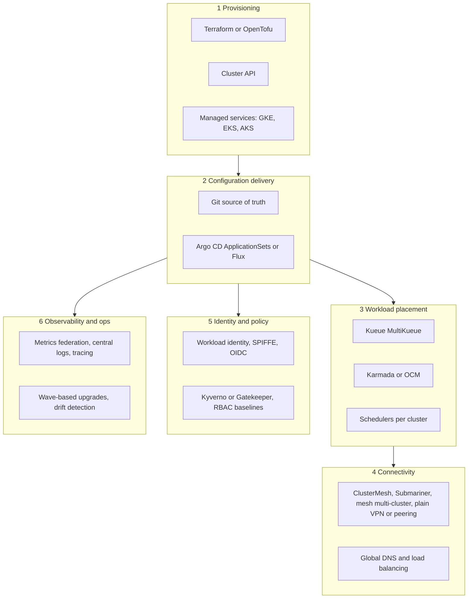
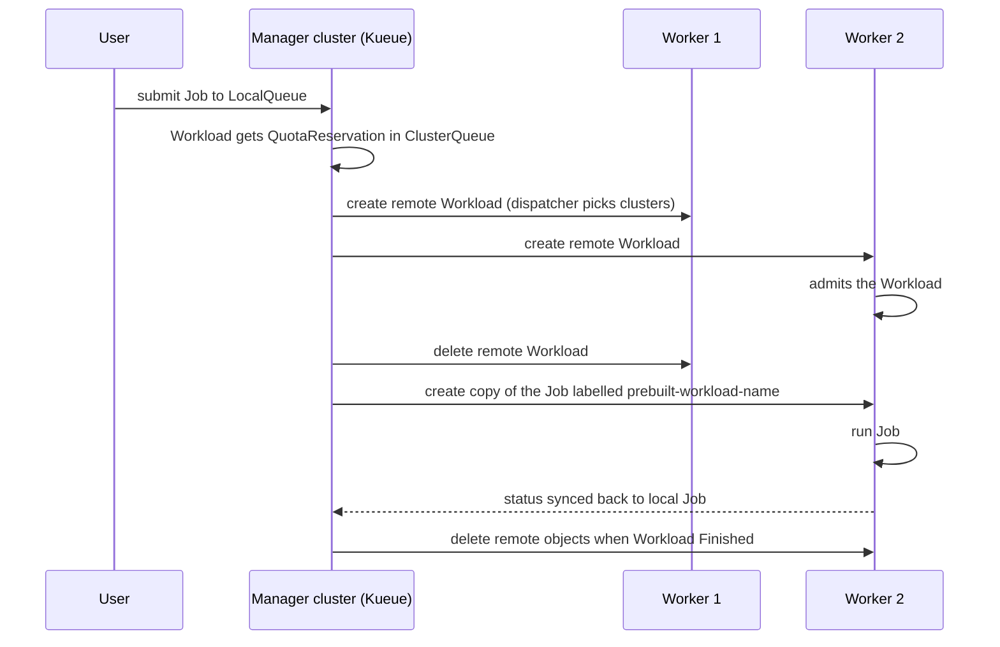

# 5.35 Multicluster and fleet management

| | |
|---|---|
| Level | Advanced |
| Priority tier | 2 |
| Lab venue | Two or three `kind` clusters are enough to practise GitOps fan-out and MultiKueue mechanics |
| Part | Part 5: Kubernetes |
| Status | Drafted. MultiKueue facts were read from the Kueue repository (shallow clone, commit `1ec0d28`, 2026-10-23, docs and API types). Everything else is from documentation knowledge, **unverified**; labs are **untested** |

## Why this matters for AI infrastructure

AI platforms rarely stay on one cluster. Capacity is spread across regions and providers (reservations in one place, Spot in another, an on-premises DGX pool, a neocloud like CoreWeave or Nebius), data sits in different places, teams need isolation, and a single huge cluster is a single blast radius. At the same time every extra cluster multiplies the operational work: upgrades, policy, secrets, observability, networking. This chapter covers when to split, how to keep a fleet consistent, how work is placed across clusters, and what breaks.

## Prerequisites and outcomes

Needs 5.5, 5.14 to 5.16 (networking), 5.21 and 5.22 (security), 5.28 (service mesh), 5.29 and 5.31 (operators), 5.34 and Part 4 (Terraform, GitOps). After this chapter you can:

- Decide between one large cluster, a few big clusters, and many small ones for a given requirement.
- Describe the layers of fleet management: provisioning, configuration delivery, workload placement, networking, identity, policy, observability.
- Design GitOps fan-out with Argo CD ApplicationSets and cluster generators, with promotion waves.
- Explain how Kueue MultiKueue dispatches jobs across clusters, its limits, and its security model.
- Compare Karmada, Open Cluster Management, Cluster API and cloud fleet products at the level of what problem each solves.
- Plan fleet-wide upgrades, certificate and credential rotation, and failure-domain design.

## 1. Why more than one cluster

| Driver | Explanation |
|---|---|
| Capacity location | GPUs come from several regions/providers/reservations; one control plane cannot span them well |
| Blast radius | A bad upgrade, a controller bug or an etcd problem should not stop all training and inference |
| Isolation | Regulated data, tenant separation, production vs research, different compliance regimes |
| Latency and data gravity | Inference near users; training near data |
| Scale limits | Control plane limits (nodes, objects, watch load) push very large estates into several clusters |
| Hardware or version differences | Different GPU generations, drivers, OS images, Kubernetes versions |
| Organisational | Different owners and change cadences |

Costs of splitting: duplicate platform components in each cluster (CNI, ingress, observability, GPU stack), cross-cluster networking and identity, harder scheduling (no global view), more upgrade work, and fragmented capacity (idle GPUs in cluster A while cluster B queues).

A decision heuristic: **start with one cluster per environment per region per hardware domain**, and split further only for a concrete driver from the table. Treat clusters as cattle, not pets: reproducible from code, replaceable.

Also decide how large a cluster should be. Training clusters are often a single tightly-coupled fabric (one InfiniBand/RoCE domain) so the cluster boundary follows the network boundary; a job cannot span clusters without a network that connects the GPUs. In general, **one training job runs inside one cluster**. Multicluster is for placing *jobs*, replicating *services* and managing *platforms*, not for stretching a single NCCL job across clusters.

## 2. Layers of fleet management



Each layer can use different tools; there is no single product that does all of it well. Keep the interfaces clean: provisioning produces a cluster plus a record in a **cluster inventory**; configuration delivery reads that inventory to decide which clusters get what.

## 3. Provisioning and lifecycle

- **Terraform/OpenTofu** (Part 4) for clusters and node pools in each cloud. One module per cluster type, parameterised; one state per cluster (never one giant state for the fleet). Outputs feed the inventory.
- **Cluster API (CAPI)**: Kubernetes-style declarative cluster lifecycle. A management cluster holds `Cluster`, `MachineDeployment`, `MachinePool` resources and provider-specific infrastructure resources; controllers create and upgrade workload clusters. Good for on-premises and bare metal (with providers such as vSphere, Metal3, Tinkerbell) and for uniform upgrade handling; needs a dependable management cluster (back it up, run it highly available, avoid it being a fleet-wide single point of failure).
- **Managed services** (GKE, EKS, AKS, and GPU clouds' managed Kubernetes): the control plane is the provider's problem; you still manage node pools, add-ons and configuration.
- **Cluster inventory/identity**: a registry listing every cluster with labels (`env`, `region`, `gpu-type`, `tier`, `owner`) used for targeting. In Argo CD this is cluster Secrets with labels; in Kubernetes SIGs there is a ClusterProfile API for describing clusters, which the Kueue docs reference for credential discovery.
- **Day-2**: version skew policy, certificate rotation, add-on versions, node image updates, drift detection (Terraform plan in CI; GitOps controllers for in-cluster drift).

## 4. Configuration delivery with GitOps

Pattern: one Git repository (or a structured set) describes a **base platform** (CNI, ingress, cert-manager, GPU stack, observability agents, policy) and **overlays** per environment, region or hardware type. A GitOps controller in or near each cluster applies it (5.27 on GitOps).

Argo CD options:

1. **One central Argo CD** with registered remote clusters (push model): simple and visible; the central instance holds credentials to every cluster, so it is a high-value target and a single point of failure.
2. **Argo CD per cluster** (pull model): each cluster reconciles itself; no central credentials, good for isolated or air-gapped clusters; harder to see everything in one place. A common hybrid is a central Argo CD managing only the Argo CD instances (app of apps).

**ApplicationSet** generates many Applications from a template. Generators: `list`, `clusters` (every registered cluster, filterable by label), `git` (directories or files in a repo), `matrix` and `merge` (combine generators), `scmProvider`, `pullRequest`, plugin generators. A typical use:

```yaml
apiVersion: argoproj.io/v1alpha1
kind: ApplicationSet
metadata:
  name: gpu-stack
spec:
  generators:
  - clusters:
      selector:
        matchLabels:
          gpu: "true"
  template:
    metadata:
      name: "gpu-stack-{{name}}"
    spec:
      project: platform
      source:
        repoURL: https://git.example.com/platform/fleet.git
        targetRevision: main
        path: "clusters/{{metadata.labels.env}}/gpu-stack"
      destination:
        server: "{{server}}"
        namespace: gpu-system
      syncPolicy:
        automated: { prune: true, selfHeal: true }
```

(Template field names reflect the documented ApplicationSet syntax as I recall it; validate against your Argo CD version.)

Rollout across a fleet should be **progressive**: ApplicationSet supports progressive syncs (rolling-sync steps by label, e.g. canary clusters first, then dev, then prod). Without it, you can emulate waves by pointing different cluster groups at different Git branches or tags and promoting by merging. Always have a canary cluster that mirrors production hardware.

Flux alternative: one `Kustomization`/`HelmRelease` set per cluster, shared repo with per-cluster paths, or a management cluster using Flux's remote cluster kubeconfig support.

Design rules:

- **Do not template secrets into Git.** Use External Secrets/Secrets Store CSI or SOPS/sealed secrets (5.21).
- Keep per-cluster differences in **small overlays** (values files), not forks.
- Treat **CRD installation order** carefully (CRDs before their custom resources; sync waves in Argo CD).
- Pin versions (chart, image digest) and promote through environments.
- Fleet-wide changes need a **kill switch**: pause the ApplicationSet or revert the Git change; practise it.

## 5. Placing workloads across clusters

### Kueue MultiKueue (read from the Kueue docs and API types)

MultiKueue lets one **manager cluster** dispatch Kueue-managed jobs to **worker clusters**. It is documented as beta (since Kueue v0.9) and enabled by default via the `MultiKueue` feature gate.

Roles and objects:

- **Manager cluster**: runs Kueue plus the MultiKueue admission-check controller. Users submit jobs here to a ClusterQueue that has a MultiKueue **AdmissionCheck**. The ClusterQueue's quota decides how many jobs are eligible at a time; the docs recommend manager quota roughly equal to the total worker quota (too low leaves workers idle; too high dispatches jobs that workers cannot admit).
- **Worker cluster**: a normal standalone Kueue cluster.
- **`MultiKueueCluster`**: one per worker. Its spec has a `clusterSource` and either `kubeConfig` (with `location` and `locationType`) or `clusterProfileRef`.
- **`MultiKueueConfig`**: lists the worker clusters (`spec.clusters`).

Flow, as documented:



Dispatchers (since Kueue v0.13): **AllAtOnce** (default; copy the Workload to all workers as soon as quota is reserved, fastest admission, but several workers may briefly reserve resources), **Incremental** (nominate clusters in rounds, by default batches of up to 3, adding the next batch after a fixed interval of 5 minutes if none admits; since Kueue v0.19 the order of `MultiKueueConfig.spec.clusters` is respected, which allows "cheap on-premises first, spill over to cloud" policies) and **External** (custom). Configuration of the dispatcher name and the incremental step size is in the Kueue configuration file (`multiKueue.dispatcherName`, `multiKueue.incrementalDispatcherConfig`), the latter behind a feature gate. The workload's `status.nominatedClusterNames` lists considered clusters and `status.clusterName` records the admitted one, immutable once set.

Supported job types in the docs include batch Job, JobSet, Kubeflow jobs, KubeRay workloads, MPIJob, AppWrapper, plain Pods, Deployment, StatefulSet and LeaderWorkerSet, plus external frameworks.

**Security**: the manager holds credentials to workers. Credentials can come from a `ClusterProfile`, a `Secret` or a file `Path`; the docs mark `Path` as development only and describe a validation gate restricting paths to a fixed prefix (`/etc/multikueue/kubeconfigs/`), because untrusted kubeconfig files can execute code or read sensitive files. Create a **least-privilege** service account on each worker (the docs provide a script to generate a worker-specific kubeconfig) and rotate it.

**Limitations** called out in the docs: the manager cannot also act as one of its own workers (use a separate dedicated ClusterQueue for local jobs); for job types without `managedBy` support (StatefulSet, LeaderWorkerSet) the manager's job status may not reflect the worker's actual state (check the Workload status).

Design questions to ask: where does the **data** live, and does moving the job to another cluster mean pulling terabytes? Are images, secrets, ConfigMaps and PVCs available in every worker? Are quotas and flavors consistent so a job fits wherever it lands? How are results and checkpoints stored in a place all clusters can reach (object storage, Part 13)?

### Other approaches

| Tool | Idea | Fit |
|---|---|---|
| **Karmada** | A "Kubernetes-native" multicluster control plane: you create ordinary resources plus `PropagationPolicy` and `OverridePolicy`; Karmada distributes them to member clusters, can schedule replicas by weight/availability and fail over | General multicluster application distribution; heavier, another control plane to run |
| **Open Cluster Management (OCM)** | Hub-and-spoke: `ManagedCluster`, `ManifestWork`, `Placement`; agents on managed clusters pull work | Large heterogeneous fleets, policy delivery; also the basis of some vendor products |
| **Cloud fleet products** (GKE Fleet / multi-cluster services and gateway, EKS and AKS equivalents) | Provider-integrated cluster registration, cross-cluster Services/Gateway, config management | Convenient if you are within one cloud |
| **Admiralty, Liqo** | Virtual-node style: remote clusters appear as nodes, Pods are scheduled across them | Research and bursty spill-over; understand networking and failure semantics before use |
| **Per-cluster scheduler + external queue** (Slurm federation, Run:ai, custom) | A higher-level system owns the queue and submits to clusters | When you already have a scheduler with policy and fair-share (Part 6, Part 14) |

Evaluate any of them against: how failure is handled (a cluster disappears mid-job), how state is reconciled after a partition, how credentials are held, how quota and fair-share are enforced globally, and how debugging works (where do I look to see why a job is not running).

## 6. Cross-cluster networking

Options, from simplest to most integrated:

1. **No pod-to-pod connectivity**: clusters talk through public or internal load balancers and DNS. Safest and often sufficient for APIs and inference endpoints.
2. **VPC peering or VPN plus routable Pod CIDRs**: needs non-overlapping Pod/Service CIDRs across the fleet (decide this at the start; overlapping ranges are painful to fix).
3. **Cilium ClusterMesh**: connects Cilium clusters for global services and cross-cluster policy (needs unique cluster ids and routable or tunnelled connectivity) (5.15).
4. **Submariner**: cross-cluster pod and service connectivity with service discovery, CNI-agnostic.
5. **Service mesh multi-cluster** (Istio and others): shared trust, locality-aware load balancing and failover (5.28).
6. **Multi-Cluster Services (MCS) API**: standard `ServiceExport` and `ServiceImport` resources for cross-cluster service discovery; implementations vary.

For AI: **training traffic stays inside a cluster's fabric**. Cross-cluster traffic is checkpoints to object storage, model pulls, inference gateway routing, control-plane APIs and telemetry. Design for bandwidth cost and egress charges, not just connectivity.

## 7. Identity, access and policy

- **Human access**: SSO/OIDC to every cluster with group-based RBAC generated from one source; short-lived credentials; a bastion or proxy so API endpoints need not be public.
- **Workload identity**: cloud-native workload identity (GKE Workload Identity, IRSA on EKS, and equivalents) or SPIFFE/SPIRE for cross-cluster and cross-cloud trust, rather than static keys in Secrets.
- **Secrets**: a central secret manager with per-cluster access scopes, synced by External Secrets or CSI; avoid copying the same long-lived secret everywhere.
- **Admission policy** (Kyverno, OPA Gatekeeper, ValidatingAdmissionPolicy) delivered by GitOps to every cluster: image registries and signatures (5.22), privileged Pod rules, resource-limit requirements, GPU request rules, namespace labels. Roll out in audit mode first, then enforce.
- **Compliance evidence**: collect policy reports centrally.
- **Management-plane credentials** (the central Argo CD, the MultiKueue manager, CAPI management cluster) are the crown jewels: they can modify every cluster. Isolate them, restrict network access, audit every use, and keep an out-of-band recovery path.

## 8. Observability across the fleet

- **Metrics**: each cluster runs Prometheus (or an agent) and ships to a central long-term store (Thanos, Mimir, Cortex-style, or a managed service) with a `cluster` external label on every series (5.19). Federate selected metrics, not everything.
- **Logs and traces**: central collection with cluster labels; keep high-volume GPU/job logs local with short retention and ship summaries.
- **GPU fleet view**: DCGM metrics per GPU, aggregated by cluster, pool and tenant: utilisation, errors, idle expensive hardware, queue wait time, preemptions.
- **Fleet SLOs**: control-plane availability, scheduling latency, GPU utilisation, job success rate, queue time.
- **Alert routing** must identify the cluster and owner. Watch for alert storms when a fleet-wide dependency fails.
- Monitor the **management plane itself**: GitOps sync status, MultiKueue cluster `Active` conditions, CAPI health.

## 9. Upgrades and change management

Fleet upgrades are the main recurring cost.

1. Define **rings**: canary (mirrors prod hardware, small), dev/staging, prod ring 1 (low-risk), prod ring 2 and so on, with soak times.
2. Order: management plane first (CAPI, GitOps, MultiKueue manager), then clusters, within version-skew rules. Within a cluster, control plane, add-ons, then node pools; GPU driver changes are separate and tested against real workloads (Part 10).
3. **Pre-flight checks** in CI: API deprecation scans, Helm chart diffs, admission policy tests, a synthetic GPU job (`nvidia-smi`, a small NCCL test) on the canary.
4. **Automated rollback** where cheap (Git revert, node pool blue/green), plus a rehearsed manual path where not.
5. **Maintenance windows and PDBs** so upgrades drain nodes without killing long training jobs; coordinate with the scheduler (cordon first, wait for jobs, 5.32).
6. Track fleet **version inventory** and age; alert on clusters near end of support.

## 10. Failure-domain design

| Failure | Design response |
|---|---|
| Whole cluster lost | Stateless services replicated across clusters; training checkpoints in object storage reachable from others; job requeued to another cluster by the dispatcher |
| Management plane lost | Workload clusters keep running (control planes are independent); pull-based agents keep reconciling the last state; document manual operation; back up the management cluster |
| Bad fleet-wide change | Rings and progressive sync; a global pause switch |
| Credential leak (central controller) | Short-lived credentials, per-cluster least privilege, rotation drill |
| Network partition between manager and workers | MultiKueue marks the cluster inactive; running jobs on workers continue; define what happens to in-flight jobs on reconnect |
| Cloud region outage | Active-active inference across regions; training capacity redundancy planned against cost |
| Skew drift | Drift detection; reconcile or rebuild rather than hand-fix |

State the recovery objectives explicitly (how long can a cluster be gone, how much training progress may be lost = checkpoint interval).

## 11. Lab (untested)

1. Create three `kind` clusters (`mgmt`, `dev`, `prod`). Install Argo CD on `mgmt`, register `dev` and `prod` with labels, and create an ApplicationSet with a `clusters` generator that deploys a namespace and a small app to both. Change a label and watch the Application appear or disappear.
2. Add a canary step using separate Git paths or progressive sync; make a bad change and observe what the canary catches.
3. MultiKueue (CPU-only): install Kueue on all three clusters. On `dev` and `prod` create a ClusterQueue and LocalQueue; generate a worker kubeconfig with the script in the Kueue docs, create Secrets on the manager, a `MultiKueueCluster` per worker, a `MultiKueueConfig`, a MultiKueue AdmissionCheck and a manager ClusterQueue using it. Submit a `batch/v1` Job and watch the remote Workload, the copy of the Job, and the cleanup. Then fill `prod`'s quota and watch spill-over with the Incremental dispatcher.
4. Break it: block the manager's access to a worker and observe the `MultiKueueCluster` condition; restore.
5. Write the fleet inventory (labels) you would want for 10 real clusters (cloud, region, GPU, env, owner, upgrade ring) and the Git layout that consumes it.
6. Write the upgrade runbook for one ring, including pre-flight checks and rollback.

## 12. Interview angles

- When would you split one cluster into several, and when would you not?
- Can a training job span two clusters? Why or why not?
- Push vs pull GitOps for a fleet: trade-offs?
- How does MultiKueue decide where a job runs, and what are its failure modes?
- Where do credentials live in your fleet design, and what happens if the central controller is compromised?
- How do you roll out a GPU driver or CNI change across 30 clusters safely?
- How do you give researchers one place to submit jobs while capacity lives in several clouds?
- What do you monitor on the management plane?
- How do you choose non-overlapping Pod CIDRs for 50 future clusters?
- Compare Karmada, OCM and plain ApplicationSets.

## 13. Checkpoint questions (30)

1. Name four reasons to run multiple clusters and three costs.
2. Why does one NCCL job normally not span clusters?
3. What are the six layers of fleet management in this chapter?
4. What belongs in a cluster inventory and who consumes it?
5. Why one Terraform state per cluster?
6. What does Cluster API's management cluster do, and what is its risk?
7. Push vs pull Argo CD: key differences?
8. What does an ApplicationSet cluster generator do?
9. How can you do wave-based rollout with ApplicationSets?
10. Why keep secrets out of Git, and what do you use instead?
11. What are the manager and worker roles in MultiKueue?
12. What objects configure MultiKueue (`MultiKueueCluster`, `MultiKueueConfig`, AdmissionCheck)?
13. Describe the job flow from submission to cleanup.
14. What are the three dispatcher modes and their trade-offs?
15. How does the Incremental dispatcher order clusters (since which version), and what are its defaults?
16. What should the manager's quota be relative to workers?
17. Name three ways MultiKueue can get worker credentials; which is development only?
18. Which limitation affects StatefulSet and LeaderWorkerSet status on the manager?
19. Why can't the manager also be its own worker?
20. What data-gravity questions must you answer before cross-cluster dispatch?
21. Compare Karmada and OCM at one sentence each.
22. What does a service mesh add for multi-cluster, and what does ClusterMesh add?
23. Why must Pod CIDRs not overlap across a fleet you may connect?
24. What traffic crosses clusters in AI platforms and what stays inside?
25. How do you attach cluster identity to metrics?
26. What are the crown-jewel credentials in a fleet and how do you protect them?
27. Describe an upgrade ring plan.
28. What pre-flight checks run on the canary?
29. What happens to running jobs when the management plane is down?
30. How would you define recovery objectives for a lost cluster?

## 14. Sources and review notes

- Read from source: Kueue repository docs and API types (MultiKueue concept page, `MultiKueueCluster`/`MultiKueueConfig` types, configuration dispatcher constants), shallow clone commit `1ec0d28`, 2026-10-23. The MultiKueue section follows them closely; versions and feature-gate states may have moved since.
- From documentation knowledge, unverified: Argo CD ApplicationSet generator list and template syntax, progressive syncs, Cluster API objects and providers, Karmada and OCM resource names, Cilium ClusterMesh, Submariner, MCS API, cloud fleet products, Thanos and similar.
- Concept sources: *Production Kubernetes* (Rosso, Lander, Brand, Harris) for multi-cluster and operational concerns; *Kubernetes Up and Running* and *Programming Kubernetes* for background; this handbook's 5.14 to 5.16, 5.19, 5.21, 5.22, 5.27 to 5.29, 5.31, 5.34, Part 4 and Part 14.
- Not done: no multi-cluster lab was run; no fleet tooling other than Kueue docs was inspected.
