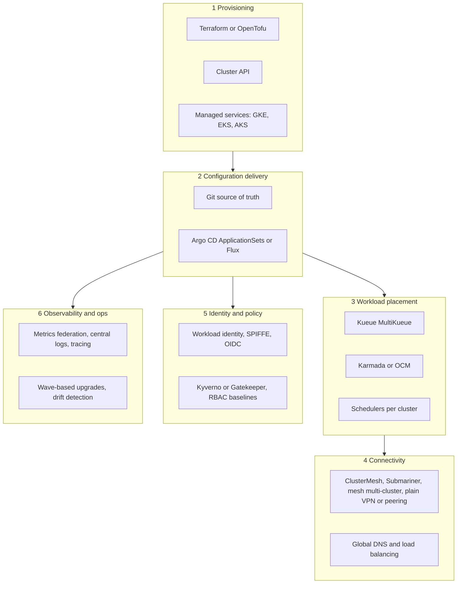
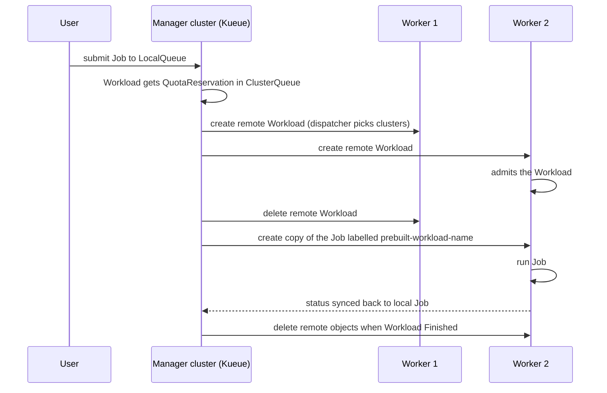

# 5.35 Multicluster and fleet management

| | |
|---|---|
| Level | Advanced |
| Priority tier | 2 |
| Lab venue | Two or three `kind` clusters are enough to practise GitOps fan-out and MultiKueue mechanics |
| Part | Part 5: Kubernetes |
| Status | Drafted. MultiKueue facts were read from the Kueue repository (shallow clone, commit `1ec0d28`, 2026-10-23, docs and API types). Everything else is from documentation knowledge, **unverified**; labs are **untested** |

## Why this matters for AI infrastructure

Picture an AI platform whose reserved GPUs sit in one place, whose Spot capacity sits in another, and whose on-premises DGX pool sits in a third. Platforms like this rarely stay on one cluster. Capacity comes from several regions and providers, including a neocloud such as CoreWeave or Nebius.

Data sits in different places, and teams need isolation. A single huge cluster is also a single blast radius. Every extra cluster, though, multiplies the operational work: upgrades, policy, secrets, observability and networking. This chapter covers when to split, how to keep a fleet consistent, how work is placed across clusters, and what breaks.

## Prerequisites and outcomes

Before you start, work through 5.5, 5.14 to 5.16 (networking), 5.21 and 5.22 (security), 5.28 (service mesh), 5.29 and 5.31 (operators), and 5.34 and Part 4 (Terraform, GitOps). When you finish, you should be able to:

- Decide whether a given requirement calls for one large cluster, a few big clusters or many small ones.
- Describe the layers of fleet management: provisioning, configuration delivery, workload placement, networking, identity, policy and observability.
- Design GitOps fan-out with Argo CD ApplicationSets and cluster generators, with promotion waves.
- Explain how Kueue MultiKueue dispatches jobs across clusters, along with its limits and its security model.
- Compare Karmada, Open Cluster Management, Cluster API and cloud fleet products by the problem each one solves.
- Plan fleet-wide upgrades, certificate and credential rotation, and failure-domain design.

## 1. Why more than one cluster

One cluster is hard enough to run, so why would anyone want several? Real systems often leave you no choice. Picture a single datacenter knocked out by a cut fiber-optic cable, an ice storm or a botched software rollout. That datacenter is a single failure domain, and users have nowhere else to go. A regional cluster spans several independent zones, which handles many infrastructure failures. It still does not protect you from Kubernetes itself, because Kubernetes can be a single point of failure.

Every cluster is tied to one Kubernetes version, such as 1.21.3, and an upgrade can break your application. Kubernetes deprecates APIs and changes how they behave from time to time. Bugs also slip into releases now and then. Any one of these events is unlikely to hit you. Over the years an application lives, though, it is probable that one will. For most applications, that is not an acceptable risk.

Regional affinity is the second pressure. A game server has to sit near its players to keep latency low. Some data must stay inside a legal or regulatory region. Because every cluster is tied to a place, these needs push an application across several clusters.

The third pressure is trust between teams. Namespaces, RBAC and node pools separate users inside one cluster. A node pool is a group of nodes set up for a particular capability or workload. Even so, the cluster is largely one shared space. Some teams decide that the risk of another team hurting them by accident is not worth it. They accept the extra work of running several clusters.

The table lists the common drivers. Each row is a reason that could justify another cluster.

| Driver | Explanation |
|---|---|
| Capacity location | GPUs come from several regions/providers/reservations; one control plane cannot span them well |
| Blast radius | A bad upgrade, a controller bug or an etcd problem should not stop all training and inference |
| Isolation | Regulated data, tenant separation, production vs research, different compliance regimes |
| Latency and data gravity | Inference near users; training near data |
| Scale limits | Control plane limits (nodes, objects, watch load) push very large estates into several clusters |
| Hardware or version differences | Different GPU generations, drivers, OS images, Kubernetes versions |
| Organisational | Different owners and change cadences |

Splitting has a price. You duplicate platform components in every cluster, such as the CNI, ingress, observability and the GPU stack. You also need cross-cluster networking and identity. Scheduling gets harder, because no scheduler has a global view. Upgrades multiply, and capacity fragments. You can end up with idle GPUs in cluster A while cluster B has a queue.

Use this starting rule: **start with one cluster per environment per region per hardware domain**, and split further only for a concrete driver from the table. Treat clusters as cattle, not pets. A cattle-style cluster can be reproduced from code and replaced.

Cluster size is the other question. Training clusters are often a single tightly coupled fabric, one InfiniBand or RoCE domain. The cluster boundary therefore follows the network boundary, and a job cannot span clusters without a network that connects its GPUs. In general, **one training job runs inside one cluster**. Multicluster is for placing *jobs*, replicating *services* and managing *platforms*. It is not for stretching a single NCCL job across clusters.

Brendan Burns, Joe Beda, Kelsey Hightower and Lachlan Evenson, in *Kubernetes: Up and Running* (Chapter 21, *Multicluster Application Deployments*), highlight four foundational lessons. Learn them before you expand from one cluster into a multi-cluster fleet:

1. **"Fixing foundational problems in your infrastructure is 10 times harder when you have 10 clusters" (*Kubernetes: Up and Running*, Chapter 21):** A manual deployment step, a missing CI/CD pipeline, an unautomated certificate rotation or an observability gap that you tolerate in one cluster is multiplied by $N$ across $N$ clusters. So automate 100% of single-cluster deployment, testing and monitoring *before* you go multicluster.
2. **North-South Global Load Balancing: `GeoDNS` vs. `Anycast` Cloud Load Balancers (*Kubernetes: Up and Running*, Chapter 21):**
   - **Why GeoDNS has drawbacks:** Recursive DNS resolvers across the internet often ignore short DNS TTLs and cache records for minutes or hours. So removing a failed cluster's IP from DNS does not immediately stop user traffic. DNS also resolves based on the user's *DNS resolver* location, not the user's actual IP. Uneven ISP distribution adds another problem. If 2 ISPs resolve all of their millions of subscribers through 2 DNS caches, round-robin DNS across 3 cluster IPs sends 100% of those users to only 2 of the 3 clusters. The 3rd cluster sits idle.
   - **Global Anycast HTTP(S) Load Balancing (Cloud Load Balancers / Cloudflare):** It advertises a single global Anycast VIP via BGP and terminates TCP and HTTP at the nearest edge PoP. It health-checks backend cluster ingresses continuously. It routes **every individual HTTP request**, including path-based routing like `/video` vs `/api`, to the closest healthy cluster with available capacity.
3. **The "Replicated Silo" Pattern and Minimum-Replica Overhead (*Kubernetes: Up and Running*, Chapter 21):** Copying an identical, independent application stack into $R$ regional clusters is the simplest multicluster design, with zero cross-cluster runtime coupling. The catch is the replica floor. Suppose your application needs a minimum of `3` replicas for High Availability in every cluster. Across `8` regional clusters, that forces a floor of $8 \times 3 = \mathbf{24}$ replicas, even if global traffic needs only `10` replicas. That leaves `14` overprovisioned GPU/CPU replicas, mostly idle in low-traffic regions. The model is `audit_fleet_cidrs_and_silo_overhead()` in `code/part05/multicluster_fleet_dispatcher.py`.
4. **Multicluster Data & State Consistency Models (*Kubernetes: Up and Running*, Chapter 21):**
   - **Regional Data Silos / Sharding:** Each user's data is homed strictly in one regional cluster. For example, EU users live in `eu-west` and US users live in `us-east`. This satisfies GDPR data-residency laws and avoids cross-region write locks.
   - **Primary-Secondary with Read Replicas (Eventual Consistency):** Writes go to a primary region. Regional inference and serving clusters read from local read-only replicas, or from replicated object storage buckets for model weights.
   - **Globally Distributed Strongly Consistent Databases (Google Cloud Spanner / CockroachDB):** These databases provide global external consistency across regions. Clients can opt into bounded stale reads for lower latency.

### Get the foundations right first

Before you split anything, the single cluster must be solid. Picture a team that finds adding a cluster slow and painful. That team will avoid adding clusters, even when a new cluster is the right move. Every shortcut you tolerate in one cluster gets worse as you add more. A foundational problem is ten times harder to fix with ten clusters than with one.

Automation is the most important foundation. It covers two jobs: deploying your applications, and creating and managing the clusters themselves. A single cluster is consistent with itself by definition. Several clusters, however, can drift apart. One may run a different Kubernetes version, another a different monitoring agent, and a third a different container runtime. Every difference makes the system harder to predict. What you learn in one cluster also fails to carry over to the next. Keeping all clusters the same is what makes a fleet stable.

Many teams believe they already build every cluster the same way. Experience usually shows otherwise. Do not create clusters with a GUI or a one-off CLI session. Push changes through source control and CI/CD instead. That feels slow at first, but the stable base pays off. The same rule covers shared components such as monitoring, logging and security scanners. Manage them as code with tools like Helm, and deploy them with automation.

Consistency also covers who gets in and what they may do. Use one identity system for every cluster. Plain certificate-based authentication is supported. The authors, though, strongly recommend a global identity provider, such as Azure Active Directory or any OpenID Connect compatible provider. Sharing certificates is a dangerous habit, and a central identity makes that habit unnecessary. Many providers also offer two-factor authentication.

Access control follows the same logic. Cloud-based RBAC keeps roles and bindings in one central place, not inside each cluster. That stops permissions from being left behind in an old cluster. On-premises, Azure Arc for Kubernetes can provide RBAC. If it is not available, keep RBAC rules in source control and apply them to every cluster with infrastructure as code. Policies follow the same pattern. Define them in one place, and watch compliance on one dashboard.

### Building the application for many clusters

Once the clusters are consistent, the application itself needs careful design. A stateless application, or one with only read-only state, can run in each cluster behind a load balancer. Most applications, though, have state that must stay consistent across replicas. Get that wrong, and users see a confusing, flawed experience.

Take a simple retail shop. Suppose a customer's order is stored in only one cluster. After the next request lands in a different region, the customer may not see that order. So state must be replicated across regions, and the replication method shapes the experience. The key question is whether a user can read their own write. A customer orders on a computer, then opens the app on a phone. The two requests may reach two different clusters, yet the customer still expects to see the order. That expectation is a data consistency question.

There are two basic models of consistency. With strong consistency, a write does not succeed until it has been replicated. With eventual consistency, a write succeeds at once and is copied later. Some systems let the client choose for each request. Azure Cosmos DB, for example, offers bounded consistency, which limits how stale data may be. Google Cloud Spanner lets clients accept stale reads in exchange for better performance.

Strong consistency sounds like the obvious choice, because the data always matches. It costs more, though. Replication at write time means many writes fail whenever copies cannot be made, and fewer transactions can run at the same time. Eventual consistency is cheaper and handles a much higher write load. The price is that developers have more to handle, and users may run into edge conditions. Many storage systems support only one concurrency model. Those that support several make you pick one when you create them. That choice is hard to change later, so settle it before you design for many environments.

> **Note:** Running replicated stateful storage is hard. It needs a dedicated team with deep expertise to set it up, maintain it and monitor it. Where possible, use cloud-based storage for a replicated data store, so the cloud provider's large team carries that work. On-premises, you can hand support to a company that focuses on your storage product. Only at large scale does it make sense to build your own storage team.

Replicated silos are the simplest cross-regional model. You copy the whole application into every region, and each copy is an exact clone. A load balancer spreads requests across them. Wherever the application needs state, you replicate the data as well, so the application changes very little. Data may take time to reach other regions, but strong consistency does not force a major refactor. Each region is its own silo, with local data, and one cluster serves each request entirely. That is simple, but it costs efficiency.

Regions differ in population, but every silo must be sized for the largest region. That leaves most replicas over-provisioned. Shrinking the small regions sounds easy. Bottlenecks and requirements, such as keeping at least three replicas, can make it hard, though. Silos are a fine starting point when you move from one cluster to many, but expect to refactor them later.

As the application grows, its design will change. Build with that change in mind, and the application can adapt without a massive refactor.

Multicluster deployment adds complexity. For most applications, though, real-world requirements and user expectations make that complexity necessary. Designing for many clusters from the start makes an application more reliable. It also lowers the chance of a costly refactor as the application grows. Managing configuration and deploying it to each cluster is one of the most important pieces. The GitOps material later in this chapter covers it.

### Cluster federation and management clusters

Cluster federation means managing all the clusters under your control from one central place. Once you enjoy Kubernetes, you will want more of it. Without some discipline, that habit gets messy. Federation strategies help an enterprise manage its software dependencies, so they do not grow into costly, destructive tangles.

A useful approach is to federate regionally first, then globally. A regional layer lessens the blast radius of a failure in a federation cluster, and it reduces the computational load on those clusters. When you first begin, you may lack the global presence or infrastructure volume to justify a multilevel federation. Keep the layered design in mind as a principle, in case it becomes a requirement later.

A management cluster is a Kubernetes cluster that manages other clusters. As usage grows and the cluster count climbs, organizations need software to keep operations smooth. They often run that software on Kubernetes-based platforms too. Cluster API is a popular project for this job. It bundles operators that rely on custom resources, such as `Cluster` and `Machine`, to describe other clusters and their parts. A common pattern deploys the Cluster API components to a management cluster. That management cluster then deploys and manages the infrastructure for the workload clusters.

This layout has flaws. It is usually prudent to separate your production tier strictly from the other tiers. Many organizations therefore run a management cluster dedicated to production, which adds more management overhead. Cluster autoscaling is another problem. The Cluster Autoscaler normally runs in the cluster it scales, watching for conditions that call for scaling. But the controller that provisions and decommissions worker nodes lives in the management cluster. Any workload cluster that uses the Cluster Autoscaler therefore depends on the management cluster. What happens if the management cluster is unavailable during a busy period, when your cluster needs to scale out to meet demand?

One fix is to run the Cluster API components inside the workload cluster, in a self-contained way. The `Cluster` and `Machine` resources live there too. You can still use the management cluster to create and delete clusters. For routine work such as autoscaling, though, the workload cluster becomes largely autonomous and no longer depends on the management cluster. This pattern has another advantage. A controller or workload in the cluster can read Cluster API metadata through the local API, without calling the management cluster's API. Take a Namespace controller. It might change its behavior depending on whether its cluster is a development or a production cluster. The `Cluster` resource that represents the cluster already holds that information.

Management clusters also often host shared or regional services that other clusters use. Those services are not really management functions. The management cluster is simply a logical place to run them. CI/CD systems and container registries are examples.

## 2. Layers of fleet management

When a fleet breaks, you first ask which layer failed. The diagram below splits fleet management into six layers.



No single product does all six layers well, so each layer can use different tools. What matters to you is that the interfaces between layers stay clean. Provisioning produces a cluster and a record of it in a **cluster inventory**. Configuration delivery then reads that inventory to decide which clusters get what. Keep the inventory as the handoff between those two layers, so each can change without breaking the other.

## 3. Provisioning and lifecycle

Creating a cluster is the first job in fleet management, and the same work repeats for every cluster you add. The options below handle it in different ways.

- **Terraform or OpenTofu** (Part 4) builds clusters and node pools in each cloud. Use one parameterised module per cluster type. Keep one state per cluster, never one giant state for the fleet. Outputs from each run feed the inventory.
- **Cluster API (CAPI)** gives you Kubernetes-style, declarative cluster lifecycle. A management cluster holds `Cluster`, `MachineDeployment` and `MachinePool` resources, plus provider-specific infrastructure resources. Controllers then create and upgrade the workload clusters. It suits on-premises and bare-metal setups, with providers such as vSphere, Metal3 and Tinkerbell, and it gives you uniform upgrade handling. It needs a dependable management cluster. Back it up, run it highly available, and make sure it does not become a fleet-wide single point of failure.
- **Managed services** such as GKE, EKS and AKS, along with the managed Kubernetes that GPU clouds offer, hand the control plane to the provider. You still manage node pools, add-ons and configuration.
- **Cluster inventory and identity** is a registry that lists every cluster with labels, such as `env`, `region`, `gpu-type`, `tier` and `owner`, which you use for targeting. In Argo CD, this is a set of cluster `Secret` objects with labels. In Kubernetes SIGs, a `ClusterProfile` API describes clusters, and the Kueue docs refer to it for credential discovery.
- **Day-2 work** keeps the fleet healthy after it is built. It covers version skew policy, certificate rotation, add-on versions, node image updates and drift detection. Drift detection can run as a Terraform plan in CI, or as GitOps controllers that watch for in-cluster drift.

Decide early which tool owns each of these jobs, so that no cluster is built by hand.

## 4. Configuration delivery with GitOps

Picture a platform team that must keep many clusters on the same base platform, while each cluster still differs a little. GitOps is how that team keeps the differences small and visible.

One Git repository, or a structured set of them, describes the **base platform**. The base platform covers the CNI, ingress, cert-manager, GPU stack, observability agents and policy. The repository also holds **overlays**, one per environment, region or hardware type, that adapt the base. A GitOps controller in or near each cluster applies the result. Chapter 5.27 covers GitOps itself.

Argo CD gives you two ways to run this, and they differ in where the credentials live.

1. **One central Argo CD** pushes to registered remote clusters. This is the push model. It is simple, and it gives you one place to see everything. The central instance, though, holds credentials to every cluster. That makes it a high-value target and a single point of failure.
2. **Argo CD per cluster** pulls. This is the pull model. Each cluster reconciles itself, and no central credentials exist. That suits isolated or air-gapped clusters. Seeing everything in one place is harder. A common hybrid runs a central Argo CD that manages only the Argo CD instances, using app of apps.

An **ApplicationSet** generates many Applications from one template. Its generators decide what gets generated. The `list` generator uses a fixed list. The `clusters` generator covers every registered cluster, and you can filter it by label. The `git` generator reads directories or files in a repo. The `matrix` and `merge` generators combine other generators. The `scmProvider`, `pullRequest` and plugin generators round out the set. A typical use looks like this:

```yaml
apiVersion: argoproj.io/v1alpha1
kind: ApplicationSet
metadata:
  name: gpu-stack
spec:
  generators:
  - clusters:
      selector:
        matchLabels:
          gpu: "true"
  template:
    metadata:
      name: "gpu-stack-{{name}}"
    spec:
      project: platform
      source:
        repoURL: https://git.example.com/platform/fleet.git
        targetRevision: main
        path: "clusters/{{metadata.labels.env}}/gpu-stack"
      destination:
        server: "{{server}}"
        namespace: gpu-system
      syncPolicy:
        automated: { prune: true, selfHeal: true }
```

The template field names follow the documented ApplicationSet syntax as I recall it. Validate them against your Argo CD version. The manifest selects only clusters labelled `gpu: "true"`, and it renders one Application for each of them.

Roll changes out across a fleet **progressively**. ApplicationSet supports progressive syncs, which are rolling-sync steps selected by label. For example, canary clusters go first, then dev, then prod. Without progressive syncs, you can still run waves. Point different cluster groups at different Git branches or tags, and promote a change by merging it. Always keep a canary cluster that mirrors production hardware.

Flux works differently. You can use one `Kustomization` or `HelmRelease` set per cluster, a shared repo with per-cluster paths, or a management cluster that uses Flux's remote cluster kubeconfig support.

A few design rules keep this manageable:

- Do not template secrets into Git. Use External Secrets, Secrets Store CSI, or SOPS and sealed secrets, which 5.21 covers.
- Keep per-cluster differences in small overlays, such as values files, not in forks.
- Treat CRD installation order carefully. CRDs must come before the custom resources that use them, and Argo CD sync waves handle that order.
- Pin versions, such as the chart version or an image digest, and promote them through environments.
- Fleet-wide changes need a kill switch. You pause the ApplicationSet or revert the Git change. Practise that before you need it.

### Each region is a stage

One deployment is not enough for users spread across the world. A Kubernetes cluster normally lives in a single region and holds one complete copy of the application. A worldwide application therefore runs as several clusters, and each cluster has its own configuration. The full worldwide system, with hard parts such as data replication, is a large topic of its own. What you can settle early is how to arrange the configuration files.

A region's configuration is the same kind of thing as a stage in the life cycle. Adding a region therefore works like adding a stage. A simple list might be Development, Staging, Canary and Production. A worldwide list might be Development, Staging, Canary, EastUS, WestUS, Europe and Asia.

In a directory layout, each region gets its own folder with its own parameters:

```
frontend/
staging/
templates -> ../v3/
parameters.yaml
eastus/
templates -> ../v1/
parameters.yaml
...
```

If you use version control and tags instead, the parameters for each region sit at the root. You add a new tag for each region. The file contents at that tag then deploy to that region. Decide on the layout before you add the second region, so every region follows the same pattern.

## 5. Placing workloads across clusters

### Federated software deployment

Managing remote clusters raises a second question. How do you deploy software to them? Managing the clusters is one job. Deciding where end-user workloads go is another, and that is the reason you run all these clusters. You may have critical, high-value workloads that must run in several regions for availability. Or you may need to place workloads according to each cluster's characteristics. Deciding that is hard, and no broad consensus on a good solution exists.

The Kubernetes community has tried for some time to solve this in a broadly applicable way. The most recent effort is KubeFed. It also addresses cluster configuration, but its focus is defining workloads that are destined for multiple clusters. A useful design idea to come out of it is that you can federate any API type used in Kubernetes. For example, federated versions of the Namespace and Deployment types let you declare how resources should be applied across clusters. That is powerful. You can create a `FederatedDeployment` in one management cluster, and it appears as `Deployment` objects in other clusters. More advances in this area are expected. For now, the most common approach in the field is CI/CD tooling, configured to target different clusters when workloads are deployed.

### Kueue MultiKueue (read from the Kueue docs and API types)

MultiKueue lets one **manager cluster** dispatch Kueue-managed jobs to **worker clusters**. The docs mark it as beta since Kueue v0.9. The `MultiKueue` feature gate enables it by default.

The setup is made of a few roles and objects:

- **Manager cluster** runs Kueue and the MultiKueue admission-check controller. Users submit jobs here, to a `ClusterQueue` that has a MultiKueue `AdmissionCheck`. The ClusterQueue's quota decides how many jobs are eligible at a time. The docs recommend a manager quota roughly equal to the total worker quota. A quota that is too low leaves workers idle. A quota that is too high dispatches jobs that workers cannot admit.
- **Worker cluster** is a normal standalone Kueue cluster.
- **`MultiKueueCluster`** exists once per worker. Its spec has a `clusterSource`, and that is either `kubeConfig`, which carries `location` and `locationType`, or `clusterProfileRef`.
- **`MultiKueueConfig`** lists the worker clusters in `spec.clusters`.

The documented flow looks like this:



Notice that the manager creates remote copies on both workers, but only W2 admits and runs the Job. The manager then deletes the pending remote copy on W1.

Dispatchers decide how the manager picks workers. Since Kueue v0.13, you can choose from three. **AllAtOnce** is the default. It copies the Workload to all workers as soon as quota is reserved. Admission is fastest this way, but several workers may briefly reserve resources.

**Incremental** nominates clusters in rounds. By default, each round holds batches of up to 3 clusters. If none of them admits the job, the next batch is added after a fixed interval of 5 minutes. Since Kueue v0.19, the order in `MultiKueueConfig.spec.clusters` is respected. That order allows "cheap on-premises first, spill over to cloud" policies. **External** is the custom option.

You set the dispatcher name and the incremental step size in the Kueue configuration file, through `multiKueue.dispatcherName` and `multiKueue.incrementalDispatcherConfig`. The second one sits behind a feature gate. The Workload's `status.nominatedClusterNames` lists the clusters considered. `status.clusterName` records the admitted one, and it cannot change once set.

The docs list many supported job types. They include batch `Job`, `JobSet`, Kubeflow jobs, KubeRay workloads, `MPIJob`, AppWrapper, plain Pods, `Deployment`, `StatefulSet` and `LeaderWorkerSet`, plus external frameworks.

**Security** matters here, because the manager holds credentials to its workers. Those credentials can come from a `ClusterProfile`, a `Secret` or a file `Path`. The docs mark `Path` as development only. They also describe a validation gate that restricts paths to a fixed prefix, `/etc/multikueue/kubeconfigs/`. The reason is that untrusted kubeconfig files can execute code or read sensitive files. Create a **least-privilege** service account on each worker. The docs provide a script that generates a worker-specific kubeconfig, and you should rotate those credentials.

The docs also call out limitations. The manager cannot also act as one of its own workers, so local jobs need a separate, dedicated ClusterQueue. For job types without `managedBy` support, such as `StatefulSet` and `LeaderWorkerSet`, the manager's job status may not reflect the worker's actual state. In that case, check the Workload status.

Before you rely on MultiKueue, answer a few design questions. Where does the **data** live, and does moving a job to another cluster mean pulling terabytes? Are images, secrets, ConfigMaps and PVCs available in every worker? Are quotas and flavors consistent, so a job fits wherever it lands? Where are results and checkpoints stored, in a place that all clusters can reach, such as the object storage in Part 13?

### Other approaches

Several other tools take different approaches. The table compares them by idea and by fit.

| Tool | Idea | Fit |
|---|---|---|
| **Karmada** | A "Kubernetes-native" multicluster control plane: you create ordinary resources plus `PropagationPolicy` and `OverridePolicy`; Karmada distributes them to member clusters, can schedule replicas by weight/availability and fail over | General multicluster application distribution; heavier, another control plane to run |
| **Open Cluster Management (OCM)** | Hub-and-spoke: `ManagedCluster`, `ManifestWork`, `Placement`; agents on managed clusters pull work | Large heterogeneous fleets, policy delivery; also the basis of some vendor products |
| **Cloud fleet products** (GKE Fleet / multi-cluster services and gateway, EKS and AKS equivalents) | Provider-integrated cluster registration, cross-cluster Services/Gateway, config management | Convenient if you are within one cloud |
| **Admiralty, Liqo** | Virtual-node style: remote clusters appear as nodes, Pods are scheduled across them | Research and bursty spill-over; understand networking and failure semantics before use |
| **Per-cluster scheduler + external queue** (Slurm federation, Run:ai, custom) | A higher-level system owns the queue and submits to clusters | When you already have a scheduler with policy and fair-share (Part 6, Part 14) |

Evaluate any of them with a few questions. How does it handle failure, such as a cluster that disappears mid-job? How does it reconcile state after a partition? How does it hold credentials, and how does it enforce quota and fair-share globally? Finally, ask how debugging works: where do you look to see why a job is not running?

## 6. Cross-cluster networking

Suppose a service in one cluster has to reach a service in another cluster. Several options can connect them, from the simplest to the most integrated.

1. **No pod-to-pod connectivity.** Clusters talk through public or internal load balancers and DNS. This is the safest option, and it is often enough for APIs and inference endpoints.
2. **VPC peering or VPN plus routable Pod CIDRs** needs non-overlapping Pod and Service CIDRs across the fleet. Decide that at the start, because overlapping ranges are painful to fix.
3. **Cilium ClusterMesh** connects Cilium clusters for global services and cross-cluster policy. It needs unique cluster IDs and routable or tunnelled connectivity. See 5.15.
4. **Submariner** provides cross-cluster Pod and Service connectivity with service discovery. It does not depend on a particular CNI.
5. **Service mesh multi-cluster**, as offered by Istio and others, gives you shared trust, locality-aware load balancing and failover. See 5.28.
6. The **Multi-Cluster Services (MCS) API** defines standard `ServiceExport` and `ServiceImport` resources for cross-cluster service discovery. Implementations vary.

For AI workloads, **training traffic stays inside a cluster's fabric**. The traffic that crosses clusters is different. It covers checkpoints sent to object storage, model pulls, inference gateway routing, control-plane APIs and telemetry. Design for bandwidth cost and egress charges, not just connectivity.

### User traffic: GeoDNS and anycast

Users reach your application through a domain name, such as `my.company.com`. The first step in any multicluster load-balancing strategy is therefore a DNS lookup. How users get in also decides how quickly you can reroute traffic during a failure or a traffic spike. That makes this choice worth getting right early.

GeoDNS is the traditional approach. The IP address returned by the lookup depends on where the client is, and it usually points to the nearest regional cluster. GeoDNS is still common, and on-premises it may be the only option. It has drawbacks, though. DNS answers are cached in many places across the internet, and many of those caches ignore the time-to-live (TTL) you set. In steady state, that rarely matters. During an outage, it matters a lot, because cached answers keep sending users to a failed datacenter. GeoDNS also guesses location from the client's IP address. Many clients behind one firewall share an egress IP from different places, so the guess is often wrong.

Anycast is the other option. A single static IP address is advertised from many locations using core routing protocols. The address is virtual. Network routing then sends each user to the location that is closest by network performance, not by map distance. Anycast usually gives better results, but it is not available in every environment.

You also choose whether load balancing happens at the TCP level or the HTTP level. TCP balancing sees only a stream of bytes. For web applications, a global HTTP-aware load balancer sees each request and the details around it. It can route on cookies set in the browser, and it can make smarter routing decisions because it sees every HTTP request. Whichever approach you pick, the global DNS name maps to a set of regional IP addresses. Those are usually the IPs of a `Service` or `Ingress`, and traffic then flows through the cluster as your design dictates. Settle the Pod CIDR plan first, because the connected options above depend on it.

## 7. Identity, access and policy

Identity decides who can change what across your fleet. Each item below answers one part of that question.

- **Human access** uses SSO or OIDC to reach every cluster, with group-based RBAC generated from one source. Credentials should be short-lived. A bastion or proxy in front means API endpoints need not be public.
- **Workload identity** should use a cloud-native option, such as GKE Workload Identity, IRSA on EKS or an equivalent. For cross-cluster and cross-cloud trust, SPIFFE or SPIRE is the better fit. Avoid static keys in Secrets.
- **Secrets** belong in a central secret manager, with per-cluster access scopes, synced by External Secrets or CSI. Avoid copying the same long-lived secret everywhere.
- **Admission policy** is delivered by GitOps to every cluster, using Kyverno, OPA Gatekeeper or ValidatingAdmissionPolicy. It covers image registries and signatures (5.22), privileged Pod rules, resource-limit requirements, GPU request rules and namespace labels. Roll it out in audit mode first, then enforce it once you are confident.
- **Compliance evidence** means collecting policy reports centrally.
- **Management-plane credentials** belong to the central Argo CD, the MultiKueue manager and the CAPI management cluster. They are the crown jewels, because they can modify every cluster. Isolate them, restrict their network access, audit every use, and keep an out-of-band recovery path.

If you tighten only one thing first, start with the management-plane credentials, because they carry the most risk if they leak.

## 8. Observability across the fleet

When a GPU goes quiet in one cluster out of many, you need to find it quickly. That requires one view across the whole fleet, built from the pieces below.

- **Metrics:** each cluster runs Prometheus, or an agent, and ships to a central long-term store, such as Thanos, Mimir, a Cortex-style store or a managed service. Put a `cluster` external label on every series (5.19). Federate selected metrics, not everything.
- **Logs and traces** are collected centrally, with cluster labels. Keep high-volume GPU and job logs local with short retention, and ship summaries instead.
- **GPU fleet view** shows DCGM metrics per GPU, aggregated by cluster, pool and tenant. Watch utilisation, errors, idle expensive hardware, queue wait time and preemptions.
- **Fleet SLOs** track control-plane availability, scheduling latency, GPU utilisation, job success rate and queue time.
- **Alert routing** must identify the cluster and its owner. Watch for alert storms when a fleet-wide dependency fails.
- **The management plane** needs monitoring too. That means GitOps sync status, MultiKueue cluster `Active` conditions and CAPI health.

Watch the management plane with the same care you give the clusters it manages.

### Federating metrics

Managing many clusters makes one problem hard: gathering metrics from all that infrastructure into one central location. Measurements that show the health of clusters and workloads at a glance matter a great deal here. Many organizations gather and store metrics with Prometheus, a well-established open source project. Even if you do not use it, its federation model is worth studying, so you can copy it with your own tools where possible. Prometheus supports regional federation. Federated Prometheus servers scrape a subset of metrics from lower-level Prometheus servers, so the model fits whatever federation strategy you choose. The book returns to this topic in its Chapter 9.

## 9. Upgrades and change management

Fleet upgrades are the main recurring cost of running a fleet, so plan them as a routine.

1. Define **rings**. Start with a small canary ring that mirrors production hardware. Then add dev and staging, then prod ring 1 (low-risk), then prod ring 2 and so on. Give each ring a soak time.
2. Upgrade the management plane first: CAPI, GitOps and the MultiKueue manager. Then upgrade the clusters, within version-skew rules. Inside a cluster, go in this order: control plane, add-ons, then node pools. GPU driver changes are separate, and you test them against real workloads (Part 10).
3. Run **pre-flight checks** in CI. These include API deprecation scans, Helm chart diffs and admission policy tests. Also run a synthetic GPU job on the canary, such as `nvidia-smi` or a small NCCL test.
4. Automate rollback where it is cheap, using a Git revert or node pool blue/green. Where it is not cheap, rehearse a manual path.
5. Use maintenance windows and PDBs, so upgrades drain nodes without killing long training jobs. Coordinate with the scheduler: cordon first, wait for jobs, as 5.32 explains.
6. Track the fleet's version inventory and its age. Alert on clusters near end of support.

### Rolling out a release across regions

It is tempting to think that cloud or datacenter outages cause most downtime. In practice, most outages come from a new version of software rolling out. The key to high availability is therefore limiting the **blast radius** of any change. Roll the change out region by region, and check each region before you move to the next.

A regional rollout is a workflow, not one declarative update. Start by updating staging to the latest version. Then move through every region until the release is everywhere. Tools such as GitHub Actions can automate that workflow. They offer a declarative syntax, and the workflow itself lives in source control.

The gap between regions depends on the **mean time to smoke**. That is the average time, after a release reaches a region, for a problem to show itself, if one exists. Each problem appears at a different time, so you wait for the average. Managing software at scale is about probability, not certainty. Waiting two to three times the mean time to smoke is a reasonable place to start. The right number varies a lot by application.

The order of regions matters too. Start with a low-traffic region, so early problems touch few customers. Early problems are often the most severe, because they show up quickly. Next, roll out to one high-traffic region to check the release at real scale. After it works in both, you may be confident enough to roll out everywhere. If regions behave differently, test slowly across more geographies before a wider push.

Follow the release schedule completely for every release, big or small. Many outages happened because someone sped up a release to fix something else, or because they believed the change was safe.

### Dashboards for version drift

Different regions can run different versions. A release may fail, be aborted, or cause trouble in one region only. If you do not track this, the fleet turns into a snowflake of versions. Customers will also ask whether their bug fix is live yet.

A dashboard answers that question at a glance. It shows which version runs in which region. Alerts should fire when too many versions are deployed at once. A good rule is to keep no more than three active versions: one being tested, one rolling out, and one being replaced by the rollout. Any more than that is asking for trouble.

## 10. Failure-domain design

Every failure needs its own response, so you should plan each one in advance. The table lists the common failures and how the design should answer each one.

| Failure | Design response |
|---|---|
| Whole cluster lost | Stateless services replicated across clusters; training checkpoints in object storage reachable from others; job requeued to another cluster by the dispatcher |
| Management plane lost | Workload clusters keep running (control planes are independent); pull-based agents keep reconciling the last state; document manual operation; back up the management cluster |
| Bad fleet-wide change | Rings and progressive sync; a global pause switch |
| Credential leak (central controller) | Short-lived credentials, per-cluster least privilege, rotation drill |
| Network partition between manager and workers | MultiKueue marks the cluster inactive; running jobs on workers continue; define what happens to in-flight jobs on reconnect |
| Cloud region outage | Active-active inference across regions; training capacity redundancy planned against cost |
| Skew drift | Drift detection; reconcile or rebuild rather than hand-fix |

State the recovery objectives explicitly. Ask yourself how long a cluster can be gone, and how much training progress may be lost. The second answer is set by the checkpoint interval.

## 11. Lab

Start with the self-checking Python lab. Run it locally before you touch any cluster. It checks three things: the Kueue `MultiKueue` `AllAtOnce` vs `Incremental` 3-cluster round dispatcher (`simulate_multikueue_dispatch`), the Argo CD `ApplicationSet` label-selector and ring rollout planner (`plan_applicationset_ring_rollout`), and the fleet Pod CIDR overlap detector along with the minimum-replica overhead calculator for the replicated silo pattern from *Kubernetes: Up and Running*, Chapter 21 (`audit_fleet_cidrs_and_silo_overhead`).

```bash
python3 code/part05/multicluster_fleet_dispatcher_lab.py
```

Next, use three `kind` clusters named mgmt, dev and prod. Every interactive step below is `untested here`. Work through these exercises as you go:

1. Create three `kind` clusters (mgmt, dev, prod). Install Argo CD on mgmt, register dev and prod with labels, and create an `ApplicationSet` with a `clusters` generator. It should deploy a namespace and a small app to both. Change a label, then watch the `Application` appear or disappear.
2. Add a canary step using separate Git paths or progressive sync. Make a bad change, and observe what the canary catches.
3. Try MultiKueue on CPU-only nodes. Install Kueue on all three clusters. On dev and prod, create a `ClusterQueue` and `LocalQueue`. Generate a worker kubeconfig with the script in the Kueue docs. Create `Secret` objects on the manager, a `MultiKueueCluster` per worker, a `MultiKueueConfig`, a MultiKueue `AdmissionCheck`, and a manager `ClusterQueue` that uses it. Submit a `batch/v1` `Job`, then watch the remote Workload, the copy of the Job, and the cleanup. Next, fill prod's quota and watch the spill-over with the Incremental dispatcher.
4. Break it on purpose. Block the manager's access to a worker, and observe the `MultiKueueCluster` condition. Then restore access.
5. Write the fleet inventory you would want for 10 real clusters. Give each cluster labels for cloud, region, GPU, env, owner and upgrade ring. Then sketch the Git layout that consumes that inventory.
6. Write the upgrade runbook for one ring. Include the pre-flight checks and the rollback.

## 12. Interview angles

These questions test whether you can explain the trade-offs, not just name the tools.

- When would you split one cluster into several, and when would you not?
- Can a training job span two clusters? Why or why not?
- Push vs pull GitOps for a fleet: trade-offs?
- How does MultiKueue decide where a job runs, and what are its failure modes?
- Where do credentials live in your fleet design, and what happens if the central controller is compromised?
- How do you roll out a GPU driver or CNI change across 30 clusters safely?
- How do you give researchers one place to submit jobs while capacity lives in several clouds?
- What do you monitor on the management plane?
- How do you choose non-overlapping Pod CIDRs for 50 future clusters?
- Compare Karmada, OCM and plain ApplicationSets.

## Exercises

Work through these in order, and write your answers down as you go.

1. Explain the trade-offs of splitting into multiple clusters. Use `audit_fleet_cidrs_and_silo_overhead()` in `code/part05/multicluster_fleet_dispatcher.py`. Cover the 7 drivers for splitting, and set them against the operational and capacity-fragmentation costs. Then explain why a single NCCL training job does not span clusters. Finally, compare GeoDNS, with its TTL caching and uneven ISP resolution problems, against Anycast HTTP(S) Cloud Load Balancing, as covered in *Kubernetes: Up and Running*, Chapter 21.
2. Map the 6 layers of fleet management in Section 2. Explain why Terraform must use **one state file per cluster**, rather than one monolithic fleet state. Then explain how Cluster API, using `Cluster`, `MachineDeployment` and `MachinePool` on a management cluster, provisions and upgrades workload clusters. Cluster API is covered in the NVIDIA Base Command Manager 11 Containerization Manual (bcm11-containerization), Chapter 8.
3. Trace the `gpu-stack` `ApplicationSet` manifest in Section 4 using `plan_applicationset_ring_rollout()` in `code/part05/multicluster_fleet_dispatcher.py`. Follow how the `clusters` generator matches `gpu: "true"`. Compare the security models of central push and per-cluster pull GitOps. Then design a 4-ring progressive sync: `canary -> staging -> prod-ring-1 -> prod-ring-2`.
4. Using `simulate_multikueue_dispatch()` in `code/part05/multicluster_fleet_dispatcher.py`, trace the 8-step MultiKueue sequence diagram in Section 5. Compare the `AllAtOnce`, `Incremental` (batches of 3 every 5 minutes in `MultiKueueConfig.spec.clusters` priority order) and `External` dispatchers. Then explain to yourself why `Path` kubeconfigs are restricted to `/etc/multikueue/kubeconfigs/`.
5. Compare MultiKueue, Karmada (`PropagationPolicy`/`OverridePolicy`), OCM (`ManagedCluster`/`ManifestWork`/`Placement`) and Liqo, along with the cross-cluster networking options Cilium ClusterMesh, Submariner and the MCS API. Then explain why non-overlapping Pod and Service CIDRs must be planned on Day 0, before you enable Cilium ClusterMesh or Submariner. The function `audit_fleet_cidrs_and_silo_overhead()` covers that overlap check.
6. Cover fleet-wide identity, observability with Thanos or Mimir `cluster` labels, upgrade runbooks and failure-domain design. Trace what happens to running GPU training and inference workloads in two cases: (a) the central management cluster (Argo CD, the MultiKueue manager or CAPI) goes down, and (b) an entire worker cluster or cloud region is lost. Then write the pre-flight canary checks for rolling out a CNI or GPU Operator upgrade across 20 clusters.

## Checkpoint questions (20)

<details>
<summary>1. What is the practical heuristic for deciding when to split an AI platform into multiple Kubernetes clusters, and why does a single synchronous `NCCL` training job almost always run inside one cluster?</summary>

- **Heuristic:** Start with one cluster per environment (`dev`, `staging`, `prod`) per region per tightly coupled hardware fabric domain. Split further only for a concrete requirement. Those include capacity spread across multiple clouds or regions, blast-radius containment, strict compliance or regulatory isolation, or control-plane scale limits above `2,000–5,000` nodes.
- **Why one `NCCL` training job stays inside one cluster:** Synchronous `AllReduce` and `AllGather` collectives need **100–800 Gb/s per GPU of non-blocking, microsecond-latency RDMA (InfiniBand or RoCEv2)** inside a single rail-optimized leaf-spine fabric. Stretch one such job across WAN or VPC links between two clusters, and every step waits on the slowest cross-cluster link. Use multicluster queueing with **`MultiKueue`** instead. It places each whole training job into a cluster with a contiguous fabric big enough to run it.
</details>

<details>
<summary>2. In *Kubernetes: Up and Running* Chapter 21, what are the three drawbacks of `GeoDNS` for routing user traffic across multiple clusters, and how does `Anycast` HTTP Load Balancing solve them?</summary>

1. **DNS TTL caching ignores outages:** Recursive DNS resolvers and client OS or browsers often ignore short DNS TTLs (`60s`). They cache IP addresses for 15–60 minutes. So when a cluster goes down and you remove its IP from DNS, cached clients keep sending requests to the dead cluster.
2. **Resolver location is not user location:** GeoDNS sees the IP address of the user's *recursive DNS resolver*, such as a centralized corporate or ISP DNS server in another country. It does not see the end user's actual location.
3. **Uneven ISP load distribution:** Suppose 3 cluster IPs exist in DNS. If the 2 largest ISPs in a country each cache 1 DNS answer for millions of subscribers, 2 of your clusters receive 100% of the traffic. The 3rd cluster sits idle.
**How Anycast HTTP(S) Cloud Load Balancing solves all three:** A single global IP is advertised via BGP Anycast from hundreds of edge PoPs worldwide. The edge proxy terminates the user's TCP and HTTP connection near the user. It health-checks backend clusters in real time, and it routes each individual HTTP request (`L7`) only to healthy clusters with spare capacity.
</details>

<details>
<summary>3. In *Kubernetes: Up and Running* Chapter 21, what is the "Replicated Silo" multicluster pattern, and why can it cause severe GPU overprovisioning in low-traffic regions?</summary>

In the **Replicated Silo** pattern, every regional cluster runs a complete, self-contained copy of the application stack, with zero cross-cluster dependencies.
However, every production service needs a **minimum replica floor for High Availability**. For example, that means at least **3 replicas** across zones in each cluster, so a node failure or rolling update does not cause downtime. Suppose you deploy a 70B LLM inference service, which needs `4 H100 GPUs per replica * 3 HA replicas = 12 H100 GPUs per cluster`, into **8 regional clusters**. You then run at least `8 * 3 = 24 replicas`, which is `96` H100 GPUs. That holds even if 5 of those smaller regions have so little traffic that 10 replicas globally would have handled the entire load.
</details>

<details>
<summary>4. Why must Terraform / OpenTofu use **one state file per cluster** (and separate state for node pools/addons) rather than one monolithic state file for the entire fleet?</summary>

If all 20 clusters in your fleet share a single Terraform state file, three things go wrong:
1. **Blast radius:** A single bad variable, provider upgrade bug or typo in `terraform apply` can mutate or destroy multiple production clusters at once.
2. **State lock contention and slow `plan` times:** `terraform plan` has to refresh thousands of cloud resources across 20 clusters. That takes 20+ minutes and hits cloud API rate limits. While one engineer upgrades `dev-us-west`, the state lock blocks every other engineer from touching `prod-eu-central`.
3. **Promotion rings:** Separate states let you apply and soak changes on `canary` for 24 hours before you run `terraform apply` on `prod-ring-1`.
</details>

<details>
<summary>5. How does `Cluster API` (`CAPI`, `bcm11-containerization` Chapter 8) manage cluster lifecycles, and what happens to workload clusters if the CAPI Management Cluster goes down?</summary>

- **How CAPI works:** A central **Management Cluster** runs the CAPI controllers and stores declarative CRDs. Those include `Cluster`, `KubeadmControlPlane`, `MachineDeployment`, `Machine` and `MachineHealthCheck`. They also include infrastructure provider CRs such as `AWSCluster`, `GCPCluster`, `VSphereMachine`, or bare-metal `Metal3` and `Tinkerbell`. Creating or patching a `Cluster` or `MachineDeployment` CR on the Management Cluster causes CAPI to provision a **Workload Cluster**, or to roll-upgrade one.
- **What happens if the Management Cluster goes down:** **All existing Workload Clusters and their running GPU workloads keep running normally.** Each Workload Cluster has its own independent `kube-apiserver` and `etcd`. Only Day-2 lifecycle operations pause until the Management Cluster recovers. Those include provisioning new clusters, node-pool autoscaling if CAPI drives it externally, and `MachineHealthCheck` node replacement.
</details>

<details>
<summary>6. Compare the **Hub-and-Spoke (Central Push)** Argo CD model vs. the **Per-Cluster (Pull)** Argo CD / Flux model for a 20-cluster fleet.</summary>

| Dimension | Central Hub-and-Spoke Argo CD (Push) | Per-Cluster Argo CD / Flux (Pull) |
|---|---|---|
| **Architecture** | One central Argo CD instance holds kubeconfig `Secret`s for all 20 remote clusters and pushes manifests to their API servers | Each cluster runs its own local GitOps controller that pulls from Git (optional central "App-of-Apps" manages only the GitOps configs) |
| **Single Pane of Glass** | Built-in: one UI shows sync/health status of all 20 clusters | Requires a central dashboard / federated metrics to view fleet status |
| **Security & Blast Radius** | Central Argo CD is a **crown-jewel target** holding admin credentials to every cluster, and requires network reachability to all 20 API servers | **Zero central cluster credentials**; works seamlessly for private/air-gapped clusters that only allow outbound HTTPS to Git/registry |
</details>

<details>
<summary>7. How does an Argo CD `ApplicationSet` with a `clusters` generator and Progressive Sync (`RollingSync`) roll out a platform upgrade safely across a fleet?</summary>

1. Each registered cluster Secret in Argo CD carries inventory labels, such as `env: prod`, `gpu: "true"`, and `ring: canary`, `staging`, `prod-ring-1` or `prod-ring-2`.
2. The `ApplicationSet`'s `clusters` generator matches `gpu: "true"` and renders one `Application` for each GPU cluster, named `gpu-stack-{{name}}`.
3. With `strategy: { type: RollingSync }`, the `ApplicationSet` controller groups target clusters by their `ring` label. It syncs **`ring: canary`** first, and it waits for the `Application` health check to become `Healthy`, plus any soak or approval gate. Only then does it advance to **`staging`**, then **`prod-ring-1`**, and finally **`prod-ring-2`**. If `canary` fails health checks, the rollout halts automatically before it touches production.
</details>

<details>
<summary>8. Walk through the 8-step lifecycle of a job dispatched by **Kueue `MultiKueue`** from a Manager Cluster to Worker Clusters (Section 5).</summary>

1. A user submits a `Job`, `JobSet`, `PyTorchJob` or `RayJob` (with `suspend: true`) to a `LocalQueue` on the **Manager Cluster**. You do not set `spec.managedBy` manually, because Kueue's webhook defaults it to `kueue.x-k8s.io/multikueue`.
2. The Manager Cluster's `ClusterQueue`, configured with a MultiKueue `AdmissionCheck`, grants the local `Workload` a **`QuotaReservation`**.
3. The MultiKueue dispatcher, `AllAtOnce` or `Incremental`, creates remote copies of the **`Workload` CR** on the nominated **Worker Clusters**, `W1` and `W2`.
4. Worker Cluster `W2` has free GPU quota, so it **admits** its copy of the `Workload`.
5. The Manager Cluster sees `W2`'s admission. It records `status.clusterName = "W2"` on the local `Workload`, **deletes the pending remote `Workload` from `W1`**, and creates a remote copy of the actual **`Job`** on `W2`, labeled with `kueue.x-k8s.io/prebuilt-workload-name`.
6. `W2` runs the Job pods on its GPU nodes.
7. While the Job runs on `W2`, the Manager Cluster continuously mirrors `W2`'s Job and Workload `.status` back onto the user's Job on the Manager Cluster.
8. When the Job finishes, either `Succeeded` or `Failed`, the Manager marks the local Workload `Finished` and cleans up the remote objects on `W2`.
</details>

<details>
<summary>9. Compare `MultiKueue`'s three dispatcher modes: `AllAtOnce` (default), `Incremental`, and `External`.</summary>

- **`AllAtOnce` (default):** It sends remote `Workload` copies to **all** worker clusters listed in `MultiKueueConfig.spec.clusters` as soon as the manager reserves quota. Admission is fastest this way, but **multiple worker clusters may briefly reserve quota for the same job** before the losing clusters' copies are deleted.
- **`Incremental` (Kueue v0.13+, ordered since v0.19):** It nominates worker clusters in **rounds of 3 clusters**, following the **exact priority order listed in `MultiKueueConfig.spec.clusters`**. It waits **5 minutes** per round before it adds the next batch of 3 clusters, if none in the current batch admits the job. It suits **"on-prem DGX first → reserved cloud second → expensive on-demand/neocloud burst third"** spill-over policies.
- **`External`:** It delegates cluster selection to an external placement controller that sets `Workload.status.nominatedClusterNames`.
</details>

<details>
<summary>10. In `MultiKueue`, how should you size the Manager Cluster's `ClusterQueue` nominal quota relative to the Worker Clusters' quotas?</summary>

The Kueue documentation recommends setting the Manager `ClusterQueue`'s quota roughly equal to the sum of the connected Worker Clusters' quotas.
- If the Manager's quota is much lower than the sum of the workers, the Manager throttles job dispatching and leaves worker clusters sitting idle.
- If the Manager's quota is infinite, or much higher than the workers, the Manager gives `QuotaReservation` to hundreds of jobs at once. It then floods the worker clusters with remote `Workload` objects that cannot be admitted.
</details>

<details>
<summary>11. What are the three ways a `MultiKueueCluster` CR can reference credentials for a Worker Cluster, and why is `LocationType: Path` restricted to `/etc/multikueue/kubeconfigs/`?</summary>

1. **`Secret` (`LocationType: Secret`):** It references a Kubernetes `Secret` in the Kueue system namespace. That `Secret` contains a least-privilege worker kubeconfig.
2. **`ClusterProfile` (`clusterProfileRef`):** It references a standard SIG-Multicluster `ClusterProfile` CR for dynamic credential discovery.
3. **`Path` (`LocationType: Path`, development only):** It reads a kubeconfig file from the manager controller container's filesystem. A maliciously crafted kubeconfig can specify an **`exec:` credential plugin**, which runs arbitrary commands inside the controller pod. It can also reference arbitrary mounted files, such as `/var/run/secrets/kubernetes.io/serviceaccount/token`, as a bearer token. For that reason, Kueue marks `Path` as development only and restricts it to `/etc/multikueue/kubeconfigs/`.
</details>

<details>
<summary>12. Why can't a `MultiKueue` Manager Cluster list itself as one of its own `MultiKueueCluster` workers in the same `ClusterQueue`, and what is the workaround?</summary>

If the Manager Cluster dispatched a remote copy of the `Workload` and `Job` back into the **same namespace and `LocalQueue` on itself**, the copy would collide with the original `Job` and `Workload` names. It would also recursively trigger the MultiKueue controller.
**Workaround:** If your Manager Cluster also has local GPU nodes, create a separate local `ClusterQueue`, without the MultiKueue `AdmissionCheck`, for local jobs. Or run the MultiKueue manager on a lightweight, dedicated CPU management cluster, and treat all GPU clusters uniformly as workers.
</details>

<details>
<summary>13. What four "Data Gravity & Environment Parity" questions must you solve before dispatching GPU training jobs across multiple clusters with `MultiKueue`?</summary>

1. **Dataset and checkpoint locality:** Where does the 50 TB training dataset live? If a job spills over from Cluster A (`us-east`) to Cluster B (`eu-central`), will it stall for hours while pulling 50 TB across regions? Will it run up massive cloud egress bills?
2. **Shared checkpoint storage:** When a preempted job restarts on a different worker cluster, can both clusters read and write the same S3 or GCS checkpoint bucket with high bandwidth?
3. **Container image and secret parity:** Are the container images replicated in a local registry mirror near every worker cluster? Are required `Secret`s and `ConfigMap`s synced to every worker namespace through GitOps or External Secrets?
4. **Hardware topology parity (`ResourceFlavor`s):** Does a job requesting `8x H100` get scheduled onto compatible RDMA or NVLink hardware on every target worker cluster?
</details>

<details>
<summary>14. Compare `Kueue MultiKueue`, `Karmada`, and `Open Cluster Management` (`OCM`).</summary>

- Kueue MultiKueue is built for batch and AI/ML job queueing and quota-aware dispatching. It covers `Job`, `JobSet`, `PyTorchJob`, `RayJob` and `MPIJob`. It sends each job to a single winning worker cluster that has quota, and it syncs status back.
- Karmada is a full multicluster Kubernetes API server, made of `karmada-apiserver` and `karmada-scheduler`. You apply standard `Deployment`, `Service` or `Job` objects, plus `PropagationPolicy` and `OverridePolicy` CRDs, to spread replicas across clusters by weight or failover.
- Open Cluster Management (`OCM`) is a lightweight hub-and-spoke pull architecture built on `ManagedCluster`, `ManifestWork` and `Placement`. Each spoke cluster runs a `klusterlet` agent that pulls its assigned `ManifestWork` bundles from the hub.
</details>

<details>
<summary>15. Why must you assign **non-overlapping `Pod` and `Service` CIDRs** to every cluster at Day 0, even if your clusters do not talk to each other today?</summary>

When teams create clusters independently with default CNI CIDRs, such as `10.244.0.0/16` or `192.168.0.0/16`, every cluster ends up with the exact same overlapping IP range.
Six months later, you may need to connect two clusters through VPC Peering, VPN, Cilium ClusterMesh or Submariner. Overlapping Pod CIDRs make direct pod-to-pod L3 routing impossible, unless you add complex double NAT (`Globalnet`). Changing a live Kubernetes cluster's Pod or Service CIDR also means rebuilding the cluster from scratch. Allocating each cluster a unique `/16` from a central IPAM table, such as `10.240.0.0/16`, `10.241.0.0/16` and so on, costs nothing on Day 0. It saves a painful rebuild later.
</details>

<details>
<summary>16. Compare `Cilium ClusterMesh`, `Submariner`, `Multi-Cluster Services` (`MCS` API), and a `Multi-Cluster Service Mesh` (`Istio`).</summary>

- **Cilium ClusterMesh** connects multiple Cilium clusters. It requires a unique `cluster-id` from `1` to `255` and non-overlapping Pod CIDRs. It works through eBPF, and it enables cross-cluster `CiliumNetworkPolicy` and global Services (`service.cilium.io/global: "true"`).
- **Submariner** provides CNI-agnostic L3 IPsec or WireGuard gateway tunnels between clusters. It adds `Lighthouse` DNS discovery (`<svc>.<ns>.svc.clusterset.local`), with an optional `Globalnet` NAT for overlapping CIDRs.
- **Multi-Cluster Services (MCS) API** (`multicluster.x-k8s.io`) is the upstream Kubernetes standard. It defines `ServiceExport` in the exporting cluster and `ServiceImport` in the importing clusters. GKE Multi-Cluster Services, Cilium and Submariner implement it.
- **Istio multi-cluster service mesh** adds end-to-end **SPIFFE mTLS**, L7 canary and locality failover, and east-west gateways across clusters. It does this without requiring flat pod-to-pod L3 routing, using `multi-network` mode through east-west gateways.
</details>

<details>
<summary>17. How do you design Unified Multi-Cluster Prometheus Observability (`Thanos` or `Grafana Mimir`) so you can query GPU utilization across 15 clusters without metric collisions?</summary>

1. Configure every cluster's Prometheus, or `Grafana Alloy` or `vmagent`, with unique **`externalLabels`** that identify the cluster, region and environment. For example: `externalLabels: { cluster: "gke-us-central1-prod-01", region: "us-central1", env: "prod" }`
2. Stream metrics through **`remote_write`**, or through a `Thanos Sidecar` with an S3 upload, to a central Grafana Mimir, Thanos or VictoriaMetrics cluster.
3. Every PromQL query and fleet-layer alert rule aggregates by `(cluster, namespace, pod)`:
   `avg by (cluster) (DCGM_FI_PROF_PIPE_TENSOR_ACTIVE)`
   Alertmanager then routes pages using the `cluster` label.
</details>

> **dcgm-exporter 4.9.0 version note.** dcgm-exporter 4.9.0 (2026-11-06) renamed many default metrics and changed some units. For example `DCGM_FI_DEV_GPU_UTIL` (percent) became `DCGM_FI_DEV_GPU_UTIL_RATIO` (0 to 1), and `DCGM_FI_DEV_FB_USED` (MiB) became `DCGM_FI_DEV_FB_USED_BYTES`. The metric names in this chapter are the 4.8.x names. On a 4.9.0 exporter use the [full mapping in 17.4](../part-17-operations/04-dcgm-exporter-and-interpreting-gpu-metrics.md#14-what-dcgm-exporter-490-renamed), and change thresholds together with the unit.

<details>
<summary>18. What are the "Crown-Jewel Credentials" in a multicluster fleet, and what four controls protect them?</summary>

The **Crown-Jewel Credentials** are the credentials held by the **Central Management Plane**, such as the Argo CD hub, the Cluster API management cluster, the MultiKueue manager or central CI/CD. Compromising that one plane grants write access to **every workload cluster in the fleet**.
**Four mandatory controls:**
1. **Prefer pull over push where possible.** Use per-cluster Flux or Argo CD, or OCM `klusterlet` agents, pulling with cluster-scoped read-only credentials.
2. **Least-Privilege Per-Worker ServiceAccounts:** A MultiKueue manager kubeconfig on Worker X should only have RBAC to manage `Workloads` and `Jobs` in specific batch namespaces. It should **never `cluster-admin`**.
3. **Short-Lived OIDC / SPIFFE Federation and Automated Rotation:** Use Workload Identity or OIDC tokens instead of static, long-lived kubeconfig tokens. Rehearse credential rotation.
4. **Dedicated, Locked-Down Management Cluster:** Never run untrusted tenant workloads or notebooks on the management cluster that holds fleet credentials.
</details>

<details>
<summary>19. Walk through a 4-Ring Fleet Upgrade Plan (`canary -> staging -> prod-ring-1 -> prod-ring-2`) for rolling out a new Kubernetes minor version or GPU Operator upgrade across 20 clusters.</summary>

1. **Management plane first:** Upgrade the management cluster (CAPI, Argo CD, MultiKueue manager) first, and verify compatibility.
2. **Ring 0, `canary` (1–2 small clusters with real production GPU and NIC hardware):** Apply the upgrade through a GitOps PR. Run automated pre-flight and post-flight synthetic tests. These include a `pluto` or `kubent` API deprecation scan, `nvidia-smi`, a DCGM health check, and a 2-node `nccl-tests` `all_reduce_perf` job. Then soak for **24–48 hours**.
3. **Ring 1, `dev` and `staging` clusters:** Roll out and soak for 48 hours under developer workloads.
4. **Ring 2, `prod-ring-1` (10–20% of production clusters, single region or blast domain):** Upgrade during scheduled maintenance windows, respecting PDBs and training checkpoint drains. Soak for 72 hours.
5. **Ring 3, `prod-ring-2` (remaining production clusters, one failure domain at a time):** Keep a single-commit Git revert or ApplicationSet pause switch ready at every step.
</details>

<details>
<summary>20. What happens to in-flight jobs if a network partition disconnects the `MultiKueue` Manager Cluster from Worker Cluster `W2` for 20 minutes?</summary>

1. **While disconnected:** The Manager Cluster's health check marks `MultiKueueCluster/W2` as `Active=False`, so the Manager stops dispatching new jobs to `W2`. Jobs already running on `W2` keep running normally on `W2`'s GPUs, because `W2` has its own independent control plane and `kubelet`s.
2. **Note on reconnect and timeout:** Configure MultiKueue's worker lost or reconnect timeout carefully. If a worker stays unreachable past the grace period, decide and document whether the Manager should keep waiting for `W2` or requeue the Workload onto another worker cluster, `W3`. A requeued job resumes from the latest object-store checkpoint, and you must make sure that `W2`'s stale job is fenced or cleaned up when `W2` reconnects.
</details>

## Sources and review notes

- **Sources read in full:**
  - `kubernetes-up-and-running-3rd-edition` — Brendan Burns, Joe Beda, Kelsey Hightower & Lachlan Evenson, *Kubernetes: Up and Running*, 3rd ed., **Chapter 21: Multicluster Application Deployments** (read in full: why go multicluster, "fixing foundational problems in your infrastructure is 10 times harder when you have 10 clusters", GeoDNS TTL caching and uneven ISP resolution drawbacks vs Anycast Cloud Load Balancing, TCP vs HTTP load balancing, the Replicated Silo pattern and minimum-3-replica efficiency floor, and Sharded vs Read-Replica vs globally consistent `Cloud Spanner` state designs).
  - `kubernetes-up-and-running-3rd-edition` — *Kubernetes: Up and Running*, 3rd ed., **Chapter 22: Organizing Your Application** (read in full: one configuration per region as a deployment stage, blast radius and region-by-region rollout, mean time to smoke, and version dashboards with a three-version limit). Used for "Each region is a stage", "Rolling out a release across regions", and "Dashboards for version drift".
  - Kubernetes SIGs `Kueue` repository (shallow clone at commit `1ec0d28`, 2026-10-23): `MultiKueue` documentation and API types (`MultiKueueCluster`, `MultiKueueConfig`, `AllAtOnce` vs `Incremental` vs `External` dispatchers, `/etc/multikueue/kubeconfigs/` path validation).
  - `production-kubernetes` — Josh Rosso, Rich Lander, Alexander Brand & John Harris, *Production Kubernetes*, **Chapter 2: Deployment Models** (multi-cluster deployment topologies and blast-radius trade-offs).
  - `bcm11-containerization` — *NVIDIA Base Command Manager 11 Containerization Manual*, **Chapter 8: Kubernetes Cluster API** (Cluster API management and workload cluster lifecycle).
- **Run here:** `python3 code/part05/multicluster_fleet_dispatcher_lab.py` (3 passed, 0 failed).
- **Explicitly labelled inferences:** The `simulate_multikueue_dispatch`, `plan_applicationset_ring_rollout`, and `audit_fleet_cidrs_and_silo_overhead` models in `code/part05/multicluster_fleet_dispatcher.py` and the `gpu-stack` `ApplicationSet` manifest are the author's constructions synthesizing *Kubernetes: Up and Running* Chapter 21, `Kueue` (`1ec0d28`), *Production Kubernetes* Chapter 2, and `bcm11-containerization` Chapter 8 (plus original study items 21, 22, 23, 24, 25, 26, 27, 28, 29, and 30).
- **Not verified on live hardware:** Live multi-cluster `Argo CD ApplicationSet`, `MultiKueue`, `Cluster API`, and `Cilium ClusterMesh` executions (`Kueue v0.9`/`v0.13`/`v0.19`, commit `1ec0d28`, batches of `3` every `5` minutes, `/etc/multikueue/kubeconfigs/`, `10` clusters, `30` / `50` clusters) are marked (`untested here`) where not executed by `multicluster_fleet_dispatcher_lab.py`.
