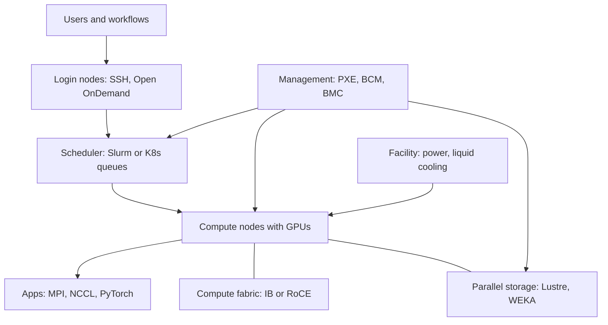

# 6.1 What a supercomputer is: TOP500, Linpack, HPC versus AI factory

| Field | Value |
|---|---|
| Level | Beginner |
| Priority tier | 1 |
| Lab venue | Any machine with Python 3; `flops_lab.py` runs 3 checks locally and cluster CLI commands are **untested** here |
| Part | Part 6: HPC and Slurm |
| Status | Drafted |

## Why this matters for AI infrastructure

Walk onto the data center floor where a large language model is training and you are standing inside a supercomputer. Thousands of GPUs hum inside liquid-cooled racks, linked by a dedicated InfiniBand or RoCE fabric. Those accelerators read training shards from a parallel file system and take orders from a central batch scheduler. Almost every tool and habit used to keep that cluster productive comes straight from high-performance computing. Slurm queues, collective communications, environment modules, pre-job health checks, node draining, and fair-share accounting were forged over decades by HPC engineers. Understanding what traditional HPC measures and why a supercomputer is a single synchronized complex lets you diagnose cluster-wide slowdowns and speak with authority in production war rooms.

## Prerequisites and outcomes

You need Part 1 for Linux administration and Part 2 for networking basics. After finishing this chapter, you will be able to:

- Define a supercomputer from the operator's perspective as a single synchronized complex rather than by price tag or list rank.
- Explain hardware parallelism, vector pipelining, the cycle formula `K*(N-1)+S`, and the nine hardware and software parallelism levels across a cluster.
- Compute theoretical peak performance from hardware clocks and instruction width, and explain why achieved benchmark performance is always lower.
- Explain what the TOP500, HPL, HPCG, HPL-MxP, Green500, Graph500, IO500, and MLPerf benchmarks measure and what each misses.
- Compare a traditional HPC center with an AI factory across workloads, numerical precision, network topologies, storage bursts, scheduling, and power density.
- Distinguish high-availability, high-productivity, and high-performance clusters, plus custom vendor supercomputers versus commodity clusters and Beowulf farms.
- Describe the physical and operational realities of running a supercomputer at 80 to 100 percent continuous utilization, including power-on surges and command-line fleet management.

## 1. What "super" means: from marketing ranks to a single synchronized complex

Imagine you have just inherited a hundred Linux servers racked in a cold room. In an ordinary corporate office, if one server loses half its memory or a network switch fails, nobody panics. You can swap in a cheap spare switch or let employees print their reports on the second floor for a few days while you wait for replacement parts. Try that same casual swap on a compute cluster, such as replacing a broken InfiniBand switch with Gigabit Ethernet or replacing an 8 GB compute node with a 4 GB node. Every multi-node job spanning that rack immediately grinds to a crawl. Users will flood your ticket queue with complaints because a tightly coupled parallel job runs at the speed of its slowest participant.

There is no formal standards-body definition of a supercomputer. Engineers rely on three working definitions depending on their role:

1. **By rank or cost:** a machine near the top of a published list, or one that costs tens or hundreds of millions of dollars. That headline number is interesting to executives, but it tells you nothing about how to operate the machine.
2. **By capability:** a system whose total performance is far beyond what any single server can deliver, achieved by running one parallel program across many processors that exchange data rapidly.
3. **By operational shape:** a shared, expensive, tightly integrated complex where overall synchronization, fabric health, storage throughput, and software consistency determine whether useful work comes out.

In *Supercomputers for Linux SysAdmins*, Sergey Zhumatiy captures this third view directly. A supercomputer is not just a huge bunch of expensive hardware, servers, switches, and disks. It is a single complex construction, not only ideologically, but in essence. All of its components are closely connected, and the most significant task of an administrator is to understand and realize these connections. Because the complex often works together to solve one huge task, even a slight imbalance in one component can significantly drop the performance of the whole system.

Three technical properties appear in every real supercomputer:

- **Scale-out parallelism:** performance comes from many cores, many nodes, and many accelerators working together on one problem rather than from a single fast core.
- **Fast, low-latency interconnect:** processors must exchange messages with microsecond latency and high bandwidth, which separates a supercomputer from a loose farm of independent servers.
- **Shared infrastructure:** a parallel file system, a central batch scheduler, a uniform software stack, and a centralized management plane coordinate the entire fleet.

### Parallelism, pipelining, and the nine levels of cluster parallelism

Every modern supercomputer achieves speed through parallel data processing. Since the beginning of the computer era, parallel processing has remained the primary way to achieve high performance. Even the simplest desktop computer today is equipped with simultaneous multithreading technology, such as Intel HyperThreading or AMD SMT, allowing two or more program threads to run simultaneously. Cell phones and cameras are likewise parallel and multicore. The underlying rule is simple. When two or more operations are independent so that their execution results do not affect each other's input data, hardware can execute them simultaneously in parallel.

In processor hardware, this principle takes two classic forms:

- **Parallelism:** separate hardware devices execute different machine instructions at the same time. For example, if the variables `a`, `b`, and `c` reside in internal processor memory, the commands `x=a+b` and `y=b*c` can execute independently if the processor has separate addition and multiplication devices. GPUs apply this same principle across hundreds or thousands of small cores executing the same code in parallel.
- **Pipelining:** a single command is divided into sequential stages, where each stage is executed quickly by a separate hardware element along an assembly-line conveyor. Several commands at different stages of the conveyor run simultaneously. This principle is most often used in vectorization, which executes a single operation across regularly arranged data arrays called vectors, as in AVX vector processor operations.

Consider adding two vectors whose elements are arranged one after another in memory. Because the operation performed on each vector element is identical, hardware divides floating-point addition into pipeline stages: loading elements from memory, normalization of mantissas, addition, correction, and writing back to memory. After the first stage finishes on the first element of the vector, that stage can immediately begin on the second element without waiting for the entire operation to finish on the first element.

Suppose the slowest stage of the conveyor takes `K` clock cycles and all stages together take `S` clock cycles. Processing a vector of `N` elements requires this many clock cycles:

```text
Total cycles = K * (N - 1) + S
```

The first element finishes after the required `S` clock cycles, which is called the pipeline acceleration time. After that initial fill, the device produces one result every `K` clock cycles. In modern processors, `K` is most often `1`. In the five-stage vector addition example where `S = 5` and `K = 1`, processing `100` elements takes `104` cycles instead of `500` cycles. Note that pipelining does not necessarily imply vectorization, and vectorization does not require pipelining. If a scalar addition unit is pipelined and a program performs several regular additions in a row, those scalar instructions can utilize the pipeline just as well.

Hardware parallelism also extends outside the processor cores to memory access and I/O devices. Different memory banks on a motherboard can work independently to read or write data faster. Note that memory banks are independent channels rather than mere physical slots. If your motherboard has four memory banks, populating four slots with `8 GB` each so there is one module per bank works better than placing a single `32 GB` module in one slot. While data is being written into the first bank, the memory controller can already start writing the next data block into the second bank. Parallelism also exists when working with devices through direct memory access and offloading. The processor forms a block in memory in advance and commands the disk or network controller to write or transmit it. The processor can then perform other actions while the hardware controller moves the data to disk or across the network.

Does writing a parallel program mean it will immediately run faster than a regular sequential one? No, and in fact it may run even slower. Parts of the code that should execute in parallel may actually conflict with each other. For instance, two threads might access different memory sections and prevent the processor cache from working efficiently. Or parallel processes might spend most of their time waiting for data from the slowest process. Finding the real cause of poor scaling is difficult and requires performance debuggers, including parallel profilers, tracers, and compute node monitoring. An administrator should know all nine levels of hardware and software parallelism in a cluster to help diagnose slow jobs:

1. `[HW]` multiple memory banks operating independently across channels.
2. `[HW]` multiline CPU cache hierarchies.
3. `[HW]` multiple CPUs on a motherboard.
4. `[HW]` multiple CPU cores inside one processor chip.
5. `[HW]` multiple functional execution devices inside one CPU core.
6. `[HW]` accelerators, such as GPUs and FPGAs.
7. `[HW]` network devices with DMA and protocol offloading features.
8. `[SW]` multiple UNIX processes and threads on one server, such as OpenMP threads in one process.
9. `[SW]` multiple servers running one parallel program across nodes using MPI for message passing, plus CUDA or OpenACC on accelerators.

When a parallel program runs slowly even though the installed MPI environment works without errors, an administrator checks this hierarchy from top to bottom. A classic root cause is a configuration error that causes MPI to send messages over a slow Ethernet management network instead of the fast InfiniBand fabric.

**Treat a supercomputer as one synchronized machine where every memory bank, core, accelerator, and network link is balanced.** Always verify which network fabric a slow parallel job is actually using.

> **In one minute:**
> - For an administrator, "super" means overall synchronization across a tightly coupled complex of servers, storage, and fabric, not a price tag.
> - Hardware accelerates independent work through parallel functional units and assembly-line pipelines (`K*(N-1)+S` clock cycles), backed by multi-bank RAM and DMA offload.
> - Parallel programs can run slower than sequential ones if threads thrash CPU caches, wait on stragglers, or accidentally route MPI messages over slow management Ethernet across the nine levels of cluster parallelism.

## 2. Measuring speed: FLOPS, precision, peak and achieved

Walk into an executive briefing for a new GPU cluster and someone will inevitably announce that the system delivers "an exaflop of compute." If you accept that number without asking a follow-up question, you can miscalculate job runtimes and capacity plans by more than an order of magnitude. An exaflop in 64-bit scientific simulation and an "AI exaflop" in 8-bit or 16-bit tensor arithmetic measure completely different hardware units.

**FLOPS** stands for floating-point operations per second, scaled by standard metric prefixes: giga (`10^9`), tera (`10^12`), peta (`10^15`), and exa (`10^18`). Modern processors and GPUs pack many more low-precision arithmetic units onto silicon than double-precision units. Therefore, any FLOPS rating must be paired with its numerical **precision**.

| Precision | Typical workload | Hardware execution notes |
|---|---|---|
| `FP64` (double) | Traditional physics simulation and the TOP500 Linpack benchmark | Highest silicon cost per operation; many AI-focused GPUs execute `FP64` at a small fraction of their tensor rate |
| `FP32` (single) | Graphics, CAD, legacy simulation, and older ML models | Standard single-precision baseline |
| `TF32`, `BF16`, `FP16` | Mixed-precision deep-learning training and fine-tuning | Matrix Tensor Core paths deliver an order of magnitude more throughput than scalar `FP64` |
| `FP8`, `FP4` | Frontier LLM training and high-throughput inference | Highest floating-point rates; accuracy is maintained via per-block scaling factors in Parts 10 and 15 |
| `INT8`, `INT4` | Quantized model inference | Integer matrix pipelines |

Whenever a vendor or colleague quotes a cluster FLOPS figure, ask three questions immediately. **At what precision, dense or sparse, and theoretical peak (`Rpeak`) or benchmark achieved (`Rmax`)?**

**Rpeak** is the theoretical ceiling: the rate a cluster would hit if every arithmetic unit on every chip completed a full instruction on every single clock cycle with zero stalls. For a CPU cluster, you compute `Rpeak` by multiplying the hardware counts together:

```text
Rpeak (GFLOP/s) = nodes * sockets * cores * GHz * FP64 FLOPs per cycle per core
```

For an accelerator cluster, you multiply the total number of GPUs by the vendor's per-GPU peak for the chosen precision. **Rmax**, by contrast, is the highest sustained performance actually measured when running the High-Performance Linpack benchmark. The ratio `Rmax / Rpeak` is the cluster's **HPL efficiency**. Achieved performance always falls below theoretical peak because real programs spend time waiting on memory bandwidth, network communication latency, load imbalance across nodes, clock throttling under power or thermal caps, and system software overhead. Well-tuned HPL runs on GPU clusters often reach well over half of `Rpeak`, whereas a misconfigured fabric or a single thermally throttled node pulls `Rmax` down sharply.

### A calculator you can run

You can see how precision and efficiency change cluster numbers by running `code/part06/flops.py`:

```python
def rpeak_cpu(nodes, sockets, cores, ghz, flops_per_cycle):
    """GFLOP/s peak = nodes * sockets * cores * GHz * FLOPs/cycle/core."""
    return nodes * sockets * cores * ghz * flops_per_cycle

def gpu_cluster_peak_pflops(nodes, gpus_per_node, tflops_per_gpu):
    return nodes * gpus_per_node * tflops_per_gpu / 1000.0

g = rpeak_cpu(nodes=100, sockets=2, cores=64, ghz=2.4, flops_per_cycle=32)
print(f"CPU cluster Rpeak: {g/1000:.1f} TFLOP/s")
```

Running `python3 code/part06/flops.py` evaluates a 100-node dual-socket CPU example with `32` FLOPs per cycle from dual AVX-512 FMA units. It also models an illustrative 800-GPU cluster using round placeholder rates of `60 TFLOP/s` in FP64 and `1000 TFLOP/s` in dense BF16:

```text
CPU cluster Rpeak: 983.0 TFLOP/s (or 491.5 TFLOP/s at 16 FLOPs/cycle)
GPU cluster Rpeak: 48.0 PFLOP/s
HPL efficiency if Rmax=38 PF: 79%
AI peak (BF16 dense, illustrative): 800 PFLOP/s; at 40% MFU: 320 PFLOP/s
Vector pipeline N=1000: 1004 cycles vs 5000 unpipelined (4.98x)
```

Notice the spread across those output lines. The exact same 800-GPU cluster has a theoretical peak of `48.0 PFLOP/s` in FP64 versus `800 PFLOP/s` in illustrative dense BF16, and its sustained output changes again once you multiply by achieved efficiency.

In AI infrastructure, **MFU** (model FLOPs utilization) is the practical counterpart to HPL efficiency. It measures the fraction of peak accelerator FLOPs that goes into useful forward-and-backward model math rather than waiting on NCCL collectives, kernel launch gaps, or dataloader stalls. Large distributed training jobs routinely land around `35%` to `50%` MFU, so lifting MFU by even five percentage points saves millions of dollars in GPU time.

**Never accept a FLOPS figure without its precision, sparsity mode, and efficiency ratio**.

> **In one minute:**
> - Always qualify FLOPS with precision, sparsity, and whether the figure is theoretical peak or sustained achieved performance.
> - CPU `Rpeak` equals `nodes * sockets * cores * GHz * FLOPs/cycle/core`; halving vector width from `32` to `16` FLOPs per cycle cuts a 100-node cluster from `983.0` to `491.5` TFLOP/s.
> - HPL efficiency and AI MFU reveal how much hardware capability survives memory, network, and thermal bottlenecks.

## 3. The lists and benchmarks

When a newly built cluster is handed over from the hardware integrator to the operations team, how do you prove that all thousand nodes, cables, power supplies, and cooling loops actually work together under full load? Running `nvidia-smi` on each node only proves the GPUs powered on. The community relies on standardized benchmark suites to rank the world's largest machines and burn in new clusters before users arrive.

| Benchmark / list | What it measures | What it leaves out |
|---|---|---|
| **TOP500** (published twice a year in June at ISC and November at SC) | Ranks the 500 fastest known systems by achieved `Rmax` on HPL in `FP64` | Everything except dense linear algebra; low-precision AI speeds, storage I/O, and real multi-job application mixes |
| **HPL** (High-Performance Linpack) | Solves a large dense linear system `Ax = b` using LU factorization in `FP64`; stresses compute units, power, cooling, and regular collective communication | Memory-bandwidth-bound sparse kernels, irregular graph communication, and file system I/O |
| **HPCG** (High Performance Conjugate Gradients) | Solves a sparse linear system dominated by irregular memory access, pointer chasing, and global reductions; typically achieves only a few percent of `Rpeak` | Still a single synthetic mathematical kernel, though much closer to real PDE simulation codes than HPL |
| **HPL-MxP** | Solves the Linpack problem using mixed-precision tensor arithmetic with `FP64` iterative refinement | Pure low-precision inference or transformer attention patterns |
| **Green500** | Re-ranks the TOP500 systems by energy efficiency in GFLOP/s per watt | Facility overhead outside the compute racks and idle power draw |
| **Graph500** | Measures data-intensive graph traversal in traversed edges per second | Dense matrix compute |
| **IO500** | Ranks parallel storage systems using standardized `IOR` bandwidth and `mdtest` metadata benchmarks in Chapter 6.28 | Compute and accelerator performance |
| **MLPerf Training & Inference** (MLCommons) | Measures wall-clock time to train reference AI models to a target accuracy, or inference throughput and latency under strict quality constraints | Customer-specific data pipelines; vendor submissions use heavily tuned software stacks |

For an infrastructure engineer, these benchmarks are **acceptance tests and diagnostic hammers**, not crystal balls. HPL pushes every GPU and CPU to maximum power draw while exchanging data across the fabric. A cluster that falls short of its expected HPL efficiency almost always has a degraded optical transceiver, a misconfigured routing table, a throttling cooling loop, or a sick node. Chapter 6.28 walks through running HPL, HPCG, IOR, OSU, and NCCL tests during cluster acceptance.

Keep three caveats in mind when discussing public rankings in interviews:

1. **Many massive AI clusters never submit:** hyperscalers and AI labs frequently skip TOP500 submissions for competitive reasons or because stopping a large GPU training cluster for days of FP64 Linpack tuning costs too much money.
2. **FP64 vs AI design trade-offs:** TOP500 rewards FP64 double-precision arithmetic. Modern AI factory architectures intentionally devote silicon area to low-precision Tensor Cores rather than maximizing FP64.
3. **Exascale vocabulary:** **exascale** strictly means `10^18` sustained FP64 operations per second on HPL, a milestone first passed by publicly ranked systems in the early 2020s. Always check the current June or November lists at `top500.org` and `mlcommons.org` before quoting specific system ranks.

**Use HPL, HPCG, IO500, and MLPerf as burn-in acceptance tests to expose fabric, thermal, and storage flaws before handing a cluster to users**.

> **In one minute:**
> - TOP500 ranks systems twice a year in June and November by FP64 `Rmax` on dense HPL, whereas HPCG tests memory-bandwidth-bound sparse math and typically reaches only a few percent of `Rpeak`.
> - HPL-MxP and MLPerf evaluate mixed-precision and end-to-end AI workloads, while Green500 measures GFLOP/s per watt and IO500 measures parallel storage.
> - Treat standard benchmarks as acceptance and burn-in tests for your hardware, not as direct predictors of every user workload.

## 4. Traditional HPC versus the AI factory

Suppose an experienced HPC systems administrator transfers onto an LLM training platform team. On day one, the cluster looks completely familiar: liquid-cooled racks, InfiniBand switches, a Lustre or WEKA parallel file system, and Slurm scheduling batch jobs. By Friday, however, the differences become unmistakable. Instead of two hundred scientists running two hundred different Fortran and C++ codes across a few dozen nodes each, a single foundation-model pre-training job occupies four thousand GPUs continuously for six weeks. That single job hammers the fabric with giant collective operations and dumps multi-terabyte checkpoints every few hours.

Both traditional HPC centers and modern AI factories are tightly coupled parallel machines. Their workload shapes and operational priorities diverge in specific ways:

| Dimension | Traditional HPC center | AI factory / training & serving cluster |
|---|---|---|
| **Primary workloads** | Physical simulation in C, C++, and Fortran using MPI and OpenMP | Neural-network pre-training, fine-tuning, data curation, and inference serving in Python with PyTorch/JAX and NCCL |
| **Numerical precision** | Heavy `FP64` double precision | Heavy `BF16`, `FP16`, `FP8`, and `FP4`; `FP64` is rarely used |
| **Parallelism & traffic** | 3D domain decomposition; MPI point-to-point halo exchanges and small-message global reductions | Data, Tensor, Pipeline, Expert, and Context parallelism; massive AllReduce, AllGather, ReduceScatter, and AllToAll elephant flows |
| **Job distribution** | Wide mix: hundreds of small to medium jobs from many researchers, plus occasional hero runs | Bimodal: a few monolithic training jobs spanning thousands of GPUs for weeks, alongside interactive fine-tuning and 24/7 inference services |
| **Interconnect** | InfiniBand, Slingshot, or custom torus/dragonfly/fat-tree fabrics | Rail-optimized InfiniBand or RoCEv2 Ethernet fat-trees with GPUDirect RDMA, plus intra-rack NVLink and NVSwitch domains in Part 12 |
| **Storage pattern** | Parallel file systems such as Lustre and GPFS for scratch, home, and simulation dumps; heavy POSIX metadata | High-throughput streaming reads for dataloaders plus periodic, synchronous multi-terabyte checkpoint write bursts in Part 13 |
| **Orchestration** | Slurm, PBS, or LSF with deep fair-share trees and project allocation accounting | Slurm with Pyxis and Enroot for large training pools, or Kubernetes with Kueue, KAI, or Volcano for unified training and inference |
| **Software packaging** | Environment modules, Spack, EasyBuild, and bare-metal compiler toolchains | OCI containers built from NGC base images |
| **Failure recovery** | Periodic checkpoint/restart; moderate node count per job keeps per-job MTBF manageable | At thousands of GPUs per job, hardware faults happen every few hours or days; automated health checks and sub-minute checkpointing are mandatory |
| **Primary north-star metric** | High overall node utilization and fair queue turnaround across a broad user community | High MFU, minimum time-to-train, and lowest **cost per token** or **tokens per watt** |
| **Facility envelope** | `15` to `40 kW` per rack with air or rear-door heat exchangers, plus liquid cooling on flagship systems | `40` to `130` kW or more per rack; direct-to-chip liquid cooling and megawatt power feeds are the primary deployment constraint in Chapter 6.30 |

The phrase **AI factory** reflects an industrial shift in how data centers are planned. Instead of treating a cluster as a general-purpose computing library where diverse users check out nodes, an AI factory is engineered like a manufacturing plant. Its raw inputs are megawatts of electricity and petabytes of training data, and its manufactured outputs are trained model weights and served intelligence tokens.

Yet the operational convergence between HPC and AI is much stronger than the contrast. If you know how to keep an HPC cluster's fabric clean, its parallel storage fast, and its Slurm scheduler healthy, you already own the core skills needed to run an AI factory.

**Bring HPC's discipline in gang scheduling, fabric hygiene, and pre-job health checks into AI clusters**. Add fast container delivery and automated fault recovery for multi-thousand-GPU jobs.

> **In one minute:**
> - Traditional HPC centers run diverse FP64 MPI simulations across many users, whereas AI factories run massive BF16 and FP8 NCCL training jobs and 24/7 inference services.
> - Because a single AI training run can lock up thousands of GPUs for weeks, the mean time between hardware failures inside that job drops from weeks to hours, making fast checkpointing and automated node draining critical.
> - An AI factory measures success as an industrial production line: useful model FLOPs and tokens produced per megawatt and per dollar.

## 5. Kinds of clusters, custom supercomputers, and distributed models

When people say the word "cluster," they simply mean many computers combined into a single system. In *Supercomputers for Linux SysAdmins* Chapter 2 and *AI Factory* Chapter 9, the authors show that clusters fall into distinct categories depending on their purpose and coupling.

### The three classic cluster types: HA, high-productivity, and HPC

1. **High-availability and load-balanced service clusters:** Their task is to provide access to a resource—such as a website, database, or inference API—with maximum speed and minimum latency. They are typically paired with load balancing, A/B or canary testing, and continuous deployment. If one node fails, the entire resource remains available because clients reconnect and access the service from another node in the cluster. Cloud computing applies a very similar principle: you do not know which physical node will run your application or operating system image because the cloud platform selects free resources automatically.
2. **High-productivity (high-throughput computing and Grid) clusters:** In this model, all nodes work on a single large task that has been broken into independent parts. If a node fails, its unfinished part is simply sent to another node. If new nodes are added to the cluster, they receive parts that have not yet been calculated, and the overall computation finishes faster. Classic examples include Grid computing and projects like `SETI@home` and `Folding@home`. Only a narrow class of loosely coupled tasks can be solved this way. A dedicated data center cluster is often unnecessary because home computers or ordinary servers connected over a LAN or the internet work well.
3. **High-performance computing (HPC and tightly coupled AI training) clusters:** Unlike the previous two types, the failure of a single node in an HPC cluster usually leads to the emergency termination of the entire parallel program. Only in rare cases does execution continue automatically from a previously saved control point. Because of this tight coupling, HPC clusters are much more sensitive to component faults and cannot be operated without strict control and monitoring. All nodes are closely connected by high-speed, low-latency networks and high-performance parallel file systems. Applications exchange messages frequently between parallel processes, so message initialization overhead (latency) matters just as much as network throughput. On a network with high latency, parallel programs can run many times slower than on a low-latency fabric.

| Cluster type | Primary goal | Inter-node coupling | Effect of a single node failure | Typical examples |
|---|---|---|---|---|
| **HA / load-balanced cluster** | Continuous service uptime and low request latency | Loose or replicated state | Traffic fails over transparently to surviving nodes | Web tiers, HA database pairs, stateless LLM inference replicas |
| **High-productivity (HTC / Grid)** | Complete a massive batch of independent tasks | None between worker tasks | Only the failed node's task slice is retried elsewhere | `SETI@home`, `Folding@home`, genomics sweeps, data preprocessing |
| **HPC / AI training cluster** | Run one tightly coupled parallel program as fast as possible | Tight microsecond message passing | Entire multi-node job aborts and must restart from a checkpoint | Weather forecasting, CFD, multi-node LLM pre-training |

### Clusters versus custom vendor supercomputers, farms, and Beowulf systems

Does the word "supercomputer" always mean a cluster? No, not always. An important feature of a **cluster** is that it can be built from commercially available components. You can buy all the parts in a store and, with sufficient experience, assemble the cluster yourself.

In the historical perspective, a **supercomputer** was a product made of unique, proprietary components produced by a single vendor. Take IBM's `Blue Gene` series as an example. Its architecture resembles a cluster and uses similar software tools, but `Blue Gene` could only be purchased from IBM or its distributors. It was impossible to build a `Blue Gene` on your own because its key components were never sold separately. Today such custom systems are rare, though examples like the `NEC Tsubasa` still exist. At the opposite extreme sit **computing farms**—groups of computers working on a task without transmitting data to each other—and **Beowulf** clusters assembled practically from improvised commodity PCs. While the line between a cluster and a non-cluster is clear, practically all modern supercomputers are built with a cluster architecture enhanced by fast networks and synchronization hardware.

### Cloud, fog, and edge distributed tiers

When an AI platform extends beyond a single data center, distributed computing spans three geographic tiers and three cloud service models. As framed in *AI Factory* Chapter 9, cloud providers offer IaaS for raw VMs and GPUs, PaaS for managed application platforms, and SaaS for turnkey software across public, private, or hybrid clouds.

- **Cloud / core data center:** centralized hyperscale or on-premises AI factories holding thousands of GPUs and parallel or object storage (File, Block, and Object stores; see Chapter 1.27) for heavy model training and high-throughput batch serving.
- **Fog computing:** intermediate compute and storage nodes positioned near the local network edge, such as at a factory plant or regional telecom site. They aggregate and filter sensor streams to reduce bandwidth backhaul and latency before data reaches the central cloud.
- **Edge computing and cloudlets:** compute placed directly on or beside physical devices and IoT sensors, such as autonomous vehicles or local cloudlet hotspots. They serve workloads where millisecond inference latency or offline operation forbids a round trip to the cloud.

Where do **Slurm** and **Kubernetes** fit across these models? **Slurm** was built specifically for the HPC cluster model: a fixed pool of nodes executing queued, finite batch jobs with exclusive resource allocation, gang scheduling, and strict fair-share accounting. **Kubernetes** was built for the HA and cloud service model, maintaining continuously running desired state across pods and load-balanced services. It requires specialized batch operators like Kueue, Volcano, KAI Scheduler, or JobSet when adapted for tightly coupled GPU training.

### Fog computing: moving intelligence onto the local network

Picture a plant that sends every sensor reading to a distant cloud and then waits for the answer. Each round trip takes time, and the plant cannot act while it waits. Fog computing solves this by placing processing closer to the devices that produce the data.

Fog computing, also called fog networking or fogging, is a decentralised structure that sits between data-producing devices, such as Internet of Things (IoT) devices, and the cloud. It extends the cloud architecture to the edge of the network, so the cloud is involved less. Bringing processing units nearer the end devices improves how computing power is used and shortens task execution and processing time. Fog pushes intelligence down to the local network. Edge devices and gateways handle the work, and data flows from the endpoints to a gateway for processing and back again.

Fog computing offers these benefits:

- Enhanced security and increased business agility.
- Improved reliability and minimised latency.
- Flexible mobility and better overall network performance, because the distance across the network is shorter.
- Time-sensitive analysis at the network edge, instead of sending all IoT data to the cloud.
- Fast response, measured in milliseconds.

Fog has limits too. Its architecture depends on many links in a chain that carries data from physical assets into the digital world, and each link can fail. Its latency and bandwidth are still limited, and it still depends on the cloud.

The fog model has three layers. The **cloud layer** holds data centres and servers with large storage and computing power. They manage and process the data that arrives from the fog layer. The **fog layer** holds fog nodes, which are network devices with enough processing and temporary storage. A fog node receives requests from devices and decides whether to process a request locally or send it to the cloud. The **terminal layer** holds the IoT and end-user devices that sense the physical world and send their data up to the fog layer.

### Edge computing: processing at the device

Edge computing places computing resources and storage at the edge of the network, close to the end user. It works together with the cloud, so it can be seen as a more localised version of fog and cloud computing. It grew out of peer-to-peer networking, distributed data, self-healing networks and remote cloud services. It runs on small form-factor hardware with flash storage arrays, and its processors offer better hardware security with low power use.

Edge computing is built on the idea of cloudlets. A cloudlet is like a Wi-Fi hotspot that offers cloud services without Wi-Fi internet connectivity. The only rule on where it sits is that it must be at the edge of the network or near the user.

Edge computing brings clear advantages:

- It reduces latency between end devices and the cloud.
- It uses the resources of both the cloud and the local devices, because each device both produces and consumes data.
- It reduces network cost and transmission delay, and gives better control over sensitive data movements.
- It helps augmented and virtual reality applications, which benefit from low response times.
- It can keep data local, so the local data stays safe if the data centre is compromised.
- It can hold data locally and send it to the cloud later, when enough bandwidth is free.
- It reduces network traffic and the risk of a data bottleneck.

Edge computing processes sensor data close to where it is produced, instead of carrying it to a central node. Devices at the edge triage their data locally, which cuts the traffic sent to the central repository. This also removes parts of the fog communication chain and reduces the number of possible failure points. An edge device can be any device with enough computing capacity, including switches, routers and sensors.

For IoT, edge devices collect and process the data that sensors send. Without edge computing, that data would travel back and forth to the cloud, which slows responses and wastes efficiency. Because processing happens nearer the source, the data is handled faster, with lower latency, and less bandwidth is used.

### Fusing data from many sensors

Edge devices often collect readings from several sensors at once. Combining those readings into one picture is called data fusion. It sounds simple, but the readings rarely agree perfectly, so fusion has to handle several problems:

- **Imprecision and uncertainty:** no measurement is perfect, so each reading carries some level of uncertainty.
- **Spurious data and outliers:** data can be noisy or hard to read, and faulty or imprecise measurements can produce extreme values.
- **Modality:** the data may mix visual, auditory and physical measurements.
- **Conflict:** different sensors can report values that contradict each other, and these are hard to fuse.
- **Operational timing:** different parts of the data can take different routes to the fusion point, so they arrive out of sequence.
- **Dynamic versus static:** some values come from a phenomenon that does not change over time, while others change constantly.
- **Dimensionality:** measurements can come in different dimensions, so they must be reduced to the needed dimensions, either at the sensor node or at the fusion centre.
- **Correlation:** nearby sensors can share the same external noise. If those shared dependencies are ignored, the result can be inconsistent.
- **Alignment and registration:** each sensor uses its own local frame, so the data must be placed in one standard frame before fusion.

Two more terms matter here. Data association means finding meaningful relations between variables, often quite different ones, inside large databases. The processing framework decides whether fusion is centralised or decentralised. Decentralised fusion is usually preferred in wireless sensor networks, because it lowers the communication load and lets each sensor process its own data. Data quality has to be considered from collection through to fusion.

### Cloud, fog and edge compared

These three architectures look alike, but they differ in important ways. Each one meets a different set of needs. The table below shows the main differences.

| Points of difference | Cloud computing | Fog computing | Edge computing |
|---|---|---|---|
| Location of data processing | Central cloud server | Within an IoT gateway or fog nodes located in the LAN network | Device itself |
| Purpose | Long-term in-depth analysis | Quick analysis and real-time response | Quick analysis and real-time response |
| Latency | High | Low | Very low |
| Security | Less secure | High security | High security |
| Geographical distribution | Centralised | Distributed | Distributed |

The three are not interchangeable. Time-sensitive data is processed at the edge, while data that is not time-driven goes to the cloud. Fog uses a centralised system that works with industrial gateways and embedded computers on a LAN. Edge computing does much of its processing on embedded platforms that connect directly to sensors and controllers.

Organisations that rely heavily on data are increasingly using cloud, fog and edge infrastructure together. Most enterprises are moving toward fog or edge designs to make better use of their end-user and industrial IoT devices. Integrating a cloud platform with on-site fog networks or edge devices often gives the best results.

**Match your orchestrator and fault-tolerance design to the coupling of the workload**. Use gang scheduling and fast checkpoints for tightly coupled HPC and NCCL jobs, and stateless failover or task retries for HA and HTC pools.

> **In one minute:**
> - HA clusters survive node failures transparently and HTC or Grid clusters (`Folding@home`) simply retry the dead node's task, whereas a single node failure in a tightly coupled HPC or AI training job halts the entire job.
> - True clusters are built from commercially available components (unlike proprietary single-vendor supercomputers such as `IBM Blue Gene` or `NEC Tsubasa`), separated from loose compute farms by their low-latency fabric.
> - Slurm naturally fits queued, tightly coupled batch jobs on a fixed node pool, while Kubernetes naturally fits long-running services and adds batch queueing via operators.

## 6. What "super" means to the administrator

To the user submitting a job script, the supercomputer looks like one giant virtual computer with a huge memory and tens of thousands of computing cores. To the system administrator on call, that illusion is held together by eight strict invariants across every node in the fleet:

1. **Identical software state:** every compute node runs the exact same OS image, kernel patch level, GPU driver, and NIC firmware.
2. **Synchronized time and identity:** clocks are synchronized via `chrony` or NTP, and every username maps to the exact same numeric UID and GID everywhere in Chapter 6.24.
3. **Predictable naming and networking:** DNS, `/etc/hosts`, DHCP and PXE boot, the out-of-band management network, and the high-speed compute fabric all resolve and route cleanly.
4. **Uniform shared storage:** parallel and home file systems are mounted at identical paths with enforced user and project quotas in Chapters 6.18 to 6.21.
5. **Centralized scheduling and accounting:** users never log into compute nodes directly to start work; the batch scheduler places every job, isolates it in cgroups, and logs usage in Chapters 6.7 to 6.15.
6. **Comprehensive observability:** automated monitoring tracks node health, temperatures, power supplies, air conditioning, UPS units, fabric symbol errors, and GPU faults in Chapter 6.26.
7. **Repeatable provisioning:** automated image deployment and configuration management ensure a replacement server boots into an identical state within minutes in Chapter 6.22.
8. **Spares and SLA discipline:** unless hardware has built-in redundancy, you maintain an on-site emergency stock of key spares and vendor service agreements with clearly defined replacement SLAs.

### Why office IT habits fail in a supercomputer data center

At first glance, a large cluster looks no different from many office computers connected by a local area network and a few storage servers. In reality, four physical and operational differences separate a supercomputer from office IT.

- **Extreme spatial, power, and cooling density:** Unlike office PCs spread across a building, a cluster is packed into several square meters or a few dozen square meters. You cannot cool it with an open window or a household air conditioner, nor can you plug it into wall sockets or protect it with a household UPS. In modern clusters, **the computing part can occupy less than a quarter of the total installation area**, while all the rest is taken up by climate and energy equipment in Chapter 6.30.
- **80 to 100 percent continuous utilization:** In an office, computers need only a few minutes a day to display a document or play a video clip. Ninety-nine percent of the time, office PCs sit idle waiting for a mouse click or keystroke. In a supercomputer, the normal mode of operation is **`80–100%` utilization of each node at all times**.
- **Synchronized I/O storms are normal, not a virus:** When an office network suddenly sees network load jump hundreds of times and network storage slows to a crawl, every administrator thinks all the computers caught a virus. In a cluster, having all nodes occupied by one task start exchanging data or writing intermediate data to the network disk at the same time is completely normal everyday operation. Peak loads are a gray everyday occurrence here, so key services must be duplicated or load-shared from the start.
- **You cannot wait for users to report hardware failures:** In an office, if a node, air conditioner, or UPS fails, an employee runs in shouting that their report is on fire. Worst of all in a cluster is learning about a hardware failure from users whose parallel program stopped working properly or starts only two times out of three. You solve this by monitoring everything and anything across the facility and cluster.

### Power-on surge hazards and startup sequencing

A special type of peak load in a supercomputer is the **power-on procedure**. In an office, employees arrive at different times in the morning and turn on their computers gradually. Powering on a supercomputer all at once creates three severe operational hazards:

1. **Electrical inrush and boot-storm service overload:** Switching on a supercomputer means a sharp increase in power consumption by dozens or even thousands of kilowatts. Immediately afterward, all compute nodes request storage and service nodes at almost the same time. If you turn on everything at once, the electrical installation can trip or burn down. Even switching nodes on smoothly at intervals of a few seconds can cause network conflicts or overload a central service with requests.
2. **Multi-rack disk array spin-up torque and controller sequencing:** In large disk arrays spanning several racks, shelves and disks are started in a specific sequence. This limits high starting currents and ensures the **spinning disks do not sway the rack**. You must also power on the array components in the exact sequence expected by the storage controllers. Otherwise, the array controllers may think the array is broken and start rebuilding it or even mark it as dead.
3. **Hot-corridor thermal baking:** Server racks are often arranged opposite each other in a corridor and blow hot air into the shared hot aisle. They must be turned on at staggered intervals to avoid overheating opposing servers that are not yet turned on.

### Command-line fleet management and the "panacea" console trap

Because the scale of even a small compute cluster differs dramatically from a dozen servers, graphical administration tools are unrealistic. How do you find out which servers failed to detect their full amount of RAM the last time they were powered on? Running a graphical system monitor on a hundred nodes and clicking the system tab on each would take all day. Instead, you run a single command across all nodes using a parallel shell tool such as `pdsh` or `clush`:

```bash
# (untested here)
grep MemTotal /proc/meminfo | awk '{print $2}'
```

In a couple of seconds, you get the detected memory from every server. Adding a couple of shell commands—modeled in `filter_nodes_missing_ram()` in `code/part06/flops.py`—compares each node's value against your expected benchmark of `528,482,304` kB within a `2%` tolerance and prints only the nodes that failed. Studying the *Advanced Bash Scripting Guide* and combining `bash` or `zsh` with `grep`, `sed`, `awk`, `find`, `ps`, and Python or Perl multiplies your operational speed many times over. Users of a supercomputer also need very different support than users in neighboring office rooms, a topic covered in Chapter 6.25.

When performing bulk operations day after day, every administrator eventually dreams of a single convenient console that does everything without launching scripts or copying text from terminal screens. That thought often strikes when looking at enterprise management suites like `HP OpenView` or `Zenoss`. You want to exclaim, "Here it is, the panacea." Those products do inventory equipment, track users and software, and automate standard tasks, and you can adapt them for parts of your work.

Alas, they solve only parts of the problem. Both commercial and free enterprise consoles are aimed at tasks that overlap with supercomputing but are still different. Forcing them to perform specialized HPC actions that they were not designed for requires a huge investment of human effort, money, and time. As soon as your supercomputer's configuration changes, you have to do that customization all over again. Experience across many supercomputer centers shows there are no universal all-in-one solutions because the market of supercomputer administrators is narrow and custom tools are expensive to maintain. Instead, rely on flexible, extensible CLI tools and keep all organizational and accounting processes well documented. That documentation is not merely to avoid forgetting steps, but to see the big picture and adapt established processes quickly when conditions change.

**Automate fleet checks from the command line and enforce a staggered storage-first power-on sequence**. Monitor every facility and hardware metric proactively so users never discover failures for you.

> **In one minute:**
> - A supercomputer runs at `80–100%` utilization 24/7, packs compute into less than a quarter of total facility floor space, and treats synchronized network and storage bursts as normal everyday load.
> - Never power on a cluster all at once: sequence disk shelves before storage controllers to prevent starting-current spikes, rack sway, and false array rebuilds, stagger hot-corridor racks, and pace compute node boots.
> - Use parallel CLI tools (`pdsh` or `clush` with `grep MemTotal /proc/meminfo | awk '{print $2}'`) and flexible scripts rather than chasing rigid all-in-one enterprise GUI consoles.

## 7. The stack at a glance



| Layer in diagram | Role in the supercomputer complex | Covered in |
|---|---|---|
| **Login nodes (`L`)** | User entry point for editing code, compiling, and submitting batch jobs (`ssh`, Open OnDemand) | Chapters 6.2, 6.25 |
| **Scheduler (`S`)** | Allocates nodes and GPUs exclusively, enforces fair-share and QoS, and launches parallel steps (Slurm, Kueue) | Chapters 6.7–6.17 |
| **Compute nodes & Apps (`C`, `A`)** | Execute parallel kernels across CPUs and GPUs (MPI, OpenMP, NCCL, PyTorch, Enroot) | Chapters 6.3–6.6, 6.12–6.13, 6.29 |
| **Compute fabric (`F`)** | Low-latency, high-bandwidth RDMA interconnect (InfiniBand, RoCEv2) | Chapter 6.12, Part 12 |
| **Parallel storage (`P`)** | High-throughput shared namespaces for datasets and checkpoints (Lustre, GPFS, BeeGFS, WEKA, VAST) | Chapters 6.18–6.21, Part 13 |
| **Management plane (`M`)** | Out-of-band BMCs (Redfish), PXE image provisioning (xCAT, Warewulf, BCM), LDAP, and monitoring | Chapters 6.22–6.27, Parts 7 & 8 |
| **Facility (`FAC`)** | High-density power distribution, UPS, chillers, and direct-to-chip liquid cooling | Chapter 6.30, Part 9 |

## 8. Common misconceptions

- **"A supercomputer is one giant computer."** Physically it is hundreds or thousands of separate Linux servers; the high-speed fabric, parallel file system, and batch scheduler make it behave as one coherent system.
- **"More FLOPS means my job will run faster."** Only if your code uses the numerical precision that the headline number assumes and is not bottlenecked by memory bandwidth, network latency, or storage I/O.
- **"TOP500 rank proves AI capability."** TOP500 measures FP64 dense LU factorization on HPL. Evaluate AI clusters with MLPerf, NCCL tests, and your actual training or inference workload.
- **"Cloud VMs are identical to a supercomputer."** Cloud providers can host true supercomputer clusters when you use bare-metal or passthrough GPU instances inside a compact placement group with RDMA fabrics. Ordinary unplaced VMs on a shared TCP network suffer severe latency penalties in Chapter 1.27.
- **"Replacing a failed component with a slightly slower spare is fine temporarily."** In a tightly coupled cluster, one node with less RAM or a slower network link drags down every multi-node job that lands on it.

## 9. Lab (no cluster required)

First, run the self-checking Python lab (`code/part06/flops_lab.py`) locally. It verifies the vector pipeline cycle equation `K*(N-1)+S` from `SCL` Chapter 2, the CPU and GPU `Rpeak`, HPL efficiency, and BF16 MFU calculations. It also checks the fleet-wide `/proc/meminfo` `MemTotal` anomaly filter from `SCL` Chapter 1:

```bash
python3 code/part06/flops_lab.py
```

Next, work through these hands-on analysis steps:

1. Open `code/part06/flops.py` and run `python3 code/part06/flops.py`. Change `flops_per_cycle` from `32` to `16` to simulate a CPU without dual AVX-512 FMA units and verify that `Rpeak` drops from `983.0` to `491.5` TFLOP/s.
2. Using `vector_pipeline_cycles(1000, 1, 5)`, compare the pipelined cycle count of `1004` cycles against `5000` unpipelined cycles and verify the `4.98x` speedup printed by `code/part06/flops.py`.
3. Test `filter_nodes_missing_ram()` with a 10-node dictionary where one node lost one of its eight `64 GB` DIMMs on boot. It reports `448 GB` instead of `512 GB`, so a `2%` tolerance threshold flags the degraded node immediately.
4. Look up the current June or November TOP500 and Green500 lists online (**untested** here). Record the number-one system's `Rmax`, `Rpeak`, HPL efficiency, and power in megawatts.

## 10. Interview angles

- Define a supercomputer in two sentences from a system administrator's perspective. What separates it from a 1,000-node web farm?
- Walk through the nine levels of hardware and software parallelism in a cluster. If an MPI job launches cleanly on 64 nodes but runs ten times slower than expected, what is the first configuration mistake you check?
- Explain the difference between `Rpeak`, `Rmax`, and MFU. Why is HPCG efficiency only a few percent of `Rpeak` when HPL reaches `60%` to `80%` or more?
- Why do powering on a multi-rack storage array and a hot-corridor compute cluster require a strict startup sequence?
- How do you verify in three seconds that all 500 compute nodes detected their full physical RAM after a power outage?

## Exercises

1. **Vector Pipelining and Hardware Parallelism (`SCL` Chapter 2):** Using `vector_pipeline_cycles()` in `code/part06/flops.py`, compute the clock cycles a 5-stage vector adder (`S = 5`, `K = 1`) needs for `N = 100` elements versus `500` unpipelined cycles. Then explain why populating four `8 GB` RAM modules across four independent motherboard memory banks outperforms a single `32 GB` module in one slot.
2. **The Nine Levels of Cluster Parallelism and Slow-Job Triage (`SCL` Chapter 2):** List all seven hardware and two software levels of cluster parallelism from *Supercomputers for Linux SysAdmins* Chapter 2. Explain why a parallel MPI program can run slower than a sequential program when threads contend for CPU cache or when MPI accidentally routes traffic over the Ethernet management network instead of InfiniBand.
3. **CPU and GPU `Rpeak`, `Rmax`, HPL Efficiency, and MFU (`code/part06/flops.py`):** Using `rpeak_cpu()`, `gpu_cluster_peak_pflops()`, and `hpl_efficiency()`, compute the FP64 `Rpeak` of a `100`-node CPU cluster (`2` sockets, `64` cores per socket, `2.4 GHz`, `32` vs `16` FLOPs per cycle). Then compute the HPL efficiency (`Rmax = 38` vs `48.0` PFLOP/s) and `40%` MFU sustained BF16 rate of an 800-GPU cluster.
4. **Cluster Taxonomy (`SCL` Ch. 2 & `AF` Ch. 9):** Contrast HA, HTC (`SETI@home` and `Folding@home`), and HPC clusters on inter-node coupling and single-node failure blast radius. Distinguish a commodity COTS or Beowulf cluster from a single-vendor custom supercomputer (`IBM Blue Gene`, `NEC Tsubasa`), and state how Cloud, Fog, and Edge tiers divide training and low-latency inference.
5. **Physical Operations and Power-On Surge Sequencing (`SCL` Chapter 2):** Explain why compute racks often occupy less than a quarter of a supercomputer's total floor area and operate at `80–100%` continuous utilization. Detail the three physical startup hazards when powering on a cluster after an outage: electrical and network request surges, multi-rack disk shelf spin-up torque and controller ordering, and hot-corridor overheating.
6. **Command-Line Fleet Verification vs. Monolithic GUI Consoles (`SCL` Chapters 1 & 2):** Write the `pdsh` or `clush` command using `grep MemTotal /proc/meminfo | awk '{print $2}'` to audit physical memory across 100 nodes after boot. Trace how `filter_nodes_missing_ram()` in `code/part06/flops.py` identifies nodes with missing DIMMs within a `2%` tolerance, and explain why enterprise GUI suites (`HP OpenView`, `Zenoss`) are not a universal panacea for supercomputer administration.

## Checkpoint questions (20)

<details>
<summary>1. What are the three working definitions of a supercomputer, and what does "super" mean to the Linux administrator who operates one (`SCL` Chapters 1 & 2)?</summary>

The three definitions are **by rank or cost**, **by capability** (solving one large problem via parallel execution across many processors), and **by operational shape**. To the administrator, **"super" means overall synchronization across a single tightly integrated complex**. Every server, switch, storage array, and software layer must be aligned and tuned together, because even a slight imbalance on one node degrades the entire complex.
</details>

<details>
<summary>2. What is the difference between hardware **parallelism** and **pipelining** inside a processor (`SCL` Chapter 2)?</summary>

- **Parallelism:** Separate hardware execution units perform different independent instructions simultaneously, such as an adder computing `x=a+b` while a multiplier computes `y=b*c`, or hundreds of GPU cores executing the same kernel in parallel.
- **Pipelining:** A single operation is split into sequential stages (load, normalize mantissas, add, correct, write). Those stages execute like a conveyor belt so multiple elements are in flight at different stages simultaneously, as in AVX vector instructions.
</details>

<details>
<summary>3. Write the cycle formula for processing a vector of `N` elements through a pipeline whose slowest stage takes `K` clock cycles and whose full pipeline length is `S` cycles (`SCL` Chapter 2).</summary>

$$\text{Total cycles} = K \times (N - 1) + S$$
The first element completes in `S` clock cycles, called the **pipeline acceleration time**, and subsequent elements complete one every `K` clock cycles. In modern processors `K` is typically `1`, so for `S = 5`, `K = 1`, and `N = 100`, total cycles equal `104`.
</details>

<details>
<summary>4. Why does populating four `8 GB` RAM modules across four motherboard memory banks perform better than installing one `32 GB` module in a single slot (`SCL` Chapter 2)?</summary>

Independent **memory banks** operate in parallel. While one word is being written into or read from the first memory bank, the memory controller can simultaneously initiate the next write or read on a second bank. Putting all `32 GB` into a single slot serializes every memory access through one bank.
</details>

<details>
<summary>5. List the nine levels of hardware (`[HW]`) and software (`[SW]`) parallelism in a compute cluster (`SCL` Chapter 2).</summary>

1. `[HW]` Multiple independent memory banks.
2. `[HW]` Multiline CPU caches.
3. `[HW]` Multiple CPUs (sockets).
4. `[HW]` Multiple CPU cores on a die.
5. `[HW]` Multiple functional devices inside one CPU core.
6. `[HW]` Accelerators such as GPUs and FPGAs.
7. `[HW]` Network devices with DMA and offloading.
8. `[SW]` Multiple UNIX processes and threads on a node (OpenMP).
9. `[SW]` Multiple servers running one parallel program across nodes (MPI, plus CUDA and OpenACC).
</details>

<details>
<summary>6. Why can a parallel program run **slower** than a sequential program, and what classic network misconfiguration slows down working MPI jobs (`SCL` Chapter 2)?</summary>

Parallel code can run slower if threads on a node contend for different memory sections and thrash the CPU cache, or if processes spend most of their time waiting for data from the slowest process. A classic cluster misconfiguration is when MPI launches cleanly but routes inter-node messages over the **slow Ethernet management network** instead of the high-speed **InfiniBand** fabric.
</details>

<details>
<summary>7. Why must every FLOPS rating be accompanied by a numerical precision, and how do `FP64`, `BF16`, and `FP8` compare on modern AI GPUs?</summary>

FLOPS counts floating-point operations per second, and modern GPUs dedicate far more silicon throughput to low-precision Matrix Tensor Cores (`BF16`, `FP16`, `FP8`, `FP4`) than to `FP64` double-precision units. As a result, a cluster's dense `BF16` or `FP8` peak is often more than an order of magnitude higher than its `FP64` TOP500 peak.
</details>

<details>
<summary>8. Write the formula for a CPU cluster's theoretical peak (`Rpeak`), and compute `Rpeak` for `100` nodes with `2` sockets, `64` cores per socket, `2.4 GHz`, and `32` FP64 FLOPs per cycle per core.</summary>

$$\text{Rpeak (GFLOP/s)} = \text{nodes} \times \text{sockets} \times \text{cores} \times \text{GHz} \times \text{FLOPs/cycle/core}$$
For the 100-node cluster: $100 \times 2 \times 64 \times 2.4 \times 32 = 983{,}040\text{ GFLOP/s} \approx \mathbf{983.0\text{ TFLOP/s}}$.
</details>

<details>
<summary>9. What is the difference between `Rpeak`, `Rmax`, and `MFU`?</summary>

- **`Rpeak`:** Theoretical maximum FLOP/s if every arithmetic unit executed on every clock cycle with zero stalls.
- **`Rmax`:** Highest sustained FP64 FLOP/s actually achieved on the HPL benchmark, where `Rmax / Rpeak` is HPL efficiency.
- **`MFU` (Model FLOPs Utilization):** The AI counterpart to HPL efficiency, measuring the ratio of useful model forward and backward FLOP/s achieved to the accelerator's theoretical peak FLOP/s at the training precision.
</details>

<details>
<summary>10. What does HPL measure on the TOP500 list, when is the list published, and how does HPL-MxP differ?</summary>

- **TOP500 / HPL:** Published twice a year in **June** at ISC and **November** at SC, ranking systems by `Rmax` solving a dense linear system $Ax = b$ via LU factorization in **FP64** double precision.
- **HPL-MxP:** Solves the Linpack problem using **mixed-precision** low-precision tensor factorization (`FP16` or `BF16`) combined with `FP64` iterative refinement to reflect AI hardware capabilities.
</details>

<details>
<summary>11. Why does HPCG typically achieve only a few percent of `Rpeak` on machines that score `60%` to `80%` efficiency on HPL?</summary>

HPL performs dense matrix-matrix multiplication with high arithmetic intensity (many FLOPs per byte read from memory), which keeps compute cores saturated. **HPCG** (High Performance Conjugate Gradients) performs sparse linear algebra with irregular pointer chasing, low arithmetic intensity, and frequent global reductions, making it bottlenecked by **memory bandwidth and network latency** rather than raw FLOPs.
</details>

<details>
<summary>12. What do Green500, Graph500, IO500, and MLPerf each measure?</summary>

- **Green500:** Energy efficiency of supercomputers in **GFLOP/s per watt**.
- **Graph500:** Data-intensive graph traversal throughput in traversed edges per second.
- **IO500:** Parallel storage bandwidth (`IOR`) and metadata rate (`mdtest`).
- **MLPerf (MLCommons):** Time-to-train reference AI models to a target quality and serving throughput or latency under quality constraints.
</details>

<details>
<summary>13. Compare a traditional HPC center with an AI factory across workloads, numerical precision, and failure frequency.</summary>

- **Workloads & precision:** Traditional HPC runs many distinct C, C++, and Fortran physical simulations in **FP64** using MPI and OpenMP. An AI factory runs Python, PyTorch, and NCCL foundation-model training and inference in **BF16, FP8, and FP4**.
- **Failure frequency:** A single AI training job can occupy thousands of GPUs simultaneously for weeks. Its mean time between hardware faults drops to hours or days, requiring fast asynchronous checkpoints and automated node draining.
</details>

<details>
<summary>14. Compare High-Availability (HA), High-Productivity (HTC / Grid), and High-Performance (HPC) clusters when a single compute node fails (`SCL` Chapter 2).</summary>

- **HA cluster:** Clients reconnect transparently to surviving nodes and the service stays online.
- **HTC / Grid cluster (`SETI@home`, `Folding@home`):** Only the failed node's independent task chunk is lost and reassigned to another node while all other nodes keep working.
- **HPC / AI training cluster:** Because all processes are tightly coupled and exchanging messages synchronously, **one failed node usually terminates the entire multi-node parallel program**, requiring a restart from the last saved checkpoint.
</details>

<details>
<summary>15. How does a commodity cluster differ from a historical single-vendor supercomputer like `IBM Blue Gene` or `NEC Tsubasa`, and what is a `Beowulf` cluster (`SCL` Chapter 2)?</summary>

A **cluster** can be assembled from commercially available off-the-shelf servers and switches sold on the open market, and a **Beowulf** cluster is one built from ordinary commodity PCs or improvised parts. A historical non-cluster **supercomputer** (`IBM Blue Gene`, `NEC Tsubasa`) uses proprietary processors, boards, and interconnects manufactured by a single vendor that cannot be purchased separately to build your own machine.
</details>

<details>
<summary>16. Why do Slurm and Kubernetes fit different cluster models by default, and how are they bridged in AI platforms?</summary>

**Slurm** models a fixed pool of nodes running **queued, finite batch jobs** with exclusive node and GPU allocation, gang scheduling, and fair-share accounting. **Kubernetes** models **continuously running desired state** across pods and load-balanced services, and requires batch add-ons (Kueue, Volcano, KAI Scheduler, JobSet) or Slurm-on-Kubernetes (Slinky and Soperator in Chapter 6.16) to gang-schedule tightly coupled training jobs.
</details>

<details>
<summary>17. Contrast an office LAN with a supercomputer facility in terms of floor area allocation, normal node utilization, and synchronized I/O bursts (`SCL` Chapter 2).</summary>

- **Floor area:** In a modern supercomputer facility, **the computing racks can occupy less than a quarter of the total floor area**, while the remaining three-quarters is occupied by cooling and power equipment.
- **Utilization:** Office PCs sit idle `99%` of the time; a supercomputer operates at **`80–100%` node utilization continuously**.
- **Synchronized bursts:** Hundreds of nodes simultaneously blasting data across the network or writing checkpoints to shared storage is normal everyday operation in a cluster, not a virus outbreak.
</details>

<details>
<summary>18. What are the three physical and operational hazards of powering on a supercomputer after a maintenance window (`SCL` Chapter 2)?</summary>

1. **Electrical inrush and boot-request storm:** Turning everything on at once causes a sudden jump of dozens or thousands of kilowatts in power draw. Immediately afterward, every compute node floods storage and management servers with simultaneous requests.
2. **Multi-rack disk array spin-up torque and controller order:** Disk shelves and drives must spin up in sequence to limit starting currents and prevent the **physical torque of spinning disks from swaying the rack**. Shelves must also be online before storage controllers boot so controllers do not mark the array dead or start a rebuild.
3. **Hot-corridor overheating:** In face-to-face racks blowing exhaust into a shared hot corridor, servers must start at staggered intervals so active racks do not overheat opposing servers whose fans are still off.
</details>

<details>
<summary>19. How does an administrator check in seconds which compute nodes failed to detect their full physical RAM on boot (`SCL` Chapter 1)?</summary>

Instead of opening a GUI monitor on each machine, run a parallel shell (`pdsh` or `clush`) command across all nodes:
`grep MemTotal /proc/meminfo | awk '{print $2}'`.
Then compare each node's reported kilobytes against the expected benchmark within tolerance to print only the nodes with missing DIMMs.
</details>

<details>
<summary>20. Why does *Supercomputers for Linux SysAdmins* Chapter 2 warn against treating enterprise management suites like `HP OpenView` or `Zenoss` as a universal "panacea" for supercomputers?</summary>

While enterprise suites (`HP OpenView`, `Zenoss`) inventory standard servers and automate routine office IT tasks, they only cover a fraction of a supercomputer's specialized fabric, scheduler, and boot requirements. Customizing them to do what HPC requires takes massive human, financial, and time investment—and must be redone whenever the cluster's architecture changes. A documented, systematic workflow built on flexible, extensible CLI tools and scripts adapts far better.
</details>

## Sources and review notes

- **Sources read in full:**
  - `supercomputers-for-linux-sysadmins-managing-modern-hpc-clusters-and-supercomputers-from-software-to-hardware` — Sergey Zhumatiy, *Supercomputers for Linux SysAdmins*, **Chapter 1: Introduction** and **Chapter 2: What Is "Super"?**. Covered topics include the supercomputer as a single closely connected complex, CLI mastery (`pdsh`/`clush` `grep MemTotal /proc/meminfo | awk '{print $2}'`), and hardware parallelism versus vector pipelining (`K*(N-1)+S` with `S=5` and `K=1`). Also covered are multi-bank RAM (`4 x 8 GB` vs `1 x 32 GB`), DMA offload, the 9 levels of cluster parallelism, slow-Ethernet MPI misconfiguration, cluster types (`HA`, `HTC`/`SETI@home`/`Folding@home`, `HPC`), `IBM Blue Gene` and `NEC Tsubasa` versus commodity/Beowulf clusters, `< 25%` compute floor area, `80–100%` utilization, the 3 power-on hazards, and the `HP OpenView`/`Zenoss` console warning.
  - `ai-factory` — Ramin Karim, Diego Galar & Uday Kumar, *AI Factory*, **Chapter 9: Distributed Computing**. Covered topics include Cloud (`IaaS`, `PaaS`, `SaaS`), public/private/hybrid deployment, `File`/`Block`/`Object` storage, and Cloud/Fog/Edge distributed computing tiers. Remaining general IT sections on cognitive computing, blockchain, and railway cybersecurity are out of scope per `planning/gem_books/ai-factory_triage.md` and `planning/coverage/chapters/06-01.md`.
- **Public benchmark references:** `TOP500`, `HPL`, `HPCG`, `HPL-MxP`, `Green500`, `Graph500`, `IO500`, and `MLCommons` (`MLPerf Training` and `Inference`) benchmark definitions and publication schedules.
- **Run here:** `python3 code/part06/flops.py` and `python3 code/part06/flops_lab.py` (3 passed, 0 failed).
- **Explicitly labelled inferences:** The `vector_pipeline_cycles` (`104` vs `500` cycles for `N=100`, `1004` vs `5000` cycles for `N=1000`, `4.98x`) and `filter_nodes_missing_ram` (`528,482,304` kB, `448 GB` vs `512 GB`) functions in `code/part06/flops.py` are the author's deterministic teaching models. The illustrative `100`-node and `800`-GPU `Rpeak` (`983.0` and `491.5` TFLOP/s, `48.0` and `38` PFLOP/s = `79%`, `800` and `320` PFLOP/s at `40%` MFU, `60` and `1000` TFLOP/s per GPU) examples are likewise illustrative models.
- **Not verified on live hardware:** Live `pdsh` and `clush` execution across a physical cluster (`grep MemTotal /proc/meminfo | awk '{print $2}'`), live `TOP500` and `MLPerf` benchmark runs, and facility power-on sequences are marked (`untested here`).
