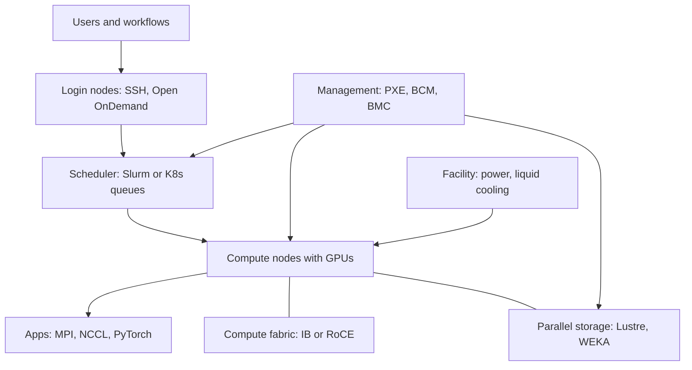

# 6.1 What a supercomputer is: TOP500, Linpack, HPC versus AI factory

| Field | Value |
|---|---|
| Level | Beginner |
| Priority tier | 1 |
| Lab venue | Any machine with Python 3; `flops_lab.py` runs 3 checks locally and cluster CLI commands are **untested** here |
| Part | Part 6: HPC and Slurm |
| Status | Drafted |

## Why this matters for AI infrastructure

Imagine a training run that was fast last week and crawls tonight. Nothing has crashed, and no alert has fired. Every GPU dashboard looks fine when you check it one at a time. The slowdown is spread across thousands of accelerators, and the cause is one slow link or one throttled node somewhere in the fabric. To find it, you have to think about the whole machine, not one server at a time.

That is the core idea of this chapter. If you walk onto the data center floor where a large language model is training, you are standing inside a supercomputer. Thousands of GPUs run in liquid-cooled racks, linked by a dedicated InfiniBand or RoCE fabric. The accelerators read training data from a parallel file system, and they take their orders from a central batch scheduler. Nearly every tool and habit that keeps such a cluster productive came from high-performance computing, or HPC. Slurm queues, collective communication, environment modules, pre-job health checks, node draining, and fair-share accounting were all built by HPC engineers over several decades. When you understand what HPC measures and why a supercomputer behaves like one synchronized machine, you can diagnose cluster-wide slowdowns. You can also explain what you found to people in a production war room.

## Prerequisites and outcomes

You need Part 1 for Linux administration and Part 2 for networking basics. You do not need anything more exotic than that. Every new term is explained the first time it appears, so if a word is unfamiliar, it is just the next thing to learn.

Once you have read the chapter, use this list as a self-check. Each line describes something you should now be able to do in your own words:

- Define a supercomputer from the operator's point of view. It is a single synchronized complex, not a price tag or a rank on a list.
- Explain hardware parallelism and vector pipelining, use the cycle formula `K*(N-1)+S`, and name the nine levels of parallelism across a cluster.
- Compute a theoretical peak from clock speed and instruction width, and explain why the real, achieved number is always lower.
- Say what TOP500, HPL, HPCG, HPL-MxP, Green500, Graph500, IO500, and MLPerf measure, and what each one leaves out.
- Compare a traditional HPC center with an AI factory on workloads, precision, networks, storage, scheduling, and power.
- Tell high-availability, high-productivity, and high-performance clusters apart, and say what each one does when a node fails.
- Describe what it means to run a supercomputer at 80 to 100 percent utilization, including power-on surges and command-line fleet checks.

## 1. What "super" means: a single synchronized complex

Suppose you have just inherited a hundred Linux servers racked in a cold room. In an ordinary office, nobody panics if one server loses half its memory or a network switch fails. You swap in a spare switch, or you let people print their reports on another floor for a few days while you wait for parts. On a compute cluster, the same casual swap does real damage. Replace a broken InfiniBand switch with a slower Gigabit Ethernet one, or swap an 8 GB compute node for a 4 GB node, and every multi-node job that touches that rack slows to a crawl. Users flood your ticket queue, and they are right to. A tightly coupled parallel job runs at the speed of its slowest participant, the same way a group of students cannot finish a relay race faster than their slowest runner.

Nobody has written an official definition of a supercomputer. Engineers use three working definitions, and the one they pick depends on their job:

1. By rank or cost: a machine near the top of a published list, or one that costs tens or hundreds of millions of dollars. That headline number interests executives, but it tells you nothing about how to run the machine.
2. By capability: a system whose total performance is far beyond what any single server can deliver. It gets there by running one parallel program across many processors that exchange data quickly.
3. By operational shape: a shared, expensive, tightly integrated complex, where overall synchronization, fabric health, storage throughput, and software consistency decide whether useful work comes out.

The third view is the one that matters to an administrator. A supercomputer is more than a big pile of expensive servers, switches, and disks. Think of it like a symphony orchestra. Each musician can play well alone, but the music only works when every section keeps time with the others. One violin section that drags behind spoils the whole performance, even if every violinist is excellent. Your most important job is to understand those connections and keep the whole orchestra in time. Because the complex usually works together on one huge task, a small imbalance in one component can noticeably drop the performance of the whole system.

Three technical properties appear in every real supercomputer:

- Scale-out parallelism: performance comes from many cores, many nodes, and many accelerators working together on one problem, rather than from one very fast core.
- Fast, low-latency interconnect: processors must exchange messages in microseconds, with high bandwidth. This is what separates a supercomputer from a loose farm of independent servers.
- Shared infrastructure: a parallel file system, a central batch scheduler, a uniform software stack, and a centralized management plane coordinate the whole fleet.

### Parallelism, pipelining, and the nine levels of cluster parallelism

Every modern supercomputer gets its speed from doing many things at once. Parallel processing has been the main route to high performance since the early days of computing, and your laptop uses the same idea. Simultaneous multithreading, such as Intel HyperThreading or AMD SMT, lets two or more threads of one program run at the same time. Phones and cameras are multicore too. The rule underneath is simple. If two operations are independent, meaning neither one needs the other's result, the hardware can run them at the same time.

Inside a processor, this rule takes two classic forms. The first is plain parallelism. Separate hardware units carry out different instructions at the same moment. Picture a kitchen with several cooks, where one cook chops onions while another stirs the sauce. If the variables `a`, `b`, and `c` already sit in the processor, the commands `x=a+b` and `y=b*c` can run independently, provided the chip has a separate adder and a separate multiplier. GPUs take this idea much further, running thousands of small cores that all execute the same code on different pieces of data.

The second form is pipelining. Here one operation is cut into stages, and each stage has its own piece of hardware. Think of a car factory, where one station welds, the next paints, and the next fits the seats. Several cars are in the factory at once, each at a different stage. Vectorization relies on this idea most often. It applies one operation across a row of data called a vector, as AVX vector instructions do.

Let us walk through a vector addition step by step. Suppose the elements sit one after another in memory, and every element gets the same operation. The hardware can split a floating-point addition into stages: load the numbers from memory, normalize the mantissas, add, correct, and write the result back. Once the first element has left the first stage, the second element can enter it right away. You do not wait for element one to finish completely before you start element two.

Now the arithmetic. Suppose the slowest stage of that line takes `K` clock cycles, and the whole pipeline takes `S` cycles from start to finish. Processing a vector of `N` elements takes this many clock cycles:

```text
Total cycles = K * (N - 1) + S
```

Read the formula in two parts. The first element needs all `S` cycles, because it has to pass through every stage. That first wait is called the pipeline fill time. After the fill, a new result leaves the line every `K` cycles. In modern processors `K` is usually `1`, so each new element adds just one cycle. Take the five-stage example, where `S = 5` and `K = 1`. Processing 100 elements takes `1 × (100 - 1) + 5`, which is `104` cycles. Doing the same work without a pipeline would take 500 cycles, because each element would need all five stages before the next one could start.

Pipelining and vectorization are different ideas, so do not merge them in your head. Vectorization does not need a pipeline, and a pipeline does not need vectors. A pipelined scalar adder can serve a run of ordinary additions just as well.

Parallelism also reaches past the cores and into memory and I/O. Memory banks on a motherboard are independent channels, not just physical slots, so they can work at the same time. Suppose your board has four memory banks. Four slots with 8 GB each, one module per bank, beats a single 32 GB module in one slot. While the memory controller is still working on the first bank, it can already start on the second. Devices use the same trick through direct memory access (DMA) and offloading. The processor builds a block of data in memory, then tells the disk or network controller to move it. The processor is then free to do other work while the controller handles the transfer.

Does a parallel program always run faster just because it is parallel? No, and it can even run slower. Parts of the code that should run side by side may fight over the same memory, which stops the cache from working well. Two threads that touch different sections of memory can still interfere with each other through the shared cache. Or the processes may spend most of their time waiting for the slowest of them. Finding the real cause is hard. You need performance tools such as profilers, tracers, and node monitors to see it. An administrator should know all nine levels of hardware and software parallelism in a cluster, because they make a good checklist when a job runs slowly:

1. `[HW]` multiple memory banks operating independently across channels.
2. `[HW]` multiline CPU cache hierarchies.
3. `[HW]` multiple CPUs on a motherboard.
4. `[HW]` multiple CPU cores inside one processor chip.
5. `[HW]` multiple functional execution devices inside one CPU core.
6. `[HW]` accelerators, such as GPUs and FPGAs.
7. `[HW]` network devices with DMA and protocol offloading features.
8. `[SW]` multiple UNIX processes and threads on one server, such as OpenMP threads in one process.
9. `[SW]` multiple servers running one parallel program across nodes using MPI for message passing, plus CUDA or OpenACC on accelerators.

When a parallel program is slow, but the MPI environment starts without errors, walk down this list from top to bottom. A classic culprit sits near the bottom. Someone has configured MPI to send its messages over the slow Ethernet management network, when they should be using the fast InfiniBand fabric. Nothing errors out. The job just runs slowly, and it looks normal until you check which network it actually used.

**Treat a supercomputer as one synchronized machine where every memory bank, core, accelerator, and network link is balanced.** And always check which network fabric a slow parallel job is really using.

## 2. Measuring speed: FLOPS, precision, peak and achieved

Picture an executive briefing on a new GPU cluster. Someone announces that the system delivers "an exaflop of compute." It sounds impressive, and it is almost meaningless until you ask what kind of arithmetic that number counts. An exaflop of 64-bit scientific simulation and an "AI exaflop" of 8-bit tensor arithmetic describe very different hardware. If you accept the headline without asking, you can get your job runtimes and capacity plans wrong by more than a factor of ten. Think of it as a car's top speed. A car that reaches its best speed downhill, with a tailwind, on a special track is not the same as a car you can drive all day on your daily commute.

FLOPS stands for floating-point operations per second. A floating-point operation is one arithmetic step on a number with a decimal point, such as adding two decimal numbers together. The prefixes scale the count. Giga means 10^9, tera means 10^12, peta means 10^15, and exa means 10^18. Modern processors and GPUs pack far more low-precision arithmetic units onto the silicon than double-precision units. Because the answer depends so much on precision, every FLOPS rating must come with its precision. The table pairs each precision with the work it usually serves.

| Precision | Typical workload | Hardware execution notes |
|---|---|---|
| `FP64` (double) | Traditional physics simulation and the TOP500 Linpack benchmark | Highest silicon cost per operation; many AI-focused GPUs execute `FP64` at a small fraction of their tensor rate |
| `FP32` (single) | Graphics, CAD, legacy simulation, and older ML models | Standard single-precision baseline |
| `TF32`, `BF16`, `FP16` | Mixed-precision deep-learning training and fine-tuning | Matrix Tensor Core paths deliver an order of magnitude more throughput than scalar `FP64` |
| `FP8`, `FP4` | Frontier LLM training and high-throughput inference | Highest floating-point rates; accuracy is maintained via per-block scaling factors in Parts 10 and 15 |
| `INT8`, `INT4` | Quantized model inference | Integer matrix pipelines |

Notice the trade-off in the table. FP64 costs the most silicon per operation, while FP8 and FP4 give the highest rates. That is why a GPU can look modest in the FP64 column and still be the right machine for an AI workload that runs in BF16.

Whenever someone quotes a cluster FLOPS figure, ask three questions right away. What precision is it? Is it dense or sparse? And is it a theoretical peak, called Rpeak, or a result that was actually measured, called Rmax?

Rpeak is the ceiling. It is the rate the cluster would reach if every arithmetic unit on every chip finished a full instruction on every clock cycle, with no waiting at all. Think of it as the speedometer's maximum, which you will never hold for a whole trip. For a CPU cluster, you work out Rpeak by multiplying the hardware counts together:

```text
Rpeak (GFLOP/s) = nodes * sockets * cores * GHz * FP64 FLOPs per cycle per core
```

For an accelerator cluster, you multiply the number of GPUs by the vendor's per-GPU peak for the precision you care about. Rmax is the measured number. It is the best sustained rate achieved while running the High-Performance Linpack benchmark. Divide Rmax by Rpeak and you get the cluster's HPL efficiency. That ratio is always below 100 percent in the real world. Programs spend time waiting for memory, waiting for the network, waiting for the slowest node, and sometimes slowing down because the chips get too hot or hit a power cap. Well-tuned HPL runs on GPU clusters often reach well over half of Rpeak. One misconfigured fabric or one overheating node can pull Rmax down sharply.

### A calculator you can run

Running `code/part06/flops.py` shows how precision and efficiency change the numbers. The core is two small functions and one example:

```python
def rpeak_cpu(nodes, sockets, cores, ghz, flops_per_cycle):
    """GFLOP/s peak = nodes * sockets * cores * GHz * FLOPs/cycle/core."""
    return nodes * sockets * cores * ghz * flops_per_cycle

def gpu_cluster_peak_pflops(nodes, gpus_per_node, tflops_per_gpu):
    return nodes * gpus_per_node * tflops_per_gpu / 1000.0

g = rpeak_cpu(nodes=100, sockets=2, cores=64, ghz=2.4, flops_per_cycle=32)
print(f"CPU cluster Rpeak: {g/1000:.1f} TFLOP/s")
```

Run `python3 code/part06/flops.py`, and the script works through a 100-node dual-socket CPU example. That example assumes 32 FLOPs per cycle, which comes from dual AVX-512 FMA units. It also models an illustrative 800-GPU cluster, using round placeholder rates of 60 TFLOP/s in FP64 and 1000 TFLOP/s in dense BF16. The output looks like this:

```text
CPU cluster Rpeak: 983.0 TFLOP/s (or 491.5 TFLOP/s at 16 FLOPs/cycle)
GPU cluster Rpeak: 48.0 PFLOP/s
HPL efficiency if Rmax=38 PF: 79%
AI peak (BF16 dense, illustrative): 800 PFLOP/s; at 40% MFU: 320 PFLOP/s
Vector pipeline N=1000: 1004 cycles vs 5000 unpipelined (4.98x)
```

Read the output as a range, not as one answer. The same 800-GPU cluster has a theoretical peak of 48.0 PFLOP/s in FP64, yet 800 PFLOP/s in illustrative dense BF16. The number you get to actually use is smaller again, once you apply the efficiency you really achieve. For the AI case, 800 PFLOP/s at 40 percent MFU gives 320 PFLOP/s, because 800 × 0.40 = 320.

MFU stands for model FLOPs utilization, and it is the AI version of HPL efficiency. Here is the plain meaning. Imagine a car that spends a third of the trip waiting at red lights. Its top speed did not change, but its useful speed did. MFU measures how much of the accelerator's peak goes into useful forward and backward math on the model. Time spent waiting on NCCL collectives, kernel launch gaps, or the dataloader does not count toward it. Large distributed training jobs routinely land somewhere around 35% to 50% MFU. It may sound low, but a gain of five points matters a lot. On a big cluster, five more points of MFU can save millions of dollars in GPU time.

**Never accept a FLOPS figure without its precision, its sparsity mode, and its efficiency ratio.**

## 3. The lists and benchmarks

Picture a newly built cluster being handed over from the hardware integrator to your operations team. How do you prove that all thousand nodes, cables, power supplies, and cooling loops really work together under full load? Running `nvidia-smi` on each node only shows that the GPUs turned on. It says nothing about whether the fabric carries full traffic, or whether the cooling keeps up once every node is busy. So the community uses standard benchmark suites. They rank the world's largest machines, and they burn in new clusters before users arrive.

Each benchmark is good at one thing and blind to others. Think of a car review. A test on a smooth race track tells you about top speed. A drive through city traffic tells you about the stop-start driving you actually do. Neither test replaces the other. The table lists what each benchmark measures and what it leaves out.

| Benchmark / list | What it measures | What it leaves out |
|---|---|---|
| **TOP500** (published twice a year in June at ISC and November at SC) | Ranks the 500 fastest known systems by achieved `Rmax` on HPL in `FP64` | Everything except dense linear algebra; low-precision AI speeds, storage I/O, and real multi-job application mixes |
| **HPL** (High-Performance Linpack) | Solves a large dense linear system `Ax = b` using LU factorization in `FP64`; stresses compute units, power, cooling, and regular collective communication | Memory-bandwidth-bound sparse kernels, irregular graph communication, and file system I/O |
| **HPCG** (High Performance Conjugate Gradients) | Solves a sparse linear system dominated by irregular memory access, pointer chasing, and global reductions; typically achieves only a few percent of `Rpeak` | Still a single synthetic mathematical kernel, though much closer to real PDE simulation codes than HPL |
| **HPL-MxP** | Solves the Linpack problem using mixed-precision tensor arithmetic with `FP64` iterative refinement | Pure low-precision inference or transformer attention patterns |
| **Green500** | Re-ranks the TOP500 systems by energy efficiency in GFLOP/s per watt | Facility overhead outside the compute racks and idle power draw |
| **Graph500** | Measures data-intensive graph traversal in traversed edges per second | Dense matrix compute |
| **IO500** | Ranks parallel storage systems using standardized `IOR` bandwidth and `mdtest` metadata benchmarks in Chapter 6.28 | Compute and accelerator performance |
| **MLPerf Training & Inference** (MLCommons) | Measures wall-clock time to train reference AI models to a target accuracy, or inference throughput and latency under strict quality constraints | Customer-specific data pipelines; vendor submissions use heavily tuned software stacks |

Read the last column as carefully as the first. A top score on one benchmark tells you nothing about the areas it skips. A system can sit near the top of the TOP500 and still have a storage tier that cannot feed its dataloaders.

For an infrastructure engineer, these benchmarks are acceptance tests and diagnostic tools, not crystal balls. HPL pushes every GPU and CPU to full power draw while the fabric carries data between them. That is why a bad optical transceiver or a throttling cooling loop often shows up first in an HPL run. If a cluster falls short of its expected HPL efficiency, the cause is almost always a degraded optical transceiver, a misconfigured routing table, a throttling cooling loop, or a sick node. Chapter 6.28 walks through running HPL, HPCG, IOR, OSU, and NCCL tests during cluster acceptance.

Keep three caveats in mind when you quote public rankings in an interview:

1. Many large AI clusters never submit. Hyperscalers and AI labs often skip TOP500 submissions, either for competitive reasons, or because taking a large GPU training cluster offline for days of FP64 Linpack tuning costs too much.
2. TOP500 rewards FP64 double-precision arithmetic. Modern AI factory designs deliberately spend silicon on low-precision Tensor Cores instead of maximizing FP64.
3. Exascale has a strict meaning: 10^18 sustained FP64 operations per second on HPL. Publicly ranked systems first passed that milestone in the early 2020s. Always check the current June or November lists at `top500.org` and `mlcommons.org` before you quote a specific rank.

**Use HPL, HPCG, IO500, and MLPerf as burn-in acceptance tests, so that fabric, thermal, and storage flaws show up before you hand a cluster to users.**

## 4. Traditional HPC versus the AI factory

Suppose an experienced HPC systems administrator moves onto an LLM training platform team. On day one, the room looks familiar. There are liquid-cooled racks, InfiniBand switches, a Lustre or WEKA parallel file system, and Slurm running batch jobs. By Friday, the differences are obvious. In a traditional center, two hundred scientists run two hundred different Fortran and C++ programs, each on a few dozen nodes. On the AI platform, one foundation-model pre-training job may hold four thousand GPUs for six weeks straight. That job floods the fabric with huge collective operations, and it writes multi-terabyte checkpoints every few hours.

Both traditional HPC centers and AI factories are tightly coupled parallel machines. They still differ in ways that change how you operate them. The table shows where those differences matter most to an operator.

| Dimension | Traditional HPC center | AI factory / training & serving cluster |
|---|---|---|
| **Primary workloads** | Physical simulation in C, C++, and Fortran using MPI and OpenMP | Neural-network pre-training, fine-tuning, data curation, and inference serving in Python with PyTorch/JAX and NCCL |
| **Numerical precision** | Heavy `FP64` double precision | Heavy `BF16`, `FP16`, `FP8`, and `FP4`; `FP64` is rarely used |
| **Parallelism & traffic** | 3D domain decomposition; MPI point-to-point halo exchanges and small-message global reductions | Data, Tensor, Pipeline, Expert, and Context parallelism; massive AllReduce, AllGather, ReduceScatter, and AllToAll elephant flows |
| **Job distribution** | Wide mix: hundreds of small to medium jobs from many researchers, plus occasional hero runs | Bimodal: a few monolithic training jobs spanning thousands of GPUs for weeks, alongside interactive fine-tuning and 24/7 inference services |
| **Interconnect** | InfiniBand, Slingshot, or custom torus/dragonfly/fat-tree fabrics | Rail-optimized InfiniBand or RoCEv2 Ethernet fat-trees with GPUDirect RDMA, plus intra-rack NVLink and NVSwitch domains in Part 12 |
| **Storage pattern** | Parallel file systems such as Lustre and GPFS for scratch, home, and simulation dumps; heavy POSIX metadata | High-throughput streaming reads for dataloaders plus periodic, synchronous multi-terabyte checkpoint write bursts in Part 13 |
| **Orchestration** | Slurm, PBS, or LSF with deep fair-share trees and project allocation accounting | Slurm with Pyxis and Enroot for large training pools, or Kubernetes with Kueue, KAI, or Volcano for unified training and inference |
| **Software packaging** | Environment modules, Spack, EasyBuild, and bare-metal compiler toolchains | OCI containers built from NGC base images |
| **Failure recovery** | Periodic checkpoint/restart; moderate node count per job keeps per-job MTBF manageable | At thousands of GPUs per job, hardware faults happen every few hours or days; automated health checks and sub-minute checkpointing are mandatory |
| **Primary north-star metric** | High overall node utilization and fair queue turnaround across a broad user community | High MFU, minimum time-to-train, and lowest **cost per token** or **tokens per watt** |
| **Facility envelope** | `15` to `40 kW` per rack with air or rear-door heat exchangers, plus liquid cooling on flagship systems | `40` to `130` kW or more per rack; direct-to-chip liquid cooling and megawatt power feeds are the primary deployment constraint in Chapter 6.30 |

Start reading the table at the failure-recovery and north-star rows. They explain most of what follows. At thousands of GPUs per job, hardware faults arrive every few hours or days, and no one can babysit that by hand. That is why the table calls automated health checks and sub-minute checkpoints mandatory. Slurm's health checks, its drain logic, and its checkpoint-aware scheduling all exist because of that failure rate.

The phrase "AI factory" describes a shift in how data centers are planned. A traditional cluster is like a public library, where many different people check out books and nobody needs the whole collection at once. An AI factory is more like a manufacturing plant. Its raw inputs are megawatts of electricity and petabytes of training data. Its outputs are trained model weights and served tokens. Planners measure it by output per unit of power, not by how many jobs can run at once.

Still, HPC and AI have more in common than the contrast suggests. If you can keep an HPC cluster's fabric clean, its parallel storage fast, and its Slurm scheduler healthy, you already have most of the core skills to run an AI factory.

**Bring HPC's discipline in gang scheduling, fabric hygiene, and pre-job health checks into your AI clusters.** Then add fast container delivery and automated fault recovery for jobs that span thousands of GPUs.

## 5. Kinds of clusters and custom supercomputers

When people say "cluster," they mean many computers working together as one system. Clusters differ mainly in how tightly their nodes are coupled, and that coupling decides what happens when one node dies. Keep that question in mind as you read this section: "If one node fails, what happens to the work?"

### The three classic cluster types: HA, high-productivity, and HPC

There are three classic types, and each one answers that question differently.

1. High-availability and load-balanced service clusters. Their job is to keep a resource available, such as a website, a database, or an inference API, with as little latency as possible. Think of a restaurant with two chefs. If one chef goes home sick, customers still get fed, because the other chef takes the orders. These clusters are usually paired with load balancing, A/B or canary tests, and continuous deployment. If one node fails, clients reconnect and reach the service on another node. Cloud computing works on a similar principle. You do not know which physical server will run your image, because the platform picks free capacity for you.
2. High-productivity clusters, which include high-throughput computing (HTC) and Grid clusters. Here, one big job is broken into independent pieces, like a laundry where every sock is washed on its own. If a machine fails, its unfinished sock goes to another machine, and new machines that join simply take the pieces that have not been done yet. Classic examples are Grid computing and projects like SETI@home and Folding@home. Only tasks that split into independent parts fit this model. A dedicated data center is often unnecessary, because home computers or ordinary servers connected over a LAN or the internet can do the work well.
3. HPC clusters, including tightly coupled AI training. Unlike the first two types, the failure of one node in an HPC cluster usually stops the whole parallel program. Think of a relay race. If one runner falls, the baton cannot be passed on, and the team stops. Only in rare cases does the job carry on from a saved checkpoint. Because of this tight coupling, HPC clusters are far more sensitive to faults, and they cannot run without strict control and monitoring. The nodes connect through high-speed, low-latency networks and high-performance parallel file systems. The processes exchange messages constantly, so the delay of each message, which is latency, matters as much as the total data rate. On a high-latency network, a parallel program can run many times slower than on a low-latency fabric.

The table compares the three types on the points that matter when a node fails. The last column gives examples of each type.

| Cluster type | Primary goal | Inter-node coupling | Effect of a single node failure | Typical examples |
|---|---|---|---|---|
| **HA / load-balanced cluster** | Continuous service uptime and low request latency | Loose or replicated state | Traffic fails over transparently to surviving nodes | Web tiers, HA database pairs, stateless LLM inference replicas |
| **High-productivity (HTC / Grid)** | Complete a massive batch of independent tasks | None between worker tasks | Only the failed node's task slice is retried elsewhere | `SETI@home`, `Folding@home`, genomics sweeps, data preprocessing |
| **HPC / AI training cluster** | Run one tightly coupled parallel program as fast as possible | Tight microsecond message passing | Entire multi-node job aborts and must restart from a checkpoint | Weather forecasting, CFD, multi-node LLM pre-training |

The same failure question also tells you which scheduler and fault design fits. The *AI Factory* book describes cloud, fog, and edge tiers as well. In plain terms, cloud sites are large and far away, and they suit big training runs. Edge and fog sites sit close to users and devices, and they suit inference that cannot wait for a long round trip. Those tiers describe where work lives. They do not change the coupling rules inside one training cluster.

### Clusters versus custom vendor supercomputers, farms, and Beowulf systems

Does a supercomputer always mean a cluster? No. A cluster is valuable partly because you can build it from parts you buy off the shelf. With enough experience, you can assemble one yourself.

A supercomputer used to be something else entirely: a product built from unique, proprietary parts by a single vendor. Take IBM's Blue Gene series. Its architecture looks like a cluster and uses similar software tools. But you could only buy a Blue Gene from IBM or its distributors, because its key parts were never sold separately. Custom systems like this are rare now, though NEC Tsubasa is one example that still exists. At the other end of the range sit computing farms, which are groups of computers working on separate tasks without sending data to each other, and Beowulf systems, which are put together from improvised commodity PCs. The line between a cluster and a non-cluster is clear. Nearly all modern supercomputers, however, are clusters that have been upgraded with fast networks and synchronization hardware.

**Match your orchestrator and fault-tolerance design to how tightly coupled the workload is.** Use gang scheduling and fast checkpoints for tightly coupled HPC and NCCL jobs. Use stateless failover or task retries for HA and HTC pools.

## 6. What "super" means to the administrator

A user who submits a job script sees one giant virtual computer with a huge memory and tens of thousands of cores. You, the administrator on call, know the illusion holds together only because eight strict rules apply to every node in the fleet. Think of a choir. The audience hears one voice, but only because every singer holds the same pitch and keeps the same tempo. When one singer drifts, the sound changes in a way that is hard to trace from the audience. The table lists the eight rules. Each one maps to a chapter, so you can read the detail when you need it.

| # | Invariant | What it means |
|---|---|---|
| 1 | Identical software state | Every compute node runs the exact same OS image, kernel patch level, GPU driver, and NIC firmware. |
| 2 | Synchronized time and identity | Clocks are synchronized via `chrony` or NTP, and every username maps to the exact same numeric UID and GID everywhere in Chapter 6.24. |
| 3 | Predictable naming and networking | DNS, `/etc/hosts`, DHCP and PXE boot, the out-of-band management network, and the high-speed compute fabric all resolve and route cleanly. |
| 4 | Uniform shared storage | Parallel and home file systems are mounted at identical paths with enforced user and project quotas in Chapters 6.18 to 6.21. |
| 5 | Centralized scheduling and accounting | Users never log into compute nodes directly to start work; the batch scheduler places every job, isolates it in cgroups, and logs usage in Chapters 6.7 to 6.15. |
| 6 | Comprehensive observability | Automated monitoring tracks node health, temperatures, power supplies, air conditioning, UPS units, fabric symbol errors, and GPU faults in Chapter 6.26. |
| 7 | Repeatable provisioning | Automated image deployment and configuration management ensure a replacement server boots into an identical state within minutes in Chapter 6.22. |
| 8 | Spares and SLA discipline | Unless hardware has built-in redundancy, you maintain an on-site emergency stock of key spares and vendor service agreements with clearly defined replacement SLAs. |

Take invariant 2 as an example. If one node's clock drifts by a few seconds, a job that expects its ranks to agree on time may misbehave in ways that look like application bugs. If one node maps a username to a different UID, a user may suddenly be unable to read their own checkpoint. These are small faults with large effects, and that is why the table treats them as rules rather than suggestions.

### Why office IT habits fail in a supercomputer data center

At first glance, a large cluster looks like many office computers joined by a local network and a few storage servers. In practice, four differences separate a supercomputer from office IT. Each one breaks a habit that works fine in an office.

The first difference is density. Office PCs are spread across a building. A cluster is packed into a few square meters, or at most a few dozen. You cannot cool it by opening a window, and you cannot run it from ordinary wall sockets or a household UPS. In modern clusters, **the computing part can occupy less than a quarter of the total installation area**. The rest goes to power and climate equipment, covered in Chapter 6.30.

The second difference is utilization. An office PC needs a few minutes of work a day, to show a document or play a clip. For most of the day, it sits idle, waiting for a click. In a supercomputer, the normal state is 80 to 100 percent utilization on every node. So an idle node is not a comfort. It is usually a warning sign, pointing to a broken job, a stuck drain, or a scheduler that has stopped placing work.

The third difference is the I/O storm. In an office, if network traffic suddenly jumps a hundredfold and file shares crawl, everyone suspects a virus. In a cluster, every node busy at once, exchanging data or writing checkpoints to shared disk, is completely normal. Peak loads are the everyday state here, so the key services must be duplicated or spread across many servers from the start.

The fourth difference is how you learn about failures. In an office, when a server or a UPS dies, someone runs in shouting that their report is on fire. In a cluster, the worst case is hearing about a fault from users whose parallel job has stopped, or from a job that now fails two times out of three. You prevent that by monitoring everything, across the facility and the cluster alike.

### Power-on surge hazards and startup sequencing

Powering on is itself a peak load. In an office, people arrive at different times and turn their computers on one by one. Powering on a supercomputer all at once creates three serious hazards. Think of a street where every household switches on every kettle, oven, and heater at 7 a.m. The fuse blows, and the whole street goes dark.

1. Electrical inrush and boot-storm service overload: Switching a supercomputer on sharply increases its power draw, by dozens or even thousands of kilowatts. Right afterward, every compute node asks the storage and service nodes for data at nearly the same moment. If you turn everything on at once, the electrical installation can trip or even catch fire. Switching nodes on a few seconds apart can still cause network conflicts or flood a central service with requests. Staggering the boot in groups keeps both the electrical load and the request load within what the facility can absorb.
2. Multi-rack disk array spin-up torque and controller sequencing: In a large disk array spread across several racks, shelves and disks have to start in a specific order. That limits the starting current and keeps the spinning disks from shaking the rack. You must also power on the array components in the exact order the storage controllers expect. Otherwise the controllers may decide the array is broken, start a rebuild, or even mark it as dead.
3. Hot-corridor thermal baking: Server racks often face each other across a corridor and blow hot air into a shared hot aisle. If you switch them all on together, the fans of the servers that are not yet running give you no cooling for their neighbours. Turn them on at staggered intervals, so you do not overheat the opposing servers that are still off.

### Command-line fleet management and the "panacea" console trap

Many complicated cluster jobs come down to a few standard commands chained together. Most of the time, you do not need a special tool at all. The real effort is in learning each command well, and that takes time. After that, the command line becomes a toolbox that you can combine in many ways.

Even a small compute cluster is far bigger than a dozen servers, so graphical tools stop being practical. Suppose you need to know which servers failed to detect their full RAM after the last power-on. Opening a graphical system monitor on a hundred nodes and clicking the system tab on each one would take all day. Instead, you run one command across all of them with a parallel shell tool such as `pdsh` or `clush`:

```bash
# (untested here)
grep MemTotal /proc/meminfo | awk '{print $2}'
```

In a couple of seconds, you get the detected memory from every server. A few more shell commands, modeled in `filter_nodes_missing_ram()` in `code/part06/flops.py`, do the rest. They compare each node's value against the expected benchmark of `528,482,304` kB, within a 2% tolerance, and print only the nodes that fall short. Studying the *Advanced Bash Scripting Guide* helps, and so does combining `bash` or `zsh` with `grep`, `sed`, `awk`, `find`, `ps`, and Python or Perl. Together these tools multiply your speed many times over. Supercomputer users also need very different support from the people in the next office, a topic covered in Chapter 6.25.

After a few months of bulk work, every administrator starts to dream of one convenient console that does everything without scripts or copied terminal text. That dream often strikes when you look at enterprise management suites such as `HP OpenView` or `Zenoss`. You might find yourself thinking, "Here it is, the panacea." These products inventory equipment, track users and software, and automate routine tasks. You can adapt them for parts of your work.

They do solve only parts of the problem, though. Commercial and free enterprise consoles aim at tasks that overlap with supercomputing without being the same thing. Forcing them into specialized HPC work takes a huge investment of people, money, and time. Each time the supercomputer's configuration changes, you must redo that customization. Experience across many supercomputer centers shows that no universal all-in-one product exists. The market for supercomputer administrators is small, and custom tools are expensive to maintain. Instead, rely on flexible, extensible command-line tools, and document every operational and accounting process. The documentation does more than list steps. It shows the big picture, so you can adapt established processes quickly when conditions change.

**Automate fleet checks from the command line and enforce a staggered storage-first power-on sequence.** Monitor every facility and hardware metric proactively, so users never discover failures before you do.

## 7. The stack at a glance

The diagram shows how the pieces of a supercomputer connect, from the users at the top to the facility at the bottom. Read it from the top down. A request enters through a login node, passes to the scheduler, and lands on compute nodes. Those nodes depend on the fabric, the storage, the management plane, and the facility beneath them. The table after the diagram maps each layer to the chapters that cover it.



| Layer in diagram | Role in the supercomputer complex | Covered in |
|---|---|---|
| **Login nodes (`L`)** | User entry point for editing code, compiling, and submitting batch jobs (`ssh`, Open OnDemand) | Chapters 6.2, 6.25 |
| **Scheduler (`S`)** | Allocates nodes and GPUs exclusively, enforces fair-share and QoS, and launches parallel steps (Slurm, Kueue) | Chapters 6.7–6.17 |
| **Compute nodes & Apps (`C`, `A`)** | Execute parallel kernels across CPUs and GPUs (MPI, OpenMP, NCCL, PyTorch, Enroot) | Chapters 6.3–6.6, 6.12–6.13, 6.29 |
| **Compute fabric (`F`)** | Low-latency, high-bandwidth RDMA interconnect (InfiniBand, RoCEv2) | Chapter 6.12, Part 12 |
| **Parallel storage (`P`)** | High-throughput shared namespaces for datasets and checkpoints (Lustre, GPFS, BeeGFS, WEKA, VAST) | Chapters 6.18–6.21, Part 13 |
| **Management plane (`M`)** | Out-of-band BMCs (Redfish), PXE image provisioning (xCAT, Warewulf, BCM), LDAP, and monitoring | Chapters 6.22–6.27, Parts 7 & 8 |
| **Facility (`FAC`)** | High-density power distribution, UPS, chillers, and direct-to-chip liquid cooling | Chapter 6.30, Part 9 |

When you trace a failure, start by finding its layer, and then use the table to find the chapters for that layer. A slow job whose GPUs look healthy usually points to the fabric or the storage layer, not to the accelerators themselves.

## 8. Common misconceptions

Here are five beliefs you will hear often. Each one sounds reasonable until a real job proves it wrong.

- "A supercomputer is one giant computer." Physically, it is hundreds or thousands of separate Linux servers. The high-speed fabric, the parallel file system, and the batch scheduler make them behave as one system.
- "More FLOPS means my job will run faster." That holds only if your code uses the precision the headline number assumes. Your job also has to avoid being held back by memory bandwidth, network latency, or storage I/O.
- "A TOP500 rank proves AI capability." TOP500 measures FP64 dense LU factorization on HPL. Evaluate AI clusters with MLPerf, NCCL tests, and your real training or inference workload.
- "Cloud VMs are identical to a supercomputer." Cloud providers can host true supercomputer clusters. You need bare-metal or passthrough GPU instances, placed in a compact placement group with RDMA fabrics. Ordinary unplaced VMs on a shared TCP network suffer severe latency penalties, as Chapter 1.27 explains.
- "Replacing a failed component with a slightly slower spare is fine for now." In a tightly coupled cluster, one node with less RAM or a slower network link drags down every multi-node job that lands on it.

## 9. Lab (no cluster required)

Start with the self-checking Python lab, which runs on your own machine. It is the safest place to build your intuition. Run `code/part06/flops_lab.py` locally. It verifies the vector pipeline cycle equation `K*(N-1)+S`. It also checks the CPU and GPU Rpeak, HPL efficiency, and BF16 MFU calculations. Finally, it tests the fleet-wide `/proc/meminfo` `MemTotal` anomaly filter:

```bash
python3 code/part06/flops_lab.py
```

The cluster commands in this chapter have not been run on a live cluster. The steps below use only your own machine and public web pages.

Then work through these hands-on steps.

1. Open `code/part06/flops.py` and run `python3 code/part06/flops.py`. Change `flops_per_cycle` from `32` to `16`. That simulates a CPU without dual AVX-512 FMA units. Rpeak should drop from `983.0` to `491.5` TFLOP/s. Ask yourself why halving the instructions per cycle halves the ceiling.
2. Call `vector_pipeline_cycles(1000, 1, 5)` and compare the pipelined count of `1004` cycles with the `5000` unpipelined cycles. Then check that the `4.98x` speedup printed by `code/part06/flops.py` matches.
3. Test `filter_nodes_missing_ram()` with a 10-node dictionary. Suppose one node lost one of its eight `64 GB` DIMMs on boot. That node reports `448 GB` instead of `512 GB`, so a 2% tolerance threshold flags it straight away.
4. Look up the current June or November TOP500 and Green500 lists online (not run here). Record the number-one system's Rmax, Rpeak, HPL efficiency, and power in megawatts.

## 10. Interview angles

Use these questions to test yourself. Answer each one in your own words before you check the sections above.

- Define a supercomputer in two sentences from a system administrator's perspective. What separates it from a 1,000-node web farm?
- Walk through the nine levels of hardware and software parallelism in a cluster. If an MPI job launches cleanly on 64 nodes but runs ten times slower than expected, what is the first configuration mistake you check?
- Explain the difference between Rpeak, Rmax, and MFU. Why is HPCG efficiency only a few percent of Rpeak when HPL reaches 60% to 80% or more?
- Why do powering on a multi-rack storage array and a hot-corridor compute cluster require a strict startup sequence?
- How do you verify in three seconds that all 500 compute nodes detected their full physical RAM after a power outage?

## Exercises

Try these on paper first, and only check your answers after you have written yours. Each question is short on purpose.

1. Start with pipelining and memory banks. Use `vector_pipeline_cycles()` in `code/part06/flops.py` to find how many clock cycles a five-stage vector adder needs for `N = 100` elements. Use `S = 5` and `K = 1`. How many cycles would `500` unpipelined elements take? Why do four `8 GB` RAM modules in four independent memory banks outperform one `32 GB` module in one slot?
2. Work through the nine levels of cluster parallelism. Name all seven hardware levels. Then name the two software levels. Why can a parallel MPI program run slower than a sequential one? Think about threads that compete for cache. Think about MPI traffic that goes over the Ethernet management network instead of InfiniBand.
3. Use the functions in `code/part06/flops.py` to work out Rpeak, Rmax, HPL efficiency, and MFU. Start with the FP64 Rpeak of a 100-node CPU cluster, using `rpeak_cpu()` and `gpu_cluster_peak_pflops()`, and `hpl_efficiency()` for the efficiency step. It has two sockets, 64 cores per socket, and 2.4 GHz. What is the answer with 32 FLOPs per cycle? What is it with 16? Next, calculate the HPL efficiency with Rmax at 38 PFLOP/s. Then do it again at 48.0 PFLOP/s. Finally, what sustained BF16 rate does an 800-GPU cluster reach at 40% MFU?
4. Compare HA, HTC (SETI@home and Folding@home), and HPC clusters. Start with inter-node coupling. Then ask what one node failure costs in each type. Next, what is the difference between a commodity COTS or Beowulf cluster and a single-vendor custom supercomputer, such as IBM Blue Gene or NEC Tsubasa? Finally, where do the cloud, fog, and edge tiers fit for training and for low-latency inference?
5. Why do compute racks often take up less than a quarter of a supercomputer's total floor area? Why do the racks run at 80 to 100 percent continuous utilization? Describe the three physical startup hazards when you power on a cluster after an outage. These are the electrical and network request surge, disk shelf spin-up torque with controller ordering, and hot-corridor overheating.
6. Write the `pdsh` or `clush` command that uses `grep MemTotal /proc/meminfo | awk '{print $2}'` to audit physical memory across one hundred nodes after boot. How does `filter_nodes_missing_ram()` in `code/part06/flops.py` find nodes with missing DIMMs, within a two percent tolerance? Why are enterprise GUI suites such as `HP OpenView` and `Zenoss` not a universal panacea for supercomputer administration? Use *Supercomputers for Linux SysAdmins* Chapters 1 and 2 as your sources.

## Checkpoint questions (20)

<details>
<summary>1. What are the three working definitions of a supercomputer, and what does "super" mean to the Linux administrator who operates one?</summary>

There are three working definitions: by rank or cost, by capability, and by operational shape. By capability means solving one large problem through parallel execution across many processors. To the administrator, "super" means overall synchronization across one tightly integrated complex. Every server, switch, storage array, and software layer must line up and be tuned together. Even a slight imbalance on one node degrades the whole complex.
</details>

<details>
<summary>2. What is the difference between hardware **parallelism** and **pipelining** inside a processor?</summary>

Parallelism means separate hardware units run different independent instructions at the same time. For example, an adder can compute `x=a+b` while a multiplier computes `y=b*c`. Hundreds of GPU cores can run the same kernel together. Pipelining is different. It splits one operation into sequential stages, such as load, normalize mantissas, add, correct, and write. The stages work like a conveyor belt, so several elements are in flight at different stages at once. AVX vector instructions work this way.
</details>

<details>
<summary>3. Write the cycle formula for processing a vector of `N` elements through a pipeline whose slowest stage takes `K` clock cycles and whose full pipeline length is `S` cycles.</summary>

```text
total cycles = K * (N - 1) + S
```
The first element finishes after `S` cycles. That wait is the pipeline acceleration time. Each later element finishes one every `K` cycles. In modern processors `K` is typically `1`. For example, with `S = 5`, `K = 1`, and `N = 100`, the total is `104` cycles.
</details>

<details>
<summary>4. Why does populating four `8 GB` RAM modules across four motherboard memory banks perform better than installing one `32 GB` module in a single slot?</summary>

Independent memory banks work in parallel. While one word is being written or read on the first bank, the memory controller can start the next access on a second bank at the same time. If you put all `32 GB` into a single slot, every access goes through one bank, which serializes them.
</details>

<details>
<summary>5. List the nine levels of hardware (`[HW]`) and software (`[SW]`) parallelism in a compute cluster.</summary>

1. `[HW]` Multiple independent memory banks.
2. `[HW]` Multiline CPU caches.
3. `[HW]` Multiple CPUs (sockets).
4. `[HW]` Multiple CPU cores on a die.
5. `[HW]` Multiple functional devices inside one CPU core.
6. `[HW]` Accelerators such as GPUs and FPGAs.
7. `[HW]` Network devices with DMA and offloading.
8. `[SW]` Multiple UNIX processes and threads on a node (OpenMP).
9. `[SW]` Multiple servers running one parallel program across nodes (MPI, plus CUDA and OpenACC).
</details>

<details>
<summary>6. Why can a parallel program run **slower** than a sequential program, and what classic network misconfiguration slows down working MPI jobs?</summary>

Parallel code can run slower if you have threads on a node contending for different memory sections and thrashing the CPU cache. It can also run slower when processes spend most of their time waiting for data from the slowest process. A classic misconfiguration is MPI launching cleanly but routing inter-node messages over the slow Ethernet management network instead of the high-speed InfiniBand fabric.
</details>

<details>
<summary>7. Why must every FLOPS rating be accompanied by a numerical precision, and how do FP64, BF16, and FP8 compare on modern AI GPUs?</summary>

FLOPS counts floating-point operations per second. Modern GPUs put far more throughput into low-precision Matrix Tensor Cores (BF16, FP16, FP8, FP4) than into FP64 double-precision units. So if you compare a cluster's dense BF16 or FP8 peak with its FP64 TOP500 peak, you will often find the first is more than an order of magnitude higher.
</details>

<details>
<summary>8. Write the formula for a CPU cluster's theoretical peak (Rpeak), and compute Rpeak for `100` nodes with `2` sockets, `64` cores per socket, `2.4 GHz`, and `32` FP64 FLOPs per cycle per core.</summary>

Multiply the hardware counts together. For example, the 100-node cluster works out like this.

```text
Rpeak (GFLOP/s) = nodes * sockets * cores * GHz * FLOPs/cycle/core
```
For the 100-node cluster: 100 * 2 * 64 * 2.4 * 32 = 983,040 GFLOP/s, which is about **983.0 TFLOP/s**.
</details>

<details>
<summary>9. What is the difference between Rpeak, Rmax, and MFU?</summary>

- Rpeak is the theoretical maximum FLOP/s, reached only if every arithmetic unit runs on every clock cycle with zero stalls.
- Rmax is the highest sustained FP64 FLOP/s achieved on the HPL benchmark. If you divide Rmax by Rpeak, you get the HPL efficiency.
- MFU, model FLOPs utilization, is the AI counterpart to HPL efficiency. It compares useful model forward and backward FLOP/s with the accelerator's theoretical peak at the training precision.
</details>

<details>
<summary>10. What does HPL measure on the TOP500 list, when is the list published, and how does HPL-MxP differ?</summary>

- TOP500 / HPL: The list is published twice a year, in June at ISC and in November at SC. It ranks systems by Rmax on a dense linear system, written Ax = b and solved by LU factorization in FP64 double precision.
- HPL-MxP: It solves the Linpack problem with mixed-precision, low-precision tensor factorization (FP16 or BF16), then applies FP64 iterative refinement. That reflects AI hardware capabilities.
</details>

<details>
<summary>11. Why does HPCG typically achieve only a few percent of Rpeak on machines that score 60% to 80% efficiency on HPL?</summary>

HPL performs dense matrix-matrix multiplication with high arithmetic intensity. In plain terms, you can think of it as doing many FLOPs for every byte it reads from memory, which keeps the compute cores saturated. HPCG, the High Performance Conjugate Gradients benchmark, performs sparse linear algebra instead. It uses irregular pointer chasing, low arithmetic intensity, and frequent global reductions. So its speed depends on memory bandwidth and network latency more than on raw FLOPs.
</details>

<details>
<summary>12. What do Green500, Graph500, IO500, and MLPerf each measure?</summary>

- Green500 measures energy efficiency in GFLOP/s per watt.
- Graph500 measures data-intensive graph traversal throughput, in traversed edges per second.
- IO500 measures parallel storage bandwidth (`IOR`) and metadata rate (`mdtest`).
- MLPerf, from MLCommons, measures the time to train reference AI models to a target quality, along with serving throughput or latency under quality constraints.
</details>

<details>
<summary>13. Compare a traditional HPC center with an AI factory across workloads, numerical precision, and failure frequency.</summary>

- Workloads and precision: Traditional HPC runs many distinct C, C++, and Fortran physical simulations in FP64, using MPI and OpenMP. An AI factory runs Python, PyTorch, and NCCL foundation-model training and inference in BF16, FP8, and FP4.
- Failure frequency: A single AI training job can occupy thousands of GPUs at once for weeks. Its mean time between hardware faults drops to hours or days. That calls for fast asynchronous checkpoints and automated node draining.
</details>

<details>
<summary>14. Compare High-Availability (HA), High-Productivity (HTC / Grid), and High-Performance (HPC) clusters when a single compute node fails.</summary>

- HA cluster: Clients reconnect transparently to surviving nodes, and the service stays online.
- HTC / Grid cluster (SETI@home, Folding@home): Only the failed node's independent task chunk is lost. That chunk is reassigned to another node while the other nodes keep working.
- HPC / AI training cluster: Because all processes are tightly coupled and exchange messages synchronously, one failed node usually terminates the entire multi-node parallel program. The job then restarts from the last saved checkpoint.
</details>

<details>
<summary>15. How does a commodity cluster differ from a historical single-vendor supercomputer like `IBM Blue Gene` or `NEC Tsubasa`, and what is a `Beowulf` cluster?</summary>

A cluster can be assembled from commercially available off-the-shelf servers and switches sold on the open market. A Beowulf cluster is built from ordinary commodity PCs or improvised parts. A historical non-cluster supercomputer, such as IBM Blue Gene or NEC Tsubasa, uses proprietary processors, boards, and interconnects made by a single vendor. You cannot buy those parts separately to build your own machine.
</details>

<details>
<summary>16. Why do Slurm and Kubernetes fit different cluster models by default, and how are they bridged in AI platforms?</summary>

Slurm models a fixed pool of nodes that runs queued, finite batch jobs. It offers exclusive node and GPU allocation, gang scheduling, and fair-share accounting. Kubernetes models continuously running desired state across pods and load-balanced services. To gang-schedule tightly coupled training jobs, it needs batch add-ons such as Kueue, Volcano, KAI Scheduler, or JobSet. If you want Slurm on Kubernetes instead, Slinky and Soperator provide it, as Chapter 6.16 covers.
</details>

<details>
<summary>17. Contrast an office LAN with a supercomputer facility in terms of floor area allocation, normal node utilization, and synchronized I/O bursts.</summary>

- Floor area: In a modern supercomputer facility, the computing racks can occupy less than a quarter of the total floor area. Cooling and power equipment take up the remaining three-quarters.
- Utilization: An office PC sits idle 99% of the time. A supercomputer runs at `80–100%` node utilization continuously.
- Synchronized bursts: Hundreds of nodes blasting data across the network or writing checkpoints to shared storage is normal everyday operation in a cluster, not a sign of a virus outbreak.
</details>

<details>
<summary>18. What are the three physical and operational hazards of powering on a supercomputer after a maintenance window?</summary>

1. Electrical inrush and boot-request storm: Turning everything on at once causes a sudden jump of dozens or thousands of kilowatts in power draw. Immediately afterward, every compute node floods storage and management servers with simultaneous requests.
2. Multi-rack disk array spin-up torque and controller order: Disk shelves and drives must spin up in sequence to limit starting currents and keep the physical torque of spinning disks from swaying the rack. Shelves must also be online before storage controllers boot, so the controllers do not mark the array dead or start a rebuild.
3. Hot-corridor overheating: In face-to-face racks that blow exhaust into a shared hot corridor, you must start the servers at staggered intervals. That keeps active racks from overheating opposing servers whose fans are still off.
</details>

<details>
<summary>19. How does an administrator check in seconds which compute nodes failed to detect their full physical RAM on boot?</summary>

Instead of opening a GUI monitor on each machine, you run a parallel shell command across all nodes, with `pdsh` or `clush`:
`grep MemTotal /proc/meminfo | awk '{print $2}'`.
Then compare each node's reported kilobytes against the expected benchmark, within tolerance, and print only the nodes with missing DIMMs.
</details>

<details>
<summary>20. Why should you be careful about treating enterprise management suites like `HP OpenView` or `Zenoss` as a universal "panacea" for supercomputers?</summary>

Enterprise suites such as `HP OpenView` and `Zenoss` inventory standard servers and automate routine office IT tasks. They cover only a fraction of a supercomputer's specialized fabric, scheduler, and boot requirements. Customizing them for HPC takes a massive investment of human effort, money, and time, and you must redo it whenever the cluster's architecture changes. If you build a documented, systematic workflow on flexible, extensible CLI tools and scripts, it adapts far better.
</details>

## Sources and review notes

- **Sources read in full:**
  - `supercomputers-for-linux-sysadmins-managing-modern-hpc-clusters-and-supercomputers-from-software-to-hardware` — Sergey Zhumatiy, *Supercomputers for Linux SysAdmins*, **Chapter 1: Introduction** and **Chapter 2: What Is "Super"?**. Covered topics include the supercomputer as a single closely connected complex, CLI mastery (`pdsh`/`clush` `grep MemTotal /proc/meminfo | awk '{print $2}'`), and hardware parallelism versus vector pipelining (`K*(N-1)+S` with `S=5` and `K=1`). Also covered are multi-bank RAM (`4 x 8 GB` vs `1 x 32 GB`), DMA offload, the 9 levels of cluster parallelism, slow-Ethernet MPI misconfiguration, cluster types (`HA`, `HTC`/`SETI@home`/`Folding@home`, `HPC`), `IBM Blue Gene` and `NEC Tsubasa` versus commodity/Beowulf clusters, `< 25%` compute floor area, `80–100%` utilization, the 3 power-on hazards, and the `HP OpenView`/`Zenoss` console warning.
  - `ai-factory` — Ramin Karim, Diego Galar & Uday Kumar, *AI Factory*, **Chapter 9: Distributed Computing**. Covered topics include Cloud (`IaaS`, `PaaS`, `SaaS`), public/private/hybrid deployment, `File`/`Block`/`Object` storage, and Cloud/Fog/Edge distributed computing tiers. Remaining general IT sections on cognitive computing, blockchain, and railway cybersecurity are out of scope per `planning/gem_books/ai-factory_triage.md` and `planning/coverage/chapters/06-01.md`.
- **Public benchmark references:** `TOP500`, `HPL`, `HPCG`, `HPL-MxP`, `Green500`, `Graph500`, `IO500`, and `MLCommons` (`MLPerf Training` and `Inference`) benchmark definitions and publication schedules.
- **Run here:** `python3 code/part06/flops.py` and `python3 code/part06/flops_lab.py` (3 passed, 0 failed).
- **Explicitly labelled inferences:** The `vector_pipeline_cycles` (`104` vs `500` cycles for `N=100`, `1004` vs `5000` cycles for `N=1000`, `4.98x`) and `filter_nodes_missing_ram` (`528,482,304` kB, `448 GB` vs `512 GB`) functions in `code/part06/flops.py` are the author's deterministic teaching models. The illustrative `100`-node and `800`-GPU `Rpeak` (`983.0` and `491.5` TFLOP/s, `48.0` and `38` PFLOP/s = `79%`, `800` and `320` PFLOP/s at `40%` MFU, `60` and `1000` TFLOP/s per GPU) examples are likewise illustrative models.
- **Not verified on live hardware:** Live `pdsh` and `clush` execution across a physical cluster (`grep MemTotal /proc/meminfo | awk '{print $2}'`), live `TOP500` and `MLPerf` benchmark runs, and facility power-on sequences are marked (`untested here`).
