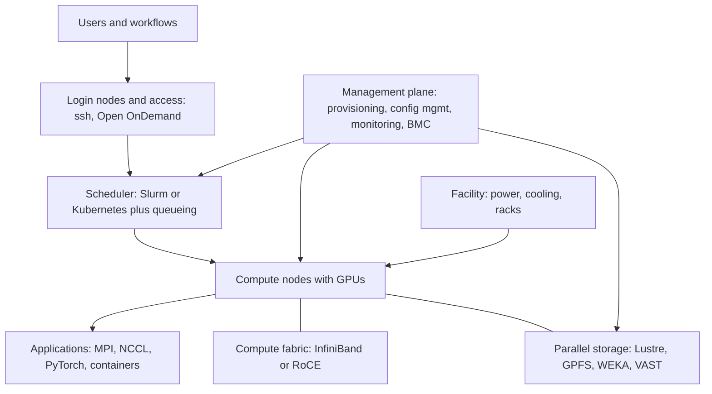

# 6.1 What a supercomputer is: TOP500, Linpack, HPC versus AI factory

| | |
|---|---|
| Level | Beginner |
| Priority tier | 1 |
| Lab venue | Any machine with Python 3; the calculator was run once and its output is shown |
| Part | Part 6: HPC and Slurm |
| Status | Drafted. Figures about named systems and lists are from memory and **must be re-checked** against the current lists before quoting |

## Why this matters for AI infrastructure

The machines you will operate in an AI role are supercomputers by any honest definition: thousands of accelerators, a dedicated high-speed fabric, a parallel file system, a batch scheduler, and an operations team that treats utilisation as a currency. Much of the vocabulary and nearly all the operating practice (Slurm, MPI, environment modules, health checks, drain/resume, fair-share) comes from the HPC world and was inherited by AI clusters. Knowing what the HPC people measure, why they measure it, and where AI differs lets you read job postings, interview with credibility, and avoid reinventing solutions that the community settled decades ago.

## Prerequisites and outcomes

Needs Part 1 (Linux) and Part 2 (networking basics). After this chapter you can:

- Define a supercomputer in terms an administrator cares about, rather than in terms of a price tag or a rank.
- Compute a theoretical peak (Rpeak) from hardware parameters and explain why measured performance (Rmax) is lower.
- Explain what the TOP500, HPL, HPCG, Green500 and MLPerf each measure and what they do not.
- Compare a traditional HPC centre and an AI factory on workload, precision, network, storage, scheduling and operations.
- Distinguish cluster types (HPC, HTC, HA, cloud) and say where Kubernetes and Slurm each fit.
- Describe the roles of the machines in a cluster (the next chapter covers them in detail).

## 1. What "super" means

There is no standards-body definition. Three working definitions, from the least to the most useful for an operator:

1. **By rank or cost**: a machine near the top of a published list, or one that costs tens or hundreds of millions of currency units. Interesting, but it tells you nothing about how to run one.
2. **By capability**: a system whose total performance is far beyond what a single server can deliver, achieved by running one program across many processors that exchange data quickly. This is the definition of *parallel computing at scale*.
3. **By operational shape**: a shared, expensive, tightly integrated resource where *scheduling, fabric health, storage throughput and software consistency* decide how much useful work comes out. This is what an administrator means.

The book *Supercomputers for Linux SysAdmins* (credited at the end) frames the third view well: for the administrator, "super" means that many ordinary Linux machines must behave as one coherent system, centrally managed, with failures expected rather than exceptional. A rack of GPUs that nobody can schedule fairly, patch consistently, or diagnose quickly is not a supercomputer in the operational sense, whatever its peak.

Three properties recur in every definition:

- **Scale-out parallelism.** Performance comes from many cores, many nodes, many accelerators working together, not from one fast core.
- **Fast interconnect.** The processors must exchange data with low latency and high bandwidth, otherwise the program waits. This is the main thing that separates a supercomputer from a large pile of independent servers (a *farm*).
- **Shared infrastructure.** A parallel file system, a scheduler, a common software stack and a management plane, because users cannot each bring their own.

### Parallelism, pipelining, and the nine levels of cluster parallelism

Every modern supercomputer achieves speed through parallel data processing: when two or more operations do not depend on each other's outputs, hardware can run them at the same time. In hardware, this principle takes two classic forms:

- **Parallelism**: separate functional units execute different machine instructions at the same time (for example, an addition unit computes `x=a+b` while a multiplication unit computes `y=b*c`, or hundreds of GPU cores run the same kernel across different data).
- **Pipelining**: a single operation is split into sequential hardware stages (such as loading elements from memory, normalizing mantissas, adding, correcting, and writing back to memory) that work like an assembly line. This is heavily used in vector instructions such as AVX (Advanced Vector Extensions).

If the slowest pipeline stage takes `K` clock cycles and the entire pipeline takes `S` clock cycles (called the pipeline acceleration time for the first element), processing a vector of `N` elements takes:

```text
Total cycles = K*(N-1)+S
```

After the first element finishes in `S` cycles, the pipeline produces one result every `K` cycles. In modern processors, most often `K = 1` (and in the book's vector addition example, `S = 5` five stages).

Even within a single server, memory banks and device controllers add further hardware parallelism: for example, on a motherboard with four independent memory banks, populating four slots with `8 GB` each (one per bank) allows overlapping writes across banks and performs better than putting a single `32 GB` module in one slot.

An administrator diagnosing a slow parallel job must check the full hierarchy of hardware (`[HW]`) and software (`[SW]`) parallelism across the cluster:

1. `[HW]` multiple memory banks
2. `[HW]` multiline CPU cache
3. `[HW]` multiple CPUs
4. `[HW]` multiple CPU cores
5. `[HW]` multiple functional devices in one CPU core
6. `[HW]` accelerators, like GPUs and FPGAs
7. `[HW]` network devices, with features like DMA (Direct Memory Access, where a device reads or writes main memory without occupying the CPU) and offloading
8. `[SW]` multiple UNIX processes and thread (for example, via OpenMP for threads in one process)
9. `[SW]` multiple servers, running one parallel program (maybe many processes each, using MPI for message passing across nodes, or CUDA and OpenACC for accelerators)

When a parallel program runs slowly even though the MPI (Message Passing Interface) environment works, a classic root cause at the top of this hierarchy is a misconfiguration that routes MPI traffic over a slow Ethernet management network instead of the fast InfiniBand fabric.

## 2. Measuring speed: FLOPS, precision, peak and achieved

**FLOPS** is floating-point operations per second. Prefixes: giga (10^9), tera (10^12), peta (10^15), exa (10^18). It is always paired with a **precision**, because the number of operations per cycle changes by an order of magnitude between precisions:

| Precision | Typical use | Notes |
|---|---|---|
| FP64 (double) | Traditional simulation, the TOP500 benchmark | Highest cost per operation; many accelerators run it slowly relative to lower precisions |
| FP32 (single) | Graphics, some simulation, older ML | |
| TF32, BF16, FP16 | Mixed-precision deep-learning training | Tensor-core paths give very high rates |
| FP8, FP4 (and block-scaled variants) | Newer training and inference | Highest rates; accuracy handled by scaling schemes (Part 10, 15) |
| INT8/INT4 | Quantised inference | |

When someone says "this machine does N exaflops", ask: **at what precision, dense or sparse, peak or measured?** An "AI exaflop" at low precision and a TOP500 exaflop in FP64 are not comparable numbers.

**Rpeak** is the theoretical maximum: if every functional unit were busy every cycle. For a CPU cluster:

```text
Rpeak (GFLOP/s) = nodes x sockets x cores x GHz x FP64 FLOPs per cycle per core
```

For an accelerator cluster, multiply the number of accelerators by the vendor's peak for the chosen precision. **Rmax** is the performance actually achieved by the benchmark. The ratio Rmax/Rpeak is the *efficiency*. Reasons efficiency is below one: memory bandwidth limits, communication time, load imbalance, clock throttling under power or thermal limits, software overheads. Well-tuned HPL runs on GPU systems often reach well over half of Rpeak, with variation by architecture; a poorly tuned fabric or a few sick nodes drops it sharply.

### A calculator you can run

```python
def rpeak_cpu(nodes, sockets, cores, ghz, flops_per_cycle):
    """GFLOP/s peak = nodes * sockets * cores * GHz * FLOPs/cycle/core."""
    return nodes * sockets * cores * ghz * flops_per_cycle

def gpu_cluster_peak_pflops(nodes, gpus_per_node, tflops_per_gpu):
    return nodes * gpus_per_node * tflops_per_gpu / 1000.0

g = rpeak_cpu(nodes=100, sockets=2, cores=64, ghz=2.4, flops_per_cycle=32)
print(f"CPU cluster Rpeak: {g/1000:.1f} TFLOP/s")
```

Running the full script (`code/part06/flops.py`: CPU example, plus a GPU example with *assumed*, illustrative per-GPU rates, plus the AI view at an assumed 40% model-FLOPs utilisation) printed:

```text
CPU cluster Rpeak: 983.0 TFLOP/s
GPU cluster Rpeak: 48.0 PFLOP/s
HPL efficiency if Rmax=38 PF: 79%
AI peak (BF16 dense, illustrative): 800 PFLOP/s; at 40% MFU: 320 PFLOP/s
```

The per-GPU figures in that script (60 TFLOP/s FP64 tensor, 1000 TFLOP/s BF16 dense) are placeholders chosen for round numbers, not vendor specifications; take real values from the datasheet for the exact part (Part 9, 10). The point of the exercise: the same 800 GPUs have a "peak" that differs by more than an order of magnitude depending on the precision you pick, and the achieved fraction differs again.

**MFU (model FLOPs utilisation)** is the AI-world analogue of HPL efficiency: the fraction of peak accelerator FLOPs that goes into useful model computation. Large training runs commonly land far below peak (the exact figure depends on model, scale and software); every point of MFU is real money (Part 14).

## 3. The lists and benchmarks

| Benchmark / list | What it measures | What it leaves out |
|---|---|---|
| **TOP500** (published twice a year, June and November, around the ISC and SC conferences) | Ranks systems by Rmax on **HPL** (High-Performance Linpack) | Everything except dense linear algebra; AI workloads; storage; real application mix |
| **HPL** | Solves a dense system of linear equations `Ax = b` with LU factorisation, in FP64 (modern versions allow mixed precision as HPL-MxP, a separate list). Stresses compute and, to a degree, the network. It is compute-bound, with a very regular communication pattern | Memory-bound and irregular codes, I/O |
| **HPCG** (High Performance Conjugate Gradients) | Sparse linear algebra with memory-bandwidth-bound access and global communication; typically reaches a few percent of Rpeak | Still a narrow kernel, but closer to many real codes than HPL |
| **HPL-MxP** | HPL with mixed precision, the "AI-style" arithmetic | |
| **Green500** | Performance per watt (the TOP500 machines re-ranked by efficiency) | Facility efficiency beyond the machine (PUE), idle power |
| **Graph500** | Graph traversal throughput | |
| **IO500** | Storage performance with standardised IOR and metadata tests (Part 6.28) | |
| **MLPerf Training / Inference** (MLCommons) | Time to train specified models to a quality target; inference throughput/latency in specified scenarios | Unique customer workloads; the submissions are tuned by vendors |

How to use them: they are *communication tools and acceptance tests*, not predictions. A cluster that cannot reproduce expected HPL efficiency has a fabric, cooling or node-health problem; running HPL (and later NCCL tests) after build is how you find out (6.28). A high rank says the machine can run one well-tuned program well; it does not say your workload will.

Caveats an interviewer may probe: not all large machines are submitted (cloud AI clusters and many industry systems never appear), TOP500 position depends on submission and tuning effort, and the list rewards FP64 performance, a metric on which AI-first designs deliberately do not optimise.

Also note the vocabulary of scale: **exascale** is 10^18 FP64 operations per second (the first publicly ranked machines passed it in the early 2020s). Several systems exceed that on HPL, and AI clusters with far larger *low-precision* figures exist. Check the current list for names and numbers; I am deliberately not quoting rankings from memory.

## 4. Traditional HPC versus the AI factory

Both are parallel machines with fast fabrics and schedulers. The emphasis differs.

| Dimension | Traditional HPC centre | AI factory / training cluster |
|---|---|---|
| Typical workloads | Simulation (CFD, weather, molecular dynamics, finite elements), many different codes written in C, C++, Fortran with MPI and OpenMP | Neural-network training and fine-tuning, inference serving, data processing; mostly Python with PyTorch/JAX, NCCL for collectives |
| Arithmetic | FP64 heavy | BF16/FP8/FP4 heavy; FP64 mostly irrelevant |
| Parallelism | Domain decomposition; MPI point-to-point and collectives; often many small messages and neighbour exchange | Data, tensor, pipeline and expert parallelism; large collectives (all-reduce, all-gather, all-to-all) |
| Job shape | Wide range: from one core to tens of thousands; many users, many applications | A few very large jobs (thousands of GPUs, weeks) plus many small experiments; inference is long-running services |
| Interconnect | InfiniBand or Slingshot or proprietary fabrics, fat-tree/dragonfly | InfiniBand or RoCE Ethernet with rail-optimised fat-trees, GPU-direct RDMA (Part 12) |
| Storage | Large parallel file system (Lustre, GPFS) for scratch, checkpoint, home; heavy POSIX | Parallel/object storage for datasets and checkpoints; dataloader read patterns; checkpoint bursts (Part 13) |
| Scheduler | Slurm, PBS, LSF; strong fair-share and accounting culture | Slurm still common; Kubernetes with Kueue/Volcano/Run:ai for mixed training and serving |
| Software | Environment modules, Spack/EasyBuild, vendor compilers and MPI | Containers (enroot/pyxis, Docker), pip/conda stacks, NGC images |
| Failure view | Checkpoint/restart, MTBF-aware | Same, but with larger GPU counts per job the failure rate per job is higher; fast checkpointing and fast restart matter (Part 14, 17) |
| Utilisation goal | High node utilisation across a diverse user base | High GPU utilisation and high MFU; time-to-train; cost per token |
| Facility | Air or liquid cooled racks | Very high power density; liquid cooling; power is the limiting resource (Part 6.30) |

The convergence is stronger than the contrast. Both need healthy nodes, a quiet and fast fabric, reliable storage, reproducible software and disciplined operations. If you can run an HPC cluster, you can run an AI cluster with a few new topics (NCCL, GPU health, Python environments, checkpointing). If you only know Kubernetes, the HPC side adds the scheduler culture (queues, fair-share, preemption, accounting) and the tightly coupled job model (gang scheduling, all-or-nothing allocation).

"AI factory" as a phrase refers to treating the datacentre as a production line that turns power and data into tokens or trained models, measured by throughput per watt and per dollar. A planning mindset: capacity in GPUs, power in megawatts, output in tokens or model quality, and a utilisation metric watched by finance.

## 5. Kinds of clusters

| Type | Goal | Coupling | Examples |
|---|---|---|---|
| **HPC / HPC-AI cluster** | Run one parallel job fast | Tight (MPI/NCCL, low latency) | Weather model; LLM pre-training |
| **HTC (high-throughput computing)** | Run very many independent jobs | Loose (no inter-job communication) | Genomics pipelines, parameter sweeps, rendering |
| **HA (high availability) cluster** | Keep a service up through failures | Failover | Database pair with a floating IP |
| **Load-balanced / web cluster** | Spread requests | Stateless replicas | Web tier; inference replicas |
| **Cloud / container platform** | Elastic multi-tenant services | Varies | Kubernetes clusters |
| **Hybrid** | Mix of the above | | An AI platform: Slurm training pool, Kubernetes serving pool |

Scheduler fit: **Slurm** and its relatives model a *fixed pool of nodes with queued, finite jobs* and allocate whole nodes or GPUs exclusively with strong accounting. **Kubernetes** models *continuously running desired state* with pods and services, and needs add-ons (Kueue, Volcano, JobSet) for gang scheduling and queueing. Chapter 6.16 covers running Slurm on Kubernetes; Part 11 and 14 cover the Kubernetes side.

## 6. What "super" means to the administrator

Taking the third definition seriously, the administrator's job is to make the following *invariants* hold across hundreds or thousands of nodes:

1. **Identical software**: same OS image, kernel, drivers, firmware versions (or managed variation).
2. **Time and identity**: synchronised clocks, consistent users and groups, working authentication (Part 6.24).
3. **Name and network**: DNS/hosts, DHCP/PXE for provisioning, a healthy management network and a healthy compute fabric (Part 2, 12).
4. **Shared storage** mounted everywhere, with quotas (Part 6.18 to 6.21).
5. **Central scheduling and accounting**: nobody logs into compute nodes to start work; the scheduler places it and records it (6.7 to 6.15).
6. **Observability**: node health, fabric errors, GPU errors, temperatures, power (6.26, Part 17).
7. **Repeatable change**: images and configuration management so that a new node, or a rebuilt node, joins identically (Part 4, 6.22).
8. **Failure handling**: drain a bad node, requeue its jobs, repair, return it. At scale this happens daily.

Two operational facts to absorb early:

- **Scale makes rare things routine.** A failure with a one-in-ten-thousand daily chance per component happens regularly at fifty thousand components. Design and procedures assume failures.
- **The slowest participant sets the pace.** In a tightly coupled job, one slow node, one flapping link or one thermally throttled GPU slows everyone. That is why health checks before every job and automated draining exist (6.14).

### Command-line fleet checks and power-on surge hazards

Because a cluster contains dozens to thousands of servers, graphical administration tools are impractical. For example, to check which nodes failed to detect their full amount of RAM the last time they were powered on, an administrator runs a single command across all nodes in seconds using a parallel shell tool such as `pdsh` or `clush` (ClusterShell):

```bash
# (untested here)
grep MemTotal /proc/meminfo | awk '{print $2}'
```

Piping that output into a short shell comparison flags any node whose detected memory falls below the expected benchmark.

Physical operations also differ sharply from an office network, where PCs stay idle 99% of the time and users arrive and boot their machines at different hours. A cluster operates at `80–100%` node utilization continuously, where Computing hardware can occupy less than a quarter of the total floor area and the rest goes to cooling and power equipment. Powering on a supercomputer creates three distinct operational hazards that require a strict startup sequence:

1. **Power-on electrical and network request surge**: switching on the whole cluster at once causes a sudden jump of dozens or thousands of kilowatts in power draw, followed immediately by every compute node requesting storage and management services at the same time. Even turning nodes on one by one at intervals of a few seconds can cause network conflicts or overload a central service if that service is not duplicated or load-shared.
2. **Disk-shelf spin-up and controller ordering**: in large multi-rack disk arrays, shelves and drives are spun up in a strict sequence not only to limit high starting currents, but also so the physical torque of spinning disks does not sway the rack. Array components must power up in the order expected by the storage controllers; otherwise, the controllers may assume the array is broken and start a rebuild or mark the array as dead.
3. **Hot-corridor staggered startup**: when server racks face each other and blow exhaust into a shared hot corridor, servers must be powered on at staggered intervals so that active nodes do not overheat neighboring servers whose fans have not yet turned on.

## 7. The stack at a glance



The rest of Part 6 walks this diagram: anatomy (6.2), the parallel programming concepts the hardware serves (6.3 to 6.5), software environments (6.6), the scheduler (6.7 to 6.17), storage (6.18 to 6.21), provisioning and management (6.22 to 6.27), benchmarks and containers (6.28 to 6.29), facilities (6.30), and a capstone (6.31).

## 8. Common misconceptions

- "A supercomputer is one giant computer." It is many computers; the *software and fabric* make it behave as one.
- "More FLOPS means faster for me." Only if your workload is compute-bound and uses the precision and fabric the number assumes.
- "TOP500 rank shows AI capability." It shows FP64 HPL performance. Use MLPerf or, better, your own workload.
- "Cloud VMs are the same thing." Cloud can host supercomputer-class clusters (with the right instances, placement and fabric), but ordinary VMs on a shared network are not.
- "HPC is legacy." The schedulers, MPI, fabrics and operations practice are the foundation of modern AI clusters.

## 9. Lab (no cluster required)

1. Save the calculator and run it. Change `flops_per_cycle` from 32 to 16 (no AVX-512 dual FMA) and compute the new Rpeak. Explain the change.
2. For a hypothetical 512-GPU training cluster, take three real accelerator datasheets (Part 9), compute the dense BF16 peak for each, then the achieved training FLOPs at 30%, 40% and 50% MFU.
3. Find the latest TOP500 and Green500 lists online. Record the number-one system, its Rmax, Rpeak, efficiency and power. Note which accelerators it uses. (Check, do not trust this chapter.)
4. Look up one MLPerf Training submission. Which workload, how many accelerators, how long to train? What does the submission *not* tell you?
5. Draw the diagram in section 7 from memory and annotate each box with one failure you would monitor.

## 10. Interview angles

- Define a supercomputer in two sentences. What separates it from a large web farm?
- Rpeak versus Rmax: what drives the gap?
- What does the TOP500 measure? Why would an AI-first vendor not optimise for it?
- Compare traditional HPC and AI training clusters. What is the same?
- What is MFU, and how does it relate to HPL efficiency?
- When would you pick Slurm and when Kubernetes? Can you run both?
- Why do tightly coupled jobs make one slow node a cluster-wide problem?
- What invariants must an administrator maintain across a cluster?

## 11. Checkpoint questions (25)

1. What three properties recur in definitions of a supercomputer?
2. What does "FLOPS" count, and why must precision accompany it?
3. Write the Rpeak formula for a CPU cluster.
4. Why is Rmax below Rpeak? Give three causes.
5. What does HPL compute? Which precision?
6. Why is HPCG's efficiency low?
7. What does Green500 rank?
8. What is HPL-MxP?
9. What does MLPerf measure and how does it differ from TOP500?
10. How often is the TOP500 published?
11. Which workloads dominate traditional HPC centres, and in which languages?
12. Which parallelism types dominate large AI training?
13. Why is FP64 less important for AI factories?
14. Name two interconnect families used in both worlds.
15. What storage patterns differ between HPC simulation and AI training?
16. Which schedulers are typical in HPC and which in AI platforms?
17. Define HTC and give an example.
18. What is the difference between an HA cluster and an HPC cluster?
19. Which scheduler model matches "fixed pool, finite jobs, strong accounting"?
20. What does gang scheduling mean and why do tightly coupled jobs need it?
21. Name six invariants an administrator maintains.
22. Why do rare failures become routine at scale?
23. Why does one slow node slow a whole job?
24. What does "AI factory" emphasise?
25. Write the pipeline cycle formula for processing a vector of `N` elements when the slowest pipeline stage takes `K` cycles and the full pipeline length is `S` cycles, and list the three physical startup hazards when powering on a large supercomputer. **A:** The vector requires `K*(N-1)+S` clock cycles (where `S` cycles is the pipeline acceleration time for the first element, and subsequent elements complete every `K` cycles; in the book's example, `S=5` and `K=1`). When powering on a supercomputer, the three startup hazards are: (1) a sudden power surge of dozens or thousands of kilowatts followed by a simultaneous storm of network requests to storage and service nodes; (2) multi-rack disk arrays swaying the rack from simultaneous disk spin-up or array controllers marking volumes dead/rebuilding if shelves start out of sequence; and (3) servers in a hot-corridor layout overheating unpowered opposing servers if not started at staggered intervals.

## 12. Sources and review notes

- Sysadmin framing of what "super" means, cluster types, hardware/software parallelism hierarchy, vector pipeline cycle formula, CLI RAM check, and power-on surge hazards (read in full: `supercomputers-for-linux-sysadmins-managing-modern-hpc-clusters-and-supercomputers-from-software-to`, "1. Introduction" and "2. What Is “Super”?").
- Cloud, fog and edge background (limited relevance): *AI Factory*, chapter 9 on distributed computing; used only for the cluster-types framing.
- Benchmark descriptions follow the public documentation of TOP500, HPL, HPCG, Green500, IO500 and MLCommons from memory; names and publication cadence are stable, rankings and numbers are not and are deliberately omitted.
- Original: the Rpeak/MFU calculator (run once; output shown) and the HPC-versus-AI comparison table. Per-GPU rates in the script are placeholders, not specifications.
- Run here: `code/part06/flops.py` Rpeak/MFU calculator.
- Not verified on live hardware: `pdsh` / `clush` `grep MemTotal /proc/meminfo | awk '{print $2}'` check, and any claim about which systems exceed exascale or about typical efficiency ranges. Check current lists.
