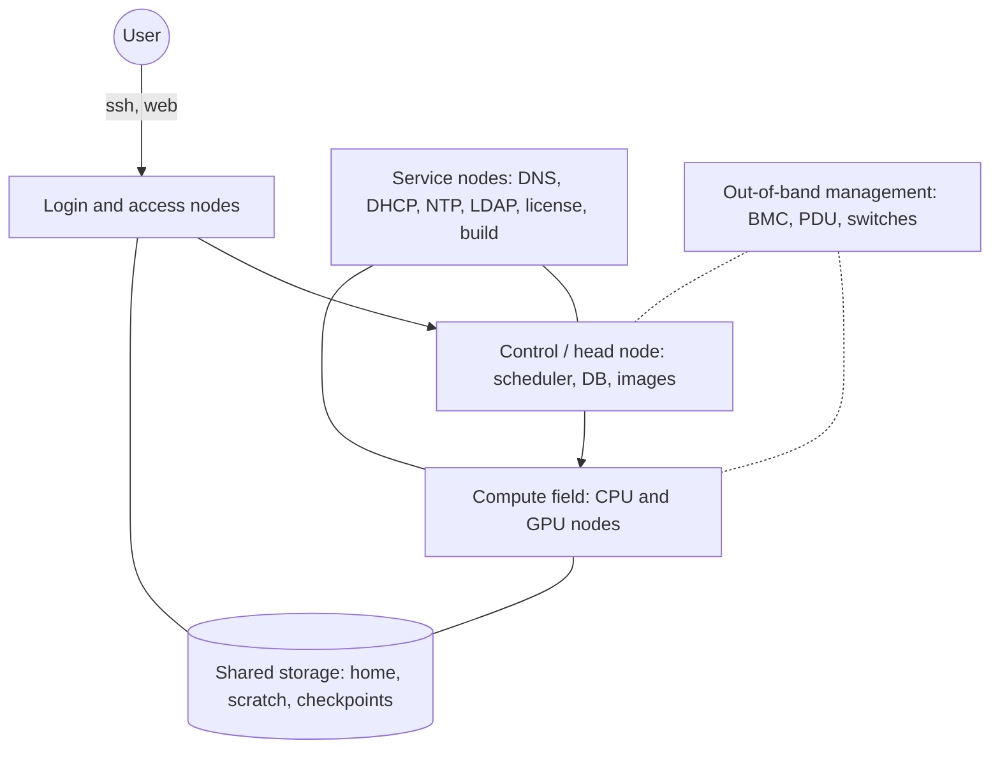

# 6.2 Cluster anatomy: head, login, compute, storage and management nodes

| Field | Value |
|---|---|
| Level | Beginner |
| Priority tier | 1 |
| Lab venue | Any machine with Python 3; `cluster_anatomy_lab.py` runs 3 checks locally and cluster design exercises are **untested** here |
| Part | Part 6: HPC and Slurm |
| Status | Drafted |

## Why this matters for AI infrastructure

Every AI cluster, whether it runs Slurm, Kubernetes, or both, is built from the same handful of node roles and networks. Picture a researcher who launches a heavy preprocessing script on the head node, or a remote IDE plugin that paralyzes a shared login server. Production incidents almost always trace back to the wrong workload running on the wrong node, or across the wrong network. An NFS service co-located on a compute node starves an AllReduce collective, and a management network that shares a switch with compute traffic causes the same kind of trouble.

Knowing the standard anatomy lets you read an architecture diagram in one pass, ask the right questions in a design review, and place new services where they belong. It also gives you the working vocabulary of NVIDIA Base Command Manager, Slurm, and cluster procurement specifications, which chapters 6.7 onwards and Part 8 cover.

## Prerequisites and outcomes

Start with Chapter 6.1, Part 1 on Linux administration, and Part 2 on networking basics. When you finish this chapter, you will be able to:

- Name each node role in an HPC or GPU cluster, say what runs on it, and say what must never run on it.
- Describe the separate networks of a modern GPU cluster: the compute fabric, storage fabric, in-band control Ethernet, out-of-band management, and external network. Explain why they are separated.
- Compare cluster networking technologies and fabric topologies, including tree, fat tree, hypercube, 3D torus (`[N/2]+[M/2]+[K/2]`), and Dragonfly or Dragonfly+.
- Explain how local disks versus diskless boot, DAS, NAS, and SAN storage, RAID levels, SMP versus NUMA, and the HyperThreading BIOS versus scheduler core declaration trick affect cluster operations.
- Produce a complete cluster planning, documentation, post-build verification, and 8-column maintenance runbook checklist.
- Walk through the lifecycle of a typical user session and batch job, and identify the invisible background services that keep the cluster alive.

## 1. Anatomy of a supercomputer: four layers

Imagine you have been handed the budget to build a new supercomputer cluster from scratch. What do you buy first, how do the pieces connect, and which teams need to be in the room? A supercomputer is easiest to reason about in four big parts:

1. Hardware infrastructure is the physical layer: the power supply, cooling systems, physical security, and the room itself. Power systems include transformers, UPS units, PDUs, and backup generators. Physical security includes cameras, door access cards, and server rack locks. A facilities team may own this layer, but the cluster administrator must know its exact limits. You need to verify available kilowatts, cooling reserve, floor loading, unloading routes, and at least 5 to 10 percent power headroom, as discussed in Chapter 6.30.
2. Compute nodes form the compute field, the workhorse servers and compute networks where parallel tasks actually execute. Before you pick a server configuration, gather requirements from your users and their software packages. Ask whether performance depends on a low-latency interconnect, GPUs, high memory capacity, or storage IOPS. Once you define the best compute node and the trade-offs you can accept, size the compute field in modular topology blocks.
3. Compute infrastructure ties the compute field into a single complex. It covers the management network, shared storage, the storage network, and the infrastructure service nodes. Those service nodes run login servers, scheduler controllers, monitoring, authentication, and backups. Suppose a hundred compute nodes read or write at the same moment, which is routine for parallel jobs. A single shiny server with one big disk will be swamped, and job I/O requests will time out.
4. Software is the operating system, the hardware and network file system drivers, the provisioning and monitoring tools, the workload management queuing system, the compilers, and the parallel libraries. Plan this stack before the hardware arrives, because changing system software or the job scheduler later is painful. Choose standard HPC tools rather than forcing an unfamiliar tool you happened to use in an office job.

A newcomer usually fixates on layer 2, the GPU and CPU servers. Experienced operators spend most of their career engineering and protecting layers 3 and 4.

**Design all four layers together before you order hardware. A bottleneck in power, cooling, shared storage, or system software will cripple the most expensive compute nodes.**

## 2. Node roles: control, compute, login, service, and storage

Which machine should run the scheduler, and which one should run a user's code? Every new cluster raises that question. In HPC, the word node is simply the usual name for a server. Depending on the size of a cluster, several roles may share one physical server, or each may get a machine of its own. Every node belongs to one of two broad groups. The first is the compute field. The second is the service nodes.



| Node role | Primary responsibility | What must never happen here |
|---|---|---|
| **Control / head / management node** | Runs the batch scheduler (`slurmctld`, `slurmdbd`), provisioning (CMDaemon), and cluster control | Users logging in directly or running compute and compilation jobs |
| **Login / access nodes** | User entry point for editing code, compiling small programs, and submitting jobs | Unbounded CPU and RAM usage, such as runaway VSCode remote plugins or training runs |
| **Compute nodes (compute field)** | Execute scheduled parallel jobs (`slurmd`, GPU drivers, fabric and storage clients) | Co-locating shared infrastructure services like an NFS server, or unmanaged user logins |
| **Pre-/postprocessing & visualization nodes** | Prepare large simulation meshes or datasets (256 GB or more RAM) and render remote graphics | Running long multi-node batch jobs that belong on the compute field |
| **Service & storage nodes** | Dedicated servers for Lustre, WEKA, or NFS, FlexLM licenses, DNS, NTP, LDAP, compilation, data transfer, monitoring, and backups | Mixing critical control-plane databases with heavy user I/O |

### Control / head / management node

Every cluster has one service node you cannot leave out: the management node, often called the head node. All other subsystems are managed from it. It takes on three roles:

- Workload manager controller: it runs `slurmctld` and often `slurmdbd` with its accounting database, covered in Chapter 6.7.
- Provisioning and image server: it serves DHCP and TFTP or HTTP for PXE network boot, and it holds the operating system images for compute nodes, covered in Chapter 6.22. In NVIDIA Base Command Manager, the head node runs CMDaemon and manages every node category and image, covered in Part 8.
- Configuration management and inventory: it holds the cluster database, Ansible or xCAT configurations, and local package repositories.

Large complexes keep control nodes and access nodes apart. Access nodes take user logins, and control nodes run the task management system. That split protects system services and sensitive databases from unauthorized access. A tiny lab cluster might combine all service roles onto one physical box. Production clusters, however, should deploy at least two control nodes in an active/passive high-availability pair, alongside one or more dedicated login nodes, as covered in Chapters 6.15, 6.27, and 8.12.

### Compute nodes (the compute field)

The workhorse of the cluster is the compute field, also called the counting field. In a modern AI cluster, these are the HGX or DGX servers that pack eight GPUs, two CPUs, and several high-speed NICs, covered in Part 9. Two rules govern their hardware and software.

The first rule is to keep node configurations homogeneous and balanced. The more uniform your compute nodes are, the easier it is to manage images and schedule parallel tasks. Create mixed hardware only when you are certain all of it will be used actively. Put distinct hardware configurations into separate scheduler partitions, covered in Chapter 6.8. You can also add a small test partition with a short runtime limit of 15–20 minutes for quick job debugging. Within each node, balance CPU cores, memory channels, GPUs, and fabric bandwidth, so that no internal bottleneck starves the processors. Users should never log into compute nodes directly, except through the scheduler. Some sites allow SSH during an active job, and they enforce that with `pam_slurm_adopt`.

The second rule concerns local disks and unneeded daemons. Local hard drives or NVMe SSDs have both costs and benefits. The minuses are extra space, power consumption, heat dissipation, a higher probability of failure, and high purchase cost. Enterprise NVMe drives are expensive, so you must keep a spare count in stock or buy a support contract. That matters most in high-density blade or GPU servers. The pluses are a local copy of the OS, which simplifies power-on and speeds up loading system libraries at program start. Local swap space and a local `/tmp` directory also greatly improve memory efficiency.

Whether the node boots locally or over the network, keep its software configuration as light as possible. Remove unnecessary services such as local mail, `cron`, `networkmanager`, `ModemManager`, and `acpid`. Use precreated device files instead of dynamic rules where possible. The essential services on a compute node are `sshd`, the network file system client, the scheduler daemon `slurmd`, hardware drivers, and node monitoring.

### Login nodes (access, submit, and gateway nodes)

Login nodes are the front door for users. People connect with `ssh` or a web portal, covered in Chapter 6.25, to edit files, compile code, submit batch jobs with `sbatch`, check queues with `squeue`, and transfer files. Shared software trees on login and compute nodes are often served from read-mostly NFS or CVMFS, and they are exposed through environment modules, as covered in Chapter 6.6. Never share login nodes with control or core service nodes. Enforce strict per-user CPU, memory, and process limits with cgroups and `pam_limits`.

Many users now run IDE plugins such as VSCode remote. These plugins look like an easy way to work with the cluster. In practice, many of them, VSCode in particular, consume large amounts of CPU and RAM, and they can paralyze a shared login node. Enforce strict per-user resource slices. When your cluster runs several OS versions or heavy software builds, give compilation to separate compilation nodes.

### Service nodes, license servers, and pre-/postprocessing nodes

Every server outside the compute field is a service node. Combining a compute node with a service role, such as an NFS server, is strongly discouraged. The result is unbalanced task operation and a higher chance that the service fails. Common service node roles include the following.

- License servers protect commercial software. Commercial packages often rely on a dedicated license server running a manager such as FlexLM. A separate machine keeps license files safe from theft and improves fault tolerance. Always record the MAC address of the license server in your documentation. If the server is suddenly replaced, setting the old MAC address on the new server is enough for most programs to keep working at once. You can then request a formal license reissue for the new hardware's real MAC address, with no downtime.
- Pre- and postprocessing nodes prepare input data and process results. They carry more RAM than standard nodes, 256 GB or more, which matters when you prepare large tasks and process calculation output. Visualization nodes add dedicated graphics cards for work on visual information, such as 3D meshes, and they stream the finished image over the network to a remote user.
- Storage, data-transfer, compilation, auth, monitoring, and backup nodes round out the fleet. Storage nodes connect to disk arrays to form distributed storage, covered in Chapters 6.18 to 6.20 and Part 13. Dedicated data-transfer nodes, abbreviated DTNs, sit beside software deployment servers. Authorization servers that run LDAP are covered in Chapter 6.24. Remote journaling and monitoring servers are covered in Chapter 6.26, and backup servers in Chapter 6.27.

Keep compute nodes stripped down to essential daemons, never co-locate an NFS or management service on a compute node, cap VSCode and user processes on login nodes, and document your license server's MAC address.

## 3. The networks, latencies, and fabric topologies

Picture a storage backup running at the same time as a parallel job that needs microsecond-level exchanges between its nodes. A modern HPC or GPU cluster avoids that clash by running several physically or logically separate networks. The separation keeps a storage backup or a management scan from disturbing collective communication.

| Network | Purpose | Typical technology | Operational characteristics |
|---|---|---|---|
| **Compute (communication) network** | High-speed data exchange (MPI, NCCL) between parallel tasks across compute nodes | InfiniBand (SDR to NDR/XDR), RoCEv2 Ethernet (100–800G), or Cray SlingShot | Lowest latency and highest bandwidth; connects all compute nodes; isolated from external traffic |
| **Control (in-band service) network** | Remote node access, launching tasks, monitoring, and cluster control | 1 / 10 / 25 / 100 GbE Ethernet | Connects all cluster nodes; standard TCP/IP |
| **Storage & out-of-band service networks** | Parallel file system traffic, plus dedicated IPMI, Redfish, and iKVM BMC management and hardware barrier sync | High-speed Ethernet or IB for storage; dedicated 1 GbE switch fabric for BMCs and PDUs | Out-of-band BMC network works even when the node OS is powered off; strictly access-controlled in Part 7 |
| **External network** | User and administrator access from the corporate intranet or internet, plus dataset transfers | Routed Ethernet with firewall, NAT or proxy, and reverse proxy or port forwarding | Compute, storage, and internal service nodes have no public or corporate IPs; outbound access uses NAT or proxy |

Decide the subnets for each network up front, with room to grow. Name interfaces consistently, for example `node042`, `node042-bmc`, and `node042-ib0`, so that host 042 matches across every subnet, as discussed in Chapter 2.30. Do not forget the external network. If users load a lot of data, it can easily become a bottleneck. Compute nodes, storage servers, and most service nodes have no direct access to the external network or to public IP addresses. They reach the outside world through NAT or a proxy, while administrators reach internal dashboards through port forwarding or a reverse proxy.

### Network throughput and latency

Two basic measures describe what a network can do. Throughput measures how much information can move per second. Network equipment makers quote peak throughput, but in real applications the speed is typically 1.5–2 times lower than peak. With low bandwidth, data exchange falls behind computation, and nodes spend time waiting on the network.

Latency is the net time needed to send a zero-length message. It depends on how long the network devices and the system take to prepare for sending and receiving. If a task exchanges data often over a high-latency network, the nodes spend most of their time preparing messages instead of moving data.

The table below summarizes common cluster networking technologies. Myrinet is historical. SlingShot is a proprietary technology from Cray, which is now part of Hewlett-Packard. A high-speed network card costs about $1,000. A switch or communicator costs $10,000 to $1,000,000 and above.

| Technology | Throughput | Latency (microseconds) | MPI latency (microseconds) |
|---|---|---|---|
| **Gigabit Ethernet** | Peak – 1000 Mbit/sec (125 MB/sec), MPI – 60–120 MB/sec | 30–100 | 50 |
| **10-Gigabit Ethernet** | Peak – 10 Gbit/sec (1.2 GB/sec), MPI – 700–900 MB/sec | 9 | 25–30 |
| **100-Gigabit Ethernet** | Peak – 100 Gbit/sec (about 12 GB/sec) | 0.3–1 | 1–3 |
| **Myrinet 2000, Myrinet-10G** | Peak 2 Gbit/sec (10 Gbit/sec) full duplex; TCP/IP 1.7–1.9 Gbit/sec (9.6 Gbit/sec); MPI up to 200 MB/sec (400 MB/sec duplex) | 2 | 10 |
| **InfiniBand** | 10 to 4800 Gbit/sec or higher, implementation dependent | 0.1–0.6 | 1–3 |
| **SlingShot** | Peak – 200 Gbit/s | 0.2–1.2 | 4–5 |

Notice the MPI latency column. On 100 GbE and InfiniBand it sits at 1–3 µs, against 50 µs on 1 GbE.

### Fabric topologies and the 3D torus hop formula

Topology can cancel out high network speeds. Connecting two switches with a single link creates an immediate choke point. Connecting them with parallel links in standard Ethernet makes Spanning Tree leave one link running and place the others in standby. To use parallel links, configure link aggregation, such as EtherChannel, bonding, or trunking, with identical settings on both switches. InfiniBand's subnet manager natively supports multiple routes across star, tree, fat-tree, hypercube, torus, and Dragonfly topologies.

Here are the topologies the chapter covers.

- Tree (star) is the typical Ethernet topology. Spanning Tree blocks parallel links unless you aggregate them.
- Fat tree either gives a tree higher aggregated link throughput at the upper levels, or multiplies the upper-level switches so that two or more root or spine switches each connect to every lower-level leaf switch. The second design spreads traffic and makes recovery easy if any non-leaf switch fails.
- Hypercube is built by taking two hypercubes of dimension N-1 and connecting corresponding vertices. In practice, each vertex is a leaf switch with nodes attached. The design guarantees no more than N hops between any two vertices, but the cabling is complicated and expensive.
- Multidimensional torus is similar to a hypercube, but each dimension has several vertices closed into a loop. In a 3D torus with dimension sizes N, M, and K, the maximum number of hops between any two vertices is:

```text
Max hops (3D torus) = [N/2] + [M/2] + [K/2]
```

Here `[X]` is the integer part of X. Using `torus_3d_max_hops()` in `code/part06/cluster_anatomy.py`, an 8 x 8 x 8 torus has a maximum of 12 hops. Each term is 8 divided by 2, which is 4, so 4 + 4 + 4 gives 12. For a 5 x 7 x 9 torus, the terms are 2, 3, and 4, so the maximum is 2 + 3 + 4, or 9 hops.
- Dragonfly and Dragonfly+ place bottom-level switches into groups with all-to-all connections inside each group, and the groups connect to one another at the next level. Basic Dragonfly connects groups all-to-all. Dragonfly+ connects each member to a subset of its neighbor group's members. That reduces the switch ports and cables required, while keeping average hop counts low.

Isolate the compute, storage, control, and BMC networks, and size your fabric topology so that inter-switch uplinks never bottleneck collective traffic.

## 4. Storage access methods, RAID levels, SMP vs NUMA, and hardware features

Every cluster has to keep shared software, home directories, and scratch space somewhere. Two hardware questions decide how that storage is attached and protected, and how memory and threads appear to the scheduler. The first is how external storage is attached and protected. The second is how multiprocessor memory and threads are exposed to the scheduler.

### DAS, NAS, SAN, and RAID levels

External storage holds shared software packages, home directories, and scratch space. Direct Attached Storage, or DAS, looks like a local disk to the operating system. Network Attached Storage, or NAS, gives file-level access over a network through protocols such as NFS, and a parallel file system such as Lustre spreads data across several storage nodes in the same way. A Storage Area Network, or SAN, exports block devices over duplicate switches with multipath, so a failed route switches to a backup. Because a SAN exports blocks rather than a file system, never mount one SAN block device on more than one node at once. Chapter 6.18 covers shared and parallel storage in detail.

Storage systems use RAID to combine equal-capacity disks at the block level, for speed and fault tolerance. The table below shows what each level trades away.

| RAID level | Block layout and redundancy mechanism | Speed and fault-tolerance trade-off |
|---|---|---|
| RAID-0 | Alternates blocks across disks (`block0` on disk 1, `block1` on disk 2) | Highest sequential write speed; zero fault tolerance |
| RAID-1 | Mirrors identical blocks across all disks | Highest fault tolerance, surviving N-1 disk failures at 50% capacity cost |
| RAID-2, 3, 4 | Hamming code redundancy (RAID-2) or striping with a dedicated checksum disk (RAID-3 and RAID-4) | Not used in practice because RAID-5 gives better speed and reliability |
| RAID-5 | Combines blocks into stripes of typically 3–5 disks with 1 interleaved checksum block per stripe | Survives 1 disk failure with less redundancy than RAID-1, but writing a single block requires reading the entire stripe to compute the new checksum |
| RAID-6 | Striped array with 2 independent checksum blocks per stripe | Survives 2 simultaneous disk failures; higher write cost |
| RAID-10, 50, 60 | Two-level arrays (lower level first, upper level second): RAID-0 built from RAID-1, RAID-5, or RAID-6 arrays | Combines RAID-0 stripe speed with RAID-1, RAID-5, or RAID-6 redundancy |


### SMP vs NUMA, process/memory pinning, HyperThreading trick, and RDMA vs RoCE

Before multicore chips existed, manufacturers put several single-core processors, often two to eight, on one common system bus with uniform memory access. That design is a Symmetric Multiprocessor, or SMP, system. Modern multicore processors place several cores on one chip and use Non-Uniform Memory Access, or NUMA. Each processor socket has its own memory channel and local RAM for fast access. Reaching another socket's RAM crosses a shared interconnect, which is slower. Hardware keeps the CPU caches coherent across sockets.

Linux gives each active process a time slice of a few milliseconds before switching it out. An unpinned process therefore often walks across every core in the system. Core migration hurts cache efficiency on SMP systems, and it causes large cross-socket memory delays on NUMA systems. Parallel launchers, such as `numactl`, MPI, and Slurm in Chapter 6.12, enforce processor affinity, also called processor pinning, and memory affinity. They bind each parallel process to a specific NUMA node for both CPU cores and memory allocation. In production parallel runs, NUMA binding is obligatory, so job speed stays fast and repeatable.

Many processors also implement HyperThreading, or HT. Each physical core then appears as two logical cores that share computational units. Parallel HPC and AI codes already use execution units efficiently, so HyperThreading rarely speeds them up and often slows them down through contention. A practical trick, modeled in `scheduler_declared_cores()` in `code/part06/cluster_anatomy.py`. It works in three steps:

1. Enable HyperThreading in the BIOS of each compute node, which exposes 256 logical CPUs on a dual-socket 64-core server.
2. Configure the job scheduler with the physical core count, 128 cores, as if HyperThreading were disabled.
3. Compute jobs then allocate at most 128 tasks, one per physical core, while node system services use the extra logical threads with minimal impact on user calculations. If your scheduler auto-detects core counts and cannot be overridden, disable HyperThreading in the BIOS instead.

Across nodes, Direct Memory Access, or DMA, lets a local disk or NIC read and write main memory without CPU participation. InfiniBand adapters extend DMA across the fabric, so they can reach a remote node's memory without involving the remote CPU. That is Remote Direct Memory Access, or RDMA. RoCE, which stands for RDMA over Converged Ethernet, runs InfiniBand RDMA verbs over supported Ethernet cards to reduce cost. Standard Ethernet has higher latency, though, and it lacks InfiniBand's subnet manager, adaptive topologies, and rich built-in fabric counters.

Bind every parallel rank to its local NUMA cores and memory, and declare only physical cores to the scheduler when BIOS HyperThreading stays on for system daemons.

## 5. Planning, hardware consistency, documentation, and post-build verification

Suppose your vendor quote arrives with a 5-year support contract attached. Four planning rules prevent expensive mistakes when you move from requirements to quotes and contracts.

1. Plan for support after the warranty. Ask management, before you sign, how the complex will be supported once the initial 5-year vendor support contract expires. A manager may answer, "we have 5 years support, don't worry, and then we'll see." Write a formal memo instead, noting that even a small hardware break can stop the entire service. State clearly that you do not approve operating without an active service contract.
2. Insist on strict hardware and firmware consistency. Specify in the contract, and verify on delivery, that all memory modules, motherboards, firmware, BIOS versions, network cards, and GPUs are identical across similar servers. That includes exact GPU part numbers and VBIOS versions. Never listen to a salesperson claiming "this is the same model, just a bit modern part number, it is even better." Mixed hardware causes different driver and application behavior, which wastes weeks of debugging.
3. Estimate power and cooling. Sum the power of all servers, network switches, storage, cooling systems, and UPS units. Multiply your rough server sum by 1.5 or 2, and work with facility power engineers on a professional estimate with 5–10% headroom. Check whether you need a backup generator, or whether outages are short enough for a clean UPS shutdown.
4. Plan colocation and remote hands. If you use a remote data center or colocation facility, define upfront how easily you can get physical access. Clarify how remote engineers can help, which tasks remote hands can do, and which tasks you must do yourself. Also plan how users will reach the supercomputer and upload or download huge datasets through your external switch, NAT, and firewall.

Here is the arithmetic for a 32-node example, using the numbers from the lab later in this chapter. Thirty-two compute nodes at 10.0 kW each draw 320.0 kW raw. Add 10% headroom, and the budget becomes 352.0 kW.

### Planning checklist and scenario drills

Before deployment, walk through one plan that covers nineteen topics: compute hardware, power and cooling, remote access, physical security, service nodes, high availability, network topology, authentication, storage and quotas, access from internal and external networks, security policy, backups, cluster management software, scheduler software, job policy and accounting, monitoring, baseline benchmarks, user resources, and capacity planning. Many of the hardest problems show up in the first week, when users cannot reach the machine or their uploads crawl, and most of them can be seen on paper. Ask how users will reach the cluster and how data will get in, because a switch that is too small for NAT or a missing firewall rule becomes a bottleneck or a hole.

Then rehearse seven typical operational scenarios, and write down how you will act in each case.

- If you suspect a bad node, what are your exact steps to prove it is bad and replace it?
- What are your steps if you suspect network problems?
- What if your nodes have different firmware versions that affect application performance?
- What if your management node running the job manager fails?
- How will you transfer data to the cluster and back, and how much time does it take?
- How do you add a user to the cluster, and how do you remove them?
- How do you plan to perform security checks and updates?

### SysAdmin and User documentation checklists

Do not put documentation off until the last minute. Keep two distinct sets: one for SysAdmins, and a collaborative wiki or portal for users, where they can ask questions and leave comments.

| Documentation platform | Required contents |
|---|---|
| **SysAdmin documentation** | Hardware configurations of each node type; network topology and hardware; installed software, license info, and special configurations; system settings and limits; admin and maintenance logins and password access; policies to add accounts and software; backup and restore schedules; maintenance procedures; important contacts (stakeholders, suppliers, engineers, tech support, power/cooling/physical access teams); incident and maintenance journal; **temporary changes** (such as changing quotas for a month or granting temporary access to external tech support); and **HOWTOs** (close/open cluster in emergencies, change quotas, add/delete/update accounts, reboot a proprietary license server, inform users of problems, run basic tests) |
| **User documentation** | How to submit a request for access, full process, and timing; how to get a password, generate SSH keys, log in for the first time, and take first steps; what the cluster is (hardware, software, file systems, links); how to copy data, prepare a task, and run, check, or cancel a job; policies and limits; and a growing "How to..." FAQ for unexpected user questions |

The SysAdmin row records what the admin team needs to keep running the machine. The user row records what a new person needs in order to get started.

### Skills, post-build verification, the 5 check types, runbook schema, and node hardening

To run the complex after the build, The skills worth mastering are basic networking, advanced `bash` scripting plus `awk`, an editor such as `vim`, `nano`, or `emacs`, `screen` or `tmux`, and basic Python and C++. You also need Ansible or xCAT, Lmod or Spack, and a clear understanding of how containers work under the hood. Knowing Docker commands is not enough. You must understand how the host kernel technology works, along with every hardware and software feature and limitation. When a cluster is built, set up, tuned, and verified, check at least these 11 items:

1. DNS server.
2. NTP sync (internal and external).
3. SSH to all nodes, including service nodes.
4. Shared file system performance check on both the login node and compute nodes.
5. Network performance benchmark.
6. Nodes performance benchmark on each node individually and across all nodes.
7. User `add`, `block`, `unblock`, and `delete` check.
8. Partition `add`, `modify`, and `delete` check.
9. Compute partition quotas and limits check.
10. Monitoring check and alerts check.
11. Test data backup and restore.

Write all checks and baseline numbers from HPL, NCCL-test, IOR, STREAM, and FIO into runbooks and playbooks. Plan at least one maintenance window per year for firmware upgrades, part replacements, and software upgrades. Organize your checks around five standard check types.

1. Full cluster check, after each maintenance.
2. Performance verification, after each maintenance.
3. Node performance check, after a node fix or replacement.
4. Node readiness check, before and after each job run (Chapter 6.14).
5. Node health check, run periodically on the nodes.

For any serious activity, such as maintenance, a software or hardware installation or upgrade, or moving data, use a peer-reviewed runbook spreadsheet with these eight standard columns. The `validate_runbook_schema()` function in `code/part06/cluster_anatomy.py` checks them.

| Runbook column | Purpose |
|---|---|
| `phase` | Stage of the maintenance or migration window |
| `action` | Concrete step to perform |
| `start` | Scheduled or actual start time |
| `duration` | Expected time required for the step |
| `dependency` | Prerequisite steps that must finish first |
| `owner` | Person responsible for executing the step |
| `status` | Current completion state |
| `info` | Commands to run, links to docs, and optional rollback action description |

Each row is one step. The `info` column carries the commands, the documentation links, and an optional rollback description that someone needs at the moment of the change.

Finally, apply four operational rules across your nodes.

- Use standard environment modules for `PATH`. Do not add new software paths into random bash profile files such as `bashrc`, `profile`, and `pam_env`. Use environment modules everywhere, and document that single approach, so that you can always trace `PATH` issues.
- Debug issues in one consistent direction, either top-to-bottom or client-to-server. If a Slurm client command fails, first check whether the server daemon is running and listening on its network socket, using `ss` or `netstat`. Then verify that routing and firewall rules let the client reach it, and that the client has the right server address. Use `strace` for DNS or connection calls, and `tcpdump` for packets.
- Replace SSH cron storms with local `systemd` timers. Disable `cron` on compute nodes, and never use a central cronjob that SSHes to all nodes to run checks. Instead, run local `systemd` timers on each node. They save results to a network file system, a database, or a message queue, for a service node to process.
- Install `molly-guard` and `auditd`. Install molly-guard on service and head nodes to prevent accidental reboots. Tune `auditd` to log critical command executions, and follow the NIST SP 800-223 baseline, titled High-Performance Computing Security.

Never open a new cluster to users until all 11 post-build checks, baseline benchmarks, SysAdmin and User docs, and molly-guard protections are in place.

## 6. How a supercomputer does the job: user session, job life cycle, and what is hidden

Think of a user who logs in, submits a job, and goes home for the night. The physical cluster anatomy connects to a software stack. That stack includes the operating system, hardware and network file system drivers, system control and monitoring software, the task queuing system, parallel libraries such as MPI and CUDA, and compilers and math libraries such as BLAS and FFT. When users develop code or run packages like VASP or NAMD, compiling directly on the target architecture lets the compiler apply hardware-specific optimizations, which maximize performance.

### A typical user session and the job life cycle

1. Connect to the access node. From a workstation or laptop, the user opens an `ssh` client, such as PuTTY, OpenSSH, or an IDE SSH plugin. Authentication uses a password, a private key, or 2FA. Once on the access node, the user can edit and compile parallel programs, copy input data over `sftp`, or manage files with Midnight Commander, which runs as `mc`.
2. Queue the job. The user submits a job command to a job queue, called a partition, with `sbatch`, or runs interactively. The submission names the executable path, its arguments, the number of parallel MPI processes, the nodes, the memory, the GPUs, and the software licenses, covered in Chapter 6.11. Batch I/O is redirected to files, so the user can log out and check status or download results later. An interactive job stays attached to the user's terminal.
3. Schedule and run the prologue. The job management system reviews the queue regularly. When the job reaches the front of the queue or fits the available resources, the scheduler selects the compute nodes, notifies them, and runs an initialization script called the prologue, `prolog`.
4. Start and run. A startup process such as `mpirun` or `mpiexec` starts on a compute or management node, receives the allocated node list, and launches the job across the compute nodes. The management system watches the running job, and it supports administrative actions such as changing job priority, blocking a queued job, or suspending a running job.
5. Terminate and run the epilogue. When the startup process finishes, or the job is forcibly canceled, the control system enters the termination phase. It runs the epilogue, `epilog`, which makes sure every user process has exited and temporary directories are cleaned up. Then it marks the job completed and logs its usage.

### What is hidden from the user (and why "toy" laptop clusters fail at 20 nodes)

Every step above is visible to the average user. Behind the scenes, though, the administrator depends on background services that keep the supercomputer correct, and users never see them. Those services handle account management across all nodes, distributed file system operation, quota management and enforcement, and remote node monitoring and health checks. They also collect statistics, keep a central journal, watch equipment and facility infrastructure, send emergency notifications with automated UPS shutdown, and run backups of user and system state.

Why does this invisible layer matter? You can build the simplest toy computing cluster on your knee. Take 2 laptops, connect them to a common network, set up passwordless `ssh`, run an NFS server on one laptop, mount it on the other, and run MPI programs. Now try 20 laptops instead of 2. Problems arise immediately. The network cannot cope with the collective load, the single NFS laptop slows down, one laptop hangs, and it takes half an hour just to work out what happened. A real supercomputer needs the disciplined node separation, fabric topology, and invisible services covered in this chapter.

Make health checks, time sync, quotas, monitoring, and epilogue cleanup invisible to users when the system is healthy, and noisy to administrators the moment a component drifts.

## 7. Merging roles in small clusters and mapping to Kubernetes

How much you can merge depends on the size of the cluster. The table below shows what to combine at each scale, and what to avoid.

| Cluster scale | Reasonable role consolidation | Dangerous anti-pattern to avoid |
|---|---|---|
| **Lab cluster (2–8 nodes)** | Head and login on 1 server; NFS from head; 1 Ethernet for control and storage | Letting users run compute jobs on the head node; running without config and home backups |
| **Small cluster (10–100 nodes)** | Active/passive head pair, 1–2 login nodes, service VMs on the head pair, 1 shared storage tier | Single unbacked-up head node; co-locating NFS on a compute node |
| **Medium to large (100+ nodes)** | Dedicated head pair, multiple login, DTN, and pre/post nodes, separate service nodes, dedicated storage fabric | Co-locating user login or heavy services on the scheduler control plane |

The physical anatomy of a classic Slurm HPC cluster and a Kubernetes GPU cluster is nearly identical, even though the software names change. Parts 5 and 11 compare the two in detail. The table below maps each HPC concept to its Kubernetes counterpart.

| HPC / Slurm concept | Kubernetes analogue |
|---|---|
| Control / head node (`slurmctld`, `slurmdbd`) | Control-plane nodes (`kube-apiserver`, `etcd`, `kube-scheduler`, `kube-controller-manager`) |
| Login / access node | Bastion host, `kubectl` client workstation, or interactive workspace Pod |
| Compute node (`slurmd`) | GPU worker node (`kubelet`, `containerd`, and NVIDIA Device Plugin or DRA) |
| Partition (queue) | NodePool or `NodeGroup` with hardware labels, taints, and Kueue `ClusterQueue` |
| Batch job (`sbatch`) | `Job`, `Indexed Job`, `JobSet`, `PyTorchJob`, or `MPIJob` |
| Environment modules (Lmod) | OCI container images |
| Provisioning (BCM, xCAT, Warewulf) | Cluster API, Metal3, Tinkerbell, or cloud node-pool image templates |

In small clusters you can consolidate service roles onto VMs if you need to. Never merge a compute node with a service node, and never allow user jobs on the control plane.

### Running the cluster anatomy in the cloud

Suppose you need a large simulation next month and have no cluster. Cloud providers sell HPC instances with near-direct access to a fast network and accelerators, and performance usually stays 5 to 15 percent below real hardware. Estimate the bill carefully, because an on-premises cluster can be cheaper over the long run. Before you rent, check which network the instances use, keep all nodes in one performance subnet such as a capacity reservation, and test shared storage with your real save and reload pattern rather than trusting a plain NFS volume. Build the cluster with Terraform, install software with Ansible from a custom image, and use the provider API for the routine work of replacing instances and powering nodes. The planning checklist in section 5 still applies. Check traffic charges and charges for nodes that are turned off before you commit.

## 8. Lab: size a 32-node GPU cluster and validate its runbook

Before you trust a cluster design on paper, let the code check the arithmetic. Start by running the self-checking Python lab locally. It verifies the 3D torus maximum hop formula, `[N/2]+[M/2]+[K/2]`, through `torus_3d_max_hops`. It also checks the BIOS HyperThreading versus scheduler physical-core declaration model, `scheduler_declared_cores`. The lab tests the 32-node GPU cluster port and power budget planner, `plan_cluster_power_and_ports`, and the 8-column maintenance runbook validator, `validate_runbook_schema`.

```bash
python3 code/part06/cluster_anatomy_lab.py
```

Next, work through these design steps, which are **untested** on live hardware.

1. Run `python3 code/part06/cluster_anatomy.py` and inspect the output for a 32-node GPU cluster. It has 8 GPUs per node, 10.0 kW per compute node, 2 login nodes, 2 head nodes, and 10% power headroom. Verify that it requires 256 compute fabric ports, 36 in-band Ethernet ports, 36 out-of-band BMC ports, and 352.0 kW of budgeted compute power. That budget is 320.0 kW raw plus 10% headroom.
2. Using `torus_3d_max_hops(8, 8, 8)` and `torus_3d_max_hops(5, 7, 9)`, verify both results. An 8 x 8 x 8 3D torus has a maximum diameter of 12 hops, which is 4 + 4 + 4. A 5 x 7 x 9 3D torus has a maximum of 9 hops, which is 2 + 3 + 4.
3. Write an Ansible YAML inventory with the groups `head`, `login`, `compute_gpu`, `service`, and `storage`. Name the hosts `gpu[001:032]` and `gpu[001:032]-bmc`, or use `node042`, `node042-bmc`, and `node042-ib0`. Place the compute, control, storage, and out-of-band networks in separate subnets.

Finish all three steps before you order hardware.

## 9. Interview angles

- Walk through the node roles and networks of a 256-GPU cluster. Why is co-locating an NFS server on a compute node a serious mistake?
- Explain the BIOS HyperThreading versus scheduler core-count trick. When does it help, and when must you disable HyperThreading in the BIOS instead?
- Why should you record the MAC address of your FlexLM license server, and how much RAM should pre- and postprocessing nodes have?
- Compare the raw latency and MPI latency of 1 GbE, 10 GbE, 100 GbE, and InfiniBand, and compute the maximum hops in an N x M x K 3D torus.
- What are the five post-build and maintenance check types, and the eight mandatory columns in a cluster maintenance runbook?

## Exercises

1. Size the switch ports and power budget for 32 GPU compute nodes, each with 8 GPUs and 10.0 kW, plus 2 login nodes and 2 head nodes. Use `plan_cluster_power_and_ports()` in `code/part06/cluster_anatomy.py`, and include 10% headroom. Why multiply raw server power by 1.5–2.0 when you estimate total facility electrical load with power engineers?
2. Compare the raw and MPI latencies of 1 GbE (30–100 us and 50 us), 10 GbE (9 us and 25–30 us), 100 GbE (0.3–1 us and 1–3 us), InfiniBand (0.1–0.6 us and 1–3 us), and SlingShot (0.2–1.2 us and 4–5 us). Then use `torus_3d_max_hops()` to find the maximum hops in an 8 x 8 x 8 torus (12 hops) and a 5 x 7 x 9 torus (9 hops), and compare them with an N-dimensional hypercube.
3. Using `scheduler_declared_cores(2, 64, 2)`, explain how leaving HyperThreading enabled in the BIOS, which exposes 256 logical CPUs, while declaring 128 physical cores to Slurm, isolates compute tasks. Then explain why CPU and memory NUMA pinning are mandatory for multi-node jobs.
4. Give the pros and cons of local disks on compute nodes. Explain why VSCode remote plugins in 2025 can paralyze login nodes. State the recommended RAM for pre- and postprocessing nodes, which is 256 GB or more, and explain how recording a FlexLM license server's MAC address enables instant hardware replacement.
5. List the five check types, and validate a maintenance runbook header with `validate_runbook_schema()`. Then explain why molly-guard, ssmtp or nail, and local `systemd` timers are used on cluster nodes instead of central SSH cron jobs.
6. Trace a batch job from `ssh` login through queueing, scheduling, `prolog`, parallel startup (`mpirun` or `srun`), and `epilog` termination. List the background services hidden from the user. Then explain why a 2-laptop `ssh` and NFS toy cluster fails when scaled to 20 nodes.

## Checkpoint questions (20)

<details>
<summary>1. What are the four main layers of a supercomputer's anatomy, and which layers consume most of an administrator's time?</summary>

1. Hardware infrastructure: power (UPS, PDUs, generators), cooling, physical security, and rack space.
2. Compute nodes (the compute field): the servers and compute fabric where parallel tasks run.
3. Compute infrastructure: management and storage networks, shared file systems, and service nodes (head, login, monitoring, auth, backup).
4. Software: the OS, drivers, provisioning, batch scheduler, compilers, and parallel libraries.

Newcomers focus on layer 2. Administrators, however, spend most of their time on layers 3 and 4, engineering and operating them.
</details>

<details>
<summary>2. How much power headroom should you keep at minimum, and what rough multiplier estimates total facility power from server power?</summary>

Always keep at least 5 to 10 percent power headroom above your calculated load. For a rough estimate of total facility power, multiply total server power by 1.5 to 2.0. That covers cooling systems, network and storage gear, and UPS conversion losses. Zhumatiy cites a real supercomputer that could never be powered on above 70%, because its facility electricity was undersized.
</details>

<details>
<summary>3. Why are control and head nodes separated from access and login nodes, and how many control nodes should a production cluster have?</summary>

Keeping login nodes apart from control nodes shields critical services from direct user access and runaway user processes. Those services include slurmctld, provisioning, and the sensitive user password and accounting databases. A production cluster should have at least two control nodes in an active/passive high-availability pair, plus one or more dedicated login nodes.
</details>

<details>
<summary>4. What are the pros and cons of installing local hard drives or NVMe SSDs in compute nodes?</summary>

- The cons are extra physical space, higher power consumption and heat dissipation, a higher component failure rate, and significant purchase and spare-stock cost. NVMe in high-density blade or GPU servers is especially costly.
- The pros are a local copy of the OS, which simplifies boot and speeds up library loading at job launch. Local swap space and a fast local `/tmp` directory also improve memory efficiency.
</details>

<details>
<summary>5. Which services should be removed or disabled on compute nodes, and which essential services must remain?</summary>

- Remove or disable local mail servers, `cron`, `networkmanager`, `ModemManager`, `acpid`, and unneeded kernel modules. For mail, postfix is replaced by a simple smarthost forwarder such as ssmtp or nail, which relays through the head node. Use systemd timers in place of cron.
- Keep only the essentials: `sshd`, the network file system client, the batch scheduler agent `slurmd`, the hardware and fabric drivers, and the node monitoring agent.
</details>

<details>
<summary>6. Why must you enforce strict per-user resource limits on login nodes, especially with modern 2025 developer workflows?</summary>

In 2025, many users connect to clusters with remote IDE plugins such as VSCode remote. These are convenient, but each user's remote IDE backend starts several heavy language-server and file-watching processes. Those processes use large amounts of CPU and RAM. Without per-user cgroup and `pam_limits` caps, they can paralyze a shared login node.
</details>

<details>
<summary>7. Why is combining a compute node and a service node, such as an NFS server, on the same physical machine strongly discouraged?</summary>

A shared service such as NFS on a compute node takes CPU cycles, memory bandwidth, and network interrupts from the parallel rank running on that machine. Tightly coupled parallel jobs run at the speed of their slowest rank. So the service load causes severe task imbalance, and it raises the chance of service failure under heavy compute load.
</details>

<details>
<summary>8. Why should you host commercial software license managers (FlexLM) on a dedicated service node and record its network MAC address?</summary>

A dedicated license server keeps license files away from theft and faults. FlexLM and similar managers bind licenses to the server's network MAC address. If the hardware dies, you can set the old MAC address on the replacement server's NIC, which restores licensed software across the cluster at once. Meanwhile, you request a formal license reissue for the new hardware's real MAC address.
</details>

<details>
<summary>9. What are pre- and postprocessing nodes and visualization nodes, and how much RAM should you plan for pre- and postprocessing nodes?</summary>

Pre- and postprocessing nodes are dedicated servers. They prepare large simulation or training inputs, and they process output data. They need 256 GB or more of RAM. Visualization nodes add dedicated graphics cards. They render large 3D meshes or visual outputs and stream the image to remote users. They often serve as pre- and postprocessing nodes too.
</details>

<details>
<summary>10. How do real application throughput and MPI latency compare across Gigabit Ethernet, 10-Gigabit Ethernet, 100-Gigabit Ethernet, InfiniBand, and SlingShot?</summary>

Real application throughput is typically 1.5–2 times lower than vendor peak throughput.

- Gigabit Ethernet peaks at 1000 Mbit/sec (125 MB/sec), with MPI throughput of 60–120 MB/sec. Its raw latency is 30–100 us, and its MPI latency is 50 us.
- 10-Gigabit Ethernet peaks at 10 Gbit/sec (1.2 GB/sec), with MPI throughput of 700–900 MB/sec. Its raw latency is 9 us, and its MPI latency is 25–30 us.
- 100-Gigabit Ethernet peaks at 100 Gbit/sec. Its raw latency is 0.3–1 us, and its MPI latency is 1–3 us.
- InfiniBand reaches 10 to 4800 Gbit/sec or higher. Its raw latency is 0.1–0.6 us, and its MPI latency is 1–3 us.
- SlingShot peaks at 200 Gbit/s. Its raw latency is 0.2–1.2 us, and its MPI latency is 4–5 us.
</details>

<details>
<summary>11. Compare Tree, Fat-Tree, N-Dimensional Hypercube, 3D Torus, and Dragonfly/Dragonfly+ network topologies, and write the 3D torus maximum hop formula.</summary>

- Tree (star) is the standard Ethernet hierarchy. Spanning Tree blocks parallel inter-switch links unless you configure link aggregation, such as EtherChannel, bonding, or trunking, on both switches.
- Fat tree adds upper-level spine or root switches, so every leaf connects to several spines. The load spreads out, and the fabric survives a non-leaf switch failure.
- An N-D hypercube connects two (N-1)-D hypercubes at corresponding vertices. It guarantees at most N hops between any two vertices, at a high cabling cost.
- A 3D torus has closed loops in each dimension. The maximum hops between any two vertices is [N/2] + [M/2] + [K/2], where [X] is the integer part of X.
- Dragonfly and Dragonfly+ use hierarchical groups with all-to-all links inside each group. Basic Dragonfly links groups all-to-all, while Dragonfly+ links each group to a subset of members in the other groups. Both keep hop counts low with fewer cables.
</details>

<details>
<summary>12. Distinguish DAS, NAS, and SAN storage access methods, and state the golden rule for mounting SAN block devices.</summary>

DAS, or Direct Attached Storage, is a disk array connected directly to a host over SATA, SAS, or FibreChannel, and it appears as local disks. NAS, or Network Attached Storage, is shared file-level storage over NFS, or over CIFS or SMB, which should be avoided on HPC clusters. SAN, or Storage Area Network, is a redundant block-level network that uses multipath for instant path failover. The golden rule follows from that: a SAN exports raw block devices rather than a file system, so never mount the same SAN block device on more than one node at once. The exception is a specialized cluster-aware file system or heartbeat database.
</details>

<details>
<summary>13. Compare RAID-0, RAID-1, RAID-5, RAID-6, and nested RAID-10, 50, and 60.</summary>

- RAID-0 stripes blocks across disks. It gives the highest sequential write speed, but zero fault tolerance.
- RAID-1 mirrors everything. It survives N-1 disk failures, at a 50% capacity cost.
- RAID-5 stripes blocks with one interleaved parity block per stripe, typically across 3–5 disks. It survives one disk failure. A single-block write, though, requires reading the whole stripe to recompute parity.
- RAID-6 stripes blocks with two independent parity blocks per stripe, and it survives two disk failures.
- RAID-10, 50, and 60 are nested arrays, built lower level first. RAID-0 is striped across RAID-1, RAID-5, or RAID-6 arrays.
</details>

<details>
<summary>14. What is the difference between SMP and NUMA, and why are CPU pinning and memory affinity obligatory for parallel jobs?</summary>

In SMP, or Symmetric Multiprocessing, all processors share one memory bus with equal access latency. In NUMA, or Non-Uniform Memory Access, each socket has fast local RAM, and remote RAM sits across a slower inter-socket bus. Without processor affinity, also called CPU pinning, and memory affinity, set with numactl and MPI binding, the OS scheduler migrates processes across cores every few milliseconds. That invalidates caches and forces slow cross-socket memory reads.
</details>

<details>
<summary>15. Explain the HyperThreading (HT) BIOS versus scheduler core declaration trick.</summary>

Two compute threads sharing one physical core's execution units often slow down tightly optimized HPC and AI code. So keep HyperThreading enabled in the node BIOS, but configure Slurm with only the physical core count, as if HyperThreading were disabled. User jobs then get one rank per physical core. OS and monitoring daemons use the extra logical threads, with minimal impact on user jobs. If the scheduler auto-detects cores and you cannot override that, disable HyperThreading in the BIOS instead.
</details>

<details>
<summary>16. Why must you insist on identical hardware part numbers and firmware (BIOS and VBIOS) within each node class during procurement?</summary>

Salespeople often claim that a slightly newer RAM, NIC, motherboard, or GPU part number is "the same model, even better." In practice, mixed part numbers or BIOS and VBIOS revisions inside one compute pool cause different driver behavior and performance skew across nodes. That inconsistency wastes weeks of administrator debugging time.
</details>

<details>
<summary>17. List the five standard check types and the five baseline benchmarks recommended after building or maintaining a cluster.</summary>

- The five check types are: a full cluster check after each maintenance, a performance verification after each maintenance, a node performance check after fixing or replacing a node, a node readiness check before and after each job run, and a node health check run periodically on the nodes through local timers.
- The five baseline benchmarks are HPL for compute, NCCL-test for GPUs, InfiniBand, and NVLink, IOR for the parallel file system, STREAM for memory bandwidth, and FIO for storage I/O.
</details>

<details>
<summary>18. What are the eight mandatory columns in a cluster maintenance runbook spreadsheet?</summary>

`phase`, `action`, `start`, `duration`, `dependency`, `owner`, `status`, and `info`. The `info` column holds commands to run, documentation links, and verification notes, plus an optional rollback action column.
</details>

<details>
<summary>19. Why should you install molly-guard on service nodes and replace central SSH check cronjobs with local systemd timers?</summary>

- molly-guard intercepts interactive `reboot` and `shutdown` commands. It requires you to type the target hostname, which stops an administrator from rebooting a production head or service node in the wrong terminal window.
- A central cronjob that SSHes into hundreds of nodes at once creates load spikes, and it hangs on unreachable nodes. Local systemd timers avoid that. Each node writes its results to shared storage, a database, or a message queue, for a service node to aggregate.
</details>

<details>
<summary>20. Trace the phases of a batch job's life cycle, and list the invisible background services that the user never sees.</summary>

- Job phases, in order: queueing with `sbatch`, scheduling and the `prolog` script, startup and running with `mpirun`, `mpiexec`, or `srun` across compute nodes, and termination with the `epilog` script, which cleans up and handles accounting.
- Hidden services: account management, the distributed file system, quota management, remote node monitoring, statistics collection and journaling, facility and equipment monitoring, emergency notification with UPS shutdown, and backups.
</details>

## Sources and review notes

- **Sources read in full:**
  - `supercomputers-for-linux-sysadmins-managing-modern-hpc-clusters-and-supercomputers-from-software-to-hardware` — Sergey Zhumatiy, *Supercomputers for Linux SysAdmins*, Apress 2025. We read Chapters 3, 4, and 6 in full. Covered topics include the 4-layer cluster anatomy, 5–10% power headroom, the 70% power-limited supercomputer example, and the 1.5–2.0x facility power multiplier. We also cover hardware part-number, BIOS, and VBIOS consistency, post-warranty support contracts, the 19-point planning checklist, and the 7 scenario drills. Operational topics include SysAdmin and User documentation checklists, the 11 post-build checks, and the 5 check types (`HPL`, `NCCL-test`, `IOR`, `STREAM`, `FIO`). Additional topics include the 8-column runbook schema, `molly-guard`, `ssmtp` and `nail`, local `systemd` timers, `auditd`, and NIST SP 800-223. Hardware topics include node roles (control, compute, login VSCode remote trap in 2025, FlexLM license MAC rule, and 256 GB RAM pre-/postprocessing and visualization nodes). Network topics include Table 4-1 latencies, $1,000 NIC and $10,000–$1,000,000 switch costs, and fabric topologies (`[N/2]+[M/2]+[K/2]` 3D torus hops). Storage and compute topics include DAS, NAS, and SAN multipath, RAID 0 through 60, SMP vs NUMA pinning, and the BIOS HyperThreading trick. Session topics include DMA/RDMA/RoCE, the job life cycle (`prolog` and `epilog`), invisible background services, and the 2-laptop vs 20-laptop cluster example.
  - `supercomputers-for-linux-sysadmins-managing-modern-hpc-clusters-and-supercomputers-from-software-to-hardware` — **Chapter 17: Clouds**, covering cloud HPC cluster framing as detailed in Chapter 1.27 and Section 7.
  - `bcm11-admin` — *NVIDIA Base Command Manager 11 Administrator Manual*. This covers the head-node `CMDaemon` and image provisioning model alongside chapters 6.6, 6.8, 6.9, 6.11, 6.12, 6.14, 6.15, 6.18, 6.20, 6.22, 6.24, 6.25, 6.26, 6.27, 6.28, and 6.30.
- **Run here:** `python3 code/part06/cluster_anatomy.py` and `python3 code/part06/cluster_anatomy_lab.py` (3 passed, 0 failed).
- **Explicitly labelled inferences:** The `torus_3d_max_hops` (12 hops for 8x8x8, 9 hops for 5x7x9) and `scheduler_declared_cores` (256 OS logical CPUs vs 128 physical cores on a 2x64 node) functions in `code/part06/cluster_anatomy.py` are deterministic models. The `plan_cluster_power_and_ports` (32 nodes, 256 fabric ports, 36 OOB and in-band ports, 320.0 kW raw, and 352.0 kW with 10% headroom) function is also a deterministic model. It and `validate_runbook_schema` are built on *Supercomputers for Linux Sysadmins* Chapters 3 and 4, alongside original study items 21, 22, 23, and 24.
- **Not verified on live hardware:** Live cluster hardware bring-up, FlexLM MAC spoofing, `molly-guard` and `auditd` deployment, and physical switch or SAN multipath failovers are marked (`untested here`).
