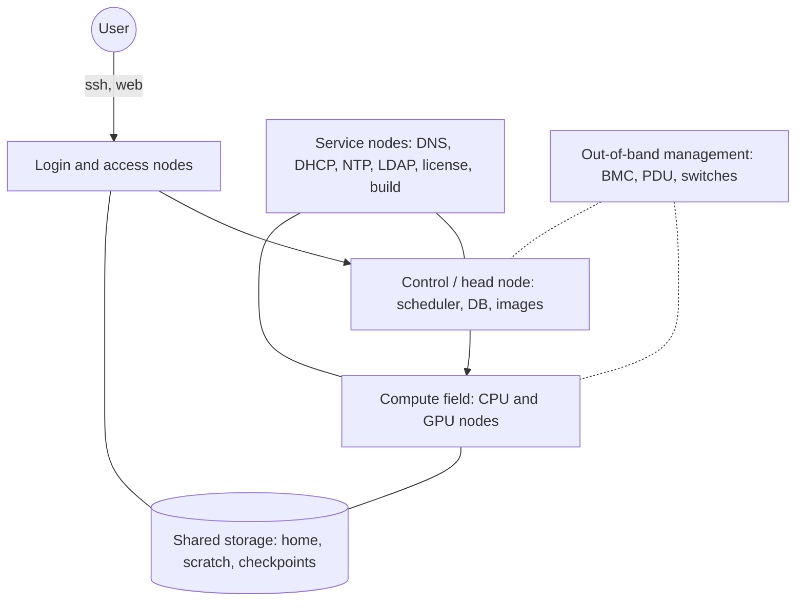

# 6.2 Cluster anatomy: head, login, compute, storage and management nodes

| Field | Value |
|---|---|
| Level | Beginner |
| Priority tier | 1 |
| Lab venue | Any machine with Python 3; `cluster_anatomy_lab.py` runs 3 checks locally and cluster design exercises are **untested** here |
| Part | Part 6: HPC and Slurm |
| Status | Drafted |

## Why this matters for AI infrastructure

Every AI cluster, whether it runs Slurm, Kubernetes, or both, is built from the same handful of node roles and networks. Production incidents almost always trace back to the wrong workload running on the wrong node or across the wrong network. A researcher launches a heavy preprocessing script on the head node, or a remote IDE plugin paralyzes a shared login server. An NFS service co-located on a compute node starves an AllReduce collective, or a management network shares a switch with compute traffic. Knowing the standard anatomy lets you read an architecture diagram in one pass, ask the right questions in a design review, and place new services where they belong. It also gives you the working vocabulary of NVIDIA Base Command Manager, Slurm, and cluster procurement specifications covered across chapters 6.7 onwards and Part 8.

## Prerequisites and outcomes

You need Chapter 6.1, Part 1 for Linux administration, and Part 2 for networking basics. After finishing this chapter, you will be able to:

- Name each node role in an HPC or GPU cluster, what runs on it, and what must never run on it.
- Describe the separate networks of a modern GPU cluster—compute fabric, storage fabric, in-band control Ethernet, out-of-band management, and external network—and explain why they are separated.
- Compare cluster networking technologies and fabric topologies, including tree, fat tree, hypercube, 3D torus (`[N/2]+[M/2]+[K/2]`), and Dragonfly or Dragonfly+.
- Explain how local disks versus diskless boot, DAS, NAS, and SAN storage, RAID levels, SMP versus NUMA, and the HyperThreading BIOS versus scheduler core declaration trick affect cluster operations.
- Produce a complete cluster planning, documentation, post-build verification, and 8-column maintenance runbook checklist.
- Walk through the lifecycle of a typical user session and batch job, and identify the invisible background services that keep the cluster alive.

## 1. Anatomy of a supercomputer: four layers

Imagine you are handed the budget to build a new supercomputer cluster from scratch. What should you buy first, how do the pieces connect, and which teams do you need in the room? Following Sergey Zhumatiy's framing in *Supercomputers for Linux SysAdmins*, published by Apress in 2025, a supercomputer is easiest to reason about when divided into four big parts:

1. **Hardware infrastructure:** the physical power supply, cooling systems, physical security systems, and the room itself. Power systems include transformers, UPS units, PDUs, and backup generators. Physical security includes cameras, door access cards, and server rack locks. Even when a facilities team owns this layer, the cluster administrator must know its exact limits. You need to verify available kilowatts, cooling reserve, floor loading, unloading routes, and at least **5 to 10 percent power headroom** as discussed in Chapter 6.30.
2. **Compute nodes (the compute field):** the workhorse servers and compute networks where parallel tasks actually execute. Before picking a server configuration, you gather requirements from your users and their computational packages. Ask whether performance depends on a low-latency interconnect, GPUs, high memory capacity, or storage IOPS. Once you define the optimal compute node and acceptable trade-offs, you size the compute field in modular topology blocks.
3. **Compute infrastructure:** the management network, shared storage, storage network, and infrastructure service nodes that tie the compute field into a single complex. Infrastructure nodes include login servers, scheduler controllers, monitoring servers, authentication, and backups. If a hundred compute nodes read or write simultaneously, which is routine for parallel jobs, a single shiny server with one big disk will be swamped and cause job I/O requests to time out.
4. **Software:** the operating system, hardware and network file system drivers, overall cluster provisioning and monitoring tools, the workload management queuing system, compilers, and parallel libraries. Plan the software stack before hardware arrives, because changing system software or the job scheduler later is painful. Always choose standard HPC tools rather than forcing an unfamiliar tool you happened to use in an office job.

A newcomer usually fixates on layer 2, the GPU and CPU servers. Experienced operators spend most of their career engineering and protecting layers 3 and 4.

**Design all four layers together before ordering hardware, because a bottleneck in power, cooling, shared storage, or system software will cripple the most expensive compute nodes**.

> **In one minute:**
> - Every supercomputer consists of four layers: hardware infrastructure, compute nodes, compute infrastructure, and the software stack.
> - Include power for cooling and budget at least `5–10%` electrical headroom; a real-world supercomputer once could not be turned on past `70%` capacity due to insufficient facility electricity.
> - Choose industry-standard cluster management and batch queuing software up front rather than improvising with non-HPC tools.

## 2. Node roles: control, compute, login, service, and storage

In HPC terminology, the word **node** is simply the customary synonym for a server. Depending on the size of a cluster, several logical roles may be combined onto one physical server or split across dozens of dedicated machines. All nodes fall into two broad categories: the **compute field** and **service nodes**.



| Node role | Primary responsibility | What must never happen here |
|---|---|---|
| **Control / head / management node** | Runs the batch scheduler (`slurmctld`, `slurmdbd`), provisioning (`CMDaemon`), and cluster control | Users logging in directly or running compute and compilation jobs |
| **Login / access nodes** | User entry point for editing code, compiling small programs, and submitting jobs | Unbounded CPU and RAM usage, such as runaway VSCode remote plugins or training runs |
| **Compute nodes (compute field)** | Execute scheduled parallel jobs (`slurmd`, GPU drivers, fabric and storage clients) | Co-locating shared infrastructure services like an NFS server, or unmanaged user logins |
| **Pre-/postprocessing & visualization nodes** | Prepare large simulation meshes or datasets (256 GB or more RAM) and render remote graphics | Running long multi-node batch jobs that belong on the compute field |
| **Service & storage nodes** | Dedicated servers for Lustre, WEKA, or NFS, FlexLM licenses, DNS, NTP, LDAP, compilation, data transfer, monitoring, and backups | Mixing critical control-plane databases with heavy user I/O |

### Control / head / management node

One service node is always present in every cluster: the **management** or **control node**, often called the **head node**. It is the brain from which all subsystems are managed:

- **Workload manager controller:** runs `slurmctld` and often `slurmdbd` with its accounting database, covered in Chapter 6.7.
- **Provisioning and image server:** serves DHCP and TFTP or HTTP for PXE network boot, and holds the operating system images for compute nodes, covered in Chapter 6.22. In NVIDIA Base Command Manager, the head node runs `CMDaemon` and manages every node category and image, covered in Part 8.
- **Configuration management and inventory:** holds the cluster database, Ansible or xCAT configurations, and local package repositories.

To protect system services and sensitive databases from unauthorized access, large complexes strictly separate **control nodes** from **access nodes**. Access nodes handle user logins, while control nodes operate the task management system. A tiny lab cluster might combine all service roles onto one physical box. Production clusters, however, should deploy **at least two control nodes** in an active/passive high-availability pair alongside one or more dedicated login nodes, as covered in Chapters 6.15, 6.27, and 8.12.

### Compute nodes (the compute field)

The workhorse of the cluster is the **compute field**, also called the counting field. In a modern AI cluster, these are the HGX or DGX servers packing eight GPUs, two CPUs, and multiple high-speed NICs, covered in Part 9. Two rules govern compute node hardware and software:

- **Keep node configurations homogeneous and balanced:** The more uniform your compute nodes are, the easier it is to manage images and schedule parallel tasks. Only create mixed hardware configurations when you are certain that all of them will be actively utilized. Organize distinct hardware configurations into separate scheduler **partitions**, covered in Chapter 6.8, plus an optional small **test partition** with a short runtime limit of `15–20 minutes` for quick job debugging. Within each node, balance CPU cores, memory channels, GPUs, and fabric bandwidth so no internal bottleneck starves the processors. Users should never log into compute nodes directly except through the scheduler, where sites that permit SSH attachment during an active job enforce it via `pam_slurm_adopt`.
- **Weigh local disks against diskless booting, and strip unneeded daemons:** Installing local hard drives or NVMe SSDs in compute nodes has both pros and cons. The minuses are extra space, power consumption, heat dissipation, higher probability of failure, and high purchase cost. Enterprise NVMe drives are expensive and require keeping a spare count in stock or buying a support contract, which is especially relevant in high-density blade or GPU servers. The pluses are installing a local copy of the OS—which simplifies power-on and speeds up loading system libraries at program start—and adding local swap space and a local `/tmp` directory, which greatly improves memory efficiency. Whether booted locally or over the network, keep the compute node software configuration as light as possible. Do away with unnecessary services like local mail, `cron`, `networkmanager`, `ModemManager`, and `acpid`, and use precreated device files instead of dynamic rules where possible. The essential services on a compute node are `sshd`, the network file system client, the scheduler daemon `slurmd`, hardware drivers, and node monitoring.

### Login nodes (access, submit, and gateway nodes)

Login nodes are the user-facing front door. Users connect via `ssh` or a web portal, covered in Chapter 6.25, to edit files, compile code, submit batch jobs with `sbatch`, check queues with `squeue`, and transfer files. Shared software trees on login and compute nodes are often served from read-mostly NFS or CVMFS and exposed via environment modules, as covered in Chapter 6.6. Never share login nodes with control or core service nodes, and enforce strict per-user CPU, memory, and process limits using cgroups and `pam_limits`.

As Zhumatiy notes from modern 2025 cluster operations, many users streamline their workflows using IDE plugins such as **VSCode remote**. At first glance those plugins make remote work with the cluster easier. In practice, many of those plugins—and VSCode in particular—consume huge amounts of system CPU and RAM and can paralyze a shared login node. Enforce strict per-user resource slices and dedicate separate **compilation nodes** when your cluster runs multiple OS versions or heavy software builds.

### Service nodes, license servers, and pre-/postprocessing nodes

Every server not included in the compute field is a **service node**. **Combining the functions of a compute node and a service node, such as an NFS server, is strongly discouraged.** Doing so leads to unbalanced task operation and an increased probability of service failure. Common service node roles include:

- **License server and MAC address preservation:** Commercial software packages often rely on a dedicated license server running a manager such as FlexLM. Putting license services on a separate machine protects license files from theft and improves fault tolerance. **Always record the MAC address of the license server in your documentation**. If the server is suddenly replaced, setting the old MAC address on the new server is enough for most programs to keep working immediately. You can then request a formal license reissue for the new hardware's real MAC address without downtime.
- **Pre- and postprocessing nodes (`256 GB` or more RAM) and visualization nodes:** Input data preparation and output data processing nodes are very common in modern complexes. They are equipped with a larger amount of RAM than standard nodes—`256 GB` or more—which is critical for preparing large tasks and processing calculation results. **Visualization nodes** add dedicated graphics cards for processing visual information, such as 3D meshes, and streaming the finished image over the network to a remote user.
- **Storage, data-transfer, compilation, auth, monitoring, and backup nodes:** Storage nodes connect to disk arrays to form distributed storage across chapters 6.18 to 6.20 and Part 13. Dedicated data-transfer nodes (DTNs), software deployment servers, authorization servers (LDAP in Chapter 6.24), remote journaling and monitoring servers (Chapter 6.26), and backup servers (Chapter 6.27) round out the service fleet.

**Keep compute nodes stripped down to essential daemons, never co-locate an NFS or management service on a compute node, cap VSCode and user processes on login nodes, and document your license server's MAC address**.

> **In one minute:**
> - Separate control nodes (`slurmctld`, provisioning, at least 2 for HA) from user-facing login nodes, and never let users run jobs on either.
> - Never combine a compute node with a service node like an NFS server, because background service load unbalances tightly coupled parallel jobs.
> - Enforce strict resource limits on login nodes to prevent VSCode remote plugins from paralyzing the host, provision `256 GB` or more of RAM on pre-/postprocessing nodes, and record your FlexLM license server's MAC address for instant failover.

## 3. The networks, Table 4-1 latencies, and fabric topologies

A modern HPC or GPU cluster uses several physically or logically separate networks. This separation ensures that a storage backup or management scan never disturbs microsecond collective communication.

| Network | Purpose | Typical technology | Operational characteristics |
|---|---|---|---|
| **Compute (communication) network** | High-speed data exchange (MPI, NCCL) between parallel tasks across compute nodes | InfiniBand (SDR to NDR/XDR), RoCEv2 Ethernet (100–800G), or Cray SlingShot | Lowest latency and highest bandwidth; connects all compute nodes; isolated from external traffic |
| **Control (in-band service) network** | Remote node access, launching tasks, monitoring, and cluster control | 1 / 10 / 25 / 100 GbE Ethernet | Connects all cluster nodes; standard TCP/IP |
| **Storage & out-of-band service networks** | Parallel file system traffic, plus dedicated IPMI, Redfish, and iKVM BMC management and hardware barrier sync | High-speed Ethernet or IB for storage; dedicated 1 GbE switch fabric for BMCs and PDUs | Out-of-band BMC network works even when the node OS is powered off; strictly access-controlled in Part 7 |
| **External network** | User and administrator access from the corporate intranet or internet, plus dataset transfers | Routed Ethernet with firewall, NAT or proxy, and reverse proxy or port forwarding | Compute, storage, and internal service nodes have no public or corporate IPs; outbound access uses NAT or proxy |

Decide subnets for each network up front with room to grow, and name interfaces consistently—for example, `node042`, `node042-bmc`, and `node042-ib0`, matching host `042` across every subnet as discussed in Chapter 2.30. Do not forget the **external network**: if users load a lot of data, it can easily become a bottleneck. Compute nodes, storage servers, and most service nodes do not have direct access to the external network or public IP addresses. Instead, they reach the outside world via NAT or proxy, while admins reach internal dashboards via port forwarding or a reverse proxy.

### Network throughput, latency, and Table 4-1 comparison

Two basic parameters characterize network capabilities:

- **Throughput:** how much information can be transmitted per second. Network equipment manufacturers specify peak throughput, whereas in real applications the speed is typically **`1.5–2` times lower than peak**. With low bandwidth, data exchange lags behind computation and nodes spend time waiting for data over the network.
- **Latency (delay):** the net time required to transmit a **zero-length message**, governed by the time taken by network devices and the system to prepare for transmitting and receiving information. If a task exchanges data frequently on a high-latency network, nodes spend most of their time on message preparation rather than data transfer.

Table 4-1 from *Supercomputers for Linux SysAdmins* Chapter 4 summarizes common cluster networking technologies. Myrinet is historical, while SlingShot is a proprietary technology by Cray, now part of Hewlett-Packard. Prices range from about `$1,000` per high-speed network card to `$10,000` to `$1,000,000` and above for a switch or communicator:

| Technology | Throughput (`SCL` Table 4-1) | Latency ($\mu$sec) | MPI latency ($\mu$sec) |
|---|---|---|---|
| **Gigabit Ethernet** | Peak – `1000 Mbit/sec` (`125 MB/sec`), MPI – `60–120 MB/sec` | `30–100` | `50` |
| **10-Gigabit Ethernet** | Peak – `10 Gbit/sec` (`1.2 GB/sec`), MPI – `700–900 MB/sec` | `9` | `25–30` |
| **100-Gigabit Ethernet** | Peak – `100 Gbit/sec` (`1.2 GB/sec` in the book's table) | `0.3–1` | `1–3` |
| **Myrinet 2000, Myrinet-10G** | Peak `2 Gbit/sec` (`10 Gbit/sec`) full duplex; TCP/IP `1.7–1.9 Gbit/sec` (`9.6 Gbit/sec`); MPI up to `200 MB/sec` (`400 MB/sec` duplex) | `2` | `10` |
| **InfiniBand** | `10 to 4800 Gbit/sec` or higher, implementation dependent | `0.1–0.6` | `1–3` |
| **SlingShot** | Peak – `200 Gbit/s` | `0.2–1.2` | `4–5` |

### Fabric topologies and the 3D torus hop formula

Topology bottlenecks can negate high network speeds. Connecting two switches with a single link creates an immediate choke point. Connecting them with parallel links in standard Ethernet causes the Spanning Tree algorithm to leave only one link running while placing the others in standby. To use parallel links, you must configure link aggregation (EtherChannel, bonding, or trunking) using identical standards on both switches. InfiniBand's subnet manager natively supports multiple routes across star, tree, fat-tree, hypercube, torus, and Dragonfly topologies:

- **Tree (star):** typical Ethernet topology where Spanning Tree blocks parallel links unless aggregated.
- **Fat tree:** either a tree with higher aggregated link throughput at upper levels, or multiplying upper-level switches so two or more root/spine switches each connect to every lower-level leaf switch. This distributes traffic and allows easy recovery if any non-leaf switch fails.
- **Hypercube:** built by taking two `(N-1)`-dimensional hypercubes and connecting corresponding vertices, where each vertex in practice is a leaf switch with connected nodes. It guarantees no more than **`N` hops** between any two vertices, at the cost of complicated and expensive cabling.
- **Multidimensional torus:** similar to a hypercube, but each dimension has multiple vertices closed into a loop. In a three-dimensional (3D) torus with dimension sizes `N`, `M`, and `K`, the maximum number of hops between any two vertices is:

```text
Max hops (3D torus) = [N/2] + [M/2] + [K/2]
```

Here `[X]` is the integer part of `X`. Using `torus_3d_max_hops()` in `code/part06/cluster_anatomy.py`, an `8 x 8 x 8` torus has a maximum of `12` hops.
- **Dragonfly and Dragonfly+:** bottom-level switch groups have all-to-all connections within the group, and groups connect to other groups at the next level. Basic Dragonfly connects groups all-to-all; Dragonfly+ connects each member to a subset of neighbor group members, reducing required switch ports and cables while keeping average hop counts low.

**Isolate compute, storage, control, and BMC networks, and size your fabric topology so inter-switch uplinks never bottleneck collective traffic**.

> **In one minute:**
> - Separate the compute fabric, in-band control network, storage network, out-of-band BMC network, and NATed external network, and use consistent interface names like `node042`, `node042-bmc`, and `node042-ib0`.
> - Real application throughput is typically `1.5–2` times lower than vendor peak, and MPI latency drops from `50 us` on 1 GbE to `1–3 us` on 100 GbE and InfiniBand.
> - An `N`-D hypercube bounds path length to `N` hops, while an `N x M x K` 3D torus bounds maximum hops to `[N/2]+[M/2]+[K/2]`.

## 4. Storage access methods, RAID levels, SMP vs NUMA, and hardware features

Chapter 4 of *Supercomputers for Linux SysAdmins* also walks through two hardware domains that every cluster administrator must configure. First is how external storage is attached and protected. Second is how multiprocessor memory and threads are exposed to the scheduler.

### DAS, NAS, SAN, multipath, and RAID levels (`0` through `60`)

External storage systems host shared software packages, user home directories, and temporary scratch space. Based on access method, storage is categorized into **Direct Attached Storage (DAS)** and **Network Attached Storage (NAS)**. NAS servers in turn can connect to disk arrays via a dedicated **Storage Area Network (SAN)**.

- **DAS:** connected directly to a storage node or management node via SATA, SAS, or FibreChannel, appearing in the OS as a local disk device.
- **NAS:** provides file-level access over a network using network file system protocols such as NFS or SMB/CIFS, or distributed across multiple storage nodes as in Lustre. SMB and CIFS were originally developed by IBM and used in Microsoft systems; Zhumatiy advises against using CIFS on clusters due to unexpected implementation problems. NAS systems can also expose data via FTP, HTTP, or iSCSI.
- **SAN and multipath:** storage devices connected via a dedicated SAN appear to the OS as locally attached block devices. Duplicate switches provide multiple routes—one primary and one or more backup routes. If a component on the primary route fails, **multipath** switches to a backup route instantaneously without user impact, though some capricious storage hardware requires nonstandard multipath drivers. Because a SAN exports block devices rather than a file system, **you must not mount one SAN block device on more than one node at once** (aside from specialized heartbeat or cluster database setups).

Storage systems use **RAID** to combine equal-capacity disks at the block level for speed and fault tolerance.

| RAID level | Block layout and redundancy mechanism | Speed and fault-tolerance trade-off |
|---|---|---|
| RAID-0 | Alternates blocks across disks (`block0` on disk 1, `block1` on disk 2) | Highest sequential write speed; zero fault tolerance |
| RAID-1 | Mirrors identical blocks across all disks | Highest fault tolerance, surviving `N-1` disk failures at 50% capacity cost |
| RAID-2, 3, 4 | Hamming code redundancy (RAID-2) or striping with a dedicated checksum disk (RAID-3 and RAID-4) | Not used in practice because RAID-5 gives better speed and reliability |
| RAID-5 | Combines blocks into stripes of typically 3–5 disks with 1 interleaved checksum block per stripe | Survives 1 disk failure with less redundancy than RAID-1, but writing a single block requires reading the entire stripe to compute the new checksum |
| RAID-6 | Striped array with 2 independent checksum blocks per stripe | Survives 2 simultaneous disk failures; higher write cost |
| RAID-10, 50, 60 | Two-level arrays (lower level first, upper level second): RAID-0 built from RAID-1, RAID-5, or RAID-6 arrays | Combines RAID-0 stripe speed with RAID-1, RAID-5, or RAID-6 redundancy |

### SMP vs NUMA, process/memory pinning, HyperThreading trick, and RDMA vs RoCE

To scale server compute power before multicore chips existed, manufacturers installed multiple single-core processors—often two to eight—on a common system bus with uniform memory access, called a **Symmetric Multiprocessor (SMP)** system. Modern multicore processors place multiple cores on one chip and use **Non-Uniform Memory Access (NUMA)**. Each processor socket has its own memory channel and local RAM for fast access, while reaching another socket's RAM crosses a shared interconnect with slower access. Hardware keeps the CPU caches coherent across sockets.

Because the Linux scheduler gives each active process a time slice of a few milliseconds before switching it, an unpinned process often "walks" across all cores in the system. Core migration hurts cache efficiency on SMP systems and causes large cross-socket memory delays on NUMA systems. Parallel launchers (`numactl`, MPI, and Slurm in Chapter 6.12) enforce **processor affinity (processor pinning)** and **memory affinity**, binding each parallel process to a specific NUMA node for both CPU cores and memory allocation. In production parallel runs, NUMA binding is obligatory so job speed stays fast and repeatable.

Many processors also implement **HyperThreading (HT)**, representing each physical core as two logical cores sharing computational units. Because parallel HPC and AI codes already utilize execution units efficiently, HyperThreading rarely speeds them up and often slows them down due to contention. Zhumatiy recommends a practical trick, modeled in `scheduler_declared_cores()` in `code/part06/cluster_anatomy.py`:

1. **Enable HyperThreading in the BIOS** of each compute node, exposing 256 logical CPUs on a dual-socket 64-core server.
2. **Configure the job scheduler with the physical core count (128 cores)**, as if HyperThreading were disabled.
3. Compute jobs allocate at most 128 tasks (one per physical core), while node system services use the extra logical threads with minimal impact on user calculations. If your scheduler auto-detects core counts and cannot be overridden, disable HyperThreading in the BIOS instead.

Across nodes, **Direct Memory Access (DMA)** lets a local disk or NIC read and write main memory without CPU participation. InfiniBand adapters extend DMA across the fabric to access a remote node's memory without involving the remote CPU—**Remote Direct Memory Access (RDMA)**. **RoCE (RDMA over Converged Ethernet)** runs InfiniBand RDMA verbs over supported Ethernet cards to reduce cost, though standard Ethernet has higher latency and lacks InfiniBand's subnet manager, adaptive topologies, and rich built-in fabric counters.

**Bind every parallel rank to its local NUMA cores and memory, and declare only physical cores to the scheduler when BIOS HyperThreading is left on for system daemons**.

> **In one minute:**
> - Use NAS and parallel file systems for shared directories, never mount a raw SAN block device on multiple nodes without a cluster filesystem, and remember that RAID-5 and RAID-6 use 3–5 disk stripes while RAID-10, 50, and 60 nest RAID-0 over RAID-1, 5, and 6.
> - Eliminate process migration jitter on NUMA servers with obligatory CPU and memory affinity (`numactl` and MPI binding).
> - Keep BIOS HyperThreading enabled for background OS daemons while configuring the job scheduler with the physical core count (128 declared cores on a 256-thread node).

## 5. Planning, hardware consistency, documentation, and post-build verification

When you move from high-level requirements to concrete vendor quotes and contracts, Chapter 3 of *Supercomputers for Linux SysAdmins* highlights four planning rules that prevent expensive mistakes:

1. **Post-warranty support contract trap:** Ask management beforehand how the complex will be supported after the initial 5-year vendor support contract expires. Management might say, "we have 5 years support, don't worry, and then we'll see." Write a formal memo noting that even a small hardware break can stop the entire service. State clearly that you do not approve operating without an active service contract.
2. **Strict hardware and firmware consistency:** Specify in the contract and verify on delivery that all memory modules, motherboards, firmware, BIOS versions, network cards, and GPUs are identical across similar servers. That includes exact GPU part numbers and VBIOS versions. Never listen to a salesperson claiming "this is the same model, just a bit modern part number, it is even better"—mixed hardware causes different driver and application behavior that wastes weeks of debugging.
3. **Power and cooling estimation:** Sum the power of all servers, network switches, storage, cooling systems, and UPS units. Multiply your rough server sum by `1.5` or `2` and work with facility power engineers on a professional estimate with `5–10%` headroom. Check whether you need a backup generator or if outages are short enough for a clean UPS shutdown.
4. **Colocation and remote hands:** If you use a remote data center or colocation facility, define upfront how easily you can get physical access. Clarify how remote engineers can help perform tasks, which tasks remote hands can do, and which tasks you must do yourself. Also plan how users will reach the supercomputer and upload or download huge datasets through your external switch, NAT, and firewall.

### Remote sites, network paths, and where the data lives

Many of the hardest problems in a cluster show up in the first week, as users who cannot reach the machine or uploads that crawl. Most of them can be seen on paper during planning. Ask these questions before the contract is signed.

If the cluster sits in a remote location, such as a data center colocation facility, start with physical access. Find out how easily your team can get inside, and how remote engineers can help you do the work. Then decide which tasks they can do for you and which ones your own team must do.

Next, plan the network path. Ask how your users will reach the supercomputer and how data will get in. If users must upload and download huge amounts of data, you may need a better network channel than you first assumed. A switch of a higher class may be needed to carry data from the outside into the storage.

The external connection must carry user data in both directions. If you use NAT, which is the typical choice, the switch must be powerful enough to handle that translated traffic. Do not forget the firewall and other security features. A cluster inside the corporate network should still not be fully open, so talk to network security specialists when you are unsure.

The high-performance network needs its own review. Topology matters most here, so minimize the number of hops between nodes. Remove congestion points and single points of failure as well. Compare topologies with an expert, looking at strengths, weaknesses, cost, cabling complexity, and room for future growth.

Finally, decide where the data lives. Plan long-term storage, scratch storage, and backups, and separate hot data from cold data. Users may also need pre- and postprocessing, so ask how quickly that data must reach the compute nodes. The book suggests reading its chapter on network file systems before you make the final storage decision.

### The 19-point planning checklist and the 7 scenario drills

Review and document Zhumatiy's 19-point planning checklist before deployment:

1. **Compute hardware:** match to tasks and expected performance.
2. **Infrastructure:** power, cooling, and connectivity.
3. **Remote access:** policies, special access, and MFA codes.
4. **Physical security:** room access, server access, cameras, and card policies.
5. **Services and service nodes:** at least a dedicated login node and file system server(s).
6. **High availability and load balancing** for service nodes and services.
7. **Network topology:** minimizing hops, congestion points, and single points of failure.
8. **Authentication:** local directory and sync with existing corporate systems.
9. **Storage:** long-term storage, scratch storage, quotas, and high availability.
10. **Access from internal and external networks.**
11. **Security policies:** passwords, two-factor authentication (2FA), SSH keys, local trust zones, regular file checks, vulnerability scans, security update policies, and firewalls.
12. **Backups and restore** policies and hardware.
13. **Cluster management software.**
14. **Computing tasks management software.**
15. **Jobs policies** and accounting rules (Chapter 6.9).
16. **Monitoring** of hardware, facility, and tasks.
17. **Baseline benchmarking** suite (Chapter 6.28).
18. **Cluster resources for users:** access, tracking, and revoking.
19. **Capacity planning procedure.**

Next, rehearse seven typical operational scenarios and write down how you will act in each case.

- If you suspect a **bad node**, what are your exact steps to prove it is bad and replace it?
- What are your steps if you suspect **network problems**?
- What if you find that your nodes have **different firmware versions** that affect application performance?
- What if your **management node running the job manager fails**?
- How will you **transfer data** to the cluster and back, and how much time does it take?
- How do you **add a user** to the cluster and **remove** them from the cluster?
- How do you plan to perform **security checks and updates**?

### SysAdmin and User documentation checklists

Do not put documentation off until the last minute. Maintain two distinct sets of documentation—one for **SysAdmins** and a collaborative wiki or portal for **users** where users can ask questions or leave comments.

| Documentation platform | Required contents (`SCL` Chapter 3) |
|---|---|
| **SysAdmin documentation** | Hardware configurations of each node type; network topology and hardware; installed software, license info, and special configurations; system settings and limits; admin and maintenance logins and password access; policies to add accounts and software; backup and restore schedules; maintenance procedures; important contacts (stakeholders, suppliers, engineers, tech support, power/cooling/physical access teams); incident and maintenance journal; **temporary changes** (such as changing quotas for a month or granting temporary access to external tech support); and **HOWTOs** (close/open cluster in emergencies, change quotas, add/delete/update accounts, reboot a proprietary license server, inform users of problems, run basic tests) |
| **User documentation** | How to submit a request for access, full process, and timing; how to get a password, generate SSH keys, log in for the first time, and take first steps; what the cluster is (hardware, software, file systems, links); how to copy data, prepare a task, and run, check, or cancel a job; policies and limits; and a growing "How to..." FAQ for unexpected user questions |

### Skills, post-build verification, the 5 check types, runbook schema, and node hardening

To run the complex after build, Zhumatiy recommends mastering basic networking, advanced `bash` scripting (plus `awk`), an editor (`vim`, `nano`, or `emacs`), `screen` or `tmux`, and basic Python and C++. You also need Ansible or xCAT, Lmod or Spack, and a clear understanding of **how containers work under the hood**. Knowing Docker commands is not enough; you must understand how the host kernel technology works, along with all hardware and software features and limitations. When a cluster is built, set up, tune, and verify at least these 11 items:

1. DNS server.
2. NTP sync (internal and external).
3. SSH to all nodes, including service nodes.
4. Shared file system performance check on both the login node and compute nodes.
5. Network performance benchmark.
6. Nodes performance benchmark on each node individually and across all nodes.
7. User `add`, `block`, `unblock`, and `delete` check.
8. Partition `add`, `modify`, and `delete` check.
9. Compute partition quotas and limits check.
10. Monitoring check and alerts check.
11. Test data backup and restore.

Write all checks and baseline numbers from HPL, `NCCL-test`, IOR, STREAM, and FIO into runbooks and playbooks. Plan at least one maintenance window per year for firmware upgrades, part replacements, and software upgrades, and organize checks around **five standard check types**:

1. **Full cluster check:** after each maintenance.
2. **Performance verification:** after each maintenance.
3. **Node performance check:** after a node fix or replacement.
4. **Node readiness check:** before and after each job run (Chapter 6.14).
5. **Node health check:** periodically on the nodes.

For any serious activity—maintenance, software or hardware installation or upgrade, or moving data—use a peer-reviewed **runbook spreadsheet** with these eight standard columns (`validate_runbook_schema()` in `code/part06/cluster_anatomy.py`).

| Runbook column | Purpose |
|---|---|
| `phase` | Stage of the maintenance or migration window |
| `action` | Concrete step to perform |
| `start` | Scheduled or actual start time |
| `duration` | Expected time required for the step |
| `dependency` | Prerequisite steps that must finish first |
| `owner` | Person responsible for executing the step |
| `status` | Current completion state |
| `info` | Commands to run, links to docs, and optional rollback action description |

Finally, apply four operational rules across your nodes.

- **Use standard environment modules for `PATH`:** Do not add new software paths into random bash profile files (`bashrc`, `profile`, `pam_env`). Use environment modules everywhere and document the single approach so you can always trace `PATH` issues.
- **Debug issues in one consistent direction (top-to-bottom or client-to-server):** If a Slurm client command fails, check whether the server daemon is running and whether it is listening on its network socket (`ss` or `netstat`). Then verify whether routing and firewall rules allow the client to reach it and whether the client has the right server address, using `strace` for DNS or connection calls and `tcpdump` for packets.
- **Replace SSH cron storms with local `systemd` timers:** Disable `cron` on compute nodes and never use a central cronjob that SSHes to all nodes to run checks. Instead, run local `systemd` timers on each node that save results to a network file system, database, or message queue for a service node to process.
- **Install `molly-guard` and `auditd`:** Install `molly-guard` on service and head nodes to prevent accidental reboots, tune `auditd` to log critical command executions, and follow the **NIST SP 800-223** (*High-Performance Computing Security*) baseline.

**Never open a new cluster to users until all 11 post-build checks, baseline benchmarks, SysAdmin and User docs, and `molly-guard` protections are in place**.

> **In one minute:**
> - Enforce identical part numbers and firmware (BIOS, VBIOS) in procurement contracts, budget `1.5–2x` server power for total facility cooling and power with `5–10%` headroom, and never operate without a post-warranty support plan.
> - Verify all 11 post-build items, establish the 5 check types, and track every maintenance in an 8-column runbook (`phase`, `action`, `start`, `duration`, `dependency`, `owner`, `status`, `info`).
> - Protect service nodes from accidental reboots with `molly-guard`, replace SSH cron storms with local `systemd` timers, and follow NIST SP 800-223.

### Post-build tuning, deployment planning, and kernel hints

The eleven post-build checks are the minimum, not the full list. Once they pass, review your documents and add anything still missing. Keep the benchmark numbers you measured, because you will compare against them at every maintenance window.

Plan the initial software deployment before the hardware goes live. Decide how you will handle updates and upgrades too. There are many options, so choose one deliberately and document it.

Tune the node and kernel settings with the same discipline. Use standard solutions when they exist, and do not multiply complex fixes. Load only the kernel modules you need. Disable security mitigations (`mitigations=off`) only when that is safe for your site, and disable IPv6 when your cluster does not need it.

## 6. How a supercomputer does the job: user session, job life cycle, and what is hidden

Chapter 6 of *Supercomputers for Linux SysAdmins* connects the physical cluster anatomy to the software stack. That stack includes the operating system, hardware and network file system drivers, overall system control and monitoring software, the task control queuing system, applied parallel libraries (MPI, CUDA), and compilers and math libraries (BLAS, FFT). When users develop code or run packages like VASP or NAMD, compiling directly on the target architecture enables hardware-specific compiler optimizations that maximize performance.

### A typical user session and the job life cycle

1. **Connect to the access node:** From a workstation or laptop, the user opens an `ssh` client (`PuTTY`, `OpenSSH`, or an IDE SSH plugin) and authenticates with a password, private key, or 2FA. Once on the access node, the user edits and compiles parallel programs, copies input data over `sftp`, or manages files with Midnight Commander (`mc`).
2. **Queueing phase (`sbatch` / interactive):** The user submits a job command to a job queue (partition), specifying the executable path, arguments, number of parallel MPI processes, nodes, memory, GPUs, and software licenses (Chapter 6.11). Because batch I/O is redirected to files, the user can log out and check status or download results later, or run an interactive job attached to their terminal.
3. **Scheduling and prologue phase:** The job management system regularly reviews the queue. When the job reaches the front of the queue or fits available resources, the scheduler selects the compute nodes, notifies them, and runs an initialization script called the **prologue (`prolog`)**.
4. **Startup and running phase:** A startup process such as `mpirun` or `mpiexec` starts on a compute or management node, receives the allocated node list, and starts the job workflows across the compute nodes. The management system monitors the running job and supports administrative actions such as changing job priority, blocking a queued job, or suspending a running job.
5. **Termination and epilogue phase:** When the startup process finishes or the job is forcibly canceled, the control system enters the termination phase. It runs the **epilogue (`epilog`)** script to ensure all user processes have exited and temporary directories are cleaned up, then marks the job completed and logs its usage.

### What is hidden from the user (and why "toy" laptop clusters fail at 20 nodes)

All of the steps above are visible to the average user. What remains behind the scenes—invisible to the user, yet vital for the administrator—are the background services that ensure correct operation of the supercomputer:

- **Account management** across all nodes.
- **Distributed file system** operation.
- **Quota management** and enforcement.
- **Remote node monitoring** and health checks.
- **Statistics collection and central journaling.**
- **Equipment and facility infrastructure monitoring.**
- **Emergency notification and automated UPS shutdown.**
- **Backups** of user and system state.

Why does this invisible layer matter? You can build the simplest "toy" computing cluster on your knee. Take **2 laptops**, connect them to a common network, set up passwordless `ssh`, run an NFS server on one laptop, mount it on the other, and run MPI programs. However, when you try to connect **20 laptops instead of 2**, problems arise immediately. The network cannot cope with the collective load, the single NFS laptop slows down, one laptop hangs, and it takes half an hour just to figure out what happened. Turning a pile of machines into a real supercomputer requires the disciplined node separation, fabric topology, and invisible services covered in this chapter.

**Make your cluster's background services—health checks, time sync, quotas, monitoring, and epilogue cleanup—completely invisible to users when healthy, and noisy to administrators the second a component drifts**.

> **In one minute:**
> - A batch job moves through five phases: queueing (`sbatch`), scheduling and allocation, `prolog` initialization, parallel startup and execution (`mpirun` or `srun`), and `epilog` cleanup and accounting.
> - Account sync, distributed storage, quota enforcement, node and facility monitoring, emergency UPS shutdown, and backups operate invisibly behind every user session.
> - A 2-laptop `ssh` and NFS setup breaks down at 20 nodes because unmanaged networks, single-node NFS, and manual fault hunting cannot survive parallel load.

## 7. Merging roles in small clusters and mapping to Kubernetes

| Cluster scale | Reasonable role consolidation | Dangerous anti-pattern to avoid |
|---|---|---|
| **Lab cluster (`2–8` nodes)** | Head and login on 1 server; NFS from head; 1 Ethernet for control and storage | Letting users run compute jobs on the head node; running without config and home backups |
| **Small cluster (`10–100` nodes)** | Active/passive head pair, 1–2 login nodes, service VMs on the head pair, 1 shared storage tier | Single unbacked-up head node; co-locating NFS on a compute node |
| **Medium to large (`100+` nodes)** | Dedicated head pair, multiple login, DTN, and pre/post nodes, separate service nodes, dedicated storage fabric | Co-locating user login or heavy services on the scheduler control plane |

When you compare a classic Slurm HPC cluster with a Kubernetes GPU cluster in Parts 5 and 11, the physical anatomy is nearly identical even though the software nouns change.

| HPC / Slurm concept | Kubernetes analogue |
|---|---|
| Control / head node (`slurmctld`, `slurmdbd`) | Control-plane nodes (`kube-apiserver`, `etcd`, `kube-scheduler`, `kube-controller-manager`) |
| Login / access node | Bastion host, `kubectl` client workstation, or interactive workspace Pod |
| Compute node (`slurmd`) | GPU worker node (`kubelet`, `containerd`, and NVIDIA Device Plugin or DRA) |
| Partition (queue) | NodePool or `NodeGroup` with hardware labels, taints, and Kueue `ClusterQueue` |
| Batch job (`sbatch`) | `Job`, `Indexed Job`, `JobSet`, `PyTorchJob`, or `MPIJob` |
| Environment modules (`Lmod`) | OCI container images |
| Provisioning (`BCM`, `xCAT`, `Warewulf`) | `Cluster API`, `Metal3`, `Tinkerbell`, or cloud node-pool image templates |

**Consolidate service roles onto VMs in small clusters if needed, but never merge a compute node with a service node or allow user jobs on the control plane**.

> **In one minute:**
> - In small clusters (`10–100` nodes), run service roles as isolated VMs on a redundant head pair rather than on compute nodes.
> - Kubernetes Control Plane, Worker Node, NodePool, and JobSet map directly onto HPC's head node, compute node, partition, and batch job.

### Running the cluster anatomy in the cloud

Say you need to run a large simulation next month, but you have no cluster and no room to build one. You can try to get access to an existing HPC cluster, or build your own in the cloud. Some providers sell special HPC instances, which are virtual machines with almost direct access to a fast network and to accelerators. Even so, performance stays below real hardware. Depending on the provider, the drop can be 5-15%, and whether that is acceptable is your call.

Cost comes first. Estimate the bill carefully before you commit, because building and running an on-premises cluster can turn out cheaper over the long run. The cloud still makes a good playground, though. You can test technologies and software there before you put them into production.

Check the network before you rent. Find out which network type the instances use, and what each instance includes. A high-performance, low-latency network often limits how many instances you can connect. Keep all nodes in one performance subnet, such as a capacity reservation or a domain. Otherwise, the overall performance can be times lower.

Shared storage matters just as much. A plain NFS volume is usually not what a cluster needs. If the provider cannot give clear performance numbers, rent a few cheap instances with that file system and run I/O tests. Copy your real pattern. For example, suppose your application saves temporary data every five minutes, and each save is about the size of a compute node's memory. Simulate that save and reload, then time both.

Some providers offer a Slurm-based cluster as a ready option. For simple needs, that can be enough. If the option is missing, or you need features it does not include, build the cluster yourself. Start with Terraform for the initial setup. Then install the software with Ansible or another tool, ideally from a custom image that new nodes boot from. Cluster managers such as BCM can help with this. Test the whole process on cheap instances first.

Use the cloud API for the routine work. You can terminate an instance and bring up a new one, or power a subset of nodes on or off. The API may also expose power consumption, network counters, and node health. Collect whatever the API does not give you directly on the nodes.

The planning checklist in section 5 still applies in the cloud, though some answers shift a little. User management might connect to your corporate login system, or it might stay independent. Node checks and service tickets can often be automated through the provider API.

Many HPC applications run on cloud HPC services today, and in some cases that is the cheapest route. The book names Amazon, Oracle, Google, CoreWeave, Lambda, and HyperStack as examples. Do not underestimate the management overhead, or the narrower choice of hardware. Check network and storage options, traffic charges, charges for nodes that are turned off, and other hidden costs. Run a test, and assess the risks and performance first.

## 8. Lab: size a 32-node GPU cluster and validate its runbook

First, run the self-checking Python lab (`code/part06/cluster_anatomy_lab.py`) locally. It verifies the 3D torus maximum hop formula `[N/2]+[M/2]+[K/2]` (`torus_3d_max_hops`) and the BIOS HyperThreading versus scheduler physical core declaration model (`scheduler_declared_cores`). It also checks the 32-node GPU cluster port and power budget planner (`plan_cluster_power_and_ports`) and the 8-column maintenance runbook validator (`validate_runbook_schema`):

```bash
python3 code/part06/cluster_anatomy_lab.py
```

Next, work through these design steps (**untested** on live hardware):

1. Run `python3 code/part06/cluster_anatomy.py` and inspect the output for a `32`-node GPU cluster (`8` GPUs per node, `10.0 kW` per compute node, `2` login nodes, `2` head nodes, `10%` power headroom). Verify that it requires `256` compute fabric ports, `36` in-band Ethernet ports, `36` out-of-band BMC ports, and `352.0 kW` of budgeted compute power (`320.0 kW` raw plus `10%` headroom).
2. Using `torus_3d_max_hops(8, 8, 8)` and `torus_3d_max_hops(5, 7, 9)`, verify that an `8 x 8 x 8` 3D torus has a maximum diameter of `12` hops (`4 + 4 + 4`) and a `5 x 7 x 9` 3D torus has a maximum of `9` hops (`2 + 3 + 4`).
3. Write an Ansible YAML inventory with groups `head`, `login`, `compute_gpu`, `service`, and `storage`, naming hosts `gpu[001:032]` and `gpu[001:032]-bmc` (or `node042`, `node042-bmc`, and `node042-ib0`) across separate subnets for the compute, control, storage, and out-of-band networks.

## 9. Interview angles

- Walk through the node roles and networks of a 256-GPU cluster. Why is co-locating an NFS server on a compute node a serious mistake?
- Explain the BIOS HyperThreading versus scheduler core-count trick from *Supercomputers for Linux SysAdmins* Chapter 4. When does it help, and when must you disable HT in the BIOS instead?
- Why should you record the MAC address of your FlexLM license server, and how much RAM should pre-/postprocessing nodes have?
- Compare the raw latency and MPI latency of `1 GbE`, `10 GbE`, `100 GbE`, and InfiniBand, and compute the maximum hops in an `N x M x K` 3D torus.
- What are the five post-build and maintenance check types and the eight mandatory columns in a cluster maintenance runbook?

## Exercises

1. **32-Node GPU Cluster Port and Power Sizing (`SCL` Chapters 3 & 4):** Using `plan_cluster_power_and_ports()` in `code/part06/cluster_anatomy.py`, compute the switch ports and power budget with 10% headroom for 32 GPU compute nodes (8 GPUs and 10.0 kW each), 2 login nodes, and 2 head nodes. Why does Zhumatiy recommend multiplying raw server power by 1.5–2.0 when estimating total facility electrical load with power engineers?
2. **Network Latencies (`Table 4-1`) and 3D Torus vs. Hypercube Topologies (`SCL` Chapter 4):** Compare the raw and MPI latencies of 1 GbE (30–100 us and 50 us), 10 GbE (9 us and 25–30 us), 100 GbE (0.3–1 us and 1–3 us), InfiniBand (0.1–0.6 us and 1–3 us), and SlingShot (0.2–1.2 us and 4–5 us). Then use `torus_3d_max_hops()` to compute the maximum hops in an 8 x 8 x 8 (12 hops) and 5 x 7 x 9 (9 hops) 3D torus and compare them with an `N`-dimensional hypercube.
3. **BIOS HyperThreading vs. Scheduler Core Declaration and NUMA Pinning (`SCL` Chapter 4):** Using `scheduler_declared_cores(2, 64, 2)`, explain how leaving HyperThreading enabled in BIOS (256 logical CPUs) while declaring 128 physical cores to Slurm isolates compute tasks. Explain why CPU and memory NUMA pinning are mandatory for multi-node jobs.
4. **Node Role Rules: Local Disks vs. Diskless, License Server MACs, VSCode Traps, and Pre-/Postprocessing Nodes (`SCL` Chapter 4):** Give the pros and cons of local disks on compute nodes, and explain why VSCode remote plugins in 2025 can paralyze login nodes. State the recommended RAM for pre-/postprocessing nodes (256 GB or more), and explain how recording a FlexLM license server's MAC address enables instant hardware replacement.
5. **The 5 Verification Check Types, 8-Column Runbook Schema, and Node Hardening (`SCL` Chapter 3):** List the 5 check types and validate a maintenance runbook header with `validate_runbook_schema()`. Explain why `molly-guard`, `ssmtp` or `nail`, and local `systemd` timers are used on cluster nodes instead of central SSH cron jobs.
6. **The Job Life Cycle and Invisible Cluster Services (`SCL` Chapter 6):** Trace a batch job from `ssh` login through queueing, scheduling, `prolog`, parallel startup (`mpirun` or `srun`), and `epilog` termination. List the background services hidden from the user, and explain why a 2-laptop `ssh` and NFS "toy" cluster fails when scaled to 20 nodes.

## Checkpoint questions (20)

<details>
<summary>1. What are the four main layers of a supercomputer's anatomy (`SCL` Chapter 3), and which layers consume most of an administrator's time?</summary>

1. **Hardware infrastructure:** power (`UPS`, `PDUs`, generators), cooling, physical security, and rack space.
2. **Compute nodes (the compute field):** the servers and compute fabric where parallel tasks run.
3. **Compute infrastructure:** management and storage networks, shared file systems, and service nodes (head, login, monitoring, auth, backup).
4. **Software:** OS, drivers, provisioning, batch scheduler, compilers, and parallel libraries.
While newcomers focus on layer 2, administrators spend most of their time engineering and operating **layers 3 and 4**.
</details>

<details>
<summary>2. How much power headroom does `SCL` Chapter 3 require at minimum, and what rough multiplier estimates total facility power from server power?</summary>

Always plan at least **`5 to 10 percent` power headroom** above your calculated load. Multiply total server power by **`1.5 to 2.0`** for a rough preliminary estimate of total facility power including cooling systems, network and storage gear, and UPS conversion losses. Zhumatiy cites a real supercomputer that could never be powered on above `70%` because facility electricity was undersized.
</details>

<details>
<summary>3. Why are control/head nodes separated from access/login nodes, and how many control nodes should a production cluster have (`SCL` Chapter 4)?</summary>

Separating **access (login) nodes** from **control (head) nodes** protects critical cluster services (`slurmctld`, provisioning, and sensitive user password and accounting databases) from direct user access and runaway user processes. A production cluster should have **at least two control nodes** in an active/passive high-availability pair plus one or more dedicated login nodes.
</details>

<details>
<summary>4. What are the pros and cons of installing local hard drives or NVMe SSDs in compute nodes (`SCL` Chapter 4)?</summary>

- **Cons (minuses):** Extra physical space, higher power consumption and heat dissipation, higher component failure rate, and significant purchase and spare-stock cost, especially for NVMe in high-density blade or GPU servers.
- **Pros (pluses):** Allows installing a local copy of the OS—simplifying boot and speeding up library loading at job launch—and provides local swap space and a fast local `/tmp` directory, improving memory efficiency.
</details>

<details>
<summary>5. Which services should be removed or disabled on compute nodes, and which essential services must remain (`SCL` Chapters 3 & 4)?</summary>

- **Remove or disable:** Local mail servers (`postfix`—replace with a simple smarthost forwarder like `ssmtp` or `nail` via the head node), `cron` (use `systemd` timers instead), `networkmanager`, `ModemManager`, `acpid`, and unneeded kernel modules.
- **Keep only essentials:** `sshd`, the network file system client, the batch scheduler agent (`slurmd`), hardware and fabric drivers, and the node monitoring agent.
</details>

<details>
<summary>6. Why must you enforce strict per-user resource limits on login nodes, especially with modern 2025 developer workflows (`SCL` Chapter 4)?</summary>

In `2025`, many users connect to clusters using remote IDE plugins such as **VSCode remote**. While convenient, each user's remote IDE backend spawns multiple heavy language-server and file-watching processes. Those processes consume large amounts of CPU and RAM and can paralyze a shared login node if per-user cgroup and `pam_limits` caps are not enforced.
</details>

<details>
<summary>7. Why is combining a compute node and a service node (such as an NFS server) on the same physical machine strongly discouraged (`SCL` Chapter 4)?</summary>

Running a shared service like an NFS server on a compute node steals CPU cycles, memory bandwidth, and network interrupts from the parallel compute rank running on that machine. Because tightly coupled parallel jobs run at the speed of their slowest rank, the service load causes severe task imbalance and increases the likelihood of service failure under heavy compute load.
</details>

<details>
<summary>8. Why should you host commercial software license managers (`FlexLM`) on a dedicated service node and record its network MAC address (`SCL` Chapter 4)?</summary>

A dedicated license server isolates sensitive license files from user theft and faults. Because `FlexLM` and similar managers bind licenses to the server's network **MAC address**, recording that MAC address lets you set the old MAC address on a replacement server's NIC if the hardware dies. That restores licensed software across the cluster immediately while you request a formal license reissue for the new hardware's real MAC.
</details>

<details>
<summary>9. What are pre- and postprocessing nodes and visualization nodes, and how much RAM does `SCL` Chapter 4 recommend for pre-/postprocessing nodes?</summary>

**Pre- and postprocessing nodes** are dedicated servers used to prepare large simulation or training inputs and process output data, equipped with **`256 GB` or more of RAM**. **Visualization nodes** add dedicated graphics cards to render large 3D meshes or visual outputs and stream the rendered image over the network to remote users, often serving as pre- and postprocessing nodes as well.
</details>

<details>
<summary>10. How do real application throughput and MPI latency compare across Gigabit Ethernet, 10-Gigabit Ethernet, 100-Gigabit Ethernet, InfiniBand, and SlingShot (`SCL` Table 4-1)?</summary>

Real application throughput is typically **`1.5–2` times lower** than vendor peak throughput:
- **Gigabit Ethernet:** Peak `1000 Mbit/sec` (`125 MB/sec`), MPI `60–120 MB/sec`; raw latency `30–100 us`, MPI latency **`50 us`**.
- **10-Gigabit Ethernet:** Peak `10 Gbit/sec` (`1.2 GB/sec`), MPI `700–900 MB/sec`; raw latency `9 us`, MPI latency **`25–30 us`**.
- **100-Gigabit Ethernet:** Peak `100 Gbit/sec`; raw latency `0.3–1 us`, MPI latency **`1–3 us`**.
- **InfiniBand:** `10 to 4800 Gbit/sec` or higher; raw latency **`0.1–0.6 us`**, MPI latency **`1–3 us`**.
- **SlingShot:** Peak `200 Gbit/s`; raw latency `0.2–1.2 us`, MPI latency **`4–5 us`**.
</details>

<details>
<summary>11. Compare Tree, Fat-Tree, `N`-Dimensional Hypercube, 3D Torus, and Dragonfly/Dragonfly+ network topologies, and write the 3D torus maximum hop formula (`SCL` Chapter 4).</summary>

- **Tree (star):** Standard Ethernet hierarchy; Spanning Tree blocks parallel inter-switch links unless link aggregation (EtherChannel, bonding, or trunking) is configured on both switches.
- **Fat tree:** Multiplies upper-level spine or root switches so every leaf connects to multiple spines, distributing load and surviving non-leaf switch failures.
- **`N`-D Hypercube:** Connects two `(N-1)`-D hypercubes at corresponding vertices; guarantees at most **`N` hops** between any two vertices at high cabling cost.
- **3D Torus (`N x M x K`):** Closed loops in each dimension; maximum hops between any two vertices is **`[N/2] + [M/2] + [K/2]`**, where `[X]` is the integer part of `X`.
- **Dragonfly / Dragonfly+:** Hierarchical switch groups with all-to-all intra-group links and full (Dragonfly) or subset (Dragonfly+) inter-group links for low hop counts with fewer cables.
</details>

<details>
<summary>12. Distinguish `DAS`, `NAS`, and `SAN` storage access methods, and state the golden rule for mounting `SAN` block devices (`SCL` Chapter 4).</summary>

- **DAS (Direct Attached Storage):** Disk arrays connected directly to a host via SATA, SAS, or FibreChannel as local disks.
- **NAS (Network Attached Storage):** Shared file-level storage over NFS (or CIFS/SMB, which should be avoided on HPC clusters).
- **SAN (Storage Area Network):** Redundant block-level storage network using **multipath** for instant path failover. **Rule:** Because a SAN exports raw block devices rather than a file system, **never mount the same SAN block device on more than one node at once** unless using a specialized cluster-aware file system or heartbeat database.
</details>

<details>
<summary>13. Compare `RAID-0`, `RAID-1`, `RAID-5`, `RAID-6`, and nested `RAID-10`/`50`/`60` (`SCL` Chapter 4).</summary>

- **`RAID-0`:** Block striping across disks; highest sequential write speed, **zero fault tolerance**.
- **`RAID-1`:** Full mirroring; survives `N-1` disk failures at `50%` capacity cost.
- **`RAID-5`:** Block striping with **1 interleaved parity block** per stripe (typical stripe width `3–5` disks); survives 1 disk failure, but single-block writes require reading the entire stripe to recompute parity.
- **`RAID-6`:** Block striping with **2 independent parity blocks** per stripe; survives 2 disk failures.
- **`RAID-10`, `50`, `60`:** Two-level nested arrays (lower level first, upper level second): `RAID-0` striped across `RAID-1`, `RAID-5`, or `RAID-6` arrays.
</details>

<details>
<summary>14. What is the difference between `SMP` and `NUMA`, and why are CPU pinning and memory affinity obligatory for parallel jobs (`SCL` Chapter 4)?</summary>

In **SMP (Symmetric Multiprocessing)**, all processors share a single memory bus with equal access latency. In **NUMA (Non-Uniform Memory Access)**, each socket has fast local RAM and slower remote RAM across an inter-socket bus. Without **processor affinity (CPU pinning)** and **memory affinity** (`numactl` and MPI binding), the OS scheduler migrates processes across cores every few milliseconds, invalidating caches and forcing slow cross-socket memory reads.
</details>

<details>
<summary>15. Explain Zhumatiy's HyperThreading (`HT`) BIOS versus scheduler core declaration trick (`SCL` Chapter 4).</summary>

Two compute threads sharing one physical core's execution units often slow down tightly optimized HPC and AI code. Therefore, **keep HyperThreading enabled in the node BIOS, but configure the job scheduler (`Slurm`) with only the physical core count (as if HT were disabled)**. User compute jobs only get scheduled one rank per physical core, while OS and monitoring daemons use the extra logical threads with minimal impact on user jobs. If the scheduler auto-detects cores and cannot be overridden, disable HT in BIOS.
</details>

<details>
<summary>16. Why must you insist on identical hardware part numbers and firmware (`BIOS`/`VBIOS`) within each node class during procurement (`SCL` Chapter 3)?</summary>

Salespeople often claim that a slightly newer RAM, NIC, motherboard, or GPU part number in a shipment is "the same model, even better." In practice, mixed part numbers or BIOS and VBIOS revisions inside a compute pool cause different driver behaviors and performance skew across nodes. That inconsistency wastes weeks of administrator debugging time.
</details>

<details>
<summary>17. List the five standard check types and the five baseline benchmarks recommended after building or maintaining a cluster (`SCL` Chapter 3).</summary>

- **Five check types:** (1) **Full cluster check** after each maintenance, (2) **Performance verification** after each maintenance, (3) **Node performance check** after fixing or replacing a node, (4) **Node readiness check** before and after each job run, and (5) **Node health check** periodically on nodes via local timers.
- **Five baseline benchmarks:** **`HPL`** (compute), **`NCCL-test`** (GPUs, InfiniBand, NVLink), **`IOR`** (parallel file system), **`STREAM`** (memory bandwidth), and **`FIO`** (storage I/O).
</details>

<details>
<summary>18. What are the eight mandatory columns in a cluster maintenance runbook spreadsheet (`SCL` Chapter 3)?</summary>

`phase`, `action`, `start`, `duration`, `dependency`, `owner`, `status`, and `info` (commands to run, documentation links, and verification notes, plus an optional rollback action column).
</details>

<details>
<summary>19. Why should you install `molly-guard` on service nodes and replace central SSH check cronjobs with local `systemd` timers (`SCL` Chapter 3)?</summary>

- **`molly-guard`:** Intercepts interactive `reboot` and `shutdown` commands and requires typing the target hostname, preventing an administrator from accidentally rebooting a production head or service node in the wrong terminal window.
- **Local `systemd` timers vs SSH cron storms:** A central cronjob that SSHes into hundreds of nodes simultaneously creates load spikes and hangs on unreachable nodes. Instead, run local `systemd` timers on each node that write results to shared storage, a database, or a message queue for a service node to aggregate.
</details>

<details>
<summary>20. Trace the phases of a batch job's life cycle and list the invisible background services that the user never sees (`SCL` Chapter 6).</summary>

- **Job phases:** (1) **Queueing** (`sbatch`), (2) **Scheduling & Prologue** (`prolog`), (3) **Startup & Running** (`mpirun`, `mpiexec`, or `srun` across compute nodes), and (4) **Termination & Epilogue** (`epilog` cleanup and accounting).
- **Hidden services:** Account management, distributed file system, quota management, remote node monitoring, statistics collection and journaling, facility and equipment monitoring, emergency notification and UPS shutdown, and backups.
</details>

## Sources and review notes

- **Sources read in full:**
  - `supercomputers-for-linux-sysadmins-managing-modern-hpc-clusters-and-supercomputers-from-software-to-hardware` — Sergey Zhumatiy, *Supercomputers for Linux SysAdmins*, Apress 2025. We read Chapters 3, 4, and 6 in full. Covered topics include the 4-layer cluster anatomy, 5–10% power headroom, the 70% power-limited supercomputer example, and the 1.5–2.0x facility power multiplier. We also cover hardware part-number, BIOS, and VBIOS consistency, post-warranty support contracts, the 19-point planning checklist, and the 7 scenario drills. Operational topics include SysAdmin and User documentation checklists, the 11 post-build checks, and the 5 check types (`HPL`, `NCCL-test`, `IOR`, `STREAM`, `FIO`). Additional topics include the 8-column runbook schema, `molly-guard`, `ssmtp` and `nail`, local `systemd` timers, `auditd`, and NIST SP 800-223. Hardware topics include node roles (control, compute, login VSCode remote trap in 2025, FlexLM license MAC rule, and 256 GB RAM pre-/postprocessing and visualization nodes). Network topics include Table 4-1 latencies, $1,000 NIC and $10,000–$1,000,000 switch costs, and fabric topologies (`[N/2]+[M/2]+[K/2]` 3D torus hops). Storage and compute topics include DAS, NAS, and SAN multipath, RAID 0 through 60, SMP vs NUMA pinning, and the BIOS HyperThreading trick. Session topics include DMA/RDMA/RoCE, the job life cycle (`prolog` and `epilog`), invisible background services, and the 2-laptop vs 20-laptop cluster example.
  - `supercomputers-for-linux-sysadmins-managing-modern-hpc-clusters-and-supercomputers-from-software-to-hardware` — **Chapter 17: Clouds**, covering cloud HPC cluster framing as detailed in Chapter 1.27 and Section 7.
  - `bcm11-admin` — *NVIDIA Base Command Manager 11 Administrator Manual*. This covers the head-node `CMDaemon` and image provisioning model alongside chapters 6.6, 6.8, 6.9, 6.11, 6.12, 6.14, 6.15, 6.18, 6.20, 6.22, 6.24, 6.25, 6.26, 6.27, 6.28, and 6.30.
- **Run here:** `python3 code/part06/cluster_anatomy.py` and `python3 code/part06/cluster_anatomy_lab.py` (3 passed, 0 failed).
- **Explicitly labelled inferences:** The `torus_3d_max_hops` (12 hops for 8x8x8, 9 hops for 5x7x9) and `scheduler_declared_cores` (256 OS logical CPUs vs 128 physical cores on a 2x64 node) functions in `code/part06/cluster_anatomy.py` are deterministic models. The `plan_cluster_power_and_ports` (32 nodes, 256 fabric ports, 36 OOB and in-band ports, 320.0 kW raw, and 352.0 kW with 10% headroom) function is also a deterministic model. It and `validate_runbook_schema` are built on `SCL` Chapters 3 and 4, alongside original study items 21, 22, 23, and 24.
- **Not verified on live hardware:** Live cluster hardware bring-up, FlexLM MAC spoofing, `molly-guard` and `auditd` deployment, and physical switch or SAN multipath failovers are marked (`untested here`).
