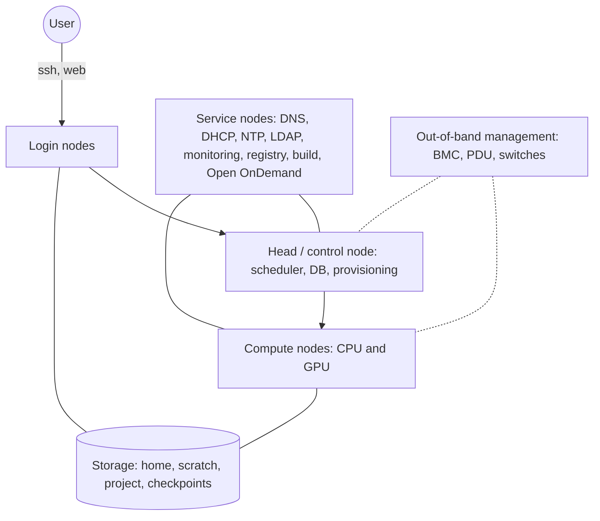

# 6.2 Cluster anatomy: head, login, compute, storage and management nodes

| | |
|---|---|
| Level | Beginner |
| Priority tier | 1 |
| Lab venue | Design exercise; optional VMs or cloud instances to try the roles |
| Part | Part 6: HPC and Slurm |
| Status | Drafted, exercises **untested** |

## Why this matters for AI infrastructure

Every AI cluster, whether it runs Slurm, Kubernetes or both, is built from the same handful of node roles and networks. Incidents are usually "the wrong thing running on the wrong node" (users running work on the head node, a login node saturating storage, a management network that shares a switch with compute traffic). Knowing the standard anatomy lets you read an architecture diagram in one pass, ask the right questions in a design review, and place new services where they belong. It also gives you the vocabulary of Base Command Manager, Slurm and cluster procurement documents (chapters 6.7 onwards, Part 8).

## Prerequisites and outcomes

Needs 6.1, Part 1 (Linux), Part 2 (networking). After this chapter you can:

- Name each node role, what runs on it, and what must never run on it.
- Describe the separate networks of a modern GPU cluster (compute fabric, storage, in-band Ethernet, out-of-band management) and why they are separate.
- Walk through the lifecycle of a user session and a job, and say which parts the user never sees.
- Produce a planning checklist (power, cooling, space, network, software, documentation) for a new cluster.
- Decide which roles can be merged in a small cluster and which cannot.

## 1. Anatomy of a supercomputer: four layers

A cluster is easiest to reason about as four layers (this follows the framing of the SCL book credited below):

1. **Hardware infrastructure**: power distribution (PDUs, UPS), cooling, physical security, rack space, cabling. It is usually owned by a facility team, but you must know its limits: available kilowatts, heat rejection, floor loading, door widths (Part 6.30).
2. **Compute nodes**: the servers on which user work actually runs.
3. **Compute infrastructure**: the networks, storage and service nodes that tie compute nodes into one system.
4. **Software**: operating system, drivers, scheduler, libraries, user applications, management tooling.

A newcomer usually fixates on layer 2. Operators spend most of their time in layers 3 and 4.

## 2. Node roles

### Head / control / management node

The brain of the cluster. Typical contents:

- The **workload manager controller** (for Slurm: `slurmctld`, and often `slurmdbd` with its database, Part 6.7).
- **Provisioning** services: DHCP, TFTP/HTTP for PXE boot, the OS images for compute nodes (Part 6.22). In NVIDIA Base Command Manager the head node is the center of the cluster, runs the CMDaemon and holds the node images (Part 8).
- **Configuration management** server or repository, the cluster's inventory and database.
- Sometimes the monitoring server, NFS for software and home, license servers.

Properties: highly valued, so **protect and duplicate it** (backup, redundant pair, HA, Part 6.15 and 6.27). **Users do not log in here** and never run jobs here. Many clusters have two head nodes in an active/passive pair so that a failure does not stop scheduling (running jobs usually continue regardless because compute nodes keep running them, but no new work starts).

### Login nodes (a.k.a. access, submit, gateway nodes)

The user-facing machines. Users `ssh` here (or use a web portal, Part 6.25) to edit files, compile small programs, submit jobs, check queues and move data. They have the scheduler **client** commands (`sbatch`, `squeue`) and the same software environment as compute nodes, but they are shared by many people at once.

Rules and controls: limit per-user CPU, memory and process counts (cgroups, `pam_limits`), forbid long computations (users will try), monitor interactive use, and keep several login nodes behind a DNS alias or load balancer so one can be rebooted. Compilers and development tools live here. GPU login nodes are sometimes provided for building CUDA code; they are not for running training.

### Compute nodes

Where jobs run. In a GPU cluster these are the HGX/DGX-class servers (eight GPUs, two CPUs, many NICs; Part 9). Characteristics:

- **Stateless or image-managed**: booted from a network image or installed identically by automation, so any node can be rebuilt (Part 6.22).
- **Minimal services**: just the scheduler agent (`slurmd`), drivers, monitoring agents, the fabric and storage clients.
- **No user logins** except through the scheduler (some sites allow `ssh` to a node only while the user has a job on it, via `pam_slurm_adopt`).
- Homogeneous groups ("partitions" or pools by hardware type) so a job can assume uniform hardware.

Compute nodes are divided by type: standard CPU nodes, GPU nodes, large-memory nodes, sometimes data-processing nodes. The scheduler's node definition must match reality exactly (Part 6.8).

### Service nodes

Everything else needed to keep the system running, each as its own server or VM, depending on size: DNS, DHCP, NTP/chrony, LDAP/identity (Part 6.24), monitoring and logging (Prometheus, Grafana, Loki or ELK; Part 6.26), container registry or mirror, software build servers, license servers, the web portal, backup servers, and I/O gateways. In large systems there can be dozens. Separate them so that a problem in one service cannot take down the scheduler.

### Storage

At least these areas:

- **Home**: small, backed up, per user. Configuration, source code.
- **Scratch / work**: large, fast, not backed up, purged. Job inputs and outputs.
- **Project / shared**: group data, datasets.
- **Software**: read-mostly, often NFS or a container/CVMFS style distribution (Part 6.6).
- **Checkpoint and dataset storage** for AI: very high aggregate bandwidth (Part 13).

Implementations range from NFS on one server through parallel file systems (Lustre, GPFS/Storage Scale, BeeGFS, WEKA, VAST; Part 6.18 to 6.20) to object storage. Storage servers have their own roles (metadata servers, object/data servers, gateways).

### Specialised nodes you will meet

- **DPU/SmartNIC-equipped hosts** that offload networking and storage to the NIC (Part 9).
- **Visualisation / interactive GPU nodes**.
- **Gateway / data-transfer nodes (DTNs)** with fast external links for moving datasets in and out.
- **Bastion / jump hosts** in front of the whole thing (Part 6.25).

## 3. The networks and network equipment

Modern GPU clusters use several physically or logically separate networks. This is the single most important structural idea in the anatomy, because failures and performance problems are scoped by network.

| Network | Purpose | Typical technology | Characteristics |
|---|---|---|---|
| **Compute (back-end) fabric** | MPI and NCCL traffic between GPUs and nodes | InfiniBand NDR/XDR or RoCE Ethernet, rail-optimised fat-tree | Lowest latency, highest bandwidth; often one NIC per GPU; lossless; not routed to users |
| **Storage fabric** | Access to parallel file system / object storage | InfiniBand or Ethernet, sometimes the same hardware as compute on a different rail, increasingly separate | Throughput for dataset reads and checkpoint writes |
| **In-band / front-end Ethernet** | Login, scheduler control traffic, NFS, provisioning, internet access | 10/25/100 GbE | Ordinary IP; the "control network" in the SCL book |
| **Out-of-band management** | BMC/IPMI/Redfish, PDUs, switch management, serial consoles | 1 GbE, separate switches | Works when the node OS is dead; strongly access-controlled (Part 7) |

Reasons for separation: performance isolation (a backup job must not disturb an all-reduce), failure isolation (the management network must still work during a fabric outage), and security (BMCs are very powerful and must be on a restricted network). In small clusters some networks are merged (for example, a single Ethernet for control and storage), and that is a compromise to document, not a default to copy.

Addressing plan: decide subnets for each network up front, with room to grow, and name interfaces consistently (for example `node042`, `node042-bmc`, `node042-ib0`). A consistent naming scheme makes scripts and monitoring much easier (Part 2.30 on addressing).

## 4. Hardware features that affect operations

- **NUMA topology**: two sockets, each with local memory and PCIe lanes; a GPU or NIC attached to socket 0 is slower to reach from socket 1. Schedulers and launchers bind processes to the right cores and GPUs (Part 6.12 and 10).
- **GPU interconnect**: GPUs within a node are connected by NVLink/NVSwitch (fast); between nodes by the fabric (slower). Parallelism strategy follows this hierarchy (Part 14).
- **Heterogeneity**: mixed node generations are common after expansions; the scheduler needs features/constraints to match jobs to hardware.
- **Diskless vs local disks**: local NVMe is useful for scratch and caching but resets with reprovisioning; do not store irreplaceable data there.
- **Time**: all nodes need synchronised clocks for authentication tokens (such as Slurm's munge credentials, Part 6.7), logs, and Kerberos.

## 5. Planning a cluster

The SCL book has a sensible planning list; adapted here for AI-era clusters:

1. **Requirements**: workloads (training, inference, simulation), user count, expected utilisation, growth, availability expectations.
2. **Power and cooling**: kilowatts per rack, total megawatts, redundancy (A/B feeds, UPS, generators), heat rejection method (air, rear-door, direct liquid cooling), and **5 to 10 percent headroom** as a minimum margin on the power budget (the book's figure); an eight-GPU server draws several kilowatts and densities now routinely exceed what older rooms can supply (Part 6.30).
3. **Space and structure**: rack count, floor loading, raised floor or not, cable paths, delivery route.
4. **Network design**: fabric topology and oversubscription, number of switches and cables (cabling is a project of its own), management network, external links.
5. **Storage design**: capacity, throughput, metadata performance, redundancy, backup.
6. **Software plan**: OS and kernel, driver and CUDA policy, scheduler, container runtime, module system, monitoring, identity.
7. **Operations plan**: staffing, on-call, spares, vendor support contracts and SLAs, change control.
8. **Security plan**: network zones, access paths, BMC protection, logging, compliance.
9. **Acceptance tests**: what you will run to prove the delivered system meets its specification (HPL, NCCL tests, IOR, burn-in; Part 6.28).

**Documentation** deserves its own line item: rack elevations, cable maps (port to port), IP/VLAN/name plans, serial numbers and warranties, BIOS and firmware baselines, install procedures, and runbooks. The book stresses documenting from day one; the cost of reconstructing a cable map from a live fabric during an outage is high. Keep documentation in version control where possible and generate it from the inventory (Part 4).

**OK, we got it, what's next? (when the hardware arrives)**: inventory and verify against the order; power on in stages; update firmware to the baseline; burn-in (stress CPU, memory, GPUs, disks, network) to expose early failures; label everything; then install the head node first, then provision a few compute nodes, then scale up. **Later**: monitoring and alerting, backup verification, user onboarding, patch process, capacity reporting.

## 6. How a typical session and the job life cycle proceed

A concrete trace helps. User "alice" wants to run a training job.

1. **Login**: alice connects with SSH (through a bastion or portal) to a login node. Identity comes from LDAP/SSSD or a similar directory; her home directory is on shared storage (Part 6.24).
2. **Prepare**: she edits code, loads the software environment (`module load`, or a container image), copies data to scratch.
3. **Submit**: she writes a batch script (`sbatch job.sh`) asking for resources: nodes, GPUs, time, partition. The client talks to the scheduler controller on the head node (6.11).
4. **Queue**: the controller records the job, checks her association and limits (accounting, Part 6.9), computes its priority (fair-share, age, QoS), and keeps it pending until resources are free.
5. **Allocate**: when nodes are available the scheduler allocates them and tells the node daemons to start the job.
6. **Prolog and launch**: a prolog may run health checks on the nodes (Part 6.14); the job step is launched by the node daemon in a cgroup with enforced limits; the launcher starts the right number of ranks per node, bound to cores and GPUs (6.12).
7. **Run**: processes talk over the compute fabric and read and write the parallel file system; output goes to files, and standard output to the job's output file.
8. **Finish**: the epilog cleans up (kills stray processes, clears temp files, resets GPU state); the scheduler records exit status and usage in the accounting database; nodes return to the pool.
9. **Review**: alice looks at the output, `sacct` for the job's statistics, and perhaps requeues.

**What the user does not see** (the SCL book's "hidden" list, extended): node health checks and automatic draining of bad nodes; provisioning and reimaging; authentication tokens and time sync; quota enforcement; background monitoring; the scheduler's backfill and preemption decisions; fabric routing and subnet management; storage rebalancing and backups; hardware repairs. A good operator makes all of that invisible, and a clear failure message is the exception that makes it visible.

## 7. Merging roles in small clusters

| Cluster size | Reasonable simplification | What to avoid |
|---|---|---|
| Lab (2 to 8 nodes) | Head + login on one machine; NFS from the head; one Ethernet for control/storage | Users running jobs on the head node; no backups |
| Small (10 to 100 nodes) | Head pair, one or two login nodes, services on VMs on the head pair, one parallel or NFS storage | One head node with no backup of the scheduler database |
| Medium to large | Dedicated service nodes, separate storage fabric, redundant everything on the control plane | Services co-located with scheduler on one box |

The rule of thumb: merge roles only where a failure of one cannot cascade into another critical one, and write down the compromise.

## 8. Mapping to Kubernetes terms

| HPC term | Kubernetes analogue (approximate) |
|---|---|
| Head / control node | Control-plane nodes (API server, scheduler, controllers, etcd) |
| Login node | A bastion or a development Pod/namespace; `kubectl` access |
| Compute node | Worker node (kubelet) |
| `slurmd` | `kubelet` plus container runtime |
| Partition | Node pool with labels and taints |
| Job / job array | Job / indexed Job (or JobSet for multi-node) |
| Parallel file system | Persistent volumes via CSI |
| Environment modules | Container images |
| Provisioning (PXE/BCM) | Cluster API / Metal3 / node images |

The analogies break in important places: Kubernetes schedules long-running desired state and does not natively give gang scheduling, fair-share accounting or exclusive node allocation, which is why add-ons exist (Part 11, 14).

## 9. Lab (paper and inventory; untested)

1. **Design exercise**: a 32-node GPU cluster (8 GPUs per node), 2 login nodes, active/passive head pair, 1 PB parallel storage. List every server role, the networks it connects to, the number of switch ports needed on each network, and total power if each GPU node draws 10 kW (check the datasheet for the real figure). Add 10 percent headroom.
2. Write an Ansible-style inventory (YAML) with groups `head`, `login`, `compute_gpu`, `service`, `storage`, and group variables for the networks. Use consistent names such as `gpu[001:032]` and `gpu[001:032]-bmc`.
3. Draw the four networks on one page. Mark which failures each isolates.
4. List 10 things that should be in the cluster documentation before go-live.
5. Trace a failed job: pick three places a user's job could fail silently (for example storage mount missing on one node) and what monitoring would catch each.

## 10. Interview angles

- Describe the roles in an HPC/GPU cluster and what runs on each.
- Why are there separate compute, storage and management networks?
- Why must users not run jobs on the head or login node, and how do you enforce it?
- What would you put in a pre-go-live acceptance plan?
- How would you make the head node resilient?
- Compare Slurm cluster anatomy with a Kubernetes cluster.
- A node is "alive" but jobs on it hang. Which layers do you check, in what order?
- How much power headroom do you plan, and why?

## 11. Checkpoint questions (25)

1. List the four layers of a cluster.
2. What runs on the head node?
3. Why should the head node be duplicated?
4. What is a login node for, and what limits do you put on it?
5. What defines a compute node in terms of state and services?
6. Name five service-node functions.
7. Name the storage areas and their purposes.
8. Name the four networks in a modern GPU cluster.
9. Why is the out-of-band network separate and restricted?
10. What is an HPC "control network"?
11. Why name interfaces consistently?
12. What is NUMA and why does it matter for placement?
13. What are the two interconnect levels inside and between GPU nodes?
14. What planning items cover power and cooling, and what headroom is recommended?
15. What belongs in cluster documentation?
16. What are the first steps when hardware arrives?
17. What is burn-in for?
18. Trace the lifecycle of a batch job in nine steps.
19. What does a prolog do? An epilog?
20. What is hidden from the user and who handles it?
21. Which roles can be merged in a lab cluster and which not?
22. What is a DTN?
23. What is a bastion host for?
24. Map `slurmd` and a partition to Kubernetes concepts.
25. Why is Kubernetes not a drop-in replacement for the HPC scheduler?

## 12. Sources and review notes

- Anatomy, planning, documentation and "what is hidden from the user": *Supercomputers for Linux SysAdmins* (Zhumatiy, Apress, 2025; abbreviated SCL here), chapters 3, 4 and 6. The four-layer framing, the planning list and the 5 to 10 percent power-headroom figure are from the book; all text is my restatement. The list of networks is extended for GPU clusters.
- Cloud background (SCL chapter 17 summary) is covered in 6.1 and in the Kubernetes comparison above.
- NVIDIA Base Command Manager manuals (in the corpus as `bcm11-*`) for the head-node-centric management model; see Part 8.
- Unverified: typical per-node power draws and fabric counts for specific products (use datasheets, Part 9); the Kubernetes mapping is approximate by design.
