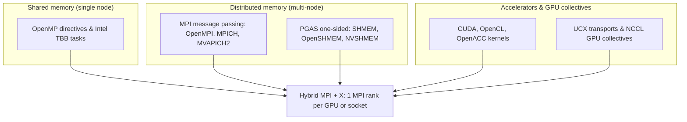

# 6.3 Parallel computing concepts: Amdahl, scaling, shared memory versus message passing

| Field | Value |
|---|---|
| Level | Intermediate |
| Priority tier | 1 |
| Lab venue | Any multi-core machine with Python 3; `scaling_lab.py` runs 3 checks locally and cluster library builds are **untested** here |
| Part | Part 6: HPC and Slurm |
| Status | Drafted |

## Why this matters for AI infrastructure

On Monday morning a research team asks why doubling their Slurm allocation from 64 GPUs to 128 GPUs cut their training epoch time by only 25 percent. They expected nearly half the time, and they are a little annoyed. Nothing in their code is broken, and the cluster is not broken either. The same mathematical laws that High-Performance Computing engineers have used for fifty years explain the result. Those laws hold whether a parallel job scales from 8 GPUs to 8,000 GPUs, so once you understand them, a disappointing graph stops being a mystery.

The first law shows why a tiny piece of unparallelized work caps your maximum speedup. A dataloader that still runs on one core, or a checkpoint step that writes everything from one process, can quietly set the ceiling for the whole job. The second idea separates two different goals. One goal is finishing a fixed training run faster. The other goal is growing the global batch size or the model size along with the cluster, so each step does more useful work. Those two goals call for different designs, and mixing them up is a common source of wasted effort.

You will also meet the words message passing and shared memory all the time. Message passing is what MPI and NCCL do across nodes, when processes send data to each other over the network. Shared memory is what OpenMP threads do on one CPU socket, or what GPUs do across an NVLink domain, where many workers see the same memory. If you know these concepts, you can spot the core numerical libraries and the parallel debuggers in a user's job log. You can also tell a userland bug apart from a cluster hardware fault, which saves a lot of finger-pointing between the research team and the operations team.

## Prerequisites and outcomes

Before you start, read Chapters 6.1 and 6.2, and know basic Python from Part 3. The chapter then walks through the measures you use to judge a parallel run, which are speedup and parallel efficiency. It explains Amdahl's law and Gustafson's law, and the Karp-Flatt metric that reads the serial fraction back out of a benchmark. It compares strong and weak scaling, and it sets the programming models side by side. Those models are OpenMP, TBB, MPI, OpenSHMEM, NVSHMEM, CUDA, OpenCL, OpenACC, NCCL, and UCX. The chapter then covers the Hockney latency-bandwidth cost model, the ring AllReduce volume formula, and the domain decomposition and halo exchanges that limit strong scaling. The last sections cover the core HPC numerical libraries (ScaLAPACK, PETSc, FFTW, and Intel TBB) and the parallel debuggers and profilers from *Supercomputers for Linux SysAdmins* Chapters 21 and 22.

## 1. Speedup, efficiency, and scalability

Imagine a single GPU finishes a simulation in one afternoon. Your manager now asks what happens if you use a whole node of GPUs instead. To answer that, you need a clear way to measure how much faster the parallel run is, and how well it uses the extra hardware. The standard measures start from two timings. Suppose a single processor or GPU finishes a computation in time T(1). Then suppose n processors working together finish that same computation in time T(n). Three metrics then tell you how well the parallel run used the hardware.

- **Speedup:** S(n) equals T(1) divided by T(n). Ideal linear speedup equals n, which means n processors finish the work n times faster. In practice you almost never reach the ideal, and the gap is what the rest of this chapter explains.
- **Parallel efficiency:** E(n) equals S(n) divided by n. It is a fraction between 0 and 1 that measures what share of each processor's time went into useful work rather than waiting or communicating. Sometimes a job shows **superlinear speedup**, where efficiency exceeds 1. That usually happens because splitting the problem across more nodes lets the whole working set fit inside fast CPU caches or GPU SRAM, instead of spilling to slower main memory. The job did not get magic. It got more fast memory.
- **Baseline honesty:** Always ask what T(1) actually represents. The honest baseline is the **best known sequential algorithm** running on one processor. Running a heavy multi-process parallel code with a single worker often adds parallel bookkeeping overhead. That overhead inflates T(1) and flatters the reported speedup, so a slide that shows a big speedup may be comparing against a weak baseline.

Judge a multi-node job by its parallel efficiency against a clean single-node baseline, not by raw wall-clock time alone. A job that finishes sooner but wastes half its hardware is a different result from a job that finishes sooner and uses the hardware well.

Here is how a misleading speedup usually happens. A team reports a large speedup, and the baseline is a parallel build run with a single worker. That single worker carries all of the bookkeeping that the parallel version needs, so T(1) is inflated before the comparison even starts. When someone reruns the baseline with the best sequential code, the honest speedup is much smaller, and the decision about the hardware changes with it. Always ask who wrote the baseline and how it was built.

> **In one minute:**
> - Speedup is `S(n) = T(1) / T(n)`, and parallel efficiency is `E(n) = S(n) / n`.
> - Superlinear speedup can occur when adding nodes increases aggregate cache or SRAM enough to hold the problem's working set.
> - Always check whether T(1) was measured with an efficient sequential baseline or with a slow single-rank build of the parallel code.

## 2. Amdahl's law (strong scaling)

Why can't you make a 10-hour job finish in 1 second by throwing 36,000 processors at it? The answer is in the part of the job that cannot be split. In 1967, Gene Amdahl pointed out that every program has some work that is strictly serial, meaning it cannot be divided among processors. Examples include initializing files, reading a configuration on rank 0, or waiting at a barrier that does not overlap with other work. Call that serial share `1 - p`. The remaining share, p, can be parallelized across n processors.

The picture helps. Imagine a kitchen where one cook must read the recipe aloud before anyone else can start. The more helpers you hire, the faster the cooking goes, but the reading still takes the same time, and it sets a floor under the whole meal. Amdahl's law says exactly that about a program.

For a **fixed problem size**, called **strong scaling**, the total execution time on n processors is `T(n) = T(1) * ((1 - p) + p / n)`. That expression gives Amdahl's law for speedup.

```text
S(n) = 1 / ((1 - p) + p / n)       upper limit as n -> infinity: 1 / (1 - p)
```

Notice the ceiling `1 / (1 - p)`. Even when 99% of your code is perfectly parallel, the 1% that is serial sets a hard limit. No number of GPUs in the universe can push the speedup past 100x. On 1,024 processors, a parallel fraction of 0.99 gives only 91.2x, which is under 9% efficiency. Put plainly, you would pay for 1,024 processors and use fewer than 100 of them.

Before you add nodes to a fixed-size job, profile it and shrink its serial bottlenecks. The serial fraction sets an absolute ceiling on speedup, and no added hardware removes it. The fix is in the software, not in the purchase order.

In practice you find the serial share by profiling. Measure the time that the job spends in the parts that stay sequential, such as reading files, setting up data structures, and waiting at barriers. Divide that time by the total run time, and the result is the value of `1 - p` that you plug into the law. If you cannot measure it cleanly, the Karp-Flatt metric in section 4 can estimate it from a benchmark instead.

> **In one minute:**
> - Amdahl's law models **strong scaling**, where fixed total work is split across n processors: `S(n) = 1 / ((1 - p) + p / n)`.
> - As n grows large, speedup hits a hard ceiling of `1 / (1 - p)`.
> - A 1% serial fraction caps maximum speedup at 100x and reaches 91.2x at 1,024 processors.

## 3. Gustafson's law (weak scaling)

If Amdahl's law were the whole story, nobody would build 10,000-GPU clusters. Yet in 1988, John Gustafson noticed that people who get a machine ten times larger rarely run the same small problem ten times faster. Instead, they **grow the problem size to match the machine**. They use a finer weather grid, a larger dataset, or a proportionally larger global batch size, so the work per processor stays constant. The question changes from "how fast can I finish this?" to "how much more can I solve in the same time?"

That change of question is the whole idea.

A quick check helps you pick the right goal. Ask whether the scientist's question has a fixed size, such as "simulate this protein", or a growing size, such as "simulate a bigger protein with more atoms". The first question points to strong scaling, and the second points to weak scaling. Most AI training questions are the second kind, which is why bigger clusters so often come with bigger batches. A team that trains a language model on more GPUs usually does not keep the old batch size and hope for the best. It grows the batch, the data and the model along with the cluster. In that case the time per step stays about the same, and the team gets to train a bigger model or see more data.

Suppose the parallel work grows linearly with processor count while the serial setup fraction stays fixed in wall-clock time. The **scaled speedup** then follows Gustafson's law for **weak scaling**.

```text
S_scaled(n) = (1 - p) + p * n
```

Take p = 0.99 on 1,024 processors. The scaled speedup is `0.01 + 0.99 * 1024 = 1013.77x`, compared with the 91.2x that Amdahl's law gives for the same fraction. Both laws are mathematically exact. They simply answer two different operational questions. Amdahl asks how to shorten a fixed job, and Gustafson asks how big a job the cluster can take in the same time.

The table below sets the two goals side by side. Read across a row to see what changes when you pick one goal over the other.

| Dimension | Strong scaling (Amdahl) | Weak scaling (Gustafson) |
|---|---|---|
| **Total problem size** | Fixed as processor count grows | Grows proportionally with processor count (constant work per processor) |
| **Engineering goal** | Solve a fixed-size problem in less wall-clock time | Solve a much larger problem in the same wall-clock time |
| **Primary bottleneck** | Serial fraction and rising communication-to-compute ratio as per-node work shrinks | Global collective latency, bisection bandwidth, and memory or I/O limits |
| **Typical AI example** | Decreasing time-to-train on a fixed global batch size, or lowering single-request inference latency via tensor parallelism | Scaling LLM pre-training to more GPUs by growing the global batch size or expert count proportionally |
| **Efficiency formula** | `E_strong(n) = T(1) / (n * T(n))` | `E_weak(n) = T(1) / T(n)` at constant work per GPU |

Under strong scaling, every doubling of processor count halves the compute work per GPU. Inter-node communication volume often stays constant, though. So the communication-to-computation ratio doubles at each step, until the scaling curve flattens out. That is the moment when adding more GPUs stops paying back, and it is the point where a sensible team stops and asks whether a bigger batch would be a better use of the hardware.

Before you judge a multi-node efficiency curve, ask whether the workload is strong-scaling a fixed problem or weak-scaling a growing one. The same graph can look terrible for one goal and healthy for the other.

One more habit helps. Write down the goal before you look at the curve. A flat strong-scaling curve is a disaster for a team that needs a faster answer, but it can be a fine result for a team that only needed a larger model in the same week.

> **In one minute:**
> - Strong scaling holds total problem size fixed, whereas weak scaling holds work per processor fixed (`S_scaled(n) = (1 - p) + p * n`).
> - Strong scaling eventually stalls because computation per node shrinks while communication overhead does not.
> - Large LLM pre-training runs rely on weak scaling by growing global batch size and model capacity with GPU count, alongside strong scaling within tensor and pipeline groups.

## 4. Karp-Flatt: diagnosing why scaling stops

Suppose a job's measured speedup on n processors falls short of n. You know it is not ideal, but you do not yet know why. Is a fixed serial section to blame? Or are communication and synchronization costs growing as the cluster grows? The two causes look the same on a single graph, and they need opposite fixes. That is the problem the Karp-Flatt metric solves. In 1990, Alan Karp and Horace Flatt rearranged Amdahl's equation. They solved it for the **experimentally determined serial fraction `e`** at each processor count, so you can read a benchmark and see what kind of slowdown it contains.

```text
e = (1 / S - 1 / n) / (1 - 1 / n)
```

Compute the Karp-Flatt value at each node count from your benchmark timings, then read the trend. The number itself is less important than the direction it moves in as you add processors.

- **If the value stays roughly constant as processor count increases:** the slowdown comes from a fixed serial section, such as single-threaded startup or rank-0 file I/O. Those problems do not get worse with scale, so you fix the serial code.
- **If the value increases steadily as processor count increases:** parallel overhead is growing with scale. The overhead can come from network collective latency, barrier synchronization, lock contention, or load imbalance across heterogeneous or throttled cores. This is the most common situation on real clusters, and it points directly to fabric, placement, or load-balance tuning.

A constant value across node counts means a fixed serial bottleneck. A rising value means communication, synchronization, or load imbalance is growing with scale. Read the trend first, and only then go looking for the culprit.

Now apply that reading to the run from section 5. The serial fraction climbs as workers are added, and that climb is the signature of overhead that grows with scale. If the values had stayed flat, the right move would have been to optimize the startup code. Because they rose, the right move is to look at the way the work is spread and shared, which is a very different investigation.

> **In one minute:**
> - The Karp-Flatt metric `e = (1/S - 1/n) / (1 - 1/n)` extracts the effective serial fraction from any measured speedup at processor count n.
> - A constant value across node counts means a fixed serial bottleneck; a rising value means communication, synchronization, or load imbalance is growing with scale.

## 5. A scaling script you can run

Reading about scaling is not the same as watching it happen. The repository script `code/part06/scaling.py` does two things. It tabulates Amdahl's law, and it runs a live multi-process strong-scaling experiment using Python's `multiprocessing.Pool`. The first part gives you the theory, and the second part gives you a measurement that you can compare against that theory.

```python
import math, os, time
from multiprocessing import Pool

def amdahl(p, n):  return 1.0 / ((1 - p) + p / n)
def gustafson(p, n): return (1 - p) + p * n
def karp_flatt(speedup, n): return (1.0 / speedup - 1.0 / n) / (1.0 - 1.0 / n)

def work(args):
    lo, hi = args
    s = 0.0
    for i in range(lo, hi):
        s += math.sqrt(i) * math.sin(i)
    return s
```

Running `code/part06/scaling.py` prints the theoretical Amdahl table first. Each row is a parallel fraction p, each column is a processor count n, and the last column is the limit that the law approaches as n grows. You can compare the columns with the limits in the last column, and you will see how quickly the speedup flattens for the lower parallel fractions.

```text
p     n=8   n=64  n=1024  limit
0.5     1.8   2.0     2.0      2
0.9     4.7   8.8     9.9     10
0.99    7.5  39.3    91.2    100
0.999   7.9  60.2   506.2   1000
```

Next, the script ran a fixed problem of 40,000,000 loop iterations, or 40 million. It ran on an 8-core Apple M3 laptop with 4 performance cores and 4 efficiency cores, and it produced these timings. Because the problem is fixed, this is a strong-scaling test, and it is the kind of run you would do on a real cluster before you ask for more nodes.

```text
workers  time_s  speedup  efficiency  karp_flatt
      1    2.55     1.00        1.00  -
      2    1.38     1.85        0.92  0.083
      4    0.90     2.84        0.71  0.135
      8    0.76     3.37        0.42  0.196
```

Look at what happens as you add workers. Efficiency falls from 0.92 at 2 workers to 0.71 at 4, and to 0.42 at 8. At the same time, the Karp-Flatt serial fraction rises from 0.083 to 0.135 to 0.196. That rising value shows the loss is not a fixed Amdahl serial section. The loss comes from growing process-spawn and IPC overhead, memory-bus contention, and **load imbalance** once work spills onto the 4 slower efficiency cores. Eight equal-sized chunks finish at different times, so the fast performance cores sit idle while they wait for the efficiency cores. The lesson for a cluster is the same. A slow node in a fast pool looks exactly like this.

Think about what that means for a production pool. If one node in a group runs a little slower than the others, the group still finishes only when that node finishes. The fast nodes wait, and the wait shows up as lost efficiency on the dashboard, even though no single node looks broken.

An earlier test with only 6 million iterations showed almost no speedup on 2 workers. Creating the processes took longer than the math itself. A problem too small for the machine measures launch overhead, not scaling. Always make the problem big enough that the work, not the startup, dominates the timing.

A practical routine follows from this. Run the script on a laptop first, so you learn the shape of the curve for free. Then run the same kind of test on one cluster node, and compare the two tables. Only after the shape makes sense should you spend cluster time on a multi-node sweep.

## 6. Why real-world scaling stops

Scaling stops for a handful of reasons, and each one has its own fix. The trick is to recognize which one you are looking at, because a fix for one reason does nothing for another.

Think of a relay team that runs slower with every extra runner. The problem might be the starting gun, which is the serial section. It might be the handoffs, which are the communication. It might be one runner who is tired, which is the load imbalance. Each cause has its own repair, and buying faster shoes does not help with a slow handoff. That is why the table is organized by cause. The table lists the common causes, along with what each one does to the cluster and what you can do about it.

| Bottleneck | What happens in the cluster | Operational or algorithmic fix |
|---|---|---|
| **Serial section** | Rank 0 reads files, initializes weights, or runs a single-threaded reduction while other ranks wait | Parallelize data loading with DALI or sharded readers, and overlap setup with compute |
| **Communication overhead** | Collective latency grows with processor count, or small messages underutilize link bandwidth | Fuse small tensors into larger buckets, overlap AllReduce with backprop, use topology-aware placement |
| **Load imbalance** | Equal shard sizes land on mixed hardware, a thermally throttled GPU, or variable-length sequences | Drain throttled or degraded nodes, enforce homogeneous partitions (Chapter 6.2), balance sequence lengths |
| **Synchronization barriers** | Every rank blocks at a global barrier until the single slowest straggler arrives | Remove unnecessary barriers, use asynchronous or pipelined collectives |
| **Memory bandwidth saturation** | All cores on a socket share the same memory channels; adding threads stalls on RAM bandwidth | Bind ranks across NUMA nodes (`numactl`), run fewer threads per socket across more nodes |
| **Shared storage I/O stalls** | Thousands of ranks hammer metadata or write synchronous checkpoints simultaneously | Stage datasets to local NVMe, stripe large files across Lustre OSTs, use asynchronous checkpoints (Chapter 6.21) |
| **OS and daemon jitter** | Background daemons, cron jobs, or interrupts steal a core for milliseconds, delaying every rank at the next barrier | Strip compute-node daemons, reserve sibling HT threads for OS work (Chapter 6.2), pin processes |
| **Fabric congestion** | Neighboring jobs or oversubscribed spine links delay collective packets | Use rail-optimized fat-trees, QoS and adaptive routing, and compact switch placement (Part 12) |

At scale, tail latency and node variability govern job speed. Every synchronous collective waits for the single slowest rank, so one unhealthy node can hold back thousands of healthy ones.

A helpful habit is to look at the distribution of step times across the ranks, not just the average. A healthy job has a tight spread, and a job with a long tail has a rank that is quietly holding everyone else back. That is why operators care so much about the slowest node in a pool, and not only about the average node.

> **In one minute:**
> - Real scaling stops because of serial sections, communication latency and bandwidth, load imbalance, barriers, memory-bus saturation, storage I/O stalls, OS jitter, and fabric congestion.
> - In a synchronous 1,000-GPU job, a 10-millisecond OS jitter hiccup on one node delays all 999 other GPUs at the next AllReduce barrier.

## 7. Parallel programming models and technologies (*Supercomputers for Linux Sysadmins* Chapter 21)

Before you can debug a parallel job, you need a rough map of the ways people write one. The diagram below groups the models by where the memory lives. Shared-memory models sit inside one node. Distributed-memory models span many nodes. Accelerator models run kernels on GPUs, and the substrates underneath move the data. Hybrid programs combine several of these at once.



In Chapter 21 of *Supercomputers for Linux SysAdmins*, Zhumatiy explains why administrators need to understand how parallel programming models work. You may never write a fluid-dynamics solver. You will still install the compilers and MPI stacks, and you will read the error logs when a user's job fails to launch. Knowing the model tells you which library to look for in the log.

### Message passing (MPI) and the parallel pi example

At the time of writing in 2025, the de facto standard for distributed-memory programs in HPC is **MPI**, the Message Passing Interface. MPI defines library procedures for C, C++, and Fortran. Those procedures launch separate processes across nodes and let them exchange messages, so each process keeps its own memory and asks for data from its neighbors when it needs it. Chapter 21 walks through a classic C program that computes $\pi$ by numerical integration of $f(a) = 4.0 / (1.0 + a^2)$. The program integrates across `NINT = 1000000` intervals, repeated `COUNT = 100000` times, with `PI25DT = 3.141592653589793238462643`. It relies on seven core MPI calls, shown in the table below.

| Step | Call | What it does |
|---|---|---|
| 1 | `MPI_Init(&argc, &argv)` | Initializes the MPI execution environment. It must run before any other MPI procedure. |
| 2 | `MPI_Comm_size(MPI_COMM_WORLD, &numprocs)` | Queries the total number of parallel processes in the global communicator. |
| 3 | `MPI_Comm_rank(MPI_COMM_WORLD, &myid)` | Queries this process's unique rank, from 0 to `numprocs - 1`. |
| 4 | `MPI_Get_processor_name(processor_name, &namelen)` | Retrieves the hostname of the node running this rank, up to `MPI_MAX_PROCESSOR_NAME` characters. |
| 5 | `MPI_Bcast(&n, 1, MPI_INT, 0, MPI_COMM_WORLD)` | A collective broadcast that sends the interval count `n` from rank 0 to every other rank. When `n` is 0, all ranks exit the loop. |
| 6 | `MPI_Reduce(&mypi, &pi, 1, MPI_DOUBLE, MPI_SUM, 0, MPI_COMM_WORLD)` | A collective reduction that sums every rank's partial integral `mypi` into `pi` on rank 0. The reduction is timed with `MPI_Wtime()`. |
| 7 | `MPI_Finalize()` | Shuts down MPI cleanly. No MPI calls are permitted afterward. |

The first four calls set up the job. They start MPI, ask how many processes there are, ask which one this process is, and ask which node it runs on. The broadcast and reduction do the shared work across ranks, with one rank sending the interval count out and the partial answers coming back in. The last call tears everything down. If you read the program in that order, the MPI calls stop looking like a random list and start looking like a short story.

### Shared memory (OpenMP) and hybrid MPI + X programming

Unlike MPI, where each process has its own private memory, **OpenMP** runs loop iterations across threads that share one address space. Those threads live inside a single process on a single node. You mark the parallel parts with compiler directives such as `#pragma omp` in C and C++, or `!$omp` in Fortran. Without OpenMP enabled, the same source stays a valid sequential program, as covered in Chapter 6.5. Access inside a node is cheaper and simpler than message passing between nodes, because the threads can read the same array without sending it anywhere. Modern supercomputer codes therefore use **hybrid programming**, often written **MPI+X**, where X stands for OpenMP, CUDA, OpenACC, or OpenCL. A typical job launches **one MPI process per node**, or per socket or GPU. Inside the node, OpenMP or CUDA spreads the work, and MPI or NCCL moves data between nodes. The result is fewer, fatter processes, which means fewer messages crossing the fabric.

### PGAS and the SHMEM / OpenSHMEM standard

**PGAS**, or Partitioned Global Address Space, sits between MPI's distributed memory and OpenMP's shared memory. Each process owns a slice of a big logical address space, and it can reach into another process's slice directly. Cray Research developed the first version, **SHMEM**, in 1999. It ran on proprietary Cray, Silicon Graphics, and Quadrics MPP interconnects. Vendor versions differed slightly in their call formats. So a community initiative standardized the library from 2009 onward as **OpenSHMEM**, at `http://www.openshmem.org`. Implementations exist in Open MPI and MVAPICH2-X. In PGAS, each node keeps local memory and gets **one-sided direct remote memory access** to symmetric memory on any node in the system. "One-sided" means the reader or writer does not need the other side to post a matching call at the same moment.

So why not stretch OpenMP across several nodes? Zhumatiy explains that remote memory access over a network is much slower than local RAM access. Separate nodes also lack hardware cache-coherent shared memory, which is the feature that keeps every core's view of memory consistent. Intel Cluster OpenMP and ScaleMP vSMP both tried to run OpenMP across distributed memory, and both attempts were unsuccessful. Unlike OpenMP, where you only slice the computation, and unlike implicit PGAS languages such as UPC, SHMEM makes you distribute both the data and the computation explicitly. Nonlocal accesses go through explicit functions, so the transfers can be grouped and optimized in hardware. Operational details for OpenSHMEM follow, and they were not run on a cluster for this chapter.

- **Compilation and GASNet dependency:** Compile C and Fortran programs with `oshc` and `oshfort`. An MPI implementation is required underneath, because it builds and runs the GASNet library that OpenSHMEM uses.
- **Launching and tuning:** Launch programs with `oshrun`, which invokes `mpirun` under the hood on a multiprocessor machine, or use standard MPI startup commands. You set the symmetric heap size at startup with the `SHMEM_SYMMETRIC_HEAP_SIZE` environment variable. Check `oshconfig` help for controls over collective operation algorithms such as barriers. On NVIDIA GPUs, **NVSHMEM** applies this symmetric-heap one-sided model directly across NVLink and InfiniBand GPUDirect RDMA, as Parts 10 and 12 describe.

### Accelerators (CUDA, OpenCL, OpenACC) and substrates (UCX, NCCL, PMIx)

Accelerators are the models that run the heavy loops on GPUs. The bullets below describe the main ones, and the three substrate tools that carry the messages underneath them.

- **CUDA:** NVIDIA's parallel computing platform and programming model for NVIDIA GPUs. It uses the `nvcc` compiler for `.cu` files. It provides two main libraries, `libcuda` for basic GPU driver operations and `libcudart` for CUDA API calls. High-level libraries such as cuBLAS, cuFFT, cuRAND, and cuSPARSE sit on top, so most users never call the low-level API directly.
- **OpenCL:** The Open Computing Language is an open standard based on C99, for heterogeneous devices such as CPUs, GPUs, and FPGAs. Unlike ordinary C, the OpenCL C99 dialect omits function pointers, header files, bit fields, and recursion, and it adds memory qualifiers. The payoff is uniformity: the same code can run across CPU cores, graphics cards, and FPGAs. The cost is lower flexibility and optimization than CUDA gives, and the standard has no distributed multi-node support.
- **OpenACC:** A directive-based standard developed by CAPS, Cray, NVIDIA, and the Portland Group for C, C++, and Fortran. Like OpenMP, it uses directive comments (`#pragma acc`), so a modified program still runs sequentially without accelerators. OpenACC directives can sit in the same program as OpenMP, and NVIDIA, GCC, and Intel compilers support them.
- **PMIx, UCX, and NCCL:** **PMIx**, the Process Management Interface for Exascale, replaces PMI-1 and PMI-2. You can list its options with `srun --mpi=list`. It lets Slurm bootstrap MPI ranks quickly, and it passes topology maps through `openpmix-mca-params.conf` and `prte-mca-params.conf`. **UCX**, or Unified Communication X, supports RoCE, InfiniBand, TCP, shared memory, and Cray `ugni` underneath Open MPI, MPICH, and NCCL. You inspect it with `ucx_info -c -f`. **NCCL**, pronounced "Nickel", provides topology-aware GPU collectives over NVLink, PCIe, and InfiniBand or RoCE. Chapter 6.4 and Part 12 cover it in detail.

Match the programming model to the hardware boundary.

A simple way to keep the models straight is to ask where the data lives when a process needs it. In MPI, the data lives in another process, so you have to send it. In OpenMP, the data lives in shared memory, so a thread can read it directly. In PGAS, the data lives in a shared address space that is split across nodes, and one side can reach across. In CUDA and NCCL, the data lives on a GPU, and the copies happen across PCIe, NVLink, or the fabric. Use OpenMP or CUDA threads inside a node, NVLink or NVSHMEM across local GPUs, and MPI or NCCL across the multi-node RDMA fabric. When a job is slow, the question "which boundary is it crossing?" usually points straight at the cause.

> **In one minute:**
> - MPI (`MPI_Init`, `MPI_Comm_size`, `MPI_Comm_rank`, `MPI_Bcast`, `MPI_Reduce`, `MPI_Finalize`) passes explicit messages across nodes, while OpenMP shares memory across threads on one node; hybrid MPI+X combines both.
> - OpenSHMEM (1999 Cray SHMEM, standardized 2009; `oshc`, `oshfort`, `oshrun`, `SHMEM_SYMMETRIC_HEAP_SIZE`, `oshconfig`) implements PGAS one-sided remote memory access, avoiding the cache-coherency wall that defeated Intel Cluster OpenMP and ScaleMP vSMP.
> - CUDA targets NVIDIA GPUs with maximum optimization (`nvcc`, `libcuda`, `libcudart`), OpenCL offers a portable C99 dialect across CPUs, GPUs, and FPGAs without function pointers or recursion, and OpenACC offloads loops via OpenMP-compatible directives.

## 8. A communication cost model (Hockney model and ring AllReduce)

Why does message size decide whether your job waits on network latency or on network bandwidth? Think about two kinds of traffic. One kind is a stream of tiny control messages, where each message is short and the wait for the first byte dominates. The other kind is a huge gradient tensor, where the bytes take a long time to flow through the wire. Roger Hockney's classic point-to-point cost model explains when each one dominates. Sending a message of m bytes between two processes takes time T(m):

```text
T(m) = alpha + m / beta
```

In this model, `alpha` is the startup **latency** for each message. It is roughly 1 to 3 microseconds on InfiniBand or 100 GbE. On 1 to 10 GbE it rises to 25 to 50 microseconds, as Chapter 6.2 shows. The value `beta` is the asymptotic link **bandwidth**, measured in bytes per second. Latency is the fixed toll you pay at the gate, and bandwidth is how fast the road carries the traffic once you are through.

A quick example shows why this matters. Suppose a job sends a very large gradient bucket once per step. The toll is paid only once, and the road speed decides the step time, so a faster link helps directly. Now suppose the same job sends thousands of tiny control messages per step. Each message pays the toll, and a faster road does almost nothing. The fix in that second case is to combine the messages, not to buy a faster network.

- **Small messages:** When message size is much smaller than `alpha * beta`, transfer time is completely dominated by latency. Sending a thousand separate 100-byte messages pays a thousand times `alpha` in startup overhead. The fix is to send fewer, larger messages.
- **Large messages:** When message size is much larger than `alpha * beta`, transfer time is dominated by link bandwidth. Adding more latency-hiding tricks does little here, and the speed is set by the wire.
- **The crossover size (`m_half = alpha * beta`):** This is the payload size where latency time equals wire transfer time, so the link delivers half of its peak bandwidth. The function `hockney_message_time_us()` in `code/part06/scaling.py` models it. Take a link with a 2.0 us latency and 50 GB/s bandwidth. That bandwidth is 50,000 bytes per microsecond, so the crossover is 2.0 times 50,000, or 100,000 bytes, which is 100 KB. Any message smaller than 100 KB spends more than half its time on latency overhead.

What about collectives across n GPUs? In a **ring AllReduce** of an M-byte tensor, the tensor is split into n chunks. The chunks circulate around a logical ring in two phases, ReduceScatter and then AllGather. Think of it as a relay where every runner passes a baton-sized piece to the next runner until everyone holds the full answer. The whole exchange takes `2 * (n - 1)` steps. Each rank sends and receives this total volume:

```text
Volume per rank (ring AllReduce) = 2 * ((n - 1) / n) * M
```

The function `ring_allreduce_volume_per_rank()` in `code/part06/scaling.py` models two properties you should notice.

1. **The bandwidth term barely depends on rank count.** As n grows, `2(n-1)/n` approaches 2M. For a 1 GB tensor on 8 GPUs, each GPU sends 1.75 GB. That makes ring AllReduce bandwidth-optimal for large tensors, because no rank ever sends more than about twice the tensor.
2. **The latency term grows linearly with rank count.** At hundreds or thousands of GPUs, the `2(n - 1)` hops of latency add up. That is why NCCL switches from ring algorithms to double-binary **tree** algorithms, which need only logarithmic latency steps. Part 12 covers the SHARP in-network reductions that tree algorithms use at scale.

The practical result is simple. Group small messages into buckets above the crossover size, as PyTorch DDP gradient bucketing does. Switch from ring to tree collectives when the GPU count grows large.

> **In one minute:**
> - Point-to-point message time is `T(m) = alpha + m / beta`, with latency-to-bandwidth crossover at `m = alpha * beta` (100 KB at 2 us and 50 GB/s).
> - Ring AllReduce moves `2 * (n - 1) / n * M` bytes per rank, which is bandwidth-optimal for large tensors but pays `2(n - 1)` latency steps.

## 9. Load balance, domain decomposition, and halo exchanges

How do simulations and distributed AI models split their data across ranks? Picture a weather model covering a whole continent. You cannot hand the whole map to one machine, so you cut it into blocks and give each block to a rank. Most 3D physical simulations, such as weather, CFD, and molecular dynamics, use **domain decomposition** for exactly this reason. The grid is cut into smaller cubic subdomains, each with edge length d, and each rank owns one. In every timestep, a rank computes the interior of its cube, which holds `d^3` grid points. It then swaps boundary **halo (ghost) cells** with its 6 neighboring ranks across the 6 faces of its cube. Those faces hold `6 * d^2` surface points. The halo is a thin border copied from the neighbor, so the computation at the edge of each block can see the values on the other side.

Here is the trap you fall into when you **strong-scale** a fixed grid onto more processors. As the edge length d shrinks, computation follows the **volume** of each cube, while communication follows its **surface area**. A small cube has less interior to compute and about the same amount of boundary to send, which means the boundary starts to dominate. So the communication-to-computation ratio tracks the **surface-to-volume ratio (`6 / d`)**, and it climbs steadily as the subdomains get smaller.

Load balance adds a second problem. When subdomains carry unequal work, such as adaptive meshes or clusters of particles, static partitioning leaves ranks waiting at barriers. Those cases call for dynamic load balancing, or for graph partitioners such as METIS and ParMETIS, which cut the work so each part costs about the same. Distributed LLM training faces the same surface-to-volume and load-balance trade-offs. They show up in Tensor Parallelism, Pipeline Parallelism micro-batch bubbles, and Mixture-of-Experts token routing, which Part 14 covers.

When you strong-scale a domain-decomposed or model-parallel job, watch the surface-to-volume ratio. Halving the shard dimensions raises the communication share relative to compute, and that is the first place a good speedup starts to fade.

Picture the simplest case, a weather model that covers a whole region. Each rank owns one block of the map, and each timestep it sends the edges of its block to the neighbors on each side. At the start of the run, the blocks are large, and most of the work happens inside them. As you add ranks and the blocks shrink, the edges become a bigger share of each block, and the neighbors spend more of their time talking. The model did not get slower on purpose. It simply ran out of interior work to hide the talking behind.

> **In one minute:**
> - In 3D domain decomposition, compute scales with subdomain volume (`d^3`) while halo-exchange communication scales with surface area (`6 * d^2`), so communication-to-compute grows as `6 / d` under strong scaling.
> - Unequal work per rank creates synchronization bubbles until rebalanced.

## 10. Parallel computing support libraries, debuggers, and profilers (*Supercomputers for Linux Sysadmins* Chapter 22)

You might hear that libraries are for users, not for sysadmins. Zhumatiy argues in Chapter 22 of *Supercomputers for Linux SysAdmins* that sysadmins cannot ignore them. Even if you never write a PDE solver, users will ask you to build custom versions of these libraries. They will also paste crash logs into tickets at the worst possible time. Knowing the four core numerical libraries, ScaLAPACK, PETSc, FFTW, and Intel TBB, along with the parallel debugger and profiler ecosystem, lets you separate cluster bugs from application bugs right away.

A good habit is to keep a short list of the library versions that each important application uses. When a crash appears, the list tells you whether the build changed. That single step often ends a long argument between the user and the operations team. A library error that mentions a missing symbol is a build problem, while a hang in the middle of a collective is a fabric or rank problem.

### ScaLAPACK (`BLAS`, `PBLAS`, `BLACS`, `SLmake.inc`, and `PTXXYYYY` naming)

Linear algebra sits at the heart of numerical methods. Solving a large system of equations, or finding the eigenvalues of a matrix, usually comes down to linear algebra underneath. On a single node, the standard open-source libraries are **BLAS**, **LINPACK**, and **LAPACK**, originally developed by Jack Dongarra, Jeremy Du Croz, Sven Hammarling, and colleagues. Vendor-optimized versions ship in **Intel MKL** and **AMD ACML**. When distributed-memory multiprocessor systems appeared, US scientific and supercomputer centers ported the cache-optimized LAPACK to distributed memory. The result was **ScaLAPACK**, or Scalable LAPACK. It kept LAPACK's structure and top-level calls because of two design decisions:

1. **PBLAS:** Parallel BLAS, including PTOOLS, runs distributed-memory Level 2 and Level 3 BLAS vector and matrix operations on top of fast single-node BLAS and LAPACK libraries. Always pick an optimized local BLAS, such as MKL, ACML, GotoBLAS, or OpenBLAS, because the layer above it is only as fast as the one below.
2. **BLACS:** Basic Linear Algebra Communication Subprograms handle all inter-processor communication over MPI, using `-lblacs`, `-lblacsC`, and `-lblacsF`. Because of that layering, porting ScaLAPACK to a new platform only requires setting up BLACS.

Layering is also a practical gift to the administrator. When a new interconnect arrives, most of the work sits in the communication layer, and the math code above it can stay the same. Knowing where the layers meet tells you where to look when a port fails. The math stays the same, and only the communication layer changes.

To build ScaLAPACK from source, download it from `http://www.netlib.org/scalapack/` and unpack it in a shared directory. Then edit `SLmake.inc` before you run `make`. Point the compilers at `mpicc` and `mpif77` so MPI links cleanly. These build steps were not run on a live cluster for this chapter, so treat the file below as a template to check against your own site.

```makefile
# SLmake.inc excerpt (untested here)
SHELL = /bin/sh
home = /share/download/SCALAPACK
PLAT = LINUX
BLACSDBGLVL = 0
BLACSdir = /usr/local/lib
USEMPI = -DUsingMpiBlacs
SMPLIB =
BLACSFINIT = -lblacsF
BLACSCINIT = -lblacsC
BLACSLIB = -lblacs
TESTINGdir = $(home)/TESTING
CBLACSLIB = $(BLACSCINIT) $(BLACSLIB) $(BLACSFINIT)
FBLACSLIB = $(BLACSFINIT) $(BLACSLIB) $(BLACSCINIT)
PBLASdir = $(home)/PBLAS
SRCdir = $(home)/SRC
TESTdir = $(home)/TESTING
PBLASTSTdir = $(TESTINGdir)
TOOLSdir = $(home)/TOOLS
REDISTdir = $(home)/REDIST
REDISTTSTdir = $(TESTINGdir)
F77 = mpif77
CC = mpicc
BLASLIB = -lgoto -lpthread
LAPACKLIB = -llapack
PBLIBS = $(SCALAPACKLIB) $(FBLACSLIB) $(LAPACKLIB) $(BLASLIB) $(SMPLIB)
PRLIBS = $(SCALAPACKLIB) $(CBLACSLIB) $(SMPLIB)
RLIBS = $(SCALAPACKLIB) $(FBLACSLIB) $(LAPACKLIB) $(BLASLIB) $(SMPLIB)
LIBS = $(PBLIBS)
```

ScaLAPACK has **530 subroutines**, sorted into **driver**, **computational**, and **service** groups. Each data type gets 14 driver subroutines, which solve a complete linear system or eigenvalue problem. Computational subroutines handle smaller pieces, such as LU decomposition or tridiagonal reduction. Subroutine names follow LAPACK with a leading P, in the form **`PTXXYYYY`** or `PTXXYYY`. The table below decodes each position of the name, so you can read a name in a log and know what it does before you look it up.

| Position | Code options | Meaning in ScaLAPACK (Supercomputers for Linux SysAdmins, Chapter 22) |
|---|---|---|
| **P** | `P` | Parallel ScaLAPACK routine prefix |
| **T** (data type) | `S`, `D`, `C`, `Z` | Single real (`S`), double-precision real (`D`), complex single precision (`C`), complex double precision (`Z`) |
| **XX** (matrix type) | `DB`, `DT`, `GB`, `GE`, `GT`, `HE`, `PB`, `PO`, `PT`, `ST`, `SY`, `TR`, `TZ`, `UN` | Banded general appearance with predominantly diagonal elements (`DB`), tridiagonal of general form with predominant diagonal elements (`DT`), general view ribbons (`GB`), general view (`GE`), tridiagonal of general form (`GT`), Hermite (`HE`), band symmetric or Hermite positively definite (`PB`), symmetric or Hermite positively definite (`PO`), tridiagonal symmetric or Hermite positively definite (`PT`), symmetric tridiagonal (`ST`), symmetrical (`SY`), triangular (`TR`), trapezoidal (`TZ`), unitarian (`UN`) |
| **YYY / YYYY** (action) | `TRF`, `TRS`, `CON`, `SV`, `SVX`, `EV`/`EVX`, `GVX`, `SVD`, `RFS`, `LS` | Matrix factorization (`TRF`), solution of SLAU after factorization (`TRS`), estimation of matrix conditioning number (`CON`), solution of SLAU (`SV`) or with additional studies (`SVX`), computation of eigenvalues and eigenvectors (`EV`, `EVX`), generalized eigenvalue problem (`GVX`), singular value calculation (`SVD`), refinement of solution (`RFS`), least squares finding (`LS`) |

Once you know this table, you can decode any ScaLAPACK name one position at a time. Start with the P, then the data type, then the matrix shape, and finally the action.

### PETSc (`PETSC_ARCH`, `PETSC_DIR`, and runtime diagnostic flags)

**PETSc**, pronounced "petsy", is a hierarchical toolkit of parallel linear and nonlinear equation solvers and time integrators for partial differential equations. You can use it from C, C++, Fortran, and Python. Its home page is `https://petsc.org/release/`. PETSc supports the MPI standard. It also supports a hybrid MPI and thread model through `--with-pthreadclasses`, and an MPI plus GPU model that uses CUDA driver 4.1 or higher with the Cusp package.

You configure PETSc with `./configure`. Pass the MPI compilers with `--with-cc=mpicc`, `--with-fc=mpifort`, and `--with-cxx=mpicxx`. Set optimization flags with `COPTFLAGS`, `FOPTFLAGS='-O5'`, and `CXXOPTFLAGS`, and set libraries with `LIBS='...'`. External solver packages come in through `--with-PACKAGE-include` or `--download-PACKAGE`, for BLAS and LAPACK, Hypre, MUMPS, and Parmetis. Setting `PETSC_DIR` and `PETSC_ARCH` lets you keep several build profiles side by side, so one site can have an Intel build and a GCC build without them overwriting each other. You can then expose those profiles through Environment Modules or Lmod. The block below shows one profile build. Its comment says the build was not run, so treat it as a pattern to check against your own site.

```bash
# (untested here)
./configure PETSC_ARCH=linux-intel -with-cc=mpicc \
  --with-fc=mpifort --with-blas-lapack-dir=/opt/intel/mkl
make PETSC_ARCH=linux-intel all test
sudo make install
```

When a PETSc program misbehaves, you can add these runtime options on the command line. You do not need to recompile, which matters when the bug only shows up in a production run.

- `-log_summary` — provides a performance summary at the end of the program.
- `-fp_trap` — stops immediately on floating-point operation exceptions.
- `-trdump` and `-trmalloc` — perform memory tracing and output a list of unreleased memory areas at the end of the program.
- `-start_in_debugger [noxterm, gdb, dbx, xxgdb]` — starts the program inside a debugger.
- `-on_error_attach_debugger [noxterm, gdb, dbx, xxgdb]` — attaches a debugger automatically when an error is detected.

### FFTW (versions 2 and 3) and Intel TBB

- **FFTW:** Fastest Fourier Transform in the West, hosted at `http://fftw.org/`, is a C and Fortran library. It computes the fast discrete Fourier transform for real and complex numbers. The input size N can be any value, not only a power of two. FFTW includes parallel FFT modules for shared and distributed memory. They cover four variants: 1D complex, multivariate complex, 1D real, and multivariate real transformations. Link against `-lfftw` or `-lttfw`, and add `-lfftw_mpi` for MPI builds. Version 3 uses `-lfftw3` and `-lfftw3_mpi`. You also add `-I` and `-L` for your directory paths. Compile FFTW from source with optimizations for your target processor, instead of relying on a generic OS package. If applications need them, install **both incompatible versions 2 and 3**, because the two APIs do not work with each other. If Intel MKL or AMD ACML is already installed, each one ships an optimized FFTW, so you can skip the manual build.
- **Intel TBB:** Threading Building Blocks is a C++ template library that works with POSIX threads, Windows threads, and Boost threads. Instead of raw threads, it builds the program from task blocks. Those tasks link into a dynamically generated graph, tuned for cache and CPU use. TBB supports only node-level threads, and it hides thread synchronization inside. So if you combine TBB with asynchronous MPI calls, take care. The errors that result are hard to diagnose, because the synchronization that would reveal them is out of sight.

### Parallel debuggers, profilers, tracers, and PMPI trace formats

Picture a parallel application running hundreds of processes across several nodes. A traditional `gdb` session, compiled with `-g`, is of very limited use there. It inspects one process at a time, and output from hundreds of ranks arrives at once and cannot be read. Dedicated parallel debuggers and tracers solve this problem. They show the stacks and variables of all the ranks together, and they record what each rank did, so you can see the one rank that went quiet. Each row of the table below names a tool, its origin, and what it does for cluster debugging.

| Tool | Category & origin | Key capabilities for cluster debugging (Supercomputers for Linux SysAdmins, Chapter 22) |
|---|---|---|
| **TotalView** (+ **ThreadSpotter**) | Commercial parallel debugger (Etnus -> RogueWave 2010 / Perforce) | Supports MPI, OpenMP, OpenACC, and CUDA with remote client and queue-manager integration; stops and inspects stacks and variables across all processes simultaneously; includes memory debugging, **ThreadSpotter** (identifying inefficient memory utilization and thread conflicts), and **reverse debugging** (recording variable values and execution flow to play back and find the cause of a crash) |
| **Arm DDT** (Distributed Debugging Tool) | Commercial parallel debugger (Allinea -> ARM) | Multi-rank GUI debugging similar to TotalView; lacks reverse debugging, but provides **offline debugging (`ddt --offline`)** that launches under the batch scheduler without an interactive client and writes a report file of variable values, stacks, and suspected memory leaks |
| **`cuda-gdb` & `cuda-nsight`** | NVIDIA CUDA Toolkit debuggers | Drop-in GPU debugger replacement for `gdb` (usable in GUI packages like DDD and VSCode) and visual GPU profiler |
| **MPE & JumpShot** | Open-source MPI tracer & visualizer (Argonne National Lab) | Uses the standard **PMPI** profiling interface to intercept MPI calls and write **`CLOG` / `SLOG` / `SLOG2`** trace files, visualized in **JumpShot** |
| **Vampir & VampirTrace** | Commercial trace analyzer (`vampir.eu`) & open-source trace library | Collects traces via VampirTrace in the open **`OTF` / `OTF2`** (Open Trace Format) standard across Linux, Windows, and macOS and automatically searches for application bottlenecks |
| **Intel ITAC, VTune, Advisor & Inspector** | Intel oneAPI HPC Toolkit | **Intel Trace Collector and Analyzer (ITAC)** records full or sampled **`STF`** traces (collected automatically via a startup key with Intel MPI); paired with **VTune**, **Advisor**, and **Inspector** for deep efficiency analysis |
| **TAU** (Tuning and Analysis Utilities) | Open-source profiling & tracing suite (Univ. of Oregon) | Open-source toolkit for collecting and analyzing traces, with JumpShot integration and native graphical tools |

Install and expose ScaLAPACK over vendor MKL or OpenBLAS, PETSc, FFTW v2 and v3, and the PMPI-capable tracers through environment modules. Then users can diagnose scaling and crash bugs without guessing, and you can see which library version a crash came from.

> **In one minute:**
> - ScaLAPACK (530 routines named `PTXXYYYY`) layers PBLAS and BLACS over single-node BLAS/LAPACK and MPI; PETSc manages builds via `PETSC_DIR` and `PETSC_ARCH` and diagnoses runs via `-log_summary`, `-fp_trap`, `-trdump`, `-trmalloc`, and `-on_error_attach_debugger`.
> - FFTW v2 and v3 are API-incompatible (though MKL and ACML provide built-in FFTW interfaces), and Intel TBB schedules C++ task graphs on a node.
> - Parallel debuggers (TotalView with reverse debugging, Arm DDT with offline reports, `cuda-gdb`) and PMPI tracers (MPE and JumpShot `SLOG2`, Vampir `OTF2`, ITAC `STF`, TAU) replace single-process `gdb` at scale.

## 11. Five canonical communication patterns to recognize

Most distributed jobs fall into one of five communication patterns. Learn to recognize them, because each pattern hits its limit in a different place. When a job slows down, the pattern tells you where to look first, which saves hours of guessing.

1. **Embarrassingly parallel:** Workers never talk to each other, so the job scales linearly until storage I/O saturates. A parameter sweep over many independent inputs is the classic example. The only shared resource is the disk, so the disk is where the limit shows up.
2. **Nearest-neighbor stencil / halo exchange:** Grid simulations and pipeline parallelism pass data to adjacent ranks. This scales well until subdomain surface-to-volume (`6 / d`) dominates.
3. **Global AllReduce every step:** Data-parallel gradient averaging is bandwidth-bound for large buckets and latency-bound for small tensors. Every rank waits for the sum, so one slow rank holds up the whole step.
4. **All-to-All transpose:** Distributed 3D FFTW and Mixture-of-Experts token dispatch stress the full fabric bisection bandwidth and adaptive routing. Every rank talks to every other rank, so the fabric's total capacity is what matters.
5. **Master-worker dynamic queue:** A central coordinator hands irregular tasks to workers. The pattern scales until the single master process saturates. The master is the bottleneck by design, so watch its CPU and its message rate.

Name the pattern first, and you know which limit to check.

Try this when a new job arrives. Before you open any profiler, ask which of the five patterns the code follows. The answer gives you a short list of limits to check, and it stops you from tuning the wrong layer for an hour.

## 12. Lab: Amdahl, Gustafson, Karp-Flatt, and Hockney cost models

Nothing in this section was run on a cluster. Start with the self-checking Python lab, `code/part06/scaling_lab.py`, and run it locally. It verifies Amdahl's and Gustafson's laws. It also checks the rising Karp-Flatt serial fraction from the 8-core Apple M3 strong-scaling run. Finally, it checks the Hockney message crossover size and the ring AllReduce per-rank byte volume. Passing the lab tells you the formulas agree with the code. It does not tell you how your own cluster behaves, which is why the full benchmark comes next.

```bash
python3 code/part06/scaling_lab.py
```

Then run the full benchmark on your own machine:

```bash
python3 code/part06/scaling.py
```

Work through these three analysis steps. Each step uses one function, and each one asks one question.

1. Compare `amdahl(0.99, 1024)`, which gives a 91.2x speedup and 8.9% efficiency, with `gustafson(0.99, 1024)`, which gives a 1013.77x scaled speedup. Why does growing the problem size change the scaling curve?
2. Look at the Karp-Flatt column from `python3 code/part06/scaling.py` on your own CPU. As the worker count reaches your total logical core count, does the serial fraction stay flat or rise?
3. Call `hockney_message_time_us(100_000, 2.0, 50.0)` and check that a 100,000-byte message, or 100 KB, sits at the crossover. Why do 2.0 us of latency and 2.0 us of transfer add up to 4.0 us total?

## 13. Interview angles

Each question below asks you to apply one idea from this chapter. Answer them the way you would explain the idea to a colleague at a whiteboard.

- State Amdahl's law and Gustafson's law. If a program is 99 percent parallel, what is its maximum strong-scaling speedup on 1,024 GPUs and on infinite GPUs?
- You measure speedups of 1.85x on 2 nodes, 2.84x on 4 nodes, and 3.37x on 8 nodes. How do you use the Karp-Flatt metric to show whether the bottleneck is a fixed serial step or growing communication and imbalance overhead?
- Compare MPI, OpenMP, OpenSHMEM, CUDA, OpenCL, and OpenACC. Why did distributed OpenMP (Intel Cluster OpenMP, ScaleMP vSMP) fail to replace MPI?
- Write Hockney's latency-bandwidth model. Why does PyTorch DDP bucket small parameter gradients into 25 MB buffers before calling NCCL AllReduce?
- What is ScaLAPACK's `PTXXYYYY` naming convention, and which PETSc flags would you tell a user to add when their solver crashes with a floating-point exception or memory leak?

## Exercises

The exercises reuse the functions and measurements from the chapter, so you can check each answer against the text. Work through them in order, because later exercises build on the numbers in earlier ones.

1. Use `amdahl()` and `gustafson()` in `code/part06/scaling.py` to calculate the strong-scaling speedup, the parallel efficiency, the Amdahl ceiling, and the Gustafson scaled speedup. Use parallel fractions of 0.99 and 0.999 on 1,024 GPUs.
2. Take the 8-core strong-scaling run from Section 5. Its speedups are 1.85, 2.84, and 3.37 on 2, 4, and 8 workers. Use `karp_flatt()` to compute the experimental serial fraction for each one. The values should be 0.083, 0.135, and 0.196. Why does a rising value rule out a pure Amdahl serial bottleneck?
3. Use `hockney_message_time_us()` and `ring_allreduce_volume_per_rank()` to compute the crossover message size. The link has 2.0 us latency and 50.0 GB/s bandwidth, and the answer is 100,000 bytes. Then compute the per-rank volume for a ring AllReduce of a 1 GB gradient tensor across 8 GPUs. The tensor is 1,000,000,000 B, and the answer is 1.75 GB.
4. Trace the 7 MPI calls in Zhumatiy's $\pi$-integration C program. They are `MPI_Init`, `MPI_Comm_size`, `MPI_Comm_rank`, `MPI_Get_processor_name`, `MPI_Bcast`, `MPI_Reduce`, and `MPI_Finalize`. Why does OpenSHMEM (`oshc`, `oshfort`, `oshrun`, `SHMEM_SYMMETRIC_HEAP_SIZE`, `oshconfig`) need explicit remote access, while Intel Cluster OpenMP and ScaleMP vSMP struggled across nodes? How do CUDA, OpenCL, and OpenACC compare?
5. Decode the ScaLAPACK routine names `PDGETRF`, `PSPOTRS`, and `PZHEEVX` with the `PTXXYYYY` table. What roles do PBLAS and BLACS play in `SLmake.inc`? List the five PETSc runtime diagnostic flags, which are `-log_summary`, `-fp_trap`, `-trdump`, `-trmalloc`, and `-on_error_attach_debugger`. Why do clusters install both FFTW v2 and v3 unless they use MKL or ACML?
6. Compare TotalView, with its reverse debugging and ThreadSpotter, against Arm DDT and its `ddt --offline` batch reports. How does the PMPI profiling interface let MPE and JumpShot (`CLOG` and `SLOG2`), Vampir and VampirTrace (`OTF` and `OTF2`), Intel ITAC (`STF`), and TAU trace MPI communication without changes to the application source code?

## Checkpoint questions (20)

<details>
<summary>1. Define speedup and parallel efficiency, and explain how superlinear speedup can happen.</summary>

- **Speedup:** $S(n) = T(1) / T(n)$, where $T(1)$ is the execution time on 1 processor and $T(n)$ is the time on $n$ processors.
- **Efficiency:** $E(n) = S(n) / n = T(1) / (n \cdot T(n))$.
- **Superlinear speedup ($E > 1$):** This happens when splitting a problem across $n$ nodes shrinks the memory footprint on each node. The working set can then fit entirely inside fast CPU caches or GPU SRAM.
</details>

<details>
<summary>2. State Amdahl's law for strong scaling and calculate the speedup of a 99% parallel program on 1,024 processors and on infinite processors.</summary>

$$S(n) = \frac{1}{(1 - p) + \frac{p}{n}}, \qquad \lim_{n \to \infty} S(n) = \frac{1}{1 - p}$$
With $p = 0.99$, the serial part is $1 - p = 0.01$. On 1,024 processors, $S(1024)$ is about **91.2x**, which is 8.9% efficiency. On infinitely many processors, the ceiling is **100x**.
</details>

<details>
<summary>3. State Gustafson's law for weak scaling and explain why it gives a much higher scaled speedup (1013.77x at p = 0.99, n = 1,024) than Amdahl's law.</summary>

$$S_{\text{scaled}}(n) = (1 - p) + p \cdot n$$
Amdahl's law holds the total problem size fixed, so the parallel work per processor shrinks as $1/n$. Gustafson's law instead **grows the problem size in proportion to $n$**, so the parallel work per processor stays constant. For $p = 0.99$ and $n = 1{,}024$, the scaled speedup is $0.01 + 0.99 \times 1024 = \mathbf{1013.77\times}$.
</details>

<details>
<summary>4. Write the Karp-Flatt formula for the experimentally determined serial fraction, and explain what it means when it rises with processor count.</summary>

$$e = \frac{\frac{1}{S} - \frac{1}{n}}{1 - \frac{1}{n}}$$
If $e$ stays constant as $n$ grows, a fixed serial section limits the job ($1 - p$). If **$e$ increases as $n$ grows**, as in the 2, 4, and 8 worker run where it goes $0.083 \to 0.135 \to 0.196$, then **parallel overhead from communication, synchronization barriers, or load imbalance is growing with scale**.
</details>

<details>
<summary>5. Why did running the lab script with a tiny problem size (6 million iterations) show almost no speedup on 2 workers?</summary>

When the total computation takes only milliseconds, the fixed cost of starting worker processes (`multiprocessing.Pool`), passing arguments between them, and collecting results outweighs the savings from parallel math. **A problem too small for the machine measures launch and IPC overhead, not parallel scaling.**
</details>

<details>
<summary>6. Why does OS jitter or a single thermally throttled GPU degrade the performance of an entire 1,000-GPU synchronous training job?</summary>

Synchronous jobs run lockstep barriers at every step. Suppose 999 GPUs finish their forward and backward pass in 100 ms. If one GPU takes 150 ms because of thermal clock throttling or an OS daemon interruption, it holds up the whole job. **The 999 fast GPUs sit idle for 50 ms at the collective barrier, waiting for the slowest rank.**
</details>

<details>
<summary>7. What do the seven MPI calls in Zhumatiy's pi-calculation C program (Supercomputers for Linux SysAdmins, Chapter 21) do?</summary>

1. `MPI_Init(&argc, &argv)`: starts the MPI runtime, and it must be called first.
2. `MPI_Comm_size(MPI_COMM_WORLD, &numprocs)`: returns the total process count.
3. `MPI_Comm_rank(MPI_COMM_WORLD, &myid)`: returns this process's rank ID, from 0 to `numprocs - 1`.
4. `MPI_Get_processor_name(processor_name, &namelen)`: returns the node hostname.
5. `MPI_Bcast(&n, 1, MPI_INT, 0, MPI_COMM_WORLD)`: sends the interval count `n` from rank 0 to all ranks.
6. `MPI_Reduce(&mypi, &pi, 1, MPI_DOUBLE, MPI_SUM, 0, MPI_COMM_WORLD)`: adds each rank's partial result `mypi` into `pi` on rank 0.
7. `MPI_Finalize()`: shuts MPI down cleanly, and no MPI calls are allowed afterward.
</details>

<details>
<summary>8. What is hybrid MPI + X programming (Supercomputers for Linux SysAdmins, Chapter 21), and why is it standard on multi-node clusters?</summary>

In **hybrid MPI+X**, X is OpenMP, CUDA, OpenACC, or OpenCL. A job launches **one MPI process per node**, or per socket or GPU. Inside the node it uses shared-memory threads or GPU kernels, and it uses MPI between nodes. This avoids copying common data structures into dozens of processes on the same node. It also cuts the number of MPI messages that cross nodes.
</details>

<details>
<summary>9. How does the PGAS model (SHMEM / OpenSHMEM) differ from MPI and OpenMP, and why did distributed OpenMP fail to scale (Supercomputers for Linux SysAdmins, Chapter 21)?</summary>

- **Why distributed OpenMP failed:** OpenMP assumes uniform, cache-coherent shared memory. Stretching that shared memory across a network, which has no hardware cache coherency, causes heavy stalls on remote access.
- **How SHMEM / OpenSHMEM works (1999 Cray, standardized 2009):** It implements **Partitioned Global Address Space (PGAS)**. Each node has local memory, plus explicit **one-sided remote memory access** to other nodes' symmetric heaps. The programmer distributes both data and compute, so remote transfers can be grouped and optimized in hardware.
</details>

<details>
<summary>10. Which commands and environment variables compile, launch, and tune OpenSHMEM programs (Supercomputers for Linux SysAdmins, Chapter 21)?</summary>

- **Compile:** Use `oshc` for C and `oshfort` for Fortran. Both need an underlying MPI build for GASNet.
- **Launch:** Use `oshrun`, which wraps `mpirun` on clusters, or use standard `mpirun` or `srun`.
- **Tune:** Set the symmetric heap size with **`SHMEM_SYMMETRIC_HEAP_SIZE`**, and check **`oshconfig`** for the collective algorithm controls.
</details>

<details>
<summary>11. Compare CUDA, OpenCL, and OpenACC (Supercomputers for Linux SysAdmins, Chapter 21).</summary>

- **CUDA:** An NVIDIA-only platform and extension for C, C++, and Fortran. It uses `nvcc` for `.cu` files, with the `libcuda` driver library and the `libcudart` runtime library. It gives the highest performance and the deepest optimization on NVIDIA GPUs.
- **OpenCL:** An open standard based on C99, for host-attached CPUs, GPUs, and FPGAs. It leaves out function pointers, headers, bit fields, and recursion. The same code runs across vendors, but tuning is less efficient and the standard has no distributed multi-node support.
- **OpenACC:** A directive-based standard (`#pragma acc`, compatible with OpenMP) for C, C++, and Fortran. Unmodified code still compiles, and it runs sequentially when no accelerator is present.
</details>

<details>
<summary>12. Write Hockney's point-to-point communication cost model, define the crossover message size, and compute it for alpha = 2.0 us and beta = 50 GB/s.</summary>

$$T(m) = \alpha + \frac{m}{\beta}, \qquad m_{1/2} = \alpha \cdot \beta$$
At the crossover size $m_{1/2} = \alpha \cdot \beta$, latency time equals wire transfer time, so the link reaches 50% of peak bandwidth. With $\alpha = 2.0\ \mu\text{s}$ and $\beta = 50\text{ GB/s}$, which is 50,000 B per $\mu$s, the crossover is $2.0 \times 50{,}000 = \mathbf{100{,}000\text{ bytes}}$, or 100 KB.
</details>

<details>
<summary>13. How much data does each rank send during a ring AllReduce of an M-byte tensor across n ranks, and why does NCCL switch from rings to trees at large n?</summary>

Each rank sends and receives **$2 \cdot \frac{n - 1}{n} \cdot M$** bytes across ReduceScatter and AllGather. The bandwidth volume approaches $2M$ no matter how large $n$ gets. The number of sequential latency hops, though, is **$2(n - 1)$**, which grows linearly with $n$. At large GPU counts, that $2(n - 1)\alpha$ latency dominates. So NCCL switches to **tree** algorithms, which need $O(\log n)$ latency hops, and it uses SHARP switch reductions.
</details>

<details>
<summary>14. In 3D domain decomposition, why does the communication-to-computation ratio worsen as 6 / d during strong scaling?</summary>

When a 3D grid is divided into cubic subdomains of edge length $d$, the compute work on each rank is proportional to the cube's **volume ($d^3$)**. The halo exchange with neighboring ranks is proportional to its **6 surface faces ($6d^2$)**. So the ratio of communication to computation is **$6d^2 / d^3 = 6 / d$**. It rises whenever you add ranks and shrink $d$.
</details>

<details>
<summary>15. What are the two architectural layers inside ScaLAPACK (Supercomputers for Linux SysAdmins, Chapter 22), and how many subroutines does ScaLAPACK contain?</summary>

1. **PBLAS (Parallel BLAS, including PTOOLS):** Distributed Level 2 and Level 3 vector and matrix operations, built on top of optimized single-node BLAS and LAPACK (MKL, ACML, GotoBLAS, or OpenBLAS).
2. **BLACS (Basic Linear Algebra Communication Subprograms):** The portable communication layer over MPI, configured with `-lblacs`, `-lblacsC`, and `-lblacsF` in `SLmake.inc`.

ScaLAPACK contains **530 subroutines**, split across driver routines (14 per data type), computational routines, and service routines.
</details>

<details>
<summary>16. Decode the ScaLAPACK `PTXXYYYY` subroutine naming scheme for `PDGETRF` and `PZHEEVX`.</summary>

- **P:** The parallel ScaLAPACK prefix.
- **T (precision and type):** S for single real, D for double real, C for single complex, and Z for double complex.
- **XX (matrix structure):** GE for a general matrix, HE for Hermitian, PO for symmetric or Hermitian positive-definite, SY for symmetric, and TR for triangular. Other codes include GB, DB, DT, GT, PB, PT, ST, TZ, and UN.
- **YYYY (operation):** TRF for factorization, TRS for solving with a factorization, SV and SVX for solving a linear system, EV and EVX for eigenvalues and eigenvectors, and GVX, SVD, CON, RFS, and LS for the rest.

So **`PDGETRF`** is the parallel double-precision general matrix LU factorization. **`PZHEEVX`** is the parallel double-complex Hermitian expert eigenvalue and eigenvector computation.
</details>

<details>
<summary>17. How do you manage multiple compiler builds of PETSc, and which five runtime flags diagnose performance, floating-point faults, memory leaks, and crashes (Supercomputers for Linux SysAdmins, Chapter 22)?</summary>

Set **`PETSC_DIR`** (the root path) and **`PETSC_ARCH`** (the build profile name, such as `linux-intel`) during `./configure` and `make`. Then expose them through Environment Modules or Lmod.

**The five diagnostic flags:**
1. `-log_summary`: prints subroutine timing, FLOP rate, and an MPI message summary at exit.
2. `-fp_trap`: halts immediately on floating-point exceptions.
3. `-trdump` and `-trmalloc` (`-malloc_debug`): trace memory and dump unfreed allocations at exit.
4. `-start_in_debugger [noxterm, gdb, dbx, xxgdb]`: starts ranks inside a debugger.
5. `-on_error_attach_debugger [noxterm, gdb, dbx, xxgdb]`: attaches a debugger when a runtime error occurs.
</details>

<details>
<summary>18. What are the four transform variants in FFTW, why must clusters often install both FFTW v2 and v3, and when can you skip building FFTW manually (Supercomputers for Linux SysAdmins, Chapter 22)?</summary>

- **Four variants:** 1D complex, multivariate complex, 1D real, and multivariate real discrete Fourier transforms, for any length $N$.
- **Why install both v2 and v3:** FFTW version 2 (`-lfftw -lfftw_mpi`) and version 3 (`-lfftw3 -lfftw3_mpi`) have **incompatible APIs**, and different applications need each one.
- **When you can skip the manual build:** Both **Intel MKL** and **AMD ACML** include built-in optimized FFTW interfaces.
</details>

<details>
<summary>19. Compare TotalView and Arm DDT for debugging multi-node parallel applications (Supercomputers for Linux SysAdmins, Chapter 22).</summary>

**TotalView** and **Arm DDT** are both parallel GUI debuggers. Both support MPI, OpenMP, and GPUs (CUDA), attach to batch jobs, and inspect stacks and variables across all ranks at once.
- **TotalView's unique strengths:** It supports **reverse debugging**, which records execution flow so you can step backward in time to the cause of a crash. It also pairs with **ThreadSpotter** for memory, cache, and thread-conflict analysis.
- **Arm DDT's unique strength:** It supports **offline debugging (`ddt --offline`)**. That runs under the batch scheduler without an interactive GUI, and it generates an HTML or text report of stacks, variables, and memory leaks.
</details>

<details>
<summary>20. How does PMPI work, and what trace formats do MPE/JumpShot, Vampir/VampirTrace, Intel ITAC, and TAU use (Supercomputers for Linux SysAdmins, Chapter 22)?</summary>

**PMPI (Profiling MPI)** is a standard wrapper interface built into MPI libraries. It lets profiling and tracing tools intercept every `MPI_*` call, at link time or at runtime, without changing the user's source code.
- **MPE and JumpShot (Argonne):** Write **`CLOG` / `SLOG` / `SLOG2`** traces, which JumpShot displays.
- **Vampir and VampirTrace:** Use the open **`OTF` / `OTF2`** (Open Trace Format) standard.
- **Intel Trace Collector and Analyzer (ITAC) and VTune:** Use Intel's **`STF`** (Structured Trace Format).
- **TAU (Univ. of Oregon):** An open-source profiling and tracing toolkit. It supports native analyzers, `OTF2`, and JumpShot `SLOG2`.
</details>

## Sources and review notes

- **Sources read in full:**
  - `supercomputers-for-linux-sysadmins-managing-modern-hpc-clusters-and-supercomputers-from-software-to-hardware` — Sergey Zhumatiy, *Supercomputers for Linux SysAdmins*, Apress 2025. We read **Chapter 21: Compilers and Environments, for Parallel Technologies** and **Chapter 22: Parallel Computing Support Libraries** in full. Covered topics from Chapter 21 include the 7-call MPI pi-calculation C program (NINT = 1000000, COUNT = 100000, PI25DT = 3.141592653589793238462643, `MPI_Init`, `MPI_Comm_size`, `MPI_Comm_rank`, `MPI_Get_processor_name`, `MPI_Bcast`, `MPI_Reduce`, `MPI_Finalize`), OpenMP, and hybrid MPI+X. We also cover SHMEM from Cray in 1999, SGI, and Quadrics alongside OpenSHMEM from 2009 onward (`oshc`, `oshfort`, `oshrun`, `SHMEM_SYMMETRIC_HEAP_SIZE`, `oshconfig`), and why distributed OpenMP (Intel Cluster OpenMP and ScaleMP vSMP) failed. Additional Chapter 21 topics include CUDA (`nvcc`, `libcuda`, `libcudart`, cuBLAS, cuFFT, cuRAND, cuSPARSE), OpenCL C99 restrictions, OpenACC directives, PMIx, UCX, and NCCL. Covered topics from Chapter 22 include ScaLAPACK: BLAS, PBLAS, PTOOLS, BLACS, `SLmake.inc`, 530 subroutines, 14 drivers per type, and the `PTXXYYYY` naming scheme. We also cover PETSc (`PETSC_DIR`, `PETSC_ARCH`, `--with-pthreadclasses`, CUDA 4.1+ Cusp, `-log_summary`, `-fp_trap`, `-trdump`, `-trmalloc`, `-start_in_debugger`, `-on_error_attach_debugger`) and FFTW across 1D and multivariate real and complex transforms, v2 vs v3 incompatibility, and MKL and ACML wrappers. Finally, we cover Intel TBB task graphs and parallel debuggers and profilers: TotalView reverse debugging and ThreadSpotter, Arm DDT offline mode, `cuda-gdb` and `cuda-nsight`, PMPI, MPE and JumpShot, Vampir and VampirTrace, Intel ITAC and VTune, and TAU.
  - `parallel-and-high-performance-computing` — Robert Robey & Yuliana Zamora, *Parallel and High Performance Computing*, Chapters 1–5. Covered topics include Amdahl's law, Gustafson's law, strong vs weak scaling, the Karp-Flatt serial fraction, domain decomposition halo exchanges, and parallel communication patterns.
- **Run here:** `python3 code/part06/scaling.py` and `python3 code/part06/scaling_lab.py` (3 passed, 0 failed; the Apple M3 8-core 40,000,000-iteration strong-scaling table in Section 5 was measured directly on local hardware).
- **Explicitly labelled inferences:** The `hockney_message_time_us` function in `code/part06/scaling.py` (100,000 B or 100 KB crossover at 2.0 us and 50.0 GB/s, 4.0 us total) is a deterministic teaching model built on Hockney's latency-bandwidth equation. The `ring_allreduce_volume_per_rank` function (1.75 GB per rank for a 1 GB tensor across 8 ranks) is likewise a deterministic model of the standard ring AllReduce algorithm.
- **Not verified on live hardware:** Compiling and running OpenSHMEM (`oshc`, `oshfort`, `oshrun`), ScaLAPACK (`SLmake.inc`), PETSc (`./configure`), FFTW, TotalView, Arm DDT, Vampir, ITAC, and TAU on a multi-node cluster are marked (`untested here`).
