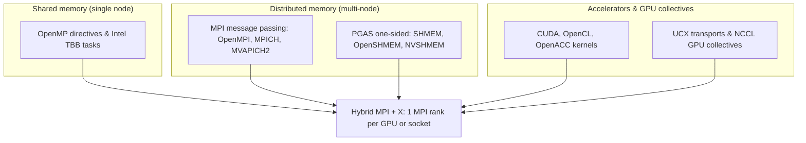

# 6.3 Parallel computing concepts: Amdahl, scaling, shared memory versus message passing

| Field | Value |
|---|---|
| Level | Intermediate |
| Priority tier | 1 |
| Lab venue | Any multi-core machine with Python 3; `scaling_lab.py` runs 3 checks locally and cluster library builds are **untested** here |
| Part | Part 6: HPC and Slurm |
| Status | Drafted |

## Why this matters for AI infrastructure

Imagine a research team comes to your desk on Monday morning frustrated that doubling their Slurm allocation from 64 GPUs to 128 GPUs only cut their training epoch time by 25 percent. Whether a parallel job scales from 8 GPUs to 8,000 GPUs is governed by the exact same mathematical laws that High-Performance Computing engineers have used for fifty years. Amdahl's law explains why even a tiny unparallelized dataloader or checkpoint step caps your maximum speedup. Strong versus weak scaling distinguishes between finishing a fixed training run faster and scaling the global batch size or model size along with the cluster. Message passing is what MPI and NCCL do across nodes, while shared memory is what OpenMP threads do on a CPU socket or what GPUs do across an NVLink domain. Operators who master these concepts and recognize the core numerical libraries and parallel debuggers in user job logs can diagnose scaling walls and separate userland bugs from cluster hardware faults.

## Prerequisites and outcomes

You need Chapters 6.1 and 6.2 plus basic Python from Part 3. After finishing this chapter, you will be able to accomplish the following goals.

- Compute speedup and parallel efficiency, apply Amdahl's law and Gustafson's law, and infer the experimental serial fraction from benchmark timings using the Karp-Flatt metric.
- Distinguish strong scaling from weak scaling and identify which scaling regime a given HPC simulation or LLM training run uses.
- Compare shared-memory, distributed message-passing, PGAS, and accelerator programming models across OpenMP, TBB, MPI, OpenSHMEM, NVSHMEM, CUDA, OpenCL, OpenACC, NCCL, and UCX.
- Apply the Hockney latency-bandwidth cost model and the ring AllReduce volume formula to reason about message sizes and fabric bottlenecks.
- Explain how domain decomposition halo exchanges and surface-to-volume ratios limit strong scaling.
- Support the core HPC numerical libraries—ScaLAPACK, PETSc, FFTW, and Intel TBB—and parallel debuggers and profilers from *Supercomputers for Linux SysAdmins* Chapters 21 and 22.

## 1. Speedup, efficiency, and scalability

Suppose a single processor or GPU finishes a computation in time T(1), and n processors working together finish that same computation in time T(n). Three fundamental metrics describe how well the parallel run used the hardware:

- **Speedup:** S(n) equals T(1) divided by T(n). Ideal linear speedup equals n, meaning n processors finish the work n times faster.
- **Parallel efficiency:** E(n) equals S(n) divided by n, a fraction between 0 and 1 measuring what share of each processor's time went into useful work rather than waiting or communicating. Occasionally a job exhibits **superlinear speedup** where efficiency exceeds 1. That usually happens because splitting the problem across more nodes lets the entire working set fit inside fast CPU caches or GPU SRAM instead of spilling to slower main memory.
- **Baseline honesty:** Always ask what T(1) actually represents. The honest baseline is the **best known sequential algorithm** running on one processor. Running a heavy multi-process parallel code with a single worker often includes parallel bookkeeping overhead that inflates T(1) and flatters the reported speedup.

**Always evaluate a multi-node job by its parallel efficiency against a clean single-node baseline rather than looking at raw wall-clock time alone**.

> **In one minute:**
> - Speedup is `S(n) = T(1) / T(n)`, and parallel efficiency is `E(n) = S(n) / n`.
> - Superlinear speedup can occur when adding nodes increases aggregate cache or SRAM enough to hold the problem's working set.
> - Always verify whether T(1) was measured with an efficient sequential baseline or a slow single-rank build of the parallel code.

## 2. Amdahl's law (strong scaling)

Why can you not make a 10-hour job finish in 1 second simply by throwing 36,000 processors at it? In 1967, Gene Amdahl pointed out that every program contains some fraction of work `1 - p` that is strictly serial. Examples include initializing files, reading a configuration on rank 0, or waiting on a non-overlapped barrier. Meanwhile, the remaining fraction p can be parallelized across n processors. For a **fixed problem size**, called **strong scaling**, the total execution time on n processors is `T(n) = T(1) * ((1 - p) + p / n)`. This gives Amdahl's law for speedup.

```text
S(n) = 1 / ((1 - p) + p / n)       upper limit as n -> infinity: 1 / (1 - p)
```

Notice the unforgiving ceiling `1 / (1 - p)`. Even if 99% of your code is perfectly parallel and only 1% is serial, **no number of GPUs in the universe can ever give you more than a 100x speedup**. On 1,024 processors, a parallel fraction of 0.99 yields a speedup of only 91.2x, which is under 9% efficiency.

**Before scaling a fixed-size job to more nodes, profile and shrink its serial bottlenecks, because the serial fraction sets an absolute mathematical ceiling on speedup**.

> **In one minute:**
> - Amdahl's law models **strong scaling**, where fixed total work is split across n processors: `S(n) = 1 / ((1 - p) + p / n)`.
> - As n grows large, speedup hits a hard ceiling of `1 / (1 - p)`.
> - A 1% serial fraction caps maximum speedup at 100x and achieves 91.2x at 1,024 processors.

## 3. Gustafson's law (weak scaling)

If Amdahl's law were the whole story, nobody would build 10,000-GPU clusters. In 1988, John Gustafson observed that when scientists or AI engineers get a machine that is ten times larger, they rarely run the exact same small problem ten times faster. Instead, they **grow the problem size to match the machine**. They use a finer weather grid, a larger dataset, or a proportionally larger global batch size so the work per processor stays constant.

When the parallel work scales linearly with processor count while the serial setup fraction stays fixed in wall-clock time, the **scaled speedup** follows Gustafson's law for **weak scaling**.

```text
S_scaled(n) = (1 - p) + p * n
```

With a parallel fraction of 0.99 on 1,024 processors, Gustafson's scaled speedup is `0.01 + 0.99 * 1024 = 1013.77x`. Both Amdahl and Gustafson are mathematically exact; they simply answer two different operational questions.

| Dimension | Strong scaling (Amdahl) | Weak scaling (Gustafson) |
|---|---|---|
| **Total problem size** | Fixed as processor count grows | Grows proportionally with processor count (constant work per processor) |
| **Engineering goal** | Solve a fixed-size problem in less wall-clock time | Solve a much larger problem in the same wall-clock time |
| **Primary bottleneck** | Serial fraction and rising communication-to-compute ratio as per-node work shrinks | Global collective latency, bisection bandwidth, and memory or I/O limits |
| **Typical AI example** | Decreasing time-to-train on a fixed global batch size, or lowering single-request inference latency via tensor parallelism | Scaling LLM pre-training to more GPUs by growing the global batch size or expert count proportionally |
| **Efficiency formula** | `E_strong(n) = T(1) / (n * T(n))` | `E_weak(n) = T(1) / T(n)` at constant work per GPU |

In strong scaling, each doubling of processor count cuts the compute work per GPU in half, while inter-node communication volume often stays constant. As a result, the communication-to-computation ratio doubles at every step until the scaling curve flattens out.

**Ask whether a workload is strong-scaling a fixed problem or weak-scaling a growing problem before judging its multi-node efficiency curve**.

> **In one minute:**
> - Strong scaling holds total problem size fixed, whereas weak scaling holds work per processor fixed (`S_scaled(n) = (1 - p) + p * n`).
> - Strong scaling eventually stalls because computation per node shrinks while communication overhead does not.
> - Large LLM pre-training runs rely on weak scaling by growing global batch size and model capacity with GPU count, alongside strong scaling within tensor and pipeline groups.

## 4. Karp-Flatt: diagnosing why scaling stops

Suppose a job's measured speedup on n processors falls short of n. How do you tell whether you are hitting a fixed Amdahl serial bottleneck or whether parallel communication and synchronization overheads are actively growing with cluster size? In 1990, Alan Karp and Horace Flatt rearranged Amdahl's equation to solve for the **experimentally determined serial fraction `e`** at each processor count.

```text
e = (1 / S - 1 / n) / (1 - 1 / n)
```

Compute the Karp-Flatt value across increasing node counts from your benchmark timings and read the trend:

- **If the value stays roughly constant as processor count increases:** the slowdown comes from a fixed serial section, such as single-threaded startup or rank-0 file I/O.
- **If the value increases steadily as processor count increases:** parallel overhead—network collective latency, barrier synchronization, lock contention, or load imbalance across heterogeneous or throttled cores—is growing with scale. This is the most common situation on real clusters and points directly to fabric, placement, or load-balance tuning.

**Calculate the Karp-Flatt metric across increasing node counts to distinguish a fixed serial bottleneck from growing network or load-imbalance overhead**.

> **In one minute:**
> - The Karp-Flatt metric `e = (1/S - 1/n) / (1 - 1/n)` extracts the effective serial fraction from any measured speedup at processor count n.
> - A constant value across node counts means a fixed serial bottleneck; a rising value means communication, synchronization, or load imbalance is growing with scale.

## 5. A scaling script you can run

The repository script `code/part06/scaling.py` tabulates Amdahl's law and runs a live multi-process strong-scaling experiment using Python's `multiprocessing.Pool`.

```python
import math, os, time
from multiprocessing import Pool

def amdahl(p, n):  return 1.0 / ((1 - p) + p / n)
def gustafson(p, n): return (1 - p) + p * n
def karp_flatt(speedup, n): return (1.0 / speedup - 1.0 / n) / (1.0 - 1.0 / n)

def work(args):
    lo, hi = args
    s = 0.0
    for i in range(lo, hi):
        s += math.sqrt(i) * math.sin(i)
    return s
```

Running `code/part06/scaling.py` prints the theoretical Amdahl table first.

```text
p     n=8   n=64  n=1024  limit
0.5     1.8   2.0     2.0      2
0.9     4.7   8.8     9.9     10
0.99    7.5  39.3    91.2    100
0.999   7.9  60.2   506.2   1000
```

When the script ran a fixed problem of 40,000,000 (40 million) loop iterations on an 8-core Apple M3 laptop with 4 performance cores and 4 efficiency cores, it produced these timings.

```text
workers  time_s  speedup  efficiency  karp_flatt
      1    2.55     1.00        1.00  -
      2    1.38     1.85        0.92  0.083
      4    0.90     2.84        0.71  0.135
      8    0.76     3.37        0.42  0.196
```

Look at what the numbers tell you. As the worker count climbs from 2 to 4 to 8, parallel efficiency drops from 0.92 to 0.71 to 0.42. At the same time, the Karp-Flatt serial fraction climbs from 0.083 to 0.135 to 0.196. That rising value proves the loss is not a fixed Amdahl serial section. Instead, it comes from growing process-spawn and IPC overhead, memory-bus contention, and **load imbalance** once work spills onto the 4 slower efficiency cores. Because 8 equal-sized chunks finish at different times, the fast performance cores sit idle waiting for the efficiency cores. An earlier test with only 6 million iterations showed almost zero speedup on 2 workers because process creation took longer than the math itself. **A problem too small for the machine measures launch overhead, not scaling**.

## 6. Why real-world scaling stops

| Bottleneck | What happens in the cluster | Operational or algorithmic fix |
|---|---|---|
| **Serial section** | Rank 0 reads files, initializes weights, or runs a single-threaded reduction while other ranks wait | Parallelize data loading with DALI or sharded readers, and overlap setup with compute |
| **Communication overhead** | Collective latency grows with processor count, or small messages underutilize link bandwidth | Fuse small tensors into larger buckets, overlap AllReduce with backprop, use topology-aware placement |
| **Load imbalance** | Equal shard sizes land on mixed hardware, a thermally throttled GPU, or variable-length sequences | Drain throttled or degraded nodes, enforce homogeneous partitions (Chapter 6.2), balance sequence lengths |
| **Synchronization barriers** | Every rank blocks at a global barrier until the single slowest straggler arrives | Remove unnecessary barriers, use asynchronous or pipelined collectives |
| **Memory bandwidth saturation** | All cores on a socket share the same memory channels; adding threads stalls on RAM bandwidth | Bind ranks across NUMA nodes (`numactl`), run fewer threads per socket across more nodes |
| **Shared storage I/O stalls** | Thousands of ranks hammer metadata or write synchronous checkpoints simultaneously | Stage datasets to local NVMe, stripe large files across Lustre OSTs, use asynchronous checkpoints (Chapter 6.21) |
| **OS and daemon jitter** | Background daemons, cron jobs, or interrupts steal a core for milliseconds, delaying every rank at the next barrier | Strip compute-node daemons, reserve sibling HT threads for OS work (Chapter 6.2), pin processes |
| **Fabric congestion** | Neighboring jobs or oversubscribed spine links delay collective packets | Use rail-optimized fat-trees, QoS and adaptive routing, and compact switch placement (Part 12) |

**At scale, tail latency and node variability govern job speed because every synchronous collective waits for the single slowest rank**.

> **In one minute:**
> - Real scaling stops because of serial sections, communication latency and bandwidth, load imbalance, barriers, memory-bus saturation, storage I/O stalls, OS jitter, and fabric congestion.
> - In a synchronous 1,000-GPU job, a 10-millisecond OS jitter hiccup on one node delays all 999 other GPUs at the next AllReduce barrier.

## 7. Parallel programming models and technologies (`SCL` Chapter 21)



In *Supercomputers for Linux SysAdmins* Chapter 21, Zhumatiy explains why an administrator must understand how parallel programming models work. Even if you never write a fluid-dynamics solver yourself, you install the compilers and MPI stacks and read the error logs when a user job fails to launch.

### Message passing (MPI) and the parallel pi example

At the time of writing in 2025, the de facto standard for distributed-memory programs in HPC is **MPI**, the Message Passing Interface. It defines library procedures for C, C++, and Fortran that launch multiple separate processes across nodes and exchange messages between them. In Chapter 21, Zhumatiy walks through a classic C program that computes $\pi$ by numerical integration of $f(a) = 4.0 / (1.0 + a^2)$. It integrates across `NINT = 1000000` intervals repeated `COUNT = 100000` times with `PI25DT = 3.141592653589793238462643` using seven core MPI calls:

1. `MPI_Init(&argc, &argv)` — initializes the MPI execution environment; must be called before any other MPI procedure.
2. `MPI_Comm_size(MPI_COMM_WORLD, &numprocs)` — queries the total number of parallel processes in the global communicator.
3. `MPI_Comm_rank(MPI_COMM_WORLD, &myid)` — queries this process's unique rank from 0 to `numprocs - 1`.
4. `MPI_Get_processor_name(processor_name, &namelen)` — retrieves the hostname of the node running this rank, up to `MPI_MAX_PROCESSOR_NAME` characters.
5. `MPI_Bcast(&n, 1, MPI_INT, 0, MPI_COMM_WORLD)` — collective broadcast sending the interval count `n` from rank 0 to every other rank. When `n` is 0, all ranks exit the loop.
6. `MPI_Reduce(&mypi, &pi, 1, MPI_DOUBLE, MPI_SUM, 0, MPI_COMM_WORLD)` — collective reduction summing every rank's partial integral `mypi` into `pi` on rank 0, timed with `MPI_Wtime()`.
7. `MPI_Finalize()` — cleanly shuts down MPI; no MPI calls are permitted afterward.

### Shared memory (OpenMP) and hybrid MPI + X programming

Unlike MPI, where each process has its own private memory, **OpenMP** distributes loop iterations and sections across multiple threads inside a **single process sharing one address space** on a single node. It uses special compiler directives such as `#pragma omp` in C and C++ or `!$omp` in Fortran so the source code remains a valid sequential program when compiled without OpenMP, as covered in Chapter 6.5. Because intra-node shared-memory access is cheaper and simpler than inter-node message passing, modern supercomputer codes use **hybrid programming**, often denoted **MPI+X**, where X stands for OpenMP, CUDA, OpenACC, or OpenCL. A job typically launches **one MPI process per node** or per socket or GPU, distributes work inside the node via OpenMP or CUDA, and uses MPI or NCCL to exchange data between nodes.

### PGAS and the SHMEM / OpenSHMEM standard

**PGAS**, or Partitioned Global Address Space, sits between MPI's distributed memory and OpenMP's shared memory. Originally developed by Cray Research in 1999 as **SHMEM**, it was supported on proprietary Cray, Silicon Graphics, and Quadrics MPP interconnects. Because vendor implementations differed slightly in call formats, a community initiative standardized the library from 2009 onward as **OpenSHMEM** at `http://www.openshmem.org`, with implementations in Open MPI and MVAPICH2-X. In PGAS, each node has local memory plus **one-sided direct remote memory access** to symmetric memory on any node in the system.

Why could OpenMP not simply be stretched across multiple nodes? As Zhumatiy explains, remote memory access over a communication network takes noticeably longer than local RAM access, and distributed nodes lack hardware cache-coherent shared memory. Unsuccessful attempts were made to run OpenMP across distributed memory, such as Intel Cluster OpenMP and ScaleMP vSMP. Unlike OpenMP, where the programmer only slices computations, and unlike implicit PGAS languages like UPC, **SHMEM requires the programmer to distribute both data and computations explicitly**. Nonlocal accesses are allocated via explicit functions so transfers can be grouped and optimized in hardware. Operational details for OpenSHMEM (**untested** here) include:

- **Compilation and GASNet dependency:** Compile C and Fortran programs with `oshc` and `oshfort`. Note that an MPI implementation is required to build and run the underlying GASNet library and OpenSHMEM.
- **Launching and tuning:** Launch programs with `oshrun`—which invokes `mpirun` under the hood on a multiprocessor machine—or with standard MPI startup commands. Users control the symmetric heap size at startup using the `SHMEM_SYMMETRIC_HEAP_SIZE` environment variable, and check `oshconfig` help to control collective operation algorithms such as barriers. On NVIDIA GPUs, **NVSHMEM** applies this symmetric-heap one-sided model directly across NVLink and InfiniBand GPUDirect RDMA in Parts 10 and 12.

### Accelerators (CUDA, OpenCL, OpenACC) and substrates (UCX, NCCL, PMIx)

- **CUDA:** NVIDIA's parallel computing platform and programming model for NVIDIA GPUs. It uses the `nvcc` compiler for `.cu` files and provides two main libraries: `libcuda` for basic GPU driver operations and `libcudart` for CUDA API calls, plus high-level libraries like cuBLAS, cuFFT, cuRAND, and cuSPARSE.
- **OpenCL:** The Open Computing Language is an open C99-based standard for heterogeneous host-attached devices including CPUs, GPUs, and FPGAs. Unlike ordinary C, the OpenCL C99 dialect omits function pointers, header files, bit fields, and recursion while adding memory qualifiers. Its advantage is uniformity—the exact same code can run across CPU cores, graphics cards, and FPGAs—at the price of lower flexibility and optimization compared to CUDA, and no distributed multi-node support in the standard.
- **OpenACC:** A directive-based standard developed by CAPS, Cray, NVIDIA, and the Portland Group for C, C++, and Fortran. Like OpenMP, OpenACC introduces special directive comments (`#pragma acc`) so the modified program still runs sequentially without accelerators. All OpenACC directives are compatible with OpenMP in the same program and are supported by NVIDIA, GCC, and Intel compilers.
- **PMIx, UCX, and NCCL:** **PMIx**—the Process Management Interface for Exascale, replacing PMI-1 and PMI-2 and listed via `srun --mpi=list`—lets Slurm bootstrap MPI ranks rapidly and pass topology maps via `openpmix-mca-params.conf` and `prte-mca-params.conf`. **UCX**, or Unified Communication X, inspected via `ucx_info -c -f`, supports RoCE, InfiniBand, TCP, shared memory, and Cray `ugni` underneath Open MPI, MPICH, and NCCL. **NCCL**, pronounced "Nickel", provides topology-aware GPU collectives over NVLink, PCIe, and InfiniBand or RoCE, detailed in Chapter 6.4 and Part 12.

**Match the programming model to the hardware boundary: OpenMP or CUDA threads inside a node, NVLink or NVSHMEM across local GPUs, and MPI or NCCL across the multi-node RDMA fabric**.

> **In one minute:**
> - MPI (`MPI_Init`, `MPI_Comm_size`, `MPI_Comm_rank`, `MPI_Bcast`, `MPI_Reduce`, `MPI_Finalize`) passes explicit messages across nodes, while OpenMP shares memory across threads on one node; hybrid MPI+X combines both.
> - OpenSHMEM (1999 Cray SHMEM, standardized 2009; `oshc`, `oshfort`, `oshrun`, `SHMEM_SYMMETRIC_HEAP_SIZE`, `oshconfig`) implements PGAS one-sided remote memory access, avoiding the cache-coherency wall that defeated Intel Cluster OpenMP and ScaleMP vSMP.
> - CUDA targets NVIDIA GPUs with maximum optimization (`nvcc`, `libcuda`, `libcudart`), OpenCL offers a portable C99 dialect across CPUs, GPUs, and FPGAs without function pointers or recursion, and OpenACC offloads loops via OpenMP-compatible directives.

## 8. A communication cost model (Hockney model and ring AllReduce)

To understand why message size dictates whether network latency or network bandwidth bottlenecks your job, use Roger Hockney's classic point-to-point cost model. Sending a message of m bytes between two processes takes time T(m):

```text
T(m) = alpha + m / beta
```

Here `alpha` is the per-message startup **latency**—around 1 to 3 microseconds on InfiniBand or 100 GbE, versus 25 to 50 microseconds on 1 to 10 GbE in Chapter 6.2. Meanwhile, `beta` is the asymptotic link **bandwidth** in bytes per second.

- **Small messages:** When message size is much smaller than `alpha * beta`, transfer time is completely dominated by latency. Sending a thousand separate 100-byte messages pays a thousand times `alpha` in startup overhead.
- **Large messages:** When message size is much larger than `alpha * beta`, transfer time is dominated by link bandwidth.
- **The crossover message size (`m_half = alpha * beta`):** the exact payload size where latency time equals wire transfer time, delivering half of peak bandwidth (`hockney_message_time_us()` in `code/part06/scaling.py`). On a link with a 2.0 us latency and 50 GB/s bandwidth, which is 50,000 bytes per microsecond, the crossover size is 100,000 bytes or 100 KB. Any message smaller than 100 KB spends more than half its time on latency overhead.

What about collective operations across n GPUs? In a **ring AllReduce** of a tensor of M bytes across n ranks, the tensor is split into n chunks and circulated around a logical ring in two phases, ReduceScatter followed by AllGather. That requires `2 * (n - 1)` steps in total, and each rank sends and receives a total data volume of:

```text
Volume per rank (ring AllReduce) = 2 * ((n - 1) / n) * M
```

Notice two crucial properties modeled in `ring_allreduce_volume_per_rank()` in `code/part06/scaling.py`:

1. **Bandwidth term is nearly independent of rank count:** As n grows, `2(n-1)/n` approaches 2M. For a 1 GB tensor on 8 GPUs, each GPU sends 1.75 GB, making ring AllReduce bandwidth-optimal for large tensors.
2. **Latency term grows linearly with rank count:** At hundreds or thousands of GPUs, `2(n - 1)` hops of latency become large. That is why NCCL automatically switches from ring algorithms to double-binary **tree** algorithms with logarithmic latency steps and SHARP in-network reductions at scale in Part 12.

**Coalesce small messages above the crossover size—as PyTorch DDP gradient bucketing does—and switch from ring to tree collectives when GPU count grows large**.

> **In one minute:**
> - Point-to-point message time is `T(m) = alpha + m / beta`, with latency-to-bandwidth crossover at `m = alpha * beta` (100 KB at 2 us and 50 GB/s).
> - Ring AllReduce moves `2 * (n - 1) / n * M` bytes per rank—bandwidth-optimal for large tensors, but paying `2(n - 1)` latency steps.

## 9. Load balance, domain decomposition, and halo exchanges

How do scientific simulations and distributed AI models divide their data across ranks? Most 3D physical simulations—such as weather, CFD, and molecular dynamics—use **domain decomposition**, splitting a 3D grid into smaller cubic subdomains of edge length d on each rank. During each timestep, a rank computes the interior volume of its cube (`d^3` grid points). It then exchanges boundary **halo (ghost) cells** across the 6 faces of its cube (`6 * d^2` surface points) with its 6 neighboring ranks.

Notice the geometry trap when you **strong-scale** a fixed grid onto more processors. As subdomain edge length d shrinks, computation scales with the **volume** while communication scales with the **surface area**. The communication-to-computation ratio is proportional to the **surface-to-volume ratio (`6 / d`)**, which grows steadily as subdomains get smaller. When subdomains contain unequal work, such as adaptive meshes or clustering particles, static partitioning leaves ranks waiting at barriers and requires dynamic load balancing or graph partitioners like METIS and ParMETIS. In distributed LLM training, the exact same surface-to-volume and load-balance trade-offs govern Tensor Parallelism, Pipeline Parallelism micro-batch bubbles, and Mixture-of-Experts token routing in Part 14.

**Watch the surface-to-volume ratio when strong-scaling domain-decomposed or model-parallel jobs, because halving shard dimensions increases communication share relative to compute**.

> **In one minute:**
> - In 3D domain decomposition, compute scales with subdomain volume (`d^3`) while halo-exchange communication scales with surface area (`6 * d^2`), so communication-to-compute grows as `6 / d` under strong scaling.
> - Unequal work per rank creates synchronization bubbles until rebalanced.

## 10. Parallel computing support libraries, debuggers, and profilers (`SCL` Chapter 22)

"Libraries? Those are for users, not for sysadmins." You might hear that objection, but Zhumatiy points out in Chapter 22 of *Supercomputers for Linux SysAdmins* that sysadmins cannot ignore them. Even if you never write a PDE solver, users will ask you to build custom versions of these libraries and will paste their crash logs into tickets. Knowing the four core numerical libraries—ScaLAPACK, PETSc, FFTW, and Intel TBB—and the parallel debugger and profiler ecosystem lets you separate cluster bugs from application bugs immediately.

### ScaLAPACK (`BLAS`, `PBLAS`, `BLACS`, `SLmake.inc`, and `PTXXYYYY` naming)

Solving linear algebra problems sits at the heart of numerical methods. On single nodes, the standard open-source libraries are **BLAS**, **LINPACK**, and **LAPACK**, originally developed by Jack Dongarra, Jeremy Du Croz, Sven Hammarling, and colleagues. Vendor-optimized variants are included in **Intel MKL** and **AMD ACML**. With the emergence of distributed-memory multiprocessor systems, US scientific and supercomputer centers ported cache-optimized LAPACK to distributed memory as **ScaLAPACK**, or Scalable LAPACK. The package preserved LAPACK's structure and top-level calls thanks to two fundamental design decisions:

1. **PBLAS:** Parallel BLAS, including PTOOLS, implements distributed-memory Level 2 and Level 3 BLAS vector and matrix operations on top of fast single-node BLAS and LAPACK libraries. Always use an optimized implementation like MKL, ACML, GotoBLAS, or OpenBLAS for the local BLAS layer.
2. **BLACS:** Basic Linear Algebra Communication Subprograms perform all inter-processor communication (`-lblacs`, `-lblacsC`, `-lblacsF`) over MPI, so porting ScaLAPACK to a new platform only requires setting up BLACS.

To build ScaLAPACK from source at `http://www.netlib.org/scalapack/`, unpack it in a shared directory and edit `SLmake.inc` before running `make`. Specify `mpicc` and `mpif77` as compilers so MPI links cleanly (**untested** here).

```makefile
# SLmake.inc excerpt (untested here)
SHELL = /bin/sh
home = /share/download/SCALAPACK
PLAT = LINUX
BLACSDBGLVL = 0
BLACSdir = /usr/local/lib
USEMPI = -DUsingMpiBlacs
SMPLIB =
BLACSFINIT = -lblacsF
BLACSCINIT = -lblacsC
BLACSLIB = -lblacs
TESTINGdir = $(home)/TESTING
CBLACSLIB = $(BLACSCINIT) $(BLACSLIB) $(BLACSFINIT)
FBLACSLIB = $(BLACSFINIT) $(BLACSLIB) $(BLACSCINIT)
PBLASdir = $(home)/PBLAS
SRCdir = $(home)/SRC
TESTdir = $(home)/TESTING
PBLASTSTdir = $(TESTINGdir)
TOOLSdir = $(home)/TOOLS
REDISTdir = $(home)/REDIST
REDISTTSTdir = $(TESTINGdir)
F77 = mpif77
CC = mpicc
BLASLIB = -lgoto -lpthread
LAPACKLIB = -llapack
PBLIBS = $(SCALAPACKLIB) $(FBLACSLIB) $(LAPACKLIB) $(BLASLIB) $(SMPLIB)
PRLIBS = $(SCALAPACKLIB) $(CBLACSLIB) $(SMPLIB)
RLIBS = $(SCALAPACKLIB) $(FBLACSLIB) $(LAPACKLIB) $(BLASLIB) $(SMPLIB)
LIBS = $(PBLIBS)
```

ScaLAPACK consists of **530 subroutines** divided into **driver** subroutines, **computational** subroutines, and **service** subroutines. There are 14 driver subroutines per data type for solving a complete linear system or eigenvalue problem, while computational subroutines perform subtasks like LU decomposition or tridiagonal reduction. Subroutine names match LAPACK with a leading P in the form **`PTXXYYYY`** or `PTXXYYY`.

| Position | Code options | Meaning in ScaLAPACK (`SCL` Chapter 22) |
|---|---|---|
| **P** | `P` | Parallel ScaLAPACK routine prefix |
| **T** (data type) | `S`, `D`, `C`, `Z` | Single real (`S`), double-precision real (`D`), complex single precision (`C`), complex double precision (`Z`) |
| **XX** (matrix type) | `DB`, `DT`, `GB`, `GE`, `GT`, `HE`, `PB`, `PO`, `PT`, `ST`, `SY`, `TR`, `TZ`, `UN` | Banded general appearance with predominantly diagonal elements (`DB`), tridiagonal of general form with predominant diagonal elements (`DT`), general view ribbons (`GB`), general view (`GE`), tridiagonal of general form (`GT`), Hermite (`HE`), band symmetric or Hermite positively definite (`PB`), symmetric or Hermite positively definite (`PO`), tridiagonal symmetric or Hermite positively definite (`PT`), symmetric tridiagonal (`ST`), symmetrical (`SY`), triangular (`TR`), trapezoidal (`TZ`), unitarian (`UN`) |
| **YYY / YYYY** (action) | `TRF`, `TRS`, `CON`, `SV`, `SVX`, `EV`/`EVX`, `GVX`, `SVD`, `RFS`, `LS` | Matrix factorization (`TRF`), solution of SLAU after factorization (`TRS`), estimation of matrix conditioning number (`CON`), solution of SLAU (`SV`) or with additional studies (`SVX`), computation of eigenvalues and eigenvectors (`EV`, `EVX`), generalized eigenvalue problem (`GVX`), singular value calculation (`SVD`), refinement of solution (`RFS`), least squares finding (`LS`) |

### PETSc (`PETSC_ARCH`, `PETSC_DIR`, and runtime diagnostic flags)

**PETSc**, pronounced "petsy" and hosted at `https://petsc.org/release/`, is a hierarchical toolkit of parallel linear and nonlinear equation solvers and time integrators for partial differential equations in C, C++, Fortran, and Python. It supports the MPI standard, the hybrid MPI+thread model via `--with-pthreadclasses`, and the MPI+GPU model using CUDA driver 4.1 or higher with the Cusp package. You configure PETSc with `./configure`, passing MPI compilers (`--with-cc=mpicc`, `--with-fc=mpifort`, `--with-cxx=mpicxx`), optimization variables (`COPTFLAGS`, `FOPTFLAGS='-O5'`, `CXXOPTFLAGS`), `LIBS='...'`, and external solver packages via `--with-PACKAGE-include` or `--download-PACKAGE` for BLAS/LAPACK, Hypre, MUMPS, and Parmetis. Setting `PETSC_DIR` and `PETSC_ARCH` lets you maintain multiple build profiles side by side and expose them via Environment Modules or Lmod (**untested** here).

```bash
# (untested here)
./configure PETSC_ARCH=linux-intel -with-cc=mpicc \
  --with-fc=mpifort --with-blas-lapack-dir=/opt/intel/mkl
make PETSC_ARCH=linux-intel all test
sudo make install
```

When diagnosing strange behavior in PETSc programs, pass these runtime options on the command line without recompiling:

- `-log_summary` — provides a performance summary at the end of the program.
- `-fp_trap` — stops immediately on floating-point operation exceptions.
- `-trdump` and `-trmalloc` — perform memory tracing and output a list of unreleased memory areas at the end of the program.
- `-start_in_debugger [noxterm, gdb, dbx, xxgdb]` — starts the program inside a debugger.
- `-on_error_attach_debugger [noxterm, gdb, dbx, xxgdb]` — attaches a debugger automatically when an error is detected.

### FFTW (versions 2 and 3) and Intel TBB

- **FFTW:** Fastest Fourier Transform in the West, hosted at `http://fftw.org/`, is a C and Fortran library computing the fast discrete Fourier transform for both real and complex numbers. It handles an arbitrary input data size N that does not need to be a power of two. It includes parallel FFT processing modules for shared and distributed memory across four calculation variants: 1D complex, multivariate complex, 1D real, and multivariate real transformations. Connect the library with `-lfftw` or `-lttfw` and `-lfftw_mpi` for MPI builds (`-lfftw3` and `-lfftw3_mpi` for v3) plus `-I` and `-L` directory paths. Compile FFTW from source with target processor optimizations rather than using generic OS packages, and install **both incompatible versions 2 and 3** if applications require them. If Intel MKL or AMD ACML is installed, each includes an optimized version of FFTW so manual installation is not required.
- **Intel TBB:** Threading Building Blocks is a C++ template library supporting POSIX threads, Windows threads, and Boost threads. It builds a parallel program in task blocks rather than raw threads, linking tasks into a dynamically generated graph optimized for cache and CPU usage. Because TBB only supports node-level threads and hides thread synchronization internally, combining TBB with asynchronous MPI calls requires great care to avoid hard-to-diagnose errors.

### Parallel debuggers, profilers, tracers, and PMPI trace formats

When a parallel application runs across hundreds of processes on multiple nodes, traditional `gdb` (compiled with `-g`) is of very limited use. Each process is inspected in isolation, and simultaneous output from hundreds of ranks is unreadable. Dedicated parallel debuggers and tracers solve this problem.

| Tool | Category & origin | Key capabilities for cluster debugging (`SCL` Chapter 22) |
|---|---|---|
| **TotalView** (+ **ThreadSpotter**) | Commercial parallel debugger (Etnus -> RogueWave 2010 / Perforce) | Supports MPI, OpenMP, OpenACC, and CUDA with remote client and queue-manager integration; stops and inspects stacks and variables across all processes simultaneously; includes memory debugging, **ThreadSpotter** (identifying inefficient memory utilization and thread conflicts), and **reverse debugging** (recording variable values and execution flow to play back and find the cause of a crash) |
| **Arm DDT** (Distributed Debugging Tool) | Commercial parallel debugger (Allinea -> ARM) | Multi-rank GUI debugging similar to TotalView; lacks reverse debugging, but provides **offline debugging (`ddt --offline`)** that launches under the batch scheduler without an interactive client and writes a report file of variable values, stacks, and suspected memory leaks |
| **`cuda-gdb` & `cuda-nsight`** | NVIDIA CUDA Toolkit debuggers | Drop-in GPU debugger replacement for `gdb` (usable in GUI packages like DDD and VSCode) and visual GPU profiler |
| **MPE & JumpShot** | Open-source MPI tracer & visualizer (Argonne National Lab) | Uses the standard **PMPI** profiling interface to intercept MPI calls and write **`CLOG` / `SLOG` / `SLOG2`** trace files, visualized in **JumpShot** |
| **Vampir & VampirTrace** | Commercial trace analyzer (`vampir.eu`) & open-source trace library | Collects traces via VampirTrace in the open **`OTF` / `OTF2`** (Open Trace Format) standard across Linux, Windows, and macOS and automatically searches for application bottlenecks |
| **Intel ITAC, VTune, Advisor & Inspector** | Intel oneAPI HPC Toolkit | **Intel Trace Collector and Analyzer (ITAC)** records full or sampled **`STF`** traces (collected automatically via a startup key with Intel MPI); paired with **VTune**, **Advisor**, and **Inspector** for deep efficiency analysis |
| **TAU** (Tuning and Analysis Utilities) | Open-source profiling & tracing suite (Univ. of Oregon) | Open-source toolkit for collecting and analyzing traces, with JumpShot integration and native graphical tools |

**Install and expose ScaLAPACK (over vendor MKL or OpenBLAS), PETSc, FFTW v2 and v3, and PMPI-capable tracers via environment modules so users can diagnose scaling and crash bugs without guessing**.

> **In one minute:**
> - ScaLAPACK (530 routines named `PTXXYYYY`) layers PBLAS and BLACS over single-node BLAS/LAPACK and MPI; PETSc manages builds via `PETSC_DIR` and `PETSC_ARCH` and diagnoses runs via `-log_summary`, `-fp_trap`, `-trdump`, `-trmalloc`, and `-on_error_attach_debugger`.
> - FFTW v2 and v3 are API-incompatible (though MKL and ACML provide built-in FFTW interfaces), and Intel TBB schedules C++ task graphs on a node.
> - Parallel debuggers (TotalView with reverse debugging, Arm DDT with offline reports, `cuda-gdb`) and PMPI tracers (MPE and JumpShot `SLOG2`, Vampir `OTF2`, ITAC `STF`, TAU) replace single-process `gdb` at scale.

## 11. Five canonical communication patterns to recognize

1. **Embarrassingly parallel:** zero inter-worker communication; scales linearly until storage I/O saturates.
2. **Nearest-neighbor stencil / halo exchange:** 2D and 3D grid simulations and pipeline parallelism; scales well until subdomain surface-to-volume (`6 / d`) dominates.
3. **Global AllReduce every step:** data-parallel gradient averaging; bandwidth-bound for large buckets, latency-bound for small tensors.
4. **All-to-All transpose:** distributed 3D FFTW and Mixture-of-Experts token dispatch; stresses full fabric bisection bandwidth and adaptive routing.
5. **Master-worker dynamic queue:** central coordinator hands irregular tasks to workers; scales until the single master process saturates.

## 12. Lab: Amdahl, Gustafson, Karp-Flatt, and Hockney cost models

First, run the self-checking Python lab (`code/part06/scaling_lab.py`) locally. It verifies Amdahl's and Gustafson's laws and the rising Karp-Flatt serial fraction on the 8-core Apple M3 strong-scaling run. It also checks the Hockney message crossover size and ring AllReduce per-rank byte volume:

```bash
python3 code/part06/scaling_lab.py
```

Next, run the full benchmark script on your machine:

```bash
python3 code/part06/scaling.py
```

Work through these analysis steps:

1. Compare `amdahl(0.99, 1024)` (91.2x speedup, 8.9% efficiency) against `gustafson(0.99, 1024)` (1013.77x scaled speedup) and explain why growing the problem size changes the scaling curve.
2. Inspect the Karp-Flatt column from `python3 code/part06/scaling.py` on your CPU. Does the serial fraction stay flat or rise as worker count reaches your total logical core count?
3. Using `hockney_message_time_us(100_000, 2.0, 50.0)`, verify that a 100,000-byte (100 KB) message sits right at the crossover where 2.0 us latency plus 2.0 us transfer equals 4.0 us total.

## 13. Interview angles

- State Amdahl's law and Gustafson's law. If a program is 99 percent parallel, what is its maximum strong-scaling speedup on 1,024 GPUs and on infinite GPUs?
- You measure speedups of 1.85x on 2 nodes, 2.84x on 4 nodes, and 3.37x on 8 nodes. How do you use the Karp-Flatt metric to prove whether the bottleneck is a fixed serial step or growing communication and imbalance overhead?
- Compare MPI, OpenMP, OpenSHMEM, CUDA, OpenCL, and OpenACC. Why did distributed OpenMP (Intel Cluster OpenMP, ScaleMP vSMP) fail to replace MPI?
- Write Hockney's latency-bandwidth model. Why does PyTorch DDP bucket small parameter gradients into 25 MB buffers before calling NCCL AllReduce?
- What is ScaLAPACK's `PTXXYYYY` naming convention, and which PETSc flags would you tell a user to add when their solver crashes with a floating-point exception or memory leak?

## Exercises

1. **Amdahl's Law vs. Gustafson's Law:** Using `amdahl()` and `gustafson()` in `code/part06/scaling.py`, calculate the strong-scaling speedup, parallel efficiency, Amdahl ceiling, and Gustafson scaled speedup for parallel fractions of 0.99 and 0.999 on 1,024 GPUs.
2. **Karp-Flatt Overhead Diagnosis:** Given the measured 8-core strong-scaling run in Section 5 with speedups of 1.85, 2.84, and 3.37 on 2, 4, and 8 workers, use `karp_flatt()` to compute the experimental serial fraction (0.083, 0.135, 0.196). Explain why a rising value rules out a pure Amdahl serial bottleneck and points to parallel overhead and load imbalance.
3. **Hockney Communication Model and Ring AllReduce Volume:** Using `hockney_message_time_us()` and `ring_allreduce_volume_per_rank()`, compute the crossover message size for an InfiniBand link with 2.0 us latency and 50.0 GB/s bandwidth (100,000 bytes). Then compute the per-rank data volume transferred during a ring AllReduce of a 1 GB (1,000,000,000 B) gradient tensor across 8 GPUs (1.75 GB).
4. **Parallel Programming Models:** Trace the 7 MPI calls in Zhumatiy's $\pi$-integration C program (`MPI_Init`, `MPI_Comm_size`, `MPI_Comm_rank`, `MPI_Get_processor_name`, `MPI_Bcast`, `MPI_Reduce`, `MPI_Finalize`). Explain why OpenSHMEM (`oshc`, `oshfort`, `oshrun`, `SHMEM_SYMMETRIC_HEAP_SIZE`, `oshconfig`) requires explicit remote access allocation whereas Intel Cluster OpenMP and ScaleMP vSMP struggled across nodes, and compare CUDA, OpenCL, and OpenACC.
5. **Numerical Libraries:** Decode the ScaLAPACK routine names `PDGETRF`, `PSPOTRS`, and `PZHEEVX` using the `PTXXYYYY` table, and explain the roles of PBLAS and BLACS in `SLmake.inc`. List the five PETSc runtime diagnostic flags (`-log_summary`, `-fp_trap`, `-trdump`, `-trmalloc`, `-on_error_attach_debugger`), and state why clusters install both FFTW v2 and v3 unless using MKL or ACML.
6. **Parallel Debuggers and PMPI Tracers:** Compare TotalView (reverse debugging and ThreadSpotter) with Arm DDT (`ddt --offline` batch reports). Explain how the PMPI profiling interface allows MPE and JumpShot (`CLOG` and `SLOG2`), Vampir and VampirTrace (`OTF` and `OTF2`), Intel ITAC (`STF`), and TAU to trace MPI communication without modifying application source code.

## Checkpoint questions (20)

<details>
<summary>1. Define speedup and parallel efficiency, and explain how superlinear speedup can happen.</summary>

- **Speedup:** $S(n) = T(1) / T(n)$, where $T(1)$ is the execution time on 1 processor and $T(n)$ is the time on $n$ processors.
- **Efficiency:** $E(n) = S(n) / n = T(1) / (n \cdot T(n))$.
- **Superlinear speedup ($E > 1$):** Occurs when splitting a problem across $n$ nodes reduces the per-node memory footprint enough for the working set to fit entirely inside fast CPU caches or GPU SRAM.
</details>

<details>
<summary>2. State Amdahl's law for strong scaling and calculate the speedup of a 99% parallel program on 1,024 processors and on infinite processors.</summary>

$$S(n) = \frac{1}{(1 - p) + \frac{p}{n}}, \qquad \lim_{n \to \infty} S(n) = \frac{1}{1 - p}$$
For $p = 0.99$ and $1 - p = 0.01$: on 1,024 processors, $S(1024)$ is approximately **91.2x** (8.9% efficiency), and the upper limit on infinite processors is **100x**.
</details>

<details>
<summary>3. State Gustafson's law for weak scaling and explain why it gives a much higher scaled speedup (1013.77x at p = 0.99, n = 1,024) than Amdahl's law.</summary>

$$S_{\text{scaled}}(n) = (1 - p) + p \cdot n$$
Amdahl's law holds total problem size fixed, shrinking the parallel work per processor as $1/n$. **Gustafson's law grows the problem size proportionally with $n$** so the amount of parallel work per processor stays constant. For $p = 0.99$ and $n = 1{,}024$, scaled speedup is $0.01 + 0.99 \times 1024 = \mathbf{1013.77\times}$.
</details>

<details>
<summary>4. Write the Karp-Flatt formula for the experimentally determined serial fraction, and explain what it means when it rises with processor count.</summary>

$$e = \frac{\frac{1}{S} - \frac{1}{n}}{1 - \frac{1}{n}}$$
If $e$ stays constant as $n$ increases, the job is limited by a fixed serial section ($1 - p$). If **$e$ increases as $n$ grows**—such as $0.083 \to 0.135 \to 0.196$ in the 2, 4, 8 worker run—**parallel overhead from communication, synchronization barriers, or load imbalance is growing with scale**.
</details>

<details>
<summary>5. Why did running the lab script with a tiny problem size (6 million iterations) show almost no speedup on 2 workers?</summary>

When the total computation takes only milliseconds, the fixed overhead of spawning worker processes (`multiprocessing.Pool`), pickling arguments, and collecting results is larger than the parallel math savings. **A problem too small for the machine measures launch and IPC overhead, not parallel scaling.**
</details>

<details>
<summary>6. Why does OS jitter or a single thermally throttled GPU degrade the performance of an entire 1,000-GPU synchronous training job?</summary>

Synchronous parallel jobs execute lockstep barriers every step. Even if 999 GPUs finish their forward and backward pass in 100 ms, a single GPU taking 150 ms due to thermal clock throttling or OS daemon interruptions stalls the whole job. **All 999 fast GPUs sit idle for 50 ms at the collective barrier waiting for the slowest rank.**
</details>

<details>
<summary>7. What do the seven MPI calls in Zhumatiy's pi-calculation C program (`SCL` Chapter 21) do?</summary>

1. `MPI_Init(&argc, &argv)`: initializes the MPI runtime and must be called first.
2. `MPI_Comm_size(MPI_COMM_WORLD, &numprocs)`: gets the total process count.
3. `MPI_Comm_rank(MPI_COMM_WORLD, &myid)`: gets this process's rank ID from 0 to `numprocs - 1`.
4. `MPI_Get_processor_name(processor_name, &namelen)`: gets the node hostname.
5. `MPI_Bcast(&n, 1, MPI_INT, 0, MPI_COMM_WORLD)`: broadcasts interval count `n` from rank 0 to all ranks.
6. `MPI_Reduce(&mypi, &pi, 1, MPI_DOUBLE, MPI_SUM, 0, MPI_COMM_WORLD)`: sums each rank's partial result `mypi` into `pi` on rank 0.
7. `MPI_Finalize()`: shuts down MPI cleanly; no MPI calls are allowed afterward.
</details>

<details>
<summary>8. What is hybrid MPI + X programming (`SCL` Chapter 21), and why is it standard on multi-node clusters?</summary>

In **hybrid MPI+X**, where X is OpenMP, CUDA, OpenACC, or OpenCL, a job launches **one MPI process per node** (or per socket or GPU). It uses shared-memory threads or GPU kernels inside the node while using MPI across nodes. This avoids duplicating common data structures across dozens of intra-node processes and reduces the number of inter-node MPI messages.
</details>

<details>
<summary>9. How does the PGAS model (SHMEM / OpenSHMEM) differ from MPI and OpenMP, and why did distributed OpenMP fail to scale (`SCL` Chapter 21)?</summary>

- **Why distributed OpenMP failed:** OpenMP assumes uniform, cache-coherent shared memory. Stretching implicit shared memory across nodes over a network without hardware cache coherency incurs massive remote-access stalls.
- **How SHMEM / OpenSHMEM (1999 Cray, standardized 2009) works:** Implements **Partitioned Global Address Space (PGAS)**, where each node has local memory plus explicit **one-sided remote memory access** to other nodes' symmetric heaps. The programmer distributes both data and compute explicitly so remote transfers can be grouped and hardware-optimized.
</details>

<details>
<summary>10. Which commands and environment variables compile, launch, and tune OpenSHMEM programs (`SCL` Chapter 21)?</summary>

- **Compile:** `oshc` for C and `oshfort` for Fortran, requiring an underlying MPI build for GASNet.
- **Launch:** `oshrun` (which wraps `mpirun` on clusters) or standard `mpirun` and `srun`.
- **Tune:** Set the symmetric heap size via **`SHMEM_SYMMETRIC_HEAP_SIZE`** and inspect collective algorithm controls via **`oshconfig`**.
</details>

<details>
<summary>11. Compare CUDA, OpenCL, and OpenACC (`SCL` Chapter 21).</summary>

- **CUDA:** NVIDIA-only platform and C/C++/Fortran extension (`nvcc` for `.cu` files, `libcuda` driver library, and `libcudart` runtime library); delivers the highest performance and deepest optimization on NVIDIA GPUs.
- **OpenCL:** Open C99-based standard for host-attached CPUs, GPUs, and FPGAs that omits function pointers, headers, bit fields, and recursion. It runs the same code across vendors at the cost of lower tuning efficiency and no distributed multi-node support.
- **OpenACC:** Directive-based standard (`#pragma acc`, compatible with OpenMP) for C, C++, and Fortran; unmodified code still compiles and runs sequentially without an accelerator.
</details>

<details>
<summary>12. Write Hockney's point-to-point communication cost model, define the crossover message size, and compute it for alpha = 2.0 us and beta = 50 GB/s.</summary>

$$T(m) = \alpha + \frac{m}{\beta}, \qquad m_{1/2} = \alpha \cdot \beta$$
At the crossover size $m_{1/2} = \alpha \cdot \beta$, latency time equals wire transfer time, achieving 50% of peak bandwidth. For $\alpha = 2.0\ \mu\text{s}$ and $\beta = 50\text{ GB/s}$ (50,000 B/$\mu$s), $m_{1/2} = 2.0 \times 50{,}000 = \mathbf{100{,}000\text{ bytes}}$ (100 KB).
</details>

<details>
<summary>13. How much data does each rank send during a ring AllReduce of an M-byte tensor across n ranks, and why does NCCL switch from rings to trees at large n?</summary>

Each rank sends and receives **$2 \cdot \frac{n - 1}{n} \cdot M$** bytes across ReduceScatter and AllGather. While the bandwidth volume approaches $2M$ independent of $n$, the number of sequential latency hops is **$2(n - 1)$**, which grows linearly with $n$. At large GPU counts, $2(n - 1)\alpha$ latency dominates, so NCCL switches to **tree** algorithms with $O(\log n)$ latency hops and SHARP switch reductions.
</details>

<details>
<summary>14. In 3D domain decomposition, why does the communication-to-computation ratio worsen as 6 / d during strong scaling?</summary>

When a 3D grid is divided into cubic subdomains of edge length $d$, the compute work per rank is proportional to the cube's **volume ($d^3$)**. Meanwhile, the halo exchange with neighboring ranks is proportional to its **6 surface faces ($6d^2$)**. The ratio of communication to computation is proportional to **$6d^2 / d^3 = 6 / d$**, which increases whenever you add more ranks and shrink $d$.
</details>

<details>
<summary>15. What are the two architectural layers inside ScaLAPACK (`SCL` Chapter 22), and how many subroutines does ScaLAPACK contain?</summary>

1. **PBLAS (Parallel BLAS, including PTOOLS):** distributed Level 2 and Level 3 vector and matrix operations built on top of optimized single-node BLAS and LAPACK (MKL, ACML, GotoBLAS, OpenBLAS).
2. **BLACS (Basic Linear Algebra Communication Subprograms):** the portable communication layer over MPI (`-lblacs`, `-lblacsC`, `-lblacsF` in `SLmake.inc`).
ScaLAPACK contains **530 subroutines** across driver (14 per data type), computational, and service routines.
</details>

<details>
<summary>16. Decode the ScaLAPACK `PTXXYYYY` subroutine naming scheme for `PDGETRF` and `PZHEEVX`.</summary>

- **P:** Parallel ScaLAPACK routine.
- **T (precision/type):** S (single real), D (double real), C (single complex), Z (double complex).
- **XX (matrix structure):** GE (general matrix), HE (Hermitian), PO (symmetric or Hermitian positive-definite), SY (symmetric), TR (triangular), plus GB, DB, DT, GT, PB, PT, ST, TZ, and UN.
- **YYYY (operation):** TRF (matrix factorization), TRS (solve using factorization), SV and SVX (solve linear system), EV and EVX (eigenvalues and eigenvectors), GVX, SVD, CON, RFS, and LS.
Thus **`PDGETRF`** is parallel double-precision general matrix LU factorization, and **`PZHEEVX`** is parallel double-complex Hermitian expert eigenvalue and eigenvector computation.
</details>

<details>
<summary>17. How do you manage multiple compiler builds of PETSc, and which five runtime flags diagnose performance, floating-point faults, memory leaks, and crashes (`SCL` Chapter 22)?</summary>

Set **`PETSC_DIR`** (root path) and **`PETSC_ARCH`** (build profile name, such as `linux-intel`) during `./configure` and `make`, and expose them via Environment Modules or Lmod.
**Five diagnostic flags:**
1. `-log_summary`: prints subroutine timing, FLOP rate, and MPI message summary at exit.
2. `-fp_trap`: halts immediately on floating-point exceptions.
3. `-trdump` and `-trmalloc` (`-malloc_debug`): trace memory and dump unfreed allocations at exit.
4. `-start_in_debugger [noxterm, gdb, dbx, xxgdb]`: starts ranks inside a debugger.
5. `-on_error_attach_debugger [noxterm, gdb, dbx, xxgdb]`: attaches a debugger when a runtime error occurs.
</details>

<details>
<summary>18. What are the four transform variants in FFTW, why must clusters often install both FFTW v2 and v3, and when can you skip building FFTW manually (`SCL` Chapter 22)?</summary>

- **Four variants:** 1D complex, multivariate complex, 1D real, and multivariate real discrete Fourier transforms for arbitrary length $N$.
- **Why install both v2 and v3:** FFTW version 2 (`-lfftw -lfftw_mpi`) and version 3 (`-lfftw3 -lfftw3_mpi`) have **incompatible APIs**, and different applications require each.
- **When to skip manual build:** Both **Intel MKL** and **AMD ACML** include built-in optimized FFTW interfaces.
</details>

<details>
<summary>19. Compare TotalView and Arm DDT for debugging multi-node parallel applications (`SCL` Chapter 22).</summary>

Both **TotalView** and **Arm DDT** are parallel GUI debuggers supporting MPI, OpenMP, and GPUs (CUDA) that attach to batch jobs and inspect stacks and variables across all ranks simultaneously.
- **TotalView unique strengths:** Supports **reverse debugging** (recording execution flow to step backward in time to a crash's cause) and pairs with **ThreadSpotter** for memory, cache, and thread-conflict analysis.
- **Arm DDT unique strength:** Supports **offline debugging (`ddt --offline`)**, running under the batch scheduler without an interactive GUI and generating an HTML or text report of stacks, variables, and memory leaks.
</details>

<details>
<summary>20. How does PMPI work, and what trace formats do MPE/JumpShot, Vampir/VampirTrace, Intel ITAC, and TAU use (`SCL` Chapter 22)?</summary>

**PMPI (Profiling MPI)** is a standard wrapper interface built into MPI libraries that allows profiling and tracing tools to intercept every `MPI_*` call at link or runtime without modifying user source code.
- **MPE & JumpShot (Argonne):** Writes **`CLOG` / `SLOG` / `SLOG2`** traces visualized in JumpShot.
- **Vampir & VampirTrace:** Uses the open standard **`OTF` / `OTF2`** (Open Trace Format).
- **Intel Trace Collector and Analyzer (ITAC) & VTune:** Uses Intel's **`STF`** (Structured Trace Format).
- **TAU (Univ. of Oregon):** Open-source profiling and tracing toolkit supporting native analyzers, `OTF2`, and JumpShot `SLOG2`.
</details>

## Sources and review notes

- **Sources read in full:**
  - `supercomputers-for-linux-sysadmins-managing-modern-hpc-clusters-and-supercomputers-from-software-to-hardware` — Sergey Zhumatiy, *Supercomputers for Linux SysAdmins*, Apress 2025. We read **Chapter 21: Compilers and Environments, for Parallel Technologies** and **Chapter 22: Parallel Computing Support Libraries** in full. Covered topics from Chapter 21 include the 7-call MPI pi-calculation C program (NINT = 1000000, COUNT = 100000, PI25DT = 3.141592653589793238462643, `MPI_Init`, `MPI_Comm_size`, `MPI_Comm_rank`, `MPI_Get_processor_name`, `MPI_Bcast`, `MPI_Reduce`, `MPI_Finalize`), OpenMP, and hybrid MPI+X. We also cover SHMEM from Cray in 1999, SGI, and Quadrics alongside OpenSHMEM from 2009 onward (`oshc`, `oshfort`, `oshrun`, `SHMEM_SYMMETRIC_HEAP_SIZE`, `oshconfig`), and why distributed OpenMP (Intel Cluster OpenMP and ScaleMP vSMP) failed. Additional Chapter 21 topics include CUDA (`nvcc`, `libcuda`, `libcudart`, cuBLAS, cuFFT, cuRAND, cuSPARSE), OpenCL C99 restrictions, OpenACC directives, PMIx, UCX, and NCCL. Covered topics from Chapter 22 include ScaLAPACK: BLAS, PBLAS, PTOOLS, BLACS, `SLmake.inc`, 530 subroutines, 14 drivers per type, and the `PTXXYYYY` naming scheme. We also cover PETSc (`PETSC_DIR`, `PETSC_ARCH`, `--with-pthreadclasses`, CUDA 4.1+ Cusp, `-log_summary`, `-fp_trap`, `-trdump`, `-trmalloc`, `-start_in_debugger`, `-on_error_attach_debugger`) and FFTW across 1D and multivariate real and complex transforms, v2 vs v3 incompatibility, and MKL and ACML wrappers. Finally, we cover Intel TBB task graphs and parallel debuggers and profilers: TotalView reverse debugging and ThreadSpotter, Arm DDT offline mode, `cuda-gdb` and `cuda-nsight`, PMPI, MPE and JumpShot, Vampir and VampirTrace, Intel ITAC and VTune, and TAU.
  - `parallel-and-high-performance-computing` — Robert Robey & Yuliana Zamora, *Parallel and High Performance Computing*, Chapters 1–5. Covered topics include Amdahl's law, Gustafson's law, strong vs weak scaling, the Karp-Flatt serial fraction, domain decomposition halo exchanges, and parallel communication patterns.
- **Run here:** `python3 code/part06/scaling.py` and `python3 code/part06/scaling_lab.py` (3 passed, 0 failed; the Apple M3 8-core 40,000,000-iteration strong-scaling table in Section 5 was measured directly on local hardware).
- **Explicitly labelled inferences:** The `hockney_message_time_us` function in `code/part06/scaling.py` (100,000 B or 100 KB crossover at 2.0 us and 50.0 GB/s, 4.0 us total) is a deterministic teaching model built on Hockney's latency-bandwidth equation. The `ring_allreduce_volume_per_rank` function (1.75 GB per rank for a 1 GB tensor across 8 ranks) is likewise a deterministic model of the standard ring AllReduce algorithm.
- **Not verified on live hardware:** Compiling and running OpenSHMEM (`oshc`, `oshfort`, `oshrun`), ScaLAPACK (`SLmake.inc`), PETSc (`./configure`), FFTW, TotalView, Arm DDT, Vampir, ITAC, and TAU on a multi-node cluster are marked (`untested here`).
