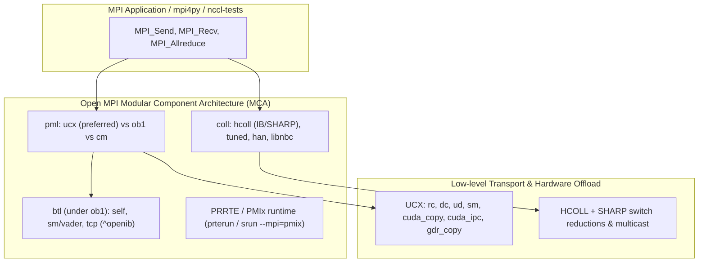

# 6.4 MPI in practice: Open MPI, ranks, collectives and tuning

| Field | Value |
|---|---|
| Level | Intermediate |
| Priority tier | 1 |
| Lab venue | Any machine with Python 3; `mpi_tuning_lab.py` and 1-rank `mpi4py` scripts run locally; multi-rank fabric runs are **untested** here |
| Part | Part 6: HPC and Slurm |
| Status | Drafted |

## Why this matters for AI infrastructure

Picture a 64-node training job submitted on Friday afternoon. Slurm allocates the 512 GPUs immediately, the job status flips to running, and then nothing happens. For two hours every GPU sits at zero percent utilization while the job hangs silently inside initialization, burning thousands of dollars of compute quota. MPI is the foundational launch, bootstrap, and message-passing substrate of high-performance computing, and it remains the process-management and benchmarking backbone of distributed AI clusters. Even when PyTorch uses NCCL for high-bandwidth GPU collectives, jobs are regularly launched via Slurm with PMIx or `mpirun`. They exchange rank and endpoint identity through MPI-style rendezvous and validate fabric health with MPI-linked benchmarks such as the OSU Micro-Benchmarks and `nccl-tests`. When you understand communicators, eager versus rendezvous deadlocks, Open MPI's Modular Component Architecture, HCOLL and UCX transports, NUMA binding, and NCCL interface selection, you can turn a mysterious multi-node hang into a five-minute fix.

## Prerequisites and outcomes

You need Chapter 6.3 for parallel scaling models and Part 2 for networking fundamentals. After finishing this chapter, you will be able to accomplish the following goals.

- Write and read small MPI programs in C or Python (`mpi4py`) that initialize the runtime, query rank and size, send and receive point-to-point messages, and execute collective reductions.
- Explain eager versus rendezvous point-to-point protocols, blocking versus non-blocking progress, and how to prevent send-send deadlocks.
- Select the right thread level for hybrid MPI+OpenMP or multithreaded dataloader jobs, and compare MPICH, Open MPI, MVAPICH2, Intel MPI, Spectrum MPI, and NVIDIA HPC-X.
- Navigate Open MPI's Modular Component Architecture, its five-level parameter precedence hierarchy, and HCOLL and UCX transport tuning.
- Launch distributed jobs with `mpirun`, `srun --mpi=pmix`, and `torchrun`, and control process mapping, ranking, and CPU and GPU NUMA binding.
- Benchmark point-to-point and collective bandwidth, distinguishing algorithmic bandwidth from bus bandwidth, and diagnose multi-node startup hangs and bandwidth collapses.

## 1. The MPI execution model: communicators, ranks, and ABI boundaries

An MPI program follows the **SPMD** (Single Program, Multiple Data) execution model. The launcher starts N independent operating-system processes—called **ranks**—running the exact same executable, each with its own private virtual address space.

- **Communicator:** an isolated communication universe binding a group of processes together. When `MPI_Init` completes, every process belongs to the default global communicator **`MPI_COMM_WORLD`**. Programs can split a communicator via `MPI_Comm_split` or `MPI_Comm_split_type` to create sub-communicators, such as one communicator per physical node or per Tensor Parallel group.
- **Rank and size:** inside any communicator, **size** is the total number of processes N, and **rank** is each process's unique integer ID from 0 to N - 1.
- **Local rank:** the process's rank within its physical host, such as 0 through 7 on an 8-GPU node. It is used to select the local GPU via `cudaSetDevice(local_rank)` or `torch.cuda.set_device(local_rank)`. An application derives its local rank either by splitting `MPI_COMM_WORLD` into node-local shared-memory communicators or by reading environment variables injected by the launcher, such as `SLURM_LOCALID` or `LOCAL_RANK`.
- **Tags and datatypes:** point-to-point messages carry an integer **tag** so the receiver can distinguish different message streams from the same sender. They also carry an explicit **datatype**, such as `MPI_DOUBLE` or custom derived types, so MPI can marshal contiguous or strided memory regions cleanly.

While the **MPI Forum** standardizes source-level API syntax across C, C++, and Fortran, **binary ABI compatibility is not universal across different MPI families**. A binary compiled against Open MPI headers cannot simply be launched under an MPICH runtime because shared library symbols and internal data structures differ. Always build and run each application stack against a single, consistent MPI module.

### A minimal Python MPI program

In Python with `mpi4py` (`code/part06/mpi_hello.py`), initializing MPI and printing each rank's identity takes three lines.

```python
from mpi4py import MPI
comm = MPI.COMM_WORLD
print(f"rank {comm.Get_rank()} of {comm.Get_size()} on {MPI.Get_processor_name()}")
```

When launched across four processes with `mpirun -np 4 python3 code/part06/mpi_hello.py` (**untested** multi-rank here; tested with 1 rank locally), `mpi4py` calls `MPI_Init` automatically on import. It prints one line per rank and calls `MPI_Finalize` at interpreter exit.

**Keep the control-plane identity model clear in every job: global rank coordinates across the cluster, while local rank binds each process to its dedicated GPU and local NUMA node**.

> **In one minute:**
> - MPI runs N separate OS processes inside a communicator (`MPI_COMM_WORLD`), while local rank (`SLURM_LOCALID`) selects the local GPU on each node.
> - Source code is portable across MPI standards, but compiled binaries are tied to their specific MPI library family (Open MPI vs MPICH).

## 2. Point-to-point communication: eager vs. rendezvous and deadlocks

When Rank 0 sends a tensor or halo buffer to Rank 1 using blocking `MPI_Send` and `MPI_Recv`, what happens under the hood depends on the message size.

- **Eager protocol:** For small messages below the eager limit, typically 8 KB to 64 KB, the sender immediately pushes the message into a pre-allocated internal bounce buffer on the receiver without waiting for the receiver to call `MPI_Recv`. Because the copy into system buffer memory completes right away, `MPI_Send` returns almost immediately.
- **Rendezvous protocol:** For large messages above the eager limit, copying a 100 MB array into a hidden bounce buffer would waste memory and bandwidth. Instead, the sender sends a tiny envelope header first and **blocks inside `MPI_Send` until the receiver posts a matching `MPI_Recv`** and returns a clear-to-send handshake. That handshake allows the NIC to transfer the payload directly from the sender's user buffer into the receiver's user buffer via RDMA with zero intermediate copies.

This protocol switch causes the most famous bug in parallel programming, the **eager-to-rendezvous deadlock**.

```text
Rank 0: MPI_Send(to Rank 1)  ---> (blocks waiting for Rank 1 to call MPI_Recv)
Rank 1: MPI_Send(to Rank 0)  ---> (blocks waiting for Rank 0 to call MPI_Recv)
```

When tested on a developer's laptop with a tiny 1 KB array, both `MPI_Send` calls use the **eager protocol**, copy into internal buffers, return immediately, and the program appears to work. Six months later in production, a researcher increases the grid resolution so the message exceeds the **eager limit**, switching to the **rendezvous protocol**. The job then deadlocks forever because both ranks wait for each other to post a receive. Eliminate send-send deadlocks in three ways:

1. **Pairwise ordering:** Rank 0 calls Send then Recv, while Rank 1 calls Recv then Send.
2. **Combined exchange:** Call **`MPI_Sendrecv`**, which posts the send and receive together safely inside the MPI library.
3. **Non-blocking communication:** Post non-blocking `MPI_Irecv` and `MPI_Isend` calls first, overlap independent local computation, and call `MPI_Wait` or `MPI_Waitall` when the data is needed.

### Measuring point-to-point latency and bandwidth (`mpi_pingpong.py`)

The repository script `code/part06/mpi_pingpong.py` measures one-way latency and asymptotic bandwidth between Rank 0 and Rank 1. It bounces messages of size $m = 2^0 \dots 2^{24}$ bytes back and forth 200 times and divides the round-trip elapsed time by 2.

```python
if rank == 0:
    comm.Send(buf, dest=1, tag=1); comm.Recv(buf, source=1, tag=2)
elif rank == 1:
    comm.Recv(buf, source=0, tag=1); comm.Send(buf, dest=0, tag=2)
```

For 1-byte messages, one-way time measures wire latency—under 1 us on shared memory, 1 to 3 us on InfiniBand, and 25 to 50 us on TCP Ethernet. For 16 MB messages, size divided by one-way time measures sustained link bandwidth.

**Never write symmetric blocking `MPI_Send` pairs that rely on eager buffering; use `MPI_Sendrecv` or non-blocking `MPI_Isend` and `MPI_Irecv` so large payloads never deadlock under the rendezvous protocol**.

> **In one minute:**
> - Small messages use the **eager protocol** with buffered copies and immediate return, while messages above the eager limit use the **rendezvous protocol** and block until a matching receive enables zero-copy RDMA.
> - Symmetric `MPI_Send` calls that work for small eager messages deadlock on large rendezvous messages; fix them with `MPI_Sendrecv` or `MPI_Isend` and `MPI_Irecv`.

## 3. Collective communication and reproducibility

Collective operations involve **every rank in a communicator**. All ranks must call the collective in the same order with compatible counts and datatypes.

| MPI collective | Data movement pattern | Distributed AI / NCCL equivalent |
|---|---|---|
| `MPI_Barrier` | Blocks until all ranks in the communicator reach the call | `dist.barrier()` straggler synchronization point |
| `MPI_Bcast` | One root rank broadcasts a buffer to all ranks | Broadcasting initial weights or tokenized control state from rank 0 |
| `MPI_Reduce` | Combines values across all ranks onto one root rank | Aggregating evaluation metrics onto rank 0 |
| `MPI_Allreduce` | Combines values across all ranks and distributes the result to **all** ranks | Data-parallel DDP gradient averaging (`dist.all_reduce`) |
| `MPI_Gather` / `MPI_Allgather` | Collects one chunk from each rank onto root or onto all ranks | FSDP and ZeRO-3 parameter gathering before forward and backward layers |
| `MPI_Scatter` | Splits a buffer on root into equal chunks across all ranks | Distributing input batches across workers |
| `MPI_Reduce_scatter` | Reduces values across ranks and scatters 1/N of the result to each rank | FSDP and ZeRO-2/3 gradient reduction and sharding |
| `MPI_Alltoall` / `MPI_Alltoallv` | Every rank sends a distinct slice to every other rank | Mixture-of-Experts token dispatch and 3D FFTW transposes |

Keep two operational facts in mind when supporting collective-heavy jobs:

1. **Floating-point reductions are not bit-for-bit associative:** In IEEE 754 floating-point arithmetic, $(a + b) + c$ does not always equal $a + (b + c)$. Changing the number of ranks or switching collective algorithms changes the summation order and produces tiny last-bit differences. When debugging numerical convergence, fix the rank count and force a deterministic collective algorithm.
2. **Validating collective arithmetic (`mpi_allreduce.py`):** The script `code/part06/mpi_allreduce.py` verifies Allreduce correctness by having each rank contribute `rank + 1` and asserting that the global sum equals `size * (size + 1) / 2`. It then times Allreduce across 1, 1,000, 1,000,000, and 8,000,000 float32 elements. Tested locally with 1 rank, it printed `sum check ok: 1`, taking 0.001 ms for 1 and 1,000 floats, 0.228 ms for 1,000,000 floats, and 1.363 ms for 8,000,000 floats.

**Ensure every rank in a communicator invokes collectives in identical order, and remember that floating-point AllReduce results vary slightly if the reduction tree topology changes**.

> **In one minute:**
> - AllReduce equals ReduceScatter followed by AllGather—the exact trio powering DDP, FSDP, and ZeRO training.
> - Because floating-point addition is not associative, bit-wise reproducibility requires a fixed rank count and a deterministic reduction tree.

## 4. Threads, hybrid programs, and MPI implementations compared (`SCL` Chapter 21)

When a program combines MPI with node-level threads such as OpenMP or Python dataloader threads, it initializes MPI with `MPI_Init_thread`. That call selects one of four thread-safety levels described in *Parallel and High Performance Computing* Chapter 8.

| Thread level | Meaning | Overhead & typical use case |
|---|---|---|
| `MPI_THREAD_SINGLE` | Only 1 thread exists in the process | Zero internal lock overhead; pure single-threaded MPI |
| `MPI_THREAD_FUNNELED` | Process is multithreaded, but **only the master thread** ever calls MPI | Near-zero lock overhead; standard for MPI+OpenMP loops where MPI runs outside parallel regions |
| `MPI_THREAD_SERIALIZED` | Multiple threads may call MPI, but **only one at a time** | Low overhead; useful when helper threads make occasional guarded MPI calls |
| `MPI_THREAD_MULTIPLE` | Any thread may call MPI concurrently at any time | Highest internal mutex contention inside the MPI library; use only when concurrent multi-threaded communication is required |

Always request the lowest thread level your algorithm needs—typically `MPI_THREAD_FUNNELED`—and check the `provided` value returned by the library, because an MPI build may grant a lower level than requested.

### Comparing MPI implementations (`SCL` Chapter 21)

Chapter 21 of *Supercomputers for Linux SysAdmins* traces the lineage and operational trade-offs of the major MPI implementations you will manage on a cluster.

- **MPICH (`http://mpich.org/`):** One of the earliest MPI implementations, created at Argonne National Laboratory in 1992 on top of the **Chameleon** portability system; the name originally stood for "MPI over Chameleon." It supports diverse transports, including Blue Gene and Cray networks, through modular drivers, making it easy to port to new systems at the cost of some optimization flexibility. At the end of 2025, the stable branch is **MPICH-4**, while branches 1 and 2 are frozen. MPICH-1 was famous for simple launching where `mpirun` generated keys and spawned processes directly via `ssh` or `rsh`. Build from source with `CC=my-compiler` and `--prefix=/opt/mpich`. Many commercial implementations, including Intel MPI and HP-MPI, were originally created on the basis of MPICH.
- **Open MPI (`http://www.open-mpi.org/`):** Created independently of MPICH and first released on November 17, 2005, developing ideas from four earlier projects: **LAM/MPI**, **FT-MPI**, **LA-MPI**, and **PACX-MPI**. Unlike MPICH, Open MPI has no driver concept and requires launching special daemon programs on compute nodes beforehand (`prterun` in Open MPI 5). Open MPI delivers strong performance and often outperforms commercial stacks, though its documentation is scattered across forums and project FAQs. Always build Open MPI from source in separate variants for each compiler family, because linking a program compiled with one compiler against Open MPI libraries built with another causes linker failures.
- **MVAPICH / MVAPICH2 (`http://mvapich.cse.ohio-state.edu/`):** Developed at Ohio State University based on MPICH-2 to optimize MPICH for **InfiniBand**, and shipped in standard OFED packages alongside Open MPI. **Crucial operational distinction:** instead of `mpirun` (which is still left in the distribution), you must launch MVAPICH2 jobs using **`mpirun_rsh`**, whose flags differ from MPICH `mpirun`.
- **IBM Spectrum MPI and Intel MPI:** **Spectrum MPI** is IBM's proprietary Open MPI derivative tuned for IBM hardware with InfiniBand and GPUDirect RDMA support. **Intel MPI** is developed almost from scratch with strong InfiniBand optimization and documentation; in 2025 it is **free to use** with an optional paid support contract.
- **NVIDIA HPC-X:** NVIDIA's production software bundle combining Open MPI, UCX, HCOLL, and SHARP pre-tuned for NVIDIA InfiniBand and RoCEv2 GPU clusters.

**Build separate Open MPI modules for each compiler family on your cluster, use `mpirun_rsh` when running MVAPICH2, and request `MPI_THREAD_FUNNELED` rather than `MPI_THREAD_MULTIPLE` unless threads communicate concurrently**.

> **In one minute:**
> - Request `MPI_THREAD_FUNNELED` for standard MPI+OpenMP programs to avoid the internal locking overhead of `MPI_THREAD_MULTIPLE`.
> - MPICH (1992 Argonne, "MPI over Chameleon", MPICH-4 current in 2025) is the parent of MVAPICH2 (launched via `mpirun_rsh`), Intel MPI (free in 2025 with paid support), and Cray MPICH.
> - Open MPI (released Nov 17, 2005 from LAM/MPI, FT-MPI, LA-MPI, and PACX-MPI) powers NVIDIA HPC-X and IBM Spectrum MPI and should be built per compiler suite.

## 5. Open MPI architecture (MCA), 5-level priority, HCOLL, and UCX



Open MPI is organized around its **Modular Component Architecture (MCA)**. This plugin system loads transport and algorithm modules at runtime, as covered in *Supercomputers for Linux SysAdmins* Chapter 21 and `volume-10` Appendix B.

| MCA framework | Responsibility | Key components in production |
|---|---|---|
| `pml` | Point-to-point messaging layer | `ucx` (modern InfiniBand, RoCE, and GPU path), `ob1` (legacy BTL engine), `cm` (uses `mtl` for OFI and libfabric) |
| `btl` | Byte transfer layer used under `ob1` | `self` (loopback), `sm` or `vader` (shared memory), `tcp` (Ethernet); legacy `openib` was removed in Open MPI 5 |
| `mtl` | Matching transport layer used under `cm` | `ofi` (libfabric), `psm2` |
| `coll` | MPI collective algorithms | `hcoll` (NVIDIA IB and SHARP offload), `tuned`, `han` (hierarchical node-aware), `libnbc` (non-blocking) |
| `io` | Parallel file I/O (`MPI-IO`) | `ompio`, `romio` |
| `plm` / PRRTE / PMIx | Process lifecycle and daemon launch | `slurm`, `rsh`; in Open MPI 5, `mpirun` is backed by `prterun` |

### The 5-level MCA parameter priority hierarchy (`SCL` Chapter 21)

You can inspect every available MCA parameter and its current value with `ompi_info -a` or `ompi_info --param pml ucx --level 9`. When the same MCA parameter is set in multiple places, Open MPI resolves it in **five levels of increasing priority**, modeled in `resolve_openmpi_mca_param()` in `code/part06/mpi_tuning.py`:

1. **Global configuration file (lowest priority):** `/etc/openmpi-mca-params.conf` (and `openpmix-mca-params.conf` or `prte-mca-params.conf` for PMIx and PRRTE), formatted as `key=value`.
2. **User local configuration file:** `$HOME/.openmpi/mca-params.conf`.
3. **Tuned option files:** passed via `mpiexec --tune file1,file2...`, whose contents are interpreted as regular `mpiexec` options.
4. **Environment variables:** `export OMPI_MCA_xxx=value` (or `PMIX_MCA_xxx` and `PRRTE_MCA_xxx`).
5. **Command-line options (highest priority):** `mpiexec -mca xxx value` or `--mca xxx value`.

Prefixing a component list with **`^`** excludes those components. For example, `export OMPI_MCA_btl=^tcp,self,openib` in Open MPI 4 or `--mca btl_tcp_if_exclude lo,docker0` prevents Open MPI from routing over unwanted interfaces.

### Tuning HCOLL and UCX in Open MPI (`SCL` Chapter 21)

By default on NVIDIA InfiniBand clusters, Open MPI uses **HCOLL** (Host Collectives) to accelerate MPI collective operations via hardware multicast and in-network **SHARP** switch reductions. Occasionally an HCOLL collective hits a bug or conflicts with an application. You can disable HCOLL or steer it to a specific HCA (**untested** here).

```bash
# Disable HCOLL via CLI flag or environment variable (under srun --mpi=pmix) (untested here)
mpiexec -mca coll_hcoll_enable 0 ... myprog
export OMPI_MCA_coll_hcoll_enable=0
srun --mpi=pmix ... myprog

# Tune HCOLL and UCX device/feature selection with -x (untested here)
mpirun -np 2 -mca pml ucx -x UCX_NET_DEVICES=mlx5_0:1 \
  -x HCOLL_MAIN_IB=mlx5_0:1 \
  -x HCOLL_ENABLE_MCAST_ALL=1 \
  -x HCOLL_ENABLE_NBC=1 \
  -x HCOLL_ENABLE_SHARP=1 \
  ./myapp
```

Here `-mca pml ucx` selects the **Unified Communication X (UCX)** point-to-point engine. Passing `-x UCX_NET_DEVICES=mlx5_0:1` and `-x HCOLL_MAIN_IB=mlx5_0:1` pins traffic to port 1 of InfiniBand adapter `mlx5_0`. Meanwhile, `HCOLL_ENABLE_MCAST_ALL=1` enables hardware multicast, `HCOLL_ENABLE_NBC=1` enables non-blocking collectives, and `HCOLL_ENABLE_SHARP=1` enables in-network switch reductions. If you are troubleshooting a suspected UCX bug, `-x OMPI_MCA_pml=^ucx` disables UCX. Run `ucx_info -d` to inspect detected RDMA devices and **`ucx_info -c -f`** to print documented descriptions of every UCX variable (`UCX_TLS=rc,sm,cuda_copy,cuda_ipc,gdr_copy`, `UCX_IB_SL=1`, `UCX_LOG_LEVEL=info`).

**Verify that `ompi_info | grep pml` lists `ucx`, understand the 5-level MCA override order, and remember that `coll_hcoll_enable` controls MPI collectives rather than NCCL GPU collectives**.

> **In one minute:**
> - Open MPI's MCA selects runtime plugins across `pml` (`ucx` vs `ob1`), `btl` (`self`, `sm`, `tcp`), and `coll` (`hcoll`, `tuned`, `han`).
> - MCA priority increases from `/etc/openmpi-mca-params.conf` (1) to `$HOME/.openmpi/mca-params.conf` (2) to `--tune` files (3) to `OMPI_MCA_` env vars (4) to `-mca` CLI flags (5).
> - Use `ucx_info -c -f` and `UCX_NET_DEVICES=mlx5_0:1` or `HCOLL_MAIN_IB=mlx5_0:1` to steer InfiniBand transports.

## 6. Launching at scale: `srun --mpi=pmix` vs. `mpirun` vs. `torchrun`

On a modern GPU cluster (`volume-10/07-mpi-fundamentals-for-hpc-ai-workloads.md`), distributed jobs are launched in one of three ways:

1. **The native Slurm HPC standard (`srun --mpi=pmix`):** Having a head node open thousands of sequential SSH connections does not scale. With `srun --mpi=pmix`, `slurmd` on each allocated node spawns `slurmstepd`, which starts the local tasks and hosts a local **PMIx server** over a Unix domain socket. Ranks publish and exchange endpoint addresses through the Slurm PMIx tree in milliseconds without SSH. Always pass **`--kill-on-bad-exit=1`**. If one rank crashes with an OOM (exit 137) or segfault (exit 139), Slurm immediately terminates all other ranks instead of leaving 500 GPUs hanging at the next AllReduce barrier (**untested** here).
   ```bash
   # (untested here)
   srun --mpi=pmix --kill-on-bad-exit=1 \
     --ntasks-per-node=8 --gpus-per-node=8 --cpus-per-task=14 \
     python3 /workspace/train.py
   ```
   Check supported Slurm PMI plugins with `srun --mpi=list`, and after package upgrades verify that `slurm-libpmi` and `pmix-libpmi` RPMs have not conflicted.
2. **The standalone Open MPI / HPC-X launcher (`mpirun`):** Used on bare-metal SSH clusters or inside multi-node Kubernetes MPIJob pods (**untested** here):
   ```bash
   # (untested here)
   mpirun -np 256 --hostfile /etc/opt/cluster/hosts.txt \
     --bind-to none --map-by slot \
     -x LD_LIBRARY_PATH -x PATH -x NCCL_DEBUG=INFO -x NCCL_IB_HCA=mlx5_0,mlx5_1 \
     -mca pml ucx -mca btl ^openib,smcuda \
     -mca btl_tcp_if_include ens1f0 \
     -mca coll_hcoll_enable 0 \
     -mca plm_rsh_no_tree_spawn 1 \
     python3 megatron_pretrain.py
   ```
   Remember three critical `mpirun` flags. First, **`-x VAR`** explicitly forwards environment variables to remote nodes; without `-x`, remote ranks never see your `NCCL_DEBUG=INFO` export. Second, **`--bind-to none`** stops Open MPI from pinning a rank and all of its PyTorch DataLoader worker threads onto a single CPU core. Third, **`-mca plm_rsh_no_tree_spawn 1`** (along with `routed_radix`) can resolve intermittent SSH tree-spawn timeouts on slow management networks.
3. **The PyTorch elastic launcher (`torchrun`):** Uses PyTorch's built-in `c10d` TCP store (`--rdzv_backend=c10d --rdzv_endpoint=10.100.1.10:29500`) without MPI. While convenient for elastic cloud jobs, funneling thousands of ranks through a single TCP rendezvous endpoint host can create a startup bottleneck at very large scale compared to Slurm's hierarchical tree.

**Prefer `srun --mpi=pmix --kill-on-bad-exit=1` on Slurm clusters, and never forget `-x` environment forwarding and `--bind-to none` (or socket/NUMA binding) when launching multi-threaded PyTorch jobs with `mpirun`**.

> **In one minute:**
> - `srun --mpi=pmix --kill-on-bad-exit=1` uses Slurm's `slurmstepd` PMIx server for fast, SSH-free rank wire-up and tears down the whole job immediately if one rank crashes.
> - With `mpirun`, use `-x` to export environment variables to remote nodes and avoid confining multi-threaded PyTorch dataloaders to 1 CPU core.

## 7. Mapping, ranking, CPU/GPU NUMA binding, and `taskset` verification

Placing parallel processes onto dual-socket GPU servers involves three distinct steps (*Parallel and High Performance Computing* Chapter 14 and `volume-10` Section 5):

- **Mapping (`--map-by slot|node|socket|numa|ppr:8:node`):** decides which hardware resource each process lands on.
- **Ranking (`--rank-by slot|node|socket`):** assigns integer rank IDs 0 through N-1 to those mapped slots, such as packing ranks 0 through 7 on Node 0 so intra-node collectives stay on NVLink.
- **Binding (`--bind-to core|socket|numa|none` or Slurm `--cpu-bind=cores --gpu-bind=closest`):** restricts the OS scheduler via cgroups and affinity masks so the process cannot migrate across sockets.

Consider a dual-socket server such as a DGX H100 where Socket 0 (NUMA 0) hosts GPUs 0–3 and HCAs 0–3, and Socket 1 (NUMA 1) hosts GPUs 4–7 and HCAs 4–7. Suppose a rank assigned to GPU 0 runs its CPU threads on Socket 1. Every host-to-device copy and control call must then cross the slow inter-socket UPI or Infinity Fabric link instead of local PCIe and NVLink (900 GB/s). Always verify bindings in production (**untested** here):

- With Open MPI: pass **`mpirun --report-bindings ...`** to print the exact core mask of every rank at startup.
- With Slurm and `numactl` or `taskset`: run `numactl --show | grep physcpubind` in a launch wrapper or inspect a running worker PID on the node with **`taskset -cp <PID>`**, confirming Rank 0 is bound to cores `0-15` rather than `0-127`.

**Bind every GPU rank to the CPU cores of its local NUMA socket (`--cpu-bind=cores --gpu-bind=closest`) and verify with `--report-bindings` or `taskset -cp <PID>`**.

> **In one minute:**
> - Mapping chooses the hardware location, ranking numbers the processes, and binding pins each process to its CPU cores and NUMA domain.
> - Misaligned CPU-to-GPU NUMA placement forces traffic across the inter-socket UPI or Infinity Fabric bus; verify live affinity with `mpirun --report-bindings`, `numactl --show`, or `taskset -cp <PID>`.

## 8. CUDA-aware MPI, GPUDirect RDMA, PCIe ACS, and `memlock`

A **CUDA-aware MPI** library—verified via `ompi_info --parsable --all | grep mpi_built_with_cuda_support`—allows applications to pass GPU device pointers directly into `MPI_Send`, `MPI_Recv`, and `MPI_Allreduce` without manually copying tensors to host RAM first. When paired with **GPUDirect RDMA**, the ConnectX HCA reads and writes GPU HBM directly across the local PCIe switch (`PIX`), bypassing host CPU RAM completely.

Three host-level configurations are required for full GPUDirect RDMA speed (`volume-10` Section 9 and Appendices C, L, O):

1. **Peer-memory kernel driver (`nvidia_peermem` or `dma-buf`):** Verify with `lsmod | grep nvidia_peermem`. If this module is missing after a kernel update, GPUDirect RDMA silently falls back to staging through host CPU RAM and multi-node bandwidth collapses.
2. **PCIe Access Control Services (ACS) and PCIe Gen 5 link width:** In virtualized environments, hypervisors enable PCIe **ACS** on PCIe switches to force all peer-to-peer transactions up to the CPU root complex IOMMU (`SYS` instead of `PIX` in `nvidia-smi topo -m`). That redirection throttles GPUDirect RDMA. Similarly, a PCIe Gen 5 x16 slot (32 GT/s, ~63 GB/s unidirectional) matches a 400 Gbps (50 GB/s) ConnectX-7 HCA. If a bad riser downgrades that slot to PCIe Gen 4 (~31.5 GB/s), the 400G NIC is hardware-bottlenecked at ~250 Gbps. Always check `lspci -vv | grep LnkSta:` and `dmesg -w | grep -i AER` on slow nodes.
3. **Unlimited locked memory (`ulimit -l` / `memlock`):** RDMA requires pinning physical pages so the kernel cannot swap them. If `ulimit -l` is too small, jobs fail with `ibv_reg_mr() failed` or `NCCL WARN Call to ibv_create_qp failed`. Set `* soft memlock unlimited` and `* hard memlock unlimited` in `/etc/security/limits.conf` and Slurm daemon unit files, and verify inside the job with `ulimit -l`.

**When multi-node GPU bandwidth drops suddenly, check `lsmod | grep nvidia_peermem`, `nvidia-smi topo -m`, `lspci -vv | grep LnkSta:`, and `ulimit -l` first**.

> **In one minute:**
> - CUDA-aware MPI and NCCL rely on GPUDirect RDMA (`nvidia_peermem` or `dma-buf`) to move tensors directly between GPU HBM and the NIC across the local PCIe switch (`PIX`).
> - Enabled PCIe ACS, a downtrained PCIe Gen 4 link (~31.5 GB/s vs Gen 5 ~63 GB/s for a 50 GB/s 400G NIC), or low `memlock` (`ibv_reg_mr failed`) will cripple or crash RDMA jobs.

## 9. Benchmarking: OSU Micro-Benchmarks and Algorithmic vs. Bus Bandwidth

To validate MPI and NCCL performance across nodes, operators run two standard suites:

- **OSU Micro-Benchmarks (`osu_latency`, `osu_bw`, `osu_bibw`, `osu_allreduce`, `osu_alltoall`):** tests both host-to-host and GPU-to-GPU MPI paths. Pairwise fabric health can also be tested directly at the verbs layer with `ib_write_bw -d mlx5_0 --use_cuda=0 <server> -a` and `ib_write_lat`.
- **`nccl-tests` (`all_reduce_perf`, `all_gather_perf`, `alltoall_perf`):** reports two bandwidth columns that you must never confuse, modeled in `compute_allreduce_algbw_and_busbw()` in `code/part06/mpi_tuning.py`:
  - **Algorithmic Bandwidth:** tensor bytes divided by elapsed time. For a 1 GB (1,000,000,000 B) AllReduce finishing in 0.005 s (5 ms), algorithmic bandwidth is **200.0 GB/s**.
  - **Bus Bandwidth:** multiplies algorithmic bandwidth by the ring collective traffic factor $2(n - 1)/n$. That normalization lets you compare the result directly against hardware NIC or NVLink line rate regardless of the number of GPUs. On 8 GPUs, the factor is $2 \times 7 / 8 = 1.75$, giving a bus bandwidth of $200.0 \times 1.75 = \mathbf{350.0\text{ GB/s}}$.

**Always quote Bus Bandwidth (`algbw * 2(n-1)/n`) when comparing AllReduce results against NIC or NVLink hardware specs, because bus bandwidth normalizes out the rank count**.

> **In one minute:**
> - Algorithmic bandwidth is `S / t`, whereas Bus Bandwidth is `algbw * 2(n-1)/n` for AllReduce and reflects actual physical link saturation.

## 10. Troubleshooting guide: the 4-layer ladder and real init hangs

During the testing of this chapter on an Apple Silicon Mac in a sandboxed shell, installing Open MPI 5.0.11 and MPICH via `conda-forge` produced a textbook diagnostic case. Running `mpirun -np 2 hostname` worked (`prterun` spawned both processes cleanly) and a 1-rank singleton `mpi4py` script succeeded, **but every 2-rank `MPI_Init` hung indefinitely**. That hang persisted even after setting `TMPDIR=/tmp`, forcing `btl=self,sm`, trying `pmix_gds=hash`, and testing MPICH TCP libfabric. Because the sandbox blocked local inter-process wire-up sockets, isolating which step hung required walking a strict diagnostic ladder.

On a production GPU cluster (`volume-10` Senior Deep Dive 3), whenever a multi-node job hangs or crawls, walk these **four layers in order**.

### Layer 1: Process launch, exit codes, and OS limits

- Did every node spawn the expected number of processes (`pgrep -fc python3`) and does every node have `ulimit -l` set to `unlimited`?
- If the job died with a non-zero exit code, decode the signal (`volume-10` Appendix G).
  - **Exit code 139 (128 + 11 SIGSEGV):** Segmentation fault, often caused by mismatched CUDA or MPI libraries or dereferencing a host pointer on the GPU.
  - **Exit code 137 (128 + 9 SIGKILL):** Host Linux OOM killer or cgroup memory limit, usually caused by too many PyTorch DataLoader workers exhausting host RAM rather than GPU VRAM.
  - **Exit code 143 (128 + 15 SIGTERM):** Terminated by Slurm walltime expiration, `scancel`, or preemption.

### Layer 2: Rendezvous (PMIx plugin and `NCCL_SOCKET_IFNAME` prefix rules)

If all processes are alive at 0% GPU utilization, check whether they found each other's IP addresses. By default, NCCL and Open MPI scan active network interfaces for TCP bootstrap rendezvous. If Node A picks a non-routable virtual bridge like `docker0` (172.17.0.1) while Node B picks `bond0` (10.100.1.10), the TCP handshake hangs forever.

Fix this with **`NCCL_SOCKET_IFNAME`** for NCCL bootstrap and **`NCCL_IB_HCA`** for RDMA HCAs. As detailed in `SCL` Chapter 21 and implemented in `match_nccl_ifname()` in `code/part06/mpi_tuning.py`, NCCL uses **four prefix-matching operators**:

| Syntax in `NCCL_SOCKET_IFNAME` / `NCCL_IB_HCA` | Matching rule (`SCL` Chapter 21) | Example on `["lo", "docker0", "eth0", "eth1", "eth11", "bond0"]` |
|---|---|---|
| Plain string (`eth`) | **Prefix match:** matches all interfaces starting with `eth` | Matches `eth0`, `eth1`, and `eth11` |
| **`=`** prefix (`=eth1`) | **Exact match:** matches only the exact interface name | Matches `eth1` only, not `eth11` |
| **`^`** prefix (`^docker`) | **Exclude prefix:** matches all interfaces except those starting with `docker` | Excludes `docker0` |
| **`^=`** prefix (`^=eth0`) | **Exclude exact:** matches all interfaces except `eth0` specifically | Excludes `eth0` while keeping `eth1` and `eth11` |

Also ensure host firewalls allow the ephemeral TCP port range used during rendezvous, such as `echo 50000 51000 > /proc/sys/net/ipv4/ip_local_port_range`.

### Layer 3: NCCL initialization, `NCCL_RUN_DIAGNOSTICS`, `ncclras`, and GPU Xids

1. **Inspect transport and graph logs:** Set `export NCCL_DEBUG=INFO` and `export NCCL_DEBUG_SUBSYS=INIT,GRAPH,ENV,NET`, optionally redirecting per-rank logs via `NCCL_DEBUG_FILE=nccl_%h_%p.log`. Confirm the log prints `Using network IB` rather than falling back to Socket.
2. **Run built-in init diagnostics (NCCL 2.31+):** Launch with **`NCCL_RUN_DIAGNOSTICS=1`** to print `NCCL DIAG` peer-to-peer and fabric checks before application traffic starts.
3. **Query the live RAS daemon on a hung job (NCCL 2.24+):** Run **`ncclras -v`** or `echo verbose status | nc localhost 28028` (default port 28028 via `NCCL_RAS_ADDR`) on any node in the job. Look for a **`MISMATCH`** row—*"Communicator ranks have different collective operation counts"*, which names the exact lagging rank, PID, GPU, and hostname—or an **`INCOMPLETE`** row naming a dead or unresponsive rank.
4. **Remember the watchdog is PyTorch's (`TORCH_NCCL_*`), not NCCL's:** When a job aborts with a `ProcessGroupNCCL` watchdog timeout, that timeout comes from PyTorch (`TORCH_NCCL_TRACE_BUFFER_SIZE` and `TORCH_FR_BUFFER_SIZE`), telling you some rank stalled. Use `ncclras` and `journalctl -k | grep "NVRM: Xid"` (checking for Xid 79 GPU fallen off the bus or Xid 119 GSP timeout) or `strace -e trace=ioctl -p <PID>` to find the broken GPU.
5. **Slow `/sys` topology discovery in containers:** If initialization takes 15 minutes, run `strace -f -tt -e trace=open,openat,read` to verify `/sys/class/pci_bus` is properly mounted in the container.

### Layer 4: Physical fabric health (InfiniBand and RoCEv2)

- **InfiniBand:** Check `ibstat` (State Active, Physical state LinkUp, expected Rate), `sudo sminfo` (Subnet Manager alive), and `sudo perfquery -x <lid>`, watching for **increasing** `SymbolErrorCounter`, `LinkErrorRecoveryCounter`, or `LinkDownedCounter` across two reads. Also check `mlxlink`, `rdma statistic` (`rnr_nak_retry_err`, `packet_seq_err`, `local_ack_timeout_err`), and `sudo ibdiagnet`. Note that `NCCL_IB_TIMEOUT` (default 20, where timeout is $\approx 4.096\ \mu\text{s} \times 2^{\text{timeout}}$) and `NCCL_IB_RETRY_CNT` (default 7) give roughly a 30-second retry window to absorb a brief 3-second link flap (`ibportstate 1 1 disable`). For SHARP, `NCCL_COLLNET_ENABLE=1` (with `CollnetChain` and `CollnetDirect` in NCCL 2.14+, and strict `NCCL_ALGO` parsing in 2.24+) controls inter-node InfiniBand SHARP, managed by UFM's `/etc/init.d/ufmd sharp_start`. By contrast, `NCCL_NVLS_ENABLE` (`NVLS` and `NVLSTree`, default 2 since 2.17) controls intra-domain NVLink SHARP on Hopper and Blackwell NVSwitch systems.
- **RoCEv2:** Check `ethtool -S <nic> | grep -i pause` and `mlnx_qos -i <nic>` for Priority Flow Control (**PFC**) pause storms, which are mitigated by the switch and NIC **PFC watchdog**. Verify `show_gids`, and do **not** hardcode `NCCL_IB_GID_INDEX=3` on modern NCCL 2.21+ or 2.32u1+, which defaults to `AUTO`. On the switch (`nv set qos roce` and `nv show qos roce` on Cumulus Linux 5.12), verify the lossless RoCE defaults. Those defaults are **PFC on priority 3**, **RoCE data on DSCP 26 -> priority 3**, and **CNP congestion notifications on DSCP 48 -> strict priority 6** with UDP port 4791 LLDP TLV.

**Walk the 4-layer debugging ladder in strict order—Launch/Limits, Rendezvous, NCCL (`ncclras` on port 28028 and Xid logs), and Fabric—so you never waste hours debugging switches for a missing `memlock` limit**.

> **In one minute:**
> - Walk the 4-layer ladder: (1) Launch and `memlock` (`ulimit -l`, exit codes 139 SIGSEGV, 137 OOM SIGKILL, 143 SIGTERM), (2) Rendezvous (`srun --mpi=list`, `NCCL_SOCKET_IFNAME` prefixes `eth`, `=eth1`, `^docker`, `^=eth0`), (3) NCCL (`NCCL_DEBUG=INFO`, `NCCL_RUN_DIAGNOSTICS=1`, `ncclras` on `localhost:28028`, `NVRM: Xid`), and (4) Fabric (`ibstat`, `perfquery -x`, `ib_write_bw`, or Cumulus RoCE DSCP 26 data, DSCP 48 CNP, and priority 3 PFC).

## 11. Lab: test MCA precedence, `NCCL_SOCKET_IFNAME` matching, and single-rank MPI

First, run the self-checking Python lab (`code/part06/mpi_tuning_lab.py`) locally. It verifies the 5-level Open MPI MCA parameter precedence resolver and the four `NCCL_SOCKET_IFNAME` prefix and exact matching operators. It also checks the AllReduce algorithmic versus bus bandwidth calculator:

```bash
python3 code/part06/mpi_tuning_lab.py
```

Next, run the standalone calculator and the single-rank MPI scripts:

```bash
python3 code/part06/mpi_tuning.py
```

Work through these hands-on steps:

1. Test `match_nccl_ifname(["lo", "docker0", "eth0", "eth1", "eth11", "bond0"], spec)` with `"eth"`, `"=eth1"`, and `"^docker,^=lo,^=eth0"`.
2. Test `resolve_openmpi_mca_param()` when `/etc/openmpi-mca-params.conf` sets `pml=ob1`, `$HOME/.openmpi/mca-params.conf` sets `pml=cm`, and `OMPI_MCA_pml=ucx` is exported in the environment. Verify that the environment variable wins unless overridden by `-mca pml ^ucx` on the command line.
3. On a machine or cluster with MPI installed, run `python3 code/part06/mpi_hello.py` and `python3 code/part06/mpi_allreduce.py` (tested locally with 1 rank; multi-rank `mpirun -np 4` and `code/part06/mpi_pingpong.py` require an unsandboxed multi-rank environment and are **untested** here).

## 12. Interview angles

- Why does a point-to-point MPI program that works with 4 KB messages suddenly deadlock when the buffer size increases to 4 MB? How do you fix it?
- List the five levels of Open MPI MCA parameter precedence from lowest to highest, and explain how to disable HCOLL or pin UCX to `mlx5_0:1`.
- Explain the four `NCCL_SOCKET_IFNAME` matching operators (`eth`, `=eth1`, `^docker`, `^=eth0`). What happens if Node 0 picks `docker0` during bootstrap?
- A 128-node training job hangs or crashes with a PyTorch watchdog error after 8 hours. Walk through the 4-layer diagnostic ladder, including `ncclras` (port 28028), `NVRM: Xid`, `lsmod | grep nvidia_peermem`, and Cumulus RoCE DSCP 26 vs DSCP 48.
- What is the difference between Algorithmic Bandwidth and Bus Bandwidth in `nccl-tests`, and what do exit codes 137, 139, and 143 mean?

## Exercises

1. **Open MPI 5-Level MCA Precedence and HCOLL/UCX Controls:** Using `resolve_openmpi_mca_param()` in `code/part06/mpi_tuning.py`, list the five levels of Open MPI MCA parameter priority from lowest to highest. Write the commands to disable HCOLL under `srun --mpi=pmix`, force UCX and HCOLL to use `mlx5_0:1` with hardware multicast and SHARP enabled, and list all documented UCX parameters via `ucx_info`.
2. **`NCCL_SOCKET_IFNAME` and `NCCL_IB_HCA` Prefix Operators:** Using `match_nccl_ifname()` in `code/part06/mpi_tuning.py` against `["lo", "docker0", "eth0", "eth1", "eth11", "bond0"]`, evaluate the exact interface list returned by `"eth"`, `"=eth1"`, `"^docker"`, and `"^docker,^=lo,^=eth0"`. Explain why hardcoding `NCCL_IB_GID_INDEX=3` is discouraged on modern NCCL.
3. **Eager vs. Rendezvous Deadlocks and MPI Thread Levels:** Trace why two ranks calling blocking `MPI_Send` to each other succeed for 1 KB messages (eager protocol) but deadlock for 10 MB messages (rendezvous protocol). Give three code fixes (`MPI_Sendrecv`, ordered send/recv, `MPI_Isend`/`MPI_Irecv`), and compare the four `MPI_Init_thread` levels.
4. **Algorithmic Bandwidth vs. Bus Bandwidth and GPUDirect RDMA:** Using `compute_allreduce_algbw_and_busbw(1_000_000_000, 0.005, 8)`, compute the algorithmic bandwidth (200.0 GB/s) and ring bus bandwidth (350.0 GB/s) for a 1 GB AllReduce completing in 5 ms across 8 GPUs. Explain how `nvidia_peermem`, PCIe ACS (`PIX` vs `SYS`), and PCIe Gen 5 (~63 GB/s) vs Gen 4 (~31.5 GB/s on a 50 GB/s 400G NIC) affect that number.
5. **Launching at Scale and NUMA Binding:** Compare `srun --mpi=pmix --kill-on-bad-exit=1`, `mpirun` (`-x`, `--bind-to none`, `-mca plm_rsh_no_tree_spawn 1`), and `torchrun` (`c10d`). Show how to verify CPU and GPU NUMA affinity on a dual-socket server using `mpirun --report-bindings`, `numactl --show`, and `taskset -cp <PID>`.
6. **The 4-Layer Hang & Fabric Debugging Playbook:** Walk through the 4-layer troubleshooting ladder for a hung multi-node job. Cover Layer 1 (`pgrep`, `ulimit -l` `memlock`, exit codes 137, 139, and 143), Layer 2 (`srun --mpi=list`, `NCCL_SOCKET_IFNAME`), Layer 3 (`NCCL_DEBUG_SUBSYS`, `NCCL_RUN_DIAGNOSTICS=1`, `ncclras` on port 28028, PyTorch `TORCH_NCCL_*` watchdog vs `NVRM: Xid`), and Layer 4 (`ibstat`, `perfquery -x`, `ibdiagnet`, and Cumulus RoCE DSCP 26, DSCP 48, and PFC priority 3).

## Checkpoint questions (20)

<details>
<summary>1. What are a communicator, global rank, size, and local rank in MPI, and how does a GPU process select its local device?</summary>

- **Communicator:** A group of processes plus an isolated communication context (`MPI_COMM_WORLD` contains all processes at startup).
- **Size and global rank:** `size` is the total process count $N$, and `rank` is each process's unique ID $0 \dots N-1$ across the job.
- **Local rank:** The process's rank within its physical node ($0 \dots G-1$, derived via `MPI_Comm_split_type` or launcher variables like `SLURM_LOCALID` and `LOCAL_RANK`), passed to `cudaSetDevice(local_rank)` so each rank claims a distinct GPU.
</details>

<details>
<summary>2. Explain the difference between the **eager** and **rendezvous** point-to-point protocols, and why a program that works on small messages can deadlock on large messages.</summary>

- **Eager protocol (below the eager limit):** `MPI_Send` copies the small payload into an internal buffer and returns immediately without waiting for `MPI_Recv`.
- **Rendezvous protocol (above the eager limit):** `MPI_Send` sends a header and **blocks until the receiver posts a matching `MPI_Recv`** so the payload can be transferred directly via zero-copy RDMA.
If Rank 0 and Rank 1 both call blocking `MPI_Send` to each other before calling `MPI_Recv`, small messages succeed via eager buffering, but large messages deadlock forever under rendezvous. Fix with `MPI_Sendrecv`, ordered send/recv, or non-blocking `MPI_Isend` and `MPI_Irecv`.
</details>

<details>
<summary>3. Why are floating-point `MPI_Allreduce` or NCCL reductions not bit-for-bit identical when you change the rank count or collective algorithm?</summary>

IEEE 754 floating-point addition is **not associative**: $(a + b) + c \ne a + (b + c)$ due to rounding after each operation. Changing the number of ranks or switching between ring, tree, and SHARP in-network reductions changes the order in which partial sums are accumulated. Bit-wise reproducibility requires a fixed rank count and a deterministic reduction algorithm.
</details>

<details>
<summary>4. List the four `MPI_Init_thread` levels from lowest to highest, and state which level suits a standard MPI + OpenMP program where only the main loop calls MPI.</summary>

1. `MPI_THREAD_SINGLE`: single-threaded process.
2. `MPI_THREAD_FUNNELED`: multithreaded process, but **only the main thread makes MPI calls**.
3. `MPI_THREAD_SERIALIZED`: multiple threads make MPI calls, but only one at a time.
4. `MPI_THREAD_MULTIPLE`: any thread may call MPI concurrently (highest internal lock overhead).
A standard MPI+OpenMP program where MPI is called outside parallel regions needs only **`MPI_THREAD_FUNNELED`**.
</details>

<details>
<summary>5. Compare the history and launch specifics of MPICH, Open MPI, MVAPICH2, Intel MPI, and NVIDIA HPC-X (`SCL` Chapter 21).</summary>

- **MPICH:** Created at Argonne in 1992 ("MPI over Chameleon"); MPICH-4 is the current stable branch in 2025, while MPICH-1 and 2 are frozen. It is the ancestor of Intel MPI (free in 2025 with paid support) and Cray MPICH.
- **Open MPI:** Released November 17, 2005 (combining LAM/MPI, FT-MPI, LA-MPI, and PACX-MPI); uses MCA plugins and node daemons (`prterun` in v5) and should be built per compiler suite.
- **MVAPICH2:** Ohio State University's InfiniBand-tuned MPICH-2 derivative; **must be launched with `mpirun_rsh`** rather than `mpirun`.
- **NVIDIA HPC-X:** NVIDIA's pre-tuned bundle of Open MPI, UCX, HCOLL, and SHARP/UCC.
</details>

<details>
<summary>6. What are the roles of the `pml`, `btl`, `mtl`, `coll`, and `plm` frameworks in Open MPI's Modular Component Architecture?</summary>

- **`pml` (Point-to-Point Messaging Layer):** high-level message scheduling (`ucx` for modern RDMA and GPU, `ob1` for BTLs, `cm` for MTLs).
- **`btl` (Byte Transfer Layer):** low-level byte movement under `ob1` (`self`, `sm`/`vader`, `tcp`; legacy `openib` was removed in Open MPI 5).
- **`mtl` (Matching Transport Layer):** used under `cm` (`ofi` and `psm2`).
- **`coll` (Collective):** collective algorithms (`hcoll`, `tuned`, `han`, `libnbc`).
- **`plm` (Process Lifecycle Management):** daemon launch (`slurm`, `rsh`).
</details>

<details>
<summary>7. List the five levels of Open MPI MCA parameter priority in order of increasing precedence (`SCL` Chapter 21).</summary>

From lowest (1) to highest (5) priority:
1. **Global config file:** `/etc/openmpi-mca-params.conf` (and `openpmix-mca-params.conf` or `prte-mca-params.conf`).
2. **User local config file:** `$HOME/.openmpi/mca-params.conf`.
3. **Tuned option files:** `mpiexec --tune file1,file2...`.
4. **Environment variables:** `export OMPI_MCA_xxx=value` (or `PMIX_MCA_` and `PRRTE_MCA_`).
5. **Command-line options:** `mpiexec -mca xxx value`.
</details>

<details>
<summary>8. How do you disable HCOLL or steer HCOLL and UCX to a specific InfiniBand port (`mlx5_0:1`) in Open MPI (`SCL` Chapter 21)?</summary>

- **Disable HCOLL:** Pass `-mca coll_hcoll_enable 0` to `mpiexec` or `export OMPI_MCA_coll_hcoll_enable=0` under `srun --mpi=pmix`.
- **Steer UCX and HCOLL:** Pass `-mca pml ucx -x UCX_NET_DEVICES=mlx5_0:1 -x HCOLL_MAIN_IB=mlx5_0:1` (plus `-x HCOLL_ENABLE_MCAST_ALL=1`, `-x HCOLL_ENABLE_NBC=1`, `-x HCOLL_ENABLE_SHARP=1`), and inspect all UCX variables with **`ucx_info -c -f`**.
</details>

<details>
<summary>9. Why is `srun --mpi=pmix --kill-on-bad-exit=1` preferred over SSH-based `mpirun` on large Slurm clusters (`volume-10` Section 4)?</summary>

`srun --mpi=pmix` uses Slurm's local `slurmstepd` daemons and built-in PMIx servers to wire up thousands of ranks in milliseconds without SSH connection storms. Adding **`--kill-on-bad-exit=1`** ensures that if any single rank crashes, Slurm immediately terminates the entire job step instead of leaving hundreds of healthy GPUs hanging forever at the next collective barrier.
</details>

<details>
<summary>10. When launching a PyTorch job with `mpirun`, what do `-x`, `--bind-to none`, and `-mca plm_rsh_no_tree_spawn 1` do (`volume-10` Sections 4 & 7)?</summary>

- **`-x <VAR>`:** Explicitly exports local environment variables (such as `NCCL_DEBUG=INFO` and `LD_LIBRARY_PATH`) to remote worker processes.
- **`--bind-to none`:** Prevents Open MPI from pinning a rank to a single CPU core, allowing PyTorch's multi-threaded DataLoader workers to use multiple cores on the socket.
- **`-mca plm_rsh_no_tree_spawn 1`:** Forces a direct flat SSH launch instead of a hierarchical tree spawn to avoid intermittent daemon timeouts on slow management networks.
</details>

<details>
<summary>11. How do you enforce and verify CPU and GPU NUMA affinity on a dual-socket server under Slurm and Open MPI (`volume-10` Section 5 & Appendix P)?</summary>

- **Enforce:** Under Slurm, pass `srun --mpi=pmix --cpu-bind=cores --gpu-bind=closest` (or `--accel-bind=g`); under Open MPI, use `--map-by numa` and `--bind-to numa`.
- **Verify:** Pass `mpirun --report-bindings`, run `numactl --show | grep physcpubind` in a launch wrapper, or inspect a live worker PID with **`taskset -cp <PID>`**, verifying it is pinned to its local socket cores `0-15` rather than all cores `0-127`.
</details>

<details>
<summary>12. What causes the `ibv_reg_mr() failed` / `ibv_create_qp failed` RDMA error at job startup, and how do you fix and verify it (`volume-10` Layer 1 & Appendix L)?</summary>

RDMA must pin (lock) physical memory pages so the OS cannot swap them out. If the user's locked-memory limit (`ulimit -l`) is too low, registering GPU or host memory regions with the InfiniBand HCA fails with `ibv_reg_mr() failed` or `ibv_create_qp failed`.
**Fix:** Configure `* soft memlock unlimited` and `* hard memlock unlimited` in `/etc/security/limits.conf` and Slurm daemon configs, and verify inside a job step with `ulimit -l`.
</details>

<details>
<summary>13. How do `nvidia_peermem`, PCIe ACS, and PCIe Gen 5 vs. Gen 4 link speeds affect GPUDirect RDMA bandwidth (`volume-10` Section 9 & Appendices C, O)?</summary>

- **`nvidia_peermem` (`lsmod | grep nvidia_peermem`):** Required kernel module (alongside `dma-buf`) allowing the NIC to read and write GPU HBM directly; if unloaded, traffic bounces through CPU RAM.
- **PCIe ACS (Access Control Services):** When enabled in BIOS, forces GPU-to-NIC peer-to-peer traffic up through the CPU root complex IOMMU (`SYS` instead of `PIX` in `nvidia-smi topo -m`), throttling GPUDirect RDMA.
- **PCIe Gen 5 vs. Gen 4:** A PCIe Gen 5 x16 slot (32 GT/s, ~63 GB/s) matches a 400 Gbps (50 GB/s) ConnectX-7 NIC. If a riser or slot downgrades to PCIe Gen 4 (~31.5 GB/s), the 400G NIC is capped at ~250 Gbps (`lspci -vv | grep LnkSta:`).
</details>

<details>
<summary>14. Define Algorithmic Bandwidth and Bus Bandwidth for a ring AllReduce, and compute both for a 1 GB tensor reduced in 5 ms across 8 GPUs.</summary>

- **Algorithmic Bandwidth:** $\text{algbw} = S / t = 1\text{ GB} / 0.005\text{ s} = \mathbf{200.0\text{ GB/s}}$.
- **Bus Bandwidth:** $\text{busbw} = \text{algbw} \times \frac{2(n - 1)}{n}$. For $n = 8$ GPUs, the ring factor is $2 \times 7 / 8 = 1.75$, giving $\text{busbw} = 200.0 \times 1.75 = \mathbf{350.0\text{ GB/s}}$ (the true per-GPU hardware link rate).
</details>

<details>
<summary>15. What do the four prefix operators in `NCCL_SOCKET_IFNAME` and `NCCL_IB_HCA` (`eth`, `=eth1`, `^docker`, `^=eth0`) match (`SCL` Chapter 21)?</summary>

1. **Plain string (`eth`):** Prefix match—matches every interface starting with `eth` (`eth0`, `eth1`, `eth11`).
2. **`=` prefix (`=eth1`):** Exact match—matches only `eth1`, not `eth11`.
3. **`^` prefix (`^docker`):** Negative prefix—matches all interfaces except those starting with `docker`.
4. **`^=` prefix (`^=eth0`):** Negative exact—matches all interfaces except `eth0` specifically.
</details>

<details>
<summary>16. What do MPI/Slurm job exit codes 139, 137, and 143 mean (`volume-10` Appendix G)?</summary>

- **Exit code 139 (128 + 11 SIGSEGV):** Segmentation fault, often caused by mismatched CUDA, NCCL, or MPI library binaries or invalid memory access.
- **Exit code 137 (128 + 9 SIGKILL):** Process killed by the Linux kernel **OOM killer** or cgroup memory limit, usually host RAM exhaustion from DataLoader workers.
- **Exit code 143 (128 + 15 SIGTERM):** Clean termination signal from Slurm walltime limit, `scancel`, or node preemption.
</details>

<details>
<summary>17. How do `NCCL_RUN_DIAGNOSTICS=1` (NCCL 2.31+) and `ncclras` (NCCL 2.24+) help isolate a hung multi-node job (`volume-10` Layer 3)?</summary>

- **`NCCL_RUN_DIAGNOSTICS=1`:** Runs active hardware, peer-to-peer, and fabric checks during communicator initialization before workload traffic and prints `NCCL DIAG` lines from rank 0.
- **`ncclras` (`ncclras -v` or `echo verbose status | nc localhost 28028`):** Queries NCCL's built-in RAS keep-alive network on a hung job. A **`MISMATCH`** row identifies the exact lagging ranks, GPUs, and nodes with lower collective operation counts, while an **`INCOMPLETE`** row names an unresponsive or crashed rank.
</details>

<details>
<summary>18. When a job aborts with a `ProcessGroupNCCL` watchdog timeout, where does the watchdog live, and what should you check before blaming the network (`volume-10` Layer 3)?</summary>

The watchdog belongs to **PyTorch's `ProcessGroupNCCL`** (`TORCH_NCCL_*` and `TORCH_FR_BUFFER_SIZE`), not NCCL itself. A watchdog timeout simply reports that a collective failed to finish on some rank. Before touching network settings, query `ncclras` and sweep every node's kernel log for GPU faults (`journalctl -k | grep "NVRM: Xid"`, such as Xid 79 GPU fallen off the bus or Xid 119 GSP timeout).
</details>

<details>
<summary>19. On a RoCEv2 fabric running Cumulus Linux 5.12, what are the documented default QoS mappings for PFC, RoCE data traffic, and CNP packets, and how should `NCCL_IB_GID_INDEX` be handled (`volume-10` Layer 4)?</summary>

- **Cumulus RoCE defaults (`nv set qos roce` and `nv show qos roce`):**
  - **PFC (Priority Flow Control):** Enabled on switch priority **3** (with UDP port 4791 LLDP TLV).
  - **RoCEv2 data traffic:** **DSCP 26** $\rightarrow$ switch priority **3** $\rightarrow$ traffic class **3** (ECN enabled).
  - **CNP (Congestion Notification Packets):** **DSCP 48** $\rightarrow$ switch priority **6** $\rightarrow$ traffic class **6** (strict priority).
- **`NCCL_IB_GID_INDEX`:** Leave it unset (`AUTO` in NCCL 2.21+ and 2.32u1+); hardcoding 3 breaks nodes whose GID tables differ.
</details>

<details>
<summary>20. What is the difference between `NCCL_COLLNET_ENABLE` and `NCCL_NVLS_ENABLE`, and how is the InfiniBand SHARP Aggregation Manager controlled under UFM (`volume-10` Section 7)?</summary>

- **`NCCL_COLLNET_ENABLE=1`:** Enables inter-node InfiniBand SHARP switch reductions via the CollNet plugin (using algorithm names `CollnetChain` and `CollnetDirect` in NCCL 2.14+). It requires the fabric-wide **SHARP Aggregation Manager**, which under UFM Enterprise is controlled via `/etc/init.d/ufmd sharp_start` and `sharp_stop`.
- **`NCCL_NVLS_ENABLE` (default 2 since NCCL 2.17):** Enables intra-domain **NVLink SHARP (`NVLS` and `NVLSTree`)** hardware reductions across third-generation+ NVSwitches on Hopper and Blackwell systems without needing the InfiniBand Aggregation Manager.
</details>

## Sources and review notes

- **Sources read in full:**
  - `supercomputers-for-linux-sysadmins-managing-modern-hpc-clusters-and-supercomputers-from-software-to-hardware` — Sergey Zhumatiy, *Supercomputers for Linux SysAdmins*, Apress 2025, **Chapter 21: Compilers and Environments, for Parallel Technologies**. Covered topics include MPICH (1992 Argonne Chameleon, MPICH-4 in 2025, MPICH-1 and 2 frozen), Open MPI (Nov 17, 2005 from LAM/MPI, FT-MPI, LA-MPI, and PACX-MPI), MVAPICH and MVAPICH2 (`mpirun_rsh`), IBM Spectrum MPI, and Intel MPI (free in 2025 with paid support). We also cover PMIx (`srun --mpi=list`, `openpmix-mca-params.conf`, `prte-mca-params.conf`) and the 5-level Open MPI MCA parameter priority hierarchy (`/etc/openmpi-mca-params.conf`, `$HOME/.openmpi/mca-params.conf`, `--tune`, `OMPI_MCA_`, `-mca`). Finally, we cover HCOLL controls (`-mca coll_hcoll_enable`, `HCOLL_MAIN_IB`, `HCOLL_ENABLE_MCAST_ALL`, `HCOLL_ENABLE_NBC`, `HCOLL_ENABLE_SHARP`), UCX (`UCX_NET_DEVICES`, `ucx_info -c -f`), and NCCL interface prefix matching (`eth`, `=eth1`, `^docker`, `^=eth0`) and tuning variables (`NCCL_DEBUG`, `NCCL_SOCKET_IFNAME`, `NCCL_IB_HCA`, `NCCL_IB_TIMEOUT`, `NCCL_IB_RETRY_CNT`, `NCCL_IB_SL`, `NCCL_IB_TC`, `NCCL_TOPO_FILE`).
  - `parallel-and-high-performance-computing` — Robert Robey & Yuliana Zamora, *Parallel and High Performance Computing*, **Chapter 8: MPI: The parallel backbone** and **Chapter 14: Affinity: Truce with the kernel**. Covered topics include point-to-point eager vs rendezvous deadlocks, collective patterns, `MPI_Init_thread` levels, and process mapping, ranking, and binding pitfalls.
  - `nvidia-devops` — **Volume 10, Chapter 7 (`volume-10/07-mpi-fundamentals-for-hpc-ai-workloads.md`)** and **Senior Deep Dive 3 (*MPI, NCCL, and Fabric Joint Debugging*)**. Covered topics include `srun --mpi=pmix --kill-on-bad-exit=1` vs `mpirun` vs `torchrun`, CPU and GPU NUMA affinity (`--cpu-bind=cores --gpu-bind=closest`, `numactl --show`, `taskset -cp`), and GPUDirect RDMA (`nvidia_peermem`, PCIe ACS, PCIe Gen 5 32 GT/s ~63 GB/s vs Gen 4 ~31.5 GB/s, `ulimit -l` `memlock`). Also covered are Algorithmic vs Bus Bandwidth, exit codes 137, 139, and 143, and the 4-layer troubleshooting ladder (`NCCL_RUN_DIAGNOSTICS=1`, `ncclras` on port 28028, PyTorch watchdog, Xid 79 and 119, `ibstat`, `perfquery`, `ib_write_bw`, Cumulus Linux 5.12 RoCE DSCP 26 and 48 and priority 3 PFC, and CollNet vs NVLS).
- **Run here:** `python3 code/part06/mpi_tuning.py` and `python3 code/part06/mpi_tuning_lab.py` (3 passed, 0 failed), plus 1-rank local execution of `code/part06/mpi_hello.py` and `code/part06/mpi_allreduce.py` (0.001 ms, 0.228 ms, 1.363 ms for 1, 1,000, 1,000,000, and 8,000,000 floats under Open MPI 5.0.11).
- **Explicitly labelled inferences:** The `resolve_openmpi_mca_param` and `match_nccl_ifname` functions in `code/part06/mpi_tuning.py` are deterministic models built on `SCL` Chapter 21. The `compute_allreduce_algbw_and_busbw` function (200.0 GB/s algbw and 350.0 GB/s busbw at a 1.75 factor for 1 GB in 5 ms on 8 ranks) is likewise a deterministic model built on `volume-10/07`.
- **Not verified on live hardware:** Multi-rank `MPI_Init` and `mpi_pingpong.py` runs (which hung in the local sandboxed macOS shell) are marked (`untested here`). Multi-node Slurm, InfiniBand, and RoCE commands (`srun --mpi=pmix`, HCOLL, UCX, `ncclras`, `ibdiagnet`, `nv show qos roce`) and hardware latency ranges are also marked (`untested here`).
