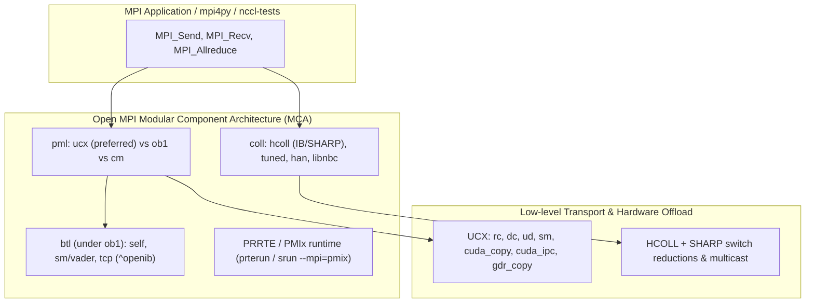

# 6.4 MPI in practice: Open MPI, ranks, collectives and tuning

| Field | Value |
|---|---|
| Level | Intermediate |
| Priority tier | 1 |
| Lab venue | Any machine with Python 3; `mpi_tuning_lab.py` and 1-rank `mpi4py` scripts run locally; multi-rank fabric runs have not been tested |
| Part | Part 6: HPC and Slurm |
| Status | Drafted |

## Why this matters for AI infrastructure

Picture a 64-node training job submitted on Friday afternoon. Slurm allocates the 512 GPUs right away, and the job status flips to running. Then nothing happens. For two hours every GPU sits at zero percent utilization while the job hangs silently inside initialization, and it burns thousands of dollars of compute quota.

MPI, the Message Passing Interface, is how high-performance computing starts its processes and passes messages between them. It still matters for AI clusters. PyTorch uses NCCL for the heavy GPU traffic, but Slurm usually launches the job through PMIx, the Process Management Interface for Exascale, or through `mpirun`. The ranks find each other through an MPI-style rendezvous, and the fabric is checked with MPI benchmarks such as the OSU Micro-Benchmarks and `nccl-tests`.

When a multi-node job hangs, this chapter shows how to find out why. You will learn what a communicator is, why a large message can deadlock when a small one does not, how Open MPI picks its transports, and how NUMA binding and NCCL interface selection change what a rank sees. That knowledge usually turns a mysterious hang into a five-minute fix.

## Prerequisites and outcomes

This chapter builds on earlier material. You need Chapter 6.3 for parallel scaling models and Part 2 for networking fundamentals. After you finish, you will be able to do the following.

- Write and read small MPI programs in C or Python (`mpi4py`) that initialize the runtime, query rank and size, send and receive point-to-point messages, and execute collective reductions.
- Explain eager versus rendezvous point-to-point protocols, blocking versus non-blocking progress, and how to prevent send-send deadlocks.
- Select the right thread level for hybrid MPI+OpenMP or multithreaded dataloader jobs, and compare MPICH, Open MPI, MVAPICH2, Intel MPI, Spectrum MPI, and NVIDIA HPC-X.
- Navigate Open MPI's Modular Component Architecture, its five-level parameter precedence hierarchy, and HCOLL and UCX transport tuning.
- Launch distributed jobs with `mpirun`, `srun --mpi=pmix`, and `torchrun`, and control process mapping, ranking, and CPU and GPU NUMA binding.
- Benchmark point-to-point and collective bandwidth, distinguishing algorithmic bandwidth from bus bandwidth, and diagnose multi-node startup hangs and bandwidth collapses.

## 1. The MPI execution model: communicators, ranks, and ABI boundaries

When you launch an MPI program, you do not get one process. You get N copies of the same program, each running as its own process. This style is called **SPMD**, which stands for Single Program, Multiple Data. The launcher starts N independent operating-system processes, called **ranks**. Every rank runs the exact same executable, and each one has its own private virtual address space.

Ranks talk inside a **communicator**. A communicator is an isolated communication universe that binds a group of processes together. When `MPI_Init` completes, every process belongs to the default global communicator, **`MPI_COMM_WORLD`**. You can split a communicator with `MPI_Comm_split` or `MPI_Comm_split_type` to make sub-communicators, such as one per physical node or one per Tensor Parallel group.

Inside any communicator, **size** is the total number of processes, N. **Rank** is each process's unique integer ID, from 0 to N - 1. Think of size as the headcount and rank as each process's seat number.

**Local rank** is a process's position within its physical host, such as 0 through 7 on an 8-GPU node. You use it to pick the GPU for that process, through `cudaSetDevice(local_rank)` or `torch.cuda.set_device(local_rank)`. An application can derive its local rank in one of two ways. It can split `MPI_COMM_WORLD` into node-local shared-memory communicators, or it can read a variable the launcher injects, such as `SLURM_LOCALID` or `LOCAL_RANK`.

Messages carry two more labels. A **tag** is an integer that lets the receiver tell apart different message streams from the same sender. A **datatype**, such as `MPI_DOUBLE` or a custom derived type, tells MPI how the memory is laid out. With that information MPI can marshal contiguous or strided memory regions cleanly.

The MPI Forum standardizes the source-level API across C, C++, and Fortran. Binary compatibility is a different matter, and it is not universal across MPI families. A binary built against Open MPI headers cannot simply run under an MPICH runtime, because the shared library symbols and internal data structures differ. Always build and run each application stack against a single, consistent MPI module.

### A minimal Python MPI program

In Python with `mpi4py` (`code/part06/mpi_hello.py`), you can initialize MPI and print each rank's identity in three lines.

```python
from mpi4py import MPI
comm = MPI.COMM_WORLD
print(f"rank {comm.Get_rank()} of {comm.Get_size()} on {MPI.Get_processor_name()}")
```

Launch it on four processes with `mpirun -np 4 python3 code/part06/mpi_hello.py`. The script was run locally with one rank. Multi-rank runs have not been tested. When it starts, `mpi4py` calls `MPI_Init` automatically on import. Each rank prints one line, and the interpreter calls `MPI_Finalize` at exit.

**In every job, keep the identity model clear. Global rank coordinates processes across the whole cluster, while local rank binds each process to its own GPU and local NUMA node.**

Pin each application to one MPI module before you build it.

## 2. Point-to-point communication: eager vs. rendezvous and deadlocks

Suppose Rank 0 sends a tensor or halo buffer to Rank 1 with blocking `MPI_Send` and `MPI_Recv`. What happens inside MPI depends on the message size. That size dependence is the source of one of the most common bugs in parallel programming.

For small messages, MPI uses the eager protocol. A message below the eager limit, which is typically 8 KB to 64 KB, is pushed straight into a pre-allocated bounce buffer on the receiver. The sender does not wait for the receiver to call `MPI_Recv`, so you may never notice the limit at all. The copy into that system buffer finishes right away, so `MPI_Send` returns almost immediately.

Large messages, above the eager limit, take the rendezvous protocol instead. Copying a 100 MB array into a hidden bounce buffer would waste memory and bandwidth. So the sender first sends a tiny envelope header, and it **blocks inside `MPI_Send` until the receiver posts a matching `MPI_Recv`**. After the receiver returns a clear-to-send handshake, the NIC moves the payload from the sender's user buffer straight into the receiver's user buffer by RDMA, with zero intermediate copies.

The protocol switch causes the most famous bug in parallel programming, the **eager-to-rendezvous deadlock**.

```text
Rank 0: MPI_Send(to Rank 1)  ---> (blocks waiting for Rank 1 to call MPI_Recv)
Rank 1: MPI_Send(to Rank 0)  ---> (blocks waiting for Rank 0 to call MPI_Recv)
```

On a developer's laptop with a tiny 1 KB array, both `MPI_Send` calls use the **eager protocol**. They copy into internal buffers, return at once, and the program appears to work. Six months later, a researcher increases the grid resolution in production. The message now exceeds the **eager limit**, which switches the job to the **rendezvous protocol**. Both ranks then wait for each other to post a receive, and the job deadlocks forever.

Eliminate send-send deadlocks in one of three ways:

1. **Pairwise ordering:** Rank 0 calls Send then Recv, while Rank 1 calls Recv then Send.
2. **Combined exchange:** Call **`MPI_Sendrecv`**, which posts the send and receive together safely inside the MPI library.
3. **Non-blocking communication:** Post non-blocking `MPI_Irecv` and `MPI_Isend` calls first, overlap independent local computation, and call `MPI_Wait` or `MPI_Waitall` when the data is needed.

### Measuring point-to-point latency and bandwidth (`mpi_pingpong.py`)

The repository script `code/part06/mpi_pingpong.py` measures one-way latency and asymptotic bandwidth between Rank 0 and Rank 1. It bounces messages of every power-of-two size from 1 byte to 16 MiB back and forth 200 times. Then it divides the round-trip elapsed time by 2.

```python
if rank == 0:
    comm.Send(buf, dest=1, tag=1); comm.Recv(buf, source=1, tag=2)
elif rank == 1:
    comm.Recv(buf, source=0, tag=1); comm.Send(buf, dest=0, tag=2)
```

A 1-byte message shows the wire latency of a link. On shared memory the one-way time is under 1 us. On InfiniBand it is 1 to 3 us, and on TCP Ethernet it is 25 to 50 us. Next, take a 16 MB message. Dividing its size by the one-way time gives the sustained link bandwidth.

**Never write symmetric blocking `MPI_Send` pairs that rely on eager buffering.** Use `MPI_Sendrecv` or non-blocking `MPI_Isend` and `MPI_Irecv`, so large payloads never deadlock under the rendezvous protocol.

Replace symmetric blocking `MPI_Send` pairs with `MPI_Sendrecv` or the non-blocking calls.

## 3. Collective communication and reproducibility

A collective operation involves every rank in a communicator. Each rank must call it in the same order, with compatible counts and datatypes. The table below maps each MPI collective to the distributed AI operation that plays the same role.

| MPI collective | Data movement pattern | Distributed AI / NCCL equivalent |
|---|---|---|
| `MPI_Barrier` | Blocks until all ranks in the communicator reach the call | `dist.barrier()` straggler synchronization point |
| `MPI_Bcast` | One root rank broadcasts a buffer to all ranks | Broadcasting initial weights or tokenized control state from rank 0 |
| `MPI_Reduce` | Combines values across all ranks onto one root rank | Aggregating evaluation metrics onto rank 0 |
| `MPI_Allreduce` | Combines values across all ranks and distributes the result to **all** ranks | Data-parallel DDP gradient averaging (`dist.all_reduce`) |
| `MPI_Gather` / `MPI_Allgather` | Collects one chunk from each rank onto root or onto all ranks | FSDP and ZeRO-3 parameter gathering before forward and backward layers |
| `MPI_Scatter` | Splits a buffer on root into equal chunks across all ranks | Distributing input batches across workers |
| `MPI_Reduce_scatter` | Reduces values across ranks and scatters 1/N of the result to each rank | FSDP and ZeRO-2/3 gradient reduction and sharding |
| `MPI_Alltoall` / `MPI_Alltoallv` | Every rank sends a distinct slice to every other rank | Mixture-of-Experts token dispatch and 3D FFTW transposes |

Read the table as a lookup. `MPI_Allreduce` corresponds to DDP gradient averaging, and `MPI_Reduce_scatter` corresponds to FSDP and ZeRO-2/3 gradient reduction. Two operational facts matter when you support a job that depends heavily on collectives.

1. **Floating-point reductions are not bit-for-bit associative.** In IEEE 754 floating-point arithmetic, adding a and b first and then c does not always give the same answer as adding b and c first. Changing the number of ranks or switching collective algorithms changes the summation order, and that produces tiny last-bit differences. When you debug numerical convergence, fix the rank count and force a deterministic collective algorithm.
2. **Validating collective arithmetic (`mpi_allreduce.py`).** The script `code/part06/mpi_allreduce.py` checks Allreduce correctness. Each rank contributes `rank + 1`, and the script asserts that the global sum equals `size * (size + 1) / 2`. It then times Allreduce on 1, 1,000, 1,000,000, and 8,000,000 float32 elements. Run locally with 1 rank, it printed `sum check ok: 1`. The timings were 0.001 ms for 1 and 1,000 floats, 0.228 ms for 1,000,000 floats, and 1.363 ms for 8,000,000 floats.

Make sure every rank calls the collectives in the same order. Floating-point AllReduce results also vary slightly when the reduction tree topology changes.

Fix the rank count and the reduction algorithm before you compare two runs.

## 4. Threads, hybrid programs, and MPI implementations compared

A program that combines MPI with node-level threads, such as OpenMP or Python dataloader threads, initializes MPI with `MPI_Init_thread`. That call picks one of four thread-safety levels.

| Thread level | Meaning | Overhead & typical use case |
|---|---|---|
| `MPI_THREAD_SINGLE` | Only 1 thread exists in the process | Zero internal lock overhead; pure single-threaded MPI |
| `MPI_THREAD_FUNNELED` | Process is multithreaded, but **only the master thread** ever calls MPI | Near-zero lock overhead; standard for MPI+OpenMP loops where MPI runs outside parallel regions |
| `MPI_THREAD_SERIALIZED` | Multiple threads may call MPI, but **only one at a time** | Low overhead; useful when helper threads make occasional guarded MPI calls |
| `MPI_THREAD_MULTIPLE` | Any thread may call MPI concurrently at any time | Highest internal mutex contention inside the MPI library; use only when concurrent multi-threaded communication is required |

Ask for the lowest level your algorithm needs, which is usually `MPI_THREAD_FUNNELED`. Then check the `provided` value the library returns. An MPI build may grant a lower level than the one you requested.

### Comparing MPI implementations

You will meet several MPI implementations on clusters. Their history explains most of the differences in launch tools and defaults.

- **MPICH (`http://mpich.org/`):** MPICH is one of the earliest MPI implementations. Argonne National Laboratory created it in 1992 on top of the **Chameleon** portability system, and the name originally stood for "MPI over Chameleon." Through modular drivers it supports diverse transports, including Blue Gene and Cray networks. That makes it easy to port to new systems, at the cost of some optimization flexibility. At the end of 2025 the stable branch is **MPICH-4**, while branches 1 and 2 are frozen. MPICH-1 was famous for simple launching. `mpirun` generated keys and spawned processes directly through `ssh` or `rsh`. To build from source, use `CC=my-compiler` and `--prefix=/opt/mpich`. Many commercial implementations, including Intel MPI and HP-MPI, were originally created on the basis of MPICH.
- **Open MPI (`http://www.open-mpi.org/`):** Open MPI was created independently of MPICH. It was first released on November 17, 2005, and it developed ideas from four earlier projects: **LAM/MPI**, **FT-MPI**, **LA-MPI**, and **PACX-MPI**. Open MPI has no driver concept. Instead, it needs special daemon programs running on compute nodes beforehand, which is `prterun` in Open MPI 5. Open MPI delivers strong performance and often outperforms commercial stacks, though its documentation is scattered across forums and project FAQs. Always build Open MPI from source in separate variants for each compiler family. Linking a program compiled with one compiler against Open MPI libraries built with another causes linker failures.
- **MVAPICH / MVAPICH2 (`http://mvapich.cse.ohio-state.edu/`):** Ohio State University developed MVAPICH on the basis of MPICH-2, to optimize MPICH for **InfiniBand**. It ships in standard OFED packages alongside Open MPI. The operational difference that matters most is the launcher. `mpirun` is still left in the distribution, but you must launch MVAPICH2 jobs with **`mpirun_rsh`**, and its flags differ from MPICH `mpirun`.
- **IBM Spectrum MPI and Intel MPI:** **Spectrum MPI** is IBM's proprietary Open MPI derivative, tuned for IBM hardware with InfiniBand and GPUDirect RDMA support. **Intel MPI** was developed almost from scratch, with strong InfiniBand optimization and documentation. In 2025 it is **free to use**, with an optional paid support contract.
- **NVIDIA HPC-X:** NVIDIA's production software bundle combines Open MPI, UCX, HCOLL, and SHARP. It is pre-tuned for NVIDIA InfiniBand and RoCEv2 GPU clusters.

**Build a separate Open MPI module for each compiler family on your cluster.** Use `mpirun_rsh` for MVAPICH2. Request `MPI_THREAD_FUNNELED` instead of `MPI_THREAD_MULTIPLE`, unless your threads communicate concurrently.

For a standard MPI+OpenMP program, start with the `MPI_THREAD_FUNNELED` level.

## 5. Open MPI architecture (MCA), 5-level priority, HCOLL, and UCX



Open MPI's internals are built from plugins. Its **Modular Component Architecture (MCA)** loads transport and algorithm modules at runtime.

| MCA framework | Responsibility | Key components in production |
|---|---|---|
| `pml` | Point-to-point messaging layer | `ucx` (modern InfiniBand, RoCE, and GPU path), `ob1` (legacy BTL engine), `cm` (uses `mtl` for OFI and libfabric) |
| `btl` | Byte transfer layer used under `ob1` | `self` (loopback), `sm` or `vader` (shared memory), `tcp` (Ethernet); legacy `openib` was removed in Open MPI 5 |
| `mtl` | Matching transport layer used under `cm` | `ofi` (libfabric), `psm2` |
| `coll` | MPI collective algorithms | `hcoll` (NVIDIA IB and SHARP offload), `tuned`, `han` (hierarchical node-aware), `libnbc` (non-blocking) |
| `io` | Parallel file I/O (`MPI-IO`) | `ompio`, `romio` |
| `plm` / PRRTE / PMIx | Process lifecycle and daemon launch | `slurm`, `rsh`; in Open MPI 5, `mpirun` is backed by `prterun` |

Each row is a layer you may need to tune. For example, `pml` picks the point-to-point engine, while `coll` picks the collective algorithms.

### The 5-level MCA parameter priority hierarchy

You can inspect every MCA parameter and its current value with `ompi_info -a` or `ompi_info --param pml ucx --level 9`. When the same parameter is set in several places, Open MPI resolves it in **five levels of increasing priority**. The resolver is modeled in `resolve_openmpi_mca_param()` in `code/part06/mpi_tuning.py`.

1. **Global configuration file (lowest priority):** `/etc/openmpi-mca-params.conf`, along with `openpmix-mca-params.conf` or `prte-mca-params.conf` for PMIx and PRRTE. Each line uses the form `key=value`.
2. **User local configuration file:** `$HOME/.openmpi/mca-params.conf`.
3. **Tuned option files:** passed with `mpiexec --tune file1,file2...`. Their contents are read as regular `mpiexec` options.
4. **Environment variables:** set with `export OMPI_MCA_xxx=value`, or with `PMIX_MCA_xxx` and `PRRTE_MCA_xxx`.
5. **Command-line options (highest priority):** `mpiexec -mca xxx value` or `--mca xxx value`.

A `^` in front of a component list means exclude these. For example, in Open MPI 4 you can export `OMPI_MCA_btl=^tcp,openib` to keep the ob1 engine off TCP and the old InfiniBand transport. Never exclude `self` from the list. The ob1 engine needs the `self` transport to send a message to its own rank, so excluding it breaks even single-process runs. Open MPI 5 removed `openib`, so on version 5 use `--mca pml ucx` for InfiniBand instead. You can also pass `--mca btl_tcp_if_exclude lo,docker0` to stop the TCP transport from routing over unwanted interfaces.

### Tuning HCOLL and UCX in Open MPI

By default on NVIDIA InfiniBand clusters, Open MPI uses **HCOLL** (Host Collectives) to accelerate MPI collective operations. It does this with hardware multicast and in-network **SHARP** switch reductions. Sometimes an HCOLL collective hits a bug or conflicts with your application. In that case you can disable HCOLL, or steer it to a specific HCA. These commands are **untested** here.

```bash
# Disable HCOLL via CLI flag or environment variable (under srun --mpi=pmix) (untested here)
mpiexec -mca coll_hcoll_enable 0 ... myprog
export OMPI_MCA_coll_hcoll_enable=0
srun --mpi=pmix ... myprog

# Tune HCOLL and UCX device/feature selection with -x (untested here)
mpirun -np 2 -mca pml ucx -x UCX_NET_DEVICES=mlx5_0:1 \
  -x HCOLL_MAIN_IB=mlx5_0:1 \
  -x HCOLL_ENABLE_MCAST_ALL=1 \
  -x HCOLL_ENABLE_NBC=1 \
  -x HCOLL_ENABLE_SHARP=1 \
  ./myapp
```

Here, `-mca pml ucx` selects the **Unified Communication X (UCX)** point-to-point engine. Passing `-x UCX_NET_DEVICES=mlx5_0:1` and `-x HCOLL_MAIN_IB=mlx5_0:1` pins traffic to port 1 of InfiniBand adapter `mlx5_0`. The other three variables switch on hardware features. `HCOLL_ENABLE_MCAST_ALL=1` enables hardware multicast, `HCOLL_ENABLE_NBC=1` enables non-blocking collectives, and `HCOLL_ENABLE_SHARP=1` enables in-network switch reductions. If you suspect a UCX bug, use `-x OMPI_MCA_pml=^ucx` to disable UCX. Run `ucx_info -d` to inspect the RDMA devices UCX detects. Run **`ucx_info -c -f`** to print documented descriptions of every UCX variable, such as `UCX_TLS=rc,sm,cuda_copy,cuda_ipc,gdr_copy`, `UCX_IB_SL=1`, and `UCX_LOG_LEVEL=info`.

Check that `ompi_info | grep pml` lists `ucx`, and keep the 5-level MCA override order in mind. Remember that `coll_hcoll_enable` controls MPI collectives, not NCCL GPU collectives.

## 6. Launching at scale: `srun --mpi=pmix` vs. `mpirun` vs. `torchrun`

On a modern GPU cluster, distributed jobs are launched in one of three ways.

1. **The native Slurm HPC standard (`srun --mpi=pmix`):** A head node cannot open thousands of sequential SSH connections and still scale. With `srun --mpi=pmix`, `slurmd` on each allocated node spawns `slurmstepd`. That process starts the local tasks and hosts a local **PMIx server** over a Unix domain socket. The ranks publish and exchange endpoint addresses through the Slurm PMIx tree in milliseconds, without SSH. Always pass **`--kill-on-bad-exit=1`**. If one rank crashes with an OOM (exit 137) or a segfault (exit 139), Slurm immediately terminates all the other ranks. Without that flag, 500 GPUs would hang at the next AllReduce barrier (**untested** here).
   ```bash
   #
   srun --mpi=pmix --kill-on-bad-exit=1 \
     --ntasks-per-node=8 --gpus-per-node=8 --cpus-per-task=14 \
     python3 /workspace/train.py
   ```
   Check which Slurm PMI plugins are supported with `srun --mpi=list`. After package upgrades, verify that the `slurm-libpmi` and `pmix-libpmi` RPMs have not conflicted.
2. **The standalone Open MPI / HPC-X launcher (`mpirun`):** Use this on bare-metal SSH clusters or inside multi-node Kubernetes MPIJob pods. This path has not been tested.
   ```bash
   #
   mpirun -np 256 --hostfile /etc/opt/cluster/hosts.txt \
     --bind-to none --map-by slot \
     -x LD_LIBRARY_PATH -x PATH -x NCCL_DEBUG=INFO -x NCCL_IB_HCA=mlx5_0,mlx5_1 \
     -mca pml ucx \
     -mca btl_tcp_if_include ens1f0 \
     -mca coll_hcoll_enable 0 \
     -mca plm_rsh_no_tree_spawn 1 \
     python3 megatron_pretrain.py
   ```
   Three `mpirun` flags are critical. First, **`-x VAR`** forwards environment variables to remote nodes. Without `-x`, remote ranks never see your `NCCL_DEBUG=INFO` export. Second, **`--bind-to none`** stops Open MPI from pinning a rank, and all of its PyTorch DataLoader worker threads, onto a single CPU core. Third, **`-mca plm_rsh_no_tree_spawn 1`** can resolve intermittent SSH tree-spawn timeouts on slow management networks. Tuning `routed_radix` goes along with it.
3. **The PyTorch elastic launcher (`torchrun`):** It uses PyTorch's built-in `c10d` TCP store, set with `--rdzv_backend=c10d --rdzv_endpoint=10.100.1.10:29500`, and it does not use MPI. The launcher is convenient for elastic cloud jobs. At very large scale, though, funneling thousands of ranks through that single TCP rendezvous endpoint can become a startup bottleneck, compared with Slurm's hierarchical tree.

**Prefer `srun --mpi=pmix --kill-on-bad-exit=1` on Slurm clusters.** When you launch multi-threaded PyTorch jobs with `mpirun`, never forget `-x` environment forwarding, and use `--bind-to none` or socket or NUMA binding.

Use `srun` with `--kill-on-bad-exit=1` for Slurm jobs, and check the `mpirun` flags before you launch a PyTorch job with it.

## 7. Mapping, ranking, CPU/GPU NUMA binding, and `taskset` verification

Placing parallel processes on a dual-socket GPU server takes three steps.

- **Mapping (`--map-by slot|node|socket|numa|ppr:8:node`):** decides which hardware resource each process lands on.
- **Ranking (`--rank-by slot|node|socket`):** assigns integer rank IDs 0 through N-1 to those mapped slots. For example, you can pack ranks 0 through 7 on Node 0, so intra-node collectives stay on NVLink.
- **Binding (`--bind-to core|socket|numa|none` or Slurm `--cpu-bind=cores --gpu-bind=closest`):** restricts the OS scheduler through cgroups and affinity masks, so the process cannot migrate across sockets.

Consider a dual-socket server such as a DGX H100. Socket 0, which is NUMA 0, hosts GPUs 0–3 and HCAs 0–3. Socket 1, which is NUMA 1, hosts GPUs 4–7 and HCAs 4–7. Suppose the rank assigned to GPU 0 runs its CPU threads on Socket 1. Every host-to-device copy and control call then has to cross the slow inter-socket UPI or Infinity Fabric link. It cannot use the local PCIe and NVLink path, where NVLink runs at 900 GB/s.

Always verify bindings in production. The commands below have not been run on a real cluster.

- With Open MPI, pass **`mpirun --report-bindings ...`** to print the exact core mask of every rank at startup.
- With Slurm and `numactl` or `taskset`, run `numactl --show | grep physcpubind` in a launch wrapper. You can also inspect a running worker PID on the node with **`taskset -cp <PID>`**. Confirm that Rank 0 is bound to cores `0-15`, not `0-127`.

**Bind every GPU rank to the CPU cores of its local NUMA socket.** Use `--cpu-bind=cores --gpu-bind=closest`, and verify with `--report-bindings` or `taskset -cp <PID>`.

Check the binding of every rank on a new node before you trust its throughput numbers.

## 8. CUDA-aware MPI, GPUDirect RDMA, PCIe ACS, and `memlock`

A **CUDA-aware MPI** library lets an application pass GPU device pointers directly into `MPI_Send`, `MPI_Recv`, and `MPI_Allreduce`. You do not have to copy tensors to host RAM first. You can verify the build with `ompi_info --parsable --all | grep mpi_built_with_cuda_support`. When it is paired with **GPUDirect RDMA**, the ConnectX HCA reads and writes GPU HBM directly across the local PCIe switch (`PIX`). That path bypasses host CPU RAM completely.

Full GPUDirect RDMA speed needs three host-level settings.

1. **Peer-memory kernel driver (`nvidia_peermem` or `dma-buf`):** Verify it with `lsmod | grep nvidia_peermem`. If that module goes missing after a kernel update, GPUDirect RDMA quietly falls back to staging through host CPU RAM. Multi-node bandwidth then collapses.
2. **PCIe Access Control Services (ACS) and PCIe Gen 5 link width:** In virtualized environments, hypervisors enable PCIe **ACS** on PCIe switches. ACS forces all peer-to-peer transactions up to the CPU root complex IOMMU. That shows as `SYS` instead of `PIX` in `nvidia-smi topo -m`, and the redirection throttles GPUDirect RDMA. Link width matters too. A PCIe Gen 5 x16 slot runs at 32 GT/s, which gives about 63 GB/s in one direction. That matches a 400 Gbps ConnectX-7 HCA, which moves 50 GB/s. If a bad riser downgrades that slot to PCIe Gen 4, which gives about 31.5 GB/s, the 400G NIC is hardware-bottlenecked at about 250 Gbps. Always check `lspci -vv | grep LnkSta:` and `dmesg -w | grep -i AER` on slow nodes.
3. **Unlimited locked memory (`ulimit -l` / `memlock`):** RDMA requires pinning physical pages, so the kernel cannot swap them out. If `ulimit -l` is too small, jobs fail with `ibv_reg_mr() failed` or `NCCL WARN Call to ibv_create_qp failed`. Set `* soft memlock unlimited` and `* hard memlock unlimited` in `/etc/security/limits.conf` and in Slurm daemon unit files. Then verify inside the job with `ulimit -l`.

**When multi-node GPU bandwidth drops suddenly, check four things first.** Run `lsmod | grep nvidia_peermem`, `nvidia-smi topo -m`, `lspci -vv | grep LnkSta:`, and `ulimit -l`.

Check these four items on any node whose bandwidth has dropped before you touch the switches.

## 9. Benchmarking: OSU Micro-Benchmarks and Algorithmic vs. Bus Bandwidth

Two standard suites let operators check MPI and NCCL performance across nodes.

- **OSU Micro-Benchmarks (`osu_latency`, `osu_bw`, `osu_bibw`, `osu_allreduce`, `osu_alltoall`):** These test both host-to-host and GPU-to-GPU MPI paths. You can also test pairwise fabric health directly at the verbs layer, with `ib_write_bw -d mlx5_0 --use_cuda=0 <server> -a` and `ib_write_lat`.
- **`nccl-tests` (`all_reduce_perf`, `all_gather_perf`, `alltoall_perf`):** This suite reports two bandwidth columns, and you must never confuse them. The `compute_allreduce_algbw_and_busbw()` function in `code/part06/mpi_tuning.py` models both.
  - **Algorithmic Bandwidth:** tensor bytes divided by elapsed time. Take a 1 GB (1,000,000,000 B) AllReduce that finishes in 0.005 s, which is 5 ms. Its algorithmic bandwidth is **200.0 GB/s**.
  - **Bus Bandwidth:** algorithmic bandwidth multiplied by the ring collective traffic factor, which is 2 times (n minus 1) divided by n. That normalization lets you compare the result directly against NIC or NVLink line rate, whatever the GPU count. On 8 GPUs the factor is 2 times 7 divided by 8, which is 1.75. The bus bandwidth is therefore 200.0 times 1.75, or **350.0 GB/s**.

**Always quote Bus Bandwidth when you compare AllReduce results with NIC or NVLink hardware specs.** It is `algbw * 2(n-1)/n`, and that normalization removes the rank count from the comparison.

Quote bus bandwidth, not algorithmic bandwidth, whenever you compare against hardware specs.

## 10. Troubleshooting guide: the 4-layer ladder and real init hangs

A real init hang makes the ladder concrete. It was reproduced on an Apple Silicon Mac in a sandboxed shell, with Open MPI 5.0.11 and MPICH installed from `conda-forge`. Running `mpirun -np 2 hostname` worked, because `prterun` spawned both processes cleanly. A 1-rank singleton `mpi4py` script also succeeded. But every 2-rank `MPI_Init` hung indefinitely. The hang persisted after setting `TMPDIR=/tmp`, forcing `btl=self,sm`, trying `pmix_gds=hash`, and testing MPICH TCP libfabric. The sandbox blocked the local sockets that processes use to find each other. Finding that out meant walking the diagnostic ladder step by step.

When a multi-node job hangs or crawls on a production GPU cluster, you should walk the **four layers in order**. Start at the top, because a lower layer rarely matters until the upper ones pass.

### Layer 1: Process launch, exit codes, and OS limits

- Did every node spawn the expected number of processes? Count them with `pgrep -fc python3`. Also check that every node has `ulimit -l` set to `unlimited`.
- If the job died with a non-zero exit code, decode the signal.
  - **Exit code 139 (128 + 11 SIGSEGV):** A segmentation fault. It often comes from mismatched CUDA or MPI libraries, or from dereferencing a host pointer on the GPU.
  - **Exit code 137 (128 + 9 SIGKILL):** The Linux out-of-memory (OOM) killer or a cgroup memory limit stopped the process. This is usually caused by too many PyTorch DataLoader workers exhausting host RAM, rather than GPU VRAM.
  - **Exit code 143 (128 + 15 SIGTERM):** Slurm terminated the process at walltime expiration, through `scancel`, or during preemption.

### Layer 2: Rendezvous (PMIx plugin and `NCCL_SOCKET_IFNAME` prefix rules)

Suppose every process is alive but sits at 0% GPU utilization. Check whether the processes found each other's IP addresses. By default, NCCL and Open MPI scan the active network interfaces for TCP bootstrap rendezvous. Suppose Node A picks a non-routable virtual bridge such as `docker0`, at 172.17.0.1, while Node B picks `bond0`, at 10.100.1.10. The TCP handshake between them then hangs forever.

Fix this with **`NCCL_SOCKET_IFNAME`** for NCCL bootstrap, and with **`NCCL_IB_HCA`** for RDMA HCAs. The function `match_nccl_ifname()` in `code/part06/mpi_tuning.py` models the matching rules. NCCL uses **four prefix-matching operators**, shown in the table below.

| Syntax in `NCCL_SOCKET_IFNAME` / `NCCL_IB_HCA` | Matching rule | Example on `["lo", "docker0", "eth0", "eth1", "eth11", "bond0"]` |
|---|---|---|
| Plain string (`eth`) | **Prefix match:** matches all interfaces starting with `eth` | Matches `eth0`, `eth1`, and `eth11` |
| **`=`** prefix (`=eth1`) | **Exact match:** matches only the exact interface name | Matches `eth1` only, not `eth11` |
| **`^`** prefix (`^docker`) | **Exclude prefix:** matches all interfaces except those starting with `docker` | Excludes `docker0` |
| **`^=`** prefix (`^=eth0`) | **Exclude exact:** matches all interfaces except `eth0` specifically | Excludes `eth0` while keeping `eth1` and `eth11` |

Also make sure host firewalls allow the ephemeral TCP port range that rendezvous uses. For example, `echo 50000 51000 > /proc/sys/net/ipv4/ip_local_port_range` sets that range.

### Layer 3: NCCL initialization, `NCCL_RUN_DIAGNOSTICS`, `ncclras`, and GPU Xids

1. **Inspect transport and graph logs:** Set `export NCCL_DEBUG=INFO` and `export NCCL_DEBUG_SUBSYS=INIT,GRAPH,ENV,NET`. You can optionally redirect per-rank logs with `NCCL_DEBUG_FILE=nccl_%h_%p.log`. Confirm that the log prints `Using network IB` and not a fallback to Socket.
2. **Run built-in init diagnostics (NCCL 2.31+):** Launch with **`NCCL_RUN_DIAGNOSTICS=1`**. It prints `NCCL DIAG` peer-to-peer and fabric checks before application traffic starts.
3. **Query the live RAS daemon on a hung job (NCCL 2.24+):** Run **`ncclras -v`** on any node in the job. You can also run `echo verbose status | nc localhost 28028`. The default port is 28028, set through `NCCL_RAS_ADDR`. Look for a **`MISMATCH`** row. It says *"Communicator ranks have different collective operation counts"* and names the exact lagging rank, PID, GPU, and hostname. An **`INCOMPLETE`** row names a dead or unresponsive rank.
4. **Remember that the watchdog is PyTorch's, not NCCL's:** When a job aborts with a `ProcessGroupNCCL` watchdog timeout, the timeout comes from PyTorch. The related settings are `TORCH_NCCL_TRACE_BUFFER_SIZE` and `TORCH_FR_BUFFER_SIZE`. It means some rank stalled. Use `ncclras` and `journalctl -k | grep "NVRM: Xid"` to look for Xid 79, a GPU that fell off the bus, or Xid 119, a GSP timeout. Or run `strace -e trace=ioctl -p <PID>` to find the broken GPU.
5. **Slow `/sys` topology discovery in containers:** If initialization takes 15 minutes, run `strace -f -tt -e trace=open,openat,read` to verify that `/sys/class/pci_bus` is properly mounted in the container.

### Layer 4: Physical fabric health (InfiniBand and RoCEv2)

- **InfiniBand:** Check `ibstat` for State Active, Physical state LinkUp, and the expected Rate. Run `sudo sminfo` to confirm the Subnet Manager is alive. Run `sudo perfquery -x <lid>` and watch for **increasing** `SymbolErrorCounter`, `LinkErrorRecoveryCounter`, or `LinkDownedCounter` across two reads. Also check `mlxlink`, run `rdma statistic` and look at `rnr_nak_retry_err`, `packet_seq_err`, and `local_ack_timeout_err`, and run `sudo ibdiagnet`. `NCCL_IB_TIMEOUT` defaults to 20, and the timeout works out to about $4.096\ \mu\text{s} \times 2^{\text{timeout}}$. `NCCL_IB_RETRY_CNT` defaults to 7. Together they give roughly a 30-second retry window. That window can absorb a brief 3-second link flap, such as one you create with `ibportstate 1 1 disable`. For SHARP, `NCCL_COLLNET_ENABLE=1` controls inter-node InfiniBand SHARP. NCCL 2.14+ supports `CollnetChain` and `CollnetDirect`, and NCCL 2.24+ parses `NCCL_ALGO` strictly. UFM manages SHARP with `/etc/init.d/ufmd sharp_start`. By contrast, `NCCL_NVLS_ENABLE` controls intra-domain NVLink SHARP on Hopper and Blackwell NVSwitch systems. Its algorithms are `NVLS` and `NVLSTree`, and its default is 2 since 2.17.
- **RoCEv2:** Check `ethtool -S <nic> | grep -i pause` and `mlnx_qos -i <nic>` for Priority Flow Control (**PFC**) pause storms. The switch and NIC **PFC watchdog** mitigate them. Verify `show_gids`. Do **not** hardcode `NCCL_IB_GID_INDEX=3` on modern NCCL 2.21+ or 2.32u1+, which defaults to `AUTO`. On the switch, use `nv set qos roce` and `nv show qos roce` on Cumulus Linux 5.12 to verify the lossless RoCE defaults. Those defaults are **PFC on priority 3**, **RoCE data on DSCP 26 -> priority 3**, and **CNP congestion notifications on DSCP 48 -> strict priority 6** with UDP port 4791 LLDP TLV.

**Walk the 4-layer debugging ladder in strict order.** Start with launch and limits, then rendezvous, then NCCL, then fabric. That order keeps you from spending hours on switches when the real problem is a missing `memlock` limit.

## 11. Lab: test MCA precedence, `NCCL_SOCKET_IFNAME` matching, and single-rank MPI

Start with the self-checking Python lab, `code/part06/mpi_tuning_lab.py`, and run it locally. It checks the 5-level Open MPI MCA parameter precedence resolver. It also checks the four `NCCL_SOCKET_IFNAME` prefix and exact matching operators, and the AllReduce algorithmic versus bus bandwidth calculator.

```bash
python3 code/part06/mpi_tuning_lab.py
```

Next, run the standalone calculator and the single-rank MPI scripts.

```bash
python3 code/part06/mpi_tuning.py
```

Then work through these hands-on steps.

1. Test `match_nccl_ifname(["lo", "docker0", "eth0", "eth1", "eth11", "bond0"], spec)` with `"eth"`, `"=eth1"`, and `"^docker,^=lo,^=eth0"`.
2. Test `resolve_openmpi_mca_param()` when `/etc/openmpi-mca-params.conf` sets `pml=ob1`, `$HOME/.openmpi/mca-params.conf` sets `pml=cm`, and `OMPI_MCA_pml=ucx` is exported in the environment. Verify that the environment variable wins, unless `-mca pml ^ucx` on the command line overrides it.
3. On a machine or cluster with MPI installed, run `python3 code/part06/mpi_hello.py` and `python3 code/part06/mpi_allreduce.py`. The AllReduce script was run locally with one rank. The multi-rank `mpirun -np 4` and `code/part06/mpi_pingpong.py` need an unsandboxed multi-rank environment and have not been tested.

Work through steps 1 and 2 first, since they need no MPI at all. You can then finish step 3 on a machine that has MPI installed.

## 12. Interview angles

Use these questions to check your understanding. Each one ties a mechanism from this chapter to a symptom you may meet on a cluster.

- Why does a point-to-point MPI program that works with 4 KB messages suddenly deadlock when the buffer size increases to 4 MB? How do you fix it?
- List the five levels of Open MPI MCA parameter precedence from lowest to highest, and explain how to disable HCOLL or pin UCX to `mlx5_0:1`.
- Explain the four `NCCL_SOCKET_IFNAME` matching operators (`eth`, `=eth1`, `^docker`, `^=eth0`). What happens if Node 0 picks `docker0` during bootstrap?
- A 128-node training job hangs or crashes with a PyTorch watchdog error after 8 hours. Walk through the 4-layer diagnostic ladder, including `ncclras` (port 28028), `NVRM: Xid`, `lsmod | grep nvidia_peermem`, and Cumulus RoCE DSCP 26 vs DSCP 48.
- What is the difference between Algorithmic Bandwidth and Bus Bandwidth in `nccl-tests`, and what do exit codes 137, 139, and 143 mean?

Answer these from memory before you move on to the exercises.

## Exercises

Each exercise uses the functions and commands from the sections above, so you can check your work against them.

1. List the five levels of Open MPI MCA parameter priority from lowest to highest. Use `resolve_openmpi_mca_param()` in `code/part06/mpi_tuning.py` to check your order.
2. Write the command that disables HCOLL under `srun --mpi=pmix`. Then write the command that forces UCX and HCOLL onto `mlx5_0:1`.
3. The interfaces are `lo`, `docker0`, `eth0`, `eth1`, `eth11`, and `bond0`. Which ones does `match_nccl_ifname()` return for `eth`, for `=eth1`, and for `^docker`? Which does it return for `^docker,^=lo,^=eth0`?
4. Why is hardcoding `NCCL_IB_GID_INDEX=3` discouraged on modern NCCL?
5. Two ranks send each other 1 KB messages with blocking `MPI_Send`, and it works. At 10 MB it deadlocks. Explain the difference using the eager and rendezvous protocols.
6. Give three code fixes for the deadlock in exercise 5. Then name the four `MPI_Init_thread` levels.
7. A 1 GB AllReduce finishes in 5 ms across 8 GPUs. Call `compute_allreduce_algbw_and_busbw(1_000_000_000, 0.005, 8)`. You should get 200.0 GB/s algorithmic and 350.0 GB/s ring bus bandwidth.
8. The 400G NIC in exercise 7 only reaches about 250 Gbps. A PCIe Gen 4 riser gives about 31.5 GB/s, and Gen 5 gives about 63 GB/s. Explain the gap. Where do `nvidia_peermem` and PCIe ACS come in?
9. Compare `srun --mpi=pmix --kill-on-bad-exit=1`, `mpirun`, and `torchrun` with `c10d`. For `mpirun`, say what `-x`, `--bind-to none`, and `-mca plm_rsh_no_tree_spawn 1` do.
10. On a dual-socket server, check CPU and GPU NUMA affinity with `mpirun --report-bindings`, `numactl --show`, and `taskset -cp <PID>`.
11. A multi-node job hangs. At Layer 1 of the ladder, which commands do you run, and what do exit codes 137, 139, and 143 mean?
12. At Layer 2, which commands check rendezvous? At Layer 3, how do `NCCL_DEBUG_SUBSYS`, `NCCL_RUN_DIAGNOSTICS=1`, and `ncclras` on port 28028 help?
13. How do you tell a PyTorch `TORCH_NCCL_*` watchdog timeout from an `NVRM: Xid` error?
14. At Layer 4, which commands check the fabric? Include `ibstat`, `perfquery -x`, and `ibdiagnet`. Which Cumulus RoCE settings should you confirm: DSCP 26, DSCP 48, and PFC priority 3?

---

## Checkpoint questions (20)

<details>
<summary>1. What are a communicator, global rank, size, and local rank in MPI, and how does a GPU process select its local device?</summary>

- **Communicator:** A group of processes plus an isolated communication context. `MPI_COMM_WORLD` holds every process at startup.
- **Size and global rank:** `size` is the total process count N. `rank` is each process's unique ID, from 0 to N minus 1, across the whole job.
- **Local rank:** The process's rank within its physical node, from 0 to G minus 1, where G is the number of processes on that node. You derive it with `MPI_Comm_split_type` or a launcher variable such as `SLURM_LOCALID` or `LOCAL_RANK`. Then you pass it to `cudaSetDevice(local_rank)`, so each rank claims a distinct GPU.
</details>

<details>
<summary>2. Explain the difference between the **eager** and **rendezvous** point-to-point protocols, and why a program that works on small messages can deadlock on large messages.</summary>

- **Eager protocol, below the eager limit:** `MPI_Send` copies the small payload into an internal buffer and returns at once, without waiting for `MPI_Recv`.
- **Rendezvous protocol, above the eager limit:** `MPI_Send` sends a header and **blocks until the receiver posts a matching `MPI_Recv`**. Then the payload moves directly by zero-copy RDMA.

If Rank 0 and Rank 1 both call blocking `MPI_Send` to each other before calling `MPI_Recv`, small messages succeed through eager buffering. Large messages deadlock forever under rendezvous. The fixes are `MPI_Sendrecv`, an ordered send and receive, or non-blocking `MPI_Isend` and `MPI_Irecv`.
</details>

<details>
<summary>3. Why are floating-point `MPI_Allreduce` or NCCL reductions not bit-for-bit identical when you change the rank count or collective algorithm?</summary>

IEEE 754 floating-point addition is **not associative**: adding a and b first and then c can differ from adding b and c first, because each operation rounds its result. Changing the rank count, or switching between ring, tree, and SHARP in-network reductions, changes the order in which partial sums are added. Bit-for-bit reproducibility therefore needs a fixed rank count and a deterministic reduction algorithm.
</details>

<details>
<summary>4. List the four `MPI_Init_thread` levels from lowest to highest, and state which level suits a standard MPI + OpenMP program where only the main loop calls MPI.</summary>

1. `MPI_THREAD_SINGLE`: a single-threaded process.
2. `MPI_THREAD_FUNNELED`: a multithreaded process, but **only the main thread makes MPI calls**.
3. `MPI_THREAD_SERIALIZED`: several threads make MPI calls, but only one at a time.
4. `MPI_THREAD_MULTIPLE`: any thread may call MPI concurrently, with the highest internal lock overhead.

A standard MPI+OpenMP program, where MPI is called outside parallel regions, needs only **`MPI_THREAD_FUNNELED`**.
</details>

<details>
<summary>5. Compare the history and launch specifics of MPICH, Open MPI, MVAPICH2, Intel MPI, and NVIDIA HPC-X.</summary>

- **MPICH:** Argonne created it in 1992 ("MPI over Chameleon"). MPICH-4 is the current stable branch in 2025, while MPICH-1 and 2 are frozen. It is the ancestor of Intel MPI, which is free in 2025 with paid support, and of Cray MPICH.
- **Open MPI:** It was released on November 17, 2005, and combined LAM/MPI, FT-MPI, LA-MPI, and PACX-MPI. It uses MCA plugins and node daemons, which are `prterun` in v5. Build it per compiler suite.
- **MVAPICH2:** Ohio State University's InfiniBand-tuned MPICH-2 derivative. You **must launch it with `mpirun_rsh`**, not `mpirun`.
- **NVIDIA HPC-X:** NVIDIA's pre-tuned bundle of Open MPI, UCX, HCOLL, and SHARP/UCC.
</details>

<details>
<summary>6. What are the roles of the `pml`, `btl`, `mtl`, `coll`, and `plm` frameworks in Open MPI's Modular Component Architecture?</summary>

- **`pml`, the Point-to-Point Messaging Layer:** high-level message scheduling. It uses `ucx` for modern RDMA and GPU paths, `ob1` for BTLs, and `cm` for MTLs.
- **`btl`, the Byte Transfer Layer:** low-level byte movement under `ob1`, with `self`, `sm` or `vader`, and `tcp`. Legacy `openib` was removed in Open MPI 5.
- **`mtl`, the Matching Transport Layer:** used under `cm`, with `ofi` and `psm2`.
- **`coll`, the Collective layer:** collective algorithms, including `hcoll`, `tuned`, `han`, and `libnbc`.
- **`plm`, the Process Lifecycle Management layer:** daemon launch, through `slurm` or `rsh`.
</details>

<details>
<summary>7. List the five levels of Open MPI MCA parameter priority in order of increasing precedence.</summary>

From lowest to highest priority:
1. **Global config file:** `/etc/openmpi-mca-params.conf`, along with `openpmix-mca-params.conf` or `prte-mca-params.conf`.
2. **User local config file:** `$HOME/.openmpi/mca-params.conf`.
3. **Tuned option files:** `mpiexec --tune file1,file2...`.
4. **Environment variables:** `export OMPI_MCA_xxx=value`, or `PMIX_MCA_` and `PRRTE_MCA_`.
5. **Command-line options:** `mpiexec -mca xxx value`.
</details>

<details>
<summary>8. How do you disable HCOLL or steer HCOLL and UCX to a specific InfiniBand port (`mlx5_0:1`) in Open MPI?</summary>

- **Disable HCOLL:** Pass `-mca coll_hcoll_enable 0` to `mpiexec`. Under `srun --mpi=pmix`, export `OMPI_MCA_coll_hcoll_enable=0` instead.
- **Steer UCX and HCOLL:** Pass `-mca pml ucx -x UCX_NET_DEVICES=mlx5_0:1 -x HCOLL_MAIN_IB=mlx5_0:1`. Also add `-x HCOLL_ENABLE_MCAST_ALL=1`, `-x HCOLL_ENABLE_NBC=1`, and `-x HCOLL_ENABLE_SHARP=1`. To inspect every UCX variable, run **`ucx_info -c -f`**.
</details>

<details>
<summary>9. Why is `srun --mpi=pmix --kill-on-bad-exit=1` preferred over SSH-based `mpirun` on large Slurm clusters?</summary>

`srun --mpi=pmix` uses Slurm's local `slurmstepd` daemons and built-in PMIx servers to wire up thousands of ranks in milliseconds, without SSH connection storms. **`--kill-on-bad-exit=1`** makes Slurm end the entire job step as soon as one rank crashes. Without it, hundreds of healthy GPUs would hang forever at the next collective barrier.
</details>

<details>
<summary>10. When launching a PyTorch job with `mpirun`, what do `-x`, `--bind-to none`, and `-mca plm_rsh_no_tree_spawn 1` do?</summary>

- **`-x <VAR>`:** Exports local environment variables, such as `NCCL_DEBUG=INFO` and `LD_LIBRARY_PATH`, to remote worker processes.
- **`--bind-to none`:** Stops Open MPI from pinning a rank to one CPU core. PyTorch's multi-threaded DataLoader workers can then use several cores on the socket.
- **`-mca plm_rsh_no_tree_spawn 1`:** Forces a direct, flat SSH launch rather than a hierarchical tree spawn. That avoids intermittent daemon timeouts on slow management networks.
</details>

<details>
<summary>11. How do you enforce and verify CPU and GPU NUMA affinity on a dual-socket server under Slurm and Open MPI?</summary>

- **Enforce:** Under Slurm, pass `srun --mpi=pmix --cpu-bind=cores --gpu-bind=closest`, or `--accel-bind=g`. Under Open MPI, use `--map-by numa` and `--bind-to numa`.
- **Verify:** Pass `mpirun --report-bindings`, or run `numactl --show | grep physcpubind` in a launch wrapper. You can also inspect a live worker PID with **`taskset -cp <PID>`**. The process should be pinned to its local socket cores `0-15`, not to all cores `0-127`.
</details>

<details>
<summary>12. What causes the `ibv_reg_mr() failed` / `ibv_create_qp failed` RDMA error at job startup, and how do you fix and verify it?</summary>

RDMA must pin the physical memory pages so the OS cannot swap them out. If the locked-memory limit (`ulimit -l`) is too low, registering GPU or host memory regions with the InfiniBand HCA fails. You see `ibv_reg_mr() failed` or `ibv_create_qp failed`.

**Fix:** Set `* soft memlock unlimited` and `* hard memlock unlimited` in `/etc/security/limits.conf` and in the Slurm daemon configs. Then verify with `ulimit -l` inside a job step.
</details>

<details>
<summary>13. How do `nvidia_peermem`, PCIe ACS, and PCIe Gen 5 vs. Gen 4 link speeds affect GPUDirect RDMA bandwidth?</summary>

- **`nvidia_peermem` (`lsmod | grep nvidia_peermem`):** A required kernel module, alongside `dma-buf`, that lets the NIC read and write GPU HBM directly. If it is unloaded, traffic bounces through CPU RAM.
- **PCIe ACS (Access Control Services):** When enabled in the BIOS, it forces GPU-to-NIC peer-to-peer traffic up through the CPU root complex IOMMU. That shows as `SYS` instead of `PIX` in `nvidia-smi topo -m`, and it throttles GPUDirect RDMA.
- **PCIe Gen 5 vs. Gen 4:** A PCIe Gen 5 x16 slot runs at 32 GT/s, about 63 GB/s, and it matches a 400 Gbps ConnectX-7 NIC, which moves 50 GB/s. If a riser or slot drops to PCIe Gen 4, about 31.5 GB/s, the 400G NIC is capped at about 250 Gbps. Check `lspci -vv | grep LnkSta:` to see the link.
</details>

<details>
<summary>14. Define Algorithmic Bandwidth and Bus Bandwidth for a ring AllReduce, and compute both for a 1 GB tensor reduced in 5 ms across 8 GPUs.</summary>

- **Algorithmic Bandwidth:** size divided by time. 1 GB divided by 0.005 s is **200.0 GB/s**.
- **Bus Bandwidth:** algorithmic bandwidth times 2(n minus 1)/n. For 8 GPUs the ring factor is 1.75, so the bus bandwidth is 200.0 times 1.75, or **350.0 GB/s**. This is the number to compare with link rate.
</details>

<details>
<summary>15. What do the four prefix operators in `NCCL_SOCKET_IFNAME` and `NCCL_IB_HCA` (`eth`, `=eth1`, `^docker`, `^=eth0`) match?</summary>

1. **Plain string (`eth`):** Prefix match. It matches every interface that starts with `eth`, such as `eth0`, `eth1`, and `eth11`.
2. **`=` prefix (`=eth1`):** Exact match. It matches only `eth1`, not `eth11`.
3. **`^` prefix (`^docker`):** Negative prefix. It matches every interface except those that start with `docker`.
4. **`^=` prefix (`^=eth0`):** Negative exact. It matches every interface except `eth0`.
</details>

<details>
<summary>16. What do MPI/Slurm job exit codes 139, 137, and 143 mean?</summary>

- **Exit code 139 (128 + 11 SIGSEGV):** A segmentation fault. The usual cause is mismatched CUDA, NCCL, or MPI library binaries, or an invalid memory access.
- **Exit code 137 (128 + 9 SIGKILL):** The Linux out-of-memory (OOM) killer or a cgroup memory limit killed the process. This is usually host RAM running out, often because of DataLoader workers.
- **Exit code 143 (128 + 15 SIGTERM):** A clean termination signal, sent when a Slurm walltime limit runs out, when `scancel` runs, or when a node is preempted.
</details>

<details>
<summary>17. How do `NCCL_RUN_DIAGNOSTICS=1` (NCCL 2.31+) and `ncclras` (NCCL 2.24+) help isolate a hung multi-node job?</summary>

- **`NCCL_RUN_DIAGNOSTICS=1`:** Runs active hardware, peer-to-peer, and fabric checks during communicator initialization, before workload traffic starts. It prints `NCCL DIAG` lines from rank 0.
- **`ncclras` (`ncclras -v` or `echo verbose status | nc localhost 28028`):** This queries NCCL's built-in RAS keep-alive network on a hung job. A **`MISMATCH`** row points to the exact lagging ranks, GPUs, and nodes, which are the ones with lower collective operation counts. An **`INCOMPLETE`** row names an unresponsive or crashed rank.
</details>

<details>
<summary>18. When a job aborts with a `ProcessGroupNCCL` watchdog timeout, where does the watchdog live, and what should you check before blaming the network?</summary>

The watchdog belongs to **PyTorch's `ProcessGroupNCCL`**, not to NCCL itself. Its settings are `TORCH_NCCL_*` and `TORCH_FR_BUFFER_SIZE`. A watchdog timeout only tells you that a collective failed to finish on some rank. Before you touch network settings, query `ncclras`. Then sweep every node's kernel log for GPU faults, such as Xid 79 for a GPU that fell off the bus or Xid 119 for a GSP timeout, with `journalctl -k | grep "NVRM: Xid"`.
</details>

<details>
<summary>19. On a RoCEv2 fabric running Cumulus Linux 5.12, what are the documented default QoS mappings for PFC, RoCE data traffic, and CNP packets, and how should `NCCL_IB_GID_INDEX` be handled?</summary>

- **Cumulus RoCE defaults (`nv set qos roce` and `nv show qos roce`):**
  - **PFC (Priority Flow Control):** Enabled on switch priority **3**, with UDP port 4791 LLDP TLV.
  - **RoCEv2 data traffic:** **DSCP 26** then switch priority **3** then traffic class **3** (ECN enabled).
  - **CNP (Congestion Notification Packets):** **DSCP 48** then switch priority **6** then traffic class **6** (strict priority).
- **`NCCL_IB_GID_INDEX`:** Leave it unset. It defaults to `AUTO` in NCCL 2.21+ and 2.32u1+. Hardcoding 3 breaks nodes whose GID tables differ.
</details>

<details>
<summary>20. What is the difference between `NCCL_COLLNET_ENABLE` and `NCCL_NVLS_ENABLE`, and how is the InfiniBand SHARP Aggregation Manager controlled under UFM?</summary>

- **`NCCL_COLLNET_ENABLE=1`:** Enables inter-node InfiniBand SHARP switch reductions through the CollNet plugin. NCCL 2.14+ uses the algorithm names `CollnetChain` and `CollnetDirect`. It needs the fabric-wide **SHARP Aggregation Manager**, which under UFM Enterprise you control with `/etc/init.d/ufmd sharp_start` and `sharp_stop`.
- **`NCCL_NVLS_ENABLE` (default 2 since NCCL 2.17):** Enables intra-domain **NVLink SHARP (`NVLS` and `NVLSTree`)** reductions across third-generation+ NVSwitches on Hopper and Blackwell systems. It does not need the InfiniBand Aggregation Manager.
</details>

## Sources and review notes

- **Sources read in full:**
  - `supercomputers-for-linux-sysadmins-managing-modern-hpc-clusters-and-supercomputers-from-software-to-hardware` — Sergey Zhumatiy, *Supercomputers for Linux SysAdmins*, Apress 2025, **Chapter 21: Compilers and Environments, for Parallel Technologies**. Covered topics include MPICH (1992 Argonne Chameleon, MPICH-4 in 2025, MPICH-1 and 2 frozen), Open MPI (Nov 17, 2005 from LAM/MPI, FT-MPI, LA-MPI, and PACX-MPI), MVAPICH and MVAPICH2 (`mpirun_rsh`), IBM Spectrum MPI, and Intel MPI (free in 2025 with paid support). We also cover PMIx (`srun --mpi=list`, `openpmix-mca-params.conf`, `prte-mca-params.conf`) and the 5-level Open MPI MCA parameter priority hierarchy (`/etc/openmpi-mca-params.conf`, `$HOME/.openmpi/mca-params.conf`, `--tune`, `OMPI_MCA_`, `-mca`). Finally, we cover HCOLL controls (`-mca coll_hcoll_enable`, `HCOLL_MAIN_IB`, `HCOLL_ENABLE_MCAST_ALL`, `HCOLL_ENABLE_NBC`, `HCOLL_ENABLE_SHARP`), UCX (`UCX_NET_DEVICES`, `ucx_info -c -f`), and NCCL interface prefix matching (`eth`, `=eth1`, `^docker`, `^=eth0`) and tuning variables (`NCCL_DEBUG`, `NCCL_SOCKET_IFNAME`, `NCCL_IB_HCA`, `NCCL_IB_TIMEOUT`, `NCCL_IB_RETRY_CNT`, `NCCL_IB_SL`, `NCCL_IB_TC`, `NCCL_TOPO_FILE`).
  - `parallel-and-high-performance-computing` — Robert Robey & Yuliana Zamora, *Parallel and High Performance Computing*, **Chapter 8: MPI: The parallel backbone** and **Chapter 14: Affinity: Truce with the kernel**. Covered topics include point-to-point eager vs rendezvous deadlocks, collective patterns, `MPI_Init_thread` levels, and process mapping, ranking, and binding pitfalls.
  - `nvidia-devops` — **Volume 10, Chapter 7 (`volume-10/07-mpi-fundamentals-for-hpc-ai-workloads.md`)** and **Senior Deep Dive 3 (*MPI, NCCL, and Fabric Joint Debugging*)**. Covered topics include `srun --mpi=pmix --kill-on-bad-exit=1` vs `mpirun` vs `torchrun`, CPU and GPU NUMA affinity (`--cpu-bind=cores --gpu-bind=closest`, `numactl --show`, `taskset -cp`), and GPUDirect RDMA (`nvidia_peermem`, PCIe ACS, PCIe Gen 5 32 GT/s ~63 GB/s vs Gen 4 ~31.5 GB/s, `ulimit -l` `memlock`). Also covered are Algorithmic vs Bus Bandwidth, exit codes 137, 139, and 143, and the 4-layer troubleshooting ladder (`NCCL_RUN_DIAGNOSTICS=1`, `ncclras` on port 28028, PyTorch watchdog, Xid 79 and 119, `ibstat`, `perfquery`, `ib_write_bw`, Cumulus Linux 5.12 RoCE DSCP 26 and 48 and priority 3 PFC, and CollNet vs NVLS).
- **Corrected claim (W4 rework):** The btl exclusion example earlier listed `self`. Open MPI documents `self` as the loopback transport that the ob1 engine needs for sends to the process's own rank, and Open MPI 5 removed `openib`, so the example is now `^tcp,openib` for version 4 with a warning never to exclude `self`. Source: Open MPI MCA documentation (btl self and the v5.0 release notes), not re-fetched in this session, so treat as confirmed from memory of the docs and recheck before relying on it.
- **Run here:** `python3 code/part06/mpi_tuning.py` and `python3 code/part06/mpi_tuning_lab.py` (3 passed, 0 failed), plus 1-rank local execution of `code/part06/mpi_hello.py` and `code/part06/mpi_allreduce.py` (0.001 ms, 0.228 ms, 1.363 ms for 1, 1,000, 1,000,000, and 8,000,000 floats under Open MPI 5.0.11).
- **Explicitly labelled inferences:** The `resolve_openmpi_mca_param` and `match_nccl_ifname` functions in `code/part06/mpi_tuning.py` are deterministic models built on Chapter 21 of *Supercomputers for Linux SysAdmins*. The `compute_allreduce_algbw_and_busbw` function (200.0 GB/s algbw and 350.0 GB/s busbw at a 1.75 factor for 1 GB in 5 ms on 8 ranks) is likewise a deterministic model built on `volume-10/07`.
- **Not verified on live hardware:** Multi-rank `MPI_Init` and `mpi_pingpong.py` runs (which hung in the local sandboxed macOS shell) are marked as not tested. Multi-node Slurm, InfiniBand, and RoCE commands (`srun --mpi=pmix`, HCOLL, UCX, `ncclras`, `ibdiagnet`, `nv show qos roce`) and hardware latency ranges are also not tested.
