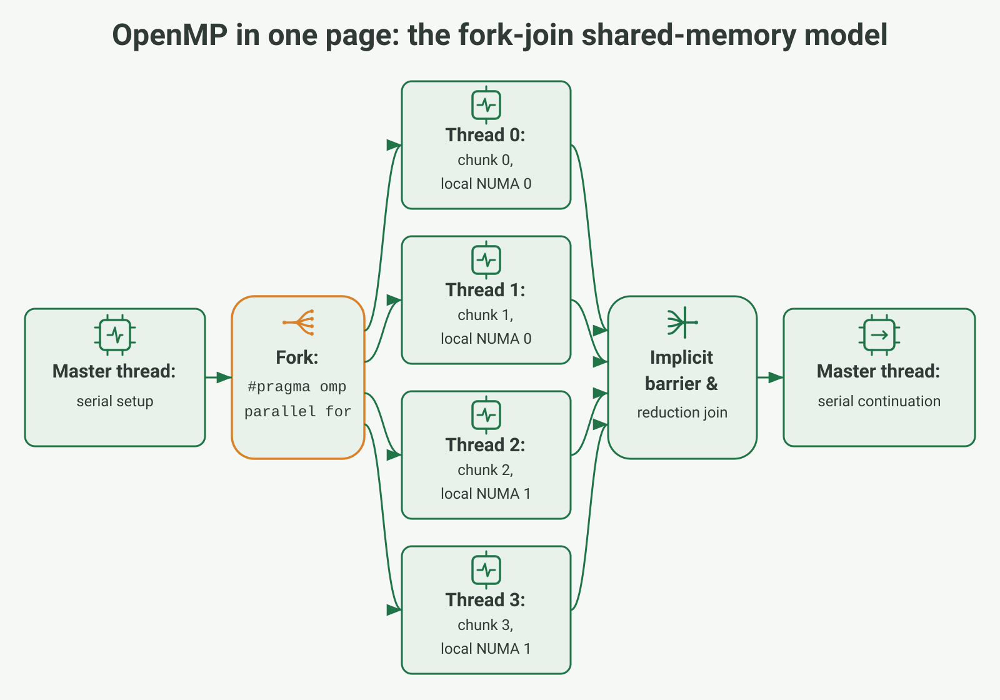

# 6.5 OpenMP, compilers and optimisation flags

| Field | Value |
|---|---|
| Level | Intermediate |
| Priority tier | 1 |
| Lab venue | Any machine with Python 3 and a C or Fortran compiler; `omp_compilers_lab.py` and the C and Fortran programs were compiled and run locally on Apple M3; multi-node Slurm scripts are **untested** here |
| Part | Part 6: HPC and Slurm |
| Status | Drafted |

## Why this matters for AI infrastructure

Every week on a shared cluster, a new ticket lands in the queue. One user asks why their CPU preprocessing code runs twenty times slower than expected. Another asks why a freshly compiled binary crashes with `Illegal instruction` on half the nodes. A third asks why turning on `-O3` did not speed up a reduction loop. These look like three unrelated complaints. They are not. All three mysteries live in the node-level compiler and threading layer, which is the part of the software stack that runs on one machine before any network traffic starts. When you learn to read that layer, these tickets stop being mysteries and start being checklists.

Think of that layer as the foreman between your source code and the processor. It decides whether a loop runs at full SIMD vector width. SIMD stands for single instruction, multiple data, which means one instruction works on several numbers at once, a bit like one stamp marking a whole row of boxes. The foreman also decides whether threads sit on the same NUMA domain (the block of RAM attached to one CPU socket) that owns their memory pages. It decides whether an optimization flag is allowed to reorder floating-point addition. It also decides whether an executable emits AVX-512 instructions on an AVX2 node. Each of these choices is made before the job starts, and together they govern every host-side workload on an AI cluster.

You will meet the same mechanisms in many places. PyTorch, NumPy, OpenBLAS, and MKL all run thread pools on the CPU, and the variable `OMP_NUM_THREADS` is the knob to watch in most of them. CPU tokenization pipelines and custom C++ and CUDA extension builds follow the same rules. When a host-side job is slow, a good first question is about threads, not about the GPU. Once you understand how OpenMP, compiler toolchains, and optimization flags work together, you have the diagnostic view to resolve performance and build tickets in minutes.

## Prerequisites and outcomes

Before you start, you need Chapters 6.3 and 6.4 and basic familiarity with C or Fortran syntax. This chapter then walks through parallel loops, thread placement, data bugs, compiler choices, and the licensing and GPU driver traps that cluster administrators meet.

The chapter starts with how to parallelize loops with OpenMP, which means reasoning about fork-join teams, data-sharing clauses, and loop schedules. Next it shows how to control thread counts, NUMA first-touch page placement, and core binding with `OMP_*` environment variables and Slurm flags. That control stops thread oversubscription in hybrid MPI+OpenMP and PyTorch jobs. It then reproduces and fixes OpenMP data races and false sharing, and it explains why a racy binary can pass casual tests before it fails under load. The compiler section compares the GNU, LLVM, Intel oneAPI, and NVIDIA HPC SDK families and their flags, across optimization levels, target architectures, C and Fortran symbol linking, and floating-point reassociation. Last, it covers the operational traps of commercial floating compiler licenses, namely FlexLM 15-minute seat leases, 50% server quorum, and MAC (media access control) address binding. It also explains CUDA driver and toolkit installation, using *Supercomputers for Linux SysAdmins* Chapter 21.

## 1. OpenMP in one page: the fork-join shared-memory model

Suppose one loop in your code keeps a single core busy while the rest of the node sits idle. The job is slow, the fans are loud, and most of the processor has nothing to do. OpenMP is one way to put those other cores to work. It is an API (a set of compiler directives and runtime functions) for shared-memory thread parallelism, which means several threads working on one block of memory. You use it from C, C++, and Fortran by adding special lines to the source. Each line is a hint that tells the compiler where to split the work. The sources for this section are *Parallel and High Performance Computing* Chapter 7 and *Supercomputers for Linux SysAdmins* Chapter 21.

Picture a team of cooks in one kitchen. One cook starts the work alone. When the dish needs several pairs of hands, the cook calls the team in, and everyone works from one shared pantry. At the end, everyone stops at the same line before the next course starts. OpenMP works the same way. An OpenMP program begins as a single master thread. When it reaches a `#pragma omp parallel` directive, or `!$omp parallel` in Fortran, the master thread forks a team of worker threads. The team shares the process's virtual address space, which is the one memory map that every thread can see. The team divides the loop or work block across its members. At the end of the region, the threads join at an implicit barrier, a point where every thread waits until the last one arrives.

This design has a useful side effect. An OpenMP directive is a compiler pragma (a line the compiler reads as an instruction) or a special comment. A compiler that does not know OpenMP simply skips it. So the exact same source file compiles cleanly as a standard sequential program when the OpenMP flag is omitted. You can check a parallel program against its serial version without maintaining two code bases.



*Figure 6.5.1. OpenMP in one page: the fork-join shared-memory model, as a diagram.*

```c
#pragma omp parallel for schedule(static)
for (long i = 0; i < n; i++) a[i] = b[i] + 3.0 * c[i];
```

Turning OpenMP on is a compile-time decision, and the flag depends on your compiler. The flag tells the compiler to read the directives and to link the OpenMP runtime, which is the library that creates and manages the threads. Use `-fopenmp` on GCC and Clang, which link `libgomp` or `libomp`. Use `-fiopenmp` on Intel oneAPI `icx` and `ifx`, or `-qopenmp` on classic `icc` and `ifort`. On NVIDIA HPC SDK, use `-mp` with `nvc`, `nvc++`, and `nvfortran`. If you forget the flag, nothing fails loudly. The directives are ignored and the program runs on one thread. That is a common reason a job that was meant to be parallel is still slow.

### Key OpenMP clauses and runtime variables

Clauses are the extra words that follow a directive. They tell OpenMP how each variable is shared and how the work is split. The table lists the most common ones. Read each row as the answer to one question: who can see this variable, how is the loop split, or when do threads wait for each other.

| Clause or construct | Role in an OpenMP parallel region |
|---|---|
| `omp_get_num_threads()`, `omp_get_thread_num()` | Runtime functions returning the team size and the calling thread's ID from 0 to T - 1 |
| `shared`, `private`, `firstprivate`, `lastprivate` | **Data-sharing scope:** `shared` (one shared variable in memory), `private` (separate uninitialized local variable per thread), `firstprivate` (private copy initialized from the master's value), `lastprivate` (copies final iteration's value back out) |
| `reduction(op : var)` | Gives each thread a private partial accumulator initialized to the identity for `op` (`+`, `*`, `max`, `min`) and combines them safely at the join barrier |
| `schedule(static \| dynamic,chunk \| guided \| auto \| runtime)` | Controls how loop iterations map to threads: `static` divides into equal contiguous chunks up front; `dynamic,chunk` hands out chunks from a queue as threads finish; `guided` starts with large chunks and shrinks them; `runtime` reads `OMP_SCHEDULE` |
| `barrier`, `critical`, `atomic`, `nowait` | Synchronization controls: `atomic` updates a single scalar memory location with hardware atomic instructions; `critical` serializes an arbitrary code block under a lock; `nowait` removes the implicit barrier at the end of a construct |
| `task`, `taskwait`, `simd`, `target` | Dynamic task graphs (`task`), explicit SIMD vectorization hints (`#pragma omp simd`), and GPU offloading (`#pragma omp target teams distribute parallel for`) |

The `reduction` row explains why sums are safe. Without it, every thread would add into the same variable at the same moment. With it, each thread keeps a private partial total, and the partial totals combine once, at the join. Think of several cashiers who each count their own till, then hand their totals to a manager at closing time. Nobody reaches into one shared cash drawer while the others are counting.

You do not need to recompile to change how OpenMP behaves. Six standard environment variables let you set the thread count, the binding, and the schedule at launch time. That means you can test the same binary under several settings, one at a time. The table lists them.

| Environment variable | Operational purpose |
|---|---|
| `OMP_NUM_THREADS` | Sets the number of threads in the parallel team; defaults to all visible logical cores if unset |
| `OMP_PROC_BIND` | Controls thread pinning: `false`, `true`, `close` (pack threads onto adjacent cores), `spread` (spread threads across sockets and NUMA domains), or `master`/`primary` |
| `OMP_PLACES` | Defines the hardware places threads bind to: `threads`, `cores`, `sockets`, `numa_domains`, or an explicit core list |
| `OMP_SCHEDULE` | Sets the loop schedule when source code specifies `schedule(runtime)` |
| `OMP_DISPLAY_ENV` / `OMP_DISPLAY_AFFINITY` | Set to `verbose` or `true` to print the active OpenMP runtime configuration and exact per-thread CPU core bindings in job logs |
| `OMP_STACKSIZE` | Sets per-thread stack size (such as `64M`) when Fortran or C codes allocate large private arrays on the thread stack |

Here is what goes wrong when you skip these variables. A job with no `OMP_NUM_THREADS` gets whatever default the runtime chooses, and that default counts every visible logical core. A job with no `OMP_PROC_BIND` lets the operating system move threads between cores, so a thread can wander from one socket to another halfway through a run. Both problems are quiet. The job finishes, the output looks right, and the only symptom is a slow number in the log. Setting the three variables in the script turns those hidden guesses into explicit choices that anyone reading the script can check.

**In every batch script, set `OMP_NUM_THREADS`, `OMP_PROC_BIND`, and `OMP_PLACES` explicitly, so OpenMP never has to guess thread counts from the whole node.**

> **In one minute:**
> - OpenMP forks a team of shared-memory threads at `#pragma omp parallel` and joins them at an implicit barrier. Without `-fopenmp`, the compiler ignores the directives and builds a valid serial binary.
> - Use `reduction(op:var)` for parallel accumulations, `schedule(static)` for uniform loops, and `OMP_NUM_THREADS`, `OMP_PROC_BIND`, and `OMP_PLACES` to control placement at runtime.

## 2. A measured OpenMP scaling experiment (`omp_scaling.c`)

Suppose you want to know why more threads help one loop and barely help another. The file `code/part06/omp_scaling.c` answers that with a measurement. Its program allocates three 50-million-element double-precision arrays, 400 MB each and 1.2 GB in total. It initializes them in parallel for NUMA first-touch placement, then runs an untimed warm-up pass. After that it times three kernels across 1 to 8 threads:

1. STREAM-style memory triad (`a[i] = b[i] + 3.0 * c[i]`): each step does 2 double reads and 1 double write. That moves 24 bytes for only 2 floating-point operations, or 0.083 FLOP/byte. The loop is therefore completely memory-bandwidth bound. Its speed depends on how fast RAM can feed the cores, not on how fast the cores can calculate.
2. Compute-heavy transcendental loop (`a[i] = sin(b[i]) * cos(c[i])`): this loop does a lot of arithmetic for each memory load. The cores stay busy, and the RAM mostly waits.
3. Parallel sum reduction (`s += a[i]` with `reduction(+ : s)`): this loop reads one array, 8 bytes per add, and combines thread-private partial sums.

The program was compiled and run locally with `clang -O2 -fopenmp code/part06/omp_scaling.c -o omp_scaling -lm` on an 8-core Apple M3. It printed the output below. Each row is one thread count, so read down the GB/s and ms columns to see where the gains stop. If your own row looks different, compare your machine's core count and memory before you blame the code. Look at the sin_ms column as well, because it tells the opposite story.

```text
threads  triad_ms  GB/s   sin_ms   sum_ms
      1      18.1   66.3     86.3     37.7  (checksum 4.498e+08)
      2      15.3   78.4     13.3     18.9
      4      14.2   84.4     11.3     12.9
      6      14.1   85.0      7.8      8.9
      8      14.1   85.4      7.3      9.4
```

Four lessons stand out in this table, and each one answers a question you are likely to ask. The calculations behind them were verified in `triad_bandwidth_gbps()` in `code/part06/omp_compilers.py`.

- Why does the triad stop getting faster? Memory bandwidth saturates early. One thread already drives 66.3 GB/s in 18.1 ms. Two threads reach 78.4 GB/s in 15.3 ms. Beyond 4 threads, which reach 84.4 GB/s in 14.2 ms, adding more produces virtually zero gain. The figures reach 85.0 GB/s at 6 threads and 85.4 GB/s at 8 threads, where the time is 14.1 ms. Once threads saturate the memory controllers, extra cores simply wait in line for DRAM.
- Why do compute-heavy loops keep scaling? The sine and cosine loop drops from 13.3 ms on 2 threads to 7.3 ms on 8. Each thread executes dozens of arithmetic instructions in registers for every cache line it fetches, which is why extra cores keep helping. Notice the 1-thread row at 86.3 ms. It was an outlier. The OS first scheduled that single thread on a slower efficiency core, before frequency ramp-up, and a warm repeat measured 26 ms.
- Why must a benchmark include a warm-up? Warm-up passes are mandatory. The first run of `omp_scaling.c` had no untimed warm-up pass. The 1-thread triad reported only 20 GB/s, because Linux charged its demand-paging page faults to the first timed loop. The first pass paid a setup cost that had nothing to do with memory bandwidth.

Here is the walkthrough behind that rule. The cores share a small number of memory controllers, and each controller can move only so many gigabytes per second. Once the threads together ask for more than that, each extra thread gets a smaller slice of the same road. Adding a thread then adds waiting, not work. A compute-bound loop works differently. It does most of its work inside the core, so the memory road is not the bottleneck and extra threads keep paying off. Before you tune the scheduler or the thread count, check which kind of loop you are running.

**If a multi-threaded CPU job stops speeding up after a few threads, check for saturated socket memory bandwidth before you blame the thread scheduler.**

> **In one minute:**
> - On `omp_scaling.c`, with 50,000,000 doubles (1.2 GB), the memory-bound triad saturates bandwidth by 2 to 4 threads (66.3 to 84.4 to 85.4 GB/s), whereas the compute-bound sine and cosine loop keeps scaling down to 7.3 ms.
> - Always include an untimed warm-up pass in benchmarks, so initial page-table faults (a 20 GB/s artifact) do not distort the 1-thread baseline.

## 3. Affinity, NUMA first-touch page placement, and hybrid oversubscription

Suppose your OpenMP job uses every core on a two-socket server and still runs slowly. The monitoring graphs look busy, yet the job takes much longer than the benchmark said it should. The cause may be where its memory landed, not how busy the cores were.

On a multi-socket server, which Chapter 6.2 covers, physical RAM is split across NUMA domains. NUMA stands for Non-Uniform Memory Access. A core reads the RAM on its own socket quickly, and it reads the RAM on the other socket more slowly, because each request crosses a link between the two chips. The background comes from *Parallel and High Performance Computing* Chapter 14. A Linux kernel rule surprises many engineers. `malloc()` does not allocate physical RAM pages.

Instead, the kernel maps a page only when its address is written to for the first time. It then places that page on the NUMA node of the core that performs that first write. This policy is called first touch. A page is the fixed-size block of memory that the kernel tracks, so first touch is really the moment the kernel decides which memory bank a new page lives in. Whoever writes first chooses the bank.

Consider a program that allocates a 64 GB array in `main()`. It then fills the array with zeros in a single serial loop on Thread 0, which runs on Socket 0. After that, it starts an OpenMP parallel compute loop across Socket 0 and Socket 1. The fill loop looks harmless, but it decides where every page lives.

1. Thread 0 touched every page first, so all 64 GB of physical pages land on Socket 0's memory controllers.
2. When the 64 threads on Socket 1 run the parallel compute loop, every memory read they issue must cross the inter-socket UPI or Infinity Fabric bus to Socket 0, cutting memory bandwidth in half. The Socket 1 cores are busy, but they are waiting on a slow road.

Three rules fix NUMA placement and thread contention. Each rule targets one of the mistakes above.

1. Initialize the array in parallel with the same `schedule(static)` as the compute loop. The first thread to touch a page is then the thread that will use it. `omp_scaling.c` does this on lines 13–14, so each pinned thread touches and faults in its own local NUMA pages.
2. Pin threads with `OMP_PROC_BIND` and `OMP_PLACES`. Set `OMP_PLACES=cores` to bind to physical cores, not sibling hyperthreads. Then pair it with `OMP_PROC_BIND=close` to pack threads on one socket, or with `OMP_PROC_BIND=spread` to spread them across sockets. Spreading lets threads use all memory controllers during parallel first-touch.
3. Prevent 8x–64x hybrid oversubscription. Suppose a node has 64 physical cores, and a user launches 8 MPI ranks or 8 PyTorch DDP processes, one per GPU. If `OMP_NUM_THREADS` is left unset, each of the 8 processes detects 64 cores and spawns 64 OpenMP threads. That creates $8 \times 64 = \mathbf{512\text{ threads}}$ fighting over 64 cores (`check_hybrid_oversubscription()` in `code/part06/omp_compilers.py`), which causes a 5x to 50x slowdown from context-switching thrash. Under Slurm, always pair `--ntasks-per-node=8 --cpus-per-task=8 --cpu-bind=cores` with these exports:
   ```bash
   export OMP_NUM_THREADS=$SLURM_CPUS_PER_TASK
   export MKL_NUM_THREADS=$SLURM_CPUS_PER_TASK
   export OPENBLAS_NUM_THREADS=$SLURM_CPUS_PER_TASK
   ```

This matters a great deal for AI hosts. A data preprocessing job might allocate a large buffer, fill it from a single thread, and then hand it to a team of workers. The buffer ends up on one socket, and every worker on the other socket pays the cross-socket toll on every read. The fix costs almost nothing. Write the initialization loop with the same schedule as the work loop, and each page lands next to the thread that will read it. You do not need to change the algorithm at all.

**Initialize large arrays in a parallel loop that matches your compute schedule, so first-touch puts each page on the local NUMA node of the thread that uses it. In multi-process GPU jobs, always cap `OMP_NUM_THREADS`.**

> **In one minute:**
> - Linux first-touch allocates physical RAM pages on the NUMA node of the thread that first writes them; serial initialization puts an entire array on one socket.
> - Leaving `OMP_NUM_THREADS` unset in an 8-GPU job on a 64-core node spawns 512 threads, which is 8.0x oversubscription. Always set `OMP_NUM_THREADS=$SLURM_CPUS_PER_TASK`.

## 4. Bugs OpenMP makes easy: data races and false sharing (`omp_race.c`)

Picture a shared spreadsheet where three people type into the same cell at the same moment. Shared memory gives OpenMP threads that same kind of spreadsheet. It makes arrays easy to share between threads, and it also makes two bugs easy to write: data races and false sharing. The program `code/part06/omp_race.c` demonstrates both.

### Data races and why "it passed my test" proves nothing

Suppose two threads update the same counter at the same moment. They can overwrite each other's work. That is a data race, which happens when two or more threads access one memory location at the same time, at least one of them writes, and nothing orders the accesses. The result depends on timing, and timing changes from run to run.

In `code/part06/omp_race.c`, 8 threads increment a shared counter 20,000,000 times. They do this in three ways. The first is an unsynchronized `racy++` loop. The second uses `#pragma omp atomic`, which makes each single update indivisible. The third uses `#pragma omp parallel for reduction(+ : reduced)`, which gives each thread its own partial total.

Running `./omp_race` twice at `-O0` gave this output:

```text
expected 20000000 | racy 6215980  | atomic 20000000 | reduction 20000000
expected 20000000 | racy 3487814  | atomic 20000000 | reduction 20000000
```

Between 70% and 80% of the increments vanished. The cause is that several threads loaded the same stale value into registers before writing it back, so each write overwrote the others. The same program compiled at `-O2` was more misleading. It printed the correct answer, 20,000,000, on two consecutive runs. On the third run it printed 17,500,000. A bug that hides itself for two runs is the most dangerous kind.

A data race depends on timing, so passing a unit test on an unloaded laptop proves nothing. Use `reduction(+ : var)` for accumulations. It is fast and lock-free until the final join. Prefer it to `#pragma omp atomic` or `critical` inside a tight inner loop, because both of those put a lock or a serialized step inside the loop you want fast. To test suspicious code, use ThreadSanitizer (`-fsanitize=thread`), Intel Inspector, or Valgrind Helgrind. Those tools watch the memory accesses and report the ones that are not ordered.

### False sharing across CPU cache lines

Suppose each thread updates its own element, `packed[id] += 1.0`, in a shared double array. No data race exists, because every thread writes a different index. Yet on multi-core servers this loop can run ten times slower than expected. The cause is false sharing, and it is one of the harder bugs to see in a code review, because the code looks correct.

A CPU cache does not track single 8-byte double words. It coherence-locks whole cache lines instead. A cache line is the unit of memory that moves between RAM and the cache, and it is 64 bytes, which holds 8 doubles, on most x86 and Arm servers. On Apple M-series chips a line is 128 bytes, which holds 16 doubles. You can query the size with `getconf LEVEL1_DCACHE_LINESIZE` or `sysctl hw.cachelinesize`.

Because `packed[0]` through `packed[7]` sit inside the same 64-byte cache line, each write by Thread 0 invalidates that line for Threads 1 through 7. The line then bounces between cores over the coherency bus. The threads never touch the same element, yet they keep fighting over the same line, and that fight is what slows the loop down.

The fix is simple. Keep the accumulation in a thread-local scalar or in a `reduction`. Alternatively, pad each per-thread slot to the cache-line width. In `omp_race.c`, `padded[id * 16]` with `PAD = 16` doubles gives 128 bytes per slot. On the Apple M3, `omp_race.c` measured ~0.09 s for both volatile loops. That is why you should always measure on your target server architecture, not on the machine where the code happens to run.

A useful test for any shared-memory loop is to ask who writes where. If every thread writes to its own private variable, and only the final combine touches shared state, the loop is safe and quick. If many threads write to the same array element or the same counter inside a hot loop, you have found the place to look first. Most of the bugs in this section come from that single pattern, so it is worth checking every loop you write or review.

**Accumulate into thread-private scalars with `reduction(+ : var)` instead of writing to shared arrays on every iteration, which removes both data races and false sharing.**

> **In one minute:**
> - In `omp_race.c`, 8 threads made 20,000,000 increments. The unsynchronized `racy++` lost 70–80% of updates at `-O0`, landing at 6,215,980 and 3,487,814. At `-O2` it passed twice, then failed with 17,500,000.
> - **False sharing** occurs when different threads write to adjacent array elements, such as `packed[id]`, that share one hardware cache line. That line is 64 bytes on x86 and Arm, or 128 bytes on Apple M-series.

## 5. Compiler families, `gcc`/`gfortran`, FlexLM traps, and CUDA setup (*Supercomputers for Linux Sysadmins* Chapter 21)

A new engineer on a cluster team gets a ticket. The code builds on the login node and fails on the GPU nodes, and the error mentions a symbol that nobody can find. Each compiler family has its own binaries, its own OpenMP flag, and its own strengths. The table compares them for HPC and AI clusters, so you know which tool to reach for first.

| Compiler family | C / C++ / Fortran binaries | OpenMP flag & runtime | Key strengths on HPC & AI clusters |
|---|---|---|---|
| **GNU (GCC)** | `gcc`, `g++`, `gfortran` (replaced legacy `g77`) | `-fopenmp` (`libgomp`) | Installed on every Linux distribution; baseline compatibility across all open-source stacks |
| **LLVM / Clang** | `clang`, `clang++`, `flang` | `-fopenmp` (`libomp`) | Fast compile times, clean diagnostics (`-Rpass=loop-vectorize`), foundation of vendor compilers |
| **Intel oneAPI** | `icx`, `icpx`, `ifx` (retired classic `icc`/`ifort`) | `-fiopenmp` (`-qopenmp`) | Deep integration with Intel MPI, MKL, Intel GDB, and VTune; high x86-64 performance |
| **NVIDIA HPC SDK** | `nvc`, `nvc++`, `nvfortran`, plus `nvcc` | `-mp` (and `-acc` for OpenACC) | Native CUDA, OpenACC, and OpenMP GPU offload; bundled with HPC-X MPI and cuBLAS/cuFFT |
| **AMD AOCC / ROCm** | `clang`, `flang`, `hipcc` | `-fopenmp` | Tuned for AMD EPYC (`znver*`) CPUs and Instinct MI-series GPUs |

In *Supercomputers for Linux SysAdmins* Chapter 21, Zhumatiy covers four practical lessons in compilation, linking, licensing, and GPU drivers. Cluster administrators run into all four, usually at the worst possible moment.

### 1. `gcc` / `gfortran` compilation, C/Fortran underscore linking, and GNU linker order

Start with a single source file. `gcc myprog.c` produces `a.out`, unless you name the output with `-o myexe`. Multi-file projects take two steps. First, compile each `.c` or `.f90` file into a `.o` object file with `gcc -c *.c`. Then link the objects with libraries, for example `gcc -o myexe *.o -lm`. Here `-lzzz` links `libzzz.so`, `-I` adds header search paths, and `-L` adds library search paths. Keep these three cross-language and linker rules in mind:

- Why do C and Fortran objects fail to link? C and Fortran symbol underscore mismatch (`-fleading-underscore`): C and Fortran compilers have historically decorated variable and function names differently in `.o` object files. Linking them together can fail with unresolved symbols, unless you align the naming conventions. Compile C files with `-fleading-underscore`. For Fortran, you can use `-fno-underscoring` or `iso_c_binding` in modern code. Treat those Fortran options as unverified until you try them on your own compiler.
- What if a C++ function is called from C? Mixing C++ with C or Fortran: a C++ function that C or Fortran calls must be declared `extern "C"`. This stops the C++ compiler from mangling its symbol name, so the other language can find it by its plain name.
- Why does library order matter? GNU single-pass linker argument order: with GNU compilers, the order of flags and file names changes linker behavior. Put `-lm` before `*.o`, as in `gcc -lm *.o -o myexe`, and the link can fail with unresolved symbols. The linker scans left to right and discards unused library symbols before it sees the `.o` files that need them. Also, enabling proprietary interprocedural optimization (IPO) on commercial compilers breaks object-file compatibility with GNU `.o` files.

### 2. Commercial compiler licensing and the 15-minute FlexLM lease trap

In 2025, the Intel oneAPI and NVIDIA HPC compilers are free to use, with optional paid support. Older commercial compilers, such as PGI and PathScale, and many commercial CAE and EDA tools use strict license managers called FlexLM. FlexLM is a license server that hands out permission to run software. Zhumatiy warns of three licensing pitfalls. They are modeled in `flexlm_quorum_and_seat_availability()` in `code/part06/omp_compilers.py`:

1. Single-user or fixed-node unlimited-user license: a license for an unlimited number of users on a fixed login or build host is ideal for a cluster. Intel's compiler can read a local license file directory directly, with no license server daemon. A single-user license is useless on a shared machine.
2. Floating concurrent-seat license and the 15-minute hold trap: a floating license that limits simultaneous compilations, say to 3 concurrent users, sounds reasonable. It stops sounding reasonable once you learn how simultaneity is metered. In the PathScale compiler that Zhumatiy encountered, each compiler invocation leases a seat to that user for 15 minutes. Whether that user compiles once or 20 times in those 15 minutes, the seat stays locked to them. Other users are blocked, even after the first user's command finished in two seconds.
3. 50% HA quorum and MAC address binding: a fault-tolerant license server triad runs across several machines. At least 50% of its servers must be online, which means 2 of 3, to keep quorum. All licenses are bound to the license server's network card MAC address, and sometimes to its hostname, at activation time. If that network card is swapped, the licenses can stop working.

### 3. CUDA Toolkit installation (`libcuda` vs. `libcudart`) and hung-driver recovery

*Supercomputers for Linux SysAdmins* Chapter 21 also gives sysadmin rules for installing the CUDA SDK on cluster nodes. The SDK's `nvcc` compiles `.cu` files. The rules below are the ones that most often decide whether a node comes back healthy after a driver change.

- Package repository or binary `.run` installer? Always prefer the distribution package manager. Use `yum install CUDA`, `zypper refresh && zypper install CUDA`, or `apt-get update && apt-get install CUDA`. For apt-get, add the official NVIDIA repo first. Make sure `gcc` is installed first. The `.run` binary installer also works, but it does not register packages in the OS package database. You must then reinstall by hand on every upgrade. Expose `/usr/local/CUDA-VERSION/bin` in `PATH` and `/usr/local/CUDA-VERSION/lib64` in `LD_LIBRARY_PATH` through an Environment Module, which Chapter 6.6 covers.
- Which library does what? `libcuda.so` vs. `libcudart.so`: two core libraries matter here. `libcuda` ships with the host NVIDIA GPU driver, and it handles low-level GPU enumeration, memory read and write, and kernel launch. `libcudart` ships with the CUDA Toolkit SDK. It provides the high-level CUDA runtime API calls, alongside cuBLAS, cuFFT, cuRAND, and cuSPARSE.
- How do you manage GPU modes and recover a hung driver? Use `nvidia-smi` to manage GPU modes, and `nvitop` or `nvtop` to watch them live. Turn on ECC, which makes memory access slightly slower but much more reliable. Turn on Persistence Mode, so the driver stays resident in memory. Without it, the first CUDA call of every job adds a 1 to 2 second load delay. You can also set Compute Mode, and check for Xid faults, ECC errors, and overheating. If an old `nvidia` kernel module refuses to unload during a driver upgrade, blacklist the module temporarily, reboot, install the new driver, and then remove the blacklist entry. If the driver hangs on an idle node, you can reinitialize it from the CLI. Test this sequence on a spare node before you use it on a production one:
  ```bash
  # (untested here)
  rmmod nvidia; modprobe nvidia; deviceQuery   # or run nvidia-smi instead of deviceQuery
  ```

When a link fails, read the first unresolved symbol in the error. That name tells you which object file or library is missing, and the flag order usually follows from it. If the symbol lives in a library, move that `-l` flag after the object files that need it. If the symbol name carries a trailing underscore, or the C++ name looks mangled, the problem is naming, not the library path. Fixing the order and the naming rule is almost always faster than adding libraries at random.

**On GNU link lines, put `-l` libraries after the `.o` files. When you link C and Fortran, use `-fleading-underscore` or `iso_c_binding`. Expose each compiler and CUDA toolkit version through environment modules.**

> **In one minute:**
> - With `gcc` and `gfortran`, put `-l` libraries after `.o` files. Use `-fleading-underscore` or `-fno-underscoring` when linking C and Fortran. Use `extern "C"` for C++.
> - Floating compiler licenses (FlexLM) can lock a seat for 15 minutes per call. In HA setups they need at least 50% server quorum. They bind to the license server's NIC MAC address.
> - `libcuda` comes with the host GPU driver, and `libcudart` comes with the CUDA Toolkit in `/usr/local/CUDA-VERSION/lib64`. Enable persistence mode with `nvidia-smi`.

## 6. Optimization levels, `-march=native` hazards, and `-ffast-math` (`flags_kernel.c`)

### Optimization levels (`-O0` through `-Ofast`) and target architecture flags

GCC and Clang work this way, and Intel and NVIDIA compilers do too. Their `-On` flags run from 0 to 3. Legacy GCC notes go up to 6. The default is `-O2`, and `-O3` is common for production HPC. Each `-On` level turns on a bundle of optimization passes, which are the compiler's rewriting steps. Higher levels do more rewriting, and that can make code faster or, in a few cases, change its results. The table shows what each flag does, and when to use it or avoid it.

| Flag | What the compiler does | When to use or avoid |
|---|---|---|
| `-O0` | Disables optimization; variables stay in stack slots matching source lines | Use with `-g` for interactive `gdb`, TotalView, or DDT debugging |
| `-O2` | Standard safe optimization: inlining, dead-code elimination, instruction scheduling, basic vectorization | Safe default for system tools and general applications |
| `-O3` | Aggressive loop optimizations: loop unrolling, loop interchange, wider SIMD vectorization | Standard starting point for compute-bound HPC kernels; combine with `-g -fno-omit-frame-pointer` for profiling |
| `-Ofast` / `-ffast-math` | `-O3` plus **relaxing IEEE 754 floating-point rules** (allows algebraic reassociation, assumes no NaN or Inf, ignores signed zero, enables flush-to-zero denormals) | Unlocks 4x to 8x SIMD reduction speedups, **but breaks IEEE 754 bit-reproducibility and `isnan()` checks** |
| `-march=native` / `-mcpu=native` (or `-ftune`/`-farch`) | Generates instructions for **every CPU feature present on the build machine** (instead of generic baseline x86 that would run on a Pentium-I without AVX) | **Fast on homogeneous nodes; crashes with `SIGILL` (`Illegal instruction`) if compiled on an AVX-512 login node and run on an AVX2 compute node** |

A common version of this trap looks like this. An engineer builds on a newer login node, copies the binary to the older compute partition, and sees the job die in the first second. Nothing in the code is wrong. The compiler simply used instructions that the older chips do not have. The safe habit is to build on the oldest hardware you will run on, or to build once per partition and load the right one through the module system.

Heterogeneous clusters need care with target flags. A heterogeneous cluster has login and compute nodes, or partitions, with different CPU generations. To avoid `Illegal instruction` crashes, compile for the lowest common microarchitecture level across your partitions. Examples are `-march=x86-64-v3` for AVX2 and FMA, or `-march=znver3`. Another option is libraries such as MKL and OpenBLAS, which choose SIMD kernels at runtime, so one binary adapts to each node. A third is per-architecture module trees built with Spack and EasyBuild, covered in Chapter 6.6.

### The floating-point reduction experiment (`flags_kernel.c`)

A colleague sends you a dot-product kernel and says that adding `-O3` changed nothing. A teammate's copy, built with `-ffast-math`, ran six times faster. Why does compiling a dot product or sum reduction with `-O3` often give zero speedup over `-O2`, while adding `-ffast-math` makes it six times faster? The program `code/part06/flags_kernel.c` answers this with a test. It computes a 20-million-element float dot product, `dot += x[i] * y[i]`, and repeats it 20 times. Each pass depends on the previous one through `y[rep] = dot * 1e-12f`. That dependency stops the compiler from deleting the outer loop as dead code.

The program was compiled and run on the Apple M3 with seven flag combinations. Each result was compared with the exact FP64 double-precision reference sum, 2446257.2. FP64 means 64-bit floating point, a high-precision format, so it serves as the answer key. This is the output:

```text
-O0                                dot=2293365.000000  2.02 GFLOP/s
-O1                                dot=2293365.000000  2.01 GFLOP/s
-O2                                dot=2293365.000000  2.69 GFLOP/s
-O3                                dot=2293365.000000  2.71 GFLOP/s
-O3 -mcpu=native                   dot=2293365.000000  2.68 GFLOP/s
-O3 -ffast-math                    dot=2445485.500000  16.05 GFLOP/s
-O3 -ffast-math -mcpu=native       dot=2445485.500000  16.29 GFLOP/s
```

Look at both the speed and the sum. Strict `-O3` runs at 2.71 GFLOP/s, and the `-ffast-math` build reaches 16.29 GFLOP/s. Their sums are 2293365.0 and 2445485.5. Read the speed first, then check whether the answer is still right. A fast wrong answer is not a win. The sums were checked in `fp_relative_error_pct()` in `code/part06/omp_compilers.py`, and the next three points explain the gap.

1. Why did strict `-O3` stay slow (2.71 GFLOP/s)? Under strict IEEE 754 rules, floating-point addition is not associative, which means that changing the grouping can change the result. The compiler is therefore forbidden from changing the left-to-right addition order. Clang's report, from `clang -O3 -Rpass=loop-vectorize`, shows `"vectorized loop (vectorization width: 4, interleaved count: 4)"` for both builds. Yet in the strict build, only the loads and multiplications, `x[i] * y[i]`, were vectorized. The additions stayed a serial, latency-bound chain, waiting on the single `dot` register every cycle.
2. Why did `-ffast-math` jump 6x (16.29 GFLOP/s)? The flag `-ffast-math` allows reassociation. More precisely, the mechanism is `-fassociative-math`. The compiler can split `dot` into several independent SIMD vector accumulators. They add in parallel every cycle and combine once at the end of the loop.
3. Why was the `-ffast-math` answer more accurate? The fast-math sum, 2445485.5, has 0.03% error. The strict sum, 2293365.0, has 6.25% error. Adding 20 million tiny float32 numbers one at a time into one growing total loses low-order mantissa bits. This loss is called swamping. Accumulating into several smaller partial sums under `-ffast-math` stays much closer to the FP64 reference, 2446257.2. However, `-ffast-math` disables NaN and Inf guarantees, and results vary with SIMD width. For ML and scientific builds, validate tolerances carefully. When strict reproducibility is required, prefer explicit pairwise or tree reductions, or FP64 accumulators.

Before you guess at a slow loop, look at what the compiler decided. A hot loop that runs far below its expected speed usually has a reason the compiler could tell you, if you ask. Both compilers can print their vectorization decisions:

```bash
gcc   -O3 -fopt-info-vec-optimized -fopt-info-vec-missed file.c
clang -O3 -Rpass=loop-vectorize -Rpass-missed=loop-vectorize file.c
```

A short example shows the workflow. You build a kernel with the strict flags, time it, and see a slow number. You then ask the compiler for its vectorization report and find that the hot loop was not vectorized. Only then do you decide whether a flag change is safe for your numerical tolerances. Reading the report first keeps you from trying flags at random, which is how teams end up with fast binaries that nobody can explain.

**For production builds, use `-O3 -g -fno-omit-frame-pointer` with a fleet-safe `-march` target. Check `-fopt-info-vec-missed` or `-Rpass=loop-vectorize` whenever a hot loop misses its expected SIMD throughput.**

> **In one minute:**
> - Strict `-O3` cannot parallelize a floating-point reduction, `dot += x[i]*y[i]`, which runs at 2.71 GFLOP/s, because IEEE 754 forbids reordering additions. `-ffast-math` permits SIMD partial-sum reassociation. It reaches 16.29 GFLOP/s, 6x faster, and cuts the swamping error from 6.25% to 0.03%. The cost is strict IEEE reproducibility and NaN safety.
> - Compiling with `-march=native` on a newer login node causes `Illegal instruction` crashes on older compute nodes.

## 7. Lab: run the OpenMP and compiler flag benchmarks

Start with the self-checking Python lab, which you run on your own machine. Run `code/part06/omp_compilers_lab.py` locally. It checks four things. It verifies the STREAM triad memory bandwidth calculation. It checks the hybrid MPI+OpenMP core oversubscription detector, and the strict versus `-ffast-math` relative error model. It also checks the FlexLM 50% quorum and 15-minute seat lease model from *Supercomputers for Linux SysAdmins* Chapter 21. The C benchmarks in the next step were run locally on the Apple M3. The multi-node Slurm scripts in this chapter were not run on a live cluster.

```bash
python3 code/part06/omp_compilers_lab.py
```

Before you run the C benchmarks, decide what you expect to see. For the triad, expect the time to flatten as threads are added. For the race test, expect the `-O0` count to fall short of the target. For the flags test, expect the strict and fast-math sums to differ. Writing down a guess first turns each run into a test of your understanding, instead of a screen of numbers you skim past.

Next, compile and run the three C benchmarks, `omp_scaling.c`, `omp_race.c`, and `flags_kernel.c`. Each command builds one binary and runs it, so you can watch one result at a time.

```bash
clang -O2 -fopenmp code/part06/omp_scaling.c -o /tmp/omp_scaling -lm && /tmp/omp_scaling
clang -O0 -fopenmp code/part06/omp_race.c -o /tmp/omp_race && /tmp/omp_race
clang -O3 code/part06/flags_kernel.c -o /tmp/flags_strict && /tmp/flags_strict
clang -O3 -ffast-math code/part06/flags_kernel.c -o /tmp/flags_fast && /tmp/flags_fast
```

Compare your output with the figures in the earlier sections. If your numbers differ, check your machine first, because the cache line size and the core count change the results. Write down what differed before you change any code, so the next person can repeat the test.

## 8. Interview angles

A hiring manager for a GPU platform team might open an interview with these five questions. Work through each one out loud, and say which section of this chapter gave you the answer.
- Why did `-O3` leave a float dot-product reduction loop at 2.71 GFLOP/s, while `-O3 -ffast-math` sped it up 6x to 16.29 GFLOP/s and changed the sum from 2293365.0 to 2445485.5?
- Explain the Linux NUMA **first-touch** policy. Suppose a multi-threaded OpenMP job on a dual-socket server initializes its arrays serially in `main()`. What happens to memory bandwidth during the parallel loop?
- A user launches 8 PyTorch DDP processes, or 8 MPI ranks, on a 64-core GPU node without setting `OMP_NUM_THREADS`. How many threads get spawned, and how do you fix it in Slurm?
- What separates a data race from false sharing? And why can a data race pass `-O2` tests twice and fail on the third run?
- What are the three operational traps of FlexLM floating compiler licenses, as described in *Supercomputers for Linux SysAdmins* Chapter 21? And how do you link C and Fortran `.o` files together?

## Exercises

1. Use `triad_bandwidth_gbps(50_000_000, 8, elapsed_ms)` in `code/part06/omp_compilers.py` to compute the achieved bandwidth in GB/s. Start with the 18.1 ms run, where one thread gives 66.3 GB/s. Then check the 14.1 ms run, where 8 threads give 85.1 GB/s. Explain why the triad curve flattens above 2 to 4 threads while `sin * cos` keeps scaling. Finally, explain why leaving out the untimed warm-up pass falsely reported 20 GB/s.
2. Imagine a dual-socket server whose arrays are filled by a serial loop on Thread 0. Explain why that causes cross-socket UPI or Infinity Fabric bottlenecks. Then explain how parallel initialization with `schedule(static)` fixes it. Next, use `check_hybrid_oversubscription(8, 64, 64)` to show why an 8-GPU node with 64 cores suffers 8.0x thread oversubscription, or 512 threads, when `OMP_NUM_THREADS` is unset.
3. A racy loop in `omp_race.c` lost 70–80% of its 20,000,000 increments at `-O0`, with results of 6215980 and 3487814. Trace why the same loop passed twice at `-O2` before failing at 17,500,000. Compare `#pragma omp atomic` with `reduction(+ : reduced)`. Then explain how false sharing occurs across 64-byte (x86 and Arm) or 128-byte (Apple M-series) cache lines.
4. Using `fp_relative_error_pct()` in `code/part06/omp_compilers.py`, compare the strict `-O3` dot product with the `-O3 -ffast-math` one. The strict result is 2293365.0 at 2.71 GFLOP/s, with 6.25% error against the FP64 reference 2446257.2. The fast-math result is 2445485.5 at 16.29 GFLOP/s, with 0.03% error. Explain why Clang reported `"vectorized loop"` for both builds. Then explain why `y[rep] = dot * 1e-12f` was needed to prevent dead-loop hoisting.
5. Explain why `gcc -lm *.o` can fail while `gcc *.o -lm` succeeds on the GNU single-pass linker. Then explain how `-fleading-underscore`, or `-fno-underscoring` with `iso_c_binding`, and `extern "C"` resolve C, Fortran, and C++ symbol mismatches. Finally, explain how to prevent `Illegal instruction` crashes when login and compute nodes have different CPU generations.
6. Using `flexlm_quorum_and_seat_availability()` in `code/part06/omp_compilers.py`, explain the 15-minute floating seat lease hold. Explain the 50% server quorum rule for 3-server license triads, and MAC address binding. Then distinguish `libcuda` from `libcudart`, and compare package-manager and `.run` CUDA installations. Finally, write the command sequence to reinitialize a hung `nvidia` kernel module, which is `rmmod nvidia; modprobe nvidia; deviceQuery`.

## Checkpoint questions (20)

<details>
<summary>1. How does OpenMP's fork-join execution model work, and what happens when you compile an OpenMP program without `-fopenmp`?</summary>

An OpenMP program starts as one master thread. When it reaches a `#pragma omp parallel` region (or `!$omp parallel` in Fortran), it forks a team of threads that share the process address space. The team divides the work and joins at an implicit barrier at the end of the region. Without `-fopenmp`, the compiler ignores the directives, since they are C/C++ pragmas or Fortran comments, and you get a valid single-threaded program.
</details>

<details>
<summary>2. Define the OpenMP data-sharing clauses `shared`, `private`, `firstprivate`, `lastprivate`, and `reduction(op : var)`.</summary>

- **`shared`:** All threads access the same single variable in shared memory.
- **`private`:** Each thread gets its own uninitialized local variable for the region.
- **`firstprivate`:** Each thread gets a private copy, initialized to the master variable's value on entry to the region.
- **`lastprivate`:** The private value from the thread that runs the sequentially last loop iteration is copied back to the outer variable at exit.
- **`reduction(op : var)`:** Each thread gets a private partial accumulator, starting at the identity of `op` (0 for `+`, 1 for `*`). At the end of the region, all partial results are combined safely into `var`.
</details>

<details>
<summary>3. Compare OpenMP loop schedules `static`, `dynamic,chunk`, `guided`, and `runtime`.</summary>

- **`static`:** Iterations are split into equal contiguous chunks, assigned before the loop starts. It has the lowest scheduling overhead and keeps NUMA first-touch locality across loops.
- **`dynamic,chunk`:** Threads pull chunks of size `chunk` from a shared queue as they finish. This balances irregular work, at the cost of more queue overhead and lost cache and NUMA locality.
- **`guided`:** Like `dynamic`, but it starts with large chunks and shrinks them exponentially down to a minimum as iterations run out.
- **`runtime`:** The schedule is chosen by the **`OMP_SCHEDULE`** environment variable at job launch.
</details>

<details>
<summary>4. What do `OMP_NUM_THREADS`, `OMP_PROC_BIND`, `OMP_PLACES`, and `OMP_DISPLAY_ENV=verbose` control?</summary>

- **`OMP_NUM_THREADS`:** Sets the number of threads in a team.
- **`OMP_PROC_BIND`:** Pins threads to places. `close` packs threads onto nearby cores on the same socket, and `spread` distributes them evenly across sockets and NUMA domains.
- **`OMP_PLACES`:** Defines the hardware units for binding: `cores`, `threads`, `sockets`, or `numa_domains`.
- **`OMP_DISPLAY_ENV=verbose` and `OMP_DISPLAY_AFFINITY=true`:** Print the effective runtime settings and per-thread core affinity masks at startup.
</details>

<details>
<summary>5. In `omp_scaling.c` (50,000,000 doubles), why did the STREAM triad stop scaling above 2 to 4 threads (~85 GB/s) while the `sin * cos` loop scaled all the way to 8 threads?</summary>

The STREAM triad (`a[i] = b[i] + 3.0 * c[i]`) moves 24 bytes, made up of 2 reads and 1 write, for only 2 FLOPs. That is 0.083 FLOP/byte. So 2 to 4 threads saturate the chip's memory-controller bandwidth, at about 85 GB/s. After that, extra threads only stall waiting on DRAM. The `sin * cos` loop does heavy register arithmetic per memory access, so it is compute-bound and keeps scaling with more cores.
</details>

<details>
<summary>6. Why did the first run of `omp_scaling.c` without an untimed warm-up pass report only 20 GB/s on 1 thread instead of 66.3 GB/s?</summary>

In C on Linux and macOS, `malloc()` only reserves virtual address ranges. Physical RAM pages get mapped through page faults on the first write. Without an untimed warm-up pass, the first timed 1-thread loop paid for the kernel page-fault and CPU frequency ramp-up overhead. That inflated the elapsed time and under-reported bandwidth as 20 GB/s instead of 66.3 GB/s.
</details>

<details>
<summary>7. Explain the Linux NUMA **first-touch** policy and how serial initialization in `main()` hurts multi-socket OpenMP performance.</summary>

Linux places a physical memory page on the NUMA node of the core that first writes to it. This is the first-touch policy. If Thread 0 on Socket 0 initializes an entire array serially before the parallel region, 100% of the array's pages land in Socket 0's RAM. When threads on Socket 1 read their half during the parallel loop, every access crosses the slow inter-socket bus. The fix is to initialize the array inside a `#pragma omp parallel for schedule(static)` loop that matches the compute loop's schedule and thread bindings.
</details>

<details>
<summary>8. How does thread oversubscription happen in a hybrid MPI + OpenMP (or multi-GPU PyTorch) job on Slurm, and how do you prevent it?</summary>

If you launch 8 MPI ranks, or 8 PyTorch DDP processes with one per GPU, on a 64-core node without setting `OMP_NUM_THREADS`, each process defaults to 64 OpenMP or BLAS threads. That creates $8 \times 64 = \mathbf{512\text{ threads}}$ competing for 64 cores, an 8x oversubscription, with severe context-switch thrashing. Prevent it by requesting `--ntasks-per-node=8 --cpus-per-task=8 --cpu-bind=cores` and exporting `OMP_NUM_THREADS=$SLURM_CPUS_PER_TASK`, plus `MKL_NUM_THREADS` and `OPENBLAS_NUM_THREADS`.
</details>

<details>
<summary>9. In `omp_race.c`, why did the unsynchronized `racy++` counter lose 70–80% of its updates at `-O0` yet pass two out of three runs at `-O2`?</summary>

`racy++` is a classic read-modify-write data race. Several threads load the same old counter value into registers, add 1, and overwrite each other's stores. The race window depends on exact instruction timing, the optimization level such as `-O2` versus `-O0`, and OS thread scheduling. So a racy binary can give the right answer in testing and still corrupt data in production. Use `reduction(+ : var)`, which is fast, or `#pragma omp atomic`, which is serialized, and verify with `-fsanitize=thread`.
</details>

<details>
<summary>10. What is **false sharing**, what cache-line sizes exist on x86/Arm vs. Apple M-series CPUs, and how do you fix it?</summary>

**False sharing** happens when multiple threads write to different variables or elements, such as `packed[id]`, that sit inside the same hardware cache line. Lines are 64 bytes, or 8 doubles, on most x86 and Arm servers. They are 128 bytes, or 16 doubles, on Apple M-series. You can check the size with `getconf LEVEL1_DCACHE_LINESIZE` or `sysctl hw.cachelinesize`. Every write invalidates the line for all other cores, so the line bounces between them. To fix it, accumulate into a private local scalar or a `reduction`, and write to shared memory once. Alternatively, pad per-thread structs and arrays to the cache-line boundary, using `PAD = 16` doubles.
</details>

<details>
<summary>11. Why does argument order matter when linking libraries with `gcc` (`gcc *.o -lm` vs. `gcc -lm *.o`), and how do you link C, Fortran, and C++ object files together (*Supercomputers for Linux SysAdmins* Chapter 21)?</summary>

- **GNU linker order:** The GNU linker processes files left to right in one pass, resolving only the symbols that are unresolved at that point. Put `-lm` before `*.o`, and the linker skips `libm` before it sees the `.o` files that call `sin()` or `sqrt()`. Always put `-lzzz` flags after the `.o` files.
- **C and Fortran linking:** Fortran compilers add leading or trailing underscores to symbol names in `.o` files. Align the symbols with `-fleading-underscore` on C, or `-fno-underscoring` on Fortran, or use Fortran's `iso_c_binding`. Wrap any C++ function that C or Fortran calls in `extern "C"`.
</details>

<details>
<summary>12. What are the three operational pitfalls of commercial floating compiler/software licenses (FlexLM) described in *Supercomputers for Linux SysAdmins* Chapter 21?</summary>

1. **The 15-minute seat lease hold:** On concurrent-use floating licenses, such as the PathScale compiler example with 3 seats, one compiler invocation leases the seat to that user for 15 minutes. That blocks other users from compiling, even if the command finished in 1 second.
2. **The 50% HA quorum rule:** Redundant multi-server license clusters need at least 50% of their servers running, which means 2 of 3, to serve licenses.
3. **MAC address binding:** Licenses are locked to the license server's NIC **MAC address**, and sometimes to its hostname. Replacing hardware or migrating a license VM without keeping the MAC breaks every build.
</details>

<details>
<summary>13. What is the difference between `libcuda.so` and `libcudart.so`, why should you prefer package-manager CUDA installs over the `.run` binary installer, and how do you reset a hung `nvidia` kernel module (*Supercomputers for Linux SysAdmins* Chapter 21)?</summary>

- **`libcuda` vs. `libcudart`:** `libcuda` is the low-level driver library for GPU enumeration, memory R/W, and performance counters. It ships with the host NVIDIA driver. `libcudart` is the high-level CUDA Runtime API library. It ships in the CUDA Toolkit SDK, in `/usr/local/CUDA-VERSION/lib64`.
- **Package manager vs. `.run` installer:** Installing with `yum`, `zypper`, or `apt-get` registers CUDA in the OS package manager, so upgrades stay clean. The standalone `.run` installer does not register with the system, so you must reinstall it by hand on each upgrade.
- **Resetting a hung driver:** On an idle node, run `rmmod nvidia; modprobe nvidia; deviceQuery`, or use `nvidia-smi`. If an old driver refuses to unload during an upgrade, blacklist the module, reboot, install the new driver, and remove the blacklist entry.
</details>

<details>
<summary>14. What does `nvidia-smi` persistence mode do, and why does disabling it hurt short batch jobs (*Supercomputers for Linux SysAdmins* Chapter 21)?</summary>

When **persistence mode** is on, the NVIDIA kernel driver keeps GPU state initialized in memory between jobs. You enable it through `nvidia-smi` or `nvidia-persistenced`. With persistence mode off, the driver unloads GPU state whenever no process holds the device open. Every program launch then pays a **1 to 2 second driver initialization delay** on its first CUDA call, which hurts short batch jobs.
</details>

<details>
<summary>15. Why did `flags_kernel.c` run at 2.71 GFLOP/s under `-O3` (`dot = 2293365.0`) and jump to 16.29 GFLOP/s (6x faster, `dot = 2445485.5`) when `-ffast-math` was added?</summary>

Under strict IEEE 754 rules, which `-O3` follows without `-ffast-math`, floating-point addition is not associative. The compiler must accumulate `dot += x[i] * y[i]` in strict source order. It vectorized the loads and multiplies, but the additions formed one register's serial dependency chain, bound by FP add latency. That gave 2.71 GFLOP/s. Adding `-ffast-math`, which enables `-fassociative-math`, let the compiler accumulate into several independent SIMD vector lanes at once and sum them at the end. That reached 16.29 GFLOP/s.
</details>

<details>
<summary>16. Why was the `-ffast-math` sum (2445485.5, 0.03% error) in `flags_kernel.c` actually closer to the FP64 reference (2446257.2) than the strict `-O3` sum (2293365.0, 6.25% error), and what is the risk of `-ffast-math`?</summary>

Adding 20 million small numbers, around 0.1 each, one by one into a running total above 2,000,000 causes severe floating-point swamping. The low-order mantissa bits of each small addend are shifted off and lost. Under `-ffast-math`, the sum splits into several smaller SIMD partial accumulators. Those add numbers of closer magnitude and keep the error at 0.03%. The risk is that `-ffast-math` assumes no NaN or Inf values exist, which breaks `isnan()` checks. It also flushes denormals to zero, and results change with SIMD width and thread count.
</details>

<details>
<summary>17. Why did the first version of `flags_kernel.c` falsely report a 20x speedup at `-O3`, and what is the lesson for writing micro-benchmarks?</summary>

In the first version, the outer 20-repetition loop recomputed the same `dot` value 20 times without changing `x` or `y`. At `-O3`, the compiler proved the repetitions were loop-invariant. It hoisted the inner loop and ran it only once, which inflated apparent GFLOP/s by 20x. Adding `y[rep] = dot * 1e-12f;` created a data dependency between repetitions. **Always make benchmark loops depend on prior iterations and consume the final output.**
</details>

<details>
<summary>18. Which GCC and Clang flags print loop vectorization reports, and what four code patterns commonly block SIMD vectorization?</summary>

- **GCC:** `gcc -O3 -fopt-info-vec-optimized -fopt-info-vec-missed file.c`
- **Clang:** `clang -O3 -Rpass=loop-vectorize -Rpass-missed=loop-vectorize -Rpass-analysis=loop-vectorize file.c`
- **Four common vectorization blockers:** pointer aliasing, which `restrict` or `__restrict__` fixes when pointers do not overlap; loop-carried data dependencies; strict IEEE 754 floating-point reductions without `-fassociative-math` or `#pragma omp simd reduction`; and non-inlined function calls or complex branching in the loop body.
</details>

<details>
<summary>19. Why does a binary compiled with `-march=native` crash with `Illegal instruction` (`SIGILL`) on some cluster nodes, and how do you build portable binaries for a heterogeneous cluster?</summary>

`-march=native` tells the compiler to emit instructions for every ISA extension on the **build host**, such as AVX-512 on a newer login node. If the binary lands on an older compute node that supports only AVX2, the CPU traps on the first AVX-512 opcode with `SIGILL`, which appears as `Illegal instruction`.
**Three solutions:** compile for the lowest common microarchitecture across the fleet (`-march=x86-64-v3`), use multi-versioned runtime dispatch with `target_clones`, or use MKL and OpenBLAS, or build per-architecture module trees via Spack and EasyBuild (Chapter 6.6).
</details>

<details>
<summary>20. Why must you avoid mixing `libgomp` (GCC OpenMP) and `libomp` (LLVM/Intel OpenMP) in the same process, and why must Fortran `.mod` files match the exact compiler version?</summary>

- **Mixed OpenMP runtimes:** If the main binary links GCC's `libgomp` while a dynamically loaded shared library links LLVM or Intel's `libomp`, both runtimes spawn their own thread pools on the same cores. The result is severe oversubscription, conflicting CPU affinity pins, and possible deadlocks.
- **Fortran `.mod` files:** These are compiler-proprietary precompiled symbol tables. Their binary format changes across compiler vendors, such as `gfortran`, `ifx`, and `nvfortran`, and even across major versions of one compiler.
</details>

## Sources and review notes

- **Sources read in full:**
  - `supercomputers-for-linux-sysadmins-managing-modern-hpc-clusters-and-supercomputers-from-software-to-hardware` — Sergey Zhumatiy, *Supercomputers for Linux SysAdmins*, Apress 2025, **Chapter 21: Compilers and Environments, for Parallel Technologies**. Covered topics include `gcc`, `g++`, and `gfortran` (replacing legacy `g77`), compiling and linking (`-c`, `-o`, `-l`, `-I`, `-L`, `-On` 0..6, `-ftune`/`-farch`, `-fleading-underscore` for C and Fortran symbol linking, `extern "C"` for C++, and GNU single-pass linker argument order). We also cover Intel oneAPI and NVIDIA HPC compilers (IPO object-file incompatibility), commercial compiler licensing models and FlexLM traps (15-minute seat lease hold in PathScale, 50% quorum rule for redundant license servers, local Intel license file mode, and NIC MAC address binding), and CUDA SDK installation (`yum`/`zypper`/`apt-get` vs `.run` binary installer, `/usr/local/CUDA-VERSION/{bin,lib64}`, `libcuda` vs `libcudart`, `nvidia-smi` ECC/persistence/compute modes, `nvitop`/`nvtop`, module blacklisting for driver upgrades, and `rmmod nvidia; modprobe nvidia; deviceQuery` driver recovery).
  - `parallel-and-high-performance-computing` — Robert Robey & Yuliana Zamora, *Parallel and High Performance Computing*, **Chapter 6: Vectorization: FLOPs for free**, **Chapter 7: OpenMP that performs**, **Chapter 11: Directive-based GPU programming**, and **Chapter 14: Affinity: Truce with the kernel**.
- **Run here:** `python3 code/part06/omp_compilers.py` and `python3 code/part06/omp_compilers_lab.py` (3 passed, 0 failed), plus local compilation and execution of `code/part06/omp_scaling.c`, `code/part06/omp_race.c`, `code/part06/flags_kernel.c`, and the `gfortran` harmonic-sum reduction (`harmonic(1e6) = 14.392726722865611` using `clang` 23.1.4 and `gfortran` 16.2.0 on an 8-core Apple M3).
- **Explicitly labelled inferences:** The `triad_bandwidth_gbps`, `fp_relative_error_pct`, `check_hybrid_oversubscription`, and `flexlm_quorum_and_seat_availability` functions in `code/part06/omp_compilers.py` are deterministic models built on the measured C benchmarks and *Supercomputers for Linux Sysadmins* Chapter 21.
- **Not verified on live hardware:** Multi-socket Linux `numactl` first-touch comparisons, Slurm hybrid job scripts, `-march=native` `SIGILL` crashes across heterogeneous x86 nodes, FlexLM license server triads, and `rmmod nvidia; modprobe nvidia; deviceQuery` are marked (`untested here`).
