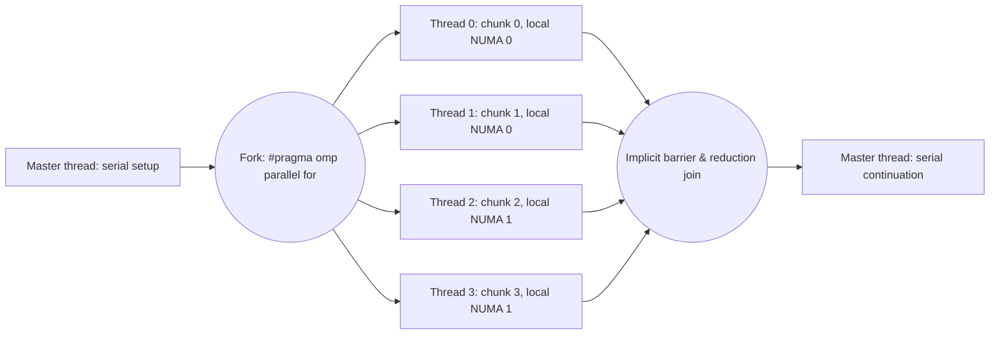

# 6.5 OpenMP, compilers and optimisation flags

| Field | Value |
|---|---|
| Level | Intermediate |
| Priority tier | 1 |
| Lab venue | Any machine with Python 3 and a C or Fortran compiler; `omp_compilers_lab.py` and the C and Fortran programs were compiled and run locally on Apple M3; multi-node Slurm scripts are **untested** here |
| Part | Part 6: HPC and Slurm |
| Status | Drafted |

## Why this matters for AI infrastructure

Every week on a shared cluster, users open tickets asking why their CPU preprocessing code is twenty times slower than expected, why a freshly compiled binary crashes with `Illegal instruction` on half the nodes, or why turning on `-O3` did not speed up a reduction loop. All three mysteries live inside the node-level compiler and threading layer. Whether a loop runs at full SIMD vector width, whether threads sit on the same NUMA socket that owns their memory pages, whether an optimization flag reorders floating-point addition, and whether an executable emits AVX-512 instructions on an AVX2 node govern every host-side workload on an AI cluster. The exact same mechanisms control PyTorch, NumPy, OpenBLAS, and MKL thread pools (`OMP_NUM_THREADS`), CPU tokenization pipelines, and custom C++ and CUDA extension builds. Learning how OpenMP, compiler toolchains, and optimization flags work gives you the diagnostic vision to resolve performance and build tickets in minutes.

## Prerequisites and outcomes

You need Chapters 6.3 and 6.4 and basic familiarity with C or Fortran syntax. After finishing this chapter, you will be able to accomplish the following goals.

- Parallelize loops with OpenMP and reason about fork-join teams, data-sharing clauses, and loop schedules.
- Control thread counts, NUMA first-touch page placement, and core binding with `OMP_*` environment variables and Slurm flags, preventing thread oversubscription in hybrid MPI+OpenMP and PyTorch jobs.
- Reproduce and fix OpenMP data races and false sharing, and explain why a racy binary can pass casual tests before failing under load.
- Choose compiler families (GNU, LLVM, Intel oneAPI, NVIDIA HPC SDK) and flags deliberately across optimization levels, target architectures, C and Fortran symbol linking, and floating-point reassociation.
- Explain the operational traps of commercial floating compiler licenses (FlexLM 15-minute seat leases, 50% server quorum, and MAC binding) and CUDA driver and toolkit installation from *Supercomputers for Linux SysAdmins* Chapter 21.

## 1. OpenMP in one page: the fork-join shared-memory model

OpenMP is a directive-based API for **shared-memory** thread parallelism in C, C++, and Fortran (*Parallel and High Performance Computing* Chapter 7 and `SCL` Chapter 21). An OpenMP program begins execution as a single **master thread**. When it reaches a `#pragma omp parallel` directive, or `!$omp parallel` in Fortran, the master thread **forks** a team of worker threads that share the process's virtual address space. It divides the loop or work block across the team and **joins** at an implicit barrier at the end of the region. Because OpenMP directives are written as compiler pragmas or special comments, the exact same source file compiles cleanly as a standard sequential program when the OpenMP flag is omitted.



```c
#pragma omp parallel for schedule(static)
for (long i = 0; i < n; i++) a[i] = b[i] + 3.0 * c[i];
```

You enable OpenMP at compile and link time with `-fopenmp` on GCC and Clang (linking `libgomp` or `libomp`), `-fiopenmp` on Intel oneAPI `icx` and `ifx` (or `-qopenmp` on classic `icc` and `ifort`), or `-mp` on NVIDIA HPC SDK (`nvc`, `nvc++`, and `nvfortran`).

### Key OpenMP clauses and runtime variables

| Clause or construct | Role in an OpenMP parallel region |
|---|---|
| `omp_get_num_threads()`, `omp_get_thread_num()` | Runtime functions returning the team size and the calling thread's ID from 0 to T - 1 |
| `shared`, `private`, `firstprivate`, `lastprivate` | **Data-sharing scope:** `shared` (one shared variable in memory), `private` (separate uninitialized local variable per thread), `firstprivate` (private copy initialized from the master's value), `lastprivate` (copies final iteration's value back out) |
| `reduction(op : var)` | Gives each thread a private partial accumulator initialized to the identity for `op` (`+`, `*`, `max`, `min`) and combines them safely at the join barrier |
| `schedule(static \| dynamic,chunk \| guided \| auto \| runtime)` | Controls how loop iterations map to threads: `static` divides into equal contiguous chunks up front; `dynamic,chunk` hands out chunks from a queue as threads finish; `guided` starts with large chunks and shrinks them; `runtime` reads `OMP_SCHEDULE` |
| `barrier`, `critical`, `atomic`, `nowait` | Synchronization controls: `atomic` updates a single scalar memory location with hardware atomic instructions; `critical` serializes an arbitrary code block under a lock; `nowait` removes the implicit barrier at the end of a construct |
| `task`, `taskwait`, `simd`, `target` | Dynamic task graphs (`task`), explicit SIMD vectorization hints (`#pragma omp simd`), and GPU offloading (`#pragma omp target teams distribute parallel for`) |

Operators and users tune OpenMP execution at job launch without recompiling using six standard environment variables:

| Environment variable | Operational purpose |
|---|---|
| `OMP_NUM_THREADS` | Sets the number of threads in the parallel team; defaults to all visible logical cores if unset |
| `OMP_PROC_BIND` | Controls thread pinning: `false`, `true`, `close` (pack threads onto adjacent cores), `spread` (spread threads across sockets and NUMA domains), or `master`/`primary` |
| `OMP_PLACES` | Defines the hardware places threads bind to: `threads`, `cores`, `sockets`, `numa_domains`, or an explicit core list |
| `OMP_SCHEDULE` | Sets the loop schedule when source code specifies `schedule(runtime)` |
| `OMP_DISPLAY_ENV` / `OMP_DISPLAY_AFFINITY` | Set to `verbose` or `true` to print the active OpenMP runtime configuration and exact per-thread CPU core bindings in job logs |
| `OMP_STACKSIZE` | Sets per-thread stack size (such as `64M`) when Fortran or C codes allocate large private arrays on the thread stack |

**Always set `OMP_NUM_THREADS`, `OMP_PROC_BIND`, and `OMP_PLACES` explicitly in every batch script so OpenMP never guesses thread counts from the whole node**.

> **In one minute:**
> - OpenMP forks a team of shared-memory threads at `#pragma omp parallel` and joins them at an implicit barrier; without `-fopenmp`, the compiler ignores the directives and builds a valid serial binary.
> - Use `reduction(op:var)` for parallel accumulations, `schedule(static)` for uniform loops, and `OMP_NUM_THREADS`, `OMP_PROC_BIND`, and `OMP_PLACES` to control placement at runtime.

## 2. A measured OpenMP scaling experiment (`omp_scaling.c`)

To see why adding threads helps compute-bound loops but hits a hard wall on memory-bound loops, look at `code/part06/omp_scaling.c`. It allocates three 50-million-element double-precision arrays (400 MB per array, 1.2 GB total). It initializes them in parallel for NUMA first-touch, runs an untimed warm-up pass, and times three kernels across 1 to 8 threads:

1. **STREAM-style memory triad (`a[i] = b[i] + 3.0 * c[i]`):** 2 double reads and 1 double write (24 bytes moved) for only 2 floating-point operations (0.083 FLOP/byte), making it completely memory-bandwidth bound.
2. **Compute-heavy transcendental loop (`a[i] = sin(b[i]) * cos(c[i])`):** heavy arithmetic per memory load.
3. **Parallel sum reduction (`s += a[i]` with `reduction(+ : s)`):** reads one array (8 bytes per add) and combines thread-private partial sums.

Compiled and executed locally with `clang -O2 -fopenmp code/part06/omp_scaling.c -o omp_scaling -lm` on an 8-core Apple M3, the program printed:

```text
threads  triad_ms  GB/s   sin_ms   sum_ms
      1      18.1   66.3     86.3     37.7  (checksum 4.498e+08)
      2      15.3   78.4     13.3     18.9
      4      14.2   84.4     11.3     12.9
      6      14.1   85.0      7.8      8.9
      8      14.1   85.4      7.3      9.4
```

Four lessons jump straight out of this table, verified in `triad_bandwidth_gbps()` in `code/part06/omp_compilers.py`:

- **Memory bandwidth saturates early:** A single thread already drives 66.3 GB/s (18.1 ms), and two threads reach 78.4 GB/s (15.3 ms). Beyond 4 threads (84.4 GB/s at 14.2 ms), adding more threads produces virtually zero gain, reaching 85.0 GB/s at 6 threads and 85.4 GB/s at 8 threads (14.1 ms). Once threads saturate the memory controllers, extra CPU cores simply wait in line for DRAM.
- **Compute-bound loops keep scaling:** The sine and cosine loop drops from 13.3 ms on 2 threads to 7.3 ms on 8 threads because each thread executes dozens of arithmetic instructions in registers per cache line fetched. Notice that the 1-thread 86.3 ms row was an outlier caused by the OS initially scheduling the single thread on a slower efficiency core before frequency ramp-up; a warm repeat measured 26 ms.
- **Warm-up passes are mandatory:** When `omp_scaling.c` was first run without the untimed warm-up pass, the 1-thread triad reported only 20 GB/s because Linux demand-paging page faults were charged to the first timed loop.

**When a multi-threaded CPU job stops speeding up after a few threads, check whether it has saturated socket memory bandwidth rather than blaming the thread scheduler**.

> **In one minute:**
> - On `omp_scaling.c` (50,000,000 doubles = 1.2 GB), the memory-bound triad saturates memory bandwidth by 2 to 4 threads (66.3 to 84.4 to 85.4 GB/s), whereas the compute-bound sine and cosine loop keeps scaling down to 7.3 ms.
> - Always include an untimed warm-up pass in benchmarks so initial page-table faults (20 GB/s artifact) do not distort the 1-thread baseline.

## 3. Affinity, NUMA first-touch page placement, and hybrid oversubscription

On a multi-socket server (Chapter 6.2), physical RAM is partitioned across **NUMA** (Non-Uniform Memory Access) domains (*Parallel and High Performance Computing* Chapter 14). A crucial Linux kernel rule surprises many engineers: **`malloc()` does not allocate physical RAM pages**. Instead, the kernel maps physical pages only when a memory address is **written to for the first time**, and it allocates each page on the **NUMA node of the CPU core that performs that first write**—a policy called **first touch**.

Consider what happens if a program allocates a 64 GB array in `main()` and initializes it to zero using a single serial loop on Thread 0 (running on Socket 0) before entering an OpenMP parallel compute loop across Socket 0 and Socket 1:

1. Because Thread 0 touched every page first, **all 64 GB of physical pages are allocated on Socket 0's memory controllers**.
2. When the 64 threads on Socket 1 run the parallel compute loop, every memory read they issue must cross the inter-socket UPI or Infinity Fabric bus to Socket 0, cutting memory bandwidth in half.

Fix NUMA placement and thread contention with three rules:

1. **Parallelize array initialization with the exact same `schedule(static)` as the compute loop** (as `omp_scaling.c` does on lines 13–14) so each pinned thread touches and faults in its own local NUMA pages.
2. **Pin threads with `OMP_PROC_BIND` and `OMP_PLACES`:** Set `OMP_PLACES=cores` to bind to physical cores rather than sibling hyperthreads. Pair it with either `OMP_PROC_BIND=close` to pack threads on one socket or `OMP_PROC_BIND=spread` to spread threads across sockets so they use all memory controllers during parallel first-touch.
3. **Prevent the 8x–64x hybrid oversubscription disaster:** Suppose a node has 64 physical cores and a user launches 8 MPI ranks or 8 PyTorch DDP processes, one per GPU. If `OMP_NUM_THREADS` is left unset, **each** of the 8 processes detects 64 cores and spawns 64 OpenMP threads. That creates $8 \times 64 = \mathbf{512\text{ threads}}$ fighting over 64 cores (`check_hybrid_oversubscription()` in `code/part06/omp_compilers.py`), causing a 5x to 50x slowdown from context-switching thrash. Under Slurm, always pair `--ntasks-per-node=8 --cpus-per-task=8 --cpu-bind=cores` with:
   ```bash
   export OMP_NUM_THREADS=$SLURM_CPUS_PER_TASK
   export MKL_NUM_THREADS=$SLURM_CPUS_PER_TASK
   export OPENBLAS_NUM_THREADS=$SLURM_CPUS_PER_TASK
   ```

**Initialize large arrays inside a parallel loop matching your compute schedule so Linux first-touch places pages on each thread's local NUMA node, and always cap `OMP_NUM_THREADS` in multi-process GPU jobs**.

> **In one minute:**
> - Linux **first-touch** allocates physical RAM pages on the NUMA node of the thread that first writes them; serial initialization puts an entire array on one socket.
> - Leaving `OMP_NUM_THREADS` unset in an 8-GPU job on a 64-core node spawns 512 threads (8.0x oversubscription); always set `OMP_NUM_THREADS=$SLURM_CPUS_PER_TASK`.

## 4. Bugs OpenMP makes easy: data races and false sharing (`omp_race.c`)

Shared memory makes sharing arrays effortless, but it also makes two bugs dangerously easy to write: **data races** and **false sharing**, both demonstrated in `code/part06/omp_race.c`.

### Data races and why "it passed my test" proves nothing

A **data race** occurs when two or more threads access the same memory location concurrently, at least one access is a write, and there is no synchronization ordering them. In `code/part06/omp_race.c`, 8 threads increment a shared counter 20,000,000 (20 million) times in three ways: an unsynchronized `racy++` loop, a `#pragma omp atomic` loop, and a `#pragma omp parallel for reduction(+ : reduced)` loop.

Running `./omp_race` twice at `-O0` produced:

```text
expected 20000000 | racy 6215980  | atomic 20000000 | reduction 20000000
expected 20000000 | racy 3487814  | atomic 20000000 | reduction 20000000
```

Between 70% and 80% of the increments vanished because multiple threads loaded the same stale value into registers before writing it back. Even more insidious: when the exact same program was compiled at `-O2`, it printed the **correct** answer 20,000,000 on two consecutive runs before printing 17,500,000 on the third run. A data race is timing-dependent, so passing a unit test on an unloaded laptop proves nothing. Always use **`reduction(+ : var)`** for accumulations, which is both fast and lock-free until the final join, rather than `#pragma omp atomic` or `critical` inside a tight inner loop. Test suspicious code with **ThreadSanitizer (`-fsanitize=thread`)**, Intel Inspector, or Valgrind Helgrind.

### False sharing across CPU cache lines

Suppose each thread updates its own independent element `packed[id] += 1.0` in a shared double array. There is **no data race** because every thread writes to a different array index. Yet on multi-core servers the loop can run ten times slower than expected because of **false sharing**. CPU caches do not track individual 8-byte double words; they coherence-lock entire **cache lines**—64 bytes (8 doubles) on most x86 and Arm servers, or 128 bytes (16 doubles) on Apple M-series, queried via `getconf LEVEL1_DCACHE_LINESIZE` or `sysctl hw.cachelinesize`. Because `packed[0]` through `packed[7]` sit inside the **same 64-byte cache line**, every write by Thread 0 invalidates the cache line for Threads 1 through 7, causing the cache line to bounce across cores over the coherency bus.

The fix is simple. Keep accumulation in a thread-local scalar variable or `reduction`, or pad per-thread array slots by the cache-line width (`padded[id * 16]` with `PAD = 16` doubles = 128 bytes in `omp_race.c`; note that on the Apple M3 `omp_race.c` measured ~0.09 s for both volatile loops, showing why you should always measure on your target server architecture).

**Eliminate data races and false sharing simultaneously by accumulating into thread-private scalar variables via `reduction(+ : var)` rather than writing to shared arrays on every loop iteration**.

> **In one minute:**
> - In `omp_race.c` (20,000,000 increments across 8 threads), an unsynchronized `racy++` lost 70–80% of updates at `-O0` (6,215,980 and 3,487,814) and intermittently passed at `-O2` before failing (17,500,000).
> - **False sharing** occurs when different threads write to adjacent array elements (`packed[id]`) that share the same 64-byte (x86/Arm) or 128-byte (Apple M-series) hardware cache line.

## 5. Compiler families, `gcc`/`gfortran`, FlexLM traps, and CUDA setup (`SCL` Chapter 21)

| Compiler family | C / C++ / Fortran binaries | OpenMP flag & runtime | Key strengths on HPC & AI clusters |
|---|---|---|---|
| **GNU (GCC)** | `gcc`, `g++`, `gfortran` (replaced legacy `g77`) | `-fopenmp` (`libgomp`) | Installed on every Linux distribution; baseline compatibility across all open-source stacks |
| **LLVM / Clang** | `clang`, `clang++`, `flang` | `-fopenmp` (`libomp`) | Fast compile times, clean diagnostics (`-Rpass=loop-vectorize`), foundation of vendor compilers |
| **Intel oneAPI** | `icx`, `icpx`, `ifx` (retired classic `icc`/`ifort`) | `-fiopenmp` (`-qopenmp`) | Deep integration with Intel MPI, MKL, Intel GDB, and VTune; high x86-64 performance |
| **NVIDIA HPC SDK** | `nvc`, `nvc++`, `nvfortran`, plus `nvcc` | `-mp` (and `-acc` for OpenACC) | Native CUDA, OpenACC, and OpenMP GPU offload; bundled with HPC-X MPI and cuBLAS/cuFFT |
| **AMD AOCC / ROCm** | `clang`, `flang`, `hipcc` | `-fopenmp` | Tuned for AMD EPYC (`znver*`) CPUs and Instinct MI-series GPUs |

In *Supercomputers for Linux SysAdmins* Chapter 21, Zhumatiy highlights four practical compilation, linking, licensing, and GPU driver lessons that every cluster administrator encounters.

### 1. `gcc` / `gfortran` compilation, C/Fortran underscore linking, and GNU linker order

When compiling a single source file (`gcc myprog.c`), GCC produces `a.out` unless you name the output with `-o myexe`. Multi-file projects compile each `.c` or `.f90` file into a `.o` object file first (`gcc -c *.c`) and then link them with libraries (`gcc -o myexe *.o -lm`, where `-lzzz` links `libzzz.so`, `-I` adds header search paths, and `-L` adds library search paths). Keep three cross-language and linker rules in mind:

- **C and Fortran symbol underscore mismatch (`-fleading-underscore`):** Because C and Fortran compilers historically decorate variable and function names differently in `.o` object files, linking C and Fortran object files together fails with unresolved symbols unless you align their naming conventions. You can compile C files with **`-fleading-underscore`** (or Fortran files with `-fno-underscoring`, or use `iso_c_binding` in modern Fortran; **untested** here).
- **Mixing C++ with C or Fortran:** Any C++ function called from C or Fortran must be declared `extern "C"` so the C++ compiler does not mangle its symbol name.
- **GNU single-pass linker argument order:** With GNU compilers, **the order of flags and file names on the command line changes linker behavior**. Putting `-lm` before `*.o` (`gcc -lm *.o -o myexe`) can fail with unresolved symbols because the linker scans left to right and discards unused library symbols before seeing the `.o` files that need them. Also note that enabling proprietary interprocedural optimization (**IPO**) on commercial compilers breaks object-file compatibility with GNU `.o` files.

### 2. Commercial compiler licensing and the 15-minute FlexLM lease trap

In 2025, both the **Intel oneAPI** and **NVIDIA HPC** compilers are free to use with optional paid support, whereas older commercial compilers (PGI, PathScale) and many commercial CAE and EDA tools use strict license managers (FlexLM). Zhumatiy warns of three licensing pitfalls, modeled in `flexlm_quorum_and_seat_availability()` in `code/part06/omp_compilers.py`:

1. **Single-user vs. fixed-node unlimited-user licenses:** A license for an unlimited number of users on a fixed login or build host is ideal for a cluster, and Intel's compiler can read a local license file directory directly without a license server daemon. A single-user license is useless on a shared machine.
2. **Floating concurrent-seat licenses and the 15-minute hold trap:** A floating license limiting simultaneous compilations (say, 3 concurrent users) sounds reasonable until you discover how simultaneity is metered. In the PathScale compiler implementation Zhumatiy encountered, **each compiler invocation leases a seat for that user for 15 minutes**. Whether that user runs the compiler once or 20 times inside those 15 minutes, the seat stays locked to them, blocking other users from compiling even after the first user's command finished in two seconds.
3. **50% HA quorum and MAC address binding:** When running a fault-tolerant license server triad across multiple machines, **at least 50% of the license servers must be online** (2 of 3) to maintain quorum. All licenses are bound to the license server's network card **MAC address** and sometimes hostname at activation time.

### 3. CUDA Toolkit installation (`libcuda` vs. `libcudart`) and hung-driver recovery

Chapter 21 also notes key sysadmin rules when installing the **CUDA SDK** (`nvcc` for `.cu` files) on cluster nodes:

- **Package repository vs. binary `.run` installer:** Always prefer installing CUDA via the distribution package manager (`yum install CUDA`, `zypper refresh && zypper install CUDA`, or `apt-get update && apt-get install CUDA` after adding the official NVIDIA repo, ensuring `gcc` is installed first). While the standalone `.run` binary installer works, it does not register packages in the OS package database, forcing manual reinstallation on every upgrade. Expose `/usr/local/CUDA-VERSION/bin` in `PATH` and `/usr/local/CUDA-VERSION/lib64` in `LD_LIBRARY_PATH` via an Environment Module (Chapter 6.6).
- **`libcuda.so` vs. `libcudart.so`:** The two core libraries are **`libcuda`** (shipped with the host NVIDIA GPU driver, enabling low-level GPU enumeration, memory read/write, and kernel launch) and **`libcudart`** (shipped with the CUDA Toolkit SDK, providing high-level CUDA runtime API calls alongside cuBLAS, cuFFT, cuRAND, and cuSPARSE).
- **Managing modes with `nvidia-smi` (`nvitop` / `nvtop`) and recovering a hung driver:** Use `nvidia-smi` to enable **ECC** (slightly slower memory access, much higher reliability), enable **Persistence Mode** (so the driver stays resident in memory instead of adding a 1 to 2 second load delay on the first CUDA call of every job), set **Compute Mode**, and check for **Xid** faults, ECC errors, and overheating. If an old `nvidia` kernel module refuses to unload during a driver upgrade, temporarily blacklist the module, reboot, install the new driver, and remove it from the blacklist. If the driver hangs on an idle node, you can reinitialize it from the CLI (**untested** here):
  ```bash
  # (untested here)
  rmmod nvidia; modprobe nvidia; deviceQuery   # or run nvidia-smi instead of deviceQuery
  ```

**Keep `-l` library flags after `.o` files on GNU link lines, use `-fleading-underscore` or `iso_c_binding` when linking C and Fortran, and expose each compiler and CUDA toolkit version through environment modules**.

> **In one minute:**
> - On GNU compilers (`gcc` and `gfortran`), put `-l` libraries after `.o` files, use `-fleading-underscore` or `-fno-underscoring` when linking C and Fortran, and use `extern "C"` for C++.
> - Floating compiler licenses (FlexLM) can lock a seat for 15 minutes per call, require at least 50% server quorum in HA setups, and bind to the license server's NIC MAC address.
> - `libcuda` comes with the host GPU driver while `libcudart` comes with the CUDA Toolkit (`/usr/local/CUDA-VERSION/lib64`); enable persistence mode via `nvidia-smi`.

## 6. Optimization levels, `-march=native` hazards, and `-ffast-math` (`flags_kernel.c`)

### Optimization levels (`-O0` through `-Ofast`) and target architecture flags

In GCC and Clang—and similarly in Intel and NVIDIA compilers, which support `-On` from 0 to 3 (or up to 6 in legacy GCC notes), with `-O2` as the default and `-O3` common for production HPC—each `-On` level enables a bundle of optimization passes:

| Flag | What the compiler does | When to use or avoid |
|---|---|---|
| `-O0` | Disables optimization; variables stay in stack slots matching source lines | Use with `-g` for interactive `gdb`, TotalView, or DDT debugging |
| `-O2` | Standard safe optimization: inlining, dead-code elimination, instruction scheduling, basic vectorization | Safe default for system tools and general applications |
| `-O3` | Aggressive loop optimizations: loop unrolling, loop interchange, wider SIMD vectorization | Standard starting point for compute-bound HPC kernels; combine with `-g -fno-omit-frame-pointer` for profiling |
| `-Ofast` / `-ffast-math` | `-O3` plus **relaxing IEEE 754 floating-point rules** (allows algebraic reassociation, assumes no NaN or Inf, ignores signed zero, enables flush-to-zero denormals) | Unlocks 4x to 8x SIMD reduction speedups, **but breaks IEEE 754 bit-reproducibility and `isnan()` checks** |
| `-march=native` / `-mcpu=native` (or `-ftune`/`-farch`) | Generates instructions for **every CPU feature present on the build machine** (instead of generic baseline x86 that would run on a Pentium-I without AVX) | **Fast on homogeneous nodes; crashes with `SIGILL` (`Illegal instruction`) if compiled on an AVX-512 login node and run on an AVX2 compute node** |

To prevent `Illegal instruction` crashes on heterogeneous clusters, compile for the **lowest common microarchitecture level** across your partitions (such as `-march=x86-64-v3` for AVX2 and FMA, or `-march=znver3`), use libraries (MKL, OpenBLAS) that dispatch SIMD kernels dynamically at runtime, or maintain per-architecture module trees via Spack and EasyBuild in Chapter 6.6.

### The floating-point reduction experiment (`flags_kernel.c`)

Why does compiling a dot product or sum reduction with `-O3` often give zero speedup over `-O2`, whereas adding `-ffast-math` suddenly makes it six times faster? The program `code/part06/flags_kernel.c` computes a 20-million-element float dot product (`dot += x[i] * y[i]`) repeated 20 times, making each pass depend on the previous pass via `y[rep] = dot * 1e-12f` so the compiler cannot delete the outer loop as dead code.

Compiled and run on the Apple M3 across seven flag combinations and compared against the exact FP64 double-precision reference sum 2446257.2, `flags_kernel.c` produced:

```text
-O0                                dot=2293365.000000  2.02 GFLOP/s
-O1                                dot=2293365.000000  2.01 GFLOP/s
-O2                                dot=2293365.000000  2.69 GFLOP/s
-O3                                dot=2293365.000000  2.71 GFLOP/s
-O3 -mcpu=native                   dot=2293365.000000  2.68 GFLOP/s
-O3 -ffast-math                    dot=2445485.500000  16.05 GFLOP/s
-O3 -ffast-math -mcpu=native       dot=2445485.500000  16.29 GFLOP/s
```

Look closely at both the speed (2.71 vs 16.29 GFLOP/s) and the numerical sum (2293365.0 vs 2445485.5, checked in `fp_relative_error_pct()` in `code/part06/omp_compilers.py`):

1. **Why strict `-O3` stayed slow (2.71 GFLOP/s):** Under strict IEEE 754 rules, floating-point addition is not associative, so the compiler is **forbidden from changing the left-to-right addition order**. Even though `clang -O3 -Rpass=loop-vectorize` reported `"vectorized loop (vectorization width: 4, interleaved count: 4)"` for both builds, in the strict `-O3` build only the loads and multiplications `x[i] * y[i]` were vectorized. The additions remained a serial, latency-bound dependency chain waiting on the single `dot` register every cycle.
2. **Why `-ffast-math` jumped 6x (16.29 GFLOP/s):** `-ffast-math` (specifically `-fassociative-math`) allows the compiler to split `dot` into multiple independent SIMD vector accumulators that add in parallel every cycle and sum together once at the end of the loop.
3. **Why the `-ffast-math` answer (2445485.5, 0.03% error) was actually more accurate than strict `-O3` (2293365.0, 6.25% error):** Adding 20 million tiny float32 numbers sequentially into a single growing running total loses low-order mantissa bits (swamping). Accumulating into multiple smaller partial sums under `-ffast-math` preserves precision much closer to the FP64 reference (2446257.2). However, `-ffast-math` disables NaN and Inf guarantees and makes results vary with SIMD width. In ML and scientific builds, validate tolerances carefully and prefer explicit pairwise or tree reductions or FP64 accumulators when strict reproducibility is required.

Inspect compiler vectorization decisions directly before guessing:

```bash
gcc   -O3 -fopt-info-vec-optimized -fopt-info-vec-missed file.c
clang -O3 -Rpass=loop-vectorize -Rpass-missed=loop-vectorize file.c
```

**Use `-O3 -g -fno-omit-frame-pointer` with a fleet-safe `-march` target for production builds, and check `-fopt-info-vec-missed` or `-Rpass=loop-vectorize` whenever a hot loop fails to reach expected SIMD throughput**.

> **In one minute:**
> - Strict `-O3` cannot parallelize a floating-point reduction (`dot += x[i]*y[i]`, 2.71 GFLOP/s) because IEEE 754 forbids reordering additions; `-ffast-math` permits SIMD partial-sum reassociation (16.29 GFLOP/s, 6x faster) and reduced swamping error from 6.25% to 0.03%, at the cost of strict IEEE reproducibility and NaN safety.
> - Compiling with `-march=native` on a newer login node causes `Illegal instruction` crashes on older compute nodes.

## 7. Lab: run the OpenMP and compiler flag benchmarks

First, run the self-checking Python lab (`code/part06/omp_compilers_lab.py`) locally. It verifies the STREAM triad memory bandwidth calculation, the hybrid MPI+OpenMP core oversubscription detector, the strict versus `-ffast-math` relative error model, and the `SCL` Chapter 21 FlexLM 50% quorum and 15-minute seat lease model:

```bash
python3 code/part06/omp_compilers_lab.py
```

Next, compile and run the three C benchmarks (`omp_scaling.c`, `omp_race.c`, and `flags_kernel.c`):

```bash
clang -O2 -fopenmp code/part06/omp_scaling.c -o /tmp/omp_scaling -lm && /tmp/omp_scaling
clang -O0 -fopenmp code/part06/omp_race.c -o /tmp/omp_race && /tmp/omp_race
clang -O3 code/part06/flags_kernel.c -o /tmp/flags_strict && /tmp/flags_strict
clang -O3 -ffast-math code/part06/flags_kernel.c -o /tmp/flags_fast && /tmp/flags_fast
```

## 8. Interview angles

- Why did adding `-O3` not speed up a float dot-product reduction loop (2.71 GFLOP/s), whereas `-O3 -ffast-math` sped it up 6x (16.29 GFLOP/s) and changed the sum from 2293365.0 to 2445485.5?
- Explain the Linux NUMA **first-touch** policy. If a multi-threaded OpenMP job on a dual-socket server initializes its arrays serially in `main()`, what happens to memory bandwidth during the parallel loop?
- A user launches 8 PyTorch DDP processes (or 8 MPI ranks) on a 64-core GPU node without setting `OMP_NUM_THREADS`. How many threads are spawned, and how do you fix it in Slurm?
- What is the difference between a **data race** and **false sharing**, and why can a data race pass `-O2` tests twice and fail on the third run?
- What are the three operational traps of floating compiler licenses (FlexLM) described in *Supercomputers for Linux SysAdmins* Chapter 21, and how do you link C and Fortran `.o` files together?

## Exercises

1. **STREAM Triad Memory Bandwidth Saturation:** Using `triad_bandwidth_gbps(50_000_000, 8, elapsed_ms)` in `code/part06/omp_compilers.py`, compute the achieved memory bandwidth in GB/s at 18.1 ms (1 thread: 66.3 GB/s) and 14.1 ms (8 threads: 85.1 GB/s). Explain why the triad curve flattens above 2 to 4 threads while `sin * cos` keeps scaling, and explain why omitting the untimed warm-up pass falsely reported 20 GB/s.
2. **NUMA First-Touch and Hybrid MPI + OpenMP Oversubscription:** Explain why initializing a shared array in a serial loop on Thread 0 causes cross-socket UPI or Infinity Fabric bottlenecks on a dual-socket server and how parallel initialization with `schedule(static)` fixes it. Then use `check_hybrid_oversubscription(8, 64, 64)` to show why an 8-GPU node with 64 cores suffers 8.0x thread oversubscription (512 threads) when `OMP_NUM_THREADS` is unset.
3. **Data Races vs. False Sharing:** Trace why the unsynchronized `racy++` loop in `omp_race.c` lost 70–80% of its 20,000,000 increments at `-O0` (6215980 and 3487814) yet passed twice at `-O2` before failing (17,500,000). Compare `#pragma omp atomic` with `reduction(+ : reduced)`, and explain how false sharing occurs across 64-byte (x86/Arm) or 128-byte (Apple M-series) cache lines.
4. **Strict IEEE 754 `-O3` vs. `-ffast-math` Vector Reductions:** Using `fp_relative_error_pct()` in `code/part06/omp_compilers.py`, compare the strict `-O3` dot product (2293365.0, 2.71 GFLOP/s, 6.25% error vs FP64 2446257.2) with `-O3 -ffast-math` (2445485.5, 16.29 GFLOP/s, 0.03% error). Explain why Clang reported `"vectorized loop"` for both builds even though only `-ffast-math` broke the serial addition dependency chain, and why `y[rep] = dot * 1e-12f` was needed to prevent dead-loop hoisting.
5. **Cross-Language C/Fortran/C++ Linking and `-march=native` Fleet Portability:** Explain why `gcc -lm *.o` can fail whereas `gcc *.o -lm` succeeds on the GNU single-pass linker. Explain how `-fleading-underscore` (or `-fno-underscoring` and `iso_c_binding`) and `extern "C"` resolve C, Fortran, and C++ symbol mismatches, and how to prevent `Illegal instruction` crashes when login and compute nodes have different CPU generations.
6. **Commercial Compiler Licensing (FlexLM) and CUDA Driver/Toolkit Operations:** Using `flexlm_quorum_and_seat_availability()` in `code/part06/omp_compilers.py`, explain the 15-minute floating seat lease hold, the 50% server quorum rule for 3-server license triads, and MAC address binding. Distinguish `libcuda` from `libcudart`, compare package-manager vs `.run` CUDA installations, and write the command sequence to reinitialize a hung `nvidia` kernel module (`rmmod nvidia; modprobe nvidia; deviceQuery`).

## Checkpoint questions (20)

<details>
<summary>1. How does OpenMP's fork-join execution model work, and what happens when you compile an OpenMP program without `-fopenmp`?</summary>

An OpenMP program starts as a single **master thread**. When it enters a `#pragma omp parallel` (or `!$omp parallel`) region, it **forks** a team of threads sharing the process address space, divides work across the team, and **joins** at an implicit barrier at the end of the region. Because OpenMP directives are C/C++ pragmas or Fortran comments, compiling without `-fopenmp` causes the compiler to ignore the directives and produce a valid single-threaded sequential program.
</details>

<details>
<summary>2. Define the OpenMP data-sharing clauses `shared`, `private`, `firstprivate`, `lastprivate`, and `reduction(op : var)`.</summary>

- **`shared`:** All threads access the same single variable in shared memory.
- **`private`:** Each thread gets its own uninitialized local variable for the region.
- **`firstprivate`:** Each thread gets a private copy initialized to the master variable's value upon entering the region.
- **`lastprivate`:** Copies the private value from the thread that executes the sequentially last loop iteration back to the outer variable at exit.
- **`reduction(op : var)`:** Gives each thread a private partial accumulator initialized to the identity of `op` (0 for `+`, 1 for `*`) and safely combines all partial results into `var` at the end of the region.
</details>

<details>
<summary>3. Compare OpenMP loop schedules `static`, `dynamic,chunk`, `guided`, and `runtime`.</summary>

- **`static`:** Divides loop iterations into equal contiguous chunks assigned to threads before the loop starts; lowest scheduling overhead and preserves NUMA first-touch locality across loops.
- **`dynamic,chunk`:** Threads pull chunks of size `chunk` from a shared work queue as they finish; balances irregular per-iteration work at the cost of higher atomic queue overhead and lost cache and NUMA locality.
- **`guided`:** Like `dynamic`, but starts with large chunks and shrinks chunk size exponentially down to a minimum as remaining iterations decrease.
- **`runtime`:** Defers schedule selection to the **`OMP_SCHEDULE`** environment variable at job launch.
</details>

<details>
<summary>4. What do `OMP_NUM_THREADS`, `OMP_PROC_BIND`, `OMP_PLACES`, and `OMP_DISPLAY_ENV=verbose` control?</summary>

- **`OMP_NUM_THREADS`:** Sets the number of threads in an OpenMP parallel team.
- **`OMP_PROC_BIND`:** Pins threads to hardware places (`close` packs threads onto nearby cores on the same socket; `spread` distributes threads evenly across sockets and NUMA domains).
- **`OMP_PLACES`:** Defines the hardware units for binding (`cores`, `threads`, `sockets`, `numa_domains`).
- **`OMP_DISPLAY_ENV=verbose` and `OMP_DISPLAY_AFFINITY=true`:** Print the effective OpenMP runtime settings and per-thread core affinity masks at program startup.
</details>

<details>
<summary>5. In `omp_scaling.c` (50,000,000 doubles), why did the STREAM triad stop scaling above 2 to 4 threads (~85 GB/s) while the `sin * cos` loop scaled all the way to 8 threads?</summary>

The STREAM triad (`a[i] = b[i] + 3.0 * c[i]`) moves 24 bytes of memory (2 reads + 1 write) for only 2 FLOPs (0.083 FLOP/byte), so 2 to 4 threads completely saturate the chip's memory-controller bandwidth (~85 GB/s). Once memory bandwidth is full, extra threads just stall waiting on DRAM. The `sin * cos` loop performs heavy register arithmetic per memory access, so it is compute-bound and scales with additional cores.
</details>

<details>
<summary>6. Why did the first run of `omp_scaling.c` without an untimed warm-up pass report only 20 GB/s on 1 thread instead of 66.3 GB/s?</summary>

In C on Linux and macOS, `malloc()` only reserves virtual address ranges; physical RAM pages are mapped via page faults on the first write. Without an untimed warm-up pass, the first timed 1-thread loop paid the kernel page-fault and CPU frequency ramp-up overhead, artificially inflating elapsed time and under-reporting memory bandwidth (20 GB/s instead of 66.3 GB/s).
</details>

<details>
<summary>7. Explain the Linux NUMA **first-touch** policy and how serial initialization in `main()` hurts multi-socket OpenMP performance.</summary>

Linux allocates a physical memory page on the **NUMA node of the CPU core that first writes to that page** (**first touch**). If Thread 0 on Socket 0 initializes an entire array in a serial loop before the parallel region, 100% of the array's physical pages land on Socket 0's RAM. When threads on Socket 1 access their half of the array during the parallel loop, every access traverses the slow inter-socket bus. Fix this by initializing the array inside a `#pragma omp parallel for schedule(static)` loop matching the compute loop's schedule and thread bindings.
</details>

<details>
<summary>8. How does thread oversubscription happen in a hybrid MPI + OpenMP (or multi-GPU PyTorch) job on Slurm, and how do you prevent it?</summary>

If you launch 8 MPI ranks (or 8 PyTorch DDP processes, 1 per GPU) on a 64-core node without setting `OMP_NUM_THREADS`, each of the 8 processes defaults to spawning 64 OpenMP or BLAS threads. That creates $8 \times 64 = \mathbf{512\text{ threads}}$ competing for 64 cores (8x oversubscription) and severe context-switch thrashing. Prevent it by requesting `--ntasks-per-node=8 --cpus-per-task=8 --cpu-bind=cores` and exporting `OMP_NUM_THREADS=$SLURM_CPUS_PER_TASK` (plus `MKL_NUM_THREADS` and `OPENBLAS_NUM_THREADS`).
</details>

<details>
<summary>9. In `omp_race.c`, why did the unsynchronized `racy++` counter lose 70–80% of its updates at `-O0` yet pass two out of three runs at `-O2`?</summary>

`racy++` is a classic **read-modify-write data race**: multiple threads load the same old counter value into registers, add 1, and overwrite each other's stores. Because race windows depend on exact instruction timing, compiler optimization level (`-O2` vs `-O0`), and OS thread scheduling, a racy binary can intermittently produce the right answer in testing and silently corrupt data in production. Use `reduction(+ : var)` (fast) or `#pragma omp atomic` (serialized) and verify with `-fsanitize=thread`.
</details>

<details>
<summary>10. What is **false sharing**, what cache-line sizes exist on x86/Arm vs. Apple M-series CPUs, and how do you fix it?</summary>

**False sharing** occurs when multiple threads write to different variables or array elements (such as `packed[id]`) that reside inside the **same hardware cache line**—64 bytes (8 doubles) on most x86 and Arm servers, or 128 bytes (16 doubles) on Apple M-series, checked via `getconf LEVEL1_DCACHE_LINESIZE` or `sysctl hw.cachelinesize`. Every write invalidates the entire cache line for all other cores, causing cache-line ping-pong. Fix it by accumulating into a private local scalar variable or `reduction` and writing to shared memory only once, or by padding per-thread structs and arrays to the cache-line boundary (`PAD = 16` doubles).
</details>

<details>
<summary>11. Why does argument order matter when linking libraries with `gcc` (`gcc *.o -lm` vs. `gcc -lm *.o`), and how do you link C, Fortran, and C++ object files together (`SCL` Chapter 21)?</summary>

- **GNU linker order:** The GNU linker processes files from left to right in a single pass, resolving only symbols that are currently unresolved. Putting `-lm` before `*.o` causes the linker to skip `libm` before it sees the `.o` files that call `sin()` or `sqrt()`. Always put `-lzzz` flags after the `.o` files.
- **C and Fortran linking:** Fortran compilers add leading or trailing underscores to symbol names in `.o` files; align C and Fortran symbols with **`-fleading-underscore`** on C or **`-fno-underscoring`** on Fortran (or Fortran's `iso_c_binding`), and wrap C++ functions called from C or Fortran in **`extern "C"`**.
</details>

<details>
<summary>12. What are the three operational pitfalls of commercial floating compiler/software licenses (FlexLM) described in `SCL` Chapter 21?</summary>

1. **The 15-minute seat lease hold:** On concurrent-use floating licenses (such as the PathScale compiler example with 3 seats), a single compiler invocation leases the license seat to that user for **15 minutes**, blocking other users from compiling even if the command finished in 1 second.
2. **The 50% HA quorum rule:** Redundant multi-server license clusters require **at least 50% of the license servers to be running** (2 of 3) to serve licenses.
3. **MAC address binding:** Licenses are locked to the license server's NIC **MAC address** (and sometimes hostname), so replacing hardware or migrating a license VM without preserving the MAC breaks all builds.
</details>

<details>
<summary>13. What is the difference between `libcuda.so` and `libcudart.so`, why should you prefer package-manager CUDA installs over the `.run` binary installer, and how do you reset a hung `nvidia` kernel module (`SCL` Chapter 21)?</summary>

- **`libcuda` vs. `libcudart`:** `libcuda` is the low-level driver library (GPU enumeration, memory R/W, performance counters) shipped with the host NVIDIA driver; `libcudart` is the high-level CUDA Runtime API library shipped in the CUDA Toolkit SDK (`/usr/local/CUDA-VERSION/lib64`).
- **Package manager vs. `.run` installer:** Installing via `yum`, `zypper`, or `apt-get` registers CUDA in the OS package manager for clean upgrades, whereas the standalone `.run` binary installer does not register with the system and must be reinstalled manually on upgrades.
- **Resetting a hung driver:** On an idle node, run `rmmod nvidia; modprobe nvidia; deviceQuery` (or `nvidia-smi`). If an old driver refuses to unload during an upgrade, blacklist the module, reboot, install the new driver, and remove the blacklist entry.
</details>

<details>
<summary>14. What does `nvidia-smi` persistence mode do, and why does disabling it hurt short batch jobs (`SCL` Chapter 21)?</summary>

When **persistence mode** is enabled via `nvidia-smi` (or `nvidia-persistenced`), the NVIDIA kernel driver keeps GPU state initialized in memory between jobs. If persistence mode is disabled, the driver unloads GPU state whenever no process holds the device open, adding a **1 to 2 second driver initialization delay** on the first CUDA call of every program launch.
</details>

<details>
<summary>15. Why did `flags_kernel.c` run at 2.71 GFLOP/s under `-O3` (`dot = 2293365.0`) and jump to 16.29 GFLOP/s (6x faster, `dot = 2445485.5`) when `-ffast-math` was added?</summary>

Under strict IEEE 754 rules (`-O3` without `-ffast-math`), floating-point addition is not associative, so the compiler must accumulate `dot += x[i] * y[i]` in strict sequential source order. Even though the compiler vectorized the `x[i] * y[i]` loads and multiplies, the additions formed a single-register serial dependency chain bound by FP add latency (2.71 GFLOP/s). Adding **`-ffast-math`** (`-fassociative-math`) allowed the compiler to accumulate into multiple independent SIMD vector lanes in parallel (16.29 GFLOP/s) and sum them at the end.
</details>

<details>
<summary>16. Why was the `-ffast-math` sum (2445485.5, 0.03% error) in `flags_kernel.c` actually closer to the FP64 reference (2446257.2) than the strict `-O3` sum (2293365.0, 6.25% error), and what is the risk of `-ffast-math`?</summary>

In strict sequential FP32 addition, adding 20 million small numbers (~0.1) one by one into a growing running total (> 2,000,000) causes severe **floating-point swamping**, where low-order mantissa bits of the small addend are shifted off and lost. Splitting the sum into multiple smaller SIMD partial accumulators under `-ffast-math` adds numbers of closer magnitude and preserves accuracy (0.03% error). However, `-ffast-math` assumes no NaN or Inf values exist (breaking `isnan()` checks), flushes denormals to zero, and makes results change across different SIMD widths and thread counts.
</details>

<details>
<summary>17. Why did the first version of `flags_kernel.c` falsely report a 20x speedup at `-O3`, and what is the lesson for writing micro-benchmarks?</summary>

In the first version of `flags_kernel.c`, the outer 20-repetition loop recomputed the exact same `dot` value 20 times without modifying `x` or `y`. At `-O3`, the compiler proved that the 20 repetitions were loop-invariant and **hoisted and executed the inner loop only once**, inflating apparent GFLOP/s by 20x. Adding `y[rep] = dot * 1e-12f;` created a data dependency between repetitions. **Always make benchmark loops depend on prior iterations and consume the final output.**
</details>

<details>
<summary>18. Which GCC and Clang flags print loop vectorization reports, and what four code patterns commonly block SIMD vectorization?</summary>

- **GCC:** `gcc -O3 -fopt-info-vec-optimized -fopt-info-vec-missed file.c`
- **Clang:** `clang -O3 -Rpass=loop-vectorize -Rpass-missed=loop-vectorize -Rpass-analysis=loop-vectorize file.c`
- **Four common vectorization blockers:** (1) pointer aliasing (fix with `restrict` or `__restrict__` when pointers do not overlap), (2) loop-carried data dependencies across iterations, (3) strict IEEE 754 floating-point reductions without `-fassociative-math` or `#pragma omp simd reduction`, and (4) non-inlined function calls or complex branching inside the loop body.
</details>

<details>
<summary>19. Why does a binary compiled with `-march=native` crash with `Illegal instruction` (`SIGILL`) on some cluster nodes, and how do you build portable binaries for a heterogeneous cluster?</summary>

`-march=native` instructs the compiler to emit instructions for every ISA extension present on the **build host**, such as AVX-512 on a newer login node. If the binary is scheduled onto an older compute node that only supports AVX2, the CPU traps on the first AVX-512 opcode with `SIGILL` (`Illegal instruction`).
**Three solutions:** (1) compile for the lowest common microarchitecture across the fleet (`-march=x86-64-v3`), (2) use multi-versioned runtime dispatch (`target_clones` or MKL and OpenBLAS), or (3) build per-architecture module trees via Spack and EasyBuild (Chapter 6.6).
</details>

<details>
<summary>20. Why must you avoid mixing `libgomp` (GCC OpenMP) and `libomp` (LLVM/Intel OpenMP) in the same process, and why must Fortran `.mod` files match the exact compiler version?</summary>

- **Mixed OpenMP runtimes:** If a main binary links GCC's `libgomp` while a dynamically loaded shared library links LLVM or Intel's `libomp`, both runtimes independently spawn their own thread pools on the same cores, causing severe thread oversubscription, conflicting CPU affinity pins, and deadlocks.
- **Fortran `.mod` files:** Fortran `.mod` module header files are compiler-proprietary precompiled symbol tables whose binary format changes across compiler vendors (`gfortran` vs `ifx` vs `nvfortran`) and even across major versions of the same compiler.
</details>

## Sources and review notes

- **Sources read in full:**
  - `supercomputers-for-linux-sysadmins-managing-modern-hpc-clusters-and-supercomputers-from-software-to-hardware` — Sergey Zhumatiy, *Supercomputers for Linux SysAdmins*, Apress 2025, **Chapter 21: Compilers and Environments, for Parallel Technologies**. Covered topics include `gcc`, `g++`, and `gfortran` (replacing legacy `g77`), compiling and linking (`-c`, `-o`, `-l`, `-I`, `-L`, `-On` 0..6, `-ftune`/`-farch`, `-fleading-underscore` for C and Fortran symbol linking, `extern "C"` for C++, and GNU single-pass linker argument order). We also cover Intel oneAPI and NVIDIA HPC compilers (IPO object-file incompatibility), commercial compiler licensing models and FlexLM traps (15-minute seat lease hold in PathScale, 50% quorum rule for redundant license servers, local Intel license file mode, and NIC MAC address binding), and CUDA SDK installation (`yum`/`zypper`/`apt-get` vs `.run` binary installer, `/usr/local/CUDA-VERSION/{bin,lib64}`, `libcuda` vs `libcudart`, `nvidia-smi` ECC/persistence/compute modes, `nvitop`/`nvtop`, module blacklisting for driver upgrades, and `rmmod nvidia; modprobe nvidia; deviceQuery` driver recovery).
  - `parallel-and-high-performance-computing` — Robert Robey & Yuliana Zamora, *Parallel and High Performance Computing*, **Chapter 6: Vectorization: FLOPs for free**, **Chapter 7: OpenMP that performs**, **Chapter 11: Directive-based GPU programming**, and **Chapter 14: Affinity: Truce with the kernel**.
- **Run here:** `python3 code/part06/omp_compilers.py` and `python3 code/part06/omp_compilers_lab.py` (3 passed, 0 failed), plus local compilation and execution of `code/part06/omp_scaling.c`, `code/part06/omp_race.c`, `code/part06/flags_kernel.c`, and the `gfortran` harmonic-sum reduction (`harmonic(1e6) = 14.392726722865611` using `clang` 23.1.4 and `gfortran` 16.2.0 on an 8-core Apple M3).
- **Explicitly labelled inferences:** The `triad_bandwidth_gbps`, `fp_relative_error_pct`, `check_hybrid_oversubscription`, and `flexlm_quorum_and_seat_availability` functions in `code/part06/omp_compilers.py` are deterministic models built on the measured C benchmarks and `SCL` Chapter 21.
- **Not verified on live hardware:** Multi-socket Linux `numactl` first-touch comparisons, Slurm hybrid job scripts, `-march=native` `SIGILL` crashes across heterogeneous x86 nodes, FlexLM license server triads, and `rmmod nvidia; modprobe nvidia; deviceQuery` are marked (`untested here`).
