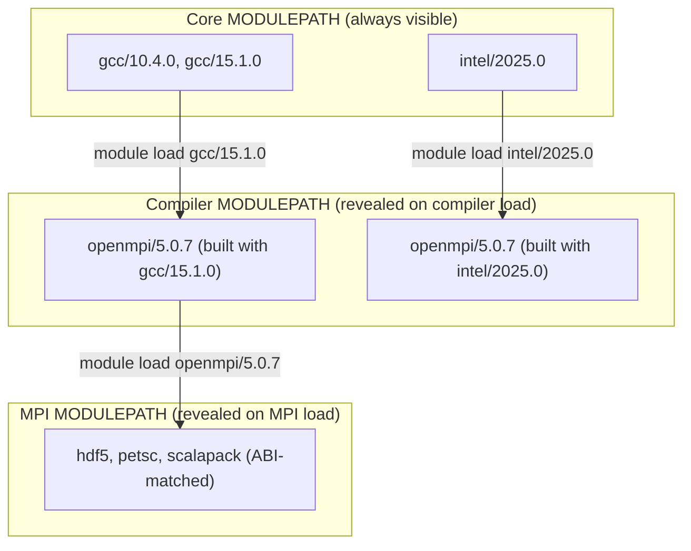

# 6.6 Environment modules, Spack and EasyBuild

| Field | Value |
|---|---|
| Level | Intermediate |
| Priority tier | 1 |
| Lab venue | Any machine with Python 3; `modules_spack_lab.py` runs 3 checks locally and cluster Lmod, Spack, and EasyBuild builds are **untested** here |
| Part | Part 6: HPC and Slurm |
| Status | Drafted |

## Why this matters for AI infrastructure

Picture a shared GPU cluster that serves fifty researchers. Group A needs GCC 10.4, Open MPI 4.1, and CUDA 11.8 for a legacy molecular dynamics code. Group B needs GCC 15.1, Open MPI 5.0.7, and CUDA 12.6 to compile custom FlashAttention kernels for a foundation model.

Suppose you install one global version into `/usr/bin` and `/usr/lib64`. Then half your users cannot work. Now suppose you tell everyone to edit their own `~/.bashrc` and install compilers into their home directories. Users will end up mixing a GCC 15 binary with a GCC 10 standard C++ library, or with an incompatible MPI runtime. Your ticket queue then fills with segmentation faults.

HPC centers solved this decades ago with Environment Modules, which uses Tcl modules and Lua-based Lmod, backed by automated source build frameworks, Spack and EasyBuild. On modern AI clusters these tools work alongside OCI containers, through Enroot and Pyxis, and Python managers such as uv and conda. Together they keep compilers, MPI, CUDA, NCCL, and PyTorch aligned across every login and compute node.

## Prerequisites and outcomes

This chapter builds on Chapters 6.2 through 6.5 and on Part 1, which cover Linux shells, environment variables, and shared libraries. After you finish, you will be able to do the following.

- Explain how `PATH`, `LD_LIBRARY_PATH`, `RPATH`, `RUNPATH`, `/etc/ld.so.conf` and `ldconfig`, `CPATH`, and `MODULEPATH` decide which executables and shared libraries run.
- Use and write Tcl Environment Modules and Lua Lmod modulefiles. That covers the Table 21-1 commands, the `stderr` versus `stdout` rule, `module spider`, inactive modules, and numeric versus string version sorting, drawn from *Supercomputers for Linux SysAdmins* Chapter 21.
- Build and manage HPC software stacks with EasyBuild and Spack. You will work with specs, concretization hashes, `spack.yaml` and `spack.lock` environments, externals, binary buildcaches, and `spack module lmod refresh`.
- Lay out a shared, architecture-aware software tree, `/opt/apps/<arch>`, exported read-only across nodes. You will trace the 11-step minicluster setup and the disk-cloning rules from Chapter 24, and choose when to use modules, Spack, EasyBuild, uv or conda, or containers.

## 1. The problem: how Linux finds binaries and shared libraries

When you type `mpirun` or `python3` on a login node, the shell searches the colon-separated directories in `PATH` from left to right. It runs the first match it finds. Once that ELF binary starts, the Linux dynamic linker, `ld-linux-x86-64.so.2`, has to find every shared library the binary needs. Those include `libmpi.so`, `libcudart.so`, and `libstdc++.so`, which are listed in the binary's dynamic section.

The loader searches five locations, in a strict order:

1. `DT_RPATH` embedded in the binary at link time, unless `DT_RUNPATH` is also present.
2. Directories listed in the `LD_LIBRARY_PATH` environment variable, searched left to right.
3. `DT_RUNPATH` embedded in the binary at link time, set with `-Wl,-rpath,/opt/...`.
4. `/etc/ld.so.cache`, the binary cache that `ldconfig` builds from `/etc/ld.so.conf` and `/etc/ld.so.conf.d/*.conf`.
5. The default operating system library directories, `/lib64` and `/usr/lib64`.

Compilers and tools read their own variables too. Compilers consult `CPATH`, `C_INCLUDE_PATH`, `LIBRARY_PATH`, and `PKG_CONFIG_PATH`. Python consults `PYTHONPATH`, and CUDA tools consult `CUDA_HOME` and `CUDA_PATH`. A complete software stack therefore means setting several of these variables consistently. It also means reversing every change cleanly when you switch to another version.

### Installing compilers and libraries on shared storage (*Supercomputers for Linux Sysadmins* Chapter 24)

Zhumatiy makes the point in *Supercomputers for Linux SysAdmins* Chapter 24, *Installing Compilers and Libraries*. Installing a compiler is not hard in itself. The runtime libraries that compiled programs need, however, must be available on every compute node. The standard practice is to install compilers into a shared directory on the network file system. To make those libraries visible to the dynamic linker across the cluster, you have two choices.

- **Option A, `/etc/ld.so.conf` with `ldconfig` on all nodes.** You list the library directories in `/etc/ld.so.conf` and run `ldconfig`. Every time you update a compiler version, its library path changes, so you must update `/etc/ld.so.conf` and run `ldconfig` on all nodes. A single global `ld.so.cache` also cannot easily isolate two conflicting library versions that different users need at the same time.
- **Option B, `LD_LIBRARY_PATH` managed through Environment Modules.** You keep several compiler and MPI versions in separate directories, such as `/opt/mpi/openmpi-4.0.1-icc` and `/opt/mpi/openmpi-5.0.7-gcc15`. Environment Modules then prepend and remove the exact `PATH`, `LD_LIBRARY_PATH`, and `MANPATH` entries in the user's shell as needed.

Never ask users to hand-edit `PATH` and `LD_LIBRARY_PATH` in `~/.bashrc`. Those edits are fragile and depend on order. You cannot unload them cleanly when a user switches compilers, and they are invisible when you debug a failed job. To see how a binary resolves its libraries, run `ldd ./myapp`, `readelf -d ./myapp | grep -i path`, and `LD_DEBUG=libs ./myapp`.

**When multiple versions exist, do not hardcode `/opt` compiler or MPI paths into `~/.bashrc` or `/etc/ld.so.conf`. Manage `PATH` and `LD_LIBRARY_PATH` through Environment Modules or `RPATH` instead.**

> **In one minute:**
> - The shell finds binaries through `PATH`. The dynamic linker finds `.so` libraries through `RPATH`, `LD_LIBRARY_PATH`, `RUNPATH`, `/etc/ld.so.cache` (built by `ldconfig`), and `/lib64`.
> - Updating `/etc/ld.so.conf` means running `ldconfig` on every node after each upgrade. Environment Modules switch `PATH` and `LD_LIBRARY_PATH` cleanly for each session or job.

## 2. Environment Modules (Tcl) and Lmod (Lua) in depth (*Supercomputers for Linux Sysadmins* Chapter 21)



Most clusters want several compilers and MPI implementations installed at the same time. Typing full paths to every executable and library, in every session, quickly becomes tedious. The Environment Modules package solves this by adding and removing paths from `PATH`, `LD_LIBRARY_PATH`, and other variables for you. It lives at `http://modules.sourceforge.net/`. The later Lua-based Lmod project lives at `https://www.tacc.utexas.edu/research-development/tacc-projects/lmod`. Both provide one command, `module`, which is really a shell function. It evaluates the output of the underlying module binary inside your current shell, so it can change your live environment directly.

Table 21-1 in *Supercomputers for Linux SysAdmins* Chapter 21 lists the main `module` commands. Each subcommand changes your environment in a different way, so read the meanings before you use them.

| Command (`module <subcommand>`) | Meaning (*Supercomputers for Linux Sysadmins* Table 21-1) |
|---|---|
| `add` \| `load` | Add modules to the environment |
| `rm` \| `unload` | Uninstall modules from the environment, reversing their path changes |
| `display` \| `show` | Show information about the specified modules |
| `avail` | Show the list of available modules in the active `MODULEPATH` |
| `switch` \| `swap` | Switch the status of the specified modules: if loaded, unload; if not loaded, load |
| `use [-a \| --append]` | Add a directory with module files to `MODULEPATH` |
| `unuse` | Delete a directory with module files from `MODULEPATH` |
| `update` | Try to reload all loaded modules by updating the environment |
| `purge` | Unload all modules (always place `module purge` at the top of batch scripts) |
| `list` | Show currently loaded modules |
| `clear` | Clear the internal list of loaded modules, but do not change the environment |

### Writing a Tcl modulefile and the `stderr` vs. `stdout` rule

In Chapter 21, Zhumatiy walks through a complete Tcl modulefile for OpenMPI 4.0.1 built with Intel compilers. The example is **untested** here.

```tcl
#%Module1.0###############################
proc ModulesHelp {} {
    global version
    puts stderr "\tThis module will set up \
environment for OpenMPI 4.0.1 \
(build by Intel compilers)"
    puts stderr "\n\tVersion $version\n"
}
set base /opt/mpi/openmpi-4.0.1-icc
module-whatis "adds OpenMPI 4.0.1 build by Intel compilers"
prepend-path PATH $base/bin/
prepend-path LD_LIBRARY_PATH $base/lib
prepend-path MANPATH $base/share/man
```

Three rules in this file deserve your attention.

1. **The `#%Module1.0` magic header:** The first line must be `#%Module1.0`. If you omit the version number `1.0`, the module system assumes the file matches the latest version of Environment Modules. Without the header, the module system ignores the file entirely.
2. **Print to `stderr` only:** A modulefile is a Tcl program, but you do not need deep Tcl knowledge to write one. Text written to the standard error stream, `stderr`, is shown to the user. Never write to the standard output stream, `stdout`. The `module` shell function evaluates `stdout` as shell commands, so any text printed there breaks the whole module system.
3. **Reversible `prepend-path`:** The main work happens in `prepend-path` and `append-path`. They modify colon-separated path lists such as `PATH`, `LD_LIBRARY_PATH`, and `MANPATH`. Other commands set or delete variables, or load another module, and `man modulefile` documents them. When you run `module unload`, the module system reverses every `prepend-path` in the file automatically.

The Lmod version uses Lua syntax but keeps the same ideas. It is **untested** here as well.

```lua
whatis("Open MPI 5.0.7 built with GCC 15.1.0")
family("mpi")
depends_on("gcc/15.1.0")
local base = "/opt/mpi/openmpi-5.0.7-gcc15"
prepend_path("PATH", pathJoin(base, "bin"))
prepend_path("LD_LIBRARY_PATH", pathJoin(base, "lib"))
prepend_path("MANPATH", pathJoin(base, "share/man"))
setenv("MPI_HOME", base)
```

### Why Lmod replaced classic Tcl Modules 3.2.10 (2012 vs. 2017)

Zhumatiy explains that the original Environment Modules project, also called Tcl modules or Tcl/C modules, paused after the 3.2.10 release in 2012. Development resumed at the end of 2017, aimed at different technical features. Version 3.2.10 caused two problems in practice. Loading a package failed if another version was already loaded. Tracking dependencies between modules was also hard, for example MPI builds made with different compilers.

The alternative project, Lua Modules (Lmod), was created at TACC to fix these problems. Lmod uses Lua for module files. It can also read classic Tcl modulefiles and translate them on the fly, so you can deploy Lmod directly onto an existing Tcl modulefile setup. Lmod solves four critical cluster problems. The `simulate_lmod_compiler_swap()` and `compare_module_versions_tcl_vs_lmod()` functions in `code/part06/modules_spack.py` model them.

1. **Automatic replacement of conflicting versions:** Suppose a package already has one version loaded, and you load another. Lmod unloads the old version automatically and prints a version-change message. That stops two compiler versions from being active at once, which would make their runtime libraries conflict.
2. **On-the-fly `MODULEPATH` hierarchies and `inactive` modules:** Lmod changes `MODULEPATH` as modules load. Loading a compiler such as `gcc` adds the directory of packages built with that compiler to `MODULEPATH`. Imagine a cluster with OpenMPI built by two compilers, `gcc` and the Intel Compiler. You load `gcc`, then `openmpi`. When you later unload `gcc`, Lmod sees that `openmpi` is no longer visible, and marks it **inactive**. Its paths leave `PATH` and `LD_LIBRARY_PATH`, but Lmod still remembers `openmpi` in your loaded list. If you then load the Intel compiler module, which has its own `openmpi` in its `MODULEPATH`, **Lmod reloads the Intel build of `openmpi` automatically** and updates your variables.
3. **`module spider` across the whole module tree:** Lmod provides `module spider`, which searches every module in the hierarchy. You can narrow it to one module family, or ask for the prerequisites of an exact version. The output below is **untested** here.
   ```text
   $ module spider
   ----------------------------------------------------------
   The following is a list of the modules currently available:
   ----------------------------------------------------------
     gcc: gcc/4.8.1, gcc/10.4.0, gcc/15.1.0
       The Gnu Compiler Collection
     lmod: lmod/8.7.60
       Lmod: An Environment Module System
     openmpi: openmpi/4.1.8, openmpi/5.0.7
       Openmpi Version of the Message Passing Interface Library

   $ module spider openmpi/5.0.7
   ---------------------------------------------------
     openmpi: openmpi/5.0.7
   ---------------------------------------------------
       Description:
         Openmpi Version of the Message Passing Interface Library
       You will need to load all module(s) on any one of the lines below before the "openmpi/5.0.7" module is available to load.
         gcc/10.4.0
         gcc/15.1.0
   ```
4. **Numeric version sorting versus Tcl string sorting (`mkl/11.0` vs. `mkl/4.0`):** If you load a module by name with no version, and no default is set, the highest version is chosen. This is where Lmod and classic Tcl modules differ. Lmod sorts versions as numbers. Classic Tcl modules sort them as strings, so `mkl/4.0` ranks higher than `mkl/11.0`. Lmod also saves and restores module collections with `module save` and `module restore`. It can hide modules for testing, and it supports flexible dependency declarations.

**Use Lmod with a `Core -> Compiler -> MPI` `MODULEPATH` hierarchy, so users can never accidentally mix a GCC-compiled MPI library with an Intel-compiled application, and teach them `module spider`.**

> **In one minute:**
> - A Tcl modulefile must start with `#%Module1.0` and print help text to `stderr`, never `stdout`, because `module` evaluates `stdout` as shell code.
> - Lmod improves on classic Tcl Modules (3.2.10, paused from 2012 to 2017). It swaps conflicting versions automatically, marks dependent modules `inactive` when their compiler unloads, and reloads the matching build when a new compiler loads. It also provides `module spider` and sorts versions numerically, so `mkl/11.0` ranks above `mkl/4.0`.

## 3. Build Systems: EasyBuild and Spack (*Supercomputers for Linux Sysadmins* Chapter 21)

Suppose you need a new version of a solver, and it depends on a dozen libraries. Building that whole chain by hand, one library at a time, is slow and easy to get wrong. Zhumatiy covers this problem in the *Build Systems* section of Chapter 21. Two open-source build frameworks dominate modern clusters: EasyBuild and Spack.

### EasyBuild: Python venv bootstrap, `.eb` easyconfigs, and toolchains

EasyBuild is an open-source Python package that needs `python3.6` or higher. It builds software from declarative easyconfig files, which end in `.eb`. These files are organized around toolchains such as `foss-2024a`, which bundles GCC, Open MPI, OpenBLAS, FFTW, and ScaLAPACK, or `intel`. Its documentation lives at `https://docs.easybuild.io/`. Zhumatiy recommends installing EasyBuild into an isolated Python venv, then registering EasyBuild itself as a module. That setup is **untested** here.

```bash
# 1. Install EasyBuild in an isolated Python virtual environment (untested here)
python3 -m venv easybuild
source easybuild/bin/activate
pip3 install easybuild

# 2. Install EasyBuild as a module under /opt/easybuild and load it
eb --install-latest-eb-release --prefix /opt/easybuild
module use /opt/easybuild/modules/all
# How to load module:
module load EasyBuild
```

After you load the `EasyBuild` module, the `eb` command builds a package and generates its modulefile. The example below builds HPL 2.3 with the `foss-2024a` GCC toolchain. The output is **untested** here.

```text
eb HPL-2.3-foss-2024a.eb
== Temporary log file in case of crash /tmp/eb-rpdngte7/easybuild-3761s4k7.log
== found valid index for /home/foo/eb/easybuild/easyconfigs, so using it...
== processing EasyBuild easyconfig /home/foo/eb/easybuild/easyconfigs/h/HPL/HPL-2.3-foss-2024a.eb
== building and installing HPL/2.3-foss-2024a...
>> installation prefix: /home/foo/.local/easybuild/software/HPL/2.3-foss-2024a
== fetching files and verifying checksums...
```

Three commands cover most day-to-day EasyBuild work.

- `eb --show-config` lists the directories holding configuration files, build descriptions, and the default installation path.
- `eb <file>.eb --dry-run` previews the dependency build plan without compiling. The short form is `-D`.
- `eb <file>.eb --robot` resolves and builds the whole dependency graph automatically, then exposes the packages through modules. The short form is `-r`.

### Spack: specs, concretization hashes, environments, externals, and buildcaches

Spack is a flexible package manager. It builds multiple versions, compilers, variants, and microarchitecture targets side by side. Its documentation lives at `https://spack.readthedocs.io/`. Installation needs only a shallow Git clone and a source of its setup script. That step is **untested** here.

```bash
git clone -c feature.manyFiles=true --depth=2 \
  https://github.com/spack/spack.git
source spack/share/spack/setup-env.sh
```

Add the `source` line to your shell profile, and Spack activates in every session. You can then build a package straight away. The example below installs `hpl`, which the Chapter 21 example also uses. The output is **untested** here.

```text
spack install hpl
==> Fetching https://ghcr.io/v2/spack/bootstrap-buildcache-v1/blobs/sha256:8d2764eefa443c29c7c9120079e3bbe7576bbc496b15843ad18d18892338a5ba
==> Fetching https://ghcr.io/v2/spack/bootstrap-buildcache-v1/blobs/sha256:a4abec667660307ad5cff0a616d6651e187cc7b1386fd8cd4b6b288a01614076
==> Installing "clingo-bootstrap@=spack~docs+ipo+optimized+python+static_libstdcpp build_system=cmake build_type=Release generator=make patches:=bebb819,ec99431 arch=linux-centos7-x86_64" from a buildcache
==> Compilers have been configured automatically from PATH inspection
[+] /usr (external glibc-2.39-o6w364jwmtleiolghwv7qzmglqt3zid6)
[+] /usr (external gcc-13.3.0-hl3rnt2aupy5a4k7pzxkqkm3qj6epopq)
==> No binary for compiler-wrapper-1.0-xi6ijcvw2a5xtrfyz4zgtzwscmtmi5t3 found: installing from source
==> Installing compiler-wrapper-1.0-xi6ijcvw2a5xtrfyz4zgtzwscmtmi5t3 [3/44]
```

Run `spack list` to see the available package recipes. The first run takes a moment, because it builds the index. Run `spack info hpl` to inspect the versions and variants of one package. When the builds finish, expose every Spack package to Lmod, or to Tcl modules, with the commands below.

```bash
spack module lmod refresh     # or: spack module tcl refresh
module use $SPACK_ROOT/spack/share/spack/modules/linux-ubuntu14-x86_64
```

Four core Spack concepts come from the Spack documentation, at commit `29aea8a`.

1. **Compact spec syntax (`parse_spack_spec()` in `code/part06/modules_spack.py`):** A spec is a short string of symbols. `@` selects a version, as in `hdf5@1.14.3`. `+` and `~` turn boolean variants on and off, as in `+mpi`, `+cuda`, and `~shared`. `name=value` sets valued variants, such as `cuda_arch=90` and `target=x86_64_v3`. `%` selects the compiler, as in `%gcc@13.3.0`, and `^` constrains a dependency, as in `^openmpi@5.0.7`. Run `spack spec <spec>` to preview the resolved dependency graph before you build.
2. **Concretization and DAG hashes:** Spack's `clingo` solver turns an abstract spec into a concrete spec. Each concrete spec gets a unique hash, which is appended to its install directory, such as `openmpi/5.0.10-gcc-13.3.0-<hash>`. Dozens of builds can therefore coexist without collisions.
3. **Reproducible environments (`spack.yaml` and `spack.lock`):** You group specs into an environment with `spack env create myenv`, `spack env activate myenv`, `spack add ...`, `spack concretize`, and `spack install`. Commit both `spack.yaml`, which sets `concretizer: unify: true`, and `spack.lock` to Git.
4. **Externals and build caches:** Pre-installed system software can be marked in `packages.yaml`. Examples include `OFED` InfiniBand drivers, vendor MPI, the system CUDA toolkit, and `rocm-5.3.0` with `amdgpu_target=gfx90a`. Set `buildable: false` and give an `externals:` prefix, and Spack reuses those installs instead of building them. To share precompiled binary packages across clusters, use `spack buildcache push <mirror> <spec>`.

**Pin the system CUDA toolkit and fabric MPI as non-buildable externals in Spack's `packages.yaml`, commit `spack.yaml` and `spack.lock` to Git, and refresh Lmod modules with `spack module lmod refresh`.**

> **In one minute:**
> - Install EasyBuild in a Python `venv`, register it with `eb --install-latest-eb-release --prefix /opt/easybuild`, check the configuration with `eb --show-config`, and build a toolchain stack such as `eb HPL-2.3-foss-2024a.eb`.
> - Install Spack with `git clone -c feature.manyFiles=true --depth=2`, source `setup-env.sh`, build with `spack install`, and generate Lmod modulefiles with `spack module lmod refresh`.

## 4. Node setup, minicluster staging, and the shared software tree (*Supercomputers for Linux Sysadmins* Chapter 24)

How do you roll out operating systems, InfiniBand drivers, compilers, and shared software trees across a new cluster? You need a way to avoid cloning a broken configuration onto a hundred nodes. In *Supercomputers for Linux SysAdmins* Chapter 24, *Configuring the Control and Compute Nodes*, Zhumatiy lays out a battle-tested sequence of eleven steps for a minicluster deployment.

1. Install the control (head) server.
2. If you use a network file system, install and configure its server. Set the exports in `/etc/exports` and run `exportfs -av`.
3. Install the first reference compute node. Give the operating system partition 50–100 GB, a small swap, and the remaining space to `/tmp`. Alternatively, use RAID-1 for `/tmp` across two local disks, because Enroot unpacks containers there by default.
4. Install the communication software stack. The Linux kernel supports the InfiniBand stack directly. In most cases, however, that is not worth using, because application performance comes in lower than expected. For efficient HPC work, use the `OFED` package from `openfabrics.org` or from the card manufacturer. It includes card drivers, libraries (`mad`, `verbs`, `ibutils`), network diagnostics, a simple subnet manager, and `openmpi` and `mvapich` builds. Back up any existing OFED packages before you upgrade. The installer deletes every OFED package it finds before it starts the build. Then set `* soft memlock unlimited` and `* hard memlock unlimited` in `/etc/security/limits.conf`.
5. Install the second compute node. For the NFS server, install the `nfs-server` package. Enable it at startup with `systemctl enable --now nfs-server`, or with the `chkconfig` or `update-rc.d` command. Open the matching RPC services in the firewall on the internal network interface. Edit `/etc/exports` to list the exported directories and client permissions. Then run `exportfs -av` to reload the NFS server configuration.
6. Assemble a **minicluster** from the control node and the two compute nodes.
7. Install compilers and test packages onto the shared network file system tree.
8. Benchmark the communication equipment between the two compute nodes. Check that bandwidth and latency match the hardware datasheets.
9. Install and configure the batch task management system, `Slurm`.
10. Run end-to-end task completion tests. Confirm passwordless admin and user SSH, load an MPI module, run an OFED MPI test job through the scheduler, and check that its output writes to shared storage. Set up monitoring and backups *before* you let users onto the cluster.
11. **Clone the verified reference compute node** to the remaining compute nodes. You can use Kickstart (`/root/anaconda-ks.cfg` or DHCP `<ip-addr>-kickstart`), Clonezilla, `dd`, or a read-only `NFS-root` image. Before you clone the disk, replace hardware-specific disk IDs with generic device names. For example, change `root=/dev/disk/by-id/ata-WDC_...` to `root=/dev/sda1` in `/boot/grub/grub.cfg` and `/etc/fstab`. Then clear the MAC bindings in `/etc/udev/rules.d/70-persistent-net.rules`.

### Cloning a disk between nodes

Suppose you want the finished system disk copied to the other nodes. One method is to connect each new disk to the reference node, one at a time, and copy the disk across. This is safe only if the disk and its controller support hot swap. Otherwise, connect the disk only while the node is powered off.

Another method is a network install of the operating system on each node. You then add the changes you made on the reference node after its install. A network install avoids moving disks entirely.

Testing a minicluster does not prove that the full cluster will run without failure. It does not show how the network responds under heavy load, or how reliable the network services are. It does catch most problems early, though. That is the point. You avoid cloning a broken setup onto every node.

### Designing the shared `/opt/apps` software tree

Mount the shared software tree read-only on every login and compute node. An `/etc/fstab` entry such as `myserver:/export /export nfs defaults 0 0` does this. Organize the tree by CPU microarchitecture baseline, so heterogeneous node pools never hit `Illegal instruction` faults.

```text
/opt/apps/                       # exported read-only to all login and compute nodes
  x86-64-v3/                     # AVX2 baseline subtree
    gcc/15.1.0/
    openmpi/5.0.7-gcc15/
  x86-64-v4/                     # AVX-512 baseline subtree
  cuda/12.6.0/                   # CUDA toolkits (userspace nvcc + libcudart)
/opt/modulefiles/                # Lmod Core / Compiler / MPI hierarchy per arch
```

### Where containers (`Enroot`/`Pyxis`) and `uv`/`conda` fit

Containers, Python environments, and the Lmod stack each suit a different job. The table below shows where each one fits and the rule that goes with it.

| Tool | Best role on an AI cluster | Operational rule |
|---|---|---|
| **Lmod + Spack / EasyBuild** | Compilers, `Open MPI`/`HPC-X`, `CUDA` toolkits, and bare-metal HPC apps | Mount read-only at the same path on login and compute nodes; always start `sbatch` scripts with `module purge` + explicit `module load name/version` |
| **Containers (`Enroot` + `Pyxis`, `Apptainer`)** | Multi-node `PyTorch`, `vLLM`, `NeMo`, and `Megatron-LM` workloads | Container `libcudart` toolkit version must be $\le$ the host driver's supported CUDA version in `nvidia-smi` |
| **`uv` / `conda` / `venv` Python envs** | Fast user iteration on Python packages | **Never let 500 ranks import an unpacked conda env directly from shared Lustre/NFS** (tens of thousands of tiny files cause a metadata storm); pack into an `Enroot` `.sqsh` image or stage to local `/tmp` NVMe |

Look closely at the last row. Importing an unpacked conda environment from shared storage can overwhelm the metadata servers. Pack the environment into an `Enroot` `.sqsh` image, or stage it on local `/tmp` NVMe first.

**Build and test your software stack on a 2-node minicluster before cloning compute nodes, mount `/opt/apps` read-only everywhere, and package multi-node Python environments into containers or local `/tmp` to protect shared storage metadata.**

> **In one minute:**
> - Validate the OS, `OFED` (`memlock unlimited`), compilers, MPI modules, and Slurm on a 2-compute-node minicluster before you clone. Strip `/dev/disk/by-id` references and the MACs in `70-persistent-net.rules` before disk cloning.
> - Organize `/opt/apps/<arch>` by CPU baseline and mount it read-only on all nodes. Avoid 500-rank conda `import` metadata storms on shared Lustre or NFS by using `Enroot` `.sqsh` containers or local `/tmp` staging.

## 5. Lab: test Lmod hierarchy swapping, version sorting, and Spack spec parsing

Start with the self-checking Python lab in `code/part06/modules_spack_lab.py`. You can run it locally. It checks three things. The first is the Lmod compiler swap, which marks modules `inactive` and reloads the ABI-matched MPI build automatically, as `simulate_lmod_compiler_swap` shows. The second is version sorting. The classic Tcl string sort gives `mkl/4.0 > mkl/11.0`, while the Lmod numeric sort gives `mkl/11.0 > mkl/4.0`, as `compare_module_versions_tcl_vs_lmod` shows. The third is the Spack spec parser, `parse_spack_spec`.

```bash
python3 code/part06/modules_spack_lab.py
```

Next, run the standalone script so you can inspect its output.

```bash
python3 code/part06/modules_spack.py
```

Then work through these hands-on steps yourself. They are **untested** on live cluster software trees.

1. Inspect `compare_module_versions_tcl_vs_lmod(["mkl/4.0", "mkl/11.0"])`. Then explain why Tcl Environment Modules 3.2.10 picks `mkl/4.0` as the highest version, while Lmod picks `mkl/11.0`.
2. Trace `simulate_lmod_compiler_swap()` for a user who has `gcc/15.1.0` and `openmpi/5.0.7` loaded. Check that switching to `clang/18.0` marks `openmpi/5.0.7` as `inactive`. Then check that switching to `intel/2025.0` reloads the Intel build of `openmpi/5.0.7` automatically.
3. Write a Tcl modulefile that starts with `#%Module1.0`, and a Lua modulefile, both for `/opt/cuda/12.6`. Make sure the help text goes to `stderr`.

## 6. Interview angles

- What order does the Linux dynamic loader, `ld.so`, follow when it searches for a shared library, `.so`? Why is it better to manage compiler libraries through Environment Modules than to edit `/etc/ld.so.conf` and run `ldconfig` (*Supercomputers for Linux SysAdmins* Chapter 24)?
- In a Tcl modulefile, why must `ModulesHelp` print to `stderr` with `puts stderr` and not to `stdout`? What happens in classic Tcl Modules and in Lmod when `mkl/4.0` and `mkl/11.0` are both installed (*Supercomputers for Linux SysAdmins* Chapter 21)?
- Explain how an Lmod `Core -> Compiler -> MPI` hierarchy works when a user swaps `gcc` for `intel`. What is an `inactive` module, and what does `module spider openmpi/5.0.7` show?
- Compare Spack and EasyBuild. What do `@`, `+`, `~`, `%`, and `^` mean in a Spack spec? Why would you declare system CUDA or InfiniBand MPI as `buildable: false` externals in `packages.yaml`?
- A researcher's 256-GPU PyTorch job takes 12 minutes just to finish `import torch` at startup. Why is their `~/.conda` environment causing this, and how would you fix it?

## Exercises

1. Start with the dynamic linker's search order. List the five places it checks for shared libraries, in order: `DT_RPATH`, `LD_LIBRARY_PATH`, `DT_RUNPATH`, `/etc/ld.so.cache` built by `ldconfig`, and `/lib64`. Then explain why Zhumatiy notes that `/etc/ld.so.conf` and `ldconfig` for shared NFS compilers adds node-wide maintenance on every compiler upgrade, compared with Environment Modules (*Supercomputers for Linux SysAdmins* Chapter 24).
2. Write a Tcl modulefile for `/opt/mpi/openmpi-4.0.1-icc`. Include `ModulesHelp`, `module-whatis`, and `prepend-path` calls for `PATH`, `LD_LIBRARY_PATH`, and `MANPATH`. Explain why writing to `stdout` inside a modulefile breaks the `module` shell function. Then use `compare_module_versions_tcl_vs_lmod(["mkl/4.0", "mkl/11.0"])` in `code/part06/modules_spack.py` to explain why Tcl Modules picks `mkl/4.0` while Lmod picks `mkl/11.0` (*Supercomputers for Linux SysAdmins* Chapter 21).
3. You will see how Lmod changes `MODULEPATH` dynamically. Use `simulate_lmod_compiler_swap()` in `code/part06/modules_spack.py` to trace three things. First, what happens to `openmpi/5.0.7` when a user unloads `gcc/15.1.0`, which marks it `inactive`. Second, what happens when the user loads `intel/2025.0`, which triggers the automatic reload of the Intel build. Third, how `module spider openmpi/5.0.7` helps users discover hidden hierarchical modules.
4. Write the command sequence from *Supercomputers for Linux SysAdmins* Chapter 21. It installs EasyBuild inside a Python `venv`, installs EasyBuild as a module under `/opt/easybuild`, loads the `EasyBuild` module, and inspects config paths with `eb --show-config`. Finish by building `HPL-2.3-foss-2024a.eb`.
5. Use `parse_spack_spec("petsc@3.21 +cuda %gcc@13.3.0 cuda_arch=90 ^openmpi@5.0.7")` to explain each spec operator: `@`, `+`, `%`, `key=val`, and `^`. Then trace what happens during `spack install hpl`, including the `clingo-bootstrap` buildcache and compiler auto-detection. Last, write the command that exposes Spack packages to Lmod, which is `spack module lmod refresh`.
6. List the 11 steps of Zhumatiy's minicluster software deployment sequence. Then name the two files or rules that must be cleaned before you clone a node disk with `dd` or Clonezilla: `/dev/disk/by-id` and `70-persistent-net.rules`. Finally, explain how to eliminate 500-rank Python `import` metadata storms, using `Enroot` `.sqsh` containers or node-local `/tmp` RAID-1 scratch disks.

## Checkpoint questions (20)

<details>
<summary>1. In what exact order does the Linux dynamic loader search for shared libraries (`.so`), and which tools inspect library resolution?</summary>

The loader checks these places, in this order.

1. `DT_RPATH` compiled into the binary, if `DT_RUNPATH` is absent.
2. Directories in the `LD_LIBRARY_PATH` environment variable, from left to right.
3. `DT_RUNPATH` compiled into the binary, set with `-Wl,-rpath,...`.
4. `/etc/ld.so.cache`, which `ldconfig` builds from `/etc/ld.so.conf`.
5. The default system directories, `/lib64` and `/usr/lib64`.

To see what the loader actually resolves, use `ldd ./binary`, `readelf -d ./binary | grep -i path`, and `LD_DEBUG=libs ./binary`.
</details>

<details>
<summary>2. In *Supercomputers for Linux SysAdmins* Chapter 24, what are the two ways to make shared compiler libraries on an NFS mount visible to compute nodes, and what is the drawback of `/etc/ld.so.conf`?</summary>

You have two options. You can set `LD_LIBRARY_PATH` dynamically through **Environment Modules**. Or you can add the shared library path to `/etc/ld.so.conf` and run **`ldconfig`**. The drawback of the second option is that each compiler upgrade changes its directory path. You then have to update `/etc/ld.so.conf` and re-run **`ldconfig`** on every compute node in the cluster. It also cannot keep conflicting library versions apart for different users at the same time.
</details>

<details>
<summary>3. Why is the `module` command implemented as a shell function rather than an ordinary binary, and why must Tcl modulefiles never print messages to `stdout` (*Supercomputers for Linux SysAdmins* Chapter 21)?</summary>

A child process cannot change the environment of its parent shell. So `module` is a shell function. It runs `eval $(modulecmd bash ...)`, which evaluates everything printed to **`stdout`** as shell commands in the current shell. Help and diagnostic text in a modulefile must go to **`stderr`**, using `puts stderr "..."`. If you write that text to `stdout`, the shell runs the message as commands, and the module call breaks.
</details>

<details>
<summary>4. What must appear on the first line of a Tcl modulefile, and what do `prepend-path` and `module-whatis` do (*Supercomputers for Linux SysAdmins* Chapter 21)?</summary>

The first line must begin with **`#%Module1.0`**. A shorter `#%Module` header also works. `module-whatis` gives a one-line summary of the package. `prepend-path` adds a directory to a colon-separated variable such as `PATH`, `LD_LIBRARY_PATH`, or `MANPATH` when you run `module load`. When you run `module unload`, it removes that exact directory again.
</details>

<details>
<summary>5. What is the difference between `module purge`, `module clear`, and `module update` (*Supercomputers for Linux SysAdmins* Table 21-1)?</summary>

- **`module purge`:** Unloads all loaded modules and reverses their environment variable changes. Put it at the top of batch scripts.
- **`module clear`:** Clears the system's record of loaded modules, without changing the current environment variables.
- **`module update`:** Tries to reload all loaded modules to refresh the environment.
</details>

<details>
<summary>6. What were the two main limitations of classic Tcl Environment Modules (3.2.10, paused in 2012) that led to the creation of Lmod (*Supercomputers for Linux SysAdmins* Chapter 21)?</summary>

Classic Tcl Environment Modules 3.2.10 had two main limits, and they led to Lmod. First, loading a package failed when another version of that package was already loaded. Second, it could not track hierarchical dependencies between modules. An example is switching an MPI module when the compiler module beneath it changes.
</details>

<details>
<summary>7. Trace what Lmod does when you load `gcc` and `openmpi`, then unload `gcc`, and then load `intel` (*Supercomputers for Linux SysAdmins* Chapter 21).</summary>

Here is what Lmod does, step by step. First, loading `gcc` adds GCC's module directory to `MODULEPATH`, so `openmpi` built with `gcc` becomes loadable. Second, unloading `gcc` removes that directory from `MODULEPATH`. Lmod also strips `openmpi` from `PATH` and `LD_LIBRARY_PATH`, and marks it **`inactive`**, while still remembering it in your module list. Third, loading `intel` adds Intel's directory to `MODULEPATH`. If an `openmpi` built with `intel` exists there, **Lmod reloads the Intel-compiled `openmpi`** and updates your environment variables.
</details>

<details>
<summary>8. What does `module spider` do in Lmod, and how does `module spider openmpi/5.0.7` differ from `module avail` (*Supercomputers for Linux SysAdmins* Chapter 21)?</summary>

`module avail` lists only the modules visible in the active `MODULEPATH`. **`module spider`** searches the entire module hierarchy, including modules that are not visible yet. Running `module spider openmpi/5.0.7` shows the compiler modules you must load first, which are `gcc/10.4.0` or `gcc/15.1.0`.
</details>

<details>
<summary>9. If `mkl/4.0` and `mkl/11.0` are installed with no explicit default, which version does classic Tcl Environment Modules pick versus Lmod, and why (*Supercomputers for Linux SysAdmins* Chapter 21)?</summary>

- **Classic Tcl Environment Modules:** Sorts versions as ASCII strings, where `'4' > '1'`, so it picks the older **`mkl/4.0`**.
- **Lmod:** Sorts version components as numbers, where `11 > 4`, so it picks **`mkl/11.0`**.
</details>

<details>
<summary>10. How do you bootstrap EasyBuild in a Python `venv`, install it as a module, and inspect its configuration (*Supercomputers for Linux SysAdmins* Chapter 21)?</summary>

Run the commands in order. The first three create the `venv` and install EasyBuild with pip. The last four register EasyBuild as a module, load it, and check its configuration.

```bash
python3 -m venv easybuild
source easybuild/bin/activate
pip3 install easybuild
eb --install-latest-eb-release --prefix /opt/easybuild
module use /opt/easybuild/modules/all
module load EasyBuild
eb --show-config
```
</details>

<details>
<summary>11. What is an EasyBuild **toolchain** (such as `foss-2024a`), and what does `eb HPL-2.3-foss-2024a.eb --robot` do (*Supercomputers for Linux SysAdmins* Chapter 21)?</summary>

A toolchain is a versioned, tested bundle of a compiler, an MPI library, and math libraries. For example, `foss-2024a` bundles GCC, Open MPI, OpenBLAS, FFTW, and ScaLAPACK. Running `eb HPL-2.3-foss-2024a.eb --robot` downloads the sources, verifies their checksums, compiles, and installs. It also generates modulefiles for `HPL 2.3` and any missing dependencies in the `foss-2024a` toolchain.
</details>

<details>
<summary>12. How do you install Spack, activate it in your shell, and expose Spack-compiled packages to Lmod (*Supercomputers for Linux SysAdmins* Chapter 21)?</summary>

Clone Spack, source its setup script, install `hpl`, and then expose the results to Lmod. The commands run in this order.

```bash
git clone -c feature.manyFiles=true --depth=2 https://github.com/spack/spack.git
source spack/share/spack/setup-env.sh
spack install hpl
spack module lmod refresh
module use $SPACK_ROOT/share/spack/modules/<arch>
```
</details>

<details>
<summary>13. What do the operators `@`, `+`, `~`, `%`, `^`, and `target=` / `cuda_arch=` mean in a Spack spec?</summary>

- **`@`:** Sets the package version, as in `hdf5@1.14.3`.
- **`+` and `~`:** `+` enables a boolean variant, as in `+mpi` and `+cuda`. `~` disables one, as in `~shared`.
- **`%`:** Sets the compiler and its version, as in `%gcc@13.3.0`.
- **`^`:** Adds a dependency constraint, as in `^openmpi@5.0.7`.
- **`target=` and `cuda_arch=`:** `target=` sets the CPU microarchitecture, as in `target=x86_64_v3`. `cuda_arch=` sets the GPU compute capability, as in `cuda_arch=90`.
</details>

<details>
<summary>14. What is Spack **concretization**, why does every Spack installation path contain a hash, and what is the difference between `spack.yaml` and `spack.lock`?</summary>

**Concretization** is the step where Spack's `clingo` solver turns an abstract spec into a complete dependency graph. Every package version, compiler, variant, and target gets fixed. The result receives a unique **DAG hash**, which is appended to the install directory, such as `openmpi/5.0.10-gcc-13.3.0-<hash>`. That keeps multiple builds from colliding. In a Spack environment, **`spack.yaml`** is the manifest you write by hand. It holds abstract specs and rules, such as `concretizer: unify: true`. **`spack.lock`** records the exact concrete hashes, so rebuilds are 100% reproducible.
</details>

<details>
<summary>15. How do Spack **externals** (`packages.yaml`) and **buildcaches** work, and why are they critical on production GPU clusters?</summary>

- **Externals (`packages.yaml`):** Set `buildable: false` and point `externals:` at the host's `/usr/local/cuda` or `/opt/hpcx`. Spack then links against the cluster's driver-matched CUDA and InfiniBand MPI, instead of compiling a generic copy from source.
- **Buildcaches, using `spack buildcache push`:** Spack packages precompiled binaries into signed tarballs on shared storage or S3. Worker nodes and CI pipelines then pull ready-made binaries, instead of compiling from source for hours.
</details>

<details>
<summary>16. Why can a batch job that works interactively on the login node fail with `module: command not found` or `error while loading shared libraries` on a compute node?</summary>

A batch job can work on the login node and still fail on a compute node. Three causes are common. First, the compute node may not mount `/opt/apps` or `/opt/modulefiles` at the same path as the login node. Second, a non-login batch shell may not source `/etc/profile.d/modules.sh` or `lmod.sh` unless you configure it. Third, the job may rely on modules loaded in an interactive session, without `module purge` and explicit `module load <name>/<version>` lines in the `sbatch` script, or when run with `--export=NONE`.
</details>

<details>
<summary>17. How do you serve a single module tree cleanly across a heterogeneous cluster with both Intel (`x86-64-v3`) and AMD (`znver4`) or Arm (`neoverse-v2`) compute nodes?</summary>

Build each software stack into its own architecture subdirectory, such as `/opt/apps/x86-64-v3/...`, `/opt/apps/znver4/...`, and `/opt/apps/neoverse-v2/...`. Then set up `/etc/profile.d/`, or an Lmod `SitePackage.lua` hook, so each shell detects the node's CPU microarchitecture at startup. It prepends the matching `/opt/modulefiles/<arch>` directory to `MODULEPATH`. The result is that `module load openmpi/5.0.7` loads the binary built for whichever node the job lands on.
</details>

<details>
<summary>18. Why does importing a large `conda` or `venv` Python environment across 500 MPI/PyTorch ranks stall job startup on Lustre or NFS, and what are three fixes?</summary>

A conda or venv environment holds 50,000+ small `.py` and `.so` files. When 500 processes run `import torch` at once, every rank makes thousands of `stat()` and `open()` calls over the network file system. That creates a metadata storm of `500 * 50,000` RPCs, which can saturate the Lustre MDS or NFS server.

Three fixes help. First, package the environment into an **Enroot or Apptainer `.sqsh` squashfs container image**. That turns the work into one large sequential file read. Second, copy the packed environment, a `conda-pack` tarball, into node-local `/tmp` in the job prolog. That local space is RAM disk or local NVMe RAID-1. Third, serve read-only software through cached `CernVM-FS`.
</details>

<details>
<summary>19. How does Zhumatiy (*Supercomputers for Linux SysAdmins* Chapter 24) recommend partitioning local disks on compute nodes, and where does Enroot unpack containers by default?</summary>

If a compute node installs its OS locally, give the OS partition 50–100 GB. Keep the `swap` partition small, just enough to act as an emergency RAM reserve. Give all remaining disk space to `/tmp`. If the node has two local disks, put a swap partition on each disk, and combine the `/tmp` partitions into a logical **RAID-1**. Chapter 24 also notes that Enroot unpacks container filesystems into `/tmp` by default.
</details>

<details>
<summary>20. What are the two fatal pitfalls when cloning a prototype compute node's disk with `dd if=/dev/sda of=/dev/sdb` or `Clonezilla` (*Supercomputers for Linux SysAdmins* Chapter 24)?</summary>

1. **Disk serial numbers in `/boot/grub/grub.cfg` and `/etc/fstab`:** Distributions such as SUSE often write device paths tied to the drive's hardware serial number, for example `root=/dev/disk/by-id/ata-WDC_07TMA0_WD-WCAPW5389339-part1`. That path fails to boot on any other node's disk. Replace it with a generic name, such as `root=/dev/sda1`, before you clone.
2. **Hardcoded NIC MAC addresses in `/etc/udev/rules.d/70-persistent-net.rules`:** If udev rules bind `eth0` to the prototype node's MAC address, the cloned nodes fail to bring up `eth0` until you remove or update the rule.
</details>

## Sources and review notes

- **Sources read in full:**
  - `supercomputers-for-linux-sysadmins-managing-modern-hpc-clusters-and-supercomputers-from-software-to-hardware` — Sergey Zhumatiy, *Supercomputers for Linux SysAdmins*, Apress 2025, **Chapter 21: Compilers and Environments, for Parallel Technologies** and **Chapter 24: Node Setup and Software Installation**. Covered topics from Chapter 21 include Environment Modules (`http://modules.sourceforge.net/`, Table 21-1 commands `add`/`load`, `rm`/`unload`, `display`/`show`, `avail`, `switch`/`swap`, `use`, `unuse`, `update`, `purge`, `list`, `clear`), the `#%Module1.0` Tcl modulefile for `openmpi-4.0.1-icc`, the `stderr` vs `stdout` rule, and the 2012 pause of Tcl Modules 3.2.10 (and late 2017 resumption). We also cover Lmod (Lua modules, on-the-fly Tcl translation, auto-unload of conflicting versions, dynamic `MODULEPATH` with `inactive` module marking and auto-reloading across `gcc` and `intel`, `module spider` on `openmpi/5.0.7` and `lmod/8.7.60`, and numeric version sorting `mkl/11.0 > mkl/4.0` vs Tcl string sorting `mkl/4.0 > mkl/11.0`). Build system topics include EasyBuild (`python3.6+` `venv`, `eb --install-latest-eb-release --prefix /opt/easybuild`, `eb HPL-2.3-foss-2024a.eb`, `eb --show-config`) and Spack (`git clone -c feature.manyFiles=true --depth=2`, `setup-env.sh`, `spack install hpl`, `clingo-bootstrap`, `glibc-2.39`, `gcc-13.3.0`, `spack list`, `spack info hpl`, `spack module lmod refresh`). Covered topics from Chapter 24 include the 11-step minicluster deployment sequence, OFED backup and `memlock unlimited` rules, shared NFS compiler installation (`LD_LIBRARY_PATH` via modules vs `/etc/ld.so.conf` and `ldconfig` on all nodes), compute node disk partitioning (50–100 GB OS, small swap, remaining space in `/tmp` RAID-1 where Enroot unpacks containers), and disk cloning pitfalls (`/dev/disk/by-id/ata-WDC_...` in `grub.cfg` and `fstab` and `/etc/udev/rules.d/70-persistent-net.rules`).
  - Spack official documentation (shallow clone at commit `29aea8a`, 2026-10-23): `environments_basics`, `module_file_support`, `gpu_configuration`, and `binary_caches`.
  - `parallel-and-high-performance-computing` — Robert Robey & Yuliana Zamora, *Parallel and High Performance Computing*, Section 17.10 (environment modules and toolchain management).
- **Run here:** `python3 code/part06/modules_spack.py` and `python3 code/part06/modules_spack_lab.py` (3 passed, 0 failed).
- **Explicitly labelled inferences:** The `simulate_lmod_compiler_swap` (`gcc/15.1.0`, `intel/2025.0`, `clang/18.0`), `compare_module_versions_tcl_vs_lmod`, and `parse_spack_spec` (`petsc@3.21`) functions in `code/part06/modules_spack.py` and the `/opt/apps/<arch>` directory layout are deterministic models built on *Supercomputers for Linux Sysadmins* Chapters 21 and 24 and the Spack documentation (`29aea8a`).
- **Not verified on live hardware:** Live execution of `module`, Lmod (`module spider`), Spack (`spack install hpl`), and EasyBuild (`eb HPL-2.3-foss-2024a.eb`) on a cluster is marked (`untested here`).
