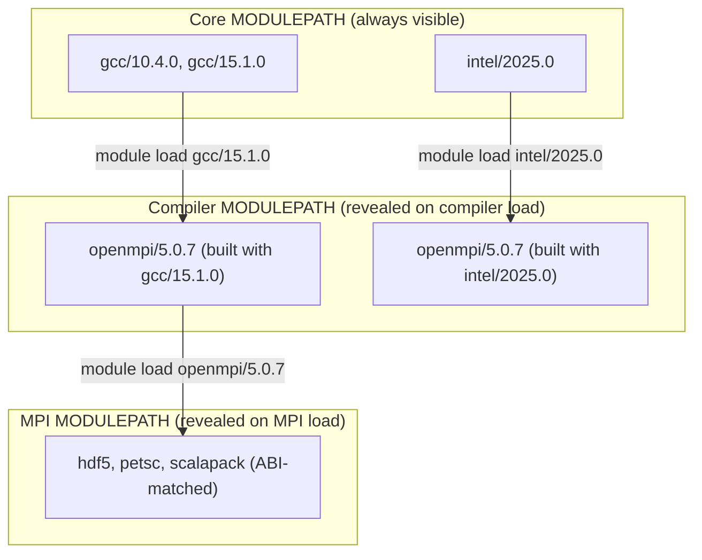

# 6.6 Environment modules, Spack and EasyBuild

| Field | Value |
|---|---|
| Level | Intermediate |
| Priority tier | 1 |
| Lab venue | Any machine with Python 3; `modules_spack_lab.py` runs 3 checks locally and cluster Lmod, Spack, and EasyBuild builds are **untested** here |
| Part | Part 6: HPC and Slurm |
| Status | Drafted |

## Why this matters for AI infrastructure

Picture a shared GPU cluster serving fifty researchers. Group A needs GCC 10.4, Open MPI 4.1, and CUDA 11.8 for a legacy molecular dynamics code. Group B needs GCC 15.1, Open MPI 5.0.7, and CUDA 12.6 to compile custom FlashAttention kernels for a foundation model. If you install one global version into `/usr/bin` and `/usr/lib64`, half your users cannot work. If you tell everyone to edit their own `~/.bashrc` and install compilers into their home directories, users inevitably mix a GCC 15 binary with a GCC 10 standard C++ library or an incompatible MPI runtime and flood your ticket queue with segmentation faults. HPC centers solved this decades ago with **Environment Modules** (Tcl modules and Lua-based **Lmod**) backed by automated source build frameworks (**Spack** and **EasyBuild**). On modern AI clusters, these tools work alongside OCI containers (Enroot and Pyxis) and Python managers (`uv` and `conda`) to keep compilers, MPI, CUDA, NCCL, and PyTorch aligned across every login and compute node.

## Prerequisites and outcomes

You need Chapters 6.2 through 6.5 and Part 1 for Linux shells, environment variables, and shared libraries. After finishing this chapter, you will be able to accomplish the following goals.

- Explain how `PATH`, `LD_LIBRARY_PATH`, `RPATH`, `RUNPATH`, `/etc/ld.so.conf` (`ldconfig`), `CPATH`, and `MODULEPATH` determine which executables and shared libraries run.
- Use and write Tcl Environment Modules and Lua Lmod modulefiles—covering the Table 21-1 commands, the `stderr` vs `stdout` rule, `module spider`, inactive modules, and numeric versus string version sorting—from *Supercomputers for Linux SysAdmins* Chapter 21.
- Build and manage HPC software stacks with **EasyBuild** and **Spack**, covering specs, concretization hashes, `spack.yaml` and `spack.lock` environments, externals, binary buildcaches, and `spack module lmod refresh`.
- Lay out a shared, architecture-aware software tree (`/opt/apps/<arch>`) exported read-only across nodes, trace the 11-step minicluster setup and disk-cloning rules from Chapter 24, and choose when to use modules, Spack, EasyBuild, `uv` or `conda`, or containers.

## 1. The problem: how Linux finds binaries and shared libraries

When a user types `mpirun` or `python3` on a login node, the shell searches the colon-separated directories in **`PATH`** from left to right and executes the first match. Once that ELF binary starts, the Linux dynamic linker (`ld-linux-x86-64.so.2`) must locate every shared library (`libmpi.so`, `libcudart.so`, `libstdc++.so`) listed in the binary's dynamic section. The loader searches five locations in strict order:

1. **`DT_RPATH`** embedded in the binary at link time, unless `DT_RUNPATH` is also present.
2. **`LD_LIBRARY_PATH`** environment variable directories, searched left to right.
3. **`DT_RUNPATH`** embedded in the binary at link time (`-Wl,-rpath,/opt/...`).
4. **`/etc/ld.so.cache`**, the binary cache generated by running **`ldconfig`** over `/etc/ld.so.conf` and `/etc/ld.so.conf.d/*.conf`.
5. Default OS library directories (`/lib64`, `/usr/lib64`).

Compilers also consult `CPATH`, `C_INCLUDE_PATH`, `LIBRARY_PATH`, and `PKG_CONFIG_PATH`. Python consults `PYTHONPATH`, and CUDA tools consult `CUDA_HOME` and `CUDA_PATH`. Selecting a complete software stack means setting several of these variables consistently and reversing every change cleanly when switching to a different version.

### Installing compilers and libraries on shared storage (`SCL` Chapter 24)

As Zhumatiy notes in *Supercomputers for Linux SysAdmins* Chapter 24 (*Installing Compilers and Libraries*), installation of compilers is not difficult in itself, but the runtime libraries needed by compiled programs must be available on every compute node. The standard practice is to install compilers into a shared directory on the network file system. To make those libraries visible to the dynamic linker across the cluster, you have two choices:

- **Option A (`/etc/ld.so.conf` + `ldconfig` across all nodes):** Explicitly list the library directories in `/etc/ld.so.conf` and run the `ldconfig` command. If you use this approach, do not forget to update `/etc/ld.so.conf` whenever you update a compiler version because the path to its libraries will change, and remember to run `ldconfig` across all nodes of the cluster. Furthermore, a global `ld.so.cache` cannot easily isolate two conflicting library versions needed by different users at the same time.
- **Option B (`LD_LIBRARY_PATH` managed via Environment Modules):** Keep multiple compiler and MPI versions installed in separate directories (`/opt/mpi/openmpi-4.0.1-icc` and `/opt/mpi/openmpi-5.0.7-gcc15`) and use **Environment Modules** to dynamically prepend and remove the exact `PATH`, `LD_LIBRARY_PATH`, and `MANPATH` entries in the user's shell.

Never ask users to hand-edit `PATH` and `LD_LIBRARY_PATH` in `~/.bashrc`. Manual `~/.bashrc` edits are fragile, order-dependent, impossible to unload cleanly when switching compilers, and invisible when debugging job failures. Always inspect library resolution with `ldd ./myapp`, `readelf -d ./myapp | grep -i path`, and `LD_DEBUG=libs ./myapp`.

**Never hardcode `/opt` compiler or MPI paths into user `~/.bashrc` files or `/etc/ld.so.conf` when multiple versions exist; manage `PATH` and `LD_LIBRARY_PATH` through Environment Modules or `RPATH`**.

> **In one minute:**
> - The shell locates binaries via `PATH`, while the dynamic linker resolves `.so` libraries via `RPATH`, `LD_LIBRARY_PATH`, `RUNPATH`, `/etc/ld.so.cache` (`ldconfig`), and `/lib64`.
> - Updating `/etc/ld.so.conf` requires running `ldconfig` on every node in the cluster after every upgrade; Environment Modules switch `PATH` and `LD_LIBRARY_PATH` cleanly per session or job.

## 2. Environment Modules (Tcl) and Lmod (Lua) in depth (`SCL` Chapter 21)



It is very desirable to install several compilers and MPI implementations on a supercomputer at the same time, yet specifying full paths to executables and libraries every time is inconvenient. To automate adding and removing paths from `PATH`, `LD_LIBRARY_PATH`, and other environment variables, the **Environment Modules** package (`http://modules.sourceforge.net/`)—and later the Lua-based **Lmod** project (`https://www.tacc.utexas.edu/research-development/tacc-projects/lmod`)—provides a single command (actually a shell function) called **`module`**. Because `module` is a shell function that evaluates the output of the underlying module binary inside your current shell, it can modify your live shell environment directly.

Table 21-1 in *Supercomputers for Linux SysAdmins* Chapter 21 presents the main `module` commands:

| Command (`module <subcommand>`) | Meaning (`SCL` Table 21-1) |
|---|---|
| `add` \| `load` | Add modules to the environment |
| `rm` \| `unload` | Uninstall modules from the environment, reversing their path changes |
| `display` \| `show` | Show information about the specified modules |
| `avail` | Show the list of available modules in the active `MODULEPATH` |
| `switch` \| `swap` | Switch the status of the specified modules: if loaded, unload; if not loaded, load |
| `use [-a \| --append]` | Add a directory with module files to `MODULEPATH` |
| `unuse` | Delete a directory with module files from `MODULEPATH` |
| `update` | Try to reload all loaded modules by updating the environment |
| `purge` | Unload all modules (always place `module purge` at the top of batch scripts) |
| `list` | Show currently loaded modules |
| `clear` | Clear the internal list of loaded modules, but do not change the environment |

### Writing a Tcl modulefile and the `stderr` vs. `stdout` rule

In Chapter 21, Zhumatiy walks through a complete Tcl modulefile example for OpenMPI 4.0.1 built by Intel compilers (**untested** here):

```tcl
#%Module1.0###############################
proc ModulesHelp {} {
    global version
    puts stderr "\tThis module will set up \
environment for OpenMPI 4.0.1 \
(build by Intel compilers)"
    puts stderr "\n\tVersion $version\n"
}
set base /opt/mpi/openmpi-4.0.1-icc
module-whatis "adds OpenMPI 4.0.1 build by Intel compilers"
prepend-path PATH $base/bin/
prepend-path LD_LIBRARY_PATH $base/lib
prepend-path MANPATH $base/share/man
```

Pay close attention to three rules in this file:

1. **The `#%Module1.0` magic header:** The first line of the module file must be `#%Module1.0`. If the version number (`1.0`) is omitted, the file format is assumed to be compatible with the latest version of Environment Modules. Without that header, the module system ignores the file.
2. **Never print to `stdout` (`puts stderr` only):** The module file is a program in the Tcl language, though you do not need to know Tcl deeply to write one. Text output to the standard error stream (`stderr`) will be shown to the user. **Never output anything to the standard output stream (`stdout`)**—because the `module` shell function evaluates `stdout` as shell commands, printing text to `stdout` will spoil the whole module system.
3. **Reversible `prepend-path` operations:** The main actions are performed by `prepend-path` and `append-path` commands, which modify colon-separated path lists such as `PATH`, `LD_LIBRARY_PATH`, and `MANPATH` (alongside commands to set or delete variables or load another module; see `man modulefile`). When you run `module unload`, the module system automatically reverses every `prepend-path` in the file.

In Lua (Lmod), the equivalent modulefile uses Lua syntax while preserving the same concepts (**untested** here):

```lua
whatis("Open MPI 5.0.7 built with GCC 15.1.0")
family("mpi")
depends_on("gcc/15.1.0")
local base = "/opt/mpi/openmpi-5.0.7-gcc15"
prepend_path("PATH", pathJoin(base, "bin"))
prepend_path("LD_LIBRARY_PATH", pathJoin(base, "lib"))
prepend_path("MANPATH", pathJoin(base, "share/man"))
setenv("MPI_HOME", base)
```

### Why Lmod replaced classic Tcl Modules 3.2.10 (2012 vs. 2017)

As Zhumatiy explains, the original Environment Modules project (also called Tcl modules or Tcl/C modules) stopped development for a while in **2012 with the release of version 3.2.10** (before resuming development at the end of **2017** toward different technical features). The main drawbacks encountered with version 3.2.10 were difficulties in loading a package if another version was already loaded, and difficulties in tracking dependencies between different modules, such as MPI implementations built with different compilers.

To solve these and other problems, the alternative project **Lua Modules (Lmod)** was created at TACC. While Lmod uses the Lua language for module files, it can also read files from original Tcl modules written in Tcl, translating them on the fly so Lmod can be deployed directly onto an existing Tcl modulefile infrastructure. Lmod solves four critical cluster problems, modeled in `simulate_lmod_compiler_swap()` and `compare_module_versions_tcl_vs_lmod()` in `code/part06/modules_spack.py`:

1. **Automatic replacement of conflicting versions:** When loading a module for a package that already has another version loaded, Lmod automatically unloads the previously loaded module and prints a version-change diagnostic. This avoids having two versions of a compiler active at once, which would create conflicts between their runtime libraries.
2. **On-the-fly `MODULEPATH` hierarchies and `inactive` module reloading:** Lmod supports dynamically changing `MODULEPATH` when a module loads. When you load a compiler module (`gcc`), it adds the directory of packages built by that specific compiler version to `MODULEPATH`. Suppose a cluster has OpenMPI built by two compilers: `gcc` and Intel Compiler. You load `gcc` and `openmpi` sequentially. When you later unload the `gcc` module, Lmod sees that `openmpi` is no longer visible in `MODULEPATH`: it marks `openmpi` as **inactive**—removing OpenMPI's paths from `PATH` and `LD_LIBRARY_PATH` while keeping `openmpi` remembered in your loaded list. If you then load the Intel compiler module and it has its own `openmpi` module in its `MODULEPATH`, **Lmod automatically reloads the Intel build of `openmpi`** and updates your environment variables for the new compiler.
3. **`module spider` across the entire module tree:** Lmod provides the `module spider` command to search all available modules across the hierarchy, a selected module family, or detailed prerequisites for an exact version (**untested** here):
   ```text
   $ module spider
   ----------------------------------------------------------
   The following is a list of the modules currently available:
   ----------------------------------------------------------
     gcc: gcc/4.8.1, gcc/10.4.0, gcc/15.1.0
       The Gnu Compiler Collection
     lmod: lmod/8.7.60
       Lmod: An Environment Module System
     openmpi: openmpi/4.1.8, openmpi/5.0.7
       Openmpi Version of the Message Passing Interface Library

   $ module spider openmpi/5.0.7
   ---------------------------------------------------
     openmpi: openmpi/5.0.7
   ---------------------------------------------------
       Description:
         Openmpi Version of the Message Passing Interface Library
       You will need to load all module(s) on any one of the lines below before the "openmpi/5.0.7" module is available to load.
         gcc/10.4.0
         gcc/15.1.0
   ```
4. **Numeric version sorting vs. Tcl string sorting (`mkl/11.0` vs. `mkl/4.0`):** When you load a module by name without a version (`module load gcc`) and no explicit default is set, the highest version is selected. **In Lmod, versions are sorted as numbers; in classic Tcl modules, versions are sorted as strings, where `mkl/4.0` is treated as higher than `mkl/11.0`!** Lmod also provides saving and restoring module collections (`module save` / `module restore`), hiding modules for testing, and flexible dependency declarations.

**Use Lmod with a `Core -> Compiler -> MPI` `MODULEPATH` hierarchy so users can never accidentally mix a GCC-compiled MPI library with an Intel-compiled application, and teach users `module spider`**.

> **In one minute:**
> - Tcl modulefiles must begin with `#%Module1.0` and print help messages to `stderr`, never `stdout` (which `module` evaluates as shell code).
> - Lmod improves on classic Tcl Modules (3.2.10, paused 2012–2017) by auto-swapping conflicting versions, marking dependent modules `inactive` when their compiler is unloaded and auto-reloading the matching ABI build when a new compiler loads, providing `module spider`, and sorting versions numerically (`mkl/11.0 > mkl/4.0`) instead of as strings (`mkl/4.0 > mkl/11.0`).

## 3. Build Systems: EasyBuild and Spack (`SCL` Chapter 21)

Many HPC and AI packages depend on dozens of underlying libraries. Building a fresh stack by hand is a headache. As Zhumatiy details in the *Build Systems* section of Chapter 21, two open-source build frameworks dominate modern clusters: **EasyBuild** and **Spack**.

### EasyBuild: Python venv bootstrap, `.eb` easyconfigs, and toolchains

**EasyBuild** (`https://docs.easybuild.io/`) is an open-source Python package (`python3.6` or higher) that builds software from declarative **easyconfig (`.eb`)** files organized around coherent **toolchains** such as `foss-2024a` (GCC, Open MPI, OpenBLAS, FFTW, and ScaLAPACK) or `intel`. Zhumatiy recommends installing EasyBuild into an isolated Python `venv` and then registering EasyBuild itself as a module (**untested** here):

```bash
# 1. Install EasyBuild in an isolated Python virtual environment (untested here)
python3 -m venv easybuild
source easybuild/bin/activate
pip3 install easybuild

# 2. Install EasyBuild as a module under /opt/easybuild and load it
eb --install-latest-eb-release --prefix /opt/easybuild
module use /opt/easybuild/modules/all
# How to load module:
module load EasyBuild
```

Once the `EasyBuild` module is loaded, you can build a package and generate its modulefile with the `eb` command—for example, building `HPL 2.3` with the `foss-2024a` GCC toolchain (**untested** here):

```text
eb HPL-2.3-foss-2024a.eb
== Temporary log file in case of crash /tmp/eb-rpdngte7/easybuild-3761s4k7.log
== found valid index for /home/foo/eb/easybuild/easyconfigs, so using it...
== processing EasyBuild easyconfig /home/foo/eb/easybuild/easyconfigs/h/HPL/HPL-2.3-foss-2024a.eb
== building and installing HPL/2.3-foss-2024a...
>> installation prefix: /home/foo/.local/easybuild/software/HPL/2.3-foss-2024a
== fetching files and verifying checksums...
```

Key EasyBuild commands:

- `eb --show-config` — lists the directories containing configuration files, build descriptions, and the default installation path.
- `eb <file>.eb --dry-run` (or `-D`) — previews the dependency build plan without compiling.
- `eb <file>.eb --robot` (or `-r`) — resolves and builds the entire dependency graph automatically and exposes the resulting packages via modules.

### Spack: specs, concretization hashes, environments, externals, and buildcaches

**Spack** (`https://spack.readthedocs.io/`) is a flexible package manager that builds multiple versions, compilers, variants, and microarchitecture targets side by side. Installation requires only a shallow Git clone and sourcing its setup script (**untested** here):

```bash
git clone -c feature.manyFiles=true --depth=2 \
  https://github.com/spack/spack.git
source spack/share/spack/setup-env.sh
```

Add the `source` line to your shell profile to activate Spack in every session. After installation, you can immediately build a package such as `hpl` (`SCL` Chapter 21 example; **untested** here):

```text
spack install hpl
==> Fetching https://ghcr.io/v2/spack/bootstrap-buildcache-v1/blobs/sha256:8d2764eefa443c29c7c9120079e3bbe7576bbc496b15843ad18d18892338a5ba
==> Fetching https://ghcr.io/v2/spack/bootstrap-buildcache-v1/blobs/sha256:a4abec667660307ad5cff0a616d6651e187cc7b1386fd8cd4b6b288a01614076
==> Installing "clingo-bootstrap@=spack~docs+ipo+optimized+python+static_libstdcpp build_system=cmake build_type=Release generator=make patches:=bebb819,ec99431 arch=linux-centos7-x86_64" from a buildcache
==> Compilers have been configured automatically from PATH inspection
[+] /usr (external glibc-2.39-o6w364jwmtleiolghwv7qzmglqt3zid6)
[+] /usr (external gcc-13.3.0-hl3rnt2aupy5a4k7pzxkqkm3qj6epopq)
==> No binary for compiler-wrapper-1.0-xi6ijcvw2a5xtrfyz4zgtzwscmtmi5t3 found: installing from source
==> Installing compiler-wrapper-1.0-xi6ijcvw2a5xtrfyz4zgtzwscmtmi5t3 [3/44]
```

Use `spack list` to view available package recipes (the first run takes a moment to build the index) and `spack info hpl` to inspect versions and variants. Once compiled, expose all Spack packages to Lmod (or Tcl modules) with:

```bash
spack module lmod refresh     # or: spack module tcl refresh
module use $SPACK_ROOT/spack/share/spack/modules/linux-ubuntu14-x86_64
```

Core Spack concepts from the Spack documentation (`29aea8a`):

1. **Compact spec syntax (`parse_spack_spec()` in `code/part06/modules_spack.py`):** `@` selects a version (`hdf5@1.14.3`), `+` and `~` toggle boolean variants (`+mpi`, `+cuda`, `~shared`), `name=value` sets valued variants (`cuda_arch=90`, `target=x86_64_v3`), `%` selects the compiler (`%gcc@13.3.0`), and `^` constrains a dependency (`^openmpi@5.0.7`). Run `spack spec <spec>` to preview the resolved DAG before building.
2. **Concretization and DAG hashes:** Spack's `clingo` solver resolves abstract specs into a **concrete spec** with a unique hash appended to the install directory (`openmpi/5.0.10-gcc-13.3.0-<hash>`), allowing dozens of builds to coexist cleanly.
3. **Reproducible environments (`spack.yaml` and `spack.lock`):** Group specs with `spack env create myenv`, `spack env activate myenv`, `spack add ...`, `spack concretize`, and `spack install`. Commit both `spack.yaml` (`concretizer: unify: true`) and `spack.lock` to Git.
4. **Externals and build caches:** In `packages.yaml`, mark pre-installed system software (such as `OFED` InfiniBand drivers, vendor MPI, or the system CUDA toolkit, or `rocm-5.3.0` with `amdgpu_target=gfx90a`) as `buildable: false` with an `externals:` prefix so Spack reuses them. Use `spack buildcache push <mirror> <spec>` to share pre-compiled binary packages across clusters.

**Pin system CUDA and fabric MPI as non-buildable externals in Spack's `packages.yaml`, commit `spack.yaml` and `spack.lock` to Git, and refresh Lmod modules via `spack module lmod refresh`**.

> **In one minute:**
> - Install EasyBuild in a Python `venv`, register it with `eb --install-latest-eb-release --prefix /opt/easybuild`, check config with `eb --show-config`, and build toolchain stacks like `eb HPL-2.3-foss-2024a.eb`.
> - Install Spack with `git clone -c feature.manyFiles=true --depth=2`, source `setup-env.sh`, build with `spack install`, and generate Lmod modulefiles with `spack module lmod refresh`.

## 4. Node setup, minicluster staging, and the shared software tree (`SCL` Chapter 24)

How do you roll out operating systems, InfiniBand drivers, compilers, and shared software trees across a new cluster without cloning broken configurations onto a hundred nodes? In *Supercomputers for Linux SysAdmins* Chapter 24 (*Configuring the Control and Compute Nodes*), Zhumatiy lays out a battle-tested **11-step minicluster deployment sequence**:

1. Install the control (head) server.
2. Install and configure the network file system server (`/etc/exports` and `exportfs -av`), if used.
3. Install the first reference compute node (`50–100 GB` OS partition, small swap, and remaining space in `/tmp`—or RAID-1 `/tmp` across two local disks, where `Enroot` unpacks containers by default).
4. Install the communication software stack. Although there is support for the InfiniBand stack directly in the Linux kernel, in most cases it is not worth using because application performance is lower than expected. For efficient operation of HPC applications, use the **`OFED`** package (`openfabrics.org` or ready-made packages from the card manufacturer), which includes card drivers, libraries (`mad`, `verbs`, `ibutils`), network diagnostics, a simple subnet manager, and `openmpi` and `mvapich` builds. Always make backup copies of existing OFED packages before upgrading because the installer deletes all OFED packages it finds before starting the build, and set `* soft memlock unlimited` and `* hard memlock unlimited` in `/etc/security/limits.conf`.
5. Install the second compute node. For the NFS server configuration, install the `nfs-server` package, enable its autostart by `systemctl enable --now nfs-server` or via the `chkconfig` or `update-rc.d` command, open the corresponding RPC services in the firewall on the internal network interface, edit the `/etc/exports` file to specify exported directories and client permissions, and run the `exportfs -av` command to force an NFS server config reload.
6. Assemble a **minicluster** consisting of the control node and the two compute nodes.
7. Install compilers and test packages onto the shared network file system tree.
8. Benchmark and verify communication equipment between the two compute nodes (checking that bandwidth and latency match hardware datasheets).
9. Install and configure the batch task management system (`Slurm`).
10. Run end-to-end task completion tests (verifying passwordless admin/user SSH, loading an MPI module, running an OFED MPI test job through the scheduler, and confirming output writes to shared storage). Also set up monitoring and backups *before* letting users onto the cluster.
11. **Clone the verified reference compute node** (via Kickstart `/root/anaconda-ks.cfg` / DHCP `<ip-addr>-kickstart`, `Clonezilla`, `dd`, or a read-only `NFS-root` image) to all remaining compute nodes—making sure to replace hardware-specific disk IDs (`root=/dev/disk/by-id/ata-WDC_...`) with generic device names (`root=/dev/sda1`) in `/boot/grub/grub.cfg` and `/etc/fstab` and clearing MAC bindings in `/etc/udev/rules.d/70-persistent-net.rules` before disk cloning.

### Cloning a disk between nodes

Suppose you want the finished system disk copied to the other nodes. One method is to connect each new disk to the reference node, one at a time, and copy the disk. This is safe only if the disk and its controller support hot swap. Otherwise, connect the disk only while the node is powered off.

Another method is a network install of the OS on each node. Then you add the changes you made on the reference node after its install. The network install avoids moving disks at all.

Testing a minicluster does not prove that the full cluster will run without failure. It does not show how the network responds under heavy load, or how reliable the network services are. It does catch most problems early, though. That is the point. You avoid cloning a broken setup onto every node.

### Designing the shared `/opt/apps` software tree

Mount the shared software tree read-only on all login and compute nodes (`/etc/fstab` entry `myserver:/export /export nfs defaults 0 0`), organized by CPU microarchitecture baseline so heterogeneous node pools never hit `Illegal instruction` faults:

```text
/opt/apps/                       # exported read-only to all login and compute nodes
  x86-64-v3/                     # AVX2 baseline subtree
    gcc/15.1.0/
    openmpi/5.0.7-gcc15/
  x86-64-v4/                     # AVX-512 baseline subtree
  cuda/12.6.0/                   # CUDA toolkits (userspace nvcc + libcudart)
/opt/modulefiles/                # Lmod Core / Compiler / MPI hierarchy per arch
```

### Where containers (`Enroot`/`Pyxis`) and `uv`/`conda` fit

| Tool | Best role on an AI cluster | Operational rule |
|---|---|---|
| **Lmod + Spack / EasyBuild** | Compilers, `Open MPI`/`HPC-X`, `CUDA` toolkits, and bare-metal HPC apps | Mount read-only at the same path on login and compute nodes; always start `sbatch` scripts with `module purge` + explicit `module load name/version` |
| **Containers (`Enroot` + `Pyxis`, `Apptainer`)** | Multi-node `PyTorch`, `vLLM`, `NeMo`, and `Megatron-LM` workloads | Container `libcudart` toolkit version must be $\le$ the host driver's supported CUDA version in `nvidia-smi` |
| **`uv` / `conda` / `venv` Python envs** | Fast user iteration on Python packages | **Never let 500 ranks import an unpacked conda env directly from shared Lustre/NFS** (tens of thousands of tiny files cause a metadata storm); pack into an `Enroot` `.sqsh` image or stage to local `/tmp` NVMe |

**Build and test your software stack on a 2-node minicluster before cloning compute nodes, mount `/opt/apps` read-only everywhere, and package multi-node Python environments into containers or local `/tmp` to protect shared storage metadata**.

> **In one minute:**
> - Validate OS, `OFED` (`memlock unlimited`), compilers, MPI modules, and Slurm on a 2-compute-node minicluster before cloning (and strip `/dev/disk/by-id` and `70-persistent-net.rules` MACs before disk cloning).
> - Organize `/opt/apps/<arch>` by CPU baseline, mount it read-only on all nodes, and avoid 500-rank conda `import` metadata storms on shared Lustre/NFS by using `Enroot` `.sqsh` containers or local `/tmp` staging.

## 5. Lab: test Lmod hierarchy swapping, version sorting, and Spack spec parsing

First, run the self-checking Python lab (`code/part06/modules_spack_lab.py`) locally. It verifies the Lmod compiler-swap `inactive` marking and automatic ABI-matched MPI reload (`simulate_lmod_compiler_swap`), the classic Tcl string sort (`mkl/4.0 > mkl/11.0`) versus Lmod numeric sort (`mkl/11.0 > mkl/4.0`) comparison (`compare_module_versions_tcl_vs_lmod`), and the Spack spec parser (`parse_spack_spec`):

```bash
python3 code/part06/modules_spack_lab.py
```

Next, run the standalone script to inspect the outputs:

```bash
python3 code/part06/modules_spack.py
```

Work through these hands-on steps (**untested** on live cluster software trees):

1. Inspect `compare_module_versions_tcl_vs_lmod(["mkl/4.0", "mkl/11.0"])` and explain why Tcl Environment Modules 3.2.10 picked `mkl/4.0` as the highest version while Lmod picks `mkl/11.0`.
2. Trace `simulate_lmod_compiler_swap()` when a user has `gcc/15.1.0` and `openmpi/5.0.7` loaded: verify that switching to `clang/18.0` marks `openmpi/5.0.7` `inactive`, whereas switching to `intel/2025.0` automatically reloads the Intel build of `openmpi/5.0.7`.
3. Write a Tcl modulefile starting with `#%Module1.0` and a Lua modulefile for `/opt/cuda/12.6`, ensuring help text goes to `stderr`.

## 6. Interview angles

- Walk through the exact order in which the Linux dynamic loader (`ld.so`) searches for a shared library (`.so`). Why is managing compiler libraries via Environment Modules better than editing `/etc/ld.so.conf` and running `ldconfig` (`SCL` Chapter 24)?
- In a Tcl modulefile, why must `ModulesHelp` print to `stderr` (`puts stderr`) instead of `stdout`, and what happens in classic Tcl Modules vs Lmod when `mkl/4.0` and `mkl/11.0` are installed (`SCL` Chapter 21)?
- Explain how an Lmod `Core -> Compiler -> MPI` hierarchy works when a user swaps `gcc` for `intel`. What is an `inactive` module, and what does `module spider openmpi/5.0.7` show?
- Compare Spack and EasyBuild. What do `@`, `+`, `~`, `%`, and `^` mean in a Spack spec, and why do you declare system CUDA or InfiniBand MPI as `buildable: false` externals in `packages.yaml`?
- A researcher's 256-GPU PyTorch job takes 12 minutes just to finish `import torch` at startup. Why is their `~/.conda` environment causing this, and how do you fix it?

## Exercises

1. **Dynamic Linker Search Order and `/etc/ld.so.conf` vs. Modules (`SCL` Chapter 24):** List the five locations the Linux dynamic linker searches for shared libraries in order (`DT_RPATH`, `LD_LIBRARY_PATH`, `DT_RUNPATH`, `/etc/ld.so.cache` from `ldconfig`, and `/lib64`). Explain why Zhumatiy notes that using `/etc/ld.so.conf` and `ldconfig` for shared NFS compilers requires extra node-wide maintenance on every compiler upgrade compared to Environment Modules.
2. **Tcl Modulefiles (`#%Module1.0`), the `stderr` Rule, and Tcl vs. Lmod Version Sorting (`SCL` Chapter 21):** Write a Tcl modulefile for `/opt/mpi/openmpi-4.0.1-icc` with `ModulesHelp`, `module-whatis`, and `prepend-path` for `PATH`, `LD_LIBRARY_PATH`, and `MANPATH`. Explain why writing to `stdout` inside a modulefile breaks the `module` shell function, and use `compare_module_versions_tcl_vs_lmod(["mkl/4.0", "mkl/11.0"])` in `code/part06/modules_spack.py` to explain why Tcl Modules picks `mkl/4.0` while Lmod picks `mkl/11.0`.
3. **Lmod Dynamic `MODULEPATH` Hierarchies, `inactive` Modules, and `module spider` (`SCL` Chapter 21):** Using `simulate_lmod_compiler_swap()` in `code/part06/modules_spack.py`, trace what happens to `openmpi/5.0.7` when a user unloads `gcc/15.1.0` (`inactive`), what happens when they load `intel/2025.0` (automatic reload of the Intel build), and how `module spider openmpi/5.0.7` helps users discover hidden hierarchical modules.
4. **EasyBuild Bootstrap and Toolchain Workflows (`SCL` Chapter 21):** Write the command sequence from `SCL` Chapter 21 to install EasyBuild inside a Python `venv`, install EasyBuild as a module under `/opt/easybuild`, load the `EasyBuild` module, inspect config paths with `eb --show-config`, and build `HPL-2.3-foss-2024a.eb`.
5. **Spack Specs, Concretization Hashes, Environments, Externals, and Module Refresh (`SCL` Chapter 21):** Using `parse_spack_spec("petsc@3.21 +cuda %gcc@13.3.0 cuda_arch=90 ^openmpi@5.0.7")`, explain each spec operator (`@`, `+`, `%`, `key=val`, `^`). Trace what happens during `spack install hpl` (`clingo-bootstrap` buildcache, compiler auto-detection), and write the command to expose Spack packages to Lmod (`spack module lmod refresh`).
6. **Minicluster Staging, Disk Cloning Rules, and Avoiding Conda Metadata Storms (`SCL` Chapter 24):** List the 11 steps of Zhumatiy's minicluster software deployment sequence, state the two files/rules that must be cleaned before cloning a node disk with `dd` or `Clonezilla` (`/dev/disk/by-id` and `70-persistent-net.rules`), and explain how to eliminate 500-rank Python `import` metadata storms using `Enroot` `.sqsh` containers or node-local `/tmp` RAID-1 scratch disks.

## Checkpoint questions (20)

<details>
<summary>1. In what exact order does the Linux dynamic loader search for shared libraries (`.so`), and which tools inspect library resolution?</summary>

1. `DT_RPATH` compiled into the binary (if `DT_RUNPATH` is absent).
2. `LD_LIBRARY_PATH` environment variable directories (left to right).
3. `DT_RUNPATH` compiled into the binary (`-Wl,-rpath,...`).
4. `/etc/ld.so.cache` (built by `ldconfig` from `/etc/ld.so.conf`).
5. Default system directories (`/lib64`, `/usr/lib64`).
Inspect with `ldd ./binary`, `readelf -d ./binary | grep -i path`, and `LD_DEBUG=libs ./binary`.
</details>

<details>
<summary>2. In `SCL` Chapter 24, what are the two ways to make shared compiler libraries on an NFS mount visible to compute nodes, and what is the drawback of `/etc/ld.so.conf`?</summary>

You can either (1) set `LD_LIBRARY_PATH` dynamically via **Environment Modules** or (2) add the shared library path to `/etc/ld.so.conf` and run **`ldconfig`**. The drawback of `/etc/ld.so.conf` is that whenever you upgrade a compiler version (changing its directory path), you must update `/etc/ld.so.conf` and re-run `ldconfig` across **every compute node in the cluster**, and it cannot isolate conflicting library versions per job.
</details>

<details>
<summary>3. Why is the `module` command implemented as a shell function rather than an ordinary binary, and why must Tcl modulefiles never print messages to `stdout` (`SCL` Chapter 21)?</summary>

A child process cannot modify the environment variables of its parent shell. Therefore, `module` is a shell function that runs `eval $(modulecmd bash ...)`—**evaluating everything printed to `stdout` as shell commands in the current shell**. Any help or diagnostic text in a modulefile must be written to **`stderr`** (`puts stderr "..."`); writing text to `stdout` causes the shell to execute the message as commands and corrupts the module call.
</details>

<details>
<summary>4. What must appear on the first line of a Tcl modulefile, and what do `prepend-path` and `module-whatis` do (`SCL` Chapter 21)?</summary>

The first line must begin with **`#%Module1.0`** (or `#%Module`). `module-whatis` defines a one-line summary of the package, and `prepend-path` prepends a directory to a colon-separated environment variable (`PATH`, `LD_LIBRARY_PATH`, `MANPATH`) on `module load` and automatically removes that exact directory on `module unload`.
</details>

<details>
<summary>5. What is the difference between `module purge`, `module clear`, and `module update` (`SCL` Table 21-1)?</summary>

- **`module purge`:** Unloads all currently loaded modules and reverses all of their environment variable changes (standard at the top of batch scripts).
- **`module clear`:** Clears the module system's internal record of loaded modules **without changing the current environment variables**.
- **`module update`:** Attempts to reload all currently loaded modules to refresh the environment.
</details>

<details>
<summary>6. What were the two main limitations of classic Tcl Environment Modules (3.2.10, paused in 2012) that led to the creation of Lmod (`SCL` Chapter 21)?</summary>

1. Difficulty handling version conflicts when loading a package if another version of that package was already loaded.
2. Inability to track hierarchical dependencies across modules, such as automatically switching an MPI module when the underlying compiler module changes.
</details>

<details>
<summary>7. Trace what Lmod does when you load `gcc` and `openmpi`, then unload `gcc`, and then load `intel` (`SCL` Chapter 21).</summary>

1. Loading `gcc` adds GCC's module directory to `MODULEPATH`, allowing `openmpi` (built with `gcc`) to be loaded.
2. When you **unload `gcc`**, Lmod removes GCC's directory from `MODULEPATH`, strips `openmpi` from `PATH` and `LD_LIBRARY_PATH`, and marks `openmpi` as **`inactive`** (still remembered in your module list).
3. When you **load `intel`**, Intel's module directory is added to `MODULEPATH`; if an `openmpi` module built with `intel` exists there, **Lmod automatically reloads the Intel-compiled `openmpi` module** and updates your environment variables.
</details>

<details>
<summary>8. What does `module spider` do in Lmod, and how does `module spider openmpi/5.0.7` differ from `module avail` (`SCL` Chapter 21)?</summary>

`module avail` only lists modules that are currently visible in the active `MODULEPATH`. **`module spider`** searches the **entire module hierarchy** (including compiler- and MPI-dependent modules not yet visible), and `module spider openmpi/5.0.7` prints the exact prerequisite compiler modules (`gcc/10.4.0` or `gcc/15.1.0`) that must be loaded before `openmpi/5.0.7` becomes available.
</details>

<details>
<summary>9. If `mkl/4.0` and `mkl/11.0` are installed with no explicit default, which version does classic Tcl Environment Modules pick versus Lmod, and why (`SCL` Chapter 21)?</summary>

- **Classic Tcl Environment Modules:** Sorts versions **as ASCII strings**, where `'4' > '1'`, so it picks the older **`mkl/4.0`**.
- **Lmod:** Sorts version components **as numbers** (`11 > 4`), so it picks **`mkl/11.0`**.
</details>

<details>
<summary>10. How do you bootstrap EasyBuild in a Python `venv`, install it as a module, and inspect its configuration (`SCL` Chapter 21)?</summary>

```bash
python3 -m venv easybuild
source easybuild/bin/activate
pip3 install easybuild
eb --install-latest-eb-release --prefix /opt/easybuild
module use /opt/easybuild/modules/all
module load EasyBuild
eb --show-config
```
</details>

<details>
<summary>11. What is an EasyBuild **toolchain** (such as `foss-2024a`), and what does `eb HPL-2.3-foss-2024a.eb --robot` do (`SCL` Chapter 21)?</summary>

A **toolchain** is a versioned, tested bundle of a compiler, MPI library, and math libraries—for example, `foss-2024a` bundles GCC, Open MPI, OpenBLAS, FFTW, and ScaLAPACK. Running `eb HPL-2.3-foss-2024a.eb --robot` automatically downloads sources, verifies checksums, compiles, installs, and generates modulefiles for `HPL 2.3` and any missing dependencies in the `foss-2024a` toolchain.
</details>

<details>
<summary>12. How do you install Spack, activate it in your shell, and expose Spack-compiled packages to Lmod (`SCL` Chapter 21)?</summary>

```bash
git clone -c feature.manyFiles=true --depth=2 https://github.com/spack/spack.git
source spack/share/spack/setup-env.sh
spack install hpl
spack module lmod refresh
module use $SPACK_ROOT/share/spack/modules/<arch>
```
</details>

<details>
<summary>13. What do the operators `@`, `+`, `~`, `%`, `^`, and `target=` / `cuda_arch=` mean in a Spack spec?</summary>

- **`@`:** Package version (`hdf5@1.14.3`).
- **`+` / `~`:** Enable (`+mpi`, `+cuda`) or disable (`~shared`) a boolean variant.
- **`%`:** Compiler and version (`%gcc@13.3.0`).
- **`^`:** Dependency constraint (`^openmpi@5.0.7`).
- **`target=` / `cuda_arch=`:** Target CPU microarchitecture (`target=x86_64_v3`) or GPU compute capability (`cuda_arch=90`).
</details>

<details>
<summary>14. What is Spack **concretization**, why does every Spack installation path contain a hash, and what is the difference between `spack.yaml` and `spack.lock`?</summary>

**Concretization** uses Spack's `clingo` solver to resolve an abstract spec into a complete dependency graph where every package version, compiler, variant, and target is fixed, hashed into a unique **DAG hash** appended to the install directory (`openmpi/5.0.10-gcc-13.3.0-<hash>`) so multiple builds never collide. In a Spack environment, **`spack.yaml`** is the human-written manifest of abstract specs and rules (`concretizer: unify: true`), while **`spack.lock`** records the exact concrete hashes for 100% reproducible rebuilds.
</details>

<details>
<summary>15. How do Spack **externals** (`packages.yaml`) and **buildcaches** work, and why are they critical on production GPU clusters?</summary>

- **Externals (`packages.yaml`):** Setting `buildable: false` and pointing `externals:` to the host's `/usr/local/cuda` or `/opt/hpcx` forces Spack to link against the cluster's driver-matched CUDA and InfiniBand MPI rather than compiling a generic copy from source.
- **Buildcaches (`spack buildcache push`):** Package pre-compiled binaries into signed tarballs on shared storage or S3 so worker nodes and CI pipelines pull ready-made binaries instead of compiling from source for hours.
</details>

<details>
<summary>16. Why can a batch job that works interactively on the login node fail with `module: command not found` or `error while loading shared libraries` on a compute node?</summary>

1. The compute node may not mount the shared `/opt/apps` or `/opt/modulefiles` directory at the same path as the login node.
2. A non-login batch shell may not source `/etc/profile.d/modules.sh` (or `lmod.sh`) unless configured.
3. The user relied on modules loaded in their interactive login session without putting `module purge` and explicit `module load <name>/<version>` lines inside the `sbatch` script (or ran with `--export=NONE`).
</details>

<details>
<summary>17. How do you serve a single module tree cleanly across a heterogeneous cluster with both Intel (`x86-64-v3`) and AMD (`znver4`) or Arm (`neoverse-v2`) compute nodes?</summary>

Compile each software stack into an architecture-specific subdirectory (`/opt/apps/x86-64-v3/...`, `/opt/apps/znver4/...`, `/opt/apps/neoverse-v2/...`) and configure `/etc/profile.d/` (or an Lmod `SitePackage.lua` hook) to detect the local node's CPU microarchitecture at shell start and prepend the matching `/opt/modulefiles/<arch>` directory to `MODULEPATH`. That way, `module load openmpi/5.0.7` loads the exact binary optimized for whichever node the job lands on.
</details>

<details>
<summary>18. Why does importing a large `conda` or `venv` Python environment across 500 MPI/PyTorch ranks stall job startup on Lustre or NFS, and what are three fixes?</summary>

A `conda` or `venv` environment contains 50,000+ small `.py` and `.so` files. When 500 processes simultaneously run `import torch`, every rank issues thousands of `stat()` and `open()` calls across the network file system—creating a massive metadata storm (`500 * 50,000` RPCs) that saturates the Lustre MDS or NFS server.
**Three fixes:** (1) package the environment into an **Enroot or Apptainer `.sqsh` squashfs container image** (1 large sequential file read), (2) broadcast or copy the packed environment (`conda-pack` tarball) into node-local `/tmp` (RAM disk or local NVMe RAID-1) in the job prolog, or (3) serve read-only software via cached `CernVM-FS`.
</details>

<details>
<summary>19. How does Zhumatiy (`SCL` Chapter 24) recommend partitioning local disks on compute nodes, and where does Enroot unpack containers by default?</summary>

If a compute node installs its OS locally, allocate **50–100 GB for the OS partition**, a **small `swap` partition** (just enough as an emergency RAM reserve), and **all remaining disk space to `/tmp`**. If the node has two local disks, put a swap partition on each disk and combine the `/tmp` partitions into a logical **RAID-1**. Chapter 24 also notes that `Enroot` unpacks container filesystems into `/tmp` by default.
</details>

<details>
<summary>20. What are the two fatal pitfalls when cloning a prototype compute node's disk with `dd if=/dev/sda of=/dev/sdb` or `Clonezilla` (`SCL` Chapter 24)?</summary>

1. **Factory disk serial numbers in `/boot/grub/grub.cfg` and `/etc/fstab`:** Distributions like SUSE often write device paths bound to the drive's hardware serial number (`root=/dev/disk/by-id/ata-WDC_07TMA0_WD-WCAPW5389339-part1`), which fails to boot on any other node's disk unless replaced with generic device names (`root=/dev/sda1`) before cloning.
2. **Hardcoded NIC MAC addresses in `/etc/udev/rules.d/70-persistent-net.rules`:** If `udev` rules bind `eth0` to the prototype node's MAC address, cloned nodes will fail to bring up `eth0` until the rule is removed or updated.
</details>

## Sources and review notes

- **Sources read in full:**
  - `supercomputers-for-linux-sysadmins-managing-modern-hpc-clusters-and-supercomputers-from-software-to-hardware` — Sergey Zhumatiy, *Supercomputers for Linux SysAdmins*, Apress 2025, **Chapter 21: Compilers and Environments, for Parallel Technologies** and **Chapter 24: Node Setup and Software Installation**. Covered topics from Chapter 21 include Environment Modules (`http://modules.sourceforge.net/`, Table 21-1 commands `add`/`load`, `rm`/`unload`, `display`/`show`, `avail`, `switch`/`swap`, `use`, `unuse`, `update`, `purge`, `list`, `clear`), the `#%Module1.0` Tcl modulefile for `openmpi-4.0.1-icc`, the `stderr` vs `stdout` rule, and the 2012 pause of Tcl Modules 3.2.10 (and late 2017 resumption). We also cover Lmod (Lua modules, on-the-fly Tcl translation, auto-unload of conflicting versions, dynamic `MODULEPATH` with `inactive` module marking and auto-reloading across `gcc` and `intel`, `module spider` on `openmpi/5.0.7` and `lmod/8.7.60`, and numeric version sorting `mkl/11.0 > mkl/4.0` vs Tcl string sorting `mkl/4.0 > mkl/11.0`). Build system topics include EasyBuild (`python3.6+` `venv`, `eb --install-latest-eb-release --prefix /opt/easybuild`, `eb HPL-2.3-foss-2024a.eb`, `eb --show-config`) and Spack (`git clone -c feature.manyFiles=true --depth=2`, `setup-env.sh`, `spack install hpl`, `clingo-bootstrap`, `glibc-2.39`, `gcc-13.3.0`, `spack list`, `spack info hpl`, `spack module lmod refresh`). Covered topics from Chapter 24 include the 11-step minicluster deployment sequence, OFED backup and `memlock unlimited` rules, shared NFS compiler installation (`LD_LIBRARY_PATH` via modules vs `/etc/ld.so.conf` and `ldconfig` on all nodes), compute node disk partitioning (50–100 GB OS, small swap, remaining space in `/tmp` RAID-1 where Enroot unpacks containers), and disk cloning pitfalls (`/dev/disk/by-id/ata-WDC_...` in `grub.cfg` and `fstab` and `/etc/udev/rules.d/70-persistent-net.rules`).
  - Spack official documentation (shallow clone at commit `29aea8a`, 2026-10-23): `environments_basics`, `module_file_support`, `gpu_configuration`, and `binary_caches`.
  - `parallel-and-high-performance-computing` — Robert Robey & Yuliana Zamora, *Parallel and High Performance Computing*, Section 17.10 (environment modules and toolchain management).
- **Run here:** `python3 code/part06/modules_spack.py` and `python3 code/part06/modules_spack_lab.py` (3 passed, 0 failed).
- **Explicitly labelled inferences:** The `simulate_lmod_compiler_swap` (`gcc/15.1.0`, `intel/2025.0`, `clang/18.0`), `compare_module_versions_tcl_vs_lmod`, and `parse_spack_spec` (`petsc@3.21`) functions in `code/part06/modules_spack.py` and the `/opt/apps/<arch>` directory layout are deterministic models built on `SCL` Chapters 21 and 24 and the Spack documentation (`29aea8a`).
- **Not verified on live hardware:** Live execution of `module`, Lmod (`module spider`), Spack (`spack install hpl`), and EasyBuild (`eb HPL-2.3-foss-2024a.eb`) on a cluster is marked (`untested here`).
