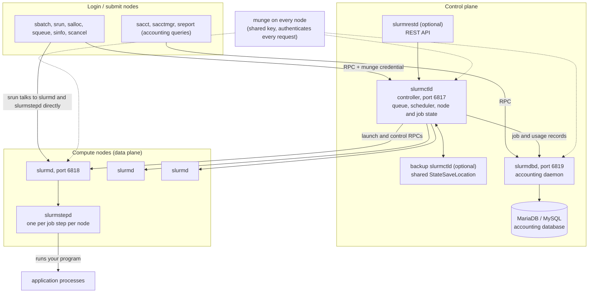
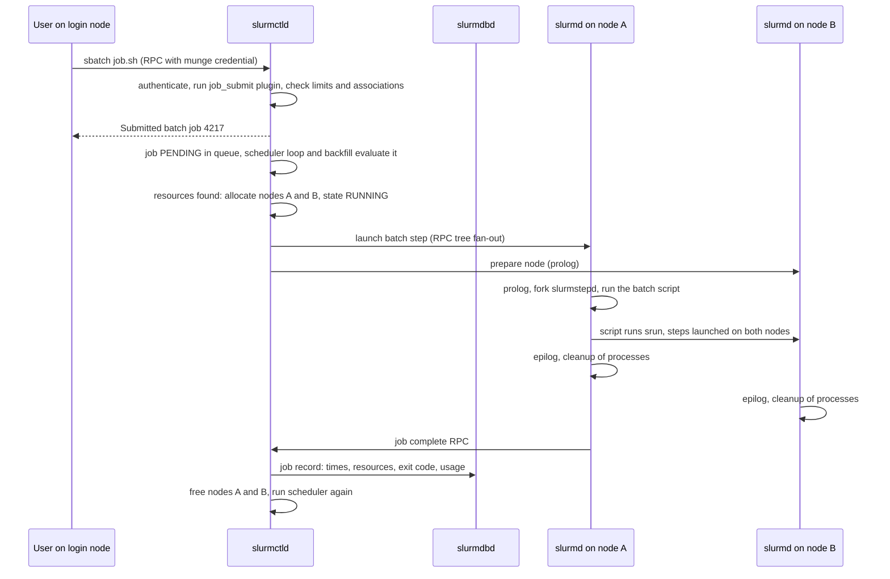
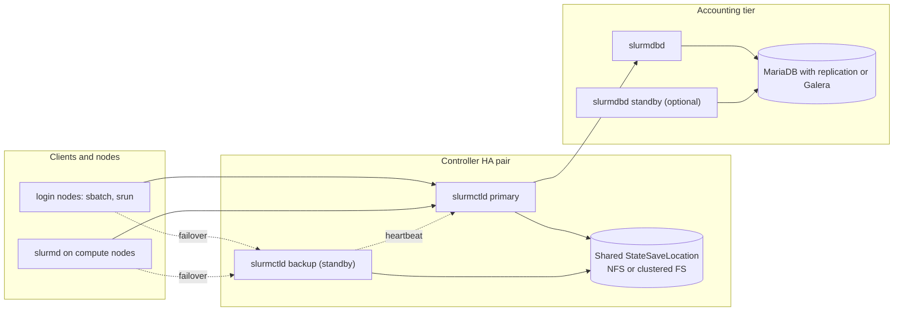
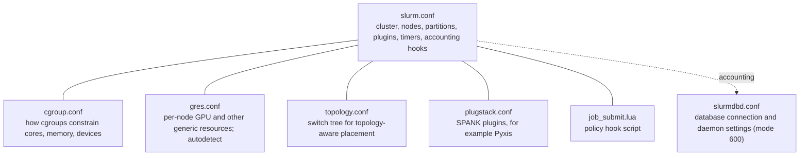
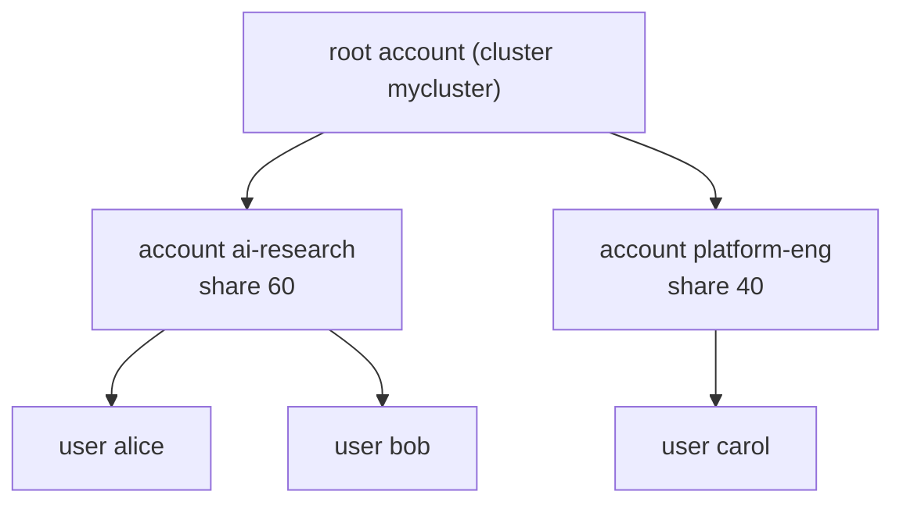

# 6.7 Slurm architecture and installation

**Level:** intermediate · **Priority:** Tier 1 (a hard requirement in HPC-style GPU-cloud roles) · **Lab venue:** GCP VMs (single-node simulated cluster, then a three-VM cluster; a Nebius GPU VM adds real GPUs) · **Status:** drafted, labs untested · **Coverage file:** `planning/coverage/chapters/06-07.md`

## Why this matters for AI infrastructure

Suppose the controller of a GPU cluster dies in the middle of a training run. Which jobs keep running, and which ones are lost? Interviewers ask questions like these, and the answers depend on Slurm. Almost every large GPU cluster that is not Kubernetes-first runs Slurm. NVIDIA DGX SuperPOD reference designs ship with it, and BCM can deploy it for you. The GPU clouds that sell raw clusters to AI labs, such as CoreWeave, Nebius, Lambda, DGX Cloud and others, expose it to customers as the default way to run training jobs.

Job descriptions for those roles list Slurm, InfiniBand and NCCL together as hard requirements. The interviews go straight to internals. Interviewers ask what runs where, what happens when the controller dies, how accounting limits actually get enforced, and why a node is `drain`ed. You cannot answer those questions by memorising `sbatch` flags. You need a clear model of the parts and how they talk to each other, and you need to have installed one at least once.

This chapter builds that model and walks you through a complete installation. It deliberately stops before partitions, QoS, fairshare and GPU scheduling in depth, which are covered in chapters 6.8 to 6.10. Job submission is 6.11, multi-node training launch is 6.12, and operations and troubleshooting are 6.14. Follow the installation yourself, since that is how the parts start to make sense.

## Prerequisites and outcomes

Before you start, you should know the Linux material from Part 1 (users, systemd, networking basics) and the cluster picture from chapters 6.1 and 6.2. By the end of this chapter, you will be able to:

- explain what problem a workload manager solves, and why Slurm is the default in HPC and AI training.
- name every Slurm daemon, say where it runs, what it stores, and which ports it uses.
- narrate the life of a batch job from `sbatch` to the accounting record, naming the component that acts at each step.
- explain how Slurm keeps working when a controller fails, and what is and is not persisted.
- plan a Slurm deployment: which node plays which role, sizing, network ports, time and identity prerequisites.
- install munge, MariaDB, `slurmdbd`, `slurmctld` and `slurmd`, write a first `slurm.conf`, create the accounting hierarchy, and verify the cluster.
- recognise the seven most common installation-time failures and fix them.

:::info Version note
Slurm changes quickly. The parameter names, defaults and plugin behaviour in this chapter match Slurm 24.x and 25.x as of the time of writing. Several older tutorials, including some books, use options that are now deprecated or removed. Settings that depend on the version are marked. Build the habit of reading the release notes and `man slurm.conf` for the exact version you run before you copy any configuration.
:::

## 1. What a workload manager does

Picture a cluster with no scheduling software at all. Users ssh to nodes, fight over GPUs, leave stray processes behind, and have no fair way to share the machine. A **workload manager** (also called a batch scheduler or resource manager) fixes this. It solves four separate problems. Keep them apart in your head, because Slurm implements each one with different components.

1. **Resource management.** Know what exists (nodes, CPUs, memory, GPUs, licences) and what is currently in use, and enforce that jobs only use what they were given.
2. **Scheduling.** Decide *who runs where and when*, given the queue, priorities, limits, fairness policies and the shape of each request. This is the part people usually mean by "the scheduler."
3. **Launching and control.** Start a program on the chosen nodes, set up its environment, track every process it creates, and clean up when it ends or is killed.
4. **Accounting.** Record who used what, for how long, so that you can bill, enforce quotas, balance fairness over time, and answer "why did my job die?"

Slurm, originally the *Simple Linux Utility for Resource Management*, was created at Lawrence Livermore National Laboratory with several partners. SchedMD leads its development and commercial support. It is open source, written in C, and designed around plugins. Reports at the end of 2025 said NVIDIA was acquiring SchedMD and promised to keep Slurm open source. Verify the current stewardship before you quote it in an interview. Slurm is the dominant scheduler on the TOP500 supercomputers.

AI training has the same shape as an HPC job. Both are a large, tightly coupled parallel program that must start on many nodes at once. That is why Slurm became the natural way to run large GPU training clusters as well.

The key property to hold on to is that Slurm is a **batch** system. You describe what you need, such as nodes, GPUs and time, and then submit it. The request waits in a queue until the scheduler can give you exactly that, all at once. Kubernetes works the other way round, with a default model of "start these containers somewhere as soon as possible and keep them running." That difference is why gang scheduling is the default here. Kubernetes needs extra projects to approximate it (Part 11).

### Why batch systems exist

Consider a supercomputer that never sits idle. The most efficient pattern is to launch tasks back to back, each one occupying the whole compute field. The moment one task ends, the next one starts. In practice that mode is uncommon, and it usually appears only on a machine built to solve one single task. Most sites run many kinds of work, and not every task can fill the machine. Some tasks only scale to certain sizes. Others need a process count such as a power of two.

Even when a task could fill the whole machine, someone still has to start the next one right after the last one finishes. Doing that by hand is tedious and easy to get wrong. That is why a machine shared by more than one user needs a batch system, also called a batch manager or resource manager. The phrase "batch processing" comes from old large machines. A single job there had several steps, and each step needed different resources, such as disks, tapes, teletypes and the processor. The batch manager planned the use of all of them as efficiently as possible.

Modern supercomputers rarely describe a job that way. Usually a job asks for one type of resource, such as processors or GPUs, and a count of them. Sometimes it also names attributes, such as memory size or the licenses it needs. Because the way jobs launch and get tracked has changed a lot, older control systems often struggle with today's workloads.

### How the pieces of a task management system fit together

A task management system is a software package with at least three parts: the queue manager, the scheduler, and the agents on the compute nodes. Think of the queue manager as the front desk. It accepts a job into the queue, shows the state of queues and jobs, changes the state of nodes, queues and jobs, and launches and tracks each job while it runs.

The agents on the compute nodes help start a job and watch it. If a job crashes or someone withdraws it, the agents must stop the processes it left running. That cleanup is what keeps a dead job from holding a node.

The scheduler decides when a job starts and which resources it gets. Many systems let you replace the built-in scheduler with a third-party one. The first-come, first-served rule is simple, but it often leaves many processors idle while a large job waits. A better scheduler can use priorities, allowed time windows, and rules that the administrator sets.

Choosing the scheduler matters for a second reason. A complex scheduler needs resources of its own. With many nodes and many tasks, it can take tens of minutes to produce a plan, and that is rarely acceptable in production. Pick a scheduler that works well with your own mix of tasks. Some systems use an outside service such as MAUI with Torque. Many commercial and free options exist, including Moab, LSF, Torque, Slurm, SGE, Condor and OpenLava.

### Partitions, batch scripts and the job's view of its resources

The ideas that recur in every HPC resource manager are partitions (often called queues), job priorities, users, agents and schedulers. Partitions matter most because they divide the compute field. Users find it easier to name a partition than to write long lists of extra resources.

Another key idea is the batch script. Almost every system runs a script rather than a single command line. Even when a system accepts one command, it wraps that command in a temporary script. The batch script runs on the first allocated node when the job starts, and it knows the full details of the resources it received.

Many MPI implementations understand resource managers, so a command such as `mpirun` can run without you listing every node. The PMIx standard gives resource managers and parallel libraries such as MPI one shared interface. A parallel program can then start its processes through the resource manager's agents, which makes startup faster and easier to control.

### Kubernetes and HPC work

Could Kubernetes, Swarm or a similar manager do this work? Sometimes it can, and that can be a good choice. Kubernetes was built to scale services, though. It is not designed for network topology, job priorities or job queuing. Its usual flow is "submit it and forget it," which works when you have more resources than you ask for.

HPC is usually different. Demand is much higher than supply, so the queue has to be organized carefully. You can make Kubernetes handle this with plugins, sidecars and operators. Before you take that route, ask whether the effort is worth it. There are still cases where it makes sense, so think twice before you choose it for your cluster.

### Dedicated test partition, scheduler overhead, and compute-node access control (`pam_listfile` and `pam_slurm_adopt`)

In *Supercomputers for Linux SysAdmins* Chapter 13 (*Job Management Systems*), Zhumatiy notes that a task management system has at least three components: the **queue manager** itself, the **scheduler**, and the **agents on compute nodes**. Simple "first-come, first-served" queuing leaves many processors idle whenever small tasks wait behind a giant job. An overly complex scheduler, though, can take **tens of minutes** to compute a schedule across huge resource pools and task queues. That delay is unacceptable in production.

Some legacy systems such as Torque pair with an external scheduler service called **MAUI**. Its site is `http://www.adaptivecomputing.com`. Commercial **Moab** is another option. Other batch managers include **LSF**, **SGE** (Grid Engine), **Condor** and **OpenLava**.

Why not simply use Kubernetes or Swarm for everything? Kubernetes is built for scaling long-running services where capacity exceeds demand, which is the "submit to K8s and forget" model. HPC is different. The resource demand is much higher than the available hardware, and the work needs deep queue prioritization and network topology placement. As Zhumatiy puts it, *"why should you tune a tractor for the Formula-1 races, when you have special race cars?"*

Two practical operational recommendations from Chapter 13 apply across all HPC batch managers:

1. **Dedicated test partition for fast smoke tests:** Keep production partitions for real work, for example separating nodes with and without accelerators so users can pick a partition name instead of writing complex resource lists. Then add a small dedicated **test partition**. Set a strict time limit of `10–15 minutes` and cap the number of queued tasks per user at `3–5`. That policy guarantees that a user can run a quick multi-node test job with minimal data within `1–2 hours`, which verifies that their code and launch script work before they submit a long production run.
2. **Preventing direct compute-node logins (`pam_listfile` and `pam_slurm_adopt`):** Resource managers allocate nodes to jobs. Unless you lock down SSH access on compute nodes, though, a user can bypass the queue. They can run `ssh` directly to a compute node, or pass an explicit host list to `mpirun`. To prevent unscheduled access, configure PAM (Pluggable Authentication Modules) on compute nodes. The book's author found one of two mechanisms to be the best way in practice:
   - Use a scheduler-integrated PAM module such as Slurm's **`pam_slurm_adopt`**. It lets a user `ssh` into a compute node only if they currently own a running job on that node, and it adopts their SSH session into the job's cgroup.
   - Or have the resource manager's **prolog** and **epilog** scripts add and remove the allocated user's name dynamically. They write it to a node-local allowlist file, which the standard **`pam_listfile`** PAM module checks. The scripts update that file before and after the job runs.

### Summary: the queue is part of the cluster

The job management system is one of the most important parts of an HPC cluster. Choose it carefully, learn it well and use it wisely. Its configuration shapes how efficiently the cluster works. Different scheduler settings can change how long jobs wait in the queue, and how long nodes sit idle, by several times.

Statistics close the loop. Only with usage statistics can you see how efficiently the supercomputer runs, what real demand exists, and whether you need to expand or modernize. Keep collecting them as part of normal operations.

## 2. The daemons

When a job is stuck, the first question is which daemon is involved. Slurm is a small set of cooperating daemons. Learn their names and responsibilities, because every later chapter assumes you know them.



**`slurmctld`, the controller.** This is the single brain of the cluster, listening on port 6817 by default. It holds the authoritative in-memory state of every node, partition, job and reservation. It runs the scheduling algorithms, decides allocations, tells compute nodes what to launch, and notices when nodes stop responding. Think of it as the API server, scheduler and controller-manager of Kubernetes combined in one process. Because so much state sits in one process, much of its work is serialised behind internal locks. That is the root cause of the "controller overloaded" failures in section 12. You can run more than one `slurmctld` for high availability, but only one is active at a time (section 5).

**`slurmd`, the node agent.** You get one per compute node, listening on port 6818. It registers the node with the controller, reporting CPUs, memory, GPUs and uptime. It answers health pings, and it launches and supervises job processes on request. It also runs the **prolog** and **epilog** scripts that prepare and clean the node before and after jobs. When the controller stops hearing from a `slurmd` for longer than `SlurmdTimeout`, it marks the node DOWN.

**`slurmstepd`, the step daemon.** When a job step starts on a node, `slurmd` forks a `slurmstepd` first. That process starts and watches your program. This is where the work happens: tracking processes through cgroups, applying limits, setting up the task environment, forwarding standard output, and collecting per-step usage. Take a job allocated across 16 nodes. Each step of that job therefore runs 16 of these processes, one per node. When `srun` starts tasks, it talks directly to the allocated nodes' daemons. The controller is involved only to create the allocation. That design is why a job can launch thousands of tasks quickly without overwhelming the controller.

**`slurmdbd`, the accounting daemon.** Slurm runs without it, but you need it in practice. It sits between `slurmctld` (and the query tools) and a MariaDB or MySQL database, on port 6819. It stores job history, the account and user hierarchy, usage totals, and the limits and QoS definitions that accounting-based policy depends on. Features you might think of as core scheduling require accounting. These include fairshare priority, per-user or per-account limits, QoS, and usage reports with `sacct` and `sreport`. Keeping the database behind a separate daemon is deliberate, because a slow SQL query then cannot stall the scheduling loop. If the database or `slurmdbd` is down for a while, `slurmctld` queues the records it has to write and replays them later, up to a memory limit.

**`slurmrestd`, the REST API.** This is an optional gateway that exposes Slurm over HTTP with JSON. It is authenticated by JWT or munge. Use it for portals, orchestration and integrations that should not shell out to command-line tools. You will meet it with Slinky (6.16) and with web front ends. It is always version-matched to the controller.

**`sackd` and login nodes.** On newer versions, a small daemon called `sackd` can run on login or submit nodes. It provides authentication and configuration from the controller, without a local copy of `slurm.conf` (see section 7).

**munge, not part of Slurm but required by default.** This is an authentication service that every node runs. It creates and validates credentials that prove which user and group sent a request, using a key shared by all nodes. Section 6 covers it.

**The command-line tools** (`sbatch`, `srun`, `salloc`, `squeue`, `sinfo`, `scancel`, `scontrol`, `sacct`, `sacctmgr`, `sreport`, `sdiag`) are all clients. They speak the same RPC protocol to the daemons. A login node needs nothing special beyond the client tools, a valid `slurm.conf` (or configless access) and munge.

## 3. The life of a job

The easiest way to understand the architecture is to follow one job from start to finish. In this example, a user submits a batch script that requests two nodes.



Read the diagram slowly, one arrow at a time.

**Submission.** When you run `sbatch`, it reads your script and extracts the `#SBATCH` directives. It packs the request, covering resources, time limit, account, partition, working directory and environment. It sends that request to `slurmctld` with a munge credential. The controller authenticates the credential and runs any `job_submit` plugin. That plugin is a policy hook that can reject or rewrite requests, for example to force a time limit or add a QoS. The controller also checks the request against the user's association and limits.

If the request passes, the job gets an ID and enters the queue in state `PENDING`. The user sees "Submitted batch job N" almost immediately, because submission does not wait for scheduling. Only *scripts* can be submitted with `sbatch`, not binaries.

**Scheduling.** The controller continuously evaluates pending jobs. A **main scheduling pass** looks at the highest-priority jobs and tries to place them. A separate **backfill** pass looks further down the queue for smaller jobs that can start now without delaying the expected start of higher-priority jobs. A **priority** plugin turns age, size, fairshare and QoS into a number that orders the queue. A **select** plugin decides *which* CPUs, memory and GPUs on *which* nodes satisfy the request. For that choice, use `select/cons_tres`.

Chapter 6.9 covers all of this in depth. For now, remember that the output of scheduling is an *allocation*, a concrete set of nodes and resources reserved for the job.

**Launch.** Once the job is allocated, the controller contacts the first node's `slurmd` to start the batch script. It does not message every node directly, because that would not scale to thousands of nodes. Instead, Slurm uses a **hierarchical RPC tree**. The controller sends a message to a few nodes, which forward it to others, which forward it again, bounded by the `TreeWidth` setting. Large jobs and node-state updates travel the same way.

Before the script starts, every allocated node runs the **prolog**, a script you control, to prepare it. For example, it can mount things, check GPU health and set up scratch space. On the first node, `slurmd` forks `slurmstepd`, which starts the batch script as the user.

**Execution and steps.** Inside the script, `srun` creates a **job step**, which is a set of tasks launched in parallel across the allocated nodes. A job can contain many steps. `srun` asks the controller to register the step, and then it contacts the `slurmd` daemons on the allocated nodes. Each of those daemons forks a `slurmstepd` to run its local tasks. This is also where MPI and NCCL-based jobs get their rank and size environment, via PMIx or PMI2 (6.12).

You can ssh into nodes and run things yourself. Slurm then does not track, limit or clean up those processes, so `srun` is the correct way.

**Completion.** When the script ends, or the time limit is hit, or `scancel` is issued, `slurmstepd` makes sure every process in the job's cgroup is gone. The **epilog** then runs on every node, typically to clean scratch, reset GPUs and check health. Finally, `slurmd` reports completion. The controller frees the nodes, writes the job record to `slurmdbd`, and runs the scheduler again, because the freed resources may let a waiting job start.

Two takeaways are worth saying out loud in an interview. First, *the controller is on the path of every allocation and every state change, but not on the path of the application's data traffic or of task launch within an allocation.* Second, *the accounting database is written asynchronously from the scheduling path.* Keep both in mind when you debug a slow job, because they tell you where to look first.

## 4. Plugins and extension points

Almost every behaviour in Slurm is a **plugin**, and `slurm.conf` picks each one by name. Learn the plugin families and you have a map of the whole configuration file. The table lists each family, the parameter that selects it, and the typical production choice. Read each row as one question Slurm has to answer.

| Family | Parameter | What it decides | Typical production choice |
|---|---|---|---|
| Authentication | `AuthType` | How requests are authenticated | `auth/munge` (or `auth/slurm` on newer versions) |
| Node selection | `SelectType` | How CPUs, memory and GPUs are assigned inside nodes | `select/cons_tres` |
| Scheduler | `SchedulerType` | Queue scheduling algorithm | `sched/backfill` |
| Priority | `PriorityType` | How job priority is computed | `priority/multifactor` |
| Preemption | `PreemptType` | Which jobs may be preempted | `preempt/qos` or `preempt/partition_prio` |
| Process tracking | `ProctrackType` | How all processes of a job are found and killed | `proctrack/cgroup` |
| Task launch | `TaskPlugin` | CPU binding and per-task cgroup constraints | `task/affinity,task/cgroup` |
| Accounting storage | `AccountingStorageType` | Where accounting data is stored | `accounting_storage/slurmdbd` |
| Accounting gather | `JobAcctGatherType` | How usage is measured | `jobacct_gather/cgroup` |
| Topology | `TopologyPlugin` | Awareness of the network tree | `topology/tree` or block topology for large IB fabrics |
| MPI | `MpiDefault` | Default `srun --mpi` plugin | `pmix` (if built with PMIx) |
| Job submit | `JobSubmitPlugins` | Policy hook at submission | `lua` for custom rules |
| Task/step hooks | `PlugStackConfig` | SPANK plugins, site-written hooks at launch | for example Pyxis (6.13) |

The last column is where to start, not the final answer. Check it against your own site before you copy it.

Two extension points deserve special mention. The first is **`job_submit` plugins**, often written in Lua. An administrator uses them to validate and rewrite requests. They can enforce naming, require GPUs to be requested with `--gres`, route a job to the right partition, or add a QoS.

The second is **SPANK plugins**, which hook into the job launch path. Their API stays stable across versions. NVIDIA's Pyxis, which launches containers from `srun`, is a SPANK plugin (6.13).

Most other plugin interfaces use internal Slurm structures, and they change from version to version. Third-party plugins that are neither SPANK nor `job_submit` therefore tend to break on upgrades. Write your site policy in `job_submit` and SPANK. Avoid custom compiled plugins unless you can maintain them.

## 5. State, persistence and high availability

Picture the controller restarting in the middle of a busy afternoon. What does it remember, and what does it have to ask the nodes? The answers depend on where each kind of state lives and what happens when it disappears.

### What lives where

Each kind of state sits in a different place, and each one has a different cost when it is lost.

| What | Where | Lost if it disappears? |
|---|---|---|
| Configuration | `slurm.conf` and friends, in `/etc/slurm` (or served configless) | Cluster cannot start; keep it in version control |
| Controller run-time state: queued and running jobs, node states, reservations | Files in `StateSaveLocation` (for example `/var/spool/slurmctld`) | Queued jobs lost; running jobs may be orphaned or lost |
| Per-node job state | `SlurmdSpoolDir` (for example `/var/spool/slurmd`) | Node forgets running steps on restart |
| Accounting: job history, associations, limits, QoS, usage | MariaDB behind `slurmdbd` | History and every account-based policy |
| Logs | `SlurmctldLogFile`, `SlurmdLogFile`, `SlurmdbdLogFile` or journald | Only diagnosability |

Of these, `StateSaveLocation` is the one that gets operators into trouble. It is how `slurmctld` survives restarts. On startup, the controller reads it back and rebuilds the queue and the cluster state. Then it asks the nodes what is running. The directory must sit on fast, reliable storage with enough free space, and it must be owned by the `SlurmUser`. For HA, it must also be shared between controllers.



### High availability of the controller

Slurm HA is **active/passive**. You list more than one host with `SlurmctldHost`. The first one is primary, and the rest are backups, in order:

```ini
SlurmctldHost=ctl1(10.0.0.10)
SlurmctldHost=ctl2(10.0.0.11)
StateSaveLocation=/shared/slurm/state     # must be reachable and consistent from both
SlurmctldTimeout=120
```

The primary writes state continuously. The backup runs but stays passive, and it contacts the primary regularly. If the primary does not answer for `SlurmctldTimeout` seconds, the backup takes control, reads the state and starts scheduling. When the primary returns, it resumes control, after the backup hands back state. Three practical consequences follow.

The shared state directory is a single point of failure, unless the storage itself is highly available. Many sites use a replicated or clustered filesystem, or a highly available NFS export.

Clients and `slurmd` try the controllers in order, so failover takes up to about `SlurmctldTimeout` plus reconnection time. During that window nothing new is scheduled, but running jobs continue.

*Do not* run two active controllers pointing at independent state. The `slurm.conf` manual says that if two controllers are simultaneously acting as primary, the behaviour is destructive. The design requirement is therefore that exactly one controller can ever be primary. To meet it, verify that the standby sees a consistent view of the state directory after the primary's last write, and test that by killing the primary under load. Decide deliberately whether you need external fencing, such as BMC power control, and make sure it does not fight Slurm's own failover. Finally, practise recovery before you need it.

Two controls are worth knowing. `scontrol takeover` tells the first backup to take over immediately, instead of waiting out the timeout. It asks the primary to terminate, or it switches directly if the primary cannot be contacted. That makes it the clean way to do planned maintenance. The parameters `SlurmctldPrimaryOnProg` and `SlurmctldPrimaryOffProg` name programs that run when a controller becomes or stops being primary, so that a virtual IP address can follow the primary. For `slurmd` daemons and clients to find the new primary, they need the full `SlurmctldHost` list. That is one more reason to distribute the same configuration everywhere, or to serve it with configless mode (section 7).

Older tutorials use `ControlMachine`, `ControlAddr` and `BackupController`. Those parameters are deprecated in favour of `SlurmctldHost`.

### High availability of accounting

`slurmdbd` has a standby mode too. You set it with `AccountingStorageBackupHost` in `slurm.conf` and with `DbdBackupHost` in `slurmdbd.conf`. The database is the real risk, though. Use a replicated or Galera MariaDB cluster, or a managed database, and back it up. Remember that when accounting is down, `slurmctld` buffers records. If `AccountingStorageEnforce` includes limits, job submission may be rejected, because the limits cannot be checked. Plan for that.

## 6. Authentication: munge, and its successor

Every request in Slurm carries an identity. When a user submits a job, when `slurmctld` tells `slurmd` to launch something, or when an admin updates a node, the request arrives with proof of who sent it. By default, that proof is a **munge credential**. Munge is a tiny service that runs on every node, and it does one thing. Any process can ask the local `munged` for a credential. Any other node's `munged` can decode it and report back the *numeric UID and GID of the process that asked for it*. This works provided both nodes share the same secret key and their clocks are within a few minutes of each other. This is how Slurm can trust "user 1042 sent this" without passwords.

Four things follow for installation:

1. **One shared key.** Every node needs an identical `/etc/munge/munge.key`, on the controller, compute, login and database hosts alike. Only the `munge` user may read it (mode 0400), and `munge` must own it. Create it once, then distribute it securely.
2. **Consistent identities.** Munge transports numbers, so the UID and GID numbers must mean the same thing everywhere. Use LDAP/SSSD or a configuration-management system (chapter 6.24) so that `alice` is UID 1042 on all nodes.
3. **Synchronised time.** Credentials carry a timestamp with a short validity window, five minutes by default. Run chrony or ntpd and monitor skew.
4. **A running `munged` and the right socket.** The tools talk to `/run/munge/munge.socket.2`. Permissions and directory ownership on that path matter.

Test munge before you install anything else, because it can save you hours. Run these two commands. The first checks the local node, and the second checks the key and clocks across nodes.

```bash
munge -n | unmunge                       # local encode and decode
munge -n | ssh node1 unmunge             # cross-node: proves the key and clocks agree
```

If the second command fails, the key or the clocks disagree between the two nodes.

Newer Slurm releases offer a built-in alternative to munge. It arrived around 23.11 with the `auth/slurm` plugin and the `sackd` daemon. It uses Slurm's own key and token mechanism, which simplifies login nodes. Munge remains the most common deployment. Treat the new method as something to evaluate once you know the basics, and check the SchedMD documentation for your version.

## 7. Configuration files and configless mode

Picture a new compute node that refuses to join the cluster, because its configuration file is one change out of date. Slurm is configured by a family of plain-text files, normally in `/etc/slurm`. Each one covers a different area, and the diagram shows how they connect.



`slurm.conf` is the main file. Historically, it had to be **identical on every node**. A node whose copy differs from the controller's refuses to join or behaves unpredictably, because the controller compares a hash of the file. Keeping 1,000 copies in sync is how people end up with drift. Slurm offers **configless mode** to avoid that, in which the controller serves the configuration files to nodes and clients itself.

Enabling configless mode takes one line on the controller. Each compute node then needs either a flag or a DNS record to find that controller.

```ini
# slurm.conf on the controller
SlurmctldParameters=enable_configless
```

```bash
# on a compute node, start slurmd pointing at the controller
slurmd --conf-server ctl1:6817
# or publish a DNS SRV record _slurmctld._tcp so that no flag is needed
```

Login nodes use `sackd` the same way. With configless mode, you edit configuration only on the controller, run `scontrol reconfigure`, and the nodes pick up the change. Most modern deployments use this mode, including BCM, Slinky and many cloud images. A handful of settings still need a daemon restart rather than a reconfigure, and the manual states which ones.

## 8. Planning and installing

Before you install anything, decide which machine plays which role. In a lab, all the roles can fit on one machine. In a real deployment, you separate them.

### Planning roles and sizing

A small production cluster has the roles below. Use the sizing notes as a checklist for each host.

| Role | Runs | Sizing notes |
|---|---|---|
| Controller(s) | `slurmctld` (primary and backup) | Fast CPU cores (the scheduler is largely single-threaded in critical sections), plenty of RAM, local SSD or a very reliable shared filesystem for `StateSaveLocation`. Not a GPU node. |
| Accounting database host | MariaDB or MySQL, `slurmdbd` | Own host or at least own disk; InnoDB buffer pool sized for the job history. Back it up. |
| Login / submit nodes | client tools, munge, sackd | Scale with number of users; users compile and prepare data here. |
| Compute nodes | `slurmd`, munge | The GPU servers. Reserve some CPU and memory for the OS and daemons (see section 10). |
| Optional | `slurmrestd` host, monitoring exporter | Often on a management node. |

Open these ports between nodes: 6817 for the controller, 6818 for `slurmd` and 6819 for `slurmdbd`. The `srun` command also opens ephemeral ports on the submit node for I/O and step traffic. If you must restrict those, use `SrunPortRange`. Compute nodes must also resolve and reach each other and the controller by name.

Have these prerequisites in place *before* you touch any Slurm package. You need DNS or `/etc/hosts` consistency, time sync, and consistent UIDs and GIDs. You also need a shared home or data filesystem, because users need the same paths on every node. Finally, create a dedicated unprivileged `slurm` system user with the same UID on all nodes.

### Installation methods

1. **Distribution packages:** `apt install slurm-wlm` on Ubuntu or `dnf install slurm` from EPEL on Rocky and RHEL. This is quick to start, but the packages are usually old, and package splits differ between distributions. As listed in *Supercomputers for Linux SysAdmins*, chapter 15, you install `slurm` and `slurm-munge` on compute and control nodes. You can add optional `slurm-perlapi` and `slurm-torque` for Torque script compatibility. The controller node also gets `slurm-slurmctld` and `slurm-plugins`, and compute nodes get `slurm-slurmd`. The database node gets MySQL or MariaDB along with `slurm`, `slurm-munge`, `slurm-slurmdbd`, `slurm-sql`, and `slurm-plugins`. On Slurm 23.11 and later, login nodes can optionally use `slurm-sackd`.
2. **Build packages from source:** Download a release from `schedmd.com` or the `https://github.com/SchedMD/slurm` repository. Check out the tag you want, for example `slurm-24-11-5-1`. Then either build directly with `./configure --prefix=/opt/slurm && make && make install`, or build RPMs or DEBs yourself with `rpmbuild -ta slurm-VERSION.tar.bz2` or the Debian packaging flow (`mk-build-deps -i debian/control; debuild -b -uc -us`). This is what serious sites do. You choose the version and enable the features you need: PMIx, NVML, hwloc, UCX, JWT for `slurmrestd`, and the MariaDB `mysql_config` headers for `slurmdbd`. The result is reproducible packages that you can sign and ship in your image pipeline. Install the development headers *before* you build. A missing `nvml.h` quietly produces a Slurm without `AutoDetect=nvml` support, which is a classic way to lose an afternoon.
3. **Use a cluster manager.** BCM (chapter 8.8), DGX OS images or vendor tools install and configure Slurm for you. You still need the knowledge in this chapter to operate it.
4. **Containerised Slurm on Kubernetes.** Slinky and Soperator run Slurm in containers, as covered in chapter 6.16.

### Versions and upgrades

Releases follow a `YY.MM` scheme and arrive roughly twice a year. Plan each upgrade carefully. **Upgrade in this order: `slurmdbd` first, then `slurmctld`, then `slurmd` and clients.** Before you start, take a database backup and copy `StateSaveLocation`. Stay within the supported compatibility window. The controller and database daemons understand RPCs and state files from a limited number of earlier major releases, so check the upgrade notes for the exact rule for your version. Skipping versions is the usual way upgrades fail. Chapter 6.15 covers upgrades in depth.

## 9. Accounting: the account tree

If you install only one optional component, install accounting. Without it you lose fairshare, QoS, per-user and per-account limits, and `sacct`. Suppose you turn on enforcement before the tree exists. A submit from a user with no association is then rejected, and everyone is locked out.

The data model is an **association tree**. Users belong to **accounts**, and accounts can be nested. An **association** is a tuple of cluster, account, user and optionally partition. Policy such as limits and shares attaches to associations and accounts. Once enforcement is on, every user must have at least one association before they can submit jobs.



You manage the tree with `sacctmgr`, which creates and modifies the hierarchy and its limits. You read usage with `sacct` and `sreport`. A typical bootstrap looks like this:

```bash
sacctmgr add cluster mycluster
sacctmgr add account ai-research Description="AI research" Organization=lab
sacctmgr add user alice Account=ai-research
sacctmgr list associations format=cluster,account,user,share,qos
```

You set administrative levels per user, using `AdminLevel=Admin`, `Operator` or `None`. **Coordinators** can manage the users inside an account. The limits and fairshare weights you attach to accounts are the substance of chapter 6.9.

Use `sacctmgr show tree` to check the hierarchy at a glance. The example below shows the cluster, a division account, team sub-accounts and users.

```
   Cluster  Account       User
 --------   -------       ----
 AIFactory  root
            genai
             llm-pretrain
                          jsmith
            robotics
             cv-vision
                          adoe
```

To create a sub-account, set `parent=`. For example: `sacctmgr add account llm-pretrain parent=genai`.

Accounting also needs housekeeping, or the database grows without bound. In `slurmdbd.conf`, `PurgeJobAfter` and `PurgeStepAfter`, along with the related `Purge*After` settings, delete old records. **If they are unset, records are never purged.** Set `ArchiveJobs=yes` if you want purged job records written to an archive. The default is no, and then purged records are simply gone.

`MaxQueryTimeRange` limits how wide a time range one `sacct` or `sreport` query may cover. That protects the database from a single enormous query (failure mode 8). The `slurmdbd.conf` file also holds the database password, so it must be readable only by `SlurmUser`.

Enforcement is controlled by `AccountingStorageEnforce` in `slurm.conf`, for example `associations,limits,qos`. With enforcement on, a submit from a user with no association is rejected, and limits are applied. Enable it only after the tree exists, or you will lock everyone out. Build the whole tree first, then switch enforcement on.

## 10. A first `slurm.conf`, and the node definition problem

You are about to write your first configuration for a small GPU cluster. Most of the file is routine. The node definition is the line that trips people up.

The configuration below is a sound starting point for a small GPU cluster on Slurm 24.x or 25.x. Read each line, because later chapters explain the choices in depth.

```ini
# ---------- slurm.conf ----------
ClusterName=mycluster
SlurmctldHost=ctl1
SlurmUser=slurm
SlurmctldPort=6817
SlurmdPort=6818
StateSaveLocation=/var/spool/slurmctld
SlurmdSpoolDir=/var/spool/slurmd
SlurmctldPidFile=/run/slurmctld.pid
SlurmdPidFile=/run/slurmd.pid
AuthType=auth/munge
CredType=cred/munge

# Scheduling and resource selection
SchedulerType=sched/backfill
SelectType=select/cons_tres
SelectTypeParameters=CR_Core_Memory
GresTypes=gpu
PriorityType=priority/multifactor

# Process tracking and task control with cgroups
ProctrackType=proctrack/cgroup
TaskPlugin=task/affinity,task/cgroup
JobAcctGatherType=jobacct_gather/cgroup

# Accounting
AccountingStorageType=accounting_storage/slurmdbd
AccountingStorageHost=db1
AccountingStorageTRES=gres/gpu
AccountingStorageEnforce=associations,limits,qos
JobCompType=jobcomp/none

# Timers and recovery
SlurmctldTimeout=120
SlurmdTimeout=300
ReturnToService=2
MinJobAge=300
MaxJobCount=50000

# Logging
SlurmctldLogFile=/var/log/slurm/slurmctld.log
SlurmdLogFile=/var/log/slurm/slurmd.log
SlurmctldDebug=info
SlurmdDebug=info

# Nodes and partitions
NodeName=gpu[01-04] CPUs=64 Sockets=2 CoresPerSocket=16 ThreadsPerCore=2 RealMemory=500000 Gres=gpu:8 State=UNKNOWN
PartitionName=gpu Nodes=gpu[01-04] Default=YES MaxTime=2-00:00:00 State=UP
```

```ini
# ---------- cgroup.conf ----------
CgroupPlugin=autodetect       # picks cgroup v1 or v2
ConstrainCores=yes
ConstrainRAMSpace=yes
ConstrainDevices=yes          # required so a job only sees the GPUs it was given
```

```ini
# ---------- gres.conf ----------
AutoDetect=nvml               # needs a Slurm build with NVML support
```

```ini
# ---------- slurmdbd.conf (mode 600, owner slurm) ----------
AuthType=auth/munge
DbdHost=db1
SlurmUser=slurm
LogFile=/var/log/slurm/slurmdbd.log
PidFile=/run/slurmdbd.pid
StorageType=accounting_storage/mysql
StorageHost=localhost
StorageUser=slurm
StoragePass=CHANGE_ME
StorageLoc=slurm_acct_db
```

A few notes cover what older material gets wrong or skips:

- `FastSchedule` was removed years ago. `ControlMachine` and `ControlAddr` are deprecated in favour of `SlurmctldHost`. You do not need an accounting password in `slurm.conf` when you go through `slurmdbd`, because the database password lives only in `slurmdbd.conf`.
- **Node definitions are where people suffer.** Do not guess the CPU layout. Run `slurmd -C` on the real node. It prints a ready-made `NodeName=... CPUs=... Boards=... SocketsPerBoard=... CoresPerSocket=... ThreadsPerCore=... RealMemory=...` line. Paste that line into your configuration. If `slurmd` registers with a different CPU count, memory or GPU count than `slurm.conf` declares, the controller marks the node `invalid`. It also drains the node, with a reason such as "Low RealMemory" or "Low socket*core*thread count", because it cannot trust the placement it computed. Set `RealMemory` a little below the physical total, so the OS and daemons are not starved. Alternatively, use `MemSpecLimit` and `CoreSpecCount` to formally reserve memory and cores for system use.
- `TaskPlugin=task/cgroup` plus `ProctrackType=proctrack/cgroup` form the foundation of reliable job cleanup. Without them, a killed job can leave a Python process holding GPU memory. The next job then starts with a half-full GPU.
- **cgroup v2.** Modern distributions, such as Ubuntu 22.04 and later and RHEL 9, use cgroup v2 by default. Slurm needs its cgroup v2 support built in, which requires the D-Bus development headers at build time. It also needs the `CgroupPlugin=autodetect` or `cgroup/v2` setting. Mixed or misdetected cgroup versions are a top cause of "slurmd will not start after the OS upgrade" (failure mode 6).
- **GPUs.** `GresTypes=gpu` plus `Gres=gpu:8` on the node plus `gres.conf` give Slurm the GPU inventory. `ConstrainDevices=yes` is what physically restricts a job to its GPUs. Details, including MIG and per-GPU types, are in chapter 6.10.
- You can generate a starting cluster configuration with the tool at `slurm.schedmd.com/configurator.html`. Its output is version-specific, so always read it against the manual.

## 11. Bringing it up, and verifying

Picture a first install where the controller starts before the database exists. Order matters when you bring a cluster up for the first time. This sequence works for a first install on a controller, a database host, and compute nodes.

1. **Users and time.** Create the `slurm` and `munge` users with fixed, identical UIDs on all nodes. Confirm chrony is synchronised everywhere.
2. **Munge.** Install it, and create the key on one node. Copy the key to all nodes with mode 0400 and owner `munge`. Start `munged`, then test with `munge -n | unmunge` across nodes.
3. **Database.** Install MariaDB, then create the database and the `slurm` user:

   ```sql
   CREATE DATABASE slurm_acct_db;
   CREATE USER 'slurm'@'localhost' IDENTIFIED BY 'CHANGE_ME';
   GRANT ALL ON slurm_acct_db.* TO 'slurm'@'localhost';
   ```

   Then raise `innodb_buffer_pool_size`, `innodb_lock_wait_timeout` and `max_allowed_packet`, as the Slurm documentation recommends for production.
4. **`slurmdbd`.** Write `slurmdbd.conf` with mode 600 and owner `slurm`. Start `slurmdbd`, then read its log, because it creates the tables on first start.
5. **Controller.** Put `slurm.conf` (and the other files) in `/etc/slurm`, create the state and log directories owned by `slurm`, and start `slurmctld`.
6. **Compute nodes.** Start `slurmd` on each node. Copy the config, or use configless mode.
7. **Accounting hierarchy.** Run the `sacctmgr` commands from section 9.
8. **Verify.**

```bash
sinfo                                  # partitions and node states: nodes should be idle, not down or drain
scontrol ping                          # is slurmctld (and the backup) answering?
scontrol show config | less            # the config the controller is really running
scontrol show node gpu01               # per-node state, Gres, CPU layout, Reason if drained
sdiag                                  # scheduler statistics, RPC counts, backfill cycle times
sacctmgr show cluster                  # is the cluster registered in accounting?
srun -N1 -n1 hostname                  # a trivial job end to end
srun -N4 -n4 hostname                  # multi-node launch
sbatch --wrap="sleep 30" && squeue     # batch path, then watch it run
sacct -X --format=JobID,JobName,Partition,Account,AllocCPUS,State,ExitCode   # accounting record
```

A healthy cluster shows nodes `idle`, and `sacct` lists completed jobs with the correct accounts. `scontrol ping` reports the controller as UP. Anything in state `down*`, `drain` or `invalid` carries a **Reason**. The asterisk in `down*` means the node is not responding. `scontrol show node` and `sinfo -R` both print the reason, and it is nearly always the explanation.

Read the log files when something fails: `slurmctld.log`, `slurmd.log` and `slurmdbd.log`. To see more, run the daemon in the foreground with extra debugging, using `slurmctld -D -vvvv` or `slurmd -D -vvvv`. Then read the first error, not the last one.

## 12. How it fails during installation and early operation

Something will go wrong during your first install, and you need a path to follow when it does. The failures below each give you the symptom, the cause, how to diagnose it, and the fix.

### 1. "Invalid authentication credential" or "Unable to contact slurm controller"

Every command fails straight away. `slurmd` cannot register, and the logs show munge errors such as `Rewound credential` or `Invalid credential`. The cause can be different munge keys, clock skew over a few minutes, `munged` not running, or wrong permissions on `/etc/munge` or `/run/munge`. To diagnose it, check `systemctl status munge`, and run `munge -n | unmunge` locally and across nodes. Compare `md5sum /etc/munge/munge.key` on each node, and check `chronyc tracking`. The fix is to redistribute the key, correct the permissions, and fix time sync. Then restart munge, and then Slurm.

### 2. Node shows `invalid`, `drain` with "Low RealMemory" or "Low socket*core*thread count"

The node registers and then drains straight away. The node line in `slurm.conf` does not match what `slurmd` discovers. Possible causes are BIOS settings, hyperthreading toggled, memory modules removed, or a GPU missing. Run `slurmd -C` on the node and compare the output with `scontrol show node`, then check the `Reason`. Correct the node definition, or the hardware. Then run `scontrol reconfigure`, followed by `scontrol update nodename=gpu01 state=resume`.

### 3. Jobs are rejected or accounting commands fail: `slurmdbd` unreachable or DB errors

`sacctmgr` hangs, or it says it cannot talk to the database. Once enforcement is on, submissions fail with "Invalid account or account/partition combination". The cause can be `slurmdbd` not running, wrong DB credentials or permissions, `max_allowed_packet` set too small, a blocked port, or no association for the user. Check `slurmdbd.log`, `systemctl status slurmdbd`, `mysql -u slurm -p slurm_acct_db`, and `sacctmgr list associations user=NAME`. Correct the credentials and configuration, and create the association. Switch `AccountingStorageEnforce` on only when the tree is complete.

### 4. Controller will not start, or starts with an empty queue: `StateSaveLocation` problems

`slurmctld` exits with a permission or I/O error. Or, after a crash, all queued jobs have vanished. The directory may not be writable by `SlurmUser`. It may sit on a full or slow filesystem, not be shared in an HA pair, or have been wiped during a reinstall. Check the log for `StateSaveLocation` errors, then run `ls -ld` and `df -h`. Correct the ownership and free space, keep state on reliable storage, and **back it up before upgrades**.

If you must recover from damaged state, know the start-up flags and their cost. By default, `slurmctld` recovers partial state: jobs and node DOWN or DRAIN state with reasons, but not partition state. `slurmctld -R` recovers full state, including partitions. `-i` ignores errors reading state files, and it loses whatever it cannot read. **`slurmctld -c` clears all state and deletes every running and queued job.** You almost never want that in production.

A recovery after two controllers believed they were primary follows a set order. Stop all but one controller first. Restore `StateSaveLocation` from backup, and start with the default or `-R`. Validate with `squeue` and `sinfo` before you reopen the queue. Have users resubmit what was lost. Then find out why the split happened.

### 5. Name resolution and identity problems

`slurmd` logs "Can't find an address", the job runs as the wrong user, or `srun` fails with "Invalid user id". The cause can be a `NodeName` that differs from the real hostname, with no `NodeHostname`/`NodeAddr` set. It can also be DNS or hosts inconsistencies, or UIDs that differ between nodes, because munge forwards numbers. Run `hostname -s`, `getent hosts` and `id user` on each node. Then fix DNS, or set `NodeAddr` or `NodeHostname`. Unify the UIDs through LDAP/SSSD or configuration management.

### 6. `slurmd` will not start after an OS upgrade: cgroup mismatch

The log reports that a cgroup controller is not available or cannot be mounted. Or all jobs fail at launch. The OS may have switched to cgroup v2 while Slurm was built without v2 support. Alternatively, `cgroup.conf` forces v1, or the systemd unit delegation is missing. Run `stat -fc %T /sys/fs/cgroup`, where `cgroup2fs` means v2. Then run `slurmd -V` and `slurmd -D -vvvv`. Use a Slurm build with cgroup v2 support, set `CgroupPlugin=autodetect`, and keep the OS and Slurm versions on a tested matrix.

### 7. "Socket timed out on send/recv operation" and a sluggish controller: RPC overload

Commands hang or fail intermittently. `squeue` takes seconds, and the log warns about an RPC backlog. The causes include polling loops, such as users or monitors running `squeue` every second from hundreds of clients. Very high job counts, a too small `MaxJobCount`, accounting back-pressure, a slow `StateSaveLocation`, or thousands of short jobs can also cause it.

Run `sdiag`. Look at "Remote Procedure Call statistics by message type" and by user, and check the scheduler cycle times. Then throttle and cache the polling. Use `sacct` instead of `squeue` for history, use `squeue --noheader` sparingly, and use exporters that poll once. Set `RPC rate limiting` where available, and raise limits only after you have found the source. This is the first failure to expect at scale, so treat the controller as a shared service with an API budget.

### 8. Commands slow or timing out while running jobs keep going: the accounting database under strain

`squeue` and `sinfo` hang or time out, but jobs that are already running progress normally. `slurmctld` normally keeps working from a cache when `slurmdbd` is slow. A database problem alone should not freeze scheduling at once, so the time is going somewhere else. A very wide `sacct` or `sreport` query that holds locks is a common culprit. Also, if `slurmdbd` stays down long enough that the controller's accounting queue exceeds its maximum size, messages are dropped.

Run `sdiag` and check the server thread count against its maximum, the agent queue and the RPC counts. Check `slurmdbd.log` for lock waits and connection errors. In the database, run `SHOW FULL PROCESSLIST;` to find long-running queries. With the owner's agreement, end the offending query with `KILL <id>;`. Then confirm that `slurmdbd` drains its queue and `slurmctld` recovers. To prevent a repeat, use `MaxQueryTimeRange`, purge old records, and size the database as the Slurm documentation recommends.

## 13. Reading the logs: three patterns to recognise

Slurm explains most failures in its logs. You only need to recognise the shapes, and once you have seen them, you will spot them quickly. The three snippets below are illustrative, since the exact wording differs between versions, and each one is an everyday pattern.

**Node flapping.** The controller log alternates between "not responding" and "now responding" for the same node. It looks like this:

```
slurmctld: error: Nodes dgx-h100-14 not responding
slurmctld: Node dgx-h100-14 now responding
```

This is rarely a Slurm problem. Either packets are being dropped on the management network, or the node is so loaded that `slurmd` cannot answer the controller's ping in time. Investigate the network and the node's CPU and I/O load before you touch Slurm settings.

**A job killed for memory.** A `slurmd` log shows a job's step dying with signal 9 and a memory-limit message for the job's cgroup. The user asked for less memory than the job actually used. The kernel's out-of-memory killer, acting at the cgroup limit, ended the job. This is the same event that gives Kubernetes containers exit code 137, covered in chapter 1.2. The fix is a realistic `--mem` request or a leaner program, not a Slurm change.

**An invalid RPC after an upgrade.** A compute node logs that it received an RPC it does not understand, or that a message had zero bytes. This points to a version mismatch. `slurmd` must never be newer than `slurmctld`. Compute nodes may be older than the controller during a rolling upgrade, which is exactly why the upgrade order is database, then controller, then compute nodes (section 8, and chapter 6.15). Roll the compute node back, or finish upgrading the controller.

## Hands-on lab

Start with the self-checking Python lab, which you run locally. It checks the Slurm daemon port map (`6817`, `6818`, `6819`), the dedicated test-partition policy from *Supercomputers for Linux SysAdmins*, Chapter 13 (`check_test_partition_policy`), the `TreeWidth` hierarchical RPC fan-out depth calculator (`compute_rpc_tree_depth`), and the munge shared-key and 5-minute clock-skew validator (`validate_munge_credential`):

```bash
python3 code/part06/slurm_arch_lab.py
```

**Lab A: a single-node "virtual cluster" on a GCP VM (untested).** The goal is to install the full stack and see every daemon. One machine runs several `slurmd` processes that pretend to be separate nodes. Use an `e2-standard-4` Ubuntu 24.04 VM. If you move to a Nebius GPU VM later, replace the fake nodes with real GPUs.

1. Install the prerequisites:

   ```bash
   sudo apt-get update
   sudo apt-get install -y munge mariadb-server slurm-wlm slurmdbd
   ```

   This installs the distribution's Slurm, which is old. Note the version with `slurmd -V`, and compare the parameters you use with that version's man pages (`man slurm.conf`). The goal here is the architecture, not the newest features.
2. Generate the munge key and test it:

   ```bash
   sudo /usr/sbin/mungekey --create --force
   sudo systemctl enable --now munge
   munge -n | unmunge
   ```
3. Create the database as in section 11, step 3. Write `/etc/slurm/slurmdbd.conf` with mode 600 and owner `slurm`, then start `slurmdbd`. Confirm the tables with `mysql -e "show tables" slurm_acct_db`.
4. Write `/etc/slurm/slurm.conf` by using section 10 as a model. This time, define two virtual nodes that share the one machine:

   ```ini
   SlurmctldHost=localhost
   NodeName=vn1 NodeHostname=localhost Port=17001 CPUs=2 RealMemory=3000 State=UNKNOWN
   NodeName=vn2 NodeHostname=localhost Port=17002 CPUs=2 RealMemory=3000 State=UNKNOWN
   PartitionName=debug Nodes=vn[1-2] Default=YES MaxTime=INFINITE State=UP
   ```

   You can also run with `TaskPlugin=task/none` and `ProctrackType=proctrack/linuxproc` on a tiny lab VM if cgroups cause trouble. Note what you gave up.
5. Start `slurmctld`. Then start two `slurmd` processes, one per virtual node, and use `-N` to give each one its node name:

   ```bash
   sudo systemctl start slurmctld
   sudo slurmd -N vn1
   sudo slurmd -N vn2
   ```
6. Verify the setup as in section 11. `sinfo` should show both nodes `idle`. Then run `srun -N2 hostname`, and run `sbatch --wrap="sleep 20"` and watch it with `squeue`.
7. Build the account tree with `sacctmgr`, as in section 9. Turn on `AccountingStorageEnforce=associations` and restart `slurmctld`. Submit as a user with an association and as a user without one, and observe the rejection message. Run `sacct` afterwards.
8. **Observe, do not just run.** Open three terminals and tail `slurmctld.log`, `slurmd.log` and `slurmdbd.log` while you submit a job. Match each log line to a step in the sequence diagram of section 3.

**Lab B: three VMs and a real separation of roles (untested).** Create `ctl1` for the controller and database, and `gpu01` and `gpu02` for compute, all on a private network. Repeat the install with a shared munge key and identically created UIDs. Keep `slurm.conf` identical on all nodes, or use configless mode. Install `slurmd` only on the compute nodes. Add a login VM with only client tools and munge. Verify cross-node `srun -N2 hostname`, and test `scontrol ping`. Then stop `slurmctld` and watch what `sinfo` does. Restart it, and see what happens to a running `sleep` job.

**Lab C: break it on purpose (untested).** On Lab B, break one thing at a time. Stop `munged` on one node. Change the clock by ten minutes. Set `RealMemory` to a larger value than the node physically has, and restart `slurmd`. Make the state directory read-only. Fill the disk that holds it. For each break, write down the symptom, the log line and the fix. Then compare your notes with the eight failure modes above.

## Exercises

1. You start with the daemons and the RPC fan-out in `code/part06/slurm_arch.py`. Map `slurmctld` (port `6817`), `slurmd` (port `6818`), `slurmstepd`, `slurmdbd` (port `6819`), `slurmrestd`, `sackd` and `munged` to their roles. Then use `compute_rpc_tree_depth(num_nodes=1024, tree_width=50)` to explain how `slurmctld` launches a 1,024-node job in `2` tree hops while sending at most `50` direct RPCs.
2. Work through the munge failures with `validate_munge_credential()` in `code/part06/slurm_arch.py`. Explain what happens when a node has a mismatched `/etc/munge/munge.key`. Explain what happens when its clock is ahead of the controller by more than the 5-minute TTL (`Rewound credential`), and when it is behind by more than 5 minutes (`Expired credential`). Then explain, as you would to a teammate, why numeric UIDs must match across all nodes.
3. Check the test-partition policy with `check_test_partition_policy()` in `code/part06/slurm_arch.py`. This exercise draws on *Supercomputers for Linux SysAdmins*, Chapter 13. State the recommended walltime limit (`10–15 minutes`) and per-user queued task cap (`3–5` tasks) for a dedicated test partition that guarantees `1–2 hours` turnaround. Then compare `pam_slurm_adopt` with prolog and epilog `pam_listfile` access control.
4. Configure an active/passive `SlurmctldHost` pair with a shared `StateSaveLocation`. Compare the `slurmctld` startup flags: default, `-R`, `-i`, and the destructive `-c`. Then write the step-by-step recovery procedure you would follow after a split-brain event. This exercise draws on `volume-10/06` and `14`.
5. Start with `slurmdbd.conf`. Trace why `slurmctld` talks to MariaDB through `slurmdbd` rather than directly. Build a 3-level `sacctmgr` account tree (`root -> genai -> llm-pretrain -> jsmith`). Then explain why `PurgeJobAfter`, `ArchiveJobs`, and `MaxQueryTimeRange` are required in production. This exercise draws on *Supercomputers for Linux SysAdmins*, Chapter 15, and `volume-10/14`.
6. Explain why guessing `RealMemory` or `CoresPerSocket` in `slurm.conf` causes nodes to drain as `invalid` (`Low RealMemory`). Then explain how `ConstrainCores=yes`, `ConstrainRAMSpace=yes`, and `ConstrainDevices=yes` in `cgroup.conf` isolate GPUs and prevent zombie processes. Finally, explain to yourself how `SlurmctldParameters=enable_configless` (`slurmd --conf-server`) eliminates configuration drift across 1,000 nodes.

## Checkpoint questions (20)

<details>
<summary>1. Name the four problems a workload manager solves and the Slurm component most responsible for each.</summary>

The four problems are resource management, scheduling, launching and control, and accounting. For resource management, `slurmctld` tracks state, `slurmd` registers hardware, and `cgroup` enforcement keeps jobs inside their allocation. Scheduling belongs to `slurmctld`'s main scheduling loop, together with the `sched/backfill`, `priority/multifactor` and `select/cons_tres` plugins. Launching and control belongs to `slurmd` and `slurmstepd`, with PMIx wire-up and the prolog and epilog scripts. Accounting belongs to `slurmdbd`, which is backed by MariaDB or MySQL.
</details>

<details>
<summary>2. What does `slurmctld` (port `6817`) do, and why can it become a bottleneck at scale?</summary>

`slurmctld` is the single central brain of the cluster, and it listens on port `6817`. It holds all node, partition and job state in memory. It runs the scheduling and backfill loops, and it processes every submit, query (`squeue`, `sinfo`) and state-change RPC. Much of its state mutation is serialized behind internal locks. That is why polling storms, such as `squeue` in tight loops, or tens of thousands of short jobs can saturate its RPC threads. You can see that saturation in `sdiag`.
</details>

<details>
<summary>3. Why does Slurm use a separate `slurmdbd` daemon (port `6819`) rather than writing to MariaDB directly from `slurmctld`?</summary>

`slurmdbd` keeps the real-time scheduling loop in `slurmctld` away from SQL database latency, lock waits and maintenance outages. It also handles heavy `sacct` and `sreport` queries directly. If `slurmdbd` or MariaDB is temporarily unreachable, `slurmctld` buffers job completion records in memory. It replays them once `slurmdbd` recovers.
</details>

<details>
<summary>4. What is the difference between `slurmd` (port `6818`) and `slurmstepd` on a compute node?</summary>

`slurmd` is the persistent node agent, with one per compute node, listening on port `6818`. It registers hardware with `slurmctld`, answers health pings, and runs node-level prolog and epilog scripts. Whenever a job or `srun` step starts on the node, `slurmd` forks a dedicated `slurmstepd` process for that step. That process creates the job's cgroup, applies CPU, RAM and GPU device constraints, drops privileges to the user, spawns the application tasks, and forwards stdio. When the step ends, it kills all processes in the cgroup.
</details>

<details>
<summary>5. Walk through the life of a batch job from `sbatch` to the accounting record, noting where `munge` and the `TreeWidth` RPC tree act.</summary>

Start with `sbatch`, which sends the job script and resource request to `slurmctld` with a munge credential. The controller then verifies the credential, runs `job_submit` plugins, checks `sacctmgr` associations and limits, and queues the job as `PENDING`. Next, the main or backfill scheduler selects nodes through `select/cons_tres` and moves the job to `RUNNING`. The controller then fans out launch RPCs, authenticated with munge, across the `TreeWidth` RPC tree to the allocated `slurmd` daemons. Each of those runs `prolog`. The first node forks `slurmstepd` to run the batch script, and for `srun` steps, every node forks one. At the end, `slurmstepd` cleans up the cgroup, `slurmd` runs `epilog` and notifies `slurmctld`, and `slurmctld` frees the nodes and sends the usage record asynchronously to `slurmdbd`.
</details>

<details>
<summary>6. What is stored in `StateSaveLocation`, and what do the `slurmctld` startup flags `-R`, `-i`, and `-c` do?</summary>

`StateSaveLocation` holds the controller's persistent runtime state on disk. That includes all queued and running jobs, node `DOWN` and `DRAIN` states with their reasons, and reservations. The startup flags change how much of that state comes back.

- **Default startup:** recovers jobs and node states, but resets partition states to `slurm.conf`.
- **`slurmctld -R`:** recovers full state, including dynamic partition changes.
- **`slurmctld -i`:** ignores errors while reading corrupted state files, which loses the unreadable records.
- **`slurmctld -c`:** **clears all state and deletes every running and queued job.** Never run `-c` in production unless you deliberately want to wipe the queue.
</details>

<details>
<summary>7. How does active/passive `slurmctld` High Availability work, what is `scontrol takeover`, and why is split-brain destructive?</summary>

You list the primary and backup controllers with multiple `SlurmctldHost` lines. They share a common `StateSaveLocation` on HA storage. The primary writes state continuously, while the backup polls it. If the primary stops responding for `SlurmctldTimeout` seconds, the backup reads `StateSaveLocation` and takes over. An admin can also run **`scontrol takeover`** for planned maintenance. `SlurmctldPrimaryOnProg`/`OffProg` can move a VIP. If both controllers ever become active simultaneously (**split-brain**), they overwrite `StateSaveLocation` and issue conflicting allocations to `slurmd` nodes. That corrupts the cluster state.
</details>

<details>
<summary>8. What three prerequisites does `munge` require across every node in the cluster, and how do you test it?</summary>

Three prerequisites apply to every node. First, all nodes need an identical secret key at `/etc/munge/munge.key`, with mode `0400` and owned by `munge`. This covers every controller, login, database and compute node. Second, the numeric UIDs and GIDs must match, because munge encodes them. Every user and system account, such as `slurm` and `munge`, needs the exact same UID and GID everywhere. Third, clocks must agree within munge's TTL window, which is 5 minutes by default, through `chrony` or `ntp`. Test locally with `munge -n | unmunge`, and across nodes with `munge -n | ssh node1 unmunge`.
</details>

<details>
<summary>9. What is Slurm **configless mode** (`enable_configless`), and how do compute and login nodes use it?</summary>

Setting `SlurmctldParameters=enable_configless` on `slurmctld` lets the controller serve `slurm.conf`, `gres.conf`, `cgroup.conf` and `topology.conf` over the network. Compute nodes can find it with `slurmd --conf-server ctl1:6817`, or through a `_slurmctld._tcp` DNS SRV record. Login nodes running `sackd` use it too. You edit the files in one place on the controller and run `scontrol reconfigure`. That removes configuration drift across hundreds of nodes.
</details>

<details>
<summary>10. Why must you run `slurmd -C` on a physical compute node before writing its `NodeName` line in `slurm.conf`?</summary>

`slurmd -C` probes the node's real hardware. It prints the exact `CPUs`, `Boards`, `SocketsPerBoard`, `CoresPerSocket`, `ThreadsPerCore` and `RealMemory` values that `slurmd` will report at registration. If `slurm.conf` declares more RAM or cores than `slurmd` detects at startup, `slurmctld` refuses to schedule onto the node. It drains the node with state `invalid`, and the reason is `Low RealMemory` or `Low socket*core*thread count`. Set `RealMemory` slightly below the `slurmd -C` total, or use `MemSpecLimit`, to leave headroom for the OS.
</details>

<details>
<summary>11. What is the mandatory component upgrade order in Slurm, and why does violating it cause `invalid RPC` errors?</summary>

Always upgrade in this order: `slurmdbd` first, then `slurmctld`, then the `slurmd` compute nodes and client tools. Stay within the supported 2-major-release compatibility window, and back up the MariaDB database and `StateSaveLocation` before you start. Higher-level daemons understand RPCs from older lower-level daemons during a rolling upgrade. A newer `slurmd` that sends new RPCs to an older `slurmctld` fails with unknown or invalid RPC errors.
</details>

<details>
<summary>12. What time limit and per-user queued task cap does *Supercomputers for Linux SysAdmins* Chapter 13 recommend for a dedicated test partition, and what two PAM mechanisms stop users from bypassing the scheduler via direct SSH to compute nodes?</summary>

Set a `10–15 minutes` walltime limit, and cap queued tasks at `3–5` per user. That way, researchers can always run a quick multi-node smoke test within `1–2 hours`.

Two PAM mechanisms block unscheduled SSH to compute nodes. The first is Slurm's **`pam_slurm_adopt`** module. It permits SSH only if the user owns a running job on that node. It also places the SSH session inside the job's cgroup, which requires `PrologFlags=Contain`. The second is to have the job `prolog` and `epilog` scripts add and remove the user dynamically in an allowlist. **`pam_listfile`** then enforces that allowlist.
</details>

<details>
<summary>13. Which two plugin types in Slurm have stable APIs across versions and are recommended for custom site policy (*Supercomputers for Linux SysAdmins* Chapter 15)?</summary>

The two are `job_submit` plugins and SPANK plugins. `job_submit` plugins, especially `job_submit/lua`, run inside `slurmctld` at submission time. They can validate, reject or rewrite requests, such as assigning partitions, enforcing `--gres=gpu`, or setting default time limits. SPANK plugins, which are listed in `plugstack.conf`, hook into the job and step launch path on nodes. They use a C API that stays stable across versions. NVIDIA's **Pyxis** container plugin uses this to add `--container-image` to `srun` and `sbatch`.
</details>

<details>
<summary>14. What do `ConstrainCores=yes`, `ConstrainRAMSpace=yes`, and `ConstrainDevices=yes` in `cgroup.conf` do?</summary>

`ConstrainCores=yes` pins the job step to its allocated CPU cores through the `cpuset` cgroup controller. `ConstrainRAMSpace=yes` enforces the job's requested memory limit (`--mem`) through the `memory` cgroup controller. A runaway process then triggers a cgroup OOM kill, instead of crashing the whole node. `ConstrainDevices=yes` uses the `devices` cgroup controller, or an eBPF device filter under cgroup v2, to hide unallocated `/dev/nvidia*` GPUs. For example, a job that asks for 2 GPUs on an 8-GPU node can only access its 2 assigned GPUs.
</details>

<details>
<summary>15. How do you build Slurm RPM or DEB packages from a source tarball (*Supercomputers for Linux SysAdmins* Chapter 15), and why must development headers (`nvml.h`, `mysql_config`, `dbus`) be installed *before* building?</summary>

For RPMs, run `rpmbuild -ta slurm-XX.YY.Z.tar.bz2`. For DEBs, run `mk-build-deps -i debian/control && debuild -b -uc -us`. You can also build from source with `./configure --prefix=/opt/slurm && make && make install`. Slurm's `configure` script auto-detects optional features at build time. The `nvml.h` header comes from the CUDA and driver development files, `mysql_config` from MariaDB development, and `dbus` supports cgroup v2. If any of those headers is missing on the build host, the build still succeeds, but silently, and without `AutoDetect=nvml`, MySQL storage for `slurmdbd`, or cgroup v2 support. That is why you install the headers before you build.
</details>

<details>
<summary>16. What are the three administrative privilege levels in `sacctmgr` (*Supercomputers for Linux SysAdmins* Chapter 15)?</summary>

The first is `Administrator`, also written `Admin`. It has full control over all Slurm and database operations, and `root` and `SlurmUser` have it by default. The second is `Operator`. It can add, modify and remove database objects such as users and accounts, manage reservations, and view `PrivateData`-restricted information. The third is `Coordinator`, a trusted team lead for specific accounts. A coordinator can add users and subaccounts, adjust association limits up to the parent limits, and cancel or requeue jobs within those accounts. You set the level with `sacctmgr update user name=<user> set adminlevel=[admin|operator|coordinator|none]`.
</details>

<details>
<summary>17. In `slurmdbd.conf`, what happens if `PurgeJobAfter` is left unset, and what does `MaxQueryTimeRange` protect against (`volume-10/14`)?</summary>

If `PurgeJobAfter` and `PurgeStepAfter` are unset, `slurmdbd` never purges historical records. The MariaDB database then grows without bound until queries slow down. Set `ArchiveJobs=yes` alongside `PurgeJobAfter` to archive records before they are deleted. `MaxQueryTimeRange` caps the time span that a single `sacct` or `sreport` command can query. That stops a user from running an unindexed multi-year query that locks the database.
</details>

<details>
<summary>18. How do you diagnose an RPC storm or sluggish `slurmctld` controller using `sdiag` (*Supercomputers for Linux SysAdmins* Chapter 15)?</summary>

Run `sdiag` and inspect three things. First, check the `Agent queue size` and the server thread count, comparing the thread count against its maximum. Second, check the scheduler and backfill cycle times, which show how many microseconds or seconds each pass takes. Third, check the `Remote Procedure Call statistics by message type`, such as `REQUEST_PARTITION_INFO` or `REQUEST_JOB_INFO`, and the statistics `by user`. The by-user view quickly shows which user's monitoring script is hammering `squeue` hundreds of times per second.
</details>

<details>
<summary>19. What happens to already-running compute jobs if `slurmctld` crashes or is stopped for an upgrade?</summary>

Suppose the controller crashes in the middle of a run. Already-running jobs keep executing normally on the compute nodes. `slurmstepd` and `slurmd` keep supervising the application processes on each node. They buffer completion notifications until `slurmctld` restarts, or until the backup `slurmctld` takes over, within `SlurmdTimeout`. Only new job submissions, new `srun` step launches and queue queries pause while the controller is down.
</details>

<details>
<summary>20. How do you run a multi-node virtual Slurm cluster on a single Linux VM for testing (*Distributed AI Systems* Chapter 8 and Lab A)?</summary>

In `slurm.conf`, declare several virtual `NodeName` entries, such as `vn1` and `vn2`. Each one sets `NodeHostname=localhost` with its own port, either `Port=17001` or `Port=17002`. Then start one `slurmd` per virtual node on the VM, using `-N <nodename>`, as in `sudo slurmd -N vn1` and `sudo slurmd -N vn2`.
</details>

## Sources and review notes

- Daemon roles, launch stages, test partition sizing (`10–15 minutes` limit, `3–5` tasks per user for `1–2 hours` turnaround), `pam_listfile` prolog/epilog access control, installation options, accounting model, `sacctmgr` examples, node and partition definitions (read in full: `supercomputers-for-linux-sysadmins-managing-modern-hpc-clusters-and-supercomputers-from-software-to`, "13. Job Management Systems" and "15. Slurm").
- Fuheng Wu, *Distributed AI Systems*, ch. 8: why Slurm for AI training, daemon overview, and the multiple-`slurmd` simulated cluster used in Lab A.
- The author's own volumes `nvidia-devops` legacy V6 (control plane and data plane, `slurm.conf` for AI factories) and the core interview questions on Slurm HA, accounting internals and Ansible deployment, used to align the architecture and failure framing.
- Migrated from nvidia-devops: `volume-06/04-distributed-orchestration-masterclass.md`, `volume-10/06-slurm-administration-ha-accounting-and-upgrades.md`, and `volume-10/14-senior-deep-dive-2-slurm-ha-and-accounting-internals.md` (the HA design and failover mechanism, split-brain recovery, the accounting architecture and `slurmdbd.conf` `PurgeJobAfter`/`ArchiveJobs`/`MaxQueryTimeRange`, the `sacctmgr` hierarchy, scenarios 1 and 2, and the log-analysis appendix; the `slurm.conf` and cgroup deep dives, fairshare and billing, upgrades, GPU-binding and PMIx scenarios and the Ansible deployment are migrated in chapters 6.8, 6.9, 6.10, 6.12, 6.15 and 4.17).
- SchedMD documentation (public): `slurm.conf`, `slurmdbd.conf`, `cgroup.conf` and `gres.conf` manual pages, quick-start administrator guide, configless guide, high-availability notes, and upgrade guide.
- Related chapters: 6.8 configuration, 6.9 accounting and scheduling policy, 6.10 GPU scheduling, 6.11 job submission, 6.12 multi-node training, 6.14 operations, 6.15 upgrades and scaling, 6.16 Slurm on Kubernetes, 8.8 Slurm under BCM.
- Run here: `python3 code/part06/slurm_arch.py` and `python3 code/part06/slurm_arch_lab.py` (3 passed, 0 failed).
- Explicitly labelled inferences: The `compute_rpc_tree_depth` (`50` direct RPCs, `2` tree hops for `1,024` nodes at `TreeWidth=50`), `validate_munge_credential` (`300` s TTL), and `check_test_partition_policy` functions in `code/part06/slurm_arch.py` are deterministic models built on *Supercomputers for Linux Sysadmins* Chapters 13 and 15 and SchedMD documentation.
- Not verified on live hardware: all lab commands, HA and `SlurmctldHost` behaviour, `auth/slurm` and `sackd` details, release cadence and the supported upgrade window, `slurmrestd` options, and every parameter default quoted here (`untested here`). The reports about NVIDIA and SchedMD stewardship are flagged for verification.
