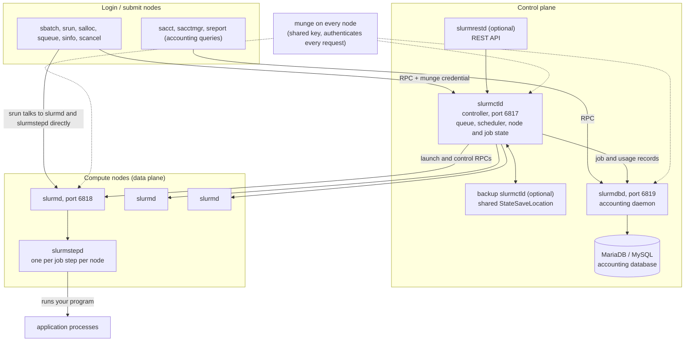
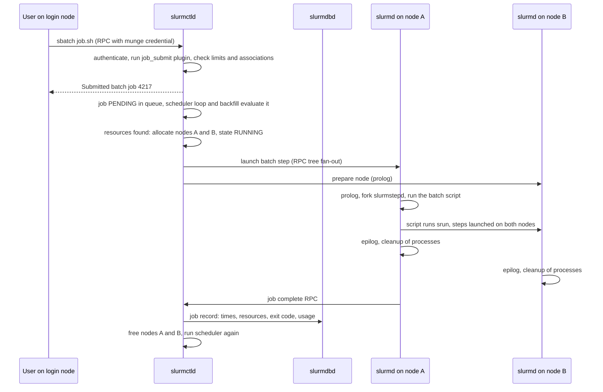
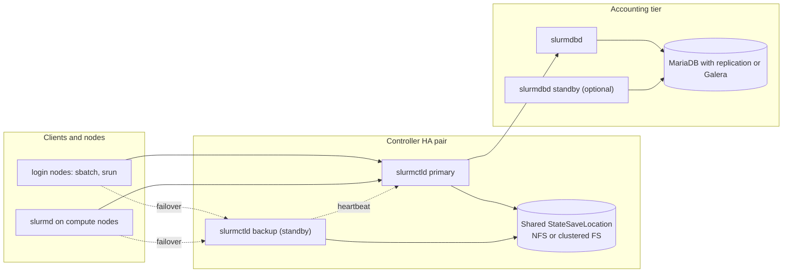
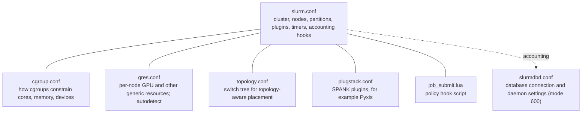
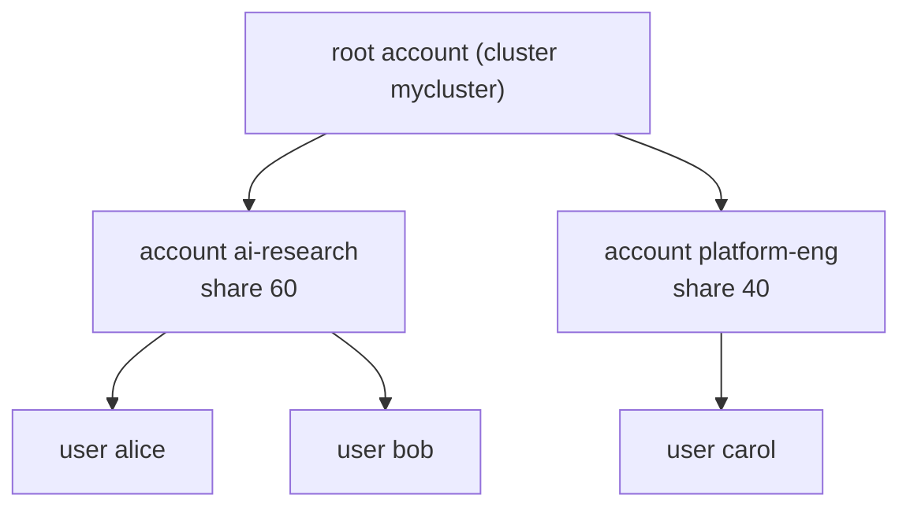

# 6.7 Slurm architecture and installation

**Level:** intermediate · **Priority:** Tier 1 (a hard requirement in HPC-style GPU-cloud roles) · **Lab venue:** GCP VMs (single-node simulated cluster, then a three-VM cluster; a Nebius GPU VM adds real GPUs) · **Status:** drafted, labs untested · **Coverage file:** `planning/coverage/chapters/06-07.md`

## Why this matters for AI infrastructure

Almost every large GPU cluster that is not Kubernetes-first runs Slurm. NVIDIA DGX SuperPOD reference designs ship with it, BCM can deploy it for you, and the GPU clouds that sell raw clusters to AI labs (CoreWeave, Nebius, Lambda, DGX Cloud and others) expose it to customers as the default way to run training jobs. Job descriptions for those roles list Slurm, InfiniBand and NCCL together as hard requirements, and interviewers go straight to internals: *what runs where, what happens when the controller dies, how do accounting limits actually get enforced, why is this node `drain`ed.* You cannot answer those by memorising `sbatch` flags. You need a clear model of the parts and how they talk to each other, and you need to have installed one at least once.

This chapter builds that model and walks through a complete installation. It deliberately stops before partitions, QoS, fairshare and GPU scheduling in depth: those are chapters 6.8 to 6.10. Job submission is 6.11, multi-node training launch is 6.12, and operations and troubleshooting are 6.14.

## Prerequisites and outcomes

You need the Linux material from Part 1 (users, systemd, networking basics) and the cluster picture from chapters 6.1 and 6.2. After this chapter you will be able to:

- explain what problem a workload manager solves and why Slurm is the default in HPC and AI training;
- name every Slurm daemon, say where it runs, what it stores, and which ports it uses;
- narrate the life of a batch job from `sbatch` to the accounting record, naming the component that acts at each step;
- explain how Slurm keeps working when a controller fails, and what is and is not persisted;
- plan a Slurm deployment: which node plays which role, sizing, network ports, time and identity prerequisites;
- install munge, MariaDB, `slurmdbd`, `slurmctld` and `slurmd`, write a first `slurm.conf`, create the accounting hierarchy, and verify the cluster;
- recognise the seven most common installation-time failures and fix them.

:::info Version note
Slurm changes quickly. Parameter names, defaults and plugin behaviour in this chapter match Slurm 24.x and 25.x as of the time of writing. Several older tutorials (including some books) use options that are now deprecated or removed. Where a setting is version-sensitive it is marked, and the habit to build is: read the release notes and `man slurm.conf` for the exact version you run before copying any configuration.
:::

## 1. What a workload manager does

A cluster is many computers that users want to treat as one resource pool. Left alone, users would ssh to nodes, fight over GPUs, leave stray processes behind, and have no way to share fairly. A **workload manager** (also called a batch scheduler or resource manager) solves four separate problems, and it helps to keep them apart because Slurm implements each with different components.

1. **Resource management.** Know what exists (nodes, CPUs, memory, GPUs, licences) and what is currently in use, and enforce that jobs only use what they were given.
2. **Scheduling.** Decide *who runs where and when*, given the queue, priorities, limits, fairness policies and the shape of each request. This is the part people usually mean by "the scheduler."
3. **Launching and control.** Start a program on the chosen nodes, set up its environment, track every process it creates, and clean up when it ends or is killed.
4. **Accounting.** Record who used what, for how long, so that you can bill, enforce quotas, balance fairness over time, and answer "why did my job die?"

Slurm (originally the *Simple Linux Utility for Resource Management*) was created at Lawrence Livermore National Laboratory with several partners, and development and commercial support are led by SchedMD. It is open source, written in C, and designed around plugins. Reports at the end of 2025 said NVIDIA was acquiring SchedMD while promising to keep Slurm open source; verify the current stewardship before quoting it in an interview. It is the dominant scheduler on the TOP500 supercomputers and, because AI training has the same shape as an HPC job (a large tightly coupled parallel program that must start on many nodes at once), it became the natural way to run large GPU training clusters as well.

The key property to hold on to: Slurm is a **batch** system. Users describe what they need (nodes, GPUs, time) and submit; the request waits in a queue until the scheduler can give them exactly that, all at once. This is the opposite of Kubernetes' default model of "start these containers somewhere as soon as possible and keep them running," and it is why gang scheduling, which Kubernetes needs extra projects to approximate (Part 11), is the default behaviour here.

### Dedicated test partition and compute-node access control (`pam_listfile` and `pam_slurm_adopt`)

Two practical operational recommendations from Chapter 13 of *Supercomputers for Linux SysAdmins* apply across all HPC batch managers:

1. **Dedicated test partition for fast smoke tests**: in addition to production partitions (for example separating nodes with and without accelerators so users can pick a partition name instead of writing complex resource lists), create a small dedicated **test partition**. Set a strict time limit of `10–15 minutes` and cap the number of queued tasks per user at `3–5`. That policy guarantees that a user can run a quick multi-node test job with minimal data within `1–2 hours` to verify that their code and launch script work before submitting a long production run.
2. **Preventing direct compute-node logins (`pam_listfile` and `pam_slurm_adopt`)**: resource managers allocate nodes to jobs, but unless you lock down SSH access on compute nodes, a user could bypass the queue by running `ssh` directly to a compute node or passing an explicit host list to `mpirun`. To prevent unscheduled access, configure PAM (Pluggable Authentication Modules) on compute nodes using one of two mechanisms:
   - Use a scheduler-integrated PAM module such as Slurm's **`pam_slurm_adopt`**, which allows a user to `ssh` into a compute node only if they currently own a running job on that node (and adopts their SSH session into the job's cgroup).
   - Or have the resource manager's **prolog** and **epilog** scripts dynamically add and remove the allocated user's name in a node-local allowlist file checked by the standard **`pam_listfile`** PAM module before and after the job runs.

## 2. The daemons

Slurm is a small set of cooperating daemons. Learn their names and responsibilities; every later chapter assumes them.



**`slurmctld`, the controller.** The single brain of the cluster, listening on port 6817 by default. It holds the authoritative in-memory state of every node, partition, job and reservation, runs the scheduling algorithms, decides allocations, tells compute nodes what to launch, and notices when nodes stop responding. Think of it as the API server, scheduler and controller-manager of Kubernetes combined in one process. Because so much state is in one process, much of its work is serialised behind internal locks; this is the root cause of the "controller overloaded" failures in section 12. You can run more than one `slurmctld` for high availability, but only one is active at a time (section 5).

**`slurmd`, the node agent.** One per compute node, port 6818. It registers the node with the controller (reporting CPUs, memory, GPUs, uptime), answers health pings, and launches and supervises job processes on request. It also runs the **prolog** and **epilog** scripts that prepare and clean the node before and after jobs. When the controller stops hearing from a `slurmd` for longer than `SlurmdTimeout`, it marks the node `DOWN`.

**`slurmstepd`, the step daemon.** When a job step starts on a node, `slurmd` forks a `slurmstepd` first, and that process starts and watches your program. This is where the work of tracking processes (via cgroups), applying limits, setting up the task environment, forwarding standard output, and collecting per-step usage happens. A job allocated across 16 nodes has 16 `slurmstepd` processes per step. When a `srun` starts tasks, it talks directly to the allocated nodes' daemons; the controller is involved only to create the allocation. That design is why a job can launch thousands of tasks quickly without overwhelming the controller.

**`slurmdbd`, the accounting daemon.** Optional in the sense that Slurm runs without it, but needed in practice. It sits between `slurmctld` (and the query tools) and a MariaDB or MySQL database, port 6819. It stores job history, the account and user hierarchy, usage totals, and the limits and QoS definitions that accounting-based policy depends on. Features you may think of as core scheduling (fairshare priority, per-user or per-account limits, QoS, usage reports with `sacct` and `sreport`) **require** accounting. Keeping the database behind a separate daemon is deliberate: a slow SQL query then cannot stall the scheduling loop. If the database or `slurmdbd` is down for a while, `slurmctld` queues the records it has to write and replays them later, up to a memory limit.

**`slurmrestd`, the REST API.** An optional gateway that exposes Slurm over HTTP with JSON, authenticated by JWT or munge, intended for portals, orchestration and integrations that should not shell out to command-line tools. You will meet it with Slinky (6.16) and with web front ends. It is always version-matched to the controller.

**`sackd` and login nodes.** On newer versions, a small daemon called `sackd` can run on login or submit nodes to provide authentication and configuration from the controller without a local copy of `slurm.conf` (see section 7).

**`munge`, not part of Slurm but required by default.** An authentication service that every node runs. It creates and validates credentials that prove which user and group sent a request, using a key shared by all nodes. Section 6 covers it.

**The command-line tools** (`sbatch`, `srun`, `salloc`, `squeue`, `sinfo`, `scancel`, `scontrol`, `sacct`, `sacctmgr`, `sreport`, `sdiag`) are all clients that speak the same RPC protocol to the daemons. There is nothing special about a login node besides having the client tools, a valid `slurm.conf` (or configless access) and munge.

## 3. The life of a job

The fastest way to make the architecture concrete is to follow one job. Below, the user submits a batch script requesting two nodes.



Read through it slowly.

**Submission.** `sbatch` reads your script, extracts the `#SBATCH` directives, packs the request (resources, time limit, account, partition, working directory, environment) and sends it to `slurmctld` with a munge credential. The controller authenticates the credential, runs any `job_submit` plugin (a policy hook that can reject or rewrite requests, for example to force a time limit or add a QoS), and checks the request against the user's association and limits. If it passes, the job gets an ID and enters the queue in state `PENDING`. The user sees "Submitted batch job N" almost immediately; submission does not wait for scheduling. Only *scripts* can be submitted with `sbatch`, not binaries.

**Scheduling.** The controller continuously evaluates pending jobs. A **main scheduling pass** looks at the highest-priority jobs and tries to place them. A separate **backfill** pass looks further down the queue for smaller jobs that can start now without delaying the expected start of higher-priority jobs. A **priority** plugin turns age, size, fairshare and QoS into a number that orders the queue. A **select** plugin (`select/cons_tres` is what you want) decides *which* CPUs, memory and GPUs on *which* nodes satisfy the request. Chapter 6.9 covers all of this in depth. For now: the output of scheduling is an *allocation*, a concrete set of nodes and resources reserved for the job.

**Launch.** Once allocated, the controller contacts the first node's `slurmd` to start the batch script. It does not message every node directly, because that would not scale to thousands of nodes. Slurm uses a **hierarchical RPC tree**: the controller sends a message to a few nodes, which forward it to others, which forward it again, bounded by the `TreeWidth` setting. Large jobs and node-state updates travel the same way. Before the script starts, every allocated node runs the **prolog** (a script you control) to prepare it: mount things, check GPU health, set up scratch space. On the first node, `slurmd` forks `slurmstepd`, which starts the batch script as the user.

**Execution and steps.** Inside the script, `srun` creates a **job step**: a set of tasks launched in parallel across the allocated nodes. A job can contain many steps. `srun` asks the controller to register the step and then contacts the `slurmd` daemons on the allocated nodes, each of which forks a `slurmstepd` to run its local tasks. This is also where MPI and NCCL-based jobs get their rank and size environment, via PMIx or PMI2 (6.12). You can ssh into nodes and run things yourself, but then Slurm does not track, limit or clean up those processes; `srun` is the correct way.

**Completion.** When the script ends (or the time limit is hit, or `scancel` is issued), `slurmstepd` makes sure every process in the job's cgroup is gone, the **epilog** runs on every node (typically to clean scratch, reset GPUs, and check health), and `slurmd` reports completion. The controller frees the nodes, writes the job record to `slurmdbd`, and runs the scheduler again, because the freed resources may let a waiting job start.

Two takeaways to say out loud in an interview. First, *the controller is on the path of every allocation and every state change, but not on the path of the application's data traffic or of task launch within an allocation.* Second, *the accounting database is written asynchronously from the scheduling path.*

## 4. Plugins and extension points

Almost every behaviour in Slurm is a **plugin**, chosen in `slurm.conf` by name. Understanding the plugin families gives you a map for the configuration file.

| Family | Parameter | What it decides | Typical production choice |
|---|---|---|---|
| Authentication | `AuthType` | How requests are authenticated | `auth/munge` (or `auth/slurm` on newer versions) |
| Node selection | `SelectType` | How CPUs, memory and GPUs are assigned inside nodes | `select/cons_tres` |
| Scheduler | `SchedulerType` | Queue scheduling algorithm | `sched/backfill` |
| Priority | `PriorityType` | How job priority is computed | `priority/multifactor` |
| Preemption | `PreemptType` | Which jobs may be preempted | `preempt/qos` or `preempt/partition_prio` |
| Process tracking | `ProctrackType` | How all processes of a job are found and killed | `proctrack/cgroup` |
| Task launch | `TaskPlugin` | CPU binding and per-task cgroup constraints | `task/affinity,task/cgroup` |
| Accounting storage | `AccountingStorageType` | Where accounting data is stored | `accounting_storage/slurmdbd` |
| Accounting gather | `JobAcctGatherType` | How usage is measured | `jobacct_gather/cgroup` |
| Topology | `TopologyPlugin` | Awareness of the network tree | `topology/tree` or block topology for large IB fabrics |
| MPI | `MpiDefault` | Default `srun --mpi` plugin | `pmix` (if built with PMIx) |
| Job submit | `JobSubmitPlugins` | Policy hook at submission | `lua` for custom rules |
| Task/step hooks | `PlugStackConfig` | SPANK plugins, site-written hooks at launch | for example Pyxis (6.13) |

Two extension points deserve special mention. **`job_submit` plugins** (often in Lua) let an administrator validate and rewrite requests: enforce naming, require GPUs to be requested with `--gres`, route a job to the right partition, add a QoS. **SPANK plugins** are hooks into the job launch path with a stable API across versions; NVIDIA's Pyxis, which launches containers from `srun`, is a SPANK plugin (6.13). Most other plugin interfaces use internal Slurm structures and change from version to version, which is why third-party plugins that are not SPANK or `job_submit` tend to break on upgrades. Write site policy in `job_submit` and SPANK; avoid custom compiled plugins unless you can maintain them.

## 5. State, persistence and high availability

### What lives where

| What | Where | Lost if it disappears? |
|---|---|---|
| Configuration | `slurm.conf` and friends, in `/etc/slurm` (or served configless) | Cluster cannot start; keep it in version control |
| Controller run-time state: queued and running jobs, node states, reservations | Files in `StateSaveLocation` (for example `/var/spool/slurmctld`) | Queued jobs lost; running jobs may be orphaned or lost |
| Per-node job state | `SlurmdSpoolDir` (for example `/var/spool/slurmd`) | Node forgets running steps on restart |
| Accounting: job history, associations, limits, QoS, usage | MariaDB behind `slurmdbd` | History and every account-based policy |
| Logs | `SlurmctldLogFile`, `SlurmdLogFile`, `SlurmdbdLogFile` or journald | Only diagnosability |

The `StateSaveLocation` is the one that gets operators into trouble. It is how `slurmctld` survives restarts: on startup it reads it back and reconstructs the queue and the cluster state, then asks the nodes what is running. It must be on fast, reliable storage with enough free space, owned by the `SlurmUser`, and, for HA, shared between controllers.

### High availability of the controller

Slurm HA is **active/passive**. List more than one host with `SlurmctldHost`; the first is primary and the rest are backups in order:

```ini
SlurmctldHost=ctl1(10.0.0.10)
SlurmctldHost=ctl2(10.0.0.11)
StateSaveLocation=/shared/slurm/state     # must be reachable and consistent from both
SlurmctldTimeout=120
```

The primary writes state continuously. The backup runs but stays passive, contacting the primary regularly. If the primary does not answer for `SlurmctldTimeout` seconds, the backup takes control, reads the state, and starts scheduling. When the primary returns it resumes control (after the backup hands back state). The practical consequences are:

- the shared state directory is a single point of failure unless the storage itself is highly available; many sites use a replicated or clustered filesystem, or a highly available NFS export;
- clients and `slurmd` try the controllers in order, so failover takes up to about `SlurmctldTimeout` plus reconnection time, during which nothing new is scheduled but running jobs continue;
- *do not* run two active controllers pointing at independent state. The `slurm.conf` manual says that if two controllers are simultaneously acting as primary the behaviour is destructive. The design requirement is therefore that exactly one controller can ever be primary: verify that the standby sees a consistent view of the state directory after the primary's last write (test it by killing the primary under load), decide deliberately whether you need external fencing such as BMC power control (and make sure it does not fight Slurm's own failover), and practise recovery before you need it.

Two controls are worth knowing. `scontrol takeover` tells the first backup to take over immediately instead of waiting out the timeout; it asks the primary to terminate, or switches directly if the primary cannot be contacted, which is the clean way to do planned maintenance. The parameters `SlurmctldPrimaryOnProg` and `SlurmctldPrimaryOffProg` name programs that run when a controller becomes or stops being primary, so that a virtual IP address can follow the primary. For `slurmd` daemons and clients to find the new primary they need the full `SlurmctldHost` list, which is one more reason to distribute the same configuration everywhere (or serve it with configless mode, section 7).

(Older tutorials use `ControlMachine`, `ControlAddr` and `BackupController`; those parameters are deprecated in favour of `SlurmctldHost`.)

### High availability of accounting

`slurmdbd` has a standby mode too (`AccountingStorageBackupHost` in `slurm.conf` and `DbdBackupHost` in `slurmdbd.conf`), but the database is the real risk: use a replicated or Galera MariaDB cluster, or a managed database, and back it up. Remember that if accounting is down, `slurmctld` buffers records and, when `AccountingStorageEnforce` includes limits, job submission may be rejected because the limits cannot be checked. Plan for that.



## 6. Authentication: munge, and its successor

By default every request in Slurm (a user submitting a job, `slurmctld` telling `slurmd` to launch something, an admin updating a node) carries a **munge credential**. Munge is a tiny service, run on every node, that does one thing: any process can ask the local `munged` for a credential, and any other node's `munged` can decode it and report back the *numeric UID and GID of the process that asked for it*, provided both share the same secret key and their clocks are within a few minutes of each other. This is how Slurm can trust "user 1042 sent this" without passwords.

What that implies for installation:

1. **One shared key.** `/etc/munge/munge.key` must be identical on every node (controller, compute, login, database host), readable only by the `munge` user (mode 0400), owned by `munge`. Create it once and distribute it securely.
2. **Consistent identities.** The UID and GID numbers must mean the same thing everywhere, because munge transports numbers. Use LDAP/SSSD or a configuration-management system (chapter 6.24) so `alice` is UID 1042 on all nodes.
3. **Synchronised time.** Credentials carry a timestamp with a short validity window (five minutes by default). Run chrony or ntpd and monitor skew.
4. **A running `munged` and the right socket.** The tools talk to `/run/munge/munge.socket.2`; permissions and directory ownership matter.

Test munge before you install anything else. It will save hours.

```bash
munge -n | unmunge                       # local encode and decode
munge -n | ssh node1 unmunge             # cross-node: proves the key and clocks agree
```

Newer Slurm releases (the `auth/slurm` plugin, introduced around 23.11 together with the `sackd` daemon) offer a built-in alternative to munge that uses Slurm's own key and token mechanism, which simplifies login nodes. Munge remains the most common deployment; treat the new method as something to evaluate once you know the basics, and check the SchedMD documentation for your version.

## 7. Configuration files and configless mode

Slurm is configured by a family of plain-text files, normally in `/etc/slurm`. Know which does what:



`slurm.conf` is the main file and, historically, had to be **identical on every node**; a node whose copy differs from the controller's refuses to join or behaves unpredictably (the controller compares a hash of the file). Keeping 1,000 copies in sync is how people end up with drift. Slurm offers **configless mode** to avoid it: the controller serves the configuration files to nodes and clients itself.

```ini
# slurm.conf on the controller
SlurmctldParameters=enable_configless
```

```bash
# on a compute node, start slurmd pointing at the controller
slurmd --conf-server ctl1:6817
# or publish a DNS SRV record _slurmctld._tcp so that no flag is needed
```

Login nodes use `sackd` the same way. With configless, you edit configuration only on the controller, run `scontrol reconfigure`, and nodes pick up the change. This is the mode most modern deployments (BCM, Slinky, many cloud images) use. A handful of settings still require restarting daemons rather than a reconfigure; the manual states which.

## 8. Planning and installing

### Planning roles and sizing

A small production cluster has these roles. In a lab they all fit on one machine; in a real deployment, separate them.

| Role | Runs | Sizing notes |
|---|---|---|
| Controller(s) | `slurmctld` (primary and backup) | Fast CPU cores (the scheduler is largely single-threaded in critical sections), plenty of RAM, local SSD or a very reliable shared filesystem for `StateSaveLocation`. Not a GPU node. |
| Accounting database host | MariaDB or MySQL, `slurmdbd` | Own host or at least own disk; InnoDB buffer pool sized for the job history. Back it up. |
| Login / submit nodes | client tools, munge, sackd | Scale with number of users; users compile and prepare data here. |
| Compute nodes | `slurmd`, munge | The GPU servers. Reserve some CPU and memory for the OS and daemons (see section 10). |
| Optional | `slurmrestd` host, monitoring exporter | Often on a management node. |

Network ports to open between nodes: 6817 (controller), 6818 (`slurmd`), 6819 (`slurmdbd`); `srun` also opens ephemeral ports on the submit node for I/O and step traffic, controlled by `SrunPortRange` if you must restrict them. Compute nodes must be able to resolve and reach each other and the controller by name.

Prerequisites you must have *before* touching Slurm packages: DNS or `/etc/hosts` consistency, time sync, consistent UIDs and GIDs, a shared home or data filesystem (users need the same paths on every node), and a dedicated unprivileged `slurm` system user with the same UID on all nodes.

### Installation methods

1. **Distribution packages.** `apt install slurm-wlm` on Ubuntu, `dnf install slurm` from EPEL on Rocky and RHEL. Quick to start, but usually old, and package splits differ between distributions. Good for learning, rarely for production GPU clusters.
2. **Build packages from source.** Download a release from schedmd.com or the SchedMD GitHub repository, and build RPMs or DEBs yourself: `rpmbuild -ta slurm-VERSION.tar.bz2`, or the Debian packaging flow (`mk-build-deps -i debian/control; debuild -b -uc -us`). This is what serious sites do: you choose the version, you enable the features you need (PMIx, NVML, hwloc, UCX, JWT for slurmrestd, MariaDB headers for slurmdbd), and you get reproducible packages you can sign and ship in your image pipeline. Install the development headers *before* building: a missing `nvml.h` quietly produces a Slurm without `AutoDetect=nvml` support, a classic way to lose an afternoon.
3. **Use a cluster manager.** BCM (chapter 8.8), DGX OS images or vendor tools install and configure Slurm for you; you still need the knowledge in this chapter to operate it.
4. **Containerised Slurm on Kubernetes.** Slinky and Soperator (chapter 6.16).

### Versions and upgrades

Releases follow a `YY.MM` scheme and arrive roughly twice a year. Plan upgrades carefully: **upgrade in this order, `slurmdbd` first, then `slurmctld`, then `slurmd` and clients**, take a database backup and copy `StateSaveLocation` first, and stay within the supported compatibility window (the controller and database daemons understand RPCs and state files from a limited number of earlier major releases; check the upgrade notes for the exact rule for your version). Skipping versions is the usual way upgrades fail. Chapter 6.15 covers upgrades in depth.

## 9. Accounting: the account tree

If you install only one optional component, install accounting. Without it you lose fairshare, QoS, per-user and per-account limits, and `sacct`.

The data model is an **association tree**. Users belong to **accounts**; accounts can be nested; an **association** is a (cluster, account, user, and optionally partition) tuple, and policy such as limits and shares attaches to associations and accounts. Every user must have at least one association before they can submit jobs once enforcement is on.



The management commands are `sacctmgr` (create and modify the hierarchy and limits) and `sacct` / `sreport` (read usage). Typical bootstrap:

```bash
sacctmgr add cluster mycluster
sacctmgr add account ai-research Description="AI research" Organization=lab
sacctmgr add user alice Account=ai-research
sacctmgr list associations format=cluster,account,user,share,qos
```

Administrative levels are set per user (`AdminLevel=Admin`, `Operator`, or `None`), and **coordinators** can manage the users inside an account. The limits and fairshare weights you attach to accounts are the substance of chapter 6.9.

`sacctmgr show tree` prints the hierarchy so you can check it at a glance, for example (the cluster, a division account, team sub-accounts and users):

```
   Cluster  Account       User
 --------   -------       ----
 AIFactory  root
            genai
             llm-pretrain
                          jsmith
            robotics
             cv-vision
                          adoe
```

Create sub-accounts with `parent=`: `sacctmgr add account llm-pretrain parent=genai`.

Accounting also needs housekeeping, or the database grows without bound. In `slurmdbd.conf`, `PurgeJobAfter` and `PurgeStepAfter` (and related `Purge*After` settings) delete old records, and **if they are unset, records are never purged**. Set `ArchiveJobs=yes` if you want purged job records written to an archive (the default is no, in which case purged records are simply gone). `MaxQueryTimeRange` limits how wide a time range one `sacct` or `sreport` query may cover, which protects the database from a single enormous query (failure mode 8). The `slurmdbd.conf` file holds the database password, so it must be readable only by `SlurmUser`.

Enforcement is controlled by `AccountingStorageEnforce` in `slurm.conf` (for example `associations,limits,qos`). With enforcement on, a submit from a user with no association is rejected, and limits are applied. Enable it only after the tree exists, or you will lock everyone out.

## 10. A first `slurm.conf`, and the node definition problem

The configuration below is a sound starting point for a small GPU cluster on Slurm 24.x or 25.x. Read each line; later chapters explain the choices in depth.

```ini
# ---------- slurm.conf ----------
ClusterName=mycluster
SlurmctldHost=ctl1
SlurmUser=slurm
SlurmctldPort=6817
SlurmdPort=6818
StateSaveLocation=/var/spool/slurmctld
SlurmdSpoolDir=/var/spool/slurmd
SlurmctldPidFile=/run/slurmctld.pid
SlurmdPidFile=/run/slurmd.pid
AuthType=auth/munge
CredType=cred/munge

# Scheduling and resource selection
SchedulerType=sched/backfill
SelectType=select/cons_tres
SelectTypeParameters=CR_Core_Memory
GresTypes=gpu
PriorityType=priority/multifactor

# Process tracking and task control with cgroups
ProctrackType=proctrack/cgroup
TaskPlugin=task/affinity,task/cgroup
JobAcctGatherType=jobacct_gather/cgroup

# Accounting
AccountingStorageType=accounting_storage/slurmdbd
AccountingStorageHost=db1
AccountingStorageTRES=gres/gpu
AccountingStorageEnforce=associations,limits,qos
JobCompType=jobcomp/none

# Timers and recovery
SlurmctldTimeout=120
SlurmdTimeout=300
ReturnToService=2
MinJobAge=300
MaxJobCount=50000

# Logging
SlurmctldLogFile=/var/log/slurm/slurmctld.log
SlurmdLogFile=/var/log/slurm/slurmd.log
SlurmctldDebug=info
SlurmdDebug=info

# Nodes and partitions
NodeName=gpu[01-04] CPUs=64 Sockets=2 CoresPerSocket=16 ThreadsPerCore=2 RealMemory=500000 Gres=gpu:8 State=UNKNOWN
PartitionName=gpu Nodes=gpu[01-04] Default=YES MaxTime=2-00:00:00 State=UP
```

```ini
# ---------- cgroup.conf ----------
CgroupPlugin=autodetect       # picks cgroup v1 or v2
ConstrainCores=yes
ConstrainRAMSpace=yes
ConstrainDevices=yes          # required so a job only sees the GPUs it was given
```

```ini
# ---------- gres.conf ----------
AutoDetect=nvml               # needs a Slurm build with NVML support
```

```ini
# ---------- slurmdbd.conf (mode 600, owner slurm) ----------
AuthType=auth/munge
DbdHost=db1
SlurmUser=slurm
LogFile=/var/log/slurm/slurmdbd.log
PidFile=/run/slurmdbd.pid
StorageType=accounting_storage/mysql
StorageHost=localhost
StorageUser=slurm
StoragePass=CHANGE_ME
StorageLoc=slurm_acct_db
```

A few notes that older material gets wrong or skips:

- `FastSchedule` was removed years ago. `ControlMachine`/`ControlAddr` are deprecated in favour of `SlurmctldHost`. An accounting password is not needed in `slurm.conf` when you go through `slurmdbd` (the database password lives only in `slurmdbd.conf`).
- **Node definitions are where people suffer.** Do not guess the CPU layout. Run `slurmd -C` on the real node: it prints a ready-made `NodeName=... CPUs=... Boards=... SocketsPerBoard=... CoresPerSocket=... ThreadsPerCore=... RealMemory=...` line. Paste that. If `slurmd` registers with a different CPU count, memory or GPU count than `slurm.conf` declares, the controller marks the node `invalid` (drained with a reason such as "Low RealMemory" or "Low socket*core*thread count"), because it cannot trust the placement it computed. Set `RealMemory` a little below the physical total so the OS and daemons are not starved, or use `MemSpecLimit` and `CoreSpecCount` to formally reserve memory and cores for system use.
- `TaskPlugin=task/cgroup` plus `ProctrackType=proctrack/cgroup` are the foundation of reliable job cleanup. Without them a killed job can leave a Python process holding GPU memory, and the next job starts with a half-full GPU.
- **cgroup v2.** Modern distributions (Ubuntu 22.04 and later, RHEL 9) use cgroup v2 by default. Slurm needs its cgroup v2 support to be built in (this requires the D-Bus development headers at build time) and the `CgroupPlugin=autodetect` or `cgroup/v2` setting. Mixed or misdetected cgroup versions are a top cause of "slurmd will not start after the OS upgrade" (failure mode 6).
- **GPUs.** `GresTypes=gpu` plus `Gres=gpu:8` on the node plus `gres.conf` give Slurm the GPU inventory; `ConstrainDevices=yes` is what physically restricts a job to its GPUs. Details, including MIG and per-GPU types, are in chapter 6.10.
- A cluster can be configured with the generator at `slurm.schedmd.com/configurator.html`, but the output is version-specific, so always read it against the manual.

## 11. Bringing it up, and verifying

Order matters. This sequence works for a first install on a controller, a database host, and compute nodes.

1. **Users and time.** Create the `slurm` and `munge` users with fixed, identical UIDs on all nodes. Confirm chrony is synchronised everywhere.
2. **Munge.** Install it, create the key on one node, copy it to all nodes with mode 0400 and owner `munge`, start `munged`, and test with `munge -n | unmunge` across nodes.
3. **Database.** Install MariaDB, create the database and the `slurm` user:

   ```sql
   CREATE DATABASE slurm_acct_db;
   CREATE USER 'slurm'@'localhost' IDENTIFIED BY 'CHANGE_ME';
   GRANT ALL ON slurm_acct_db.* TO 'slurm'@'localhost';
   ```

   Raise `innodb_buffer_pool_size`, `innodb_lock_wait_timeout` and `max_allowed_packet` as the Slurm documentation recommends for production.
4. **`slurmdbd`.** Write `slurmdbd.conf` (mode 600, owner `slurm`), start `slurmdbd`, and read its log: it creates the tables on first start.
5. **Controller.** Put `slurm.conf` (and the other files) in `/etc/slurm`, create the state and log directories owned by `slurm`, start `slurmctld`.
6. **Compute nodes.** Start `slurmd` on each node (copy the config, or use configless).
7. **Accounting hierarchy.** Run the `sacctmgr` commands from section 9.
8. **Verify.**

```bash
sinfo                                  # partitions and node states: nodes should be idle, not down or drain
scontrol ping                          # is slurmctld (and the backup) answering?
scontrol show config | less            # the config the controller is really running
scontrol show node gpu01               # per-node state, Gres, CPU layout, Reason if drained
sdiag                                  # scheduler statistics, RPC counts, backfill cycle times
sacctmgr show cluster                  # is the cluster registered in accounting?
srun -N1 -n1 hostname                  # a trivial job end to end
srun -N4 -n4 hostname                  # multi-node launch
sbatch --wrap="sleep 30" && squeue     # batch path, then watch it run
sacct -X --format=JobID,JobName,Partition,Account,AllocCPUS,State,ExitCode   # accounting record
```

Healthy output: nodes `idle`, `sacct` shows completed jobs with correct accounts, `scontrol ping` reports the controller as UP. Anything in state `down*` (asterisk means not responding), `drain` or `invalid` carries a **Reason**; `scontrol show node` and `sinfo -R` print it, and it is nearly always the explanation.

The log files are your friend: `slurmctld.log`, `slurmd.log` and `slurmdbd.log`. When something fails, run the daemon in the foreground with extra debugging (`slurmctld -D -vvvv`, `slurmd -D -vvvv`) and read the first error, not the last.

## 12. How it fails during installation and early operation

### 1. "Invalid authentication credential" or "Unable to contact slurm controller"
**Symptom:** every command fails immediately, `slurmd` cannot register, logs show munge errors such as `Rewound credential` or `Invalid credential`. **Cause:** different munge keys, clock skew over a few minutes, `munged` not running, or wrong permissions on `/etc/munge` or `/run/munge`. **Diagnose:** `systemctl status munge`, `munge -n | unmunge` locally and across nodes, compare `md5sum /etc/munge/munge.key`, `chronyc tracking`. **Fix:** redistribute the key, correct permissions, fix time sync, restart munge and then Slurm.

### 2. Node shows `invalid`, `drain` with "Low RealMemory" or "Low socket*core*thread count"
**Symptom:** node registers and immediately drains. **Cause:** the node line in `slurm.conf` does not match what `slurmd` discovers (BIOS settings, hyperthreading toggled, memory modules removed, a GPU missing). **Diagnose:** `slurmd -C` on the node, compare with `scontrol show node`, check `Reason`. **Fix:** correct the node definition (or the hardware), `scontrol reconfigure`, then `scontrol update nodename=gpu01 state=resume`.

### 3. Jobs are rejected or accounting commands fail: `slurmdbd` unreachable or DB errors
**Symptom:** `sacctmgr` hangs or says it cannot talk to the database; submissions fail with "Invalid account or account/partition combination" once enforcement is on. **Cause:** `slurmdbd` not running, wrong DB credentials or permissions, `max_allowed_packet` too small, port blocked, or no association for the user. **Diagnose:** `slurmdbd.log`, `systemctl status slurmdbd`, `mysql -u slurm -p slurm_acct_db`, `sacctmgr list associations user=NAME`. **Fix:** correct credentials and configuration; create the association; only switch `AccountingStorageEnforce` on when the tree is complete.

### 4. Controller will not start, or starts with an empty queue: `StateSaveLocation` problems
**Symptom:** `slurmctld` exits with a permission or I/O error, or after a crash all queued jobs have vanished. **Cause:** the directory is not writable by `SlurmUser`, is on a full or slow filesystem, is not shared in an HA pair, or was wiped during a reinstall. **Diagnose:** log for `StateSaveLocation` errors, `ls -ld`, `df -h`. **Fix:** correct ownership and space, keep state on reliable storage and **back it up before upgrades**. If you must recover from damaged state, know the start-up flags and their cost: by default `slurmctld` recovers partial state (jobs and node DOWN or DRAIN state with reasons, but not partition state); `slurmctld -R` recovers full state including partitions; `-i` ignores errors reading state files and loses whatever it cannot read; and **`slurmctld -c` clears all state and deletes every running and queued job**, which you almost never want in production. A recovery after two controllers believed they were primary goes: stop all but one controller first, restore `StateSaveLocation` from backup, start with the default or `-R`, validate with `squeue` and `sinfo` before reopening the queue, have users resubmit what was lost, then find out why the split happened.

### 5. Name resolution and identity problems
**Symptom:** `slurmd` logs "Can't find an address", or the job runs as the wrong user, or `srun` fails with "Invalid user id". **Cause:** `NodeName` differs from the real hostname without `NodeHostname`/`NodeAddr` being set, DNS/hosts inconsistencies, or UIDs that differ between nodes (munge forwards numbers). **Diagnose:** `hostname -s`, `getent hosts`, `id user` on each node. **Fix:** fix DNS or set `NodeAddr`/`NodeHostname`, unify UIDs through LDAP/SSSD or configuration management.

### 6. `slurmd` will not start after an OS upgrade: cgroup mismatch
**Symptom:** the log reports that a cgroup controller is not available or cannot be mounted, or all jobs fail at launch. **Cause:** the OS switched to cgroup v2 but Slurm was built without v2 support, or `cgroup.conf` forces v1, or the systemd unit delegation is missing. **Diagnose:** `stat -fc %T /sys/fs/cgroup` (`cgroup2fs` means v2), `slurmd -V`, `slurmd -D -vvvv`. **Fix:** use a Slurm build with cgroup v2 support, set `CgroupPlugin=autodetect`, and keep the OS and Slurm versions on a tested matrix.

### 7. "Socket timed out on send/recv operation" and a sluggish controller: RPC overload
**Symptom:** commands hang or fail intermittently, `squeue` takes seconds, the log warns about RPC backlog. **Cause:** polling loops (users or monitors running `squeue` every second from hundreds of clients), very high job counts, too small `MaxJobCount`, accounting back-pressure, slow `StateSaveLocation`, or thousands of short jobs. **Diagnose:** `sdiag` (look at "Remote Procedure Call statistics by message type" and by user, and the scheduler cycle times). **Fix:** throttle and cache polling (use `sacct` instead of `squeue` for history, use `squeue --noheader` sparingly, use exporters that poll once), set `RPC rate limiting` where available, raise limits only after finding the source. This is the first failure to expect at scale; treat the controller as a shared service with an API budget.

### 8. Commands slow or timing out while running jobs keep going: the accounting database under strain
**Symptom:** `squeue` and `sinfo` hang or time out, but jobs that are already running progress normally. **Cause:** `slurmctld` normally keeps working from a cache when `slurmdbd` is slow, so a database problem alone should not freeze scheduling at once; the time is going somewhere. A very wide `sacct` or `sreport` query holding locks is a common culprit, and if `slurmdbd` stays down long enough that the controller's accounting queue exceeds its maximum size, messages are dropped. **Diagnose:** `sdiag` (server thread count against its maximum, the agent queue, RPC counts), `slurmdbd.log` for lock waits and connection errors, and in the database `SHOW FULL PROCESSLIST;` for long-running queries. **Fix:** with the owner's agreement end the offending query (`KILL <id>;`), confirm `slurmdbd` drains its queue and `slurmctld` recovers, and prevent a repeat with `MaxQueryTimeRange`, purging old records and sizing the database as the Slurm documentation recommends.

## 13. Reading the logs: three patterns to recognise

Slurm explains most failures in its logs; you only need to recognise the shapes. The three snippets below are illustrative (the exact wording differs between versions), and each is an everyday pattern.

**Node flapping.** The controller log alternates between "not responding" and "now responding" for the same node:

```
slurmctld: error: Nodes dgx-h100-14 not responding
slurmctld: Node dgx-h100-14 now responding
```

This is rarely a Slurm problem. Either packets are being dropped on the management network, or the node is so loaded that `slurmd` cannot answer the controller's ping in time. Investigate the network and the node's CPU and I/O load before touching Slurm settings.

**A job killed for memory.** A `slurmd` log shows a job's step dying with signal 9 and a memory-limit message for the job's cgroup. The user asked for less memory than the job used, so the kernel's out-of-memory killer, acting at the cgroup limit, ended it (the same event that gives Kubernetes containers exit code 137, chapter 1.2). The fix is a realistic `--mem` request or a leaner program, not a Slurm change.

**An invalid RPC after an upgrade.** A compute node logs that it received an RPC it does not understand or that a message had zero bytes. This points to a version mismatch: `slurmd` must never be newer than `slurmctld`, while compute nodes may be older than the controller during a rolling upgrade, which is exactly why the upgrade order is database, then controller, then compute nodes (section 8, and chapter 6.15). Roll the compute node back or finish upgrading the controller.

## Hands-on lab

**Lab A: a single-node "virtual cluster" on a GCP VM (untested).** The purpose is to install the full stack and see every daemon, using one machine with several `slurmd` processes pretending to be several nodes. Use an `e2-standard-4` Ubuntu 24.04 VM. If you use a Nebius GPU VM later, replace the fake nodes with real GPUs.

1. Install prerequisites:

   ```bash
   sudo apt-get update
   sudo apt-get install -y munge mariadb-server slurm-wlm slurmdbd
   ```

   This installs the distribution's Slurm. It is old, so note the version with `slurmd -V` and compare the parameters you use with that version's man pages (`man slurm.conf`). The goal here is the architecture, not the newest features.
2. Generate the munge key and test it:

   ```bash
   sudo /usr/sbin/mungekey --create --force
   sudo systemctl enable --now munge
   munge -n | unmunge
   ```
3. Create the database as in section 11 step 3, write `/etc/slurm/slurmdbd.conf` (mode 600, owner `slurm`), and start `slurmdbd`. Confirm the tables with `mysql -e "show tables" slurm_acct_db`.
4. Write `/etc/slurm/slurm.conf` using section 10 as a model, but define two virtual nodes that share the machine:

   ```ini
   SlurmctldHost=localhost
   NodeName=vn1 NodeHostname=localhost Port=17001 CPUs=2 RealMemory=3000 State=UNKNOWN
   NodeName=vn2 NodeHostname=localhost Port=17002 CPUs=2 RealMemory=3000 State=UNKNOWN
   PartitionName=debug Nodes=vn[1-2] Default=YES MaxTime=INFINITE State=UP
   ```

   You can also run with `TaskPlugin=task/none` and `ProctrackType=proctrack/linuxproc` on a tiny lab VM if cgroups cause trouble; note what you gave up.
5. Start `slurmctld`, then two `slurmd` processes, one per virtual node, with `-N` to give each its node name:

   ```bash
   sudo systemctl start slurmctld
   sudo slurmd -N vn1
   sudo slurmd -N vn2
   ```
6. Verify as in section 11: `sinfo` should show both nodes `idle`; run `srun -N2 hostname` and `sbatch --wrap="sleep 20"` and watch `squeue`.
7. Build the account tree with `sacctmgr` (section 9), turn on `AccountingStorageEnforce=associations`, restart `slurmctld`, then submit as a user with and without an association and observe the rejection message. Run `sacct` afterwards.
8. **Observe, do not just run:** open three terminals and tail `slurmctld.log`, `slurmd.log` and `slurmdbd.log` while you submit a job. Match each log line to a step in the sequence diagram of section 3.

**Lab B: three VMs and a real separation of roles (untested).** Create `ctl1` (controller and database), `gpu01`, `gpu02` on a private network. Repeat the install with a shared munge key, UIDs created identically, `slurm.conf` identical on all (or configless), and install `slurmd` only on the compute nodes. Add a login VM with only client tools and munge. Verify cross-node `srun -N2 hostname`. Test `scontrol ping`, then stop `slurmctld` and watch what `sinfo` does and what happens to a running `sleep` job when you restart it.

**Lab C: break it on purpose (untested).** On Lab B, one at a time: stop `munged` on one node; change the clock by ten minutes; alter `RealMemory` to a larger value than physically present and restart `slurmd`; make the state directory read-only; fill the disk holding it. For each, write down the symptom, the log line, and the fix. Compare your notes with the seven failure modes above.

## Checkpoint questions

1. Name the four problems a workload manager solves and the Slurm component most responsible for each.
2. What does `slurmctld` do, and why can it become a bottleneck at scale?
3. Why does Slurm use a separate `slurmdbd` rather than writing to the database from `slurmctld`?
4. What is `slurmstepd`, and why is it forked before your program runs?
5. Walk through the life of a job from `sbatch` to the accounting record. At which steps does munge matter?
6. What is in `StateSaveLocation`, and what happens to queued jobs if it is lost?
7. Describe active/passive controller HA in Slurm. What is shared, how does failover trigger, and what is the main risk?
8. What are the prerequisites munge imposes on UIDs, time and keys? How do you test it across nodes?
9. What is configless mode, and what problem does it remove?
10. Why must you run `slurmd -C` on real hardware before writing a node line, and what does the controller do when the node disagrees?
11. In what order do you upgrade the Slurm components, and what must you back up first?
12. What time limit and per-user queued task cap does the book recommend for a dedicated test partition to guarantee a `1–2 hours` turnaround, and what two PAM mechanisms stop users from bypassing the scheduler via direct SSH to compute nodes?

### Answers

1. Resource management (controller state, `slurmd` reporting, cgroup enforcement), scheduling (`slurmctld`'s scheduler and backfill, priority and select plugins), launching and control (`slurmd` and `slurmstepd`), accounting (`slurmdbd` and the database).
2. It holds all cluster and job state in memory, runs scheduling, and processes every submit, query and state change; much of that work is serialised behind locks. Thousands of clients polling, huge queues or short-job storms exhaust its capacity.
3. To isolate the scheduling loop from database latency and failures. `slurmdbd` buffers and serves accounting queries; `slurmctld` queues records if the database is slow or down.
4. The per-step supervisor on each node. It starts the program, tracks all of its processes through cgroups, applies limits, forwards I/O and collects usage. It must be the parent so it can reliably clean up and report.
5. `sbatch` sends the request with a munge credential (munge matters at every RPC: submit, controller-to-node launch, `srun` to `slurmd`); the controller validates, queues, schedules, allocates; prolog and `slurmstepd` start the script; epilog and cleanup follow; completion RPC; record written to `slurmdbd`.
6. Queue, running and pending job state, node states and reservations. Losing it loses queued jobs and may orphan running ones; so keep it on reliable storage and back it up before upgrades.
7. Several `SlurmctldHost` entries; the primary writes state to a shared `StateSaveLocation`; the backup takes over after `SlurmctldTimeout` seconds without contact from the primary. The main risks are the shared state storage being a single point of failure and split-brain if two controllers become active on independent state.
8. Identical key on all nodes with correct permissions, identical numeric UIDs and GIDs, clocks within a few minutes. Test with `munge -n | ssh node unmunge`.
9. The controller serves configuration files to nodes and login nodes, so there is one authoritative copy instead of hundreds that drift. Use `SlurmctldParameters=enable_configless` and start `slurmd` with `--conf-server` or a DNS SRV record.
10. It prints the exact hardware layout Slurm sees. If `slurm.conf` and the node disagree, the controller cannot trust its CPU or memory placement, so it marks the node `invalid` or drained with a reason.
11. `slurmdbd`, then `slurmctld`, then `slurmd` and clients; back up the database and the state directory (and configuration) first; respect the supported version window.
12. Set a `10–15 minutes` time limit and allow `3–5` queued tasks per user in the test partition so users can run multi-node smoke tests within `1–2 hours`. To block unscheduled SSH logins on compute nodes, use Slurm's `pam_slurm_adopt` module or have the job prolog and epilog scripts update an access list enforced by `pam_listfile`.

## Sources and review notes

- Daemon roles, launch stages, test partition sizing (`10–15 minutes` limit, `3–5` tasks per user for `1–2 hours` turnaround), `pam_listfile` prolog/epilog access control, installation options, accounting model, `sacctmgr` examples, node and partition definitions (read in full: `supercomputers-for-linux-sysadmins-managing-modern-hpc-clusters-and-supercomputers-from-software-to`, "13. Job Management Systems" and "15. Slurm").
- Fuheng Wu, *Distributed AI Systems*, ch. 8: why Slurm for AI training, daemon overview, and the multiple-`slurmd` simulated cluster used in Lab A.
- The author's own volumes `nvidia-devops` legacy V6 (control plane and data plane, `slurm.conf` for AI factories) and the core interview questions on Slurm HA, accounting internals and Ansible deployment, used to align the architecture and failure framing.
- Migrated from nvidia-devops: `06-slurm-administration-ha-accounting-and-upgrades.md` (partial: the HA design and failover mechanism, split-brain, the accounting architecture and `slurmdbd.conf`, the `sacctmgr` hierarchy, scenarios 1 and 2, and the log-analysis appendix; the `slurm.conf` and cgroup deep dives, fairshare and billing, upgrades, GPU-binding and PMIx scenarios and the Ansible deployment are migrated in chapters 6.8, 6.9, 6.10, 6.12, 6.15 and 4.17).
- SchedMD documentation (public): `slurm.conf`, `slurmdbd.conf`, `cgroup.conf` and `gres.conf` manual pages, quick-start administrator guide, configless guide, high-availability notes, and upgrade guide.
- Related chapters: 6.8 configuration, 6.9 accounting and scheduling policy, 6.10 GPU scheduling, 6.11 job submission, 6.12 multi-node training, 6.14 operations, 6.15 upgrades and scaling, 6.16 Slurm on Kubernetes, 8.8 Slurm under BCM.
- Run here: none.
- Not verified on live hardware: all lab commands, HA and `SlurmctldHost` behaviour, `auth/slurm` and `sackd` details, release cadence and the supported upgrade window, `slurmrestd` options, and every parameter default quoted here. The reports about NVIDIA and SchedMD stewardship are flagged for verification.
